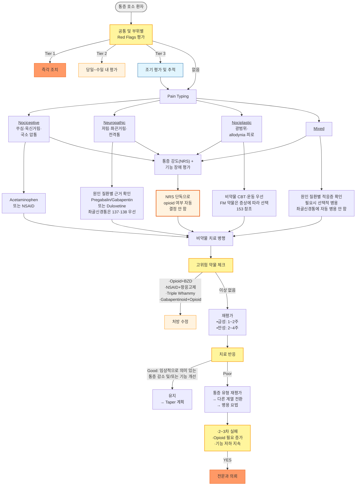
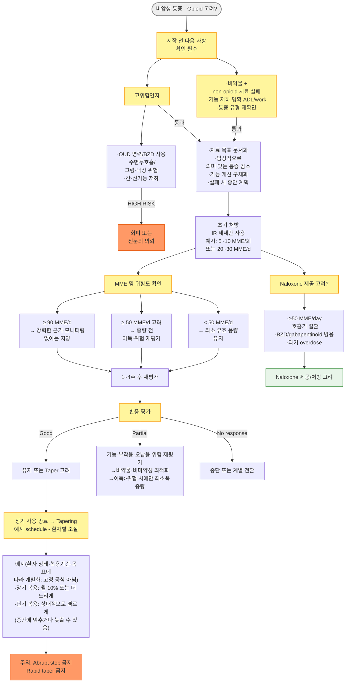

# 통증 Pain

## <mark style="color:green;">일반 사항</mark>

#### <mark style="color:$primary;">통증 발생의 기본 원리</mark>

* 급성 통증은 조직 손상 또는 손상 위협을 알리는 보호적 신호로, 다음 단계를 거쳐 발생함
  * 전환(transduction) : 유해 자극(기계적·열적·화학적 손상)이 말초 nociceptor를 자극하여 전기 신호로 전환
  * 전달(transmission) : Aδ섬유(날카롭고 국소적인 통증)와 C섬유(둔하고 지속적인 통증)를 통해 척수 후각으로 전달된 후, 척수시상로를 거쳐 뇌로 전달
  * 조절(modulation) : 척수 및 하행 억제 경로(노르에피네프린·세로토닌 매개)에서 신호가 증폭되거나 억제됨
  * 인지(perception) : 대뇌피질에서 비로소 '통증'으로 인식되며, 이 단계에서 불안·과거 경험·파국화 등 정서적·인지적 요소가 실제 통증 경험에 영향을 줌
* 만성 통증은 이 경로 자체가 변화하여, 원래의 유해 자극이 약하거나 사라져도 통증이 지속·증폭되는 상태 (☞ 아래 Central sensitization 참조)
* 각 단계에 작용하는 진통제의 원리는 아래 약물 치료 > 진통제의 작용 원리 참조

### <mark style="color:orange;">만성 통증</mark>

* ＞3개월 지속 또는 재발하는 통증 <mark style="color:$info;">\[ICD-11\]</mark>


ICD-11은 만성 통증을 다음의 두 범주로 구분하며, 이 구분은 "통증=증상"이 아닌 "통증=독립 질환"으로 인식의 전환을 반영.\
• **Chronic primary pain** : 다른 질환으로 설명되지 않는 통증, 통증 자체가 독립적 질환. 예: 섬유근통, 만성 원발성 요통, 복합부위통증증후군\
• **Chronic secondary pain** : 다른 기저질환에 의해 발생하는 통증. 예: 암성 통증, 수술 후 만성 통증, 신경병증성 통증



**Central sensitization (중추 감작)**\
척수·뇌의 통각 처리 과정이 증폭되어 말초 자극에 비해 과도한 통증, 이상통증(allodynia), 통각과민(hyperalgesia) 등이 나타날 수 있음.\
일부 만성 통증, 특히 nociplastic component가 큰 통증에서 중요한 병태생리 기전임.\
이 개념을 환자에게 적절히 설명하면 파국화 방지 및 비약물 치료(CBT·운동) 수용도를 높이는 데 도움이 될 수 있음.\
단, 모든 만성 통증을 중추 감작으로 설명할 수는 없음.


### <mark style="color:$danger;">🚩 Red Flags!</mark>


통증의 강도만으로 응급도를 판단하지 않음.\
통증 부위와 관계없이 먼저 생리적 불안정, 급성 혈관·신경계 사건, 중증 감염, 출혈·외상 및 장기 폐색·파열 가능성을 평가.\
Red flag가 없더라도 임상적으로 중증 질환이 의심되면 해당 부위별 챕터에 따라 추가 평가.\
저혈압·의식 변화·호흡수 증가·저산소증 등은 통증의 원인과 무관하게 중증질환 가능성을 높이므로, 통증 평가에서 활력징후와 의식 수준을 우선 확인함.\
암 병력, 체중 감소, 야간 발한 등은 단독으로 응급 상태를 결정하지는 않지만, 통증의 지속·진행 및 다른 임상 소견과 결합하면 조기 원인 평가가 필요할 수 있음.


<mark style="color:$danger;">**즉각 조치**</mark>

* 저혈압·쇼크 징후, 저산소증·심한 호흡곤란, 청색증, 의식 변화 또는 실신 등 생리적 불안정 `쇼크` `호흡부전` `순환 붕괴`
* 갑자기 시작되어 수초\~수분 내 최고 강도에 도달한 이전과 다른 통증, 특히 흉부·등·복부·두부 통증 `ACS` `대동맥 박리` `지주막하출혈` `장기 파열/천공`
* 통증과 함께 새로 발생한 편측 마비, 언어·시야 장애, 보행 불능, 경련 또는 의식 변화 `뇌졸중` `경련성 질환`
* 흉부·상복부·등·턱·팔 통증에 호흡곤란, 식은땀, 오심 또는 실신이 동반되는 경우 `ACS` `대동맥 박리` `폐색전증`
* 갑작스러운 사지 통증과 창백·냉감·맥박 저하·감각 또는 운동 저하 `급성 사지 허혈`
* 진찰 소견에 비해 현저히 심한 통증, 빠르게 증가하는 부종·긴장 또는 신경혈관 이상 `구획 증후군`
* 복막 자극 징후, 토혈·혈변 등 활동성 출혈, 박동성 종괴 또는 장기 파열·폐색이 의심되는 소견 `복막염` `소화관 출혈` `대동맥류 파열` `장 폐색/천공`
* 중증 외상 후 통증과 출혈, 변형, 신경·혈관 이상 또는 활력징후 불안정 `중증 외상` `골절/탈구` `혈관 손상`
* 새로 발생한 배뇨 곤란·요저류·요실금·변실금 또는 직장 충만감 소실, 회음부·안장 부위 감각 저하, 항문 괄약근 긴장도 저하, 또는 급속히 진행하는 양측 하지 근력 저하 `마미증후군` `척수 압박`
  * 항문 괄약근 긴장도 저하는 마미증후군을 시사할 수 있으나 단독 진단 소견은 아니며, 정상이라고 해서 마미증후군을 배제할 수 없음 - 직장수지검사로 평가한 항문 긴장도는 진단 정확도가 낮고 위음성으로 인한 잘못된 안심의 위험이 있음. 배뇨·배변 장애나 안장 부위 감각 변화 중 한 소견만 있어도 임상적으로 의심해야 하며, 단일 소견이 정상이라는 이유만으로 배제하지 않음
* 진통제·opioid 사용 후 호흡 저하 또는 의식 저하 `Opioid 과다복용` `호흡억제`

<mark style="color:$warning;">**당일\~수일 내 평가**</mark>

* 발열·오한·전신 상태 저하와 함께 발생한 새롭거나 심한 국소 통증 `중증 감염` `패혈증`
* 단관절의 급성 발적·열감·부종, 빠르게 확산하는 피부·연조직 염증 또는 괴사성 감염 의심 `화농성 관절염` `괴사성 근막염` `봉와직염`
* 새로 발생하거나 진행하는 객관적 근력 저하, 보행 장애 또는 신경학적 결손 `신경학적 결손` `척수/신경근 압박`
* 지속적인 구토, 경구 섭취 불가, 탈수, 소변·대변·가스 배출 장애 `장 폐색` `탈수/전해질 이상`
* 임신 또는 산후 기간에 발생한 새롭고 심한 두통·흉통·복통·골반통 `자간전증` `폐색전증` `자궁외 임신` `산과적 응급`
* 항응고제 복용 중 발생한 새롭고 심한 원인 불명 통증 또는 경미한 외상 후 지속되는 통증 `출혈` `혈종`
* 면역저하, 활동성 암, 정맥 주사 약물 사용, 최근 수술·침습적 시술·균혈증이 있는 환자의 새롭고 지속적인 통증 `기회감염` `농양` `암 전이/재발`
* 고령·골다공증 환자의 외상 후 심한 통증 또는 체중 부하 불능 `골다공증성 골절`

<mark style="color:$info;">**조기 평가 및 추적**</mark>

* 적절한 초기 치료에도 호전되지 않거나 점차 악화하는 통증 `진단 재평가 필요`
* 설명되지 않는 체중 감소, 야간 발한, 지속되는 발열·피로와 동반된 통증 `악성 종양` `만성 감염`
* 휴식·야간 통증이 지속되면서 악성 종양, 감염 또는 염증성 질환의 위험 요인이 동반된 경우 `악성 종양` `감염` `염증성 질환`
* 활동성 암 병력 또는 과거 암 치료 부위에 발생한 새롭거나 진행하는 통증 `암 재발/전이`
* 반복되는 원인 불명 통증 또는 통증과 함께 기능·보행·수면·일상생활이 계속 저하되는 경우 `만성 통증 증후군`
* 지속하거나 확대되는 감각 이상·방사통 또는 새로운 자율신경계 이상 `신경병증성 통증` `자율신경계 이상`

## <mark style="color:green;">진단</mark>

* 통증 자체를 확진하는 단일 검사는 없으며, 병력·신체검사·평가 척도·통증 형태 분류의 조합으로 접근
* 평가 항목 : 병력, 신체검사, bio-psycho-social 평가, 통증 형태(neuropathic, nociceptive, or mixed), 중증도, 기능에 대한 영향 등
  * 통증 상태나 기저질환이 변화할 때는 더 자주 재평가
* 영상 검사 등은 통증 자체의 진단이 아닌 원인 및 심각한 문제 감별 목적으로 고려

#### <mark style="color:$primary;">통증 강도 평가 척도</mark>

* 환자로 하여금 통증 정도를 표현하도록 함
* 수치 평가 척도(Numeric Rating Scale, NRS) : 0("통증 없음")\~10("상상할 수 없는 극심한 통증") 숫자 중 현재 통증 강도를 선택; 구두로 즉시 측정 가능하여 임상에서 가장 널리 사용됨
* 시각적 아날로그 통증 스케일(Visual Analogue Scale, VAS) : 100 ㎜ 눈금자에 통증이 없으면 0 ㎜ 지점에, 극심한 통증이 있으면 100 ㎜에 표시

<figure><figcaption><p><strong>시각적 아날로그 통증 스케일(Visual Analogue Scale, VAS)</strong></p></figcaption></figure>

### <mark style="color:orange;">통증 유형(기전) 분류</mark>

<mark style="color:cyan;">**통증 기전(mechanism)에 따른 분류**</mark>

* nociceptive / neuropathic / nociplastic / mixed : 약물 선택을 결정하는 주요 요소 중 하나이며, 원인·중증도·기능 장애·동반 질환·신·간기능·환자 위험도를 함께 고려하여 처방을 결정함

1. **침해수용성(nociceptive) 통증**
   * 실제 조직 손상에 의해 발생
   * 쑤심, 욱신거림, 국소적 압통
   * 예) 관절염, 근육통, 외상, 수술 후 통증
2. **신경병증성(neuropathic) 통증**
   * 체성감각신경계(somatosensory nervous system)의 병변 또는 질환에 의해 발생
   * 작열감, 찌르는 듯한 통증, 전격통, 감각 저하 또는 과민; CRPS 등 일부 신경병증성 통증에서는 피부 온도·색 변화 등 자율신경계 소견이 동반될 수 있음
   * 예) radiculopathy/radicular pain with neuropathic features, diabetic peripheral neuropathy, 대상포진후신경통, 삼차신경통
   * 통증 기전의 분류가 특정 약제의 효과를 보장하지 않음. 좌골신경통·요추 신경근성 방사통에는 일반 신경병증성 통증의 약물 권고를 그대로 적용하지 않음(137·138 참조)
3. **노시플라스틱(nociplastic) 통증**
   * 통증을 유발할 만한 실제 또는 잠재적 조직 손상의 명확한 증거가 없고, 체성감각계의 병변이나 질환으로 설명되지 않으면서, 통각 처리(nociceptive processing)의 변화 소견이 있는 통증
   * nociplastic mechanism은 nociceptive 또는 neuropathic mechanism과 동시에 존재할 수 있음(예: 만성 요통, 골관절염, 암성 통증 일부에서도 nociplastic component 동반 가능)
   * 광범위한 통증, 이상통증(allodynia), 통각과민, 피로·수면 장애·인지 기능 저하 동반
   * 예) 섬유근통, 만성 원발성 요통, 과민성 장증후군(IBS), 만성 골반통
   * 임상 양상 및 병력으로 진단 (✽DN4/painDETECT는 neuropathic pain 요소 평가 도구이며, nociplastic pain을 진단하거나 배제하는 도구는 아님)
4. **복합성(mixed) 통증**
   * 둘 이상의 기전이 함께 작용
   * 예) 척추관 협착증은 nociceptive·neuropathic 요소가 함께 관여할 수 있으며, 만성 요통에는 nociplastic 요소도 동반 가능; 기전 분류만으로 gabapentinoid 병용을 결정하지 않음
   * 약물도 관여 기전에 따라 병용

<mark style="color:cyan;">**임상 phenotype(원인·양상)에 따른 분류**</mark>

* 근육통·염증성·기계적/압박성 등 : 대부분 nociceptive mechanism에 속하는 하위 유형이며, 원인 평가와 치료 선택을 보조하는 임상적 분류임 - 약물 선택은 phenotype만이 아니라 원인·기전·위험도와 함께 결정함

1. **근육(muscle) 통증**
   * 근육 조직의 긴장, 손상 또는 염증으로 인해 발생하는 둔하고 쑤시는 통증
   * 압통, 활동 시 악화, 휴식 시 호전
   * 예) 긴장성 근육통, myofascial pain syndrome, 경추·요추 주변 근육통
2. **염증성(inflammatory) 통증**
   * 통증 부위의 발열, 발적, 부종
   * 예) 관절염, 감염, 손상, 수술 후 통증
3. **기계적/압박성(mechanical/compressive) 통증**
   * 활동 중 악화, 휴식 시 호전
   * 예) 목/허리의 근육·인대의 strain or sprain, disks or facet의 변성, 압박 골절

#### <mark style="color:$primary;">선별 도구</mark>

* neuropathic 요소는 [DN4](https://pmc.ncbi.nlm.nih.gov/articles/PMC4740539/)(4점 이상 시 가능성 높음)·[painDETECT](https://www.jkna.org/upload/pdf/jkna-39-2Suppl-24.pdf)로 평가; nociplastic pain은 이 도구들로 진단 또는 배제하지 않고 임상 양상·병력으로 판단

***



<p align="center"><strong>통증 관리 알고리듬</strong></p>

<p align="center"><em><mark style="color:$info;">저자 재구성 (참고 문헌: WHO Analgesic Ladder, CDC Clinical Practice Guideline for Prescribing Opioids for Pain 2022, 대한통증학회 아편유사제 처방지침 2024 등)</mark></em></p>

***

## <mark style="background-color:$warning;">Management</mark>

### <mark style="color:orange;">치료 방침</mark>

#### <mark style="color:$primary;">일반 치료 원칙</mark>

* 환자 맞춤 치료 : 모든 환자에게 일률적으로 적용할 수 있는 통증 완화 치료법은 없으며 환자마다 치료에 대한 반응이 다름
* 동반된 문제를 함께 치료하는 것이 효과적임, 특히 정신적 요소를 평가하고 치료함 (☞ [신체증상장애](../221_/031_-somatic-symptom-disorder.md))
* 통증 치료에서는 위약 효과가 적지 않으므로 치료 효과 평가 시 고려, 이를 치료에 활용할 수도 있음
* 치료 약제의 효과 부족 시 단순한 증량 또는 같은 계열의 약제를 추가하는 것보다 다른 계열의 약을 추가하는 것이 일반적으로 효과적이며 부작용이 적음
* 압박 또는 약물(예: 항암제, 항생제)에 의해 증상이 악화되는 경우는 이러한 치료를 중지

#### <mark style="color:$primary;">만성 통증 치료 원칙</mark>

* 통증의 완전 제거보다 일상 기능 회복(보행, 수면, 사회 활동, 직업 복귀)을 치료 목표로 설정
* 비약물 치료 우선 : 운동, CBT(인지행동치료), 교육, 물리치료
* 적절한 오피오이드 사용 : 암성 통증에서는 적극적 사용 권장. 비암성 통증에서는 신중히 선택, 다른 치료 먼저 시도; 시작 전 충분한 평가, 최소 유효 용량, 최단 기간 적용
* 생물심리사회적 모델 : 신체, 심리(우울, 불안, 파국화), 사회적 요인(직업, 가족 환경, 보상 문제)을 통합 고려
* 다학제 접근 : 복잡한 만성 통증이나 치료에 반응이 불충분한 경우 협진(마취과·신경과·정신건강의학과·재활의학과 협진) 고려

## <mark style="color:green;">비-약물 치료 및 재발 예방</mark>

* 균형 잡힌 건강한 식사
* 적정 체중 관리
* 가능한 한 활동 유지 또는 점차 활동량을 늘림, 규칙적인 적절한 운동 (☞ [운동 지침](../231_/216_-physical-activity-guideline.md))
* 금연
* 온/냉찜질, 물리 치료, chiropractic, 침, 근육 강화 및 이완 운동
  * 온/냉찜질·chiropractic·침은 근거 수준이 낮거나 논란이 있음(보조적 수단으로 활용)
* 인지행동 요법, 요가, 심호흡, mindfulness

- [ ] 비타민 D : 결핍(25(OH)D ＜20 ng/㎖)과 근골격계 통증·섬유근통의 연관성이 보고되나, 결핍이 없는 환자에서 통증 목적의 routine supplementation은 효과가 입증되지 않아 권고하지 않음; 만성 통증 환자에서 혈중 25(OH)D 측정 후 결핍이 확인된 경우에만 보충 고려

* 통증의 파국화(catastrophizing) 방지를 위한 상담
  * 통증을 실제보다 더 위협적인 것으로 과장하고(magnification), 반복적으로 되새기며(rumination), 스스로 조절할 수 없다고 믿는(helplessness) 파국화를 교정함
  * 일부 만성 통증에서는 신경계의 통증 처리 변화가 통증의 지속과 증폭에 관여할 수 있음을 설명(모든 만성 통증이 이에 해당하는 것은 아님) - 통증이 곧 진행 중인 조직 손상을 의미하지는 않는다는 점을 이해시킴
  * Hurt vs Harm : "아픈 것(hurt)이 곧 몸이 손상(harm)되는 것은 아니다"라는 인식을 심어 주어 공포-회피 반응(fear-avoidance response) 차단, 과장된 표현 교정

<table><thead><tr><th width="322">Hurt (아픈 느낌)</th><th>Harm (실제 손상)</th></tr></thead><tbody><tr><td>예민해진 신경계가 보내는 신호</td><td>조직이 실제로 파괴되는 상태</td></tr><tr><td>움직여도 대개 안전함</td><td>red flag 동반 시에만 의심</td></tr><tr><td>활동을 점진적으로 늘려 완화 가능(pacing*)</td><td>'절대안정'으로 오히려 악화될 수 있음</td></tr></tbody></table>

_\*Pacing : 통증이 있어도 감당할 수 있는 수준의 활동을 점진적으로 늘려 자기 효능감을 회복시킴_

1. _Pt. "허리가 끊어질 것 같아요" - Dr. "허리 근육이 많이 긴장해서 예민한 상태군요."_
2. _Pt. "이러다 평생 못 걸으면 어쩌죠?" - Dr. "오늘은 컨디션이 좋지 않네요. 하지만 우리는 조금씩 움직임을 늘려갈 계획입니다."_
3. _Pt. "약 없이는 한순간도 못 버텨요." - Dr. "약은 통증 조절의 도구 중 하나입니다. 호흡과 이완 요법도 함께 사용해 봅시다."_

## <mark style="color:green;">약물 치료</mark>

#### <mark style="color:$primary;">진통제의 작용 원리</mark>

* 통증 경로에 대한 작용 : 진통제는 통증의 발생·전달·조절·인지 과정에 작용하여 통증을 완화함. 대부분 통증을 유발한 근본 원인(조직 손상, 감염, 종양, 신경 압박 등)을 직접 제거하지는 않지만, NSAID처럼 염증 반응도 억제하는 약제가 있음
  * NSAID : COX 억제 → prostaglandin 합성 감소 → 말초 통각수용기의 민감화 및 염증 반응 완화; 중추 작용도 진통에 기여함
  * Acetaminophen : 주로 중추 작용을 통해 진통·해열 효과를 나타냄. 정확한 작용 기전은 완전히 규명되지 않았으며, 말초 소염 효과는 미미함
  * 국소마취제·일부 항경련제(gabapentinoid, carbamazepine) : 신경세포막 Na⁺/Ca²⁺ 채널 차단 → 신호 전달 억제 (전달 단계 차단)
  * Opioid : 척수·뇌의 opioid 수용체에 결합하여 통증 신호 전달을 억제하고 통증에 대한 정서적 반응을 완화 (전달·인지 단계 차단)
  * 항우울제(TCA, SNRI) : 하행 억제 경로의 노르에피네프린·세로토닌 재흡수 억제 → 내인성 통증 조절 기능 강화 (조절 단계 강화)
* 진통제로 증상이 조절되더라도 근본 원인 질환에 대한 평가·치료는 별도로 이루어져야 하며, "진통제에 반응한다"는 사실만으로 심각한 원인 질환을 배제할 수는 없음


**NSAID의 소염·해열 작용** : NSAID는 COX를 억제하여 prostaglandin 생성을 줄임으로써, 통각수용기의 민감화를 낮추는 동시에 국소 염증 반응을 억제하여 발적·열감·부종을 완화함. 또한 중추의 PGE₂ 생성을 줄여 발열 시 높아진 시상하부의 체온 설정점을 낮추는 해열 작용을 나타냄. 이러한 소염·해열 효과가 감염·자가면역질환 등 근본 원인의 제거 또는 손상 조직의 회복 촉진을 의미하지는 않음.


#### <mark style="color:$primary;">통증 양상별 약물 선택</mark>

* 통증의 성격(침해수용성 vs 신경병성)을 구분하고, 통증의 강도(10점 척도)에 따라 단계적으로 접근
* "Start Low, Go Slow"
  * 고령, frailty, 신·간기능 저하, CNS depressant 병용 등 약물 부작용 위험이 높은 환자에서는 저용량으로 시작하여 서서히 증량; 신장 배설 약물은 신기능에 따라 용량 조절
  * 기능적 목표 설정 : 환자에게 "통증 때문에 못 하던 어떤 활동을 다시 하고 싶은지"를 물어 구체적 목표를 설정
  * 병용 금기 약제 주의 : 예) benzodiazepine 복용 여부를 확인하여 마약성 진통제 처방 시 호흡 억제 위험을 차단

<mark style="color:cyan;">**Step 1. 통증 유형 분류 (Pain Typing)**</mark>

* 통증 기전(mechanism) 분류 및 선별 도구는 위 `진단 > 통증 유형(기전) 분류` 참조
* 분류 결과에 따라 Step 2의 약물 선택이 결정됨

<mark style="color:cyan;">**Step 2. 강도 및 유형별 약물 선택**</mark>

**통증 유형별 처방**

<table data-search="false"><thead><tr><th width="216">유형</th><th width="264">1차 선택</th><th>비고</th></tr></thead><tbody><tr><td>Nociceptive (경증)</td><td>Acetaminophen, 외용 또는 경구 NSAID 등</td><td>원인·염증 여부·환자 위험도에 따라 선택</td></tr><tr><td>Nociceptive (중등증~중증)</td><td>원인 질환별 non-opioid 치료 우선; 선택적 단기 opioid</td><td>통증 강도만으로 결정하지 않으며 OA·만성 요통·만성 좌골신경통은 해당 지침 우선</td></tr><tr><td>Neuropathic</td><td>Pregabalin/gabapentin 또는 Duloxetine</td><td>삼차신경통: carbamazepine; 좌골신경통·요추 신경근성 방사통은 질환별 권고 우선(137·138)</td></tr><tr><td>Nociplastic</td><td>비약물(CBT·운동) 우선<br>섬유근육통: SNRI(duloxetine·milnacipran), 저용량 amitriptyline 또는 pregabalin 중 증상 양상에 따라 선택(☞ 153)</td><td>NSAID 단독 효과 제한적. FM 약물은 약한 찬성 권고이며 amitriptyline은 허가 외 사용; 다른 nociplastic 통증에는 질환별 근거 적용</td></tr><tr><td>Mixed</td><td>원인 질환별 근거에 따라 선택적 병용</td><td>각 요소의 적응증·효과·위험 확인; 좌골신경통·요추 신경근성 방사통에 자동 적용하지 않음(137·138)</td></tr><tr><td>염증성</td><td>NSAID (선택제는 위험인자 고려)</td><td>-</td></tr><tr><td>근육통</td><td>NSAID ± 단기 근이완제</td><td>약제별 허가 투여기간 내 최단기간</td></tr></tbody></table>

**위험인자별 NSAID 선택**

<table><thead><tr><th width="144">위험인자</th><th>우선 선택</th></tr></thead><tbody><tr><td>GI risk ↑</td><td>Celecoxib + PPI</td></tr><tr><td>CV risk ↑</td><td>확립된 심혈관질환·심부전에서는 경구 NSAID 회피 우선. 위험인자만 있고 경구제가 불가피하면 naproxen을 상대적으로 고려하되 GI·신장·CV 위험은 남음. 국내 쎄레브렉스는 확립된 허혈성 심장질환·말초동맥질환·뇌혈관질환 및 NYHA II–IV 울혈성 심부전에서 투여 금기임</td></tr><tr><td>Renal risk ↑</td><td>외용 NSAID 우선</td></tr><tr><td>고령 / 다약제</td><td>외용 NSAID 우선 → 경구 최소 용량</td></tr></tbody></table>

**침해수용성 통증**


통증 강도만으로 opioid를 자동 선택하지 않음. NRS(10점 척도) ≥7이라고 곧바로 opioid를 선택하지 않으며, 원인·통증 기전·기능 장애·예후·약물 위험도를 종합하여 결정함.


* 1차 : non-opioid(acetaminophen 또는 NSAID) ± 보조 치료; aspirin을 통상적인 1차 진통제로 일률 선택하지 않음
  * 침해수용성 통증에서 acetaminophen과 NSAID는 기전이 달라 병용 시 진통 효과가 더해질 수 있으나 각 성분의 총량과 위장관·신장·간·심혈관 위험인자를 확인; NSAID 두 종류의 병용은 피함
* 비-opioid 치료로 조절되지 않고 기능 장애가 명확한 경우 : NSAID ± weak opioid 신중 병용 (tramadol 포함 - opioid와 동일한 주의 적용)
  * OA·만성 요통·만성 좌골신경통에서는 비마약성 치료 실패만으로 opioid를 자동 추가하지 않으며, 해당 질환 지침에 따라 진단·재활·수술 또는 전문의 평가 필요성을 재검토함
* 중증이거나 비-opioid 치료 실패, 기능 장애가 심각한 경우 : opioid(oxycodone, hydromorphone, tapentadol(신경병성 혼합 시 유리)) ± non-opioid ± 보조 치료
* WHO 3단계 진통 사다리(analgesic ladder)
  * \[1단계] 비마약성 진통제(± 보조제) → \[2단계] 약한 opioid(± 비마약성 진통제 ± 보조제) → \[3단계] 중등도\~중증 opioid(± 비마약성 진통제 ± 보조제)
  * WHO가 암성 통증(cancer pain) 완화를 위해 제시한 모델이며, 비암성 통증에는 그대로 적용하지 않음 - 비암성 통증은 통증 강도만이 아니라 원인·기전·기능 장애·약물 위험도를 함께 고려하는 개별화된 접근이 원칙

**신경병성 통증**

* 1차 (1st line) : gabapentinoid(pregabalin, gabapentin) 또는 항우울제 (SNRI: duloxetine / TCA: amitriptyline - 고령에서는 SNRI 우선 고려) 중 하나를 선택
  * 좌골신경통·요추 신경근성 방사통에는 일반 신경병증성 통증의 약물 권고를 그대로 적용하지 않음(137·138 참조); OA 자체·섬유근육통·특발성 야간 다리 경련도 각각의 질환별 근거를 우선함
  * 삼차신경통(trigeminal neuralgia)에서는 carbamazepine, oxcarbazepine이 1차 선택제
* 반응 불충분 시 : 다른 1차 약제로 전환을 우선 고려
  * 부분 반응 시 선택적 병용을 고려할 수 있으나 질환별 근거·상호작용·급여를 구분함. 예: pregabalin + duloxetine; 섬유근육통에서는 두 약제의 병용 급여가 인정되지 않음(153 참조)
  * tramadol은 급성 rescue가 필요한 경우로 제한
* opioid 장기 사용은 일반적으로 권장하지 않음
* 중증/난치성 통증에서는 전문의(통증클리닉) 의뢰 고려
* 국소 lidocaine patch : 대상포진후신경통(PHN)에서 2nd-line
* botulinum toxin : PHN·삼차신경통 등 일부 적응증에서 고려

<mark style="color:cyan;">**Step 3. 재평가 및 조정 (Re-evaluation)**</mark>

* 일반 진통제(NSAID 등)는 급성 1\~2주, 만성 2\~4주 이내 반응 평가
* gabapentinoid 등 titration이 필요한 약제는 충분한 적정 기간(수 주) 고려
* opioid는 시작 또는 증량 후 1\~4주 이내 재평가
* 목표 달성(약 30% 이상의 clinically meaningful pain reduction 및/또는 환자에게 중요한 기능 개선) 시 최소 유효 용량 유지 및 점진적 감량(tapering) 계획
* 목표 미달 (효과 부족 또는 부작용) 시
  1. 통증 유형 재검토 : 신경병성 요소가 간과되지 않았는가?
  2. Opioid 회전 : 계산된 equianalgesic dose보다 감량하여 시작 (☞ 아래 `Opioid 처방 원칙 > Opioid 회전` 참조)
  3. 중재적 시술 고려 : 신경 차단술, IMS(근육 내 자극 치료) 등 비약물적 치료 병행

### <mark style="color:orange;">Acetaminophen</mark>

* 대상 : 비염증성 통증
  * 엉덩이/무릎 관절염에 대해서는 지속 효과가 짧으며, 요통에 대해서는 효과가 적음
* 주의 : 간/신 장애, 알코올 남용
  * 출혈경향은 수록 국내 제품 허가상 신중 투여 대상이므로 개별 평가하며, NSAID와 동일한 혈소판 억제 위험으로 설명하지 않음
  * aspirin/NSAID 과민반응 환자에서는 고용량 acetaminophen에서도 교차반응 가능; aspirin 천식 또는 그 병력은 수록 국내 제품의 투여 금기와 구분하여 적용
* 부작용 : 발진, 간/신 독성
  * 반복 투여 시 간 효소 수치 상승 가능. 건강한 성인에서도 4 g/d 반복 투여 연구에서 ALT 상승이 관찰됨; 위험요인·용량·사용기간에 따라 간기능 평가 <mark style="color:$info;">\[Watkins et al., JAMA 2006\]</mark>
  * 통상 용량에서 NSAID보다 위장관 궤양·출혈 위험이 낮음. 고혈압 환자에서 4 g/d를 2주간 투여한 PATH-BP 무작위시험에서는 위약 대비 수축기혈압이 약 5 ㎜Hg 상승함; 반복적인 고용량 사용 시 혈압에 유의하며 단기간의 간헐적 사용에 같은 결과를 그대로 적용하지 않음 <mark style="color:$info;">\[PATH-BP 2022\]</mark>
* 약물 상호 작용 : warfarin(INR 상승; 아래 참조), isoniazid, CYP450 대사 약물
* Warfarin 병용 : 수일 이상 규칙적으로 복용하면 INR 상승 가능성이 있어 INR을 확인하고 필요 시 추적 간격을 조정; 특히 2 g/d 이상 반복 투여 시 유의 <mark style="color:$info;">\[Zhang et al., Eur J Clin Pharmacol 2011\]</mark>
* 국내 수록 제품의 주요 금기 : 소화성궤양, 심한 간장애·심한 신장애·심한 심장기능저하, aspirin 천식 또는 그 병력, 바르비탈계 약물·삼환계 항우울제(TCA) 복용 환자 등. <mark style="color:blue;">\[타이레놀정500㎎·타이레놀8시간이알서방정]</mark>과 <mark style="color:blue;">\[세토펜현탁액]</mark>의 해당 금기를 일반적인 감량·신중 투여와 구분함
* 성인 속방형 : 500\~650 ㎎ q4\~6h PRN 또는 1,000 ㎎ q6h PRN; 모든 acetaminophen 함유 제품을 합산하여 일반 성인의 허용 최대 4 g/d. 반복·장기 사용에서는 3 g/d 이하를 보수적으로 권장
  * 고령·쇠약·저체중·영양불량·지속적인 과음 등에서는 위험요인의 정도·체중·사용기간에 따라 감량; 고령 또는 신기능 저하만을 이유로 일률적인 2 g/d 상한을 적용하지 않음
  * 간경변에서는 임상 지침상 통상 최대 2 g/d 범위로 제한. 단, 심한 간장애·심한 신장애는 수록 국내 제품의 투여 금기이므로 감량 사용과 구분 <mark style="color:$info;">\[AASLD 2022\]</mark>
  * 서방형 : 12세 이상에서 650 ㎎ × 2정 q8h PRN; 24시간 최대 6정(3,900 ㎎) <mark style="color:blue;">\[타이레놀8시간이알서방정]</mark>; 씹거나 쪼개거나 분쇄하지 말고 그대로 삼킴. 2정씩 1일 3회는 3,900 ㎎이므로 3 g/d 이하로 제한하려는 환자에게는 맞지 않음
  * 감기약·두통약·수면제 등에도 포함된 경우가 많으므로 주의 - 누적 용량으로 계산

### <mark style="color:orange;">NSAID</mark>

* 아래 [NSAIDs 섹션](001_-pain.md#nsaids) 참조

### <mark style="color:orange;">Opioids</mark>

* 대상 : non-opioid analgesics에 반응하지 않는 환자에서 opioid의 위험(예: 중독, 과용, 사망)에 비하여 이득이 더 큰 경우에 적용
* 부작용 : 어지럼, 소양증, 낙상(특히 고령자), 진정, 구역, 위장관 운동 저하에 의한 변비, 소변 저류
  * 고령에서는 NSAID(GI·신장·심혈관 위험)와 opioid(낙상·섬망·호흡억제·사망 위험) 모두 고위험 약물이므로, 환자의 GI·renal·CV·낙상 위험을 종합 고려하여 상황별로 선택; 가능하면 외용 NSAID 또는 acetaminophen을 우선
  * 오피오이드 유발 변비(opioid-induced constipation) : 내성이 생기지 않으므로 오피오이드 시작과 동시에 하제를 선제적으로 처방하는 것을 고려
    * [삼투성 하제](../224_/073_.md#hyperosmotics) 우선 : PEG 제제 <mark style="color:blue;">\[미랄락스]</mark> 또는 lactulose <mark style="color:blue;">\[듀파락]</mark> - 복통 부작용이 적어 만성 통증 환자에 적합
    * 반응 부족 시 [자극성 하제](../224_/073_.md#stimulant) 추가 : sennoside <mark style="color:blue;">\[아락실]</mark>, bisacodyl <mark style="color:blue;">\[둘코락스]</mark>
* 주요 금기 : 유의한 호흡억제, 급성 또는 중증 기관지천식의 비감시 환경, 위장관 폐쇄/마비성 장폐색 등(약제별 허가사항 확인)
* 고위험·주의 : 중증 간·신기능 저하, 수면무호흡, 고령, 중증 두부손상, CNS depressant 또는 알코올 병용 등 - 약제 선택·용량 조절 및 모니터링 필요
* 주의(상대적 위험 요인) : 중등도\~중증 수면무호흡증에서는 opioid 사용을 가급적 피하거나 최소화하고, 불가피하면 호흡억제 위험을 면밀히 평가·모니터링
* 주의 : benzodiazepine 병용 시 집중력 저하, 낙상 증가 등의 위험이 있으므로 피함; 치료 시작 전 예상되는 결과에 대하여 주의 깊은 설명을 요함
* 단기 작용 약제를 선택하여 최소 유효 용량으로 시작, 시작 후 조기에 약물 반응을 평가
* 투여 기간 : 급성 통증에서는 예상되는 중증 통증 지속기간을 고려하여 최소 필요량만 처방; 흔한 비수술성 급성통증은 수일 이하로 충분한 경우가 많으며, CDC 2022는 절대적인 3일/7일 상한을 제시하지 않음(단, 중증 외상 등에서는 7일을 초과할 수도 있음); tramadol에도 동일하게 최소 필요량·최단기간 원칙 적용
* 약물 회전(opioid rotation) 시 계산된 equianalgesic dose보다 감량하여 시작 (☞ 아래 `Opioid 처방 원칙 > Opioid 회전` 참조)

- [ ] \[급여기준-일반원칙] [마약성진통제](https://www.hira.or.kr/rc/insu/insuadtcrtr/InsuAdtCrtrPopup.do?mtgHmeDd=20170901\&sno=1\&mtgMtrRegSno=0001)
  * 처방 일수 제한: 비암성 통증은 1회 처방당 최대 30일까지 급여 인정
  * 성분별 상한 용량 : 비암성 통증 시 아래 용량 초과분은 본인부담 100/100
  * 대상 약제 투여 용량 : oxycodone 60 ㎎/d, hydromorphone 24 ㎎/d, tapentadol 300 ㎎/d, fentanyl 패취제 37.5 ㎍/h/3d, morphine 경구제 90 ㎎/d

#### <mark style="color:$primary;">Tramadol</mark>

* 노르에피네프린·세로토닌 재흡수 억제 기전으로 신경병성 통증에 유리
* 작용 : 약한 opioid, SNRI action
* 대사 : CYP 2D6(major), 3A4(minor)
* 발작 역치 저하·세로토닌 증후군 주의; 경련 발생 위험이 있으므로 고령이나 간/신기능 저하자에서는 감량
  * 경도–중등도 간·신기능 저하에서는 용량·투여간격을 개별 조정하되, 중증 신장애·간장애는 트리돌캡슐의 국내 허가상 금기이므로 감량 투여와 구분함
  * MAOI, SSRI, SNRI, TCA 등 serotonergic 약물 병용 시 serotonin syndrome 및 발작 위험 증가
* 변비·요저류 등 opioid 작용이 있어, 진경제·TCA 등 항콜린 작용 약물과 병용 시 요저류·심한 변비·마비성 장폐색 위험이 증가할 수 있음; 고령자에서는 병용약의 항콜린 부담과 중추신경 억제가 겹쳐 착란·인지 저하가 생길 수 있으므로 병용 여부를 확인
* 용법 : 50 ㎎ → 필요시 증량 100 ㎎ bid\~qid <mark style="color:blue;">\[트리돌]</mark>
* acetaminophen 또는 NSAID 병용으로 효과 상승
  * <mark style="color:blue;">\[울트라셋]</mark> (acetaminophen 복합제)
  * <mark style="color:blue;">\[Seglentis]</mark> (celecoxib 복합제; 국내 미발매)

- [ ] Tramadol은 "약한 opioid"로 분류되지만 중독·의존, 과다 복용 및 호흡억제 위험이 있어 다른 opioid와 마찬가지로 주의가 필요함. 현재 우리나라에서는 마약류 관리에 관한 법률상 마약류로 분류되지 않은 전문의약품임

#### <mark style="color:$primary;">Codeine</mark>

* 국내 사용 제한적 (CYP2D6 다형성으로 효과 예측 어려움)
* CYP2D6 초고속 대사자에서는 모르핀 생성 증가로 중증·치명적 호흡억제 위험이 있음; 알려진 초고속 대사자에는 투여하지 않음
* 소아 연령 제한은 품목별 허가를 구분하여 적용. 마이폴캡슐은 국내 허가상 **12세 이하 투여 금기**이며, 13\~18세는 acetaminophen·ibuprofen 등 다른 진통제로 경감되지 않는 염증성 급성 중등도 통증에만 최대 3일 사용
  * 마이폴은 수유부 및 폐쇄성 수면무호흡증 치료를 위한 편도·아데노이드 절제술을 받은 18세 이하 환자에 투여 금기; 18세 미만의 비만·폐쇄성 수면무호흡증·중증 폐질환 환자에서는 회피
* 용법 : 성인 1회 20 ㎎, 1일 3회; 필요시 최소 6시간 간격으로 1일 4회까지, 최대 240 ㎎/d <mark style="color:blue;">\[인산코데인]</mark>
* 복합제 : 코데인인산염수화물 10 ㎎ + ibuprofen 200 ㎎ + acetaminophen 250 ㎎ <mark style="color:blue;">\[마이폴]</mark>
  * 발열·감기 증상으로 타이레놀·부루펜 등을 추가할 때 acetaminophen과 ibuprofen이 모두 중복될 수 있음; 복합제의 성분별 총량을 합산

#### <mark style="color:$primary;">Hydrocodone</mark>

* 복합제 : hydrocodone 5 ㎎ + acetaminophen 325 ㎎ <mark style="color:blue;">\[하이코돈]</mark>; acetaminophen 총량 합산

#### <mark style="color:$primary;">Oxycodone</mark>

* 용법 : 서방형은 최소 1주일 이상 매일 일정 용량의 속효성 opioid를 사용한 환자에서 전환 시 고려; 전환 용량은 기존 투여량·등가진통 용량·불완전 교차내성·환자 위험도를 반영하여 개별화 <mark style="color:blue;">\[옥시콘틴]</mark>
  * 비암성 통증 급여 인정 용량은 60 ㎎/d (허가상 최대용량과는 구분)

#### <mark style="color:$primary;">Tapentadol</mark>

* 작용(Dual-mechanism opioid analgesic) : μ-opioid receptor agonist + norepinephrine reuptake inhibition의 이중 기전; 통상적 SNRI 항우울제와는 다른 별도 분류
* 대상 : 지속적인 opioid 치료가 필요한 중등증\~중증 만성 통증; neuropathic component가 동반된 통증에서 고려 가능
* 장점 : 기존 opioid에 비하여 위장관 부작용(구역, 변비)이 적음
* 부작용 : 어지럼, 구역, 두통, 졸음
* 주의 : MAOI 병용 금기; SSRI/SNRI 병용 시 serotonin syndrome 위험
* 용법 : 서방형 50 ㎎ bid로 시작, 3일 간격으로 50 ㎎씩 증량 <mark style="color:blue;">\[뉴신타 서방]</mark>

#### <mark style="color:$primary;">Hydromorphone</mark>

* 비서방형 : 초기 2 ㎎을 통증 정도에 따라 4\~6시간마다 경구 투여; 환자 반응·체구에 따라 조절하며, 더 심한 통증에는 4 ㎎ 이상을 4\~6시간마다 투여; 내성이 생기거나 통증이 더 심해지면 점진적 증량 고려; 즉각적인 통증 조절이 필요한 심한 통증에서는 초기에 주사제 사용 <mark style="color:blue;">\[딜리드정/주]</mark>
* 서방형 : 국내 유통 제제 없음

#### <mark style="color:$primary;">Buprenorphine 패취제</mark>

* μ-opioid receptor partial agonist 및 κ-opioid receptor antagonist
* 신경병성 통증에 일부 근거, 신기능 저하 환자에서 상대적으로 유리
* 용법 : opioid-naïve 환자는 최저 용량 5 ㎍/h부터 시작하고 효과·과진정·호흡을 관찰하여 개별 증량; 7일마다 교체 <mark style="color:blue;">\[노스판 패취]</mark>. 기존 opioid 사용자의 전환 용량은 별도로 판단함(135 참조)
* 발열·중심체온 상승 또는 패치 부위의 외부 열 노출 시 흡수가 증가할 수 있어 진정·호흡억제를 관찰하고 필요 시 용량 조정. 패치 부위에 온찜질·전기장판 등 직접적인 열 노출을 피함
* [급여기준](https://www.hira.or.kr/rc/insu/insuadtcrtr/InsuAdtCrtrPopup.do?mtgHmeDd=20171101\&sno=1\&mtgMtrRegSno=0034) : NSAID의 최대 용량에도 반응하지 않아 마약성 진통제를 필요로 하는 심한 통증에 최대 20 ㎍/h(7일 부착)까지 인정. 1회 처방 당 최대 30일까지 인정

#### <mark style="color:$primary;">Fentanyl 패취제</mark>

* 지속적인 중등도\~중증 만성 통증에 국한하여 적용. opioid-tolerant 환자에 한하여 사용
  * opioid-naïve 환자 및 급성/간헐적 통증에는 사용하지 않음
* 용법 : 12, 25, 50, 100 ㎍/h 1매를 3일간 적용 <mark style="color:blue;">\[듀로제식디트랜스 패취]</mark>
* 발열·외부 열 노출로 흡수가 증가하여 과다 진정·호흡억제가 발생할 수 있음. 발열 시 사용 여부와 호흡·의식 상태를 확인하고 필요 시 용량 조정; 패치 부위에 온찜질·전기장판 등 직접적인 열 노출을 피함

***



<p align="center"><strong>비암성 통증 Opioid 시작·중단 프로토콜</strong></p>

<p align="center"><em><mark style="color:$info;">저자 재구성 (참고 문헌: CDC Clinical Practice Guideline for Prescribing Opioids for Pain 2022, 대한통증학회 아편유사제 처방지침 2024 등)</mark></em></p>

***

#### <mark style="color:$primary;">비암성 만성 통증에서 Opioid 처방 원칙</mark>

  (대한통증학회, 2024)

<mark style="color:cyan;">**기본 원칙**</mark>

* 병력 청취, 이학적 검사, 다양한 평가 도구로 환자 상태를 파악한 이후 꼭 필요한 경우에만 고려
* 치료 전 통증·기능·삶의 질에 대한 구체적·측정 가능한 목표를 설정
* 목표 미달 시 중단 고려 - 효과가 입증되지 않은 아편유사제의 관성적 지속 처방 방지
* 펜타닐 정제·패치제 처방 전 마약류 통합관리시스템([NIMS](https://www.nims.or.kr/))을 통한 최근 1년 투약 이력 확인은 법적 의무임(2024.6.14. 시행)
  * 졸피뎀 등 이후 확대 대상 성분은 해당 시점의 법적 의무 또는 확인 권고 여부를 구분하여 적용함(예: 메틸페니데이트·식욕억제제·졸피뎀은 권고 대상)

<mark style="color:cyan;">**Opioid 처방 전 고위험 환자 체크리스트**</mark>

* 다음 중 하나라도 해당 시 → 처방 재검토 또는 전문의 협진
  * eGFR ＜30 ㎖/min/1.73m²
  * 연령 ≥ 75세
  * 낙상 위험 (이전 낙상 병력, 균형 장애)
  * 우울증 또는 기타 정신질환
  * 수면무호흡증
  * benzodiazepine 또는 gabapentinoid 병용
  * 과거 opioid use disorder(OUD) 또는 물질사용장애 병력
  * 최근 감량·금단 후 재투여, 교도소 출소 등으로 내성이 감소한 상태(과다복용 위험 증가)

<mark style="color:cyan;">**처방 시작**</mark>

* 심한 급성 통증(＜1개월) : 속효성 제제를 최소 유효 용량으로 처방; 최소 2주마다 평가
* 아급성(1\~3개월) 및 만성(＞3개월) 통증 : 비아편유사제를 우선 고려. 불가피한 경우에만 사용
  * 초기 용량 예시 : 5\~10 MME(단일 용량) 또는 20\~30 MME/d - 개별 환자의 위험도·반응에 따라 조절
  * 50 MME/d 이상에서 과다 복용·사망 위험이 유의하게 증가하므로, 50 MME/d 도달·초과 전 이득·위험을 재평가
  * 치료 시작 또는 용량 증량 후 4주 이내에 이익과 위험을 재평가

<mark style="color:cyan;">**Naloxone 제공 또는 처방 제안 고려 기준**</mark>

* 다음 중 하나라도 해당 시 제공 또는 처방을 제안 <mark style="color:$info;">\[CDC 2022\]</mark>
  * MME ≥ 50/d
  * 호흡기 질환(COPD, 수면무호흡증) 동반
  * benzodiazepine 병용
  * 과거 opioid overdose 병력
  * 최근 감량·금단 후 재투여, 교도소 출소 등 내성이 감소한 상태
* 추가 위험 요인(CNS depressant 병용에 따른 호흡 억제 위험 증가)
  * gabapentinoid 병용

- [ ] 국내 naloxone 비강 스프레이의 일반 외래 가용성·공급 방식은 시점에 따라 확인이 필요함. 고위험 환자에서는 국내에서 실제 이용 가능한 제형과 접근 경로를 확인하여 naloxone 제공을 고려

<mark style="color:cyan;">**서방형/지속형 제제**</mark>

* 최소 1주일 동안 매일 일정 용량의 속효성 경구 opioid를 투여받은 환자에게만 고려
* 이익보다 위험이 큰 경우 감량 또는 중단을 고려. 갑작스러운 중단이나 급격한 감량은 피함

<mark style="color:cyan;">**감량/중단**</mark>

* 감량 속도는 환자의 임상 상황·복용 기간·치료 목표에 따라 개별화하며, 아래는 참고 가능한 예시일 뿐 고정된 공식으로 적용하지 않음
  * 1년 이상 복용 : 월 10% 또는 그보다 느린 감량이 더 잘 견뎌질 수 있음
  * 수주\~수개월 복용 : 주 10% 감량을 참고하되 원래 용량의 30%에 도달한 이후에는 더 느리게 조정 가능
* 급성 통증으로 단기 사용한 경우 (별도 기준, 마찬가지로 예시)
  * 1주 이상\~1개월 미만 : 2일마다 약 20%씩 감량
  * 3일 이상\~1주 미만 : 2일간 일일 용량을 50%로 감량 후 중단

<mark style="color:cyan;">**Opioid 회전**</mark> (Opioid rotation)

* 다음의 경우 고려 : 부작용 지속, 충분한 증량에도 효과 불충분, 신기능 저하로 졸음/신경 독성 발생
* 현재 opioid 총량을 바탕으로 대체 약물의 equianalgesic dose를 추정한 후 통상 25\~50%를 감량하여(즉 계산 용량의 약 50\~75%로) 시작; 부작용 및 효과를 관찰하며 개별 titration. Fentanyl·methadone 등은 단순 MME 비례 환산을 피함
  1. 불완전 교차 내성 : 기존 약물에 내성이 생겼더라도 새 약물에 대한 내성은 완전히 이전되지 않으므로 새 약물은 계산된 MME보다 적은 용량으로도 동등한 효과를 냄
  2. 예) 기존 opioid 총 60 MME/day 복용 중 회전 시 → 새 약물의 계산된 등가 용량(60 MME 상당)의 50\~75%인 약 30\~45 MME/day로 시작 후 반응을 보며 조정
  3. 등가용량 환산표의 불확실성 : MME 환산비는 개인차가 크고 근사치이므로 안전 마진을 두고 시작하는 것이 원칙임

<mark style="color:cyan;">**모니터링**</mark>

* 처음 처방 시 및 장기 처방 중 환자 처방 이력을 주기적으로 검토
* 적절한 용량 투여 여부 및 과다 복용 위험 약물과의 병용 여부를 지속 확인

<mark style="color:cyan;">**단회 투여 등가진통 환산표 (opioid rotation 참고용)**</mark>

* 아래 표는 **단회 투여 기준 등가진통 환산계수**이며, 위에서 언급한 만성 통증의 위험도 지표인 **경구 MME(1일 총 투여량 기준)와는 별개의 개념**임 - 정맥·경구·패치 등 투여경로가 섞여 있으므로 혼동하지 않음
* opioid rotation 시 처방 전환의 직접적인 등가 계산식으로 그대로 사용하지 않음. fentanyl 등은 단순 비례 환산이 특히 위험
* 불완전한 교차 내성과 개인별 약동학 가변성 때문에, 과다 복용을 피하기 위해 아래 환산계수로 계산된 용량보다 상당히 낮은 용량(통상 계산 용량의 50\~75%)으로 시작
* opioid-naive 여부, 투여경로, 신·간기능에 따라 실제 필요 용량이 크게 달라질 수 있음
* 이 환산계수는 아편유사제 사용장애(OUD) 관리와 관련된 용량 결정에는 적용 불가

<table data-full-width="true" data-search="false"><thead><tr><th width="154.631591796875">아편유사제</th><th width="275.78948974609375"></th><th width="108.9473876953125">환산계수¹⁾</th></tr></thead><tbody><tr><td rowspan="3"><strong>정맥 주사</strong><br><strong>(단회, 상호 등가)</strong></td><td>모르핀 (Morphine)</td><td>1.0</td></tr><tr><td>하이드로몰폰 (Hydromorphone)</td><td>6.6</td></tr><tr><td>펜타닐 (Fentanyl)</td><td>100²⁾</td></tr><tr><td rowspan="4"><strong>정맥 주사</strong><br><strong>→ 경구 전환</strong></td><td>모르핀 (Morphine)</td><td>3.0</td></tr><tr><td>하이드로몰폰 (Hydromorphone)</td><td>2.5~5.0</td></tr><tr><td>옥시몰폰 (Oxymorphone)</td><td>10</td></tr><tr><td>트라마돌 (Tramadol)</td><td>3.0</td></tr></tbody></table>

_¹⁾단회 투여 등가진통 용량 = 아편유사제의 용량(㎎) × 환산계수. 예) 단일 정맥 투여 : 모르핀 10 ㎎ ≒ 하이드로몰폰 1.5 ㎎(1.5 ㎎ × 6.6 = 10) ≒ 펜타닐 0.1 ㎎(0.1 ㎎ × 100 = 10). 모르핀 10 ㎎ 정맥 주사를 경구로 전환하면 경구 모르핀 30 ㎎ (☞_ [_계산기_](https://www.mdcalc.com/calc/10170/morphine-milligram-equivalents-mme-calculator)_)_\
_&#xB2;⁾단일 정맥 투여의 경우, 모르핀 10 ㎎은 펜타닐 0.1 ㎎ (100 mcg)과 유사하지만 만성적으로 펜타닐을 투여하는 경우 모르핀 10 ㎎은 펜타닐 0.25 ㎎ (250 mcg)과 유사_

_<mark style="color:$info;">Ref. 대한통증학회 아편유사제 처방지침 2024. 표</mark>_

### <mark style="color:orange;">항우울제</mark>

* 항우울제에는 항우울 작용과 별개의 진통 효과가 있음 (☞ [항우울제](../231_/213_-antidepressants-and-anxiolytics.md))
* 특히 우울증 환자에서 고려 (만성 통증 환자에서 흔히 우울증이 동반됨)
* 우울증 치료 때보다 효과가 빠르게 나타나며(약 1주) 저용량에서도 효과가 있음
* 투여 중 부작용 등 위해보다 효과와 필요성이 더 우월한지 여부를 정기적으로 평가

#### <mark style="color:$primary;">TCA</mark>

* 대상 : 대상포진후신경통, 당뇨병신경병증, 긴장성 두통, 편두통, RA, 악성 종양, 뇌졸중후통증
  * 급성 신경병증성 통증과 만성 요통에 대해서는 효과 입증이 불충분하다는 보고가 있음
* opioid 병용 시 효과 및 부작용이 증가함
* 통증에 대한 사용은 off-label
* 부작용 : 졸음, 입마름, 기립성 저혈압, 변비, 소변 저류, 심장 전도 장애
  * 대처 : 저용량으로 시작, 취침 시 복용
  * 고령, 심혈관질환·부정맥·전도장애 위험이 있는 환자에서는 투여 전 ECG를 고려하고 혈압/맥박을 모니터링
* 주의/금기 : 고령, 심질환(특히 전도 장애), 심한 위장 기능 장애
* 용량 : 저용량으로 시작(고령에서는 ½ 용량으로 시작); 1주 간격으로 증량
* amitriptyline : 항콜린 작용이 가장 큼; 10\~25 ㎎ hs, 최대 125 ㎎/d <mark style="color:blue;">\[에트라빌]</mark>
* nortriptyline : 10\~25 ㎎ hs로 시작 → 1주 간격 증량, 최대 150 ㎎/d <mark style="color:blue;">\[센시발]</mark>
* desipramine : 항콜린 작용이 가장 적음 (국내 사용 가능 품목 확인되지 않음)

#### <mark style="color:$primary;">SNRI, SSRI</mark>

* TCA와 SNRI(duloxetine)는 neuropathic pain의 대표적인 1차 치료제로, 두 약물군 모두 임상적으로 의미 있는 진통 효과가 있음. 약물군 간 우열은 일관되지 않음
  * TCA는 항콜린성·심혈관계 부작용 및 과량복용 독성을, duloxetine은 오심·혈압 상승 및 간·신기능 등을 고려하여 환자 특성에 따라 선택
  * 고령·심혈관질환 위험이 높으면 duloxetine 등 SNRI 우선 고려
* 대상 : 다른 약물 요법으로 실패한 말초신경병증성 통증, 섬유근육통
* 국내 duloxetine 금기 : 간질환, 중증 신장애(CrCl ＜30 ㎖/min) 및 투석이 필요한 말기 신질환. 조절되지 않는 고혈압·조절되지 않는 협우각 녹내장·MAOI 병용 등도 금기이며, 다른 SNRI/SSRI에 일률 적용하지 않음
* duloxetine : 섬유근육통 및 NSAID에 반응이 적절하지 않은 골관절염 통증; 30 ㎎ qd ×1주 → 60 ㎎ qd <mark style="color:blue;">\[마이셀타]</mark>
  * 두 통증 적응증에서 60 ㎎/d 초과의 추가 이득은 확인되지 않고 이상반응이 증가함. OA 통증의 13주 초과 투여 안전성·유효성은 연구되지 않았으므로 지속 필요성을 재평가하며, 중단 시 점진 감량함
  * 국내 허가 적응증은 NSAID에 반응이 적절하지 않은 골관절염 통증임. 급여의 관절 부위 제한 및 NSAID 금기의 인정 여부는 현행 고시 원문으로 확인하며, 무릎만 인정되거나 NSAID 금기만으로 자동 인정되는 것으로 단정하지 않음
* SSRI(fluoxetine 등)는 섬유근육통 자체의 진통 목적으로 일상적으로 권고하지 않음. 동반 우울·불안 등 별도 적응증이 있으면 해당 질환의 허가 용법에 따라 선택함(153 참조)
* tapentadol은 opioid계 이중기전 진통제(μ-opioid agonist + norepinephrine reuptake inhibition)로, 통상적 SNRI 항우울제와는 별도로 분류함 - ☞ 아래 [Opioids > Tapentadol](001_-pain.md#tapentadol) 참조
* [급여기준](https://www.hira.or.kr/rc/insu/insuadtcrtr/InsuAdtCrtrPopup.do?mtgHmeDd=20170101\&sno=1\&mtgMtrRegSno=0004) : 우울증 상병에 투여하는 경우의 기준이며, 상병·전문과에 따라 인정 기간 조건이 다르므로 고시 원문 확인; 통증 적응증은 각 허가·급여 조건을 구분하며, FM의 상세 조건은 153을 참조함

### <mark style="color:orange;">Benzodiazepines</mark>

* 통증 자체 치료 목적으로는 권고되지 않으며, 특히 만성 통증에서는 위해가 이득보다 큰 것으로 평가됨 - 일반 통증 약물로 사용하지 않음
* opioid와의 병용은 호흡억제·사망 위험이 증가하므로 원칙적으로 회피하며, 제품별 금기는 별도 적용 (☞ 아래 `주요 통증 약물 병용 금기 및 주의 리스트(DUR)` 참조)
* 불안·근육 긴장 등 통증과 무관한 별도 적응증이 있는 경우에 한해 최단 기간(＜2주) 사용을 고려하며, 통증에 대한 사용은 어느 경우에도 off-label임 (☞ [항우울제](../231_/213_-antidepressants-and-anxiolytics.md#benzodiazepine))
* 부작용 : 졸음, 의존성

### <mark style="color:orange;">Anticonvulsants</mark>

* 대상 : 신경병증성 통증, 특히 찌르는 듯한 통증

#### <mark style="color:$primary;">Gabapentinoid (α2δ Ligands)</mark>

* 대상 : 대상포진후신경통·당뇨병신경병증 등 약제별 허가·근거가 있는 신경병증성 통증. 섬유근육통은 pregabalin 일반형의 적응증이며 gabapentin은 허가 외·근거 제한적으로 구분함(153 참조). 순수 특발성 야간 다리 경련의 치료제로 일률적으로 사용하지 않음(148 참조)
* 저용량으로 시작하여 점차 증량
* 충분한 효과까지 2달 이상이 필요할 수 있음; pregabalin이 더 빠른 효과를 보임
* 부작용 : 어지럼/졸음(용량 의존; 저용량 시작-서서히 증량 시 완화), 말초 부종, 체중 증가, 도취감, 의존성/남용 가능성(특히 pregabalin); 영국은 규제 약물로 지정
  * 말초 부종·체중 증가는 고령자에서 더 빈번하고 두드러짐; 원인 불명의 하지 부종 평가 시 gabapentinoid 복용 여부를 반드시 확인
  * opioid 병용 시 호흡 억제로 인한 사망 위험 증가 - <mark style="color:$info;">\[FDA\]</mark> 심각한 호흡 억제 위험을 경고하고 처방 정보에 관련 경고를 추가함(Black Box Warning은 아님)
    * 병용이 불가피한 경우 각각의 용량을 최소화하고 호흡 억제 징후 면밀히 모니터링
    * 통증 외 다약제 처방 환자에서 inadvertent 병용에 주의
* gabapentin : 100\~300 ㎎ hs로 시작(이상반응 감소 목적) → 이후 1일 3회 분할하여 100 ㎎/3d씩 증량; 신기능 정상 시 신경병증성 통증에서 1주 이내 1,800 ㎎/d까지 증량 가능하며 3,600 ㎎/day를 초과하지 않음; 신기능별 용량은 아래 표 참조 <mark style="color:blue;">\[뉴론틴]</mark>
* pregabalin 일반형 : 신기능 정상 성인에서 75 ㎎ bid → 150 ㎎ bid, 신경병증성 통증은 반응·내약성에 따라 최대 600 ㎎/d <mark style="color:blue;">\[리리카]</mark>
  * 섬유근육통은 권장 300–450 ㎎/d, 최대 450 ㎎/d이며 600 ㎎/d를 적용하지 않음. 신기능 저하 시 적응증별 용량을 CrCl에 따라 추가 감량하고 서방형의 적응증·용법과 구분함

**신기능별 용량 조절** (gabapentinoid는 대부분 신장으로 배설되므로 신기능에 따른 용량 조절 필요)

* 아래 pregabalin 표의 최대량은 신경병증성 통증 기준임. 섬유근육통에서는 신기능 정상 시 최대 450 ㎎/d를 기준으로 신기능별 감량을 적용함; 표의 600 ㎎/d를 FM에 그대로 적용하지 않음


**왜 eGFR이 아닌 CrCl인가?** CKD 진단·병기 분류나 일반적인 신기능 모니터링에는 CKD-EPI 기반 **eGFR**이 표준임. 그러나 gabapentin·pregabalin은 허가 당시 약동학 연구가 **Cockcroft-Gault CrCl**로 설계되어 있어, 허가사항의 신기능별 용량표도 CrCl 기준으로 되어 있음. 이 두 약제의 용량 조절 시에는 CrCl(Cockcroft-Gault)을 별도로 계산하여 적용함


<table><thead><tr><th width="138">CrCl (㎖/min)</th><th width="200">Gabapentin 1일 총 투여량</th><th>투여 방법</th></tr></thead><tbody><tr><td>≥80</td><td>900~2,400 ㎎/day</td><td>3회 분할</td></tr><tr><td>50~79</td><td>600~1,800 ㎎/day</td><td>3회 분할</td></tr><tr><td>30~49</td><td>300~900 ㎎/day</td><td>3회 분할</td></tr><tr><td>15~29</td><td>150~600 ㎎/day</td><td>3회 분할*</td></tr><tr><td>&#x3C;15</td><td>150~300 ㎎/day</td><td>3회 분할*, CrCl에 비례하여 추가 감량</td></tr><tr><td>혈액투석</td><td>초기 300~400 ㎎</td><td>4시간 혈액투석 후 200~300 ㎎ 투여; 비투석일 미투여</td></tr></tbody></table>

_\* 150 ㎎/d에 해당하는 경우 100 ㎎ × 3을 2일마다 투여 (뉴론틴캡슐 허가 기준)_\
✽_위 표는 국내 뉴론틴캡슐·리리카 허가사항을 기준으로 작성함 - 처방 전 현재 허가사항 확인을 권장_\
✽_국내 허가사항의 신기능별 용량표에는 CrCl ≥80에서 900\~2,400 ㎎/일로 기재되어 있으나, 신경병증성 통증 용법 본문에는 1일 최대 3,600 ㎎이 별도로 명시됨_

<table><thead><tr><th width="140">CrCl (㎖/min)</th><th width="169">Pregabalin 시작용량</th><th width="185">최대용량</th><th>투여 방법</th></tr></thead><tbody><tr><td>≥60</td><td>150 ㎎/day</td><td>600 ㎎/day</td><td>2~3회 분할(BID or TID)</td></tr><tr><td>30~&#x3C;60</td><td>75 ㎎/day</td><td>300 ㎎/day</td><td>2~3회 분할(BID or TID)</td></tr><tr><td>15~&#x3C;30</td><td>25~50 ㎎/day</td><td>150 ㎎/day</td><td>1~2회 분할(QD or BID)</td></tr><tr><td>&#x3C;15</td><td>25 ㎎/day</td><td>75 ㎎/day</td><td>1일 1회(QD)</td></tr><tr><td>혈액투석 후 추가</td><td>25~100 ㎎</td><td>단회 투여(혈액투석 4시간 시행 후 추가 투여)*</td><td></td></tr></tbody></table>

_\* Pregabalin은 혈액투석으로 4시간 내 약 50%가 제거되므로, 위 1일 투여용량과 별도로 혈액투석 시행 후 보충 용량을 즉시 추가 투여_

#### <mark style="color:$primary;">Others</mark>

* carbamazepine : 100 ㎎ bid → 증량, 최대 800 ㎎/d <mark style="color:blue;">\[테그레톨]</mark>
  * 부작용 : WBC↓, PLT↓, 조절 장애(예: 시야 혼탁), 부종, 기면, 구토, 두통, 혼돈
* lamotrigine : 일반 신경병증성 통증에서 효과가 확립되어 있지 않으며(NICE CG173), 비전문 진료에서는 전문의 권고 없이 시작하지 않음; 삼차신경통 등 제한된 상황에서 전문의 판단하에 고려 가능

### <mark style="color:orange;">N-methyl-D-aspartate receptor antagonist (NMDA)</mark>

* 대상 : 신경병증성 통증. 예) 당뇨병신경병증, 대상포진후신경통, phantom limb pain, 말초신경병증성 통증, 복합부위통증증후군
* 일반적으로 내약성은 양호하나 어지럼, 혼란, 두통이 발생할 수 있음
* memantine : 근거 제한적 - 일부 난치성(refractory) 통증에 off-label 고려(비급여)
  * 5 ㎎ qd, 2일마다 5 ㎎ 증량, 유지 10 ㎎ bid <mark style="color:blue;">\[에빅사]</mark>

### <mark style="color:orange;">근이완제</mark>

* 효과에 대한 입증은 전반적으로 부족함; 골관절염에 의한 통증에는 효과가 적음
* 급성 근골격계 통증에서 필요한 경우에만 최단기간 사용하며, 약제별 허가 투여기간을 따름; 만성 통증 환자에서의 장기 처방은 권고하지 않음
* 부작용 : 졸음, 어지럼, 구역
* 대상 : 근육 경련이 통증의 원인인 경우
  * 졸음 등 부작용 문제로 고령자에게는 권고 안 함
* 습관성·의존성·진정 부작용을 최소화하기 위해 단기 작용제 우선 선택
* baclofen : 뇌·척수 질환에 의한 경직에 사용하는 약제로, 일반 급성 근골격계 통증의 통상 선택지가 아님; 5\~10 ㎎ tid <mark style="color:blue;">\[바크론]</mark>
* tizanidine : 1\~2 ㎎ tid <mark style="color:blue;">\[실다루드]</mark>
* chlorphenesin : 250 ㎎ tid <mark style="color:blue;">\[릴렉시아]</mark>
* methocarbamol : 1.5\~2.25 g #3 <mark style="color:blue;">\[메토카몰]</mark>
* cyclobenzaprine : 서방형 15\~30 ㎎ qd <mark style="color:blue;">\[본렉스이알]</mark>; 2\~3주 이상 장기 투여하지 않음, 고령자·간장애 환자 투여 금기

### <mark style="color:orange;">Steroid</mark>

* 전신 스테로이드는 일반적인 진통제가 아니며, 염증성 질환·신경 압박의 특정 상황·암성 통증·완화의료 등 원인 질환에 명확한 적응증이 있는 경우에 한하여 사용
* 작용 : 항염, 진통
* 부작용 : 혈압 상승, 체액 저류, 골다공증
* dexamethasone : 다른 스테로이드에 비하여 mineralocorticoid 작용이 적음 <mark style="color:blue;">\[덱사메타손]</mark>
  * 용량은 적응증(암성 통증의 신경 압박·완화의료 vs 염증성 질환 등)에 따라 차이가 커서 총론에서 단일 범위로 제시하지 않으며, 해당 원인 질환 챕터 또는 완화의료 지침의 용량을 따름

### <mark style="color:orange;">저용량 Naltrexone (LDN)</mark>

* 저용량 naltrexone(LDN) : 섬유근육통의 국내 허가 외 사용이며 routine 치료로 권고하지 않음. 초기 소규모 시험의 긍정적 신호와 달리 2024년 6 ㎎/d·12주 RCT 및 2026년 INNOVA(98명, 4.5 ㎎/d)에서 위약 대비 유의한 통증 개선 우월성을 입증하지 못함 <mark style="color:$info;">[Due Bruun 2024; Rodríguez-Freire 2026]</mark>; 자세한 내용은 153 참조
* tramadol·codeine을 포함한 opioid와 병용하지 않음. Opioid 진통 차단 및 의존 환자의 급성 금단 유발 위험이 있으므로, 저용량이라는 이유로 병용 안전성을 가정하지 않음
* 국내 허가 적응증 : 알코올 의존성 치료 및 외인성 아편류 효과 차단 (통증은 off-label 사용)
* <mark style="color:blue;">\[환인날트렉손]</mark> 25/50 ㎎, <mark style="color:blue;">\[파마날트렉손]</mark> 50 ㎎ (저용량 분할 사용 시 off-label)

### <mark style="color:orange;">기타 국소 진통제</mark>

#### <mark style="color:$primary;">Lidocaine patch</mark>

* 대상 : 1차 약제가 효과적이지 않은 대상포진후신경통
  * 대상포진후신경통에 대하여 lidocaine이 capsaicin보다 효과와 내약성이 우수하다는 보고가 있음
* 용법 : 1일 1회 1\~3매, 최대 12시간 부착. 12시간 drug-free interval 필요 <mark style="color:blue;">\[리도탑 카타플라스마]</mark>

#### <mark style="color:$primary;">Capsaicin cream</mark>

* 작용 : 감각 신경 말단에서 substance P를 고갈시킴으로써 탈감작 효과를 얻음
* 대상 : 1차 약제가 효과적이지 않은 neuropathic pain
* 효과 발현까지 2주 이상 소요
* 부작용 : 작열감, 발적; 초기에 심함
* 용법 : 0.075% cream qid <mark style="color:blue;">\[다이악센]</mark>

#### <mark style="color:$primary;">Rubefacient</mark>

* 작용 : 모세혈관 확장, 혈액 순환 증가
* 제한적 효과
* 대상 : 다른 약물 치료로 효과가 없는 근골격 통증에 대하여 고려
* 처방 가능한 국내 제품은 없음

***

## <mark style="color:green;">NSAIDs</mark>

### <mark style="color:orange;">경구제</mark>

* 종류에 따른 일반적 효과 차이는 크지 않으나 환자별 반응 차이가 있음; 급성 근골격계 통증은 수일 내 반응을 평가하고, 만성 통증에서는 필요 시 1\~2주 이상 충분히 사용한 후 효과·부작용을 재평가
* 심혈관 및 위장 부작용 위험을 고려하여 선택
* 대사 : 대부분 간 대사
* short-acting 약제 (반감기 ＜6시간) : ibuprofen, diclofenac, ketoprofen, indomethacin
* long-acting 약제 (반감기 ＞6시간) : naproxen, celecoxib, nabumetone, piroxicam
* COX-2 억제 정도에 따른 분류 : coxib(선택적 COX-2 억제제) - celecoxib; preferential COX-2 inhibitor - meloxicam. 선택성이 높을수록 일반적으로 위장관 궤양 위험과 혈소판 억제는 적지만 심혈관 위험은 약제·용량·환자 위험도에 따라 고려
* prodrug : sulindac, nabumetone 등은 대사 후 활성화되나, prodrug라는 이유만으로 신장 안전성이 우수하거나 CKD에서 선호되는 것으로 설명하지 않음

#### <mark style="color:$primary;">주의/금기</mark>

* 궤양 위험인자가 있는 환자 : 고령(≥65세), 소화성 궤양 또는 위장관 출혈 병력, IBD, 출혈 경향(혈소판 기능 장애, 항응고 치료 포함), NSAID 복합 또는 고용량 투여, 스테로이드 투여
* 심혈관 질환(MI, 뇌졸중, 정맥혈전증, 조절되지 않는 고혈압), 간/신 장애
  * 국내 쎄레브렉스는 확립된 허혈성 심장질환·말초동맥질환·뇌혈관질환 및 NYHA II–IV 울혈성 심부전에서 투여 금기임; 임부·수유부, 활동성 궤양/출혈, 중증 신장애(CrCl ＜30 ㎖/min) 등 제품별 금기도 우선 적용함
* aspirin/NSAID 과민반응 병력에서는 교차반응 위험; aspirin 천식 또는 그 병력은 주요 금기
  * 부루펜정 등 일부 제품은 기관지천식 및 그 병력 전체가 국내 허가상 금기임; 제품별 금기와 일반적인 위험인자를 구분함
* 탈수·경구 섭취 저하에서는 급성 신손상 위험이 증가하므로 경구 NSAID를 피하거나 최소화하고 acetaminophen 등 대안을 고려
* 임신 20주 이후에는 태아 신기능 저하·양수과소증 위험 때문에 원칙적으로 회피. 국내 부루펜은 임신 말기 3개월 투여 금기; FDA의 30주 이후 회피 기준과 국내 허가 문구를 구분 <mark style="color:$info;">\[FDA NSAIDs 임신 안전성 경고\]</mark>
* 수두에서는 ibuprofen 사용을 피하는 것이 바람직하며, 뎅기열이 의심되거나 배제되지 않은 여행 후 발열에서는 aspirin·ibuprofen 등 NSAID를 피함
* 약물 상호 작용 : 항고혈압제(ACEI/이뇨제 효과↓), warfarin(INR 변화와 무관하게 위장관·전신 출혈 위험 증가), lithium, methotrexate, 저용량 aspirin(심혈관 보호 효과↓)
  * MTX 병용 시 신배설 감소·골수억제·신독성 위험을 평가함. 항암 고용량 MTX 및 제품별 병용금기는 회피하고, RA의 저용량 주 1회 MTX와의 병용도 전문의 관리 아래 CBC·간·신기능을 추적함(151 참조); 일반약 NSAID 임의 추가를 피함

#### <mark style="color:$primary;">부작용</mark>

* 위장관 : 소화불량, 구역, 복부 팽만, 소화성 궤양(발생 빈도: 2%/yr, 복수의 위험인자가 있는 경우 10\~20%/yr), 위장관 출혈(전조 증상 없이 갑자기 발생함)
  * 위장 출혈 위험인자 : 장기 사용, ＞70세, 고용량, 위험이 보다 높은 NSAID, NSAID 병용, 항응고제/항혈소판제(aspirin)/스테로이드/SSRI 병용, 중증 질환, H. pylori 감염, 소화성 궤양 과거력, 알코올 남용
* 피부 : 발진, 두드러기; 드물게 toxic epidermal necrolysis, Stevens-Johnson syndrome
* 혈소판 응고 저해(투약 종료 후 2일까지 영향)
* 심혈관 질환, 간염(특히 sulindac, diclofenac), 신 독성/신부전, 천식 악화, 체액 저류(부종, 혈압↑)
  * 신 독성 위험인자 : ＞60세, 신장 질환력, 심부전, 복수, 이뇨제 사용
  * eGFR ＜30 ㎖/min/1.73m²에서는 전신 NSAID를 원칙적으로 피함(국내 허가상 심한 신장애 금기); 단기간 사용도 급성 신손상 위험을 고려
  * MI, 뇌졸중, 사망을 포함한 심혈관 사고의 위험성 - NSAID가 이를 30% 증가시킨다는 보고가 있음
    * 약제 종류 및 용량에 따라 차이가 있으며, naproxen이 상대적으로 심혈관 위험이 낮음. 단, naproxen은 GI 출혈 위험이 ibuprofen보다 높음(GI 출혈 위험 비교표 참조)

#### <mark style="color:$primary;">부작용 대처</mark>

* 최소 유효 용량을 최단 기간 투여
* 저용량 aspirin 복용자에서는 ibuprofen 병용을 가급적 피하고 대안을 고려. 불가피한 경우 속방형 저용량 aspirin(81 ㎎)과 단회 ibuprofen(400 ㎎) 자료에서는 aspirin을 ibuprofen보다 최소 30분 전에 또는 ibuprofen 복용 후 최소 8시간 뒤에 투여하면 항혈소판 작용 간섭을 줄일 수 있음
  * 이 시간 간격을 장용 aspirin이나 반복적인 ibuprofen 투여에 일률적으로 적용하지 않음; 시간 간격 조절이 위장관 출혈 위험까지 없애지는 않음 <mark style="color:$info;">\[FDA aspirin-ibuprofen 2006\]</mark>
  * Aspirin은 COX-1을 비가역적으로 아세틸화하여 혈소판 수명(7\~10일) 동안 항혈소판 효과가 지속되는 반면, ibuprofen은 같은 COX-1 부위에 가역적·경쟁적으로 결합함 - ibuprofen이 aspirin보다 먼저 그 부위를 차지하면 aspirin의 비가역적 아세틸화(=심혈관 보호 효과)가 방해 받을 수 있음
  * 다른 NSAID와의 상호작용 가능성도 약제별로 고려
* 시작 전 혈압·Cr/eGFR·병용약을 확인하고 필요 시 CBC·LFT·K 평가. 고위험 환자는 시작·증량 후 조기(통상 1–2주 이내, 급성 변화 시 더 일찍) 신기능·K·혈압을 재확인하며, 장기 사용 중 검사 간격은 위험도·임상 경과에 따라 조정함
* 다음의 경우 NSAID 투여 중단 : LFT 정상 상한치 ＞3배, s-albumin↓, PT 연장
* 수술 전 중단 : 흔히 속효성 NSAID 1\~2일 전, 지속성 NSAID 3일 전을 참고하나, 실제 중단 시점은 수술 종류·출혈 위험·혈전 위험·약제 반감기에 따라 다름; aspirin은 적응증과 수술 종류(고출혈위험 vs 일반 수술)에 따라 지속하는 경우도 있어 일률적으로 1주 전 중단하지 않으며, 수술팀·마취과와 협의하여 결정
* 소화성 궤양에 대한 대처
  * H. pylori 감염 치료
  * COX-2 억제제 선택 (✽aspirin과 병용 시 COX-2 억제제의 위장관 보호 이점은 감소함)
  * [misoprostol](../224_/073_-gidrugs.md#prostaglandin-e-analogue) : 위궤양 예방 효과; 소화불량 발생 가능; 200 ㎍ qid <mark style="color:blue;">\[싸이토텍]</mark>
  * [PPI](../224_/073_-gidrugs.md#proton-pump-inhibitor-ppi) : NSAID 관련 궤양 **치료**와 고위험 환자의 궤양 **예방**을 구분함. 국내 약물 관련 소화성궤양 지침은 장기 NSAID가 필요한 고위험 환자에서 저용량 PPI 예방을 권고하며, 고용량 치료 용량을 일률적으로 적용하지 않음 <mark style="color:$info;">[국내 약물 관련 소화성궤양 지침 2020]</mark>
    * [ ] [보험 적용 주의](https://www.hira.or.kr/rc/insu/insuadtcrtr/InsuAdtCrtrPopup.do?mtgHmeDd=20221201\&sno=8\&mtgMtrRegSno=0007). esomeprazole 20 ㎎, lansoprazole 15 ㎎, pantoprazole 20 ㎎, rabeprazole 5 ㎎ 등이 1일 1회 투여로 NSAID 투여 관련 상부 위장관 증상치료에 급여 인정됨- 약제별 확인 요
    * 임상적 궤양 예방 권고와 제품별 허가·급여 적응증은 동일하지 않음; 위의 상부 위장관 증상치료 급여를 무증상 예방의 자동 급여로 확대하지 않음
  * [H2-blocker](../224_/073_-gidrugs.md#h2-h2-receptor-antagonist-h2ra) : 고용량(상용량의 2배 용량)으로 NSAID에 의한 소화성 궤양 예방 효과

* 제품별 투여 금기를 먼저 확인함. 부루펜정은 국내 허가상 위장관 궤양·출혈 또는 그 병력, 기관지천식 또는 그 병력, 아스피린/NSAID 과민반응 병력, 심한 신·간·심장기능 장애 등에서 금기임. PPI 병용으로 해당 금기를 해소하지 않으며, 이 금기를 모든 NSAID에 일률적으로 확대하지 않고 제품별로 적용함
* PPI는 주로 상부 위장관 위험을 줄이며 NSAID의 신장·심혈관 위험 또는 모든 위장관 출혈 위험을 제거하지 않음. OA에서 NICE NG226은 경구 NSAID 사용 중 위장 보호 병용을 권고하며, 아래는 일반적인 고위험군 평가 기준임


**경구 NSAID 사용 시 PPI 병용 적응증**: 다음 중 하나 이상 해당 시 PPI 병용 권장\
□ 연령 ≥ 65세\
□ 소화성 궤양 또는 GI 출혈 병력\
□ 고용량 NSAID(NSAID 2종 병용은 우선 해소)\
□ Corticosteroid 또는 항응고제·항혈소판제(aspirin 포함) 병용\
□ _H. pylori_ 감염 (치료 우선)


### <mark style="color:orange;">외용제</mark>

* 전신 노출이 경구 NSAID보다 현저히 낮아(제형·성분에 따라 편차 있음) 전신 부작용 위험이 상대적으로 적음
* 급성 국소 근골격 손상(염좌·좌상 등)에서 유효한 선택지이며, ACP/AAFP 2020은 성인의 급성 비요통성 근골격 손상에 국소 NSAID를 1차로 권고함. 깊은 회전근개·심부 윤활낭·고관절 병변까지 경구제와 동등한 효과로 확대하지 않음
* 만성 통증에 대한 효과는 급성 통증에 비하여 적음
* ACR 2026 공개 권고 요약은 손·무릎 OA에 국소 NSAID를 강하게 권고하고, 경구 NSAID보다 먼저 고려하도록 조건부 권고함. 전신 노출이 낮은 치료를 우선하되 성분·제형별 근거와 금기를 확인함 <mark style="color:$info;">[ACR 2026; 135·144 참조]</mark>
* 대상 : 작은 관절(예: 손), 무릎 OA(보험 주의)
  * 고관절 OA에는 효과 없음
* 주의/금기 : NSAID 과민반응/aspirin-induced asthma 병력, 임신·수유, 소아는 성분별 허가사항 확인
* 투여 횟수는 제형별로 구분하며 모든 패치를 1일 1–2회로 일반화하지 않음. 겔은 통상 1일 수회 도포하되 해당 제품의 허가 용법을 적용함
* 서로 다른 경구 NSAID 및 경구·국소 NSAID의 정규 병용은 피함. 상처·습진·감염 피부에 적용하지 않고, 임의의 가열·밀봉을 피함
* [보험 적용 주의](https://www.hira.or.kr/rc/insu/insuadtcrtr/InsuAdtCrtrPopup.do?mtgHmeDd=20181201&sno=1&mtgMtrRegSno=0031) : 진통·진양·수렴·소염 외용제는 허가사항 범위에서 경구투여 불가능(부작용 등으로 NSAID 경구투여 불가능을 입증한 경우 포함) 또는 로숀·겔·크림을 물리치료 등 원내처치에 사용하는 경우 급여 인정; 이외 약값 전액 본인부담. 국소제의 임상적 우선 권고와 급여 인정은 별개이며 capsaicin 세부기준도 구분함 <mark style="color:$info;">[HIRA 고시 제2018-253호]</mark>
* ketoprofen : <mark style="color:blue;">\[케토톱 플라스타]</mark>는 1일 2회(약 12시간마다), <mark style="color:blue;">\[케토톱 엘플라스타]</mark>는 1일 1회 부착; 겔은 별도 허가 용법으로 도포함
  * 사용 중 및 중단 후 2주간 적용 부위를 옷 등으로 가려 햇빛·자외선 노출을 피함. 위 첩부제는 15세 미만·임신기간 6개월 이상 금기이며, 겔의 연령·임신 제한은 제품별로 구분함
* piroxicam : <mark style="color:blue;">\[트라스트 패취]</mark>는 기본 2일마다 1매, 목욕·샤워 후 또는 발한 시 1일 1매 가능; 겔은 별도 도포 용법을 적용함. 패취는 14세 이하·임신 3기·수유부 금기
* indomethacin <mark style="color:blue;">\[바이겔 크림]</mark>
* diclofenac <mark style="color:blue;">\[볼타렌 에멀겔]</mark>

### <mark style="color:orange;">NSAID 비교</mark>

<table data-search="false"><thead><tr><th width="201.73678588867188">성분명 [상품명]</th><th width="205.15786743164062">용량 (주로 골관절염; 예외는 비고 참조)</th><th width="73.31573486328125">GI 출혈 위험¹⁾</th><th width="265.6842346191406">비고</th></tr></thead><tbody><tr><td><strong>Salicylates</strong></td><td></td><td></td><td></td></tr><tr><td>aspirin <mark style="color:blue;">[바이엘아스피린정]</mark> (500 ㎎)</td><td>500~1,000 ㎎, 최소 4시간 간격<br>최대 4 g/d</td><td></td><td>만 15세 이상 해열·진통 허가 용량; 일반적인 1차 진통제로 routine 사용하지 않음. Plt 응고 저해 (7~10일). 소아·청소년 바이러스 감염 시 해열·진통 목적으로 사용하지 않음(라이 증후군); 가와사키병 등 특수 적응증은 전문의 처방에 따름</td></tr><tr><td><strong>Anthranilic acids</strong></td><td></td><td></td><td></td></tr><tr><td>mefenamic acid <mark style="color:blue;">[폰탈]</mark></td><td>250 ㎎ qid (단기 사용)</td><td></td><td>월경통에 선호; 항염작용은 적음</td></tr><tr><td>morniflumate <mark style="color:blue;">[모니플루]</mark></td><td>700 ㎎ bid</td><td></td><td></td></tr><tr><td><strong>Arylacetic acids</strong></td><td></td><td></td><td></td></tr><tr><td>aceclofenac <mark style="color:blue;">[에어탈]</mark></td><td>100 ㎎ bid</td><td>1.43²⁾</td><td></td></tr><tr><td>diclofenac <mark style="color:blue;">[디페인]</mark></td><td>50 ㎎ tid</td><td>3.42</td><td>CYP2C9 대사</td></tr><tr><td>etodolac 서방형 <mark style="color:blue;">[로딘엑스엘]</mark></td><td>400~1,000 ㎎ qd</td><td></td><td>상대적 COX-2 선택성</td></tr><tr><td>indomethacin</td><td>25~50 ㎎ tid</td><td>5.52</td><td></td></tr><tr><td>ketorolac <mark style="color:blue;">[케토라신]</mark></td><td>10 ㎎ qid</td><td>20.67</td><td>GI 위험 가장 높음; 단기(통상 5일 이내) 급성 통증에만 사용 - 골관절염 등 만성 통증에 장기 처방하지 않음</td></tr><tr><td>sulindac <mark style="color:blue;">[크리돌]</mark></td><td>100~200 ㎎ bid</td><td>2.89²⁾</td><td>간 독성 부작용 주의; "신 장애 시 선호"라는 과거 근거는 확립된 임상 권고가 아니며, CKD/신장 위험 환자는 NSAID 자체를 최소화</td></tr><tr><td><strong>Arylpropionic acids</strong></td><td></td><td></td><td></td></tr><tr><td>dexibuprofen <mark style="color:blue;">[애니펜]</mark></td><td>300 ㎎ bid~qid</td><td></td><td></td></tr><tr><td>ibuprofen <mark style="color:blue;">[부루펜]</mark></td><td>200~600 ㎎ tid~qid<br>(국내 허가상 1일 최고 3,200 ㎎)</td><td>2.28</td><td>경증~중등도 통증·감기: 200~400 ㎎ tid~qid; 고용량은 관절염 등 적응증에 따라 최소 유효 용량·최단 기간 사용. GI 위험은 용량·사용기간에 따라 증가</td></tr><tr><td>ketoprofen</td><td>50 ㎎ qid~100 ㎎ bid</td><td>4.84</td><td></td></tr><tr><td>loxoprofen <mark style="color:blue;">[록소닌]</mark></td><td>60 ㎎ bid~tid</td><td></td><td></td></tr><tr><td>nabumetone <mark style="color:blue;">[프로닥]</mark></td><td>500 tid~1,000 ㎎ bid</td><td></td><td>slow onset, Plt 영향적음</td></tr><tr><td>naproxen <mark style="color:blue;">[낙센]</mark></td><td>250~500 ㎎ bid</td><td>4.31</td><td>심혈관 위험이 상대적으로 낮을 수 있으나 안전한 대안으로 단정하지 않음. 급성 골격근장애·건염·윤활낭염: 초회 500 ㎎ 후 250 ㎎ q6~8h, 초회량 포함 최대 1,250 ㎎/d. 급성 통풍: 초회 750 ㎎ 후 250 ㎎ q8h(152 참조)</td></tr><tr><td>zaltoprofen <mark style="color:blue;">[솔레톤]</mark></td><td>80 ㎎ tid</td><td></td><td></td></tr><tr><td><strong>Oxicams</strong></td><td></td><td></td><td>드물게 Stevens Johnson 증후군</td></tr><tr><td>lornoxicam <mark style="color:blue;">[제포]</mark></td><td>12 ㎎ #3</td><td></td><td></td></tr><tr><td>meloxicam <mark style="color:blue;">[모빅]</mark></td><td>7.5~15 ㎎ qd</td><td>6.85</td><td>상대적 COX-2 선택성, Plt 영향적음; GI 위험은 구형 연구보다 높게 재평가됨</td></tr><tr><td>piroxicam <mark style="color:blue;">[브렉신]</mark></td><td>10~20 ㎎ qd</td><td>9.24</td><td>20 ㎎ 매일 복용 시 심한 GI 독성</td></tr><tr><td><strong>Coxibs</strong></td><td></td><td></td><td></td></tr><tr><td>celecoxib<br><mark style="color:blue;">[쎄레브렉스]</mark></td><td>100 ㎎ bid, 200 ㎎ qd</td><td>1.16</td><td>GI 위험은 상대적으로 낮으나 출혈 위험은 남음; 혈소판 응집 영향은 적음. OA 200 ㎎ qd/100 ㎎ bid, RA 100~200 ㎎ bid를 구분. 확립된 심혈관질환·NYHA II–IV 심부전 등 국내 금기 적용</td></tr><tr><td>etoricoxib <mark style="color:blue;">[알콕시아]</mark></td><td>30 ㎎ qd<br>국내 허가 최대 30 ㎎/d; 국내 허가 적응증은 OA만</td><td></td><td>용량 관련 혈압 상승</td></tr><tr><td><strong>Others</strong></td><td></td><td></td><td></td></tr><tr><td>nimesulide <mark style="color:blue;">[메수리드]</mark></td><td>50~100 ㎎ bid (최대 15d)</td><td>3.83²⁾</td><td></td></tr><tr><td>talniflumate <mark style="color:blue;">[소말겐]</mark></td><td>370 ㎎ tid</td><td></td><td></td></tr></tbody></table>

_1) GI 출혈에 대한 pooled OR (비사용 대비); 낮을수록 위험 적음. 서로 다른 연도·방법론의 메타분석(²로 표시된 항목은 별도 출처) 수치가 섞여 있어 약제 간 직접적인 수치 비교보다는 대략적인 위험 구간 파악 참고용으로 사용_

_<mark style="color:$info;">Ref. Tawfik AG et al. Nonsteroidal Anti-Inflammatory Drugs and Risk of Gastrointestinal Bleeding: A Systematic Review and Meta-Analysis. Clin Pharmacol Ther. 2026;119(1):46-62. / 미포함 약제(</mark>_&#xB2;⁾_<mark style="color:$info;">): Castellsague J et al. Individual NSAIDs and Upper Gastrointestinal Complications. Drug Saf. 2012;35(12):1127-46.</mark>_

#### <mark style="color:$primary;">Oxford league table</mark>


아래는 단회 투여 급성 통증 연구를 집계한 **역사적** NNT 자료이며, rofecoxib·valdecoxib·lumiracoxib 등 현재 국내에서 처방할 수 없는 약제가 포함되어 있음. 현재 시점의 약제 선택 순위표로 사용하지 않으며, 상대적인 진통 효과 크기를 이해하는 참고 자료로만 활용


<table data-search="false"><thead><tr><th width="199.6842041015625">성분명 (㎎)</th><th width="108.0526123046875">NNT*</th><th width="200">성분명 (㎎)</th><th width="107.631591796875">NNT</th></tr></thead><tbody><tr><td>Dipyrone 1000</td><td>1.6</td><td>Lumiracoxib 400</td><td>2.7</td></tr><tr><td>Etoricoxib 120</td><td>1.6</td><td>Naproxen 500/550</td><td>2.7</td></tr><tr><td>Valdecoxib 40</td><td>1.6</td><td>Naproxen 400/440</td><td>2.7</td></tr><tr><td>Ibuprofen 600/800</td><td>1.7</td><td>Piroxicam 20</td><td>2.7</td></tr><tr><td>Valdecoxib 20</td><td>1.7</td><td>Bromfenac 10</td><td>2.9</td></tr><tr><td>Diclofenac 100</td><td>1.8</td><td>Morphine 10 (IM)</td><td>2.9</td></tr><tr><td>Ketorolac 20</td><td>1.8</td><td>Tramadol 150</td><td>2.9</td></tr><tr><td>Ketorolac 60 (IM)</td><td>1.8</td><td>Ketorolac 30 (IM)</td><td>3.4</td></tr><tr><td>Piroxicam 40</td><td>1.9</td><td>Naproxen 200/220</td><td>3.4</td></tr><tr><td>Celecoxib 400</td><td>2.1</td><td>AAP 500</td><td>3.5</td></tr><tr><td>Bromfenac 25</td><td>2.2</td><td>Celecoxib 200</td><td>3.5</td></tr><tr><td>Rofecoxib 50</td><td>2.3</td><td>AAP 1500</td><td>3.7</td></tr><tr><td>Aspirin 1200</td><td>2.4</td><td>Ibuprofen 100</td><td>3.7</td></tr><tr><td>Bromfenac 50</td><td>2.4</td><td>AAP 1000</td><td>3.7</td></tr><tr><td>Dipyrone 500</td><td>2.4</td><td>Aspirin 600/650</td><td>4.4</td></tr><tr><td>Ibuprofen 400</td><td>2.5</td><td>AAP 600/650</td><td>4.6</td></tr><tr><td>AAP 650+Trama 75</td><td>2.6</td><td>Ibuprofen 50</td><td>4.7</td></tr><tr><td>Bromfenac 100</td><td>2.6</td><td>Tramadol 100</td><td>4.8</td></tr><tr><td>Diclofenac 25</td><td>2.6</td><td>Tramadol 75</td><td>5.3</td></tr><tr><td>Ketorolac 10</td><td>2.6</td><td>Ketorolac 10 (IM)</td><td>5.7</td></tr><tr><td>Diclofenac 50</td><td>2.7</td><td>Bromfenac 5</td><td>7.1</td></tr><tr><td>Ibuprofen 200</td><td>2.7</td><td>Tramadol 50</td><td>8.3</td></tr></tbody></table>

_\*NNT = Number Needed to Treat; 통증이 ≥50% 감소한 환자 1명을 얻기 위하여 투여 해야 하는 환자수 (낮을수록 효과적); NNT는 질환·용량·치료 기간·평가 지표에 따라 달라지므로, 서로 다른 조건에서 산출된 값을 단순 순위로 비교하지 않도록 주의_

#### <mark style="color:$primary;">주요 NSAID의 COX 동형효소 선택성</mark>

* 사람 전혈을 이용한 시험관 내 검사에서 측정한 IC₅₀(COX-1)/IC₅₀(COX-2) 비율을 로그 눈금으로 표시
* 비율이 1보다 작으면 COX-1, 1보다 크면 COX-2 억제에 상대적으로 선택적
* 실제 투여 후 달성되는 선택성은 용량에 따라 달라지므로, 이 비율만으로 임상적 효과나 위장관·심혈관 안전성을 직접 예측할 수 없음

<figure><figcaption><p><em>Ref. García Rodríguez LA, Tacconelli S, Patrignani P. J Am Coll Cardiol. 2008;52(20):1628-1636.</em><br><em>도표의 수치는 Patrignani P, et al. Ther Clin Risk Manag. 2008;4(5):983-997, Table 1에 정리된 값을 사용</em></p></figcaption></figure>

***

### <mark style="color:orange;">질환별 NSAID 선택</mark>

<table data-header-hidden><thead><tr><th width="116.21051025390625"></th><th width="166.15789794921875"></th><th></th></tr></thead><tbody><tr><td><strong>위험 요인</strong></td><td><strong>권장 사항 및 약제</strong></td><td><strong>주의 및 금기</strong></td></tr><tr><td>심혈관 위험</td><td>국소 외용제 등 전신 노출이 낮은 대안 우선. 확립된 심혈관질환·심부전에서는 경구 NSAID 회피; 위험인자만 있고 불가피하면 naproxen을 상대적으로 고려</td><td>국내 쎄레브렉스는 확립된 허혈성 심장질환·말초동맥질환·뇌혈관질환 및 NYHA II–IV 울혈성 심부전에서 투여 금기임. 금기에 해당하지 않는 위험인자 보유 환자도 최소 유효 용량·최단 기간 사용. PRECISION은 심혈관질환이 있거나 위험이 증가한 환자의 약제 간 비열등성 연구이며 국내 금기 완화 근거로 적용하지 않음</td></tr><tr><td>신장애 위험</td><td>국소 외용제 우선</td><td>eGFR ＜30 ㎖/min/1.73m²에서는 전신 NSAID를 원칙적으로 피함(국내 허가상 심한 신장애 금기); 이뇨제 병용 주의</td></tr><tr><td>위장관 위험</td><td>celecoxib, PPI 병용</td><td>ketorolac 피함, 고령자 주의</td></tr><tr><td>간 장애 위험</td><td>acetaminophen (간경변에서는 통상 ≤2 g/d; 심한 간장애는 국내 제품 금기)</td><td>간장애의 정도와 제품별 금기를 먼저 확인함; sulindac·diclofenac은 간독성에 특히 유의하고 다른 NSAID도 신중 사용함</td></tr></tbody></table>

### <mark style="color:orange;">주요 통증 약물 병용 금기 및 주의 리스트 (DUR)</mark>

<table data-search="false"><thead><tr><th width="104.7894287109375">약물군</th><th width="162.2105712890625">병용 주의/금기 약물</th><th width="153.842041015625">주요 위험</th><th>임상적 대처 방안</th></tr></thead><tbody><tr><td>Acetaminophen</td><td>삼환계 항우울제(TCA), 바르비탈계 약물</td><td>국내 수록 제품의 투여 금기</td><td>타이레놀정500㎎·타이레놀8시간이알서방정·세토펜현탁액 등 해당 금기가 있는 품목은 투여하지 않음</td></tr><tr><td>Opioids¹⁾</td><td>Benzodiazepines</td><td>호흡 저하, 사망 위험</td><td>가급적 병용 회피; 대안이 없어 불가피하면 최소 용량·최단 기간 및 호흡·진정 감시</td></tr><tr><td>Tramadol</td><td>SSRIs, SNRIs, TCAs</td><td>세로토닌 증후군, 발작 위험 (TCAs는 경련 역치 저하 추가)</td><td>항우울제 병용 시 세로토닌 증상 및 경련 징후 관찰</td></tr><tr><td>Tramadol</td><td>MAOIs</td><td>세로토닌 증후군, 고혈압 위기</td><td>병용 금기. MAOI 중단 후 최소 14일 경과 후 사용</td></tr><tr><td>NSAIDs</td><td>Warfarin</td><td>위장관 출혈 위험 (INR 변화 여부와 무관)</td><td>NSAID 회피·대안 검토 우선; 불가피하면 PPI 등 위장 보호와 출혈 감시·INR 추적</td></tr><tr><td>NSAIDs</td><td>DOAC²⁾</td><td>위장관 출혈 위험</td><td>NSAID 회피·대안 검토 우선; 불가피하면 위장 보호·출혈 감시. DOAC는 routine INR 추적 대상 아님</td></tr><tr><td>NSAIDs</td><td>Corticosteroids</td><td>위궤양/천공 위험</td><td>가능한 한 병용 회피가 우선; 불가피 시 위장관 위험 재평가 후 PPI 예방 및 최소 용량·최단 기간 병용</td></tr><tr><td>NSAIDs</td><td>ACEI/ARB + Diuretics (Triple Whammy³⁾)</td><td>급성 신손상</td><td>신기능(eGFR) 및 혈압 모니터링 필수. 3제 병용은 가급적 회피</td></tr><tr><td>NSAIDs</td><td>저용량 Aspirin</td><td>심혈관 보호 효과 감소 (ibuprofen에서 특히 문제)</td><td>가급적 병용 회피. 속방형 저용량 aspirin 81 ㎎과 단회 ibuprofen 400 ㎎ 자료의 30분/8시간 간격은 본문 참조; 장용 aspirin·반복 투여에 일률 적용하지 않음</td></tr><tr><td>Pregabalin</td><td>Opioids</td><td>과도한 진정, 호흡 억제</td><td>각각의 시작 용량을 평소보다 감량</td></tr></tbody></table>

_¹⁾Opioid + Benzodiazepine 조합은 중추신경계 억제를 심화시켜 치명적인 호흡 정지를 유발할 수 있음. 환자가 기존에 수면제나 불안 해소제를 복용 중인지 반드시 확인_\
_&#xB2;⁾DOAC : rivaroxaban, apixaban, dabigatran 등 직접 경구항응고제_\
_&#xB3;⁾Triple Whammy : ACEI/ARB + 이뇨제 + NSAIDs 3제 병용은 가급적 회피함. 불가피하면 시작 전 Cr/eGFR·K·혈압을 확인하고 조기 재검하며 탈수·급성질환·신기능 변화 시 더 일찍 평가함; 모든 환자에 고정된 주 1회 검사 간격을 적용하지 않음_

***

## <mark style="color:red;">질병코드</mark>

* R52 달리 분류되지 않은 통증 Pain, NEC
* R52.0 급성 통증 Acute pain
* R52.1 만성 난치성 통증 Chronic intractable pain
* R52.2 기타 만성 통증 Other chronic pain
* R52.9 상세불명의 통증 Pain, unspecified

#### <mark style="color:$primary;">주요 약제의 급여 인정 적응증 및 기록 시 확인사항</mark>


아래 보험급여 기준·상병코드는 확인 시점의 HIRA 고시를 기준으로 정리한 것이며, 고시는 수시로 개정될 수 있음. 실제 처방·청구 전에는 반드시 HIRA 현행 고시 원문(고시 번호·시행일 확인)을 참조함\
**상병코드를 병기했다는 사실만으로 급여가 자동 인정되지는 않음** - 실제 진단과 임상 소견(통증 양상, 이전 치료 이력 등)을 진료기록에 남기는 것이 원칙이며, 급여 인정을 목적으로 실제와 다른 상병코드나 소견을 기재하지 않음


<table data-search="false"><thead><tr><th>약제 분류 (주요 성분 / 대표 상품명 포함)</th><th>주요 적응증·상병 예시(자동 급여 인정 아님)</th><th>심평원 인정 기준 및 삭감 방지 핵심 포인트</th></tr></thead><tbody><tr><td><strong>α2δ Ligand계 항경련제 -</strong> Pregabalin <mark style="color:blue;">[리리카]</mark></td><td>일반형의 공개 급여기준: 당뇨병성 말초신경병증성 통증, PHN, 척수손상 신경병증성 통증, CRPS, 암성 신경병증성 통증, 척추수술 후 통증증후군 및 조건을 충족하는 FM</td><td>진단명·제품 허가·세부 급여요건을 함께 적용함. FM은 선행치료·FIQ/VAS 기준과 duloxetine 병용 급여 제한이 있음(153 참조). 신경근병증·G54 코드만으로 자동 인정되지 않음. 서방형은 별도 적응증·급여기준 적용</td></tr><tr><td><strong>α2δ Ligand계 항경련제 -</strong> Gabapentin <mark style="color:blue;">[뉴론틴]</mark></td><td>약제별 허가 및 HIRA가 열거한 신경병증성 통증의 세부 조건에 따라 판단; PHN·당뇨병성 말초신경병증성 통증 등</td><td>Pregabalin과 급여범위를 동일하게 간주하지 않으며 G54·M79.2 코드만으로 인정하지 않음. FM은 공개 급여기준에 열거되어 있지 않고 허가 외·근거 제한적임(153 참조). CrCl별 용량은 본문 국내 허가표 적용</td></tr><tr><td><strong>SNRI 항우울제 -</strong> Duloxetine <mark style="color:blue;">[마이셀타]</mark></td><td>당뇨병성 말초신경병증성 통증, FM, NSAID에 반응이 적절하지 않은 OA 통증 및 정신건강 적응증은 각각 구분</td><td>OA의 관절 부위 제한 및 NSAID 금기의 급여 인정 여부는 현행 고시 원문 확인이 필요하며 무릎만 또는 금기만으로 자동 인정된다고 단정하지 않음. FM의 선행치료·평가 및 pregabalin 병용 급여 제한은 153 참조</td></tr><tr><td><strong>선택적 COX-2 억제제 -</strong> Celecoxib <mark style="color:blue;">[쎄레브렉스]</mark></td><td>• <strong>M15~M19</strong>: 골관절염 • <strong>M05~M06</strong>: 류마티스 관절염 • <strong>M45</strong>: 강직성 척추염</td><td>• 급성 통증·원발월경통은 급여 제외. • CABG 전후 통증 치료에는 사용 금지. • 위장관·심혈관계 위험 환자에서는 최저 유효용량·최단기간 사용 권장.</td></tr><tr><td><strong>약한 마약성 진통제 -</strong> Tramadol / AAP 복합제 <mark style="color:blue;">[울트라셋, 트리돌]</mark></td><td>• <strong>M54.5</strong>: 요통 / <strong>M54.2</strong>: 경추통 • <strong>M15~M19</strong>: 골관절염 • <strong>M05~M06</strong>: 류마티스 관절염 • <strong>G50~G59</strong>: 신경장애 / 급성·만성 중등도 통증</td><td>• 열거된 상병은 흔한 처방 상병 예시이며 고시상 제한 목록이 아님. • 비마약성 진통제로 불충분한 경우에 사용. • Acetaminophen 중복 및 4 g/d 초과 주의.</td></tr><tr><td><strong>강한 마약성 진통제 -</strong> Oxycodone / Hydromorphone / Tapentadol <mark style="color:blue;">[옥시콘틴, 뉴신타]</mark></td><td>• <strong>C00~C97</strong>: 암성 통증 • <strong>M54 / M15~M19 / G50~G59</strong>: 비암성 중증 만성 통증</td><td>• 비암성 통증: 1회 처방당 최대 30일까지 급여 인정. • 속효제(IR) 포함 성분별 1일 총 투여량(Total Daily Dose) 기준 초과 시 100/100 본인부담 전환 및 삭감. • 기준: Oxycodone 60 ㎎/d, Hydromorphone 24 ㎎/d, Tapentadol 300 ㎎/d.</td></tr><tr><td><strong>경피흡수제(Opioid Patch) -</strong> Buprenorphine <mark style="color:blue;">[노스판 패취]</mark></td><td>• <strong>M15~M19</strong>: 중증 관절통 • <strong>M54.0~M54.9</strong>: 중증 척추통증 등 비암성 만성 통증</td><td>• NSAIDs 최대 용량에도 반응하지 않는 중증 만성 통증. • 최대 20 ㎍/h(7일 부착), 1회 처방 최대 30일. • 투여 전 NSAIDs 사용 이력 기록 필요.</td></tr><tr><td><strong>TCA 삼환계 항우울제 -</strong> Amitriptyline / Nortriptyline <mark style="color:blue;">[에나폰, 에트라빌 / 센시발]</mark></td><td>• <strong>G50.0</strong>: 삼차신경통 • <strong>G53.0</strong>: 대상포진 후 신경통 • <strong>E10.4~E14.4</strong>: 당뇨병성 신경병증 • <strong>F32 / F33</strong>: 우울병<br>• <strong>M79.7</strong>: 섬유근육통(허가 외, 고시 제2018-18호 조건 충족 시)</td><td>• FM은 2010 ACR 진단기준, FIQ ≥40점, pain VAS ≥40 ㎜를 충족하면 허가사항 초과 급여 인정(153 참조). • 신경병성 통증 보조제로 저용량(5~25 ㎎) 투여 시 상병 부합 필요. • 고령 환자 항콜린성 부작용 및 QT 연장 위험 주의. • 소량 적정 기재.</td></tr></tbody></table>

※ **차트 기재 시 참고 예시** (아래 문구 자체가 급여를 보장하지 않으며, 실제 환자 상태와 일치하는 경우에만 기재)

* 급여 인정 여부는 임상적 사용 권고와 별개임. 좌골신경통·요추 신경근성 방사통에서는 해당 질환 지침을 우선하고 신경병증성 통증 약제를 자동 추가하지 않음(137·138 참조)

* NSAIDs **:** 실제로 위험인자(연령, 위장관 병력 등)가 있어 COX-2를 선택한 경우 그 근거를 기록
* Neuropathic agents : 실제 통증 양상(전격통·저림 등)과 기능 저하 정도를 구체적으로 기록
* Opioids : 실제 선행 치료 내역(비마약성 진통제 종류·용량·기간·반응)을 기록

***

## <mark style="color:purple;">처방례</mark>

> **처방례 1. 급성 통증**
>
> ```
> 부루펜 200 ㎎/T 6T #3
> ```
>
> _✽급성 근골격계 통증의 1차 선택; 위장관·심혈관·신장 위험인자가 없는 경우 최소 유효 용량으로 단기(수일) 사용_

> **처방례 2. 신경병증성 통증 - TCA 저용량 시작**
>
> ```
> 에트라빌 10 ㎎/T 1T hs
> ※ 저용량으로 시작하고 효과·졸음·항콜린성 부작용을 평가하여 조정
> ```
>
> _✽통증에 대한 저용량 시작 예이며, 이 용량만으로 우울증 치료가 충분하다고 판단하지 않음; 우울증 동반 시 별도 평가·적정 용량 치료 필요_
>
> _✽타이레놀8시간이알서방정은 국내 허가상 TCA 복용 환자에서 투여 금기이므로 병용하지 않음; acetaminophen 대체 품목도 해당 금기를 구분하여 적용_

> **처방례 3. 만성 통증에서 약물 선택 예시 — 원인 질환별 지침 우선**
>
> ```
> 쎄레브렉스 200 ㎎/C 1C qd 또는
> 울트라셋 이알 세미 2T #2
> ```
>
> _✽tramadol 복합제는 비-opioid 치료로 조절되지 않고 기능 장애가 명확한 경우에 신중히 사용하며, 시작 후 1\~4주 이내 이득·위험을 재평가; acetaminophen 총량을 합산_
>
> _✽OA·만성 요통·만성 좌골신경통에서는 비마약성 치료 실패만으로 opioid를 자동 추가하지 않으며, 해당 질환 지침에 따라 진단·재활·수술 또는 전문의 평가 필요성을 재검토함_
>
> _✽쎄레브렉스 200 ㎎ qd는 OA·강직척추염의 허가 용법 예시이며 RA는 100~200 ㎎ bid로 구분함. 만성 비특이적 요통 자체의 사용은 허가 외임. 국내 쎄레브렉스는 확립된 허혈성 심장질환·말초동맥질환·뇌혈관질환 및 NYHA II–IV 울혈성 심부전에서 투여 금기임; GI 고위험군에서는 금기 확인 후 PPI 등 위장 보호를 검토함_

***

### <mark style="color:$success;">핵심 복약 지도</mark>

> **진통제 공통 주의사항**
>
> * 정기적으로 복용하도록 처방된 약은 정해진 간격으로 복용하면 더 적은 용량으로도 잘 조절될 수 있습니다. 필요할 때만 복용하도록 처방된 약은 정해진 최대 횟수 안에서 통증이 있을 때 복용하십시오.
> * 음주 중에는 진통제(특히 아세트아미노펜, NSAIDs) 복용을 피하십시오. 간 손상 및 위장관 출혈 위험이 높아집니다.
> * 의사의 지시 없이 여러 진통제를 임의로 함께 복용하지 마십시오. 같은 성분이 중복되거나 NSAID를 두 종류 이상 함께 복용하면 부작용 위험이 증가할 수 있습니다.

> **NSAIDs (이부프로펜, 나프록센, 셀레콕시브 등)**
>
> * 위장장애를 줄이기 위해 가능하면 식후 또는 음식과 함께 복용하십시오. 음식과 함께 복용해도 위장관 궤양·출혈을 완전히 예방하지는 못합니다.
> * 부종(발·발목 붓기), 혈압 상승, 소변량 감소가 생기면 즉시 알려 주십시오.
> * 심장 질환, 신장 질환, 위궤양 병력이 있으신 분은 진료 시 반드시 의사에게 알려 주십시오.
> * 탈수되었거나 잘 먹지 못하는 경우에는 복용 전 의사에게 알려 주십시오.
> * 임신 중에는 소염진통제를 임의로 복용하지 마십시오. 임신 20주 이후에는 태아의 신장 기능 저하와 양수 감소 위험 때문에 원칙적으로 피하며, 부루펜은 국내 허가상 임신 말기 3개월에 사용하지 않습니다.
> * 심근경색·뇌졸중 예방을 위해 저용량 아스피린을 복용 중이면 이부프로펜을 임의로 추가하지 마십시오.
> * 장기 복용 시 정기적인 혈액 검사가 필요합니다.

> **아세트아미노펜 (타이레놀)**
>
> * 성인 속방형은 일반적으로 1회 500\~650 ㎎을 4\~6시간 간격 또는 1,000 ㎎을 6시간 간격으로 복용합니다. 하루 동안 복용한 모든 아세트아미노펜 함유 제품을 합산하여 4 g을 초과하지 마십시오. 반복·장기 사용은 3 g/d 이하를 보수적으로 권하며, 쇠약·저체중·영양불량·지속적인 과음 등이 있으면 더 적은 용량이 필요할 수 있습니다. 간경변에서는 통상 하루 2 g 이하로 제한하지만, 심한 간장애·심한 신장애는 해당 제품의 투여 금기이므로 임의로 감량하여 복용하지 마십시오.
> * **서방형(타이레놀8시간이알서방정)** : 12세 이상에서 필요시 1회 2정씩, 최소 8시간 간격으로 복용하고 24시간 동안 6정(3,900 ㎎)을 초과하지 마십시오. 반드시 통째로 삼키고 씹거나 쪼개거나 분쇄하지 마십시오. 효과가 늦게 느껴진다고 추가 복용하지 마십시오. 의사가 하루 3 g 이하로 제한한 경우에는 2정씩 하루 3회 복용하면 그 제한을 넘습니다.
> * 감기약·두통약·수면제 및 복합 진통제에도 아세트아미노펜이 포함된 경우가 많으니, 중복 복용에 주의하십시오.
> * 에트라빌 등 삼환계 항우울제나 바르비탈계 약물을 복용 중이거나 아스피린 천식 병력이 있으면 복용 전 의사에게 알려 주십시오.
> * 와파린을 복용 중이면 아세트아미노펜을 수일 이상 규칙적으로 복용할 때 의료진에게 알려 INR 검사를 받으십시오.
> * 위 자극이 적어 식사와 무관하게 복용 가능합니다.

> **오피오이드 (트라마돌, 코데인 등)**
>
> * 울트라셋(트라마돌)·마이폴(코데인) 등 복합 진통제에도 오피오이드가 들어 있습니다.
> * 어지럼, 졸음이 생길 수 있으므로 운전이나 기계 조작을 삼가 주십시오.
> * 변비가 생기기 쉬우므로 충분한 수분 섭취와 채소 섭취를 늘리십시오.
> * 의사 처방 없이 용량을 늘리거나 임의로 중단하지 마십시오.
> * 펜타닐·부프레노르핀 패치를 사용 중 열이 나면 의료진에게 알리십시오. 패치 부위에 온찜질을 하거나 전기장판 등 직접적인 열을 가하지 마십시오.
> * 호흡이 느려지거나 극도로 졸리면 즉시 병원을 방문하십시오.

> **언제 다시 병원을 방문해야 하나요?**
>
> * 새로 발생한 근력 약화·감각 저하
> * 대소변 조절 장애 또는 안장 부위(saddle) 감각 이상
> * 발열·오한과 함께 심한 척추 통증
> * 진통제 복용 중 호흡이 느려지거나 심하게 졸린 경우
> * 치료에도 불구하고 통증·기능이 지속적으로 악화되는 경우

***

## <mark style="color:blue;">환자 안내서</mark>


**😌 통증은 참는 것이 능사가 아닙니다 - 올바른 관리가 회복을 앞당깁니다**

통증을 적절히 조절하면 수면·활동·재활에 도움이 되며, 일부 상황에서는 통증이 오래 지속될 위험을 줄이는 데도 도움이 될 수 있습니다.


#### <mark style="color:$primary;">통증이란 무엇인가요?</mark>

* 통증은 몸이 손상이나 위험을 알리는 신호입니다
* 급성 통증은 원인이 치료되면 사라지지만, 3개월 이상 지속되면 만성 통증으로 분류됩니다
* 만성 통증은 단순히 오래된 통증이 아니라, 많은 경우 신경계의 통증 처리 변화가 함께 관여하여 그 자체로 치료가 필요한 상태입니다

#### <mark style="color:$primary;">통증 조절 시 이렇게 하세요</mark>

* **정해진 방법대로 복용** : 약은 처방된 방법과 간격에 따라 복용하십시오. 정기적으로 복용해야 하는 약과 필요할 때만 복용하는 약이 있으므로 임의로 복용 간격을 변경하지 마십시오
* **통증 일지** : 언제, 어디서, 얼마나 아픈지 기록해 두면 진료에 도움이 됩니다 (0\~10점 척도; 통증 없음=0점 \~ 상상할 수 없는 극심한 통증=10점)
* **비약물 방법 병행** : 온찜질·냉찜질, 가벼운 스트레칭, 명상 등을 병행하면 약의 효과를 높일 수 있습니다
* **음주 삼가** : 진통제 복용 중 음주는 간 손상 및 위장관 출혈 위험을 크게 높이므로 피해야 합니다

#### <mark style="color:$primary;">생활 속 실천 사항</mark>

* **적절한 수면** : 수면이 부족하면 통증 역치가 낮아져 통증을 더 심하게 느끼게 됩니다
* **규칙적인 가벼운 운동** : 주치의와 상의하여 본인 상태에 맞는 운동을 꾸준히 하십시오. 과도한 안정은 오히려 만성화를 촉진할 수 있습니다
* **스트레스 관리** : 불안·우울이 통증을 악화시키는 경우가 많습니다. 필요하면 심리 상담을 병행하십시오

#### <mark style="color:$primary;">이럴 때는 즉시 병원을 방문하세요</mark>

* 갑자기 발생한 극심한 통증(흉통, 복통, 두통)
* 팔·다리 마비, 감각 소실, 대소변 장애가 동반되는 경우
* 발열·오한, 원인 모를 체중 감소, 지속적인 야간 통증 등이 새롭게 나타나거나 악화되는 경우
* 처방받은 진통제를 사용해도 통증이 계속 심하거나 점점 악화되는 경우
* 통증으로 인해 자살 생각이 들거나 스스로를 해치고 싶은 마음이 드는 경우 - 즉시 병원을 방문하거나 자살예방상담전화 109(24시간, 무료)로 연락하십시오


***

## <mark style="color:green;">주요 참고문헌 및 확인 자료</mark>

### <mark style="color:orange;">임상 근거</mark>

* [Kim M, Park SK, Kim WM, et al. Updated guidelines for prescribing opioids to treat patients with chronic non-cancer pain in Korea: developed by committee on hospice and palliative care of the Korean Pain Society. Korean J Pain. 2024;37(2):119-131.](https://doi.org/10.3344/kjp.24022) - 대한통증학회 아편유사제 처방지침 2024; 국내 만성 비암성 통증의 opioid 선택·용량 환산·추적과 위험 관리
* \[CDC 2022\] [Dowell D, et al. CDC Clinical Practice Guideline for Prescribing Opioids for Pain - United States, 2022. MMWR Recomm Rep. 2022;71(3):1-95.](https://www.cdc.gov/mmwr/volumes/71/rr/rr7103a1.htm) - 성인 외래 급성·아급성·만성 통증의 opioid 처방·감량·naloxone 제공; 암성 통증·완화의료는 적용 범위에서 제외
* \[ICD-11\] [Treede RD, et al. Chronic pain as a symptom or a disease: the IASP Classification of Chronic Pain for the International Classification of Diseases (ICD-11). Pain. 2019;160(1):19-27.](https://doi.org/10.1097/j.pain.0000000000001384) - 만성 통증(＞3개월)의 정의와 ICD-11 분류
* [World Health Organization. WHO guidelines for the pharmacological and radiotherapeutic management of cancer pain in adults and adolescents. 2018.](https://www.who.int/publications/i/item/9789241550390) - 암성 통증의 진통제 선택과 보조 치료; WHO 진통 사다리의 암성 통증 적용 맥락
* [NICE. Chronic pain (primary and secondary) in over 16s: assessment of all chronic pain and management of chronic primary pain. NICE guideline NG193. 2021.](https://www.nice.org.uk/guidance/ng193/chapter/recommendations) - 만성 통증 평가와 만성 원발성 통증의 비약물·약물 치료; 원인 질환별 이차성 통증 치료와 구분
* [Finnerup NB, et al. Pharmacotherapy for neuropathic pain in adults: a systematic review and meta-analysis. Lancet Neurol. 2015;14(2):162-173.](https://pubmed.ncbi.nlm.nih.gov/25575710/) - NeuPSIG의 신경병성 통증 약제별 효과·권고와 근거 한계
* [Kolasinski SL, et al. 2019 American College of Rheumatology/Arthritis Foundation Guideline for the Management of Osteoarthritis of the Hand, Hip, and Knee. Arthritis Rheumatol. 2020;72(2):220-233.](https://doi.org/10.1002/art.41142) - 무릎 골관절염의 외용 NSAID 등 치료 선택; 지침명은 2019, 출판은 2020년
* [Tawfik AG, et al. Nonsteroidal Anti-Inflammatory Drugs and Risk of Gastrointestinal Bleeding: A Systematic Review and Meta-Analysis. Clin Pharmacol Ther. 2026;119(1):46-62.](https://doi.org/10.1002/cpt.70054) - 본문 NSAID 비교표; NSAID별 위장관 출혈 위험 비교와 연구 간 이질성
* [Castellsague J, et al. Individual NSAIDs and Upper Gastrointestinal Complications: A Systematic Review and Meta-Analysis of Observational Studies (the SOS Project). Drug Saf. 2012;35(12):1127-1146.](https://pubmed.ncbi.nlm.nih.gov/23137151/) - 본문 NSAID 비교표에서 2026년 리뷰에 포함되지 않은 약제의 과거 위험 추정 자료
* [García Rodríguez LA, Tacconelli S, Patrignani P. Role of dose potency in the prediction of risk of myocardial infarction associated with nonsteroidal anti-inflammatory drugs in the general population. J Am Coll Cardiol. 2008;52(20):1628-1636.](https://doi.org/10.1016/j.jacc.2008.08.041) - 본문 COX 선택성 도표 출처
* Patrignani P, et al. Ther Clin Risk Manag. 2008;4(5):983-997. - COX 선택성 도표 수치(Table 1)
* [Rogal SS, et al. AASLD Practice Guidance: Palliative care and symptom-based management in decompensated cirrhosis. Hepatology. 2022;76(3):819-853.](https://doi.org/10.1002/hep.32378) - 간경변에서 acetaminophen의 통상 최대 2 g/d 사용; 국내 제품의 심한 간장애 금기와 구분
* [MacIntyre IM, et al. Regular Acetaminophen Use and Blood Pressure in People With Hypertension: The PATH-BP Trial. Circulation. 2022;145(6):416-423.](https://doi.org/10.1161/CIRCULATIONAHA.121.056015) - 고혈압 환자에서 4 g/d, 2주 투여 시 혈압 상승; 단기 간헐적 사용에 그대로 확대하지 않음
* [Watkins PB, et al. Aminotransferase elevations in healthy adults receiving 4 grams of acetaminophen daily: a randomized controlled trial. JAMA. 2006;296(1):87-93.](https://doi.org/10.1001/jama.296.1.87) - 건강한 성인의 acetaminophen 4 g/d 반복 투여와 ALT 상승
* [Zhang Q, et al. Interaction between acetaminophen and warfarin in adults receiving long-term oral anticoagulants: a randomized controlled trial. Eur J Clin Pharmacol. 2011;67(3):309-314.](https://doi.org/10.1007/s00228-010-0975-2) - acetaminophen 2\~3 g/d 반복 투여에 따른 INR 상승과 모니터링

* [ACR. 2026 Update of the Recommendations for the Management of Osteoarthritis of the Knee, Hip, and Hand. 공개 권고 요약(2026-09-14).](https://rheumatology.org/osteoarthritis-guideline) - 손·무릎 국소 NSAID, OA opioid·gabapentinoid 등의 질환별 권고; 정식 논문과 구분
* [Qaseem A, et al. Nonpharmacologic and Pharmacologic Management of Acute Pain From Non-Low Back, Musculoskeletal Injuries in Adults. Ann Intern Med. 2020;173:739–748.](https://pubmed.ncbi.nlm.nih.gov/32805126/) - 급성 비요통성 근골격 손상의 국소 NSAID 우선
* [NICE. Low back pain and sciatica in over 16s. NG59.](https://www.nice.org.uk/guidance/ng59/chapter/recommendations) - 좌골신경통에 일반 신경병증성 약물 권고를 그대로 적용하지 않는 근거
* [Clinical Guidelines for Drug-Related Peptic Ulcer, 2020 Revised Edition.](https://pmc.ncbi.nlm.nih.gov/articles/PMC7667931/) - 고위험 장기 NSAID 사용자의 저용량 PPI 예방
* [Nissen SE, et al. Cardiovascular Safety of Celecoxib, Naproxen, or Ibuprofen for Arthritis. N Engl J Med. 2016;375:2519–2529.](https://doi.org/10.1056/NEJMoa1611593) - PRECISION의 연구 대상·비교 용량·비열등성 해석과 국내 금기의 구분
* [Due Bruun K, et al. Naltrexone 6 mg once daily versus placebo in women with fibromyalgia. Lancet Rheumatol. 2024;6:e31–e39.](https://doi.org/10.1016/S2665-9913(23)00278-3)
* [Rodríguez-Freire C, et al. INNOVA Study. Eur J Pain. 2026;30(6):e70321.](https://doi.org/10.1002/ejp.70321) - LDN의 위약 대비 통증 개선 우월성 미입증

* [Macfarlane GJ, et al. EULAR revised recommendations for the management of fibromyalgia. Ann Rheum Dis. 2017;76:318–328.](https://doi.org/10.1136/annrheumdis-2016-209724) - 운동·비약물치료 우선 및 증상별 선택적 약물치료의 약한 찬성 권고

### <mark style="color:orange;">허가·급여 확인 자료</mark>

* [식품의약품안전처. 의약품안전나라 - 의약품 품목허가정보.](https://nedrug.mfds.go.kr/index) - 국내 제품별 적응증·용법·금기 및 허가 상태 확인
* \[FDA\] [U.S. Food and Drug Administration. FDA warns about serious breathing problems with seizure and nerve pain medicines gabapentin (Neurontin, Gralise, Horizant) and pregabalin (Lyrica, Lyrica CR). Drug Safety Communication. December 19, 2019.](https://www.fda.gov/drugs/drug-safety-and-availability/fda-warns-about-serious-breathing-problems-seizure-and-nerve-pain-medicines-gabapentin-neurontin) - gabapentinoid·opioid 병용 시 호흡 억제 경고
* [한국의약품안전관리원. 마약류통합관리시스템(NIMS).](https://www.nims.or.kr/) - 의료용 마약류 투약 이력·안전사용 관련 확인 자료; 현행 조회 대상·의무·예외 조건 확인
* [건강보험심사평가원. 「일반원칙」 마약성진통제. 고시 제2017-153호 (2017-09-01 시행).](https://www.hira.or.kr/rc/insu/insuadtcrtr/InsuAdtCrtrPopup.do?mtgHmeDd=20170901&sno=1&mtgMtrRegSno=0001) - 본문에 연결된 암성·비암성 통증의 급여 범위
* [건강보험심사평가원. Buprenorphine 패취제 급여기준. 고시 제2017-193호 (2017-11-01 시행).](https://www.hira.or.kr/rc/insu/insuadtcrtr/InsuAdtCrtrPopup.do?mtgHmeDd=20171101&sno=1&mtgMtrRegSno=0034) - 본문 패취제의 급여 대상·용량·처방 일수
* [U.S. Food and Drug Administration. FDA recommends avoiding use of NSAIDs in pregnancy at 20 weeks or later because they can result in low amniotic fluid.](https://www.fda.gov/drugs/drug-safety-and-availability/fda-recommends-avoiding-use-nsaids-pregnancy-20-weeks-or-later-because-they-can-result-low-amniotic) - 임신 20주 이후 태아 신기능·양수과소증 위험 및 30주 이후 회피; 국내 제품의 임신 후기 금기와 구분
* [U.S. Food and Drug Administration. Concomitant Use of Ibuprofen and Aspirin: Potential for Attenuation of the Anti-Platelet Effect of Aspirin. 2006.](https://www.fda.gov/media/76636/download) - 속방형 aspirin 81 ㎎과 ibuprofen 400 ㎎의 투약 간격 자료 및 장용·반복 투여의 한계
* [U.S. National Library of Medicine. DailyMed - 의약품 허가정보.](https://dailymed.nlm.nih.gov/) - fentanyl·buprenorphine 경피 패치의 발열·외부 열 노출에 따른 흡수 증가와 진정·호흡억제 경고

* [HIRA. Pregabalin 일반형 경구제, 고시 제2019-191호.](https://www.hira.or.kr/rc/insu/insuadtcrtr/InsuAdtCrtrPopup.do?mtgHmeDd=20190901&mtgMtrRegSno=0013&sno=6) - 신경병증성 통증·FM의 공개 세부기준
* [HIRA. Gabapentin 경구제, 고시 제2019-191호.](https://www.hira.or.kr/rc/insu/insuadtcrtr/InsuAdtCrtrPopup.do?mtgHmeDd=20190901&mtgMtrRegSno=0006&sno=6)
* [HIRA. Duloxetine 경구제, 고시 제2016-263호.](https://www.hira.or.kr/rc/insu/insuadtcrtr/InsuAdtCrtrPopup.do?mtgHmeDd=20170101&mtgMtrRegSno=0003&sno=1) - FM의 선행치료·반응 평가 및 병용 급여 제한
* [HIRA. 진통·진양·수렴·소염 외용제, 고시 제2018-253호.](https://www.hira.or.kr/rc/insu/insuadtcrtr/InsuAdtCrtrPopup.do?mtgHmeDd=20181201&mtgMtrRegSno=0031&sno=1) - 외용제 임상 권고와 별개인 공개 급여기준
* [HIRA. Amitriptyline·Nortriptyline 등, 고시 제2018-18호(2018-02-01 시행).](https://www.hira.or.kr/rc/insu/insuadtcrtr/InsuAdtCrtrPopup.do?mtgHmeDd=20180201&mtgMtrRegSno=0006&sno=1) - TCA의 섬유근육통 허가사항 초과 급여 및 2010 ACR·FIQ·pain VAS 조건
