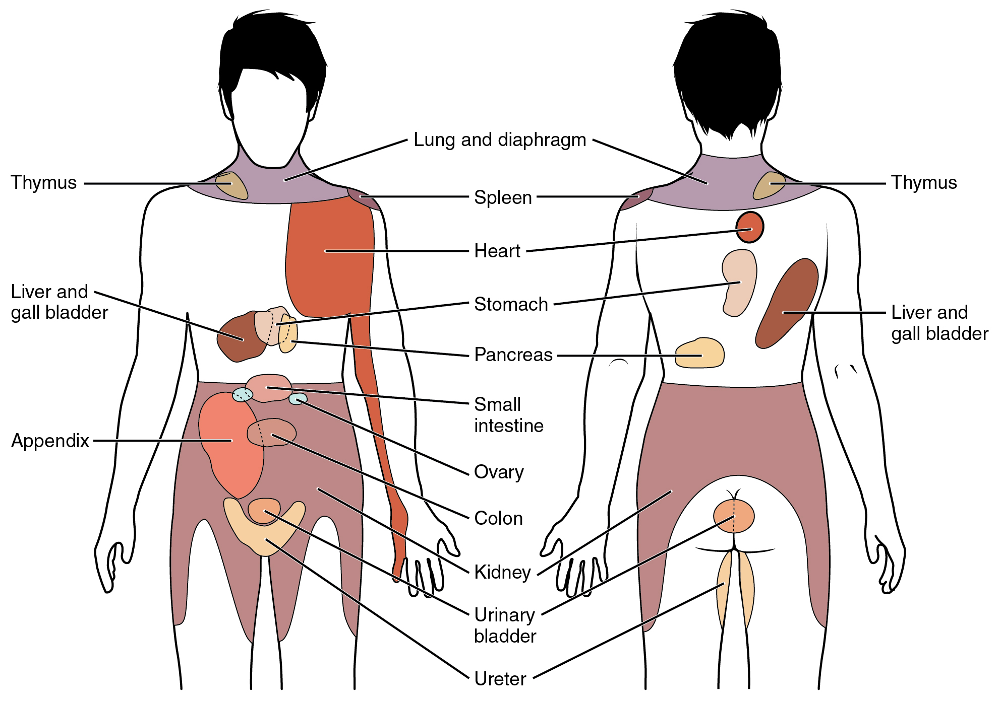
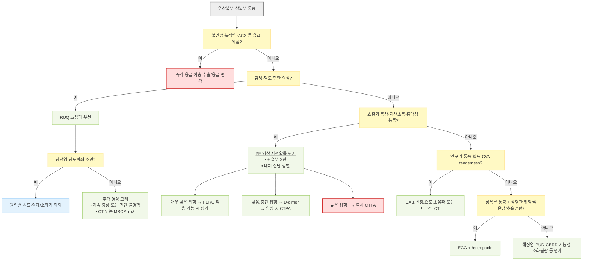
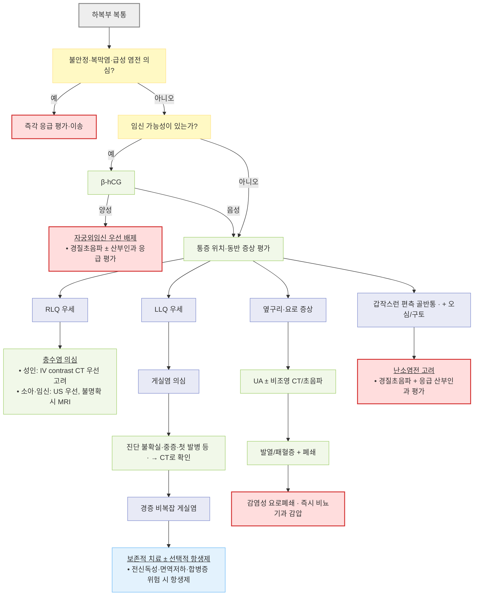
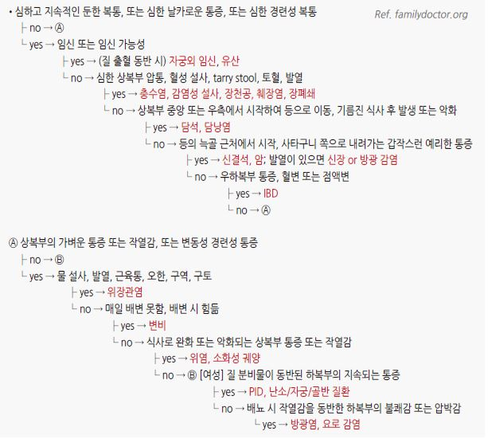
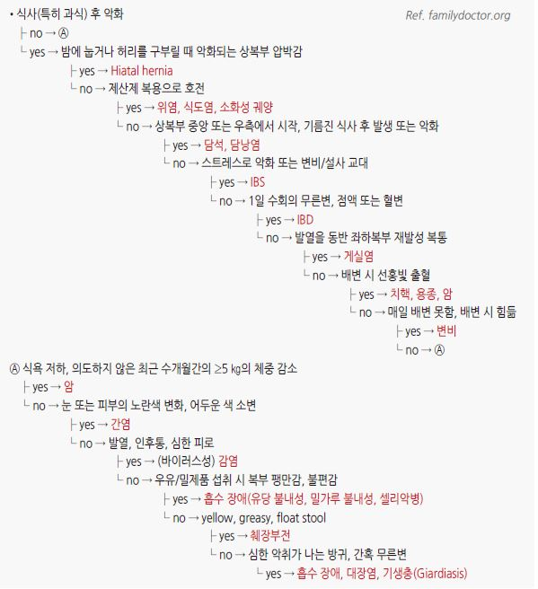
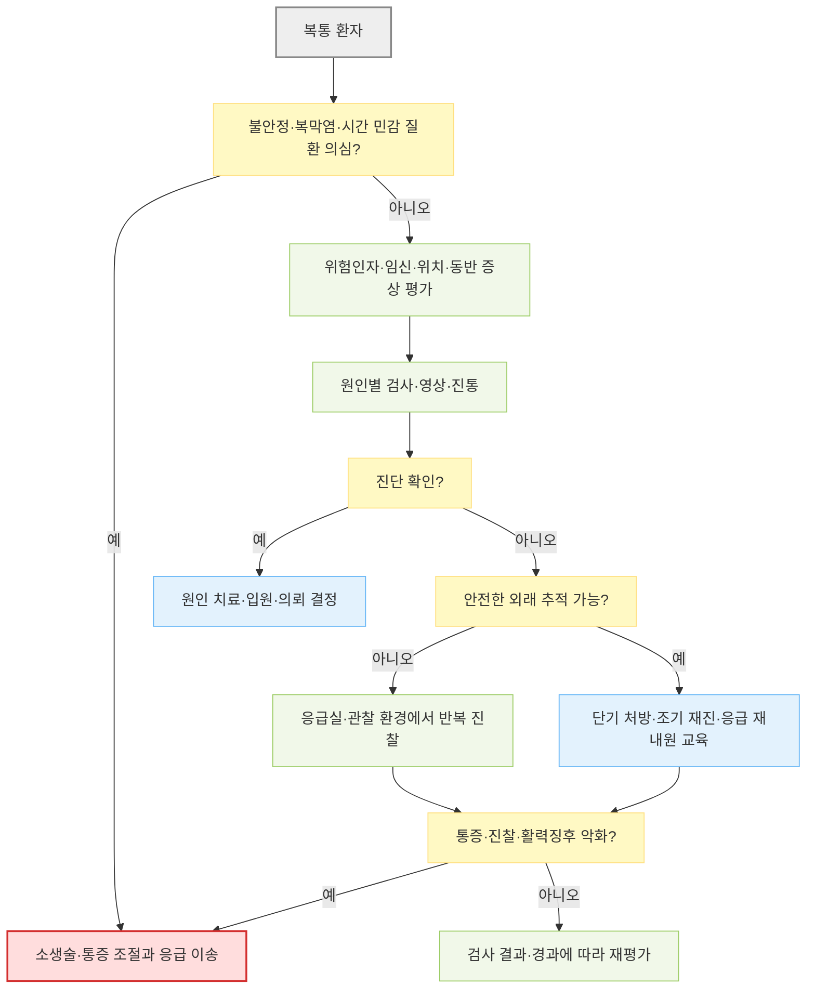

# 복통 Abdominal Pain

## <mark style="color:green;">일반 사항</mark>

* 복통은 1차 진료에서 가장 흔한 주소 중 하나로, 양성 기능성 질환부터 즉각적인 처치가 필요한 응급 질환까지 원인이 매우 다양함
* 통증의 위치·성질·시작·지속 시간·방사·악화·완화 인자와 동반 증상(발열, 구역·구토, 설사, 혈변, 황달 등)을 체계적으로 파악하는 것이 감별 진단의 핵심
* 고령(특히 당뇨병·신부전) 환자는 통증·발열·복부 강직 등이 경미하게 발현될 수 있어 중증 질환을 간과하기 쉬우므로 비전형적 증상에도 악성·혈관 질환 가능성을 항상 염두에 두어야 함
* 임신 가능성이 있는 가임기 여성의 급성 하복부·골반통에서는 임신 여부를 우선 확인하고 β-hCG를 시행; 임신이 확인되면 자궁외임신을 반드시 배제
* 복용 중인 약물을 반드시 확인
  * NSAIDs(→ 소화성 궤양·천공), 항생제(→ 항생제 관련 장염) 등은 복통의 직접적 원인이 될 수 있음
  * 드물게 약물 유발 췌장염이 발생할 수 있음 - 원인 약물 : azathioprine, valproate, thiazide계 이뇨제
  * 스테로이드는 잠재적 위험인자이나 주요 원인은 아님
  * DPP-4 억제제 및 GLP-1 수용체 작용제도 췌장염 발생이 보고되나 인과성에는 논란이 있어 과도하게 강조하지 않되, 당뇨·비만 치료 중인 환자의 복통에서는 약물 복용력을 확인
  * SGLT2 억제제 복용 환자는 혈당이 정상 또는 경도 상승만 보이는 euglycemic DKA가 가능함을 우선 고려 (혈당만으로 DKA를 배제하지 말 것)
  * 항응고제·항혈소판제 복용 환자의 복통·옆구리 통증에서는 복벽혈종(rectus sheath hematoma) 또는 retroperitoneal bleeding 가능성 고려
  * metformin은 복통·설사·구역 등 소화기 부작용이 흔하며, 드물지만 탈수·신기능 저하 동반 시 metformin 관련 젖산산증(lactic acidosis) 가능성 고려

### <mark style="color:$danger;">🚩 Red Flags!</mark>

<mark style="color:$danger;">**즉각 조치**</mark>

* vital sign 불안정 (저혈압, 빈맥, 빈호흡) `쇼크`
* 복부 강직, 반동 압통 `복막염`
* 심방세동·혈관 질환 환자의 갑작스럽거나 심한 지속 복통, 특히 진찰 소견보다 심한 통증 `급성 장간막 허혈` — 정상 lactate로 배제하지 않고 즉시 CTA 가능한 응급실로 이송
* 발열·패혈증 소견과 요로폐쇄 동반 `감염성 요로폐쇄`
* 급성 하복부·서혜부 통증과 고환염전 의심 소견 `고환염전`
* 대량 토혈·지속적 위장관 출혈, 또는 혈역학적 불안정·실신·복막자극이 동반된 출혈 `위장관 출혈`
* 박동성 복부 종괴 (특히 고령·흡연·죽상동맥경화 환자) `AAA 파열`
* 가임기 여성의 급성 하복부·골반통 + 혈역학적 불안정·실신/전실신·복막자극 소견·심한 편측 지속통 또는 의미 있는 질출혈 `자궁외임신 파열`
* 갑작스러운 극심한 복통 ("내 인생 최악의 통증") `혈관 사고(AAA, 대동맥 박리)` `천공` `장간막 허혈` `비전형적 급성 MI`(고령·당뇨 환자)
* 갑작스러운 상복부·복부 통증 + 흉통 또는 등 통증 + 사지 간 맥박·혈압 차이 또는 신경학적 증상 동반 `대동맥 박리`
* 갑작스러운 심한 편측 하복부·골반통 + 구역·구토 `난소염전`
* 발열·오한 + 황달 + 저혈압 또는 의식 변화 `급성 담관염` `패혈증`

<mark style="color:$warning;">**당일 평가**</mark>

* 통증이 지속적으로 악화되거나 반복 구토로 경구 섭취가 불가능함 — 당일 평가; 새 복막 자극 소견·전신 상태 악화는 즉각 조치
* 재평가 시 활력징후·진찰 소견이 변화
* 흑변·혈변·토혈이 있으나 활력징후가 안정적 `위장관 출혈`
* 발열 동반 `복강내 감염`
* 황달 동반 `담관염` `간염` `담도 폐쇄`
* 복부 종괴 또는 복부 장기 비대 (박동성 제외) `복강내 종양`
* 고령(특히 ≥60~65세), frailty 또는 중대한 동반 질환에서 새로 발생한 원인 불명 급성 복통
* 심방세동·혈관 질환 환자의 원인 불명 복통 — 당일 평가; 갑작스럽거나 심한 지속통·진찰 소견보다 심한 통증이면 즉각 조치
* 가임기 여성의 급성 하복부·골반통 (활력징후 안정, 즉각 위험 소견 없음) `자궁외임신` `골반염`

<mark style="color:$info;">**조기 평가 및 추적**</mark>

* 설명되지 않는 체중 감소 `악성 종양`
* 원인이 설명되지 않는 빈혈 (예: 철결핍빈혈) `대장암` `위장관 출혈`
* 복통 양상의 변화
* 같은 문제로 반복적인 진료
* 가족력 (난소 또는 창자의 악성 종양, 가족성 대장폴립증 등) `대장암` `난소암`

## <mark style="color:green;">진단</mark>

* 진찰, vital sign, 병력 청취
* 가임기 여성에서 자궁외임신 배제 : 소변 또는 혈청 β-hCG
  * β-hCG 양성인 경우 단일 β-hCG 수치나 조기 초음파 음성만으로는 자궁외임신이 배제되지 않으므로, 임신 위치 미상(pregnancy of unknown location) 시 정량 β-hCG 추이·경질초음파 추적 필요

#### <mark style="color:$primary;">실험실검사</mark>

* 기본 : CBC, 전해질, BUN/Cr, 간기능(AST/ALT/ALP/bilirubin), lipase, UA
  * 미분화 급성 복통의 초기 평가로 흔히 함께 시행하나, 병력·통증 위치·임상 가설에 따라 항목 조정 가능
  * 간기능 : RUQ 통증·황달·담도 질환 의심 시 특히 유용
  * lipase : amylase보다 진단 정확도가 높아 상복부 통증 등 췌장염 의심 시 우선 시행(amylase보다 상승이 오래 지속되어(약 8\~14일 vs 3\~7일) 증상 발생 후 수일이 지나 내원한 경우에도 진단 유용성이 더 높음)
    * 임상적으로 췌장염이 의심되면 증상 발생 시점과 관계없이 검사
  * UA : 요로 증상·옆구리 통증 또는 임신 관련 감별 시
* 추가 고려
  * β-hCG : 임신 가능성이 있는 가임기 여성
  * CRP/ESR : 염증 정도 평가
  * coagulation : 출혈 의심
  * lactate : 장간막 허혈 의심 - 초기에는 정상일 수 있으므로 음성이어도 배제 불가
  * glucose/ketone/anion gap metabolic acidosis : 당뇨 환자에서 DKA에 의한 가성 복막염 배제 - SGLT2 억제제 복용 환자는 혈당이 정상 또는 경도 상승만 보이는 euglycemic DKA가 가능하므로 glucose만으로 DKA를 배제하지 말고 ketone/혈액가스 및 anion gap을 확인

<mark style="color:cyan;">**Lab 해석**</mark>

<table><thead><tr><th width="256">검사 소견</th><th>시사 질환</th></tr></thead><tbody><tr><td>AST/ALT 현저히 상승</td><td>간염 (바이러스·허혈·약물)</td></tr><tr><td>ALP + bilirubin 상승</td><td>담도 폐쇄</td></tr><tr><td>Lipase ≥3×ULN(upper limit normal) + 전형적 상복부 통증</td><td>급성 췌장염 (Revised Atlanta Criteria: ① 전형적 통증, ② lipase/amylase ≥3×ULN, ③ 영상 소견 중 2개 이상 충족 시 진단)</td></tr><tr><td>Lactate 상승</td><td>장간막 허혈, 패혈증; 단, 정상 lactate가 장간막 허혈을 배제하지는 못함(초기에는 정상일 수 있음)</td></tr><tr><td>WBC 현저히 상승 + CRP 상승</td><td>염증성·감염성 복강내 질환 가능성을 높이나 비특이적; 단독으로 세균감염·충수염을 확진하거나 배제할 수 없음; procalcitonin은 중증도 평가 등 보조적 역할이 연구되고 있으나 미분화 복통의 routine 선별검사로는 아직 근거가 확립되지 않음</td></tr><tr><td>β-hCG 양성</td><td>임신 (자궁외임신 배제 필수)</td></tr></tbody></table>

#### <mark style="color:$primary;">심전도(ECG)</mark>

* 고령 또는 심혈관 위험인자(당뇨, 고혈압, 흡연, 관상동맥 질환 병력)가 있는 환자의 설명되지 않는 상복부 통증, 특히 흉부 불편감·호흡곤란·식은땀·구역 등이 동반되면 ECG 및 hs-troponin을 적극 고려(☞ [흉통](002_-chest-pain.md))
  * 초기 NSTEMI는 ECG 단독으로는 놓칠 수 있음을 유의
* 여성, 고령자, 당뇨병 환자에서는 비전형적 급성 관상동맥 증후군 증상(흉통 없이 복통·구역·피로감 등)이 나타날 수 있으므로 ECG 검사를 적극 고려함

#### <mark style="color:$primary;">영상검사</mark>

* 복부 X선 : 장폐쇄 또는 천공이 의심되는 일부 상황에서 보조적으로 사용할 수 있으나, 민감도가 낮아 CT를 대체하지 못함
* 복부 초음파(US) : 담낭·담도·신장·부속기 평가; 방사선 노출 없음; 임신·소아에서 1차 선택
* 복부-골반 CT : 성인의 미분화 급성 복통, 특히 고령·전신상태 이상·혈관 위험 또는 중증 질환이 의심되는 경우 중요한 초기 영상검사
  * 충수염·게실염·폐쇄·천공 등 광범위한 원인을 평가할 수 있으며, 장간막 허혈·AAA 등 혈관질환이 의심되면 적절한 CTA protocol을 선택
  * 연령·임신 여부·통증 위치와 의심 질환에 따라 US 또는 MRI를 우선 선택할 수 있음
* MRI : 방사선 노출을 피해야 하는 임신·소아에서 초음파로 진단이 불명확한 충수염 평가에 유용
  * 담도계 평가에서는 MRCP가 담관·췌관을 비침습적으로 시각화하여 담석·협착 감별에 도움
* 부인과 초음파 : 자궁외임신, 난소 병변 의심 시 (경질초음파가 우선)
* POCUS (point-of-care US; 현장진단초음파) : AAA 선별, 담낭 평가, 수신증(hydronephrosis) 확인에 유용

<mark style="color:cyan;">**CT vs 초음파 선택 원칙**</mark>

<table data-search="false"><thead><tr><th width="343">임상 상황</th><th>권장 영상</th></tr></thead><tbody><tr><td>RUQ 통증 (담낭·담도 의심)</td><td>초음파 우선</td></tr><tr><td>LLQ 통증 (게실염 의심)</td><td>CT</td></tr><tr><td>옆구리 통증 (요로 결석 의심) - 성인</td><td>비조영 CT (가장 정확); 임신에서는 초음파 우선</td></tr><tr><td>충수염 의심 - 성인</td><td>CT abdomen/pelvis with IV contrast 우선 (조영제 금기 등 상황에 따라 protocol 조정)</td></tr><tr><td>충수염 의심 - 소아·임신</td><td>초음파 우선; 불명확 시 MRI 고려</td></tr><tr><td>골반 통증 (부인과 의심)</td><td>경질초음파</td></tr><tr><td>미분화 급성 복통 (고령·혈관 위험·diffuse pain)</td><td>CT</td></tr><tr><td>AAA(abdominal aortic aneurysm) 의심 - 혈역학적 불안정</td><td>CT를 위해 지체하지 말고 즉시 수술/혈관외과 협진 및 응급 이송; bedside POCUS는 신속한 확인 용도로만 활용</td></tr><tr><td>AAA 의심 - 혈역학적 안정</td><td>CT angiography</td></tr></tbody></table>

## <mark style="color:green;">감별</mark> <a id="differential-diagnosis"></a>

### <mark style="color:orange;">통증 기원에 따른 특징</mark>

#### <mark style="color:$primary;">Visceral pain (내장통)</mark>

* 기전 : 내장 기관(소장, 대장, 담낭, 요관, 신장 등)의 폐쇄 또는 염증(소화성 궤양, 담낭염, 간염, 충수염, IBD, 신우신염, PID 등)

<mark style="color:cyan;">**기원별 통증 부위**</mark>

* embryologic origin 관련 부위에 통증이 나타남; 임상적으로는 "배꼽 주위 → 우하복부 이동"과 같은 국소화(localization) 패턴이 감별에 더 직접적으로 활용됨
* Foregut 기원 : 식도, 위장, 십이지장 근위부, 간, 담낭, 췌장 → 상복부 통증
* Midgut 기원 : 십이지장 제2부 원위부 \~ 횡행결장 proximal ⅔ (hepatic flexure 포함, splenic flexure 제외) → 배꼽 주위 통증
* Hindgut 기원 : 횡행결장 distal ⅓ 이하(splenic flexure 포함) \~ 직장상부 → 치골 상부 통증

<mark style="color:cyan;">**임상 양상**</mark>

* 복부 팽만
* 중공 장기(hollow organ)의 폐쇄·강한 연동운동 → 경련성 또는 산통성(colicky) 통증
* 염증·허혈 또는 벽측 복막 침범 → 지속적이며 국소화되는 통증 가능
* 허혈 시 극심한 광범위 통증 가능
* 염증이 복벽까지 확장되면 국소 압통 발생
* 허혈성 장질환(acute mesenteric ischemia) 초기에는 심한 통증에 비해 복부 진찰 소견이 경미할 수 있음

#### <mark style="color:$primary;">Parietal pain (체성통)</mark>

* 기전 : 위액, 담즙, 췌장 효소, 대변, 고름, 혈액 등에 의해 벽측 복막(parietal peritoneum)이 자극·염증되면서 발생
  * 벽측 복막은 체성 신경 지배를 받아 통증이 날카롭고 비교적 정확히 국소화됨
  * 움직임·기침·복막 긴장의 변화에 의해 악화
* 임상 양상 : 날카롭고 국소화된 통증
  * 국소 압통, guarding, rebound tenderness 등이 나타날 수 있음

#### <mark style="color:$primary;">Referred pain (연관통)</mark>

* 병변이 있는 장기와 같은 척수 분절의 체성 감각 영역으로 통증이 느껴지는 현상
* 담낭·우측 횡격막 자극 → 우측 어깨 또는 우측 견갑부 통증
* 비장·좌측 횡격막 자극 → 좌측 어깨 통증(Kehr sign)
* 췌장 질환 → 등으로 방사되는 상복부 통증
* 요관 결석 → 옆구리에서 서혜부·고환 또는 대음순으로 방사
* 하엽 폐렴·흉막질환 → 상복부 또는 옆구리 통증으로 발현 가능
* 급성 심근경색 → 상복부 통증으로 발현 가능, 특히 고령·당뇨 환자에서 주의

- [ ] 내장통의 초기 위치(localization)와 연관통은 구분해야 함. 내장성 통증은 초기에는 미만성·정중선에 가깝게 느껴질 수 있고, 염증이 벽측 복막으로 진행하면 국소 압통·반발통 등 체성통 소견이 나타남

<figure><figcaption><p><strong>복부 장기의 연관통(referred pain) 부위 - Ref. OpenStax College. Autonomic Reflexes and Homeostasis.</strong></p></figcaption></figure>

#### <mark style="color:$primary;">Abdominal wall pain (복벽통)</mark>

* 복벽 근육, 근막, 피부 신경의 병변에 의한 통증; 복강 내 장기와 무관
* 원인 질환 : 근육 긴장(muscle strain), 늑간신경포착, 복직근 혈종, 대상포진(발진 출현 전 전구기에 편측 복통으로 발현될 수 있으며, 특히 고령·면역 저하 환자에서 진단 지연 주의), 수술 후 신경종
* 특징 : 국소 압통, 자세 변화·움직임에 의해 악화, 복강 내 병변과 달리 복부 강직·반동 압통 없음
* Carnett's sign : 압통 부위를 누른 상태에서 환자에게 고개를 들게 하거나(또는 상체를 들어 올리거나) 복근을 긴장시킬 때 압통이 유지되거나 악화되면 복벽 기원 가능성 높음 (✽ 복강 내 병변 시 통증 감소)
  * 양성 시 CT 반복보다 복벽 원인 치료를 먼저 고려
  * 초기 복막염에서도 복근 수축 시 통증이 악화될 수 있어 위양성 가능성이 있으므로, 반동 압통·발열·전신 상태 악화 등 다른 소견과 함께 종합 판단해야 함

### <mark style="color:orange;">통증 패턴 인식</mark>

* 통증 발생 양상은 원인 감별의 첫 번째 단서임

<table data-search="false"><thead><tr><th width="250">통증 패턴</th><th>시사 원인</th></tr></thead><tbody><tr><td>갑작스러운 극심한 통증</td><td>혈관 사고(AAA, 대동맥 박리), 천공, 장간막 허혈</td></tr><tr><td>산통(colicky) - 파도처럼 반복</td><td>장 폐쇄, 요관 결석; 담도 산통은 명칭과 달리 강해진 뒤 일정하게 지속되는 통증이 흔함</td></tr><tr><td>지속적·점점 악화</td><td>충수염, 담낭염, 췌장염 등 염증성 질환</td></tr><tr><td>식후 악화 (postprandial)</td><td>만성 장간막 허혈, 기능성 소화불량, 소화성 궤양 등</td></tr><tr><td>상복부→우하복부 이동</td><td>충수염 (전형적 이동 패턴)</td></tr><tr><td>자세·움직임으로 악화</td><td>복벽통, 근골격계 원인</td></tr><tr><td>배변 후 호전</td><td>IBS, 게실 질환</td></tr></tbody></table>

### <mark style="color:orange;">위치에 따른 복부 통증의 감별</mark>

#### <mark style="color:$primary;">우상복부 및 상복부 복통</mark>

* [ ] GERD·위염·기능성 소화불량은 해부학적으로 상복부 통증이지만 임상적으로 RUQ와 겹치는 경우가 많아 함께 기술함

- Biliary colic : RUQ 또는 epigastrium의 심한 둔한 통증(＞30분 지속), 구역, 구토, 발한
- Acute cholecystitis : RUQ 또는 epigastrium의 심한 통증(＞4시간 지속), 발열, 복부 강직, Murphy's sign
- Acute cholangitis : RUQ 통증, 발열, 황달
- Acute hepatitis : RUQ 통증; 피로, 구역, 구토, 식욕 부진, 황달, 검은색 소변, pale or clay-colored stool; 음주 병력
- Liver abscess : RUQ 통증, 발열; 특히 당뇨병, 간/담도/췌장에 기저질환이 있는 경우 의심
- Fitz-Hugh-Curtis 증후군 : 골반염이나 난관염 같은 여성 생식기 감염이 퍼져서 간 주변의 피막에 염증(간주위염) 발생; 젊은 여성에서 RUQ 통증
  * 하복부 증상 없이 RUQ 통증만 있을 수 있어 담낭염과의 감별이 필요
  * PID 병력 또는 STI 위험인자 확인
- Acute MI : MI 증상(예: 흉통, 호흡 곤란) 동반
  * 관상동맥병 위험이 있는 환자에서 의심 → ECG 즉시 시행, troponin 포함 심근 효소 확인 (✽NSTEMI에서는 ECG가 정상일 수 있음 유의)
- Pancreatitis : 점차 심해진 후 지속, 앞으로 기대면 호전, 등으로의 방사통
  * 음주 병력
- GERD : 가슴쓰림, 역류, 삼킴곤란
- Gastritis, Gastropathy : 상복부 불편감·통증, 오심·구토 ± 소화불량
- 소화성 궤양 : 상복부 통증·쓰림, 식사와 연관될 수 있음
  * NSAID 사용력과 H. pylori 위험 확인
- Functional dyspepsia : 식후 팽만감, 조기 포만감
- Gastroparesis : 구역, 구토, 조기 포만감, 식후 팽만감

***



<p align="center"><strong>우상복부·상복부 복통의 평가 알고리듬</strong><br><em><mark style="color:$info;">저자 재구성 (참고 문헌 : ACR Appropriateness Criteria 등)</mark></em></p>

***

#### <mark style="color:$primary;">좌상복부 복통</mark>

* Splenomegaly : 왼쪽 어깨 방사통, 조기 포만감

#### <mark style="color:$primary;">하복부 복통</mark>

* Appendicitis : 상복부에서 시작 → RLQ로 이동, 간혹 복부 전체 통증; 식욕 부진, 구역, 구토
  * 단순 충수염(uncomplicated appendicitis)에서는 선택적으로 항생제 치료 고려 가능 - 재발 위험이 있으며 장기적으로 상당수에서 충수절제술이 필요할 수 있음. Appendicolith 동반 시 치료 실패·합병증 위험이 더 높음. 환자와 충분한 상의 후 결정
* Diverticulitis : 구역, 구토; 수일간 지속
  * 정상 면역 성인의 비복잡 게실염(농양·유리천공·누공·폐쇄가 없는 국소 결장벽 염증 및 주변 지방 침윤; modified Hinchey Ia에 해당하며, 국소 농양이 동반된 Ib는 제외) : routine 항생제 사용에 반대하며 관찰·보존적 치료를 권고 <mark style="color:$info;">\[ACG 2026]</mark>
  * 고위험 소견, 면역저하, frailty, 안전한 외래 관리가 어려운 경우에는 항생제 치료가 적절
  * 첫 발병이거나 중증·진단이 불확실한 경우 CT로 진단을 확인
    * complicated diverticulitis 회복 후에는 대장내시경을 권고하고, uncomplicated disease도 alarm symptom이 있거나 대장암 검진이 최신 상태가 아니면 대장내시경을 고려 <mark style="color:$info;">\[ACG 2026]</mark>
  * 우측 게실염 : 동양인에서 흔함; 충수염과 임상 양상 매우 유사; CT로 감별 필요
  * 좌측 게실염 : 서구형의 전형적 위치(LLQ); 고령, 저섬유·고지방 식이 환자에서 호발
* Ischemic colitis (허혈성 결장염) : 주로 LLQ 또는 좌측 복통; 혈성 설사, 복통이 갑자기 시작
  * 고령, 동맥경화, 저혈압, 심방세동 환자에서 주의
  * CT가 초기 평가에 유용하며, 필요시 대장내시경으로 확인
  * Acute mesenteric ischemia(CTA가 핵심)와는 구분되는 질환임
* Nephrolithiasis : 편측 옆구리 통증, 등 통증
  * 발열/패혈증 소견 + 요로폐쇄(수신증) 동반 시 비뇨기과적 응급(infected obstructed kidney)
* Pyelonephritis : 편측 옆구리 통증, 늑골척추각 압통, 빈뇨, 급뇨, 배뇨통, 혈뇨, 발열, 오한, 오심
* Cystitis : 치골상부 통증; 배뇨통, 빈뇨, 급뇨, 혈뇨
* Acute urinary retention : 치골상부 통증

***



<p align="center"><strong>하복부 복통의 평가 알고리듬</strong><br><em><mark style="color:$info;">저자 재구성 (참고 문헌 : ACR Appropriateness Criteria 등)</mark></em></p>

***

#### <mark style="color:$primary;">여성 특이 하복부 복통</mark>

* Ectopic pregnancy : 편측 하복부 통증, 질 출혈, 무월경; β-hCG 양성
  * 파열 시 급성 복막염 → 응급
* 골반염(PID) : 양측 하복부 통증, 발열, 질 분비물; 자궁경부 운동통(cervical motion tenderness, 골반염 진단의 핵심 신체 검진 소견)
  * Fitz-Hugh-Curtis 증후군(간 주위염) 합병 시 RUQ 통증 동반 가능
* 난소낭종 파열 : 갑작스런 편측 하복부 통증; 성적 활동 또는 운동 후 발생 가능
* 난소 염전 : 갑작스런 심한 편측 하복부 통증, 구역, 구토
  * 경질초음파를 시행하되 정상 Doppler 혈류만으로는 배제하지 않으며, 임상적으로 강하게 의심되면 영상 결과와 관계없이 즉시 산부인과 응급 평가 및 진단적 복강경을 고려 → 응급
* 원발성 월경통 : 월경 시작 전후 하복부 경련성 통증; 요통, 오심 동반 가능

#### <mark style="color:$primary;">미만성 복통</mark>

* 복막염 : 움직이거나 흔들리면 악화, 반동 압통, 복부 강직
* 장 폐쇄 : 경련성 복통, 구역, 구토, 변비, 복부 팽만; 높은 음조의 증가된 장음 또는 무음이 나타날 수 있으나 장음 소견만으로 확진·배제하지 않음
  * 성인 소장 폐쇄의 가장 흔한 원인(약 60\~70%)은 수술 후 유착(postoperative adhesion)이므로 복부 수술력 확인이 중요한 진단 단서
* GI 천공 : 갑작스런 심한 복통
* 복부 대동맥류(AAA) 파열 : 갑작스러운 심한 복통 또는 요통, 박동성 복부 종괴, 혈압 저하
  * 고령·흡연력·죽상동맥경화 병력이 있는 환자에서 강하게 의심. 흡연력이 있는 여성에 위험 증가
  * 즉각 응급 처치 필요
* Acute mesenteric ischemia : 급성의 심하고 지속적인 복통; 통증에 비해 복부 진찰 소견이 경미(pain out of proportion)
  * 조기 CT angiography 시행; 초기에는 lactate 검사는 정상일 수 있음
  * 심방세동·최근 MI·심부전 환자에서 강하게 의심
* Chronic mesenteric ischemia : 식후 30분\~1시간 내 발생하는 심한 상복부 통증, 구역, 구토, 설사, 체중 감소; 통증에 대한 공포로 식사 기피(food fear) → 체중 감소 심화
* 급성 감염성 위장관염 : 상대적으로 덜 심한 복통, 설사, 구역, 구토
  * 바이러스성(norovirus 등)과 세균성(식중독 포함) 원인 모두 포함
  * 독소 매개형 식중독은 섭취 후 1\~6시간 내 급격한 구역·구토·설사로 발현
* 셀리악병 : 부피가 큰 설사, 나쁜 냄새의 지방변, 복부 가스
* IBS : 지속적이지 않고 반복되는 복통 또는 복부 불편감이 배변 및 배변 빈도·형태 변화와 연관됨. Rome V 연구 기준은 최근 3개월 동안 월평균 ≥3일, 증상 시작 ≥6개월 전이며 관련 3요소 중 ≥2개를 충족; 세부 기준은 (☞ [과민성장증후군](../224_/087_-ibs.md))
  * Lactose intolerance(경련성 복통, 복부 팽만·가스, 설사)와 감별 필요
* Diverticulosis : 대부분 무증상; 일부에서 복부 불편감 또는 배변 습관 변화가 동반될 수 있음
* IBD : 혈성 설사, 배변 긴박감, 뒤무직, 발열, 장외 증상(관절염, 포도막염); 만성·재발성 경과가 흔하지만 최근 발생한 지속성 혈성 설사나 급성 중증 대장염으로 처음 발현할 수도 있음

### <mark style="color:orange;">복강 외 원인 (Extra-abdominal Causes)</mark>

<table><thead><tr><th width="154">질환</th><th>복통 양상 및 진단 단서</th></tr></thead><tbody><tr><td>급성 심근경색</td><td>상복부 통증; 고령·당뇨·심혈관 위험인자; ECG + troponin 필수</td></tr><tr><td>폐렴</td><td>하폐엽 폐렴에서 상복부·옆구리 통증 가능; 호흡기 증상, 흉부 X선</td></tr><tr><td>폐색전증</td><td>흉막 자극 시 복통 발생 가능; 호흡 곤란, 임상 사전확률에 따른 D-dimer, 확진은 CTPA</td></tr><tr><td>당뇨병 케톤산증</td><td>미만성 복통, 구역·구토; 혈당·케톤·anion gap 확인 (SGLT2 억제제 사용자는 정상~경도 혈당에서도 가능 - euglycemic DKA)</td></tr><tr><td>대상포진</td><td>발진 전구기 편측 복통, 피부 과민(allodynia), 띠 모양(dermatomal) 통증; 수포 출현 시 확진</td></tr></tbody></table>

### <mark style="color:orange;">고령자 복통의 특징</mark>

* 통증 강도가 낮고 증상이 경미하게 발현되어 진단이 지연되고 심각한 질환을 과소평가하기 쉬움
* 발열·백혈구 증가·복부 강직 등이 뚜렷하지 않은 경우가 많음
* 충수염 천공·장 폐쇄·장간막 허혈의 지연 진단이 흔함
* 고령자의 진단 불명 급성 복통에서는 영상검사 및 관찰의 역치를 낮추고, 진단이 불확실하면 serial abdominal exam(반복 신체 검진)으로 증상·소견의 변화를 추적하는 것이 단일 시점 검진보다 유용
  * 외래 귀가 시 명확한 지침 제공 및 조기 재평가
* 심방세동·동맥경화 병력 → 장간막 허혈 강하게 의심

### <mark style="color:orange;">소아 복통의 특징</mark>

* 장중첩증(intussusception) : 주로 영유아, 간헐적 발작성 복통 + 무기력이 반복, 담즙성 구토, 혈변("currant jelly stool")
  * 담즙성 구토·currant jelly stool 등 고전적 소견은 비교적 진행된 단계에서 나타나며, 없어도 배제되지 않음
  * 초음파로 확인
* Henoch-Schönlein purpura(IgA 혈관염) : 복통 + 촉지성 자반(palpable purpura, 주로 하지) + 관절통 ± 혈뇨; 복통이 자반보다 먼저 나타날 수 있음
* 급성 충수염 : 소아, 특히 어린 연령에서는 증상 표현이 불명확하여 진단이 지연되고 천공률이 높음
* 고환염전(testicular torsion) : 음낭통 없이 하복부·서혜부 통증만으로 발현할 수 있어 진단이 지연되기 쉬우므로, 남아의 하복부·서혜부 통증에서는 외부 생식기 진찰을 반드시 병행
* 기능성 변비(functional constipation) : 1차 진료 소아 급성/재발성 복통의 매우 흔한 원인; 배꼽 주위 또는 하복부의 쥐어짜는 듯한 통증이 배변 후 호전되는 양상이 흔하나, 이 소견 하나만으로 진단하지 않고 배변 빈도 감소, 딱딱하거나 통증 동반 배변, 변 참기 행동, 굵은 변, 촉지되는 분변 덩이 등 연령별 진단 요소를 함께 확인
  * red flag(체중 감소, 혈변, 발열, 야간통 등) 없이 이러한 소견들이 함께 있으면 기능성 변비를 우선 고려
* 의사소통이 어려운 영유아는 보챔·다리를 배 쪽으로 끌어당기는 자세·수유 거부 등이 복통의 대리 지표가 될 수 있음

### <mark style="color:orange;">증상에 따른 감별</mark>

#### <mark style="color:$primary;">급성 복통</mark>

<figure><figcaption><p><strong>급성 복통 감별 알고리듬</strong></p></figcaption></figure>

#### <mark style="color:$primary;">만성 복통</mark>

<figure><figcaption><p><strong>만성 복통 감별 알고리듬</strong></p></figcaption></figure>

***

## <mark style="background-color:$warning;">Management</mark>

### <mark style="color:orange;">접근 원칙</mark>

**Step 1. Vital sign 안정 여부 확인**

* 활력징후 불안정(저혈압·빈맥) 또는 복막염 소견 → 즉각 응급 이송 (소생술 + CT/수술 준비)

**Step 2. Red flag 및 고위험군 확인**

* 고령(특히 ≥60\~65세), frailty, 심방세동·혈관 질환, 당뇨·CKD·면역 저하 등은 중증 질환의 비전형적 발현 위험을 높이는 risk modifier이므로 영상검사·관찰 역치를 낮춤
* 임신 가능성이 있는 가임기 여성은 β-hCG 확인

**Step 3. 치명적·시간 민감성 질환 우선 배제**

* 아래는 대표적 예시이며 전체 목록이 아님; 난소·고환염전, 감염성 요로폐쇄, 급성 담관염+패혈증 등 부위별 세부 감별은 [감별](#differential-diagnosis) 섹션 참조

<table data-search="false"><thead><tr><th width="168">질환</th><th>핵심 단서</th></tr></thead><tbody><tr><td>AAA 파열</td><td>고령·흡연·박동성 종괴·저혈압</td></tr><tr><td>대동맥 박리</td><td>흉통/등통 동반·사지 간 맥박·혈압 차이·신경학적 증상</td></tr><tr><td>장간막 허혈</td><td>AF·심혈관 병력·pain out of proportion</td></tr><tr><td>GI 천공</td><td>갑작스러운 극심한 통증·복막염 소견</td></tr><tr><td>교액성 장폐쇄</td><td>산통에서 지속통으로 전환·복막 자극 동반</td></tr><tr><td>자궁외임신 파열</td><td>가임기 여성·β-hCG 양성·혈역학적 불안정</td></tr><tr><td>Acute MI</td><td>상복부 통증·심혈관 위험인자·ECG 변화</td></tr></tbody></table>

**Step 4. 통증 패턴 + 위치 기반 감별 → 검사 선택**

* [통증 패턴 인식](003_-abdominal-pain.md#통증-패턴-인식), [영상검사](003_-abdominal-pain.md#영상검사) 참조

**Step 5. Disposition 결정**

* vital 불안정, 복막염, 치명 질환 의심 → 응급 의뢰 또는 이송
* 진단이 불명확하거나 중증 질환을 완전히 배제하기 어려움(예: 초기 충수염 의심) → 응급실 또는 관찰 가능한 환경에서 serial examination 및 필요 시 반복 검사
* 활력징후 안정, 중증 질환 가능성이 낮고 경증·기능성 가능성이 높음 → 외래 추적 + 명확한 지침 설명 - "통증 악화, 발열, 구토 지속, 혈변 발생 시 즉시 재내원"

***



<p align="center"><strong>복통 관리 알고리듬</strong><br><em><mark style="color:$info;">저자 재구성 (참고 문헌: ACR Acute Nonlocalized Abdominal Pain; WSES Acute Mesenteric Ischemia 2022)</mark></em></p>

***

### <mark style="color:orange;">진통제 사용 원칙</mark>

* 진단 지연을 우려하여 진통제를 제한하는 것은 권장되지 않으며, 적절한 통증 조절은 표준 치료임. 오히려 통증이 완화되면 신체 검진의 질이 향상됨

<table><thead><tr><th width="147">임상 상황</th><th>권장 진통제</th></tr></thead><tbody><tr><td>신장·요관 산통<br>(renal colic)</td><td>• NSAIDs 우선 - ketorolac <a href="https://health.kr/drug/A11AHHHHH0001">케토란주</a>: 국내 허가상 성인 초회 10 ㎎ IM/IV, 필요시 10~30 ㎎ q4~6h; 주사 투여기간은 2일 이내. 고령·저체중·신기능 저하에서는 금기 여부를 먼저 확인하고 최소 유효량 사용; 중등도·중증 신부전 및 탈수·저혈량증 등은 투여 금기;<br>• NSAID에 진경제 병용은 통증 조절 개선 근거 부족</td></tr><tr><td>담도 산통</td><td>NSAID 우선; 필요 시 추가 진통제 고려</td></tr><tr><td>급성 췌장염</td><td>Opioid 사용 가능 - 과거 우려되던 Oddi 괄약근 경련은 임상적으로 큰 문제가 되지 않는 것으로 정리됨</td></tr><tr><td>원인 평가 중의<br>급성 복통</td><td>경증~중등도 통증에 대하여 acetaminophen 또는 원인에 적합한 NSAID를 우선 고려; 중등도~중증에서 비opioid로 불충분하거나 금기인 경우 short-acting opioid를 최소유효용량·최단기간 고려. 단, 진통제 투여 때문에 진단 평가를 지연하지 않음</td></tr></tbody></table>

### <mark style="color:orange;">주요 진단 오류</mark>

**심근경색(MI)을 위장 질환으로 오진**

* 상복부 통증을 "위염/GERD"로 단정 → 특히 고령·당뇨 환자에서 atypical MI는 복통만으로 발현 가능
* 고령 또는 심혈관 위험인자가 있는 환자의 설명되지 않는 상복부 통증에서 흉부 불편감·호흡곤란·식은땀·구역 등이 동반되면 ECG + troponin을 적극 고려

**AAA 놓침**

* 급성 요통 또는 복통을 근골격계로 판단 → "고령 + 흡연 + 갑작스러운 복통·요통"은 배제 전까지 AAA로 간주
* 혈역학적으로 불안정하면 CT를 위해 지체하지 말고 즉시 수술/혈관외과 협진 및 응급 이송. bedside POCUS는 신속한 확인 용도로만 활용. 안정 시 CT angiography

**장간막 허혈 과소진단**

* 심한 복통인데 신체 검진 정상 → "기능성"으로 판단하는 실수. "비례하지 않는 통증"(pain out of proportion)이 핵심 단서
* AF·심혈관 병력 있으면 무조건 의심. lactate 정상이어도 배제 불가. CTA 조기 시행

**자궁외임신 누락**

* 가임기 여성의 하복부 통증을 단순 GI 문제로 처리 → 파열 시 급사 가능
* 임신 가능성이 있는 가임기 여성의 하복부·골반통에서는 임신 여부를 우선 확인; 임신이 확인되면 경질초음파로 자궁외임신 평가를 시작하되, 단일 검사로 배제되지 않으면 정량 β-hCG 추적 등 임신 위치 미상 워크업을 이어감

**충수염 초기에 귀가**

* 애매한 통증 + 영상 없이 discharge → 몇 시간 후 천공; 소아·고령자는 증상 표현이 불명확하거나 비전형적이어서 특히 위험
* 진단이 불확실하면 임상적 의심도에 따른 단시간 관찰과 반복 진찰(repeat exam)을 시행하고, 안전한 외래 관찰이 어려우면 응급실 의뢰; "진단이 아니라 경과를 본다"

**기능성 질환을 성급히 진단**

* 만성·반복적 복통만으로 IBS·기능성 소화불량으로 단정하지 않음
* IBS는 적절한 증상 기준(Rome V)을 이용해 제한적 검사만으로 positive diagnosis가 가능하나, 체중 감소·출혈·빈혈·발열·새로운 증상 변화·관련 가족력 등 alarm feature가 있으면 기질적 질환에 대한 추가 평가가 필요

**게실염을 IBS로 오진**

* LLQ 통증 + 만성 병력을 IBS로 단정 → abscess·천공으로 진행 가능
* 경고 징후가 있으면 IBS로 단정하지 말고 기질적 질환을 추가 평가; LLQ + 발열/CRP 상승 시 CT 시행

**요관 결석에서 영상 미시행 / 감염 동반 폐쇄 놓침**

* 옆구리 통증에 진통제만 주고 귀가 - obstruction/infection 놓침 가능
* UA + 비조영 CT 고려; 고령에서는 AAA도 반드시 배제
* 발열/패혈증 + 요로폐쇄가 동반된 infected obstructed kidney는 응급 감압이 필요한 비뇨기과적 응급 상황임을 유념

**복벽 통증을 복강 내 질환으로 오진**

* 국소 압통에 CT 반복 시행 - Carnett's sign(+)이면 복벽 원인 우선 고려
* 불필요한 방사선 노출 및 비용 절감

**고령자 복통 과소평가**

* 경미한 통증을 benign으로 판단 → 고령자는 증상이 약해도 중증 질환 가능성 높음
* CT 역치 낮추고, 입원 관찰 적극 고려

**통증을 참으면 진단에 도움이 된다는 오해**

* 통증 조절 거부 → 환자 고통 증가, 신체 검진 질 저하
* 적절한 진통은 표준 치료임; renal colic의 NSAID 및 췌장염의 opioid는 제품별 금기·환자 위험을 확인하고 적절한 감시 아래 사용 가능함

***

## <mark style="color:red;">질병코드</mark>

* R10.0 급성 복증 Acute abdomen
* R10.1 상복부에 국한된 통증 Pain localized to upper abdomen
* R10.2 골반 및 회음부 통증 Pelvic and perineal pain
* R10.3 기타 하복부에 국한된 통증 Pain localized to other parts of lower abdomen
* R10.4 기타 및 상세불명의 복통 Other and unspecified abdominal pain

***

## <mark style="color:purple;">처방례</mark>

> **처방례 1. 요관 산통 (신장 결석, 비복잡성)**
>
> ```
> 케토란주 30 ㎎/1 ㎖: 초회 10 ㎎ IM 또는 IV 후 재평가
>   ※ 필요시 10~30 ㎎을 4~6시간 간격으로 투여; 최소 유효량 사용, 주사 투여기간은 2일 이내
>   ※ 일반 성인 최대 90 ㎎/d; 고령자·체중 50 ㎏ 이하·금기에 해당하지 않는 신장애 환자는 최대 60 ㎎/d
>   ※ 중등도·중증 신부전, 탈수·저혈량증 등 투여 금기에 해당하면 감량 투여하지 않음
> ```
>
> 약제 정보: [케토란주 30 ㎎/1 ㎖](https://health.kr/drug/A11AHHHHH0001)
>
>
> _✽ NSAIDs가 1차 선택이지만 ketorolac의 제품별 금기를 먼저 적용함. 중등도·중증 신부전, 탈수·저혈량증, 소화성궤양·위장관 출혈 또는 그 병력, 출혈 소인, 기관지천식 또는 그 병력, 다른 NSAID·항응고제 병용 등에서는 투여하지 않음. PPI 병용으로 금기가 해소되지 않음. 대체 진통제도 자체 금기와 신·간기능·호흡억제 위험을 확인하여 선택하며, 심한 신장애에서 acetaminophen을 자동 대체제로 선택하지 않음(☞ [통증](001_-pain.md))_
>
> _✽ 실제 사용할 국내 품목의 농도·허가 용법·공급 상태를 확인하고 처방 시 최신 품목정보/급여기준 조회_
>
> _✽ 통증 조절 후 비조영 CT로 결석 확인 권장(임신 시 초음파 우선)_

> **처방례 2. 중증 질환 가능성이 낮아 외래 귀가가 결정된 급성 복통 - 단기 통증 조절**
>
> ```
> 타이레놀정 500 ㎎ 1회 1~2T, 최소 6시간 간격 필요시 (1일 최대 8T)
> 비opioid로 불충분하거나 금기인 경우 대안:
> 트리돌캡슐 50 ㎎ 1회 1C, 6~8시간 간격 필요시 (이 예의 1일 최대 4C = 200 ㎎)
>   ※ 고령자 및 경도–중등도 신·간기능 저하에서는 용량·투여 간격 개별 조정
>   ※ 트리돌캡슐은 중증 신장애·중증 간장애에 투여 금기; 감량 사용과 구분
> 오심·구토가 있을 때만 추가:
> 맥페란정 3.84 ㎎/T 1회 1T, 식전 필요시 (1일 최대 3회, 최소 6시간 간격, 최대 5일)
> ```
>
> 약제 정보: [타이레놀정 500 ㎎](https://www.health.kr/drug/2021082400002) · [트리돌캡슐 50 ㎎](https://www.health.kr/drug/A11A0450A0359) · [맥페란정 3.84 ㎎](https://health.kr/drug/A11A0570A0089)
>
>
> _✽ 귀가 시 통증 악화·발열·지속 구토·혈변 발생 시 즉시 재내원하도록 안내; 관찰 중 1회 투여는 위 Management의 진통제 사용 원칙을 따름_
>
> _✽ Tramadol : 세로토닌 증후군·경련·어지럼·낙상 위험이 있어 serotonergic drug(SSRI/SNRI/MAOI 등) 병용·간질 병력 확인; MAOI 병용 및 중단 후 14일 이내는 금기이며, 적절히 조절되지 않는 간질에도 투여하지 않음; 항경련제(gabapentinoid) 또는 항콜린제 병용 시 CNS 억제·호흡 억제 또는 진정·착란·변비 심화 위험이 상가적으로 증가하므로 병용 여부를 반드시 확인_
>
> _✽ 타이레놀정은 소화성궤양, 심한 간·신장애·심한 심장기능저하, aspirin 천식 또는 그 병력, TCA·바르비탈계 약물 복용 등 제품별 금기를 확인함. 다른 acetaminophen 함유 제품과 총량을 합산하며, 반복·장기 사용에서는 통상 3 g/d 이하를 보수적으로 권장(☞ [통증](001_-pain.md))_
>
> _✽ Metoclopramide : 맥페란정은 1정당 metoclopramide 3.84 ㎎으로 함량·정수를 구분함. 장폐쇄·위장관 출혈·천공, 파킨슨병·간질, levodopa/도파민효능제 병용 등은 금기; 돔피돈 병용도 피함. 신·간기능에 따라 추가 감량하고, 추체외로 증상(EPS) 발생 가능성을 설명_

> **처방례 3. 급성 췌장염 의심 - 응급실 이송/입원 평가 전 통증 조절**
>
> ```
> 트리돌주50밀리그램 50 ㎎/1 ㎖ 1회 IV 또는 IM (호흡·의식·혈압 관찰)
>   ※ 이송 전 1회 투여 후 재평가; 반복 경구 처방(q6h 필요시 등)은 이송 전 상황에 적합하지 않으므로 지양
> 저혈량 소견 시 IV fluid(젖산링거액, LR 우선) - 활력징후·BUN/Cr·소변량에 따라 개별화하여 투여, 반복 재평가
>   ※ 과도한 aggressive hydration보다 임상 상태에 맞춘 조절이 원칙; 고령·심부전·CKD에서는 volume overload 주의 (용량·속도는 환자 상태에 따라 달라지므로 처방례로 고정하지 않음)
> ```
>
> 약제 정보: [트리돌주50밀리그램 50 ㎎/1 ㎖](https://health.kr/drug/A11A0450A0335)
>
>
> _✽ 급성 췌장염이 의심되면 응급실/입원 평가가 원칙이며, 위는 이송 전 1회성 통증 조절의 예시임; 중등도 이상은 입원 의뢰_
>
> _✽ 급성 췌장염은 원칙적으로 NPO를 유지하는 질환이 아니며, 구역·구토가 없고 임상적으로 안정되면 24\~48시간 이내 저지방 고형식으로 조기 경구 섭취를 시작 <mark style="color:$info;">\[ACG 2024]</mark>. 췌장염에서 opioid 사용은 과거 Oddi 괄약근 경련 우려로 기피했으나 임상적 근거는 불충분하며 적절한 통증 조절이 우선_

***

### <mark style="color:$success;">핵심 복약 지도</mark>

* [**NSAIDs** ](001_-pain.md#nsaids)- 경구 NSAID는 위장관 불편을 줄이기 위해 음식과 함께 복용할 수 있으나 궤양·출혈이 예방되는 것은 아님. 소화성궤양·출혈 병력, 신장애·탈수 등에서는 제품별 투여 금기를 먼저 확인함. 케토란주 등 ketorolac 주사는 국내 허가상 2일을 초과하지 않으며, 케토라신정의 최대 7일과 구분함. Loxoprofen 등 기타 NSAIDs도 최소 유효용량을 최단기간 사용; 금기가 없는 위장관 고위험군에서 PPI 병용을 검토하되, PPI가 금기를 해소하거나 신장·심혈관 위험을 없애지는 않음
* [**Tramadol** ](001_-pain.md#tramadol)- 초기 복용 시 어지러움·구역이 흔함; 복용 중 음주를 피하고 졸음·어지럼이 있으면 운전하지 않음. MAO 억제제 병용 및 중단 후 14일 이내 투여 금기; gabapentinoid/항콜린제(진경제) 병용 주의. 경련 병력에서는 신중히 사용하되 적절한 치료를 받지 않는 간질은 투여 금기. 경도–중등도 신·간기능 저하에서는 용량·투여 간격을 개별 조정하며, 중증 신장애·중증 간장애는 트리돌캡슐의 투여 금기임
* [**Opioid** ](001_-pain.md#opioids)**계열** - 필요한 최소 용량·최단기간 사용; 졸음·어지러움 발생 시 운전·기계 조작 금지. 반복·장기 사용 시 의존·과량복용 위험이 증가할 수 있으며, 변비 예방과 병용 진정제·음주 여부를 함께 확인
* [**진경제**](../224_/073_-gidrugs.md)(hyoscine butylbromide 등) - 급성 미분화 복통·요관 산통에 일률적으로 추가하지 않음. 제형별로 폐쇄각녹내장·요저류·기계적 장폐쇄 등의 금기를 확인하며 입마름·시야 흐림·배뇨 곤란에 주의
* **Acetaminophen** - 처방된 1회량·간격을 지키고 감기약·복합 진통제의 동일 성분을 합산. 임의 증량·음주를 피함
* **Metoclopramide(맥페란)** - 복용 후 토했더라도 최소 6시간 간격을 지키며 최대 5일 이내 사용. 목·턱이 뻣뻣해지거나 눈이 위로 돌아가고 몸이 저절로 움직이면 중단하고 즉시 진료; 지속 구토·심한 복부 팽만·통증 악화는 재평가

***

## <mark style="color:green;">주요 참고문헌 및 확인 자료</mark>

### <mark style="color:orange;">임상 근거</mark>

* [Scheirey CD, et al. ACR Appropriateness Criteria® Acute Nonlocalized Abdominal Pain. J Am Coll Radiol. 2018;15(11S):S217-S231.](https://pubmed.ncbi.nlm.nih.gov/30392591/) - 성인 비국소성 급성 복통의 영상검사 선택; 소아·국소 복통은 해당 기준과 구분
* \[ACG 2026] [Peery AF, et al. ACG Clinical Guideline: Colonic Diverticulitis. Am J Gastroenterol. 2026;121(7):1549-1561.](https://doi.org/10.14309/ajg.0000000000004047) - 저위험 비복잡 게실염의 항생제 선택적 사용과 회복 후 대장내시경
* [Lee JG, et al. Evidence-based clinical practice guidelines for diagnosis and medical management of acute colonic diverticulitis developed by the Korean Association for the Study of Intestinal Diseases (KASID). Intest Res. 2026;24(3):428-463.](https://doi.org/10.5217/ir.2025.00299) - 국내 게실염의 진단·내과적 치료; 환자 위험도에 따른 항생제·입원 판단
* \[ACG 2024] [Tenner S, et al. American College of Gastroenterology Guidelines: Management of Acute Pancreatitis. Am J Gastroenterol. 2024;119(3):419-437.](https://pubmed.ncbi.nlm.nih.gov/38857482/) - 급성 췌장염의 초기 관리, 조기 경구 섭취와 합병증 평가
* [Manterola C, et al. Analgesia in patients with acute abdominal pain. Cochrane Database Syst Rev. 2011;(1):CD005660.](https://pubmed.ncbi.nlm.nih.gov/21249672/) - 진단 전 opioid 진통제 사용과 임상 소견·진단 지연에 관한 근거
* [OpenStax College. Anatomy and Physiology: Autonomic Reflexes and Homeostasis.](https://openstax.org/books/anatomy-and-physiology/pages/15-2-autonomic-reflexes-and-homeostasis) - 본문 연관통 그림 출처

* [Rome Foundation. Rome V Criteria.](https://theromefoundation.org/bsfs-and-rome-v-criteria/) - IBS의 반복성 복통 또는 불편감과 간헐성·기간 기준
* [Bala M, et al. Acute mesenteric ischemia: updated guidelines of the World Society of Emergency Surgery. World J Emerg Surg. 2022;17:54.](https://doi.org/10.1186/s13017-022-00443-x) - 의심 시 지체 없는 CTA

### <mark style="color:orange;">허가·급여 확인 자료</mark>

* [식품의약품안전처. 의약품안전나라 - 의약품 품목허가정보.](https://nedrug.mfds.go.kr/index) - 국내 제품별 적응증·용법·금기 및 허가 상태 확인; ketorolac 주사제의 2일 상한·신부전/탈수 관련 금기, 트리돌캡슐의 중증 신·간장애 금기, 수록 acetaminophen 제품의 금기를 구분하여 적용


***

## <mark style="color:blue;">환자 안내서</mark>


**복통은 원인이 매우 다양합니다 - 위험 신호를 놓치지 마세요**

대부분의 복통은 일시적이고 자연히 회복되지만, 일부는 즉각적인 치료가 필요한 심각한 질환의 신호일 수 있습니다.


#### <mark style="color:$primary;">복통이란 무엇인가요?</mark>

* 배 전체 또는 특정 부위에 발생하는 통증·경련·불편감을 말합니다
* 원인은 소화기(위염, 장염, 충수염(맹장염), 담석, 변비), 비뇨기(요로결석, 방광염), 부인과(난소 낭종, 자궁외임신), 근육·혈관 질환 등 매우 다양합니다

#### <mark style="color:$primary;">이럴 때는 즉시 119에 연락하거나 응급실로 가세요</mark>

* 갑자기 찢어지는 듯한 극심한 복통이 발생한 경우
* 배가 딱딱해지거나 움직임·기침만으로 심하게 아픈 경우 — 반동 압통을 확인하려고 배를 반복해서 세게 누르지 마십시오
* 고열과 함께 심한·지속적 복통, 의식 저하·탈수·호흡 곤란·복부 강직 등이 있거나, 구토가 지속되어 수분 섭취가 불가능하거나 혈변이 동반되는 경우
* 혈압 저하, 식은땀, 의식 저하가 동반되는 경우
* 가임기 여성에서 갑작스러운 심한 하복통 (자궁외임신 가능성)
* 소아의 경우 : 의사소통이 어려운 영유아가 평소보다 심하게 보채거나, 다리를 배 쪽으로 끌어올리며 울음을 멈추지 않을 때는 즉시 진료를 받으십시오

#### <mark style="color:$primary;">복통 시 주의사항</mark>

* **원인을 모르는 심한 복통에서는 진통제를 임의로 반복 복용하기보다 의료진의 평가를 받으십시오** - 진료 과정에서 적절한 진통제를 사용하는 것은 안전하며 진단을 방해하지 않습니다
* **진료 후에도 통증이 심해지거나, 새로운 증상(발열, 구토 지속, 혈변 등)이 나타나면 즉시 재내원하십시오** - 처음 진료 시 원인이 명확하지 않았더라도 경과를 지켜보며 재평가하는 것이 안전한 진료 과정입니다
* **복통 위치와 시작 시간, 동반 증상을 메모**해 두면 진료 시 도움이 됩니다
* **식이 조절** : 응급질환이 배제되고 의료진이 경구 섭취가 가능하다고 판단한 경우, 소화기 원인의 복통은 기름지고 자극적인 음식, 과음을 피하고 소량씩 자주 드시는 것이 도움됩니다
* **수분 보충** : 의료진이 마셔도 된다고 판단한 경우 조금씩 자주 마시십시오. 구토·설사로 탈수가 생기면 경구수분보충액(ORS)을 설명서대로 사용하십시오. 스포츠음료는 의료용 ORS와 전해질·당 농도가 다르므로 탈수 치료의 동등한 대체품으로 쓰지 마십시오
* **재평가** : 원인을 확정하지 못한 채 귀가한 경우 의료진이 정한 조기 재진 일정을 지키십시오. 통증이 지속되면 호전될 때까지 기다리지 말고 다시 진료받으십시오
