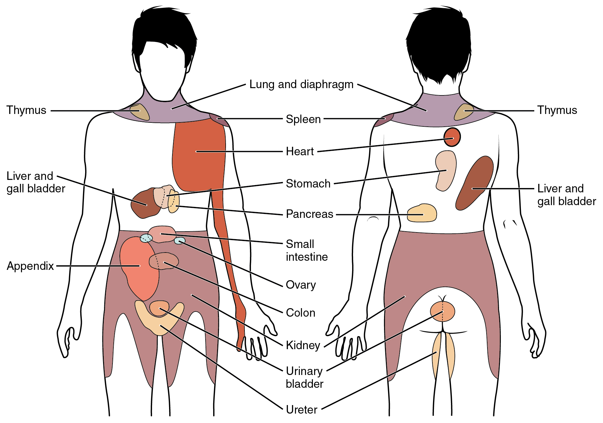
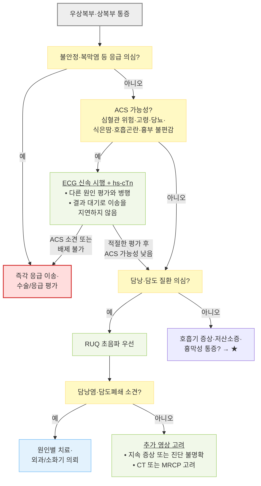
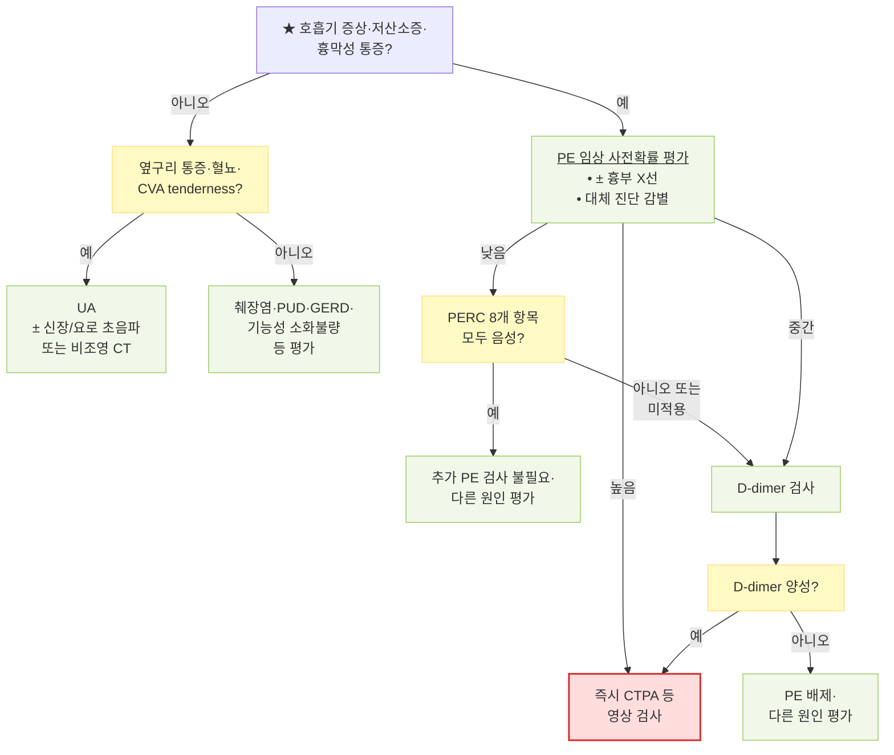
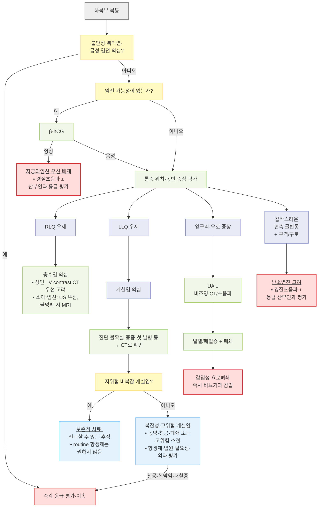
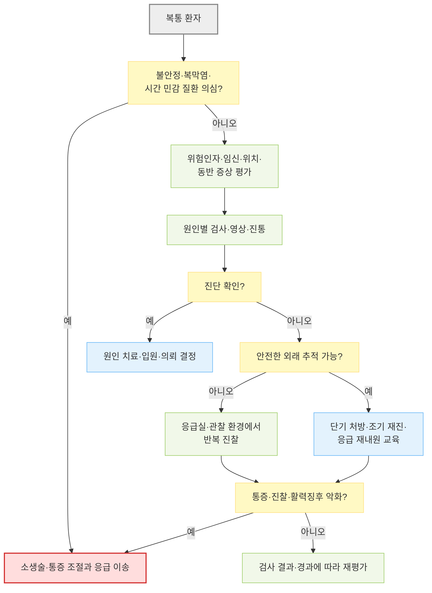

# 복통 Abdominal Pain

## <mark style="color:green;">일반 사항</mark>

* 복통은 1차 진료에서 가장 흔한 주소 중 하나로, 양성 기능성 질환부터 즉각적인 처치가 필요한 응급 질환까지 원인이 매우 다양함
* 통증의 위치·성질·시작·지속 시간·방사·악화·완화 인자와 동반 증상(발열, 구역·구토, 설사, 혈변, 황달 등)을 체계적으로 파악하는 것이 감별 진단의 핵심임
* 고령(특히 당뇨병·신부전) 환자는 통증·발열·복부 강직 등이 경미하게 발현될 수 있어 중증 질환을 간과하기 쉬우므로 비전형적 증상에도 악성·혈관 질환 가능성을 항상 염두에 두어야 함
* 임신 가능성이 있는 가임기 여성의 급성 하복부·골반통에서는 임신 여부를 우선 확인하고 β-hCG를 시행
  * 임신이 확인되면 자궁외임신을 반드시 배제
* 복용 중인 약물을 반드시 확인
  * NSAIDs(→ 소화성 궤양·천공), 항생제(→ 항생제 관련 장염) 등은 복통의 직접적 원인이 될 수 있음
  * 드물게 약물 유발 췌장염이 발생할 수 있음
    * 관련성이 보고된 약물 : azathioprine, valproate, thiazide계 이뇨제; 약제별 근거 수준은 다름
  * 스테로이드는 잠재적 위험인자이나 주요 원인은 아님
  * DPP-4 억제제 및 GLP-1 수용체 작용제도 췌장염 발생이 보고되나 인과성에는 논란이 있어 과도하게 강조하지 않되, 당뇨·비만 치료 중인 환자의 복통에서는 약물 복용력을 확인
  * SGLT2 억제제 복용 환자는 혈당이 정상 또는 경도 상승만 보이는 euglycemic DKA가 가능함을 우선 고려 (혈당만으로 DKA를 배제하지 말 것)
  * 항응고제·항혈소판제 복용 환자의 복통·옆구리 통증에서는 복직근 혈종(rectus sheath hematoma) 또는 후복막 출혈(retroperitoneal bleeding) 가능성 고려
  * metformin은 복통·설사·구역 등 소화기 부작용이 흔하며, 드물지만 탈수·신기능 저하 동반 시 metformin 관련 젖산산증(lactic acidosis) 가능성 고려

### <mark style="color:$danger;">🚩 Red Flags!</mark>

<mark style="color:$danger;">**즉각 조치**</mark>

* 활력징후 불안정 (저혈압, 빈맥, 빈호흡) `쇼크·저관류 의심`
* 복부 강직, 반동 압통 `복막염`
* 심방세동·혈관 질환 환자의 갑작스럽거나 심한 지속 복통, 특히 진찰 소견보다 심한 통증 `급성 장간막 허혈`
  * 정상 lactate로 배제하지 않으며, 즉시 CT 혈관조영술(CT angiography, CTA)이 가능한 응급실로 이송
* 발열·패혈증 소견과 요로폐쇄 동반 `감염성 요로폐쇄`
* 급성 하복부·서혜부 통증과 음낭 압통·종창 또는 고환 위치 이상 `고환염전`
* 대량 토혈·지속적 위장관 출혈, 또는 혈역학적 불안정·실신·복막자극이 동반된 출혈 `위장관 출혈`
* 복통·요통을 동반한 박동성 복부 종괴 (특히 고령·흡연·죽상동맥경화 환자) `증상성 복부대동맥류(abdominal aortic aneurysm, AAA)·파열 의심`
* 가임기 여성의 급성 하복부·골반통 + 혈역학적 불안정·실신/전실신·복막자극 소견·심한 편측 지속통 또는 의미 있는 질출혈 `자궁외임신 파열`
* 갑작스러운 극심한 복통 ("내 인생 최악의 통증") `혈관 사고(AAA, 대동맥 박리)` `천공` `장간막 허혈`
* 갑작스러운 상복부·복부 통증 + 흉통 또는 등 통증 + 사지 간 맥박·혈압 차이 또는 신경학적 증상 동반 `대동맥 박리`
* 갑작스러운 심한 편측 하복부·골반통 + 구역·구토 `난소염전`
* 발열·오한 + 황달 + 저혈압 또는 의식 변화 `급성 담관염` `패혈증`
* 통증을 동반한 환원되지 않는 서혜부·대퇴부 종괴 `감돈·교액 탈장`

<mark style="color:$warning;">**당일 평가**</mark>

* 통증이 지속적으로 악화되거나 반복 구토로 경구 섭취가 불가능함
  * 새 복막자극 소견·전신 상태 악화가 동반되면 즉각 조치
* 재평가 시 활력징후·진찰 소견이 변화
* 흑변·혈변·토혈이 있으나 활력징후가 안정적 `위장관 출혈`
* 발열 동반 `복강내 감염`
* 황달 동반 `담관염` `간염` `담도 폐쇄`
  * 발열·오한이 함께 있으면 쇼크 이전이라도 지체 없이 병원(응급실) 평가
* 복부 종괴 또는 복부 장기 비대 (박동성 제외) `복강내 종양`
* 고령(특히 65세 이상), frailty 또는 중대한 동반 질환에서 새로 발생한 원인 불명 급성 복통
* 심방세동·혈관 질환 환자의 원인 불명 복통
  * 갑작스럽거나 심한 지속통·진찰 소견보다 심한 통증이면 즉각 조치
* 가임기 여성의 급성 하복부·골반통 (활력징후 안정, 즉각 위험 소견 없음) `자궁외임신` `골반염`

<mark style="color:$info;">**조기 평가 및 추적**</mark>

* 설명되지 않는 체중 감소 `악성 종양`
* 원인이 설명되지 않는 빈혈 (예: 철결핍빈혈) `대장암` `위장관 출혈`
* 복통 양상의 변화
* 같은 문제로 반복적인 진료
* 가족력 (난소 또는 창자의 악성 종양, 가족성 대장폴립증 등) `대장암` `난소암`

## <mark style="color:green;">진단</mark> <a href="#abdominal-diagnosis" id="abdominal-diagnosis"></a>

* 진찰, 활력징후, 병력 청취
* 가임기 여성에서 자궁외임신 배제 : 소변 또는 혈청 β-hCG
  * β-hCG 양성 시 단일 β-hCG 수치나 조기 초음파 음성만으로는 자궁외임신이 배제되지 않으므로, 임신 위치가 미상(pregnancy of unknown location)인 경우 정량 β-hCG 추이·경질초음파 추적 필요

#### <mark style="color:$primary;">실험실 검사</mark>

**기본**&#x20;

* CBC, 전해질, BUN/Cr, 간기능(AST/ALT/ALP/bilirubin), lipase, UA
* 미분화 급성 복통의 초기 평가로 흔히 함께 시행하나, 병력·통증 위치·임상 가설에 따라 항목 조정 가능
* 간기능 : RUQ 통증·황달·담도 질환 의심 시 특히 유용
* lipase : 상복부 통증 등 췌장염 의심 시 amylase보다 우선 시행 - 진단 정확도가 높고 상승이 더 오래 지속되어(lipase 약 8\~14일, amylase 약 3\~5일) 증상 발생 후 수일이 지나 내원한 경우에도 유용
  * 임상적으로 췌장염이 의심되면 증상 발생 시점과 관계없이 검사
* UA : 요로 증상·옆구리 통증 또는 임신 관련 감별 시

**추가 고려**

* β-hCG : 임신 가능성이 있는 가임기 여성
* CRP/ESR : 염증 정도 평가
* coagulation : 출혈 의심
* lactate : 장간막 허혈 의심 - 초기에는 정상일 수 있으므로 음성이어도 배제 불가
* 혈당, 혈중 β-hydroxybutyrate(우선), 전해질, bicarbonate, 정맥혈가스 : 당뇨 환자에서 DKA에 의한 가성 복막염 평가&#x20;
  * SGLT2 억제제 복용 환자는 euglycemic DKA가 가능하므로 혈당만으로 배제하지 않음
  * anion gap은 보조적으로 해석하며, 혈중 케톤을 측정할 수 없으면 소변 케톤을 사용하되 초기 위음성 가능성에 유의 <mark style="color:$info;">\[ADA/EASD 등 2024]</mark>

<mark style="color:cyan;">**Lab 해석**</mark>

<table><thead><tr><th width="256">검사 소견</th><th>시사 질환</th></tr></thead><tbody><tr><td><strong>AST/ALT 현저히 상승</strong></td><td>간염 (바이러스·허혈·약물)</td></tr><tr><td><strong>ALP + bilirubin 상승</strong></td><td>담도 폐쇄</td></tr><tr><td><strong>Lipase ≥3×ULN(upper limit of normal) + 전형적 상복부 통증</strong></td><td>급성 췌장염 (Revised Atlanta Criteria: ① 전형적 통증, ② lipase/amylase ≥3×ULN, ③ 영상 소견 중 2개 이상 충족 시 진단)</td></tr><tr><td><strong>Lactate 상승</strong></td><td>장간막 허혈, 패혈증; 단, 정상 lactate가 장간막 허혈을 배제하지는 못함</td></tr><tr><td><strong>WBC 현저히 상승 + CRP 상승</strong></td><td>충수염, 담낭염, 게실염 등 염증성·감염성 질환 (비특이적 - 단독으로 확진·배제 불가)</td></tr><tr><td><strong>β-hCG 양성</strong></td><td>임신 (자궁외임신 배제 필수)</td></tr></tbody></table>

#### <mark style="color:$primary;">심전도(ECG)</mark> <a href="#acs-evaluation" id="acs-evaluation"></a>

* 고령, 여성, 당뇨 또는 심혈관 위험인자(고혈압, 흡연, 관상동맥 질환 병력)가 있는 환자의 설명되지 않는 상복부 통증, 특히 흉부 불편감, 호흡곤란, 식은땀, 구역 등이 동반되면 ECG 및 고감도 심장 트로포닌(high-sensitivity cardiac troponin, [hs-cTn](002_-chest-pain.md#lab)) 검사를 적극 고려 - 이들 환자에서는 ACS가 흉통 없이 상복부 통증·구역·피로감 등으로 나타날 수 있음
* 초기 정상 ECG·첫 hs-cTn만으로 ACS를 배제하지 않음. 증상 발생 시각·임상적 의심도와 검증된 hs-cTn 배제 경로에 따라 판단하며, 필요시 반복 검사 <mark style="color:$info;">\[ACC/AHA 등 2025]</mark>
* 외래에서 검사 결과를 기다리느라 응급 이송을 지연하지 않음

#### <mark style="color:$primary;">영상 검사</mark> <a href="#abdominal-imaging" id="abdominal-imaging"></a>

* 복부 X선 : 장폐쇄 또는 천공이 의심되는 일부 상황에서 보조적으로 사용할 수 있으나, 민감도가 낮아 CT를 대체하지 못함
* 복부 초음파(US) : 담낭·담도·신장·부속기 평가; 임신·소아에서 1차 선택
* 복부-골반 CT : 성인의 미분화 급성 복통, 특히 고령, 전신상태 이상, 혈관 위험 또는 중증 질환이 의심되는 경우 중요한 초기 영상 검사
  * 충수염·게실염·폐쇄·천공 등 광범위한 원인을 평가할 수 있음
  * 장간막 허혈·AAA 등 혈관질환이 의심되면 적절한 CTA protocol을 선택
* MRI : 방사선 노출을 피해야 하는 임신·소아에서 초음파로 진단이 불명확한 충수염 평가에 유용
  * 담도계 평가에서는 MRCP가 담관·췌관을 비침습적으로 시각화하여 담석·협착 감별에 도움
* 부인과 초음파 : 자궁외임신, 난소 병변 의심 시 (경질초음파가 우선)
* POCUS (point-of-care US; 현장진단초음파) : AAA 선별, 담낭 평가, 수신증(hydronephrosis) 확인에 유용

<mark style="color:cyan;">**CT vs 초음파 선택 원칙**</mark>

* 연령, 임신 여부, 통증 위치, 의심 질환에 따라 US 또는 MRI를 우선 선택할 수 있음

<table data-search="false"><thead><tr><th width="207">임상 상황</th><th width="150"></th><th>권장 영상</th></tr></thead><tbody><tr><td colspan="2"><strong>RUQ 통증</strong> (담낭·담도 의심)</td><td>초음파 우선</td></tr><tr><td colspan="2"><strong>LLQ 통증</strong> (게실염 의심)</td><td>CT</td></tr><tr><td colspan="2"><strong>옆구리 통증</strong> (요로 결석 의심) - 성인</td><td>비조영 CT (가장 정확); 임신에서는 초음파 우선</td></tr><tr><td rowspan="2"><strong>충수염</strong> 의심</td><td>성인</td><td>CT abdomen/pelvis with IV contrast 우선 (조영제 금기 등 상황에 따라 protocol 조정)</td></tr><tr><td>소아·임신</td><td>초음파 우선; 불명확 시 MRI 고려</td></tr><tr><td colspan="2"><strong>골반 통증</strong> (부인과 의심)</td><td>경질초음파</td></tr><tr><td colspan="2"><strong>미분화 급성 복통</strong> (고령·혈관 위험·diffuse pain)</td><td>CT</td></tr><tr><td rowspan="2"><strong>AAA</strong> 의심</td><td>혈역학적 불안정</td><td>지체하지 말고 즉시 수술/혈관외과 협진 및 응급 이송; bedside POCUS는 신속한 확인 용도로만 활용</td></tr><tr><td>혈역학적 안정</td><td>CT angiography</td></tr></tbody></table>

## <mark style="color:green;">감별</mark> <a href="#differential-diagnosis" id="differential-diagnosis"></a>

### <mark style="color:orange;">통증 기원에 따른 특징</mark>

#### <mark style="color:$primary;">Visceral pain (내장통)</mark>

* 기전 : 내장 기관(소장, 대장, 담낭, 요관, 신장 등)의 폐쇄 또는 염증
  * 예: 소화성 궤양, 담낭염, 간염, 충수염, IBD, 신우신염, PID 등&#x20;

<mark style="color:cyan;">**기원별 통증 부위**</mark>

* embryologic origin 관련 부위에 통증이 나타남
* 임상적으로는 "배꼽 주위 → 우하복부 이동"과 같은 국소화(localization) 패턴이 감별에 더 직접적으로 활용됨
* Foregut 기원 : 식도, 위장, 십이지장 근위부, 간, 담낭, 췌장 → 상복부 통증
* Midgut 기원 : 십이지장 제2부 원위부 \~ 횡행결장 proximal ⅔ (hepatic flexure 포함, splenic flexure 제외) → 배꼽 주위 통증
* Hindgut 기원 : 횡행결장 distal ⅓ 이하(splenic flexure 포함) \~ 항문관 상부(치상선 위) → 치골 상부 통증

<figure><figcaption><p><strong>발생학적 기원에 따른 내장통의 대표 위치</strong> <br><em>저자 재구성 (참고 문헌: UNSW Embryology; MSD Manual Professional Edition)</em><br></p></figcaption></figure>

<mark style="color:cyan;">**임상 양상**</mark>

* 둔하고 국소화가 불명확하며, 정중선 부근에 미만성으로 느껴지는 통증이 전형적
* 구역·구토·발한 등 자율신경 증상이 동반될 수 있음
* hollow organ의 폐쇄·강한 연동운동 시 경련성 또는 산통성(colicky) 통증 발생, 복부 팽만이 동반 가능
* 염증·허혈에 의한 통증은 지속적일 수 있으며, 급성 장간막 허혈 초기에는 심한 통증에 비해 복부 진찰 소견이 경미할 수 있음
* 염증이 벽측 복막으로 진행하면 체성통이 더해져 국소 압통·근성 방어(guarding)·반동 압통(rebound tenderness)이 나타날 수 있음

#### <mark style="color:$primary;">Parietal pain (체성통)</mark>

* 기전 : 위액, 담즙, 췌장 효소, 대변, 고름, 혈액 등이 벽측 복막(parietal peritoneum)을 자극하거나 염증을 일으키면서 발생
  * 벽측 복막은 체성 신경 지배를 받아 통증이 날카롭고 비교적 정확히 국소화됨
  * 움직임·기침·복막 긴장의 변화에 의해 악화
* 임상 양상 : 날카롭고 국소화된 통증
  * 국소 압통, 근성 방어, 반동 압통 등이 나타날 수 있음

#### <mark style="color:$primary;">Referred pain (연관통)</mark>

* 병변이 있는 장기와 같은 척수 분절의 체성 감각 영역으로 통증이 느껴지는 현상
* 담낭·우측 횡격막 자극 → 우측 어깨 또는 우측 견갑부 통증
* 비장·좌측 횡격막 자극 → 좌측 어깨 통증(Kehr sign)
* 췌장 질환 → 등으로 방사되는 상복부 통증
* 요관 결석 → 옆구리에서 서혜부·고환 또는 대음순으로 방사
* 하엽 폐렴·흉막질환 → 상복부 또는 옆구리 통증으로 발현 가능
* 급성 심근경색 → 상복부 통증으로 발현 가능, 특히 고령·당뇨 환자에서 주의
* 내장통의 초기 위치(localization)와 연관통은 구분해야 함. 충수염의 배꼽 주위 내장통이 우하복부의 체성통으로 국소화되는 과정은 연관통과 구별함

<figure><figcaption><p><strong>장기별 통증 및 연관통(referred pain)의 대표적 분포</strong><br>출처: OpenStax College. <em>Anatomy and Physiology</em>, Referred Pain Chart (<a href="https://commons.wikimedia.org/wiki/File:1506_Referred_Pain_Chart.jpg">원본</a>, <a href="https://creativecommons.org/licenses/by/3.0/">CC BY 3.0</a>).</p></figcaption></figure>

> _장기와 관련하여 통증이 느껴질 수 있는 부위를 나타낸 도식으로, 장기의 해부학적 위치나 모든 환자의 통증 범위를 뜻하지 않음. 분포만으로 원인 질환을 확진·배제하지 않으며, 충수염의 통증 이동은 위 내장통·체성통 설명과 함께 해석함._ \
> _일부 표시(흉선·넓게 표시된 신장 영역 등)는 원 도식의 단순화로 임상적 의미가 제한적임_

#### <mark style="color:$primary;">Abdominal wall pain (복벽통)</mark>

* 복강 내 장기와 무관한 복벽 근육·근막·피부·신경 병변에 의한 통증
* 원인 질환 : 근육 긴장(muscle strain), 늑간신경포착, 복직근 혈종, 대상포진, 수술 후 신경종
* 특징 : 국소 압통, 자세 변화·움직임에 의해 악화
  * 일반적인 근육·신경성 복벽통에서는 복막자극 소견이 드묾. 단, 복직근 혈종 등에서는 복막자극 소견이나 혈역학적 불안정이 동반될 수 있음
* Carnett's sign : 압통 부위를 누른 상태에서 환자에게 고개를 들게 하거나(또는 상체를 들어 올리거나) 복근을 긴장시킬 때 압통이 유지되거나 악화되면 복벽 기원 가능성 높음
  * 양성 시 반복적 CT 검사보다 복벽 원인 치료를 먼저 고려
  * 초기 복막염에서도 복근 수축 시 통증이 악화될 수 있어 위양성 가능성이 있으므로, 반동 압통·발열·전신 상태 악화 등 다른 소견과 함께 종합 판단해야 함

### <mark style="color:orange;">통증 패턴 인식</mark> <a href="#pain-patterns" id="pain-patterns"></a>

* 통증 발생 양상은 원인 감별의 첫 번째 단서임

<table data-search="false"><thead><tr><th width="250">통증 패턴</th><th>시사 원인</th></tr></thead><tbody><tr><td><strong>갑작스러운 극심한 통증</strong></td><td>혈관 사고(AAA, 대동맥 박리), 천공, 장간막 허혈</td></tr><tr><td><strong>산통(colicky) - 파도처럼 반복</strong></td><td>장 폐쇄, 요관 결석; 담도 산통은 명칭과 달리 강해진 뒤 일정하게 지속되는 통증이 흔함</td></tr><tr><td><strong>지속적·점점 악화</strong></td><td>충수염, 담낭염, 췌장염 등 염증성 질환</td></tr><tr><td><strong>식후 악화 (postprandial)</strong></td><td>만성 장간막 허혈, 기능성 소화불량, 소화성 궤양 등</td></tr><tr><td><strong>배꼽 주위→우하복부 이동</strong></td><td>충수염 (전형적 이동 패턴)</td></tr><tr><td><strong>자세·움직임으로 악화</strong></td><td>복벽통, 근골격계 원인</td></tr><tr><td><strong>배변 후 호전</strong></td><td>IBS</td></tr></tbody></table>

### <mark style="color:orange;">위치에 따른 복부 통증의 감별</mark>

#### <mark style="color:$primary;">우상복부 및 상복부 복통</mark>

* Biliary colic : RUQ 또는 epigastrium의 심한 둔한 통증(대개 30분 이상 지속되다 수시간 내 소실), 구역, 구토, 발한
* Acute cholecystitis : RUQ 또는 epigastrium의 통증이 소실되지 않고 지속·악화(대개 4\~6시간 이상), 발열, 우상복부 압통·Murphy's sign
  * 통증 지속 시간만으로 확진·배제하지 않음
  * 복부 강직 등 복막자극 소견이 있으면 합병증 평가
  * Murphy's sign : 우측 쇄골중앙선의 늑골연 아래를 누른 채 깊게 숨을 들이쉬게 할 때, 통증 때문에 흡기가 갑자기 멈추면 양성(급성 담낭염 시사)
* Acute cholangitis : 'RUQ 통증, 발열·오한, 황달'의전형적 삼징(Charcot)이 모두 없어도 배제되지 않음
  * 전신 염증 소견·담즙정체 검사 이상·담도 영상 소견을 종합하여 판단 <mark style="color:$info;">\[TG18]</mark>
* Acute hepatitis : RUQ 통증; 피로, 구역, 구토, 식욕 부진, 황달, 진한 갈색 소변, 회색(점토색) 대변
  * 음주 병력
* Liver abscess : RUQ 통증, 발열
  * 특히 당뇨병, 간/담도/췌장에 기저질환이 있는 경우 의심
* Fitz-Hugh-Curtis 증후군 : 골반염이나 난관염 같은 여성 생식기 감염이 퍼져서 간 주변의 피막에 염증(간주위염) 발생; 젊은 여성에서 RUQ 통증
  * 하복부 증상 없이 RUQ 통증만 있을 수 있어 담낭염과의 감별이 필요
  * PID 병력 또는 STI 위험인자 확인
* Acute MI : 흉통·호흡곤란이 동반될 수 있으나, 흉통 없이 상복부 통증·구역·식은땀만으로 발현할 수 있음
  * 관상동맥병 위험이 있는 환자에서 의심 → ECG 즉시 시행, hs-cTn 평가 (NSTEMI에서는 ECG가 정상일 수 있음 유의)
* Pancreatitis : 점차 심해진 후 지속, 앞으로 기대면 호전, 등으로의 방사통
  * 음주 병력
* GERD : 가슴쓰림, 역류, 삼킴곤란
  * GERD·위염·기능성 소화불량은 해부학적으로 상복부 통증이지만 임상적으로 RUQ와 겹치는 경우가 많음
* Gastritis, Gastropathy : 상복부 불편감·통증, 구역·구토 ± 소화불량
* 소화성 궤양 : 상복부 통증·쓰림, 식사와 연관될 수 있음
  * NSAID 사용력과 _H. pylori_ 위험 확인
* Functional dyspepsia : 불편한 식후 포만감, 조기 포만감, 상복부 통증 또는 쓰림
  * 상복부 팽만감·구역이 동반될 수 있음
* Gastroparesis : 구역, 구토, 조기 포만감, 식후 포만감·팽만감&#x20;

***





> _PE=pulmonary embolism), PERC=PE rule-out criteria(폐색전증 배제 기준); CTPA=CT pulmonary angiography._
>
> _초기 정상 ECG·첫 hs-cTn만으로 ACS를 배제하지 않으며, 검증된 배제 경로와 필요시 반복 검사를 적용함._ \
> _PE의 낮음·중간·높음은 임상 사전확률을 뜻함; PERC는 적용 가능한 저위험 성인에서 사용하고, D-dimer는 검사법·연령 및 선택한 진단 경로에 맞는 기준값을 적용함._ \
> _CTPA가 부적절한 경우에는 V/Q 검사 등 대체 영상을 고려함_

<p align="center"><strong>우상복부·상복부 복통의 평가 알고리듬</strong><br><em><mark style="color:$info;">저자 재구성 (참고 문헌 : ACR Right Upper Quadrant Pain 2022;</mark></em> <br><em><mark style="color:$info;">ACC/AHA 등 ACS 2025; AHA/ACC 등 PE 2026)</mark></em></p>

***

#### <mark style="color:$primary;">좌상복부 복통</mark>

* Splenomegaly : LUQ 불편감, 조기 포만감; 횡격막 자극 시 왼쪽 어깨 통증 가능
* 비장경색 : 갑작스러운 LUQ 통증 ± 발열
  * 심방세동·감염성 심내막염·혈액질환 등 색전·혈전 위험 확인
* 비장파열 : 외상(경미한 외상 포함) 후 또는 비장비대(전염성 단핵구증 등) 환자의 LUQ 통증
  * 좌측 어깨 통증(Kehr sign)·저혈압이 동반될 수 있음
  * 파열이 의심되면 즉시 응급 평가
* 비장농양 : LUQ 통증 + 발열
  * 심내막염·면역저하 환자에서 의심
* 위·췌장(꼬리) 질환, 좌측 신장·요관 질환, 좌하엽 폐렴·흉막 질환, 비장만곡부 허혈성 결장염도 LUQ 통증으로 발현 가능
* 급성 LUQ 통증의 원인이 불명확하거나 비장경색·농양 등 중증 병변이 의심되면 조영증강 CT가 유용하며, 비장비대 평가에는 초음파도 활용 <mark style="color:$info;">\[ACR 2025]</mark>

#### <mark style="color:$primary;">하복부 복통</mark>

* Appendicitis : 배꼽 주위에서 시작한 통증이 RLQ로 이동할 수 있으며, 간혹 복부 전체 통증; 식욕 부진, 구역, 구토 - 전형적인 통증 이동이 없어도 배제하지 않음
  * 단순 충수염(uncomplicated appendicitis)에서는 선택적으로 항생제 치료 고려 가능 - 재발 위험이 있으며 장기적으로 상당수에서 충수절제술이 필요할 수 있음. Appendicolith 동반 시 치료 실패·합병증 위험이 더 높음. 환자와 충분한 상의 후 결정
* Diverticulitis : 국소 복통·압통(LLQ; 동양인에서는 우측도 흔함), 발열, 구역·구토, 배변 습관 변화
  * 수일간 지속
  * 고위험 소견, 면역저하, frailty, 안전한 외래 관리가 어려운 경우에는 항생제 치료
  * 정상 면역이며 전신 상태가 안정적이고, 경구 섭취와 신뢰할 수 있는 추적이 가능한 저위험 비복잡 게실염(농양·천공·누공·협착 또는 폐쇄가 없는 국소 결장벽 염증 및 주변 지방 침윤) 시 routine 항생제 사용 없이 관찰·보존적 치료를 권고 <mark style="color:$info;">\[ACG 2026]</mark>
  * 첫 발병이거나 중증·진단이 불확실한 경우 CT로 진단을 확인
  * complicated diverticulitis 회복 후에는 대장내시경을 권고하고, uncomplicated disease도 alarm symptom이 있거나 대장암 검진이 최신 상태가 아니면 대장내시경을 고려 <mark style="color:$info;">\[ACG 2026]</mark>
  * 우측 게실염 : 동양인에서 흔함; 충수염과 임상 양상 매우 유사  - CT로 감별 필요
  * 좌측 게실염 : 서구형의 전형적 위치(LLQ); 고령, 저섬유·고지방 식이 환자에서 호발
* Ischemic colitis (허혈성 결장염) : 주로 LLQ 또는 좌측 복통; 혈성 설사, 복통이 갑자기 시작
  * 고령, 동맥경화, 저혈압, 심방세동 환자에서 주의
  * CT가 초기 평가에 유용하며, 필요시 대장내시경으로 확인
  * Acute mesenteric ischemia(CTA가 핵심)와는 구분되는 질환임
* Nephrolithiasis : 편측 옆구리 통증, 등 통증
  * 발열/패혈증 소견 + 요로폐쇄(수신증) 동반 시 비뇨기과적 응급(infected obstructed kidney)
* Pyelonephritis : 편측 옆구리 통증, 늑골척추각 압통, 빈뇨, 급뇨, 배뇨통, 혈뇨, 발열, 오한, 구역
* Cystitis : 치골상부 통증; 배뇨통, 빈뇨, 급뇨, 혈뇨
* Acute urinary retention : 치골상부 통증

***



<p align="center"><strong>하복부 복통의 평가 알고리듬</strong><br><em><mark style="color:$info;">저자 재구성 (참고 문헌 : ACR Right Lower Quadrant Pain 2022;</mark></em> <br><em><mark style="color:$info;">ACR Acute Pelvic Pain 2023; ACG 2026; EAU Urolithiasis)</mark></em></p>

***

#### <mark style="color:$primary;">여성 특이 하복부 복통</mark>

* Ectopic pregnancy : 편측 하복부 통증, 질 출혈, 무월경; β-hCG 양성
  * 파열 시 복강 내 출혈(혈복강)·쇼크 → 응급 조치
* 골반염(PID) : 하복부 통증(대개 양측); 성매개감염 위험이 있고 다른 원인이 뚜렷하지 않은 환자에서 자궁경부 운동통(cervical motion tenderness)·자궁 압통·부속기 압통 중 하나 이상이면 PID를 의심하고 경험적 치료를 고려함. 발열·질 분비물은 뚜렷하지 않을 수 있음 <mark style="color:$info;">\[CDC 2021]</mark>
  * Fitz-Hugh-Curtis 증후군(간 주위염) 합병 시 RUQ 통증 동반 가능
* 난소낭종 파열 : 갑작스러운 편측 하복부 통증
  * 성적 활동 또는 운동 후 발생 가능
* 난소염전 : 갑작스러운 심한 편측 하복부 통증, 구역, 구토
  * 경질초음파를 시행하되 정상 Doppler 혈류만으로는 배제하지 않으며, 임상적으로 강하게 의심되면 영상 결과와 관계없이 즉시 산부인과 응급 평가 및 진단적 복강경을 고려 → 응급 조
* 원발성 월경통 : 월경 시작 전후 하복부 경련성 통증; 요통, 구역 동반 가능

#### <mark style="color:$primary;">미만성 복통</mark>

* 복막염 : 움직이거나 흔들리면 악화, 반동 압통, 복부 강직
* 장 폐쇄 : 경련성 복통, 구역, 구토, 변비, 복부 팽만
  * 높은 음조의 증가된 장음 또는 무음이 나타날 수 있으나 장음 소견만으로 확진·배제하지 않음
  * 서혜부·대퇴부·제대 등 탈장 가능부위를 반드시 진찰
  * 성인 소장 폐쇄의 가장 흔한 원인(약 60\~70%)은 수술 후 유착이므로 복부 수술력 확인이 중요
* GI 천공 : 갑작스러운 심한 복통
* 복부대동맥류(AAA) 파열 : 갑작스러운 심한 복통 또는 요통, 박동성 복부 종괴, 혈압 저하
  * 고령, 흡연력, 죽상동맥경화 병력이 있는 환자에서 강하게 의심
  * 흡연은 AAA의 발생·성장·파열 위험을 높이며, AAA가 있는 여성은 남성보다 파열 위험이 높음
  * 박동성 종괴가 촉지되지 않아도 배제되지 않으며, 즉각 응급 조치 필요
* Acute mesenteric ischemia : 급성의 심하고 지속적인 복통; 통증에 비해 복부 진찰 소견이 경미
  * 검사 : 조기 CT angiography 시행; 초기에는 lactate가 정상일 수 있음
  * 심방세동, 최근 MI, 심부전 환자에서 강하게 의심
* Chronic mesenteric ischemia : 식후 30분\~1시간 내 시작하여 1\~2시간 지속되다 가라앉는 상복부·배꼽 주위 통증이 식사마다 반복됨(장 협심증, intestinal angina); 구역·구토·설사가 동반될 수 있음 → 통증에 대한 공포로 식사를 기피(food fear)하여 체중 감소
  * 통증이 식후에 가라앉지 않고 지속·악화되면 급성 장간막 허혈로의 진행을 의심하여 응급 평가
* 급성 감염성 위장관염 : 상대적으로 덜 심한 복통, 설사, 구역, 구토
  * 바이러스성(norovirus 등)과 세균성(식중독 포함) 원인 모두 포함
  * 독소 매개형 식중독은 원인균에 따라 잠복기와 주 증상이 다름&#x20;
    * 음식에 미리 형성된 독소에 의한 _S. aureus_ 식중독은 30분\~8시간, _B. cereus_ 구토형은 1\~6시간 내 급격한 구역·구토로 발현; _C. perfringen&#x73;_&#xB294; 6\~24시간 후 설사·복통이 주 증상 (☞ [감염성설사](../224_/085_-acute-infectious-diarrhea.md))
* 셀리악병 : 부피가 큰 설사, 나쁜 냄새의 지방변, 복부 가스
* [과민대장증후군](../224_/087_-ibs.md) : 지속적이지 않고 반복되는 복통 또는 복부 불편감이 배변 및 배변 빈도·형태 변화와 연관됨
  * Rome V 기준은 최근 3개월 동안 월평균 ≥3일, 증상 시작 ≥6개월 전이며 관련 3요소 중 ≥2개를 충족
  * Lactose intolerance(경련성 복통, 복부 팽만·가스, 설사)와 감별 필요
* Diverticulosis : 대부분 무증상; 일부에서 복부 불편감 또는 배변 습관 변화가 동반될 수 있음
* IBD : 혈성 설사, 배변 긴박감, 뒤무직, 발열, 장외 증상(관절염, 포도막염); 만성·재발성 경과가 흔하지만 최근 발생한 지속성 혈성 설사나 급성 중증 대장염으로 처음 발현할 수도 있음

### <mark style="color:orange;">복강 외 원인 (Extra-abdominal Causes)</mark>

<table><thead><tr><th width="142">질환</th><th>복통 양상 및 진단 단서</th></tr></thead><tbody><tr><td>급성 심근경색</td><td>상복부 통증; 고령·당뇨·심혈관 위험인자; ECG + hs-cTn 평가</td></tr><tr><td>폐렴</td><td>하폐엽 폐렴에서 상복부·옆구리 통증 가능; 호흡기 증상, 흉부 X선</td></tr><tr><td>폐색전증</td><td>흉막 자극 시 복통 발생 가능; 호흡 곤란, 임상 사전확률에 따른 D-dimer, 확진은 CTPA</td></tr><tr><td>당뇨병 케톤산증</td><td>미만성 복통, 구역·구토; 혈당·혈중 케톤(β-hydroxybutyrate)·전해질·bicarbonate·정맥혈가스 확인; anion gap은 보조적으로 해석 (SGLT2 억제제 사용자는 정상~경도 혈당에서도 가능 - euglycemic DKA)</td></tr><tr><td>대상포진</td><td>발진 전구기 편측 복통, 피부 과민(allodynia), 띠 모양(dermatomal) 통증; 수포 출현 시 확진</td></tr></tbody></table>

### <mark style="color:orange;">고령자 복통의 특징</mark>

* 통증 강도가 낮고 증상이 경미하게 발현되어 진단이 지연되고 심각한 질환을 과소평가하기 쉬움
* 발열·백혈구 증가·복부 강직 등이 뚜렷하지 않은 경우가 많음
* 충수염 천공, 장 폐쇄, 장간막 허혈 등의 지연 진단이 흔함
* 고령자의 진단 불명 급성 복통에서는 영상 검사 및 관찰의 역치를 낮춤
  * 진단이 불확실하면 serial abdominal exam(반복 신체 검진)으로 증상·소견의 변화를 추적하는 것이 단일 시점 검진보다 유용
  * 외래 귀가 시 명확한 지침 제공 및 조기 재평가
* 심방세동·동맥경화 병력이 있는 경우 장간막 허혈 강하게 의심

### <mark style="color:orange;">소아 복통의 특징</mark>

* 장중첩증(intussusception) : 주로 영유아, 간헐적 발작성 복통과 무기력이 반복, 담즙성 구토, 혈변("currant jelly stool")
  * 담즙성 구토·currant jelly stool 등 고전적 소견은 비교적 진행된 단계에서 나타나며, 없어도 배제되지 않음; 초음파로 확인
* Henoch-Schönlein purpura(IgA 혈관염) : 복통 + 촉지성 자반(palpable purpura, 주로 하지) + 관절통 ± 혈뇨; 복통이 자반보다 먼저 나타날 수 있음
* 급성 충수염 : 소아, 특히 어린 연령에서는 증상 표현이 불명확하여 진단이 지연되고 천공률이 높음
* 고환염전(testicular torsion) : 음낭통 없이 하복부·서혜부 통증만으로 발현할 수 있어 진단이 지연되기 쉬우므로, 남아의 하복부·서혜부 통증에서는 외부 생식기 진찰을 반드시 병행
* 기능성 변비(functional constipation) : 배꼽 주위 또는 하복부의 쥐어짜는 듯한 통증이 배변 후 호전되는 양상이 흔함. 단, 이 소견만으로 진단하지 않고 배변 빈도 감소, 딱딱하거나 통증 동반 배변, 변 참기 행동, 굵은 변, 촉지되는 분변 덩이 등 연령별 진단 요소를 함께 확인
  * red flag(체중 감소, 혈변, 발열, 야간통 등) 없이 이러한 소견들이 함께 있으면 기능성 변비를 우선 고려
  * 1차 진료 소아 급성/재발성 복통의 매우 흔한 원인
* 의사소통이 어려운 영유아는 보챔·다리를 배 쪽으로 끌어당기는 자세·수유 거부 등이 복통의 대리 지표가 될 수 있음
* 담즙성(초록색) 구토 : 장회전이상에 의한 중장염전 등 장폐쇄 가능성이 있어 즉시 응급 평가(특히 신생아·영아)

***

## <mark style="background-color:$warning;">Management</mark>

### <mark style="color:orange;">접근 원칙</mark>

**Step 1. 활력징후 안정 여부 확인**

* 활력징후 불안정(저혈압·빈맥) 또는 복막염 소견 → 즉각 응급 이송 (소생술 + CT/수술 준비)

**Step 2. Red flag 및 고위험군 확인**

* 고령(특히 ≥65세), frailty, 심방세동·혈관 질환, 당뇨·CKD·면역 저하 등은 중증 질환의 비전형적 발현 위험을 높이는 risk modifier이므로 영상 검사·관찰 역치를 낮춤
* 임신 가능성이 있는 가임기 여성은 β-hCG 확인

**Step 3. 치명적·시간 민감성 질환 우선 배제**

<table data-search="false"><thead><tr><th width="168">질환</th><th>핵심 단서</th></tr></thead><tbody><tr><td><strong>AAA 파열</strong></td><td>고령·흡연·박동성 종괴·저혈압</td></tr><tr><td><strong>대동맥 박리</strong></td><td>흉통/등통 동반·사지 간 맥박·혈압 차이·신경학적 증상</td></tr><tr><td><strong>장간막 허혈</strong></td><td>AF·심혈관 병력·pain out of proportion</td></tr><tr><td><strong>GI 천공</strong></td><td>갑작스러운 극심한 통증·복막염 소견</td></tr><tr><td><strong>교액성 장폐쇄</strong></td><td>산통에서 지속통으로 전환·복막 자극 동반</td></tr><tr><td><strong>자궁외임신 파열</strong></td><td>가임기 여성·β-hCG 양성·혈역학적 불안정</td></tr><tr><td><strong>Acute MI</strong></td><td>상복부 통증·심혈관 위험인자·ECG 변화(초기에는 없을 수 있음)</td></tr></tbody></table>

> _위는 대표적 예시이며 전체 목록이 아님._\
> _난소·고환염전, 감염성 요로폐쇄, 급성 담관염+패혈증 등 부위별 세부 감별은 감별 섹션 참조_

**Step 4. 통증 패턴 + 위치 기반 감별 → 검사 선택**

* [통증 패턴 인식](003_-abdominal-pain.md#pain-patterns), [영상 검사](003_-abdominal-pain.md#abdominal-imaging) 참조

**Step 5. 조치 방향 결정**

* 활력징후 불안정, 복막염, 치명 질환 의심 → 응급 의뢰 또는 이송
* 진단이 불명확하거나 중증 질환을 완전히 배제하기 어려움(예: 초기 충수염 의심) → 응급실 또는 관찰 가능한 환경에서 serial examination 및 필요시 반복 검사
* 활력징후 안정, 중증 질환 가능성이 낮고 경증·기능성 가능성이 높음 → 외래 추적 + 명확한 지침 설명 - "통증 악화, 발열, 구토 지속, 혈변 발생 시 즉시 재내원"

***



<p align="center"><strong>복통 관리 알고리듬</strong><br><em><mark style="color:$info;">저자 재구성 (참고 문헌 : ACR Acute Nonlocalized Abdominal Pain 2018;</mark></em> <br><em><mark style="color:$info;">WSES Acute Mesenteric Ischemia 2022)</mark></em></p>

***

### <mark style="color:orange;">진통제 사용 원칙</mark> <a href="#analgesia-principles" id="analgesia-principles"></a>

* 진단 전 진통제 투여는 진단 정확도를 떨어뜨리거나 치료 결정을 지연시키지 않으며, 통증이 완화되면 오히려 신체 검진이 용이해짐. 적절한 통증 조절은 표준 치료임 <mark style="color:$info;">\[Cochrane 2011]</mark>

<table><thead><tr><th width="147">임상 상황</th><th>권장 진통제</th></tr></thead><tbody><tr><td><strong>신장·요관 산통</strong><br><strong>(renal colic)</strong></td><td>NSAIDs 우선(경구 또는 주사) - 신기능 저하·탈수·출혈 위험 등 금기를 먼저 확인; <br>NSAID에 진경제 병용은 통증 조절 개선 근거 부족</td></tr><tr><td><strong>담도 산통</strong></td><td>NSAID 우선; 필요시 추가 진통제 고려</td></tr><tr><td><strong>급성 췌장염</strong></td><td>Opioid 사용 가능 - Oddi 괄약근 경련 우려만으로 opioid를 일률적으로 피할 근거는 불충분하며, 적절한 통증 조절이 우선</td></tr><tr><td><strong>원인 평가 중의</strong><br><strong>급성 복통</strong></td><td>경증~중등도 통증에 대하여 acetaminophen 또는 원인에 적합한 NSAID를 우선 고려; 중등도~중증에서 비opioid로 불충분하거나 금기인 경우 short-acting opioid를 최소유효용량·최단기간 고려. 단, 진통제 투여 때문에 진단 평가를 지연하지 않음</td></tr></tbody></table>

### <mark style="color:orange;">주요 진단 오류</mark>

**심근경색(MI)을 위장 질환으로 오진**

* 흉통 없이 상복부 통증·구역으로 발현하는 ACS를 위염·GERD로 단정하지 않음

**AAA를 놓침**

* 고령·흡연 환자의 갑작스러운 복통·요통에서는 AAA를 고려하고, 박동성 종괴가 없어도 배제하지 않음

**장간막 허혈 과소진단**

* 심한 통증에 비해 진찰 소견이 경미하다고 기능성으로 단정하지 않음
* 심방세동·심혈관 병력과 함께 판단하여 CTA를 지체하지 않음

**자궁외임신 누락**

* 임신 가능성이 있는 환자의 하복부·골반통에서 임신 여부를 확인
* 임신 위치가 확인되지 않으면 추적 평가를 완료함

**충수염 초기에 귀가**

* 초기 충수염은 진찰·검사 소견이 불명확할 수 있음
* 의심이 남으면 단시간 관찰·반복 진찰을 시행하고, 안전한 외래 관찰이 어려우면 응급실 의뢰

**기능성 질환을 성급히 진단**

* 만성·반복적 복통만으로 IBS·기능성 소화불량으로 단정하지 않음
* IBS는 적절한 증상 기준으로 positive diagnosis가 가능하나, 경고 징후가 있으면 기질적 질환을 추가 평가

**게실염을 IBS로 오진**

* 새로 발생하거나 악화되는 국소 통증·발열·염증 수치 상승을 만성 IBS로 설명하지 않음
* 게실염이 의심되면 CT로 확인

**요관 결석의 감염 동반 폐쇄 놓침**

* 통증이 호전되었다고 폐쇄·감염이 배제되는 것은 아님. 발열/패혈증 + 요로폐쇄는 응급 감압이 필요한 비뇨기과적 응급 상황

**복벽 통증을 복강 내 질환으로 오진**

* 국소 압통과 Carnett's sign(+)이면 복벽 원인을 고려하여 불필요한 CT 반복을 줄임
* 단, 혈종·복막자극 소견 등은 함께 평가

**고령자 복통 과소평가**

* 통증·발열·진찰 소견이 경미해도 중증 질환 가능성을 고려하여 영상 검사·관찰 역치를 낮춤

**통증을 참으면 진단에 도움이 된다는 오해**

* 진단 평가와 적절한 진통을 병행함

***

## <mark style="color:red;">질병코드</mark>

* R10.0 급성 복증 Acute abdomen
* R10.10 우상복부통증 Right upper quadrant abdominal pain
* R10.11 좌상복부통증 Left upper quadrant abdominal pain
* R10.12 명치통증 Epigastric pain
* R10.19 상세불명의 상복부통증 Upper abdominal pain, unspecified
* R10.2 골반 및 회음부 통증 Pelvic and perineal pain
* R10.30 우하복부통증 Right lower quadrant abdominal pain
* R10.31 좌하복부통증 Left lower quadrant abdominal pain
* R10.32 배꼽주위통증 Periumbilical pain
* R10.39 상세불명의 하복부통증 Lower abdominal pain, unspecified
* R10.42 급통증 Colic
* R10.44 옆구리 통증 Flank pain
* R10.49 상세불명의 복통 Unspecified abdominal pain

***

## <mark style="color:purple;">처방례</mark>

> **처방례 1. 요관 산통 (신장 결석, 비복잡성)**
>
> ```
> 케토란주 30 ㎎/1 ㎖: 초회 10 ㎎ IM 또는 IV 후 재평가
>   ※ 필요시 10~30 ㎎을 4~6시간 간격으로 투여; 최소 유효량 사용, 주사 투여기간은 2일 이내
>   ※ 일반 성인 최대 90 ㎎/d; 고령자·체중 50 ㎏ 이하·금기에 해당하지 않는 신장애 환자는 최대 60 ㎎/d
>   ※ 중등도·중증 신부전, 탈수·저혈량증 등 투여 금기에 해당하면 감량 투여하지 않음
> ```
>
> 약제 정보: [케토란주 30 ㎎/1 ㎖](https://www.health.kr/drug/A11AHHHHH0001)
>
> _✽ NSAIDs가 1차 선택이지만 ketorolac의 제품별 금기를 먼저 적용함. 중등도·중증 신부전, 탈수·저혈량증, 소화성궤양·위장관 출혈 또는 그 병력, 출혈 소인, 기관지천식 또는 그 병력, 다른 NSAID·항응고제 병용 등에서는 투여하지 않음. PPI 병용으로 금기가 해소되지 않음. 대체 진통제도 자체 금기와 신·간기능·호흡억제 위험을 확인하여 선택하며, 심한 신장애에서 acetaminophen을 자동 대체제로 선택하지 않음(☞_ [_통증_](001_-pain.md#management)_)_
>
> _✽ 통증 조절 후 비조영 CT로 결석 확인 권장(임신 시 초음파 우선)_

> **처방례 2. 중증 질환 가능성이 낮아 외래 귀가가 결정된 급성 복통 - 단기 통증 조절**
>
> ```
> 타이레놀정 500 ㎎ 1회 1~2T, 최소 6시간 간격 필요시 (1일 최대 8T)
> 비opioid로 불충분하거나 금기인 경우 대안:
> 트리돌캡슐 50 ㎎ 1회 1C, 6~8시간 간격 필요시 (이 예의 1일 최대 4C = 200 ㎎)
>   ※ 고령자 및 경도~중등도 신·간기능 저하에서는 용량·투여 간격 개별 조정
>   ※ 중증 신장애·간장애는 금기; 감량 사용과 구분
> 구역·구토가 있을 때만 추가:
> 맥페란정 3.84 ㎎/T 1회 1T, 식전 필요시 (1일 최대 3회, 최소 6시간 간격, 최대 5일)
> ```
>
> 약제 정보: [타이레놀정 500 ㎎](https://www.health.kr/drug/2021082400002) · [트리돌캡슐 50 ㎎](https://www.health.kr/drug/A11A0450A0359) · [맥페란정 3.84 ㎎](https://www.health.kr/drug/A11A0570A0089)
>
> _✽ 귀가 시 통증 악화·발열·지속 구토·혈변 발생 시 즉시 재내원하도록 안내; 관찰 중 1회 투여는 위 Management의 진통제 사용 원칙을 따름_
>
> _✽ Tramadol : 세로토닌 증후군·경련·어지럼·낙상 위험이 있어 serotonergic drug(SSRI/SNRI/MAOI 등) 병용·뇌전증 병력 확인; MAOI(MAO-B 억제제 포함) 병용 및 중단 후 14일 이내는 금기이며, 적절히 조절되지 않는 뇌전증에도 투여하지 않음; 항경련제(gabapentinoid) 또는 항콜린제 병용 시 CNS 억제·호흡 억제 또는 진정·착란·변비 심화 위험이 상가적으로 증가하므로 병용 여부를 반드시 확인_
>
> _✽ 타이레놀정은 소화성궤양, 심한 간·신장애·심한 심장기능저하, aspirin 천식 또는 그 병력, TCA·바르비탈계 약물 복용 등 제품별 금기를 확인함. 다른 acetaminophen 함유 제품과 총량을 합산하며, 반복·장기 사용에서는 통상 3 g/d 이하를 보수적으로 권장_
>
> _✽ Metoclopramide : 맥페란정은 1정당 metoclopramide 3.84 ㎎으로 함량·정수를 구분함. 장폐쇄·위장관 출혈·천공, 파킨슨병·뇌전증, levodopa/도파민효능제 병용 등은 금기; domperidone 병용도 피함. 신·간기능에 따라 추가 감량하고, 추체외로 증상(EPS) 발생 가능성을 설명_

> **처방례 3. 급성 췌장염 의심 - 응급실 이송/입원 평가 전 통증 조절**
>
> ```
> 트리돌주50밀리그램 50 ㎎/1 ㎖ 1회 IV 또는 IM (호흡·의식·혈압 관찰)
>   ※ 이송 전 1회 투여 후 재평가; 반복 경구 처방(q6h 필요시 등)은 이송 전 상황에 적합하지 않으므로 지양
> 저혈량 소견 시 IV fluid(젖산링거액, LR 우선) - 활력징후·BUN/Cr·소변량에 따라 개별화하여 투여, 반복 재평가
>   ※ 과도한 aggressive hydration보다 임상 상태에 맞춘 조절이 원칙; 고령·심부전·CKD에서는 volume overload 주의 (용량·속도는 환자 상태에 따라 달라지므로 처방례로 고정하지 않음)
> ```
>
> 약제 정보: [트리돌주50밀리그램 50 ㎎/1 ㎖](https://www.health.kr/drug/A11A0450A0335)
>
> _✽ 급성 췌장염이 의심되면 응급실/입원 평가가 원칙이며, 위는 이송 전 1회성 통증 조절의 예시임_
>
> _✽ 급성 췌장염은 원칙적으로 NPO를 유지하는 질환이 아님 - 경증에서는 경구 섭취를 견딜 수 있으면 24\~48시간 이내 저지방 고형식으로 조기 경구 섭취를 시작하며, 중등도·중증에서는 경구 섭취 가능 여부에 따라 영양 공급 경로를 개별화 <mark style="color:$info;">\[ACG 2024]</mark>. 췌장염에서 opioid 사용은 과거 Oddi 괄약근 경련 우려로 기피했으나 임상적 근거는 불충분하며 적절한 통증 조절이 우선_

***

### <mark style="color:$success;">핵심 복약 지도</mark>

**NSAIDs**

* 위장 불편을 줄이려면 음식과 함께 복용하십시오. 다만 음식과 함께 먹어도 위궤양·출혈이 예방되지는 않습니다
* 위궤양·위장 출혈 병력, 콩팥 질환이 있거나 탈수 상태라면 미리 알려 주십시오
* 케토란주 등 ketorolac 주사는 2일을 넘겨 사용하지 않으며, [케토라신정](https://www.health.kr/drug/A11A0071A0045)은 최대 7일까지 복용합니다
* 필요한 기간만 최소 용량으로 사용하십시오. 위장약을 함께 처방받았더라도 같은 주의가 필요합니다

**Tramadol**

* 처음 복용할 때 어지러움·구역이 흔합니다
* 복용 중에는 술을 마시지 말고, 졸리거나 어지러우면 운전하지 마십시오
* 우울증약(특히 MAO 억제제)·뇌전증약·진경제를 복용 중이거나 경련 병력, 심한 콩팥·간 질환이 있으면 미리 알려 주십시오

**Opioid 계열**

* 처방된 용량과 기간을 지키십시오
* 졸리거나 어지러우면 운전이나 기계 조작을 하지 마십시오
* 오래 복용하면 의존이 생길 수 있습니다
* 변비가 생기기 쉬우므로 수분과 섬유질을 충분히 섭취하십시오
* 수면제·안정제를 함께 복용하거나 술을 마시는 것은 위험합니다

**진경제** **(hyoscine butylbromide 등)**

* 복용 후 입마름·눈이 침침함·소변보기 어려움이 생길 수 있습니다
* 녹내장, 소변을 보기 어려운 증상(전립선비대 등)이 있으면 미리 알려 주십시오

**Acetaminophen**

* 처방된 1회량과 간격을 지키십시오. 임의로 양을늘려 복용하지 마십시오
* 감기약·종합 진통제에도 같은 성분이 들어 있는 경우가 많으므로 함께 복용하지 마십시오
* 술을 마시지 마십시오

**Metoclopramide** ([맥페란](https://www.health.kr/drug/A11A0570A0089))

* 복용 후 토했더라도 다시 먹지 말고 최소 6시간 간격을 지키십시오
* 5일 이내로만 복용하십시오
* 목·턱이 뻣뻣해지거나 눈이 위로 돌아가고 몸이 저절로 움직이면 복용을 중단하고 즉시 진료를 받으십시오
* 구토가 계속되거나 배가 심하게 부르거나 통증이 심해지면 다시 진료를 받으십시오

***

## <mark style="color:green;">주요 참고문헌 및 확인 자료</mark>

### <mark style="color:orange;">임상 근거</mark>

* [Scheirey CD, et al. ACR Appropriateness Criteria® Acute Nonlocalized Abdominal Pain. J Am Coll Radiol. 2018;15(11S):S217-S231.](https://pubmed.ncbi.nlm.nih.gov/30392591/) - 성인 비국소성 급성 복통의 영상 검사 선택; 소아·국소 복통은 해당 기준과 구분
* \[ACG 2026] [Peery AF, et al. ACG Clinical Guideline: Colonic Diverticulitis. Am J Gastroenterol. 2026;121(7):1549-1561.](https://doi.org/10.14309/ajg.0000000000004047) - 저위험 비복잡 게실염의 항생제 선택적 사용과 회복 후 대장내시경
* [Lee JG, et al. Evidence-based clinical practice guidelines for diagnosis and medical management of acute colonic diverticulitis developed by the Korean Association for the Study of Intestinal Diseases (KASID). Intest Res. 2026;24(3):428-463.](https://doi.org/10.5217/ir.2025.00299) - 게실염의 진단·내과적 치료; 환자 위험도에 따른 항생제·입원 판단
* \[ACG 2024] [Tenner S, et al. American College of Gastroenterology Guidelines: Management of Acute Pancreatitis. Am J Gastroenterol. 2024;119(3):419-437.](https://pubmed.ncbi.nlm.nih.gov/38857482/) - 급성 췌장염의 초기 관리, 조기 경구 섭취와 합병증 평가
* [Manterola C, et al. Analgesia in patients with acute abdominal pain. Cochrane Database Syst Rev. 2011;(1):CD005660.](https://pubmed.ncbi.nlm.nih.gov/21249672/) - 진단 전 opioid 진통제 사용과 임상 소견·진단 지연에 관한 근거
* [OpenStax College. Anatomy and Physiology: Autonomic Reflexes and Homeostasis.](https://openstax.org/books/anatomy-and-physiology/pages/15-2-autonomic-reflexes-and-homeostasis) - 본문 연관통 그림 출처
* [Rome Foundation. Rome V Criteria.](https://theromefoundation.org/rome-v-criteria/) - IBS의 반복성 복통 또는 불편감과 간헐성·기간 기준
* [Bala M, et al. Acute mesenteric ischemia: updated guidelines of the World Society of Emergency Surgery. World J Emerg Surg. 2022;17:54.](https://doi.org/10.1186/s13017-022-00443-x) - 의심 시 지체 없는 CTA
* [American College of Radiology. ACR Appropriateness Criteria® Right Upper Quadrant Pain. Revised 2022.](https://acsearch.acr.org/docs/69474/Narrative/) - 담낭·담도 의심 시 영상 검사
* [American College of Radiology. ACR Appropriateness Criteria® Right Lower Quadrant Pain. Revised 2022.](https://acsearch.acr.org/docs/69357/Narrative/) - 성인 충수염 의심 시 영상 검사
* [American College of Radiology. ACR Appropriateness Criteria® Acute Pelvic Pain in the Reproductive Age Group. Revised 2023.](https://acsearch.acr.org/docs/69503/Narrative/) - 임신 여부·부인과 원인에 따른 골반 초음파
* \[ACR 2025] [Expert Panel on Gastrointestinal Imaging; Soleimani S, et al. ACR Appropriateness Criteria® Acute Left Upper Quadrant Pain. J Am Coll Radiol. 2025;22(11S):S481-S491.](https://doi.org/10.1016/j.jacr.2025.08.046) - 좌상복부 통증의 영상 검사
* \[ACC/AHA 등 2025] [Rao SV, et al. 2025 ACC/AHA/ACEP/NAEMSP/SCAI Guideline for the Management of Patients With Acute Coronary Syndromes. J Am Coll Cardiol. 2025;85(22):2135-2237.](https://doi.org/10.1016/j.jacc.2024.11.009) - ECG·hs-cTn의 신속한 평가와 반복 검사
* \[AHA/ACC 등 2026] [Creager MA, et al. 2026 AHA/ACC/ACCP/ACEP/CHEST/SCAI/SHM/SIR/SVM/SVN Guideline for the Evaluation and Management of Acute Pulmonary Embolism in Adults. J Am Coll Cardiol. 2026;87(13):1626-1710.](https://doi.org/10.1016/j.jacc.2025.11.005) - 사전확률·PERC·D-dimer·영상 검사 경로
* \[TG18] [Kiriyama S, et al. Tokyo Guidelines 2018: diagnostic criteria and severity grading of acute cholangitis (with videos). J Hepatobiliary Pancreat Sci. 2018;25(1):17-30.](https://doi.org/10.1002/jhbp.512) - 담관염의 진단과 중증도
* \[CDC 2021] [Workowski KA, et al. Sexually Transmitted Infections Treatment Guidelines, 2021. MMWR Recomm Rep. 2021;70(4):1-187.](https://www.cdc.gov/mmwr/volumes/70/rr/rr7004a1.htm) - PID의 진찰 소견과 경험적 치료 기준
* \[ADA/EASD 등 2024] [Umpierrez GE, et al. Hyperglycemic Crises in Adults With Diabetes: A Consensus Report. Diabetes Care. 2024;47(8):1257-1275.](https://doi.org/10.2337/dci24-0032) - 혈중 β-hydroxybutyrate·산염기 평가
* [Corsetti M, et al. Bowel Disorders. Gastroenterology. 2026;170(6):1261-1282.](https://doi.org/10.1053/j.gastro.2026.02.003) - Rome V 장질환 기준
* [European Association for the Study of the Liver. EASL Clinical Practice Guidelines on the prevention, diagnosis and treatment of gallstones. J Hepatol. 2016;65:146-181.](https://easl.eu/wp-content/uploads/2018/10/Gallstones-English-report.pdf) - 담도 산통과 담낭염의 임상 양상
* [European Association of Urology. EAU Guidelines on Urolithiasis.](https://uroweb.org/guidelines/urolithiasis/chapter/guidelines) - 결석 영상 검사·산통·감염성 요로폐쇄
* [CDC. Confirming an Etiology in Foodborne Outbreaks.](https://www.cdc.gov/foodborne-outbreaks/php/confirming-cause/index.html) - 원인균별 잠복기와 임상 증상
* Royal Children's Hospital Melbourne. Clinical Practice Guidelines: [Abdominal pain - acute](https://www.rch.org.au/clinicalguide/guideline_index/Abdominal_pain/); [Vomiting](https://www.rch.org.au/clinicalguide/guideline_index/Vomiting/) - 소아 급성 복통과 담즙성 구토의 응급 평가
* [NICE. Ectopic pregnancy and miscarriage: diagnosis and initial management (NG126).](https://www.nice.org.uk/guidance/ng126) - 임신 위치 미상 추적 평가

### <mark style="color:orange;">허가·급여 확인 자료</mark>

* [식품의약품안전처. 의약품안전나라 - 의약품 품목허가정보.](https://nedrug.mfds.go.kr/index) - 제품별 적응증·용법·금기 및 허가 상태
* 한국표준질병사인분류 제9차 개정(KCD-9). 2025.12.16 코드 자료 - 질병코드의 한글·영문 표제어

***

## <mark style="color:blue;">환자 안내서</mark>


**복통은 원인이 매우 다양합니다 - 위험 신호를 놓치지 마세요**

대부분의 복통은 일시적이고 자연히 회복되지만, 일부는 즉각적인 치료가 필요한 심각한 질환의 신호일 수 있습니다.


#### <mark style="color:$primary;">복통이란 무엇인가요?</mark>

* 배 전체 또는 특정 부위에 발생하는 통증·경련·불편감을 말합니다
* 원인은 소화기(위염, 장염, 충수염(맹장염), 담석, 변비), 비뇨기(요로결석, 방광염), 부인과(난소 낭종, 자궁외임신), 근육·혈관 질환 등 매우 다양합니다

#### <mark style="color:$primary;">이럴 때는 즉시 119에 연락하거나 응급실로 가세요</mark>

* 갑자기 찢어지는 듯한 극심한 복통이 발생한 경우
* 배가 딱딱해지거나 움직임·기침만으로 심하게 아픈 경우 - 확인하려고 배를 반복해서 세게 누르지 마십시오
* 고열과 함께 심한·지속적 복통, 의식 저하·탈수·호흡 곤란·복부 강직 등이 있거나, 구토가 지속되어 수분 섭취가 불가능하거나 혈변이 동반되는 경우
* 혈압 저하, 식은땀, 의식 저하가 동반되는 경우
* 가임기 여성에서 갑작스러운 심한 하복통 (자궁외임신 가능성)
* 윗배 통증과 함께 가슴 답답함·숨참·식은땀이 있는 경우 (특히 고령·당뇨·심장병 위험이 있는 분)
* 소아의 경우 : 의사소통이 어려운 영유아가 평소보다 심하게 보채거나, 다리를 배 쪽으로 끌어올리며 울음을 멈추지 않을 때는 즉시 진료를 받으십시오
* 아이가 초록색(담즙) 구토를 하는 경우
* 사타구니의 혹이 갑자기 아프고 단단해지거나 누워도 줄어들지 않는 경우 - 억지로 밀어 넣지 마십시오
* 피를 토하거나 검은 변·많은 혈변과 함께 어지러움·실신·식은땀이 동반되는 경우
* 갑작스러운 고환·음낭 통증이나 부기가 생긴 경우

#### <mark style="color:$primary;">복통 시 주의사항</mark>

* **원인을 모르는 심한 복통에서는 진통제를 임의로 반복 복용하기보다 의료진의 평가를 받으십시오** - 진료 과정에서 적절한 진통제를 사용하는 것은 안전하며 진단을 방해하지 않습니다
* **진료 후에도 통증이 심해지거나, 새로운 증상(발열, 구토 지속, 혈변 등)이 나타나면 즉시 재내원하십시오** - 처음 진료 시 원인이 명확하지 않았더라도 경과를 지켜보며 재평가하는 것이 안전한 진료 과정입니다
* **복통 위치와 시작 시간, 동반 증상을 메모**해 두면 진료 시 도움이 됩니다
* **식이 조절** : 응급질환이 배제되고 의료진이 경구 섭취가 가능하다고 판단한 상황에서 소화기 원인의 복통은 기름지고 자극적인 음식, 과음을 피하고 소량씩 자주 드시는 것이 도움이 될 수 있습니다
* **수분 보충** : 의료진이 마셔도 된다고 판단한 경우 조금씩 자주 마시십시오. 구토·설사로 탈수가 생기면 경구수분보충액(ORS)을 설명서대로 사용하십시오. 스포츠음료는 의료용 ORS와 전해질·당 농도가 다르므로 탈수 치료의 동등한 대체품으로 쓰지 마십시오
* **재평가** : 원인을 확정하지 못한 채 귀가한 경우 의료진이 정한 조기 재진 일정을 지키십시오. 통증이 지속되면 호전될 때까지 기다리지 말고 다시 진료받으십시오
