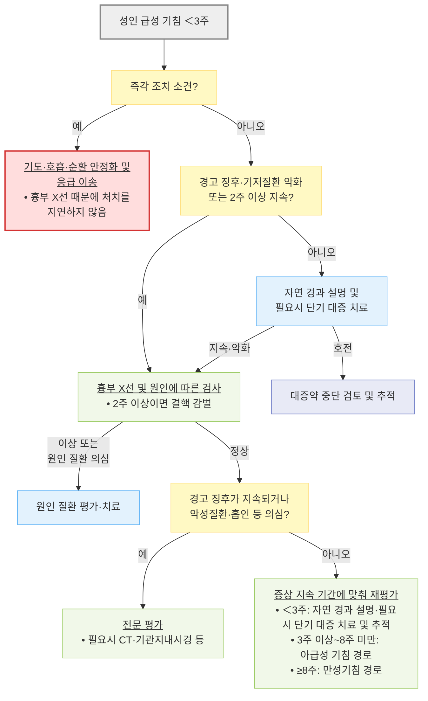
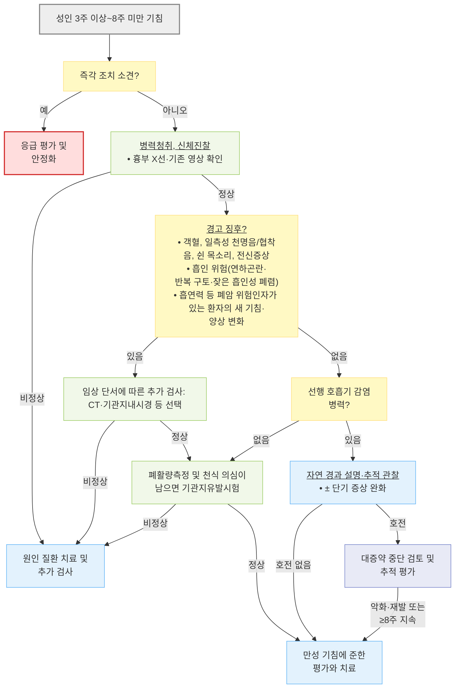
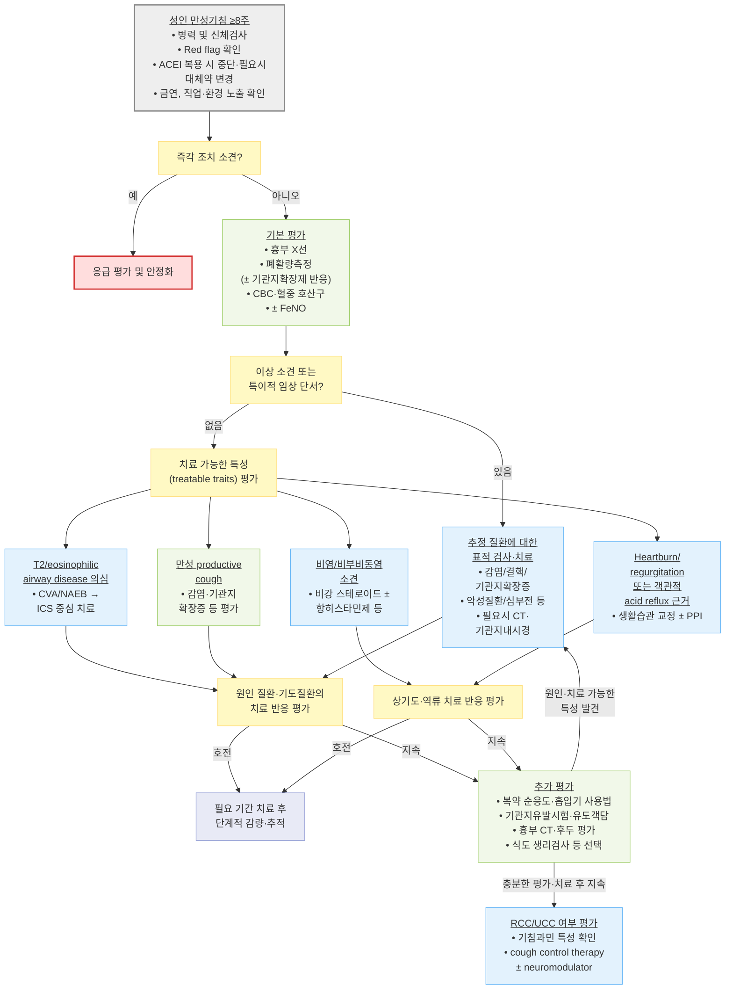

# 기침 Cough

## <mark style="color:green;">일반 사항</mark>

* 기침은 일차 진료에서 가장 흔한 주소 중 하나로, 기도 내 이물·분비물 제거를 위한 방어 반사이지만, 지속 시 삶의 질을 크게 저하시킴
* 성인은 지속 기간에 따라 급성(＜3주), 아급성(3주 이상\~8주 미만), 만성(≥8주)으로 분류하며, 이에 따라 원인과 접근법이 달라짐
* 만성 기침의 흔한 원인 : 천식(cough-variant asthma 포함), 상기도기침증후군(UACS), 비천식성 호산구성 기관지염(NAEB), 위식도역류질환(GERD)
  * 실제로 위식도역류가 기침에 기여하더라도 이를 임상적으로 확인하기는 쉽지 않으며, 특히 전형적 역류 증상이 없는 환자에서는 PPI의 기침 개선 효과가 제한적임
* 흡연 관련 만성 기침은 금연 후 대부분 호전하므로 금연 상담을 우선 시행
* 약물을 복용 중인 환자에서는 약물 관련성을 고려해야 함
  * ACEI 복용 중이면 약물 유발 기침을 먼저 배제할 것
  * 정맥 투여 opioid(특히 fentanyl) 직후의 기침, NSAID 과민반응에 의한 기관지 수축이 나타날 수 있으며, 안과용 prostanoid·statin 관련 기침도 드물게 보고됨
  * 비선택적 β차단제(점안 timolol 포함)는 β₂ 수용체 차단에 따른 기관지 수축으로 기침을 유발·악화시킬 수 있음
* 급성 기침의 대부분은 바이러스 감염(감기, 급성 기관지염)이 원인이므로 항생제의 일상적 처방은 권장하지 않음
  * 가래 색깔이나 화농성 여부만으로 세균 감염이나 항생제 치료의 필요성을 판단하기 어려우며, 단순 급성 기관지염에서는 화농성 가래 자체를 항생제 처방의 근거로 사용하지 않음 <mark style="color:$info;">\[CDC; NICE NG120]</mark>
  * 별도의 항생제 적응증이 있으면 해당 질환의 기준에 따라 사용함
    * 예: 폐렴·백일해, 항생제 적응증을 충족하는 COPD 급성악화
  * 전신 상태가 매우 불량하거나 합병증 고위험군인 급성 기침 환자에서는 임상 평가에 따라 항생제를 고려함 <mark style="color:$info;">\[NICE NG120]</mark>

### <mark style="color:$danger;">🚩 Red Flags!</mark>

<mark style="color:$danger;">**즉각 조치**</mark>

* 아나필락시스 의심 - 알레르겐 노출 후 갑작스러운 기침·호흡곤란, 후두 증상 또는 저혈압 등
* 심한 호흡 곤란, 호흡근 피로, 의식 변화 또는 중증·진행성 저산소증
* SBP ＜90 ㎜Hg 또는 말초 저관류·의식 변화를 동반하는 저혈압
* 빈맥(＞130회/분)
* 설명할 수 없는 급성 흉통
* 이물 흡인, 독성 연기 흡입 의심
* 객혈 + 기도 유지 곤란·저산소증·혈역학적 불안정 또는 지속적 다량 출혈 `생명위협 객혈`

<mark style="color:$warning;">**당일\~수일 내 평가**</mark>

* **(당일)** 안정 시 RR ≥30회/분 또는 지속되는 뚜렷한 빈호흡(즉각 조치 소견은 없음) `폐렴` `폐색전증`
* **(당일)** 새로 발생한 원인 불명의 객혈·혈담 `폐암` `결핵` `기관지확장증`
* **(당일)** 증상과 위험인자(접촉력, 과거 결핵, 면역억제 등)를 종합하여 활동성 폐결핵이 의심됨 `폐결핵`
* ＞3일 지속되는 발열 `폐렴`
* 면역저하 상태 `기회감염` `폐결핵`
* 구토, 연하곤란 동반 `흡인`
* 잦은 흡인성 폐렴 병력 `흡인`
* 흡연력 등 폐암 위험인자가 있는 환자의 새 기침·기침 양상 변화·음성 변화 `폐암`
* 새로 발견된 원인 불명의 곤봉지, 쇄골 위 림프절병증 또는 지속성·원인 불명의 경부 림프절병증 `폐암`
* 45세 이상 또는 흡연자에서 ＞3주 지속되는 원인 불명의 쉰 목소리 `후두암` `폐암`
* 지속성·원인 불명의 경부 종괴를 동반한 쉰 목소리 `후두암` `두경부암`

<mark style="color:$info;">**조기 평가 및 추적**</mark>

* ＞3주 지속되는 흉부/어깨 통증 `폐암`
* ＞3주 지속되는 원인 불명의 쉰 목소리(위 고위험 소견 없음) `후두암` `성대 질환`
* 설명할 수 없는 체중 감소 `폐암` `결핵`
* 적절한 경험적 치료에도 반응하지 않음

## <mark style="color:green;">기간에 따른 분류 및 원인</mark>

#### <mark style="color:$primary;">급성 기침 (＜3주)</mark>

* 급성 호흡기 감염 : 감기(대부분), 급성 기관지염, 비부비동염, 폐렴, 백일해, COVID-19
* 만성 질환(예: 천식, COPD, CHF)의 급성 악화, 폐색전증
* 기도 이물 흡인, 독성 물질 흡입

#### <mark style="color:$primary;">급성\~만성 기침</mark>

* 알레르기비염, GERD

#### <mark style="color:$primary;">아급성 기침 (3주 이상\~8주 미만)</mark>

* 감염후기침, 백일해, 기저 폐질환의 악화
  * 감염후기침(postinfectious cough, PIC) : 호흡기 감염 후 3주 이상\~8주 미만 지속되는 아급성 기침
    * 선행 감염 병력, 경고 징후의 부재 및 다른 원인의 배제를 종합하여 진단함
    * 8주 이상 지속되면 만성기침 원인을 재평가함 <mark style="color:$info;">\[CMAJ 2024]</mark>
* 비감염성 : 만성 기침과 같은 원인들

#### <mark style="color:$primary;">만성 기침 (≥8주)</mark>

* 흔한 원인 : 천식/cough-variant asthma(CVA), 상기도기침증후군(UACS), 비천식성 호산구성 기관지염(NAEB), GERD
  * 역류에 의한 기침은 역류를 포함한 위장관의 자각 증상이 없어도 발생할 수 있음
* 덜 흔한 원인 : 약물, 만성기관지염, COPD, 기관지확장증, 결핵, 간질성 폐질환, 폐암, 기관지 자극(예: 흡연, 연기, 향수, 표백제), 폐쇄성 수면무호흡증(OSA), tic cough, somatic cough syndrome
  * 기침과민성은 여러 만성기침 질환에 동반될 수 있으며, 일부에서는 주된 병태생리적 특성으로 나타나므로 별도로 평가함
* 다인성 기침(multifactorial cough) : 단일 원인 치료에 반응하지 않는 만성 기침에서는 두 가지 이상의 원인이 동시에 작용할 가능성을 고려
  * 성인에서는 천식·호산구성 기도염증, 비염·비부비동염, 역류 등 여러 특성이 함께 존재할 수 있음
  * 소아는 소아 전용 진단 경로로 평가

## <mark style="color:green;">지속되는 기침의 원인 질환들</mark>

#### <mark style="color:$primary;">상기도기침증후군 (Upper airway cough syndrome)</mark>

* 정의 : 비염·비부비동염 등 상기도 질환과 관련된 만성기침을 포괄하는 용어로, 과거의 후비루증후군(postnasal drip syndrome, PNDS)을 대체함
* 기전 : 명확히 확립되지 않았으며, 상기도 염증, 후비루, 기침반사 과민성이 관여하는 것으로 추정됨
* 임상 양상 : 후비루(자각하지 못할 수 있음), 반복적인 목 청소(throat clearing), 비갑개 부종, 인두후벽의 자갈밭 모양(cobblestoning) 등이 나타날 수 있으나 특이적 소견은 아님
* 진단 : 단일 검사로 확진하지 않으며, 상기도 질환의 증상·신체진찰 소견과 적절한 치료에 대한 반응을 종합하여 판단함
  * 상기도 질환에 대한 충분한 치료에도 기침이 지속되면 필요한 추가 검사나 이비인후과 평가를 고려하고, 천식/CVA·NAEB 등 다른 원인의 동반 가능성도 평가함

#### <mark style="color:$primary;">Tic cough vs. Somatic cough syndrome</mark>

<mark style="color:cyan;">**Tic cough**</mark> (과거 habit cough)

* 기침 형태로 나타나는 음성 틱으로, 단독으로 발생하거나 다른 운동 틱·음성 틱과 동반될 수 있음
* 반복적 기침이 틱의 핵심 특성인 억제 가능성(suppressibility), 주의 전환 시 감소(distractibility), 암시에 따른 변화(suggestibility), 변동성(variability), 기침 직전의 전구 감각(premonitory sensation) 등을 보일 때 의심
* 소아·청소년에서 더 흔하지만 성인에서도 발생 가능
* 일부에서 개 짖는 듯한(barking)·거위 울음 같은(honking) 기침 소리나 수면 중 기침의 감소·소실이 관찰될 수 있음
  * 이러한 양상은 다른 원인의 기침에서도 나타나며, 틱 기침에서 항상 관찰되는 것도 아니므로 이 소견의 유무만으로 진단하거나 배제해서는 안 됨
* 만성기침의 다른 의학적 원인을 충분히 평가한 뒤 틱의 임상 특성을 종합하여 진단하며, 필요시 다른 틱 및 신경·정신계 동반 질환을 평가함

<mark style="color:cyan;">**Somatic cough syndrome**</mark> (somatic cough disorder; 과거 psychogenic cough)

* 정의 : 기침을 주된 신체증상으로 하면서 [신체증상장애](../221_/031_-somatic-symptom-disorder.md)(somatic symptom disorder)의 진단 기준을 충족하는 상태
* 진단에 필요한 특징
  * 기침으로 상당한 고통이나 일상 기능 저하가 나타남
  * 다음 중 하나 이상이 동반됨
    * 증상의 심각성에 대한 과도하고 지속적인 생각
    * 증상이나 건강에 대한 지속적으로 높은 불안
    * 증상·건강염려에 쏟는 과도한 시간과 노력
  * 증상이 있는 상태가 지속되며, 통상 6개월을 넘어 경과함
* 진단 전 평가 : 만성기침의 원인을 체계적으로 평가하고, 틱 장애와 드문 기침 원인까지 충분히 감별한 후 진단함
* 진단 시 유의 사항 : 원인 불명이나 치료 불응만으로 진단하지 않으며, 기침의 음색·수면 중 기침의 유무·관찰자의 유무 또는 우울·불안의 동반 여부만으로 판단하지 않음
* 동반 질환 평가 : 필요시 우울증·불안장애 등 동반 질환을 평가함

#### <mark style="color:$primary;">ACE inhibitor-induced cough</mark>

* 정의 : ACEI가 기침의 원인 또는 악화 요인으로 작용하는 상태로, 전형적으로 마른기침을 보임
* 기전 : ACEI가 bradykinin·substance P 분해를 억제하여 기도 내 축적을 초래하고, 이것이 기침반사를 자극함
* 임상 양상 및 진단
  * ACEI 투여 시작 수시간 후부터 수개월 후까지 다양한 시점에 발생할 수 있으므로, 투약 시작과 기침 발생 시점의 간격이 길더라도 약물 관련성을 배제하지 않음
  * 인후부 가려움, 따끔거림 또는 긁는 느낌을 동반할 수 있음
  * 다른 기침 원인과 동반될 수 있으며, ACEI 중단 후 호전 여부가 약물의 기여를 판단하는 데 도움이 됨
* 경과 : ACEI 중단 후 대개 1\~4주 이내 소실하며, 일부에서는 최대 약 3개월 지속될 수 있음
  * 재투약 시 재발할 수 있음
  * 계열 효과이므로 다른 ACEI로 교체해도 재발할 수 있어, 약물 변경이 필요하면 ARB 등 다른 계열을 고려함
* 병용 주의 : DPP-4 억제제와 ACEI 병용 시 substance P 등 매개물질의 분해 감소와 관련된 혈관부종 위험 증가가 보고되어 주의가 필요함

#### <mark style="color:$primary;">비천식성 호산구성 기관지염 (Non-asthmatic eosinophilic bronchitis, NAEB)</mark>

* 정의 : 호산구성 기도 염증이 있으나 기도과반응성(airway hyperresponsiveness)과 가변적 기류 제한이 없어 천식과 구별되는 만성기침의 원인
* 임상 양상 : 주로 마른기침(소량의 가래를 동반할 수 있음); 호흡곤란·천명 없음
* 진단 : 다음 소견을 종합함
  * 정상 흉부 X선·폐활량측정(spirometry), 가변적 기류 제한 없음
  * 기관지유발시험에서 기도과반응성 없음
  * 유도객담 호산구 증가(통상 ≥3%)
  * ICS에 대한 기침 호전은 진단을 지지하며, 다른 만성기침 원인의 동반 여부도 평가함
  * 유도객담 검사가 어려운 일차 진료에서는 FeNO·혈중 호산구 등 T2 염증 지표와 ICS 반응으로 호산구성 기도질환을 추정할 수 있으나, 이들만으로 NAEB를 확진하거나 CVA와 구별할 수는 없음
* 치료 : [흡입 스테로이드(ICS)](../223_/071_-asthma.md)에 잘 반응함
  * 직업성 감작물질 등 원인 노출이 있으면 확인·회피

#### <mark style="color:$primary;">기침과민증후군 (Cough hypersensitivity syndrome, CHS)</mark>

* 정의 : 낮은 수준의 온도·기계적·화학적 자극에도 쉽게 유발되는 성가신 기침을 특징으로 하는 임상 증후군 <mark style="color:$info;">\[ERS 2020]</mark>
  * 기저질환의 유무·종류와 무관하게 기침반사 자체가 과민해진 병태생리적 특성(treatable trait)으로, 천식·GERD·UACS 등 다른 만성기침 원인과 동반될 수도 있고 단독으로 나타날 수도 있음 <mark style="color:$info;">\[BTS 2023]</mark>
  * 기침과민성의 유무와 RCC/UCC 여부는 구분하여 평가함
    * RCC(난치성 만성기침) : 원인 질환을 적절히 치료했음에도 기침이 지속됨
    * UCC(원인불명 만성기침) : 체계적인 평가와 필요한 치료적 시도 후에도 원인을 찾지 못하고 기침이 지속됨
* 기전 : 미주신경 신호전달의 신경병증성 과민(neuropathic sensitization)으로 추정
* 임상 양상
  * 대화·웃음·찬 공기·향수·연기 등 낮은 수준의 자극에도 기침 발작이 유발됨
    * allotussia : 보통 기침을 유발하지 않는 자극에 대한 기침
    * hypertussia : 기침 유발 자극에 대한 과도한 기침 반응
    * urge-to-cough : 기침하고 싶은 충동
  * 인후부 이물감, 따끔거림, 간지러움(laryngeal hypersensitivity)
  * 중년 여성에서 호발; 상기도 감염 후 시작되는 경우 많음
* 진단 : 위와 같은 임상 특징으로 의심하며, 다른 기침 원인의 평가·치료와 병행하여 기침과민성을 평가함
* 치료 : 동반된 원인·치료 가능한 특성을 평가·치료하고, 기침 조절 치료(cough control therapy; 기침 억제 재활 치료 포함)를 우선
  * 충분한 치료 후에도 지속되어 RCC/UCC에 해당하면 neuromodulator(gabapentin, pregabalin, amitriptyline 등) 고려

#### <mark style="color:$primary;">후두 과민반응 (Laryngeal hyperresponsiveness, LHR)</mark>

* 정의 : 외부 자극에 대해 후두가 과도하게 반응하여 기침, 인후부 이물감(globus), 발성장애, 유발성 후두폐쇄(inducible laryngeal obstruction, ILO) 등이 나타나는 상태를 포괄하는 개념
* 기전 : 후두 감각신경의 과민이 관여하는 것으로 추정됨
* 역학 : 천식 동반 여부와 무관하게 다양한 만성기침 표현형과 연관될 수 있음
* 임상 양상
  * 인후부 조임·이물감, 목소리 변화(근긴장성 발성장애, muscle tension dysphonia)
  * 특정 유발 요인(향수, 웃음, 운동, 찬 공기, 강한 냄새) 노출 시 급성 악화
  * ILO : 유발 요인에 의해 일시적으로 후두가 좁아져 호흡곤란·협착음(stridor) 등이 발생함
    * 주로 흡기에 나타나며, 성문 또는 성문 상부가 관여할 수 있음
    * 역설적 성대 움직임(paradoxical vocal fold movement)을 보이는 경우를 포함하며, 천식으로 오인되거나 천식과 동반될 수 있음
* 진단 : 후두 과민 자체를 확진하는 표준 검사는 없음
  * stroboscopy(후두 스트로보스코피) : 주로 음성장애·성대 진동 평가에 사용
  * ILO 의심 시 : 증상 유발을 포함한 functional laryngoscopy(기능적 후두내시경검사)가 유용함
  * 진단이 모호하거나 치료 반응이 없으면 이비인후과 협진
* 치료 : 발성/호흡 치료(음성언어치료사 협진), 유발 요인 회피 교육
  * 치료 원칙은 기침과민증후군의 기침 조절 치료와 상당 부분 중복됨

## <mark style="color:green;">소아 기침 시 유의 사항</mark>

* 만성기침의 정의 : 소아(14세 이하)에서 ＞4주 매일 지속되는 기침 <mark style="color:$info;">\[CHEST 2020; ERS 2020]</mark>
* 평가 원칙 : 소아 전용 진단·치료 알고리듬을 사용함
  * 만성기침에서는 병력·신체진찰과 흉부 X선을 기본으로 평가하고, 협조가 가능한 연령에서는 폐활량측정을 시행함
  * 성인에서 흔한 원인(천식/CVA, UACS, GERD 등)을 그대로 적용하지 않으며, 특정 임상 단서 없이 UACS·GERD에 대한 경험적 치료를 일상적으로 시행하지 않음
* 기침 양상 확인 : 건성기침과 습성기침을 구분함
  * 습성기침(wet cough) : 기도 분비물이 있는 듯한 가래 끓는 양상의 기침으로 실제 객담 배출 여부와 무관
    * 어린 소아는 가래를 삼키거나 뱉지 못할 수 있으므로 객담 배출이 없다고 건성기침으로 판단하지 않음
* 기질적 질환을 시사하는 단서 확인
  * 영아기 발병, 반복 폐렴, 성장 장애, 심잡음, 곤봉지 또는 적절한 치료에도 지속되는 습성·화농성 기침
  * 이물 흡인, 낭성섬유증, 원발섬모운동이상증, 기관지확장증, 선천성 기도·심장 기형 등을 적극 감별함
* 지속성 세균성 기관지염(protracted bacterial bronchitis, PBB) 고려 : 다른 질환을 시사하는 특이 임상 단서 없이 지속되는 소아의 만성 습성기침(chronic wet cough)의 중요한 원인이며, 적절한 항생제 치료에 반응함
  * 적절한 항생제 2주 투여 후 반응을 평가함
  * 습성기침이 지속하면 진단·복약 순응도 등을 재평가하고, 적절한 항생제 2주 추가 투여를 고려함
  * 총 4주 치료에도 습성기침이 지속하면 전문 평가와 추가 검사를 시행함

## <mark style="color:green;">진단</mark>

#### <mark style="color:$primary;">만성 기침</mark>

1. 경고 징후를 확인하고, 응급 소견이나 특정 질환 의심 소견이 있으면 우선 평가·대응
2. 약물, 흡연, 직업·환경 노출, COPD·천식 등 기저질환 확인
3. 흉부 X선·폐활량측정 등 기본 검사 시행
4. 천식/CVA, NAEB, 상기도기침증후군, 역류성 질환 등 임상적으로 의심되는 원인과 치료 가능한 특성을 평가
5. 표적 치료 후 반응을 평가하고, 지속 시 복약 순응도·흡입기 사용법·동반 원인 등을 재평가

* CVA(기침형천식)가 의심되지만 폐활량측정만으로 진단이 명확하지 않으면 필요시 기관지유발시험(methacholine challenge test)을 고려함
  * 경험적 ICS·기관지확장제 치료에 대한 반응은 CVA를 지지하지만 단독 확진 기준은 아님
  * NAEB 등에서도 ICS에 반응할 수 있으므로 다른 호산구성 기도질환과 감별함

#### <mark style="color:$primary;">간편기침평가검사 (COugh Assessment Test, COAT)</mark>

* 기침의 빈도·일상생활 지장·수면 장애·피로·기침과민성을 평가하는 5문항 자가보고 설문 <mark style="color:$info;">\[Respirology 2019; 대한결핵 및 호흡기학회 2020]</mark>
* 질문 : 최근 3일간의 상태를 기준으로 답함
  1. 기침을 얼마나 자주 하나요?
  2. 기침 때문에 일상생활에 지장이 있나요?
  3. 기침 때문에 잠자기 힘든가요?
  4. 기침 때문에 피곤한가요?
  5. 먼지가 많을 때, 자극성 냄새, 찬 공기를 마실 때 기침이 심해지나요?
* 채점 : 각 문항 0\~4점(없음=0점, 약함=1점, 보통=2점, 심함=3점, 매우 심함=4점)
* 평가 : 총점 0\~20점, 점수가 높을수록 기침으로 인한 부담이 큼
* 재현성이 우수하고 K-LCQ, NRS(numeric rating scale)와 상관성이 좋으며, 치료 전후 반응 평가에 활용 가능

#### <mark style="color:$primary;">검사 및 대상</mark>

* 아급성 기침 기본 평가 : 병력·신체진찰과 흉부 X선을 포함함 <mark style="color:$info;">\[Tuberc Respir Dis 2021]</mark>
  * 이미 시행한 적절한 흉부 영상이 있으면 결과와 이후 임상 경과를 확인하여 재촬영 필요성을 판단함
* 만성기침 기본 평가
  * 흉부 X선
  * 진단적 폐활량측정(spirometry) 및 가능하면 기관지확장제 반응
  * CBC 및 혈중 호산구(백혈구 감별계산의 호산구 절대수)
  * 산소포화도
  * 가능하면 FeNO
  * 가래가 있는 기침이면 객담 배양을 선택적으로 시행
  * 흉부 X선이 정상이어도 기관지확장증·간질성 폐질환·조기 폐암을 완전히 배제하지는 못하므로, 경험적 치료에 반응하지 않거나 비전형적 소견이 있으면 추가 영상검사(HRCT 등)를 고려

**흉부 X선**

* 만성기침에서는 기본 검사
* 급성 기침에서는 폐렴·결핵·악성종양·심부전 등 특정 질환이 의심되거나 경고 징후가 있으면 시행
  * 객혈·호흡곤란·저산소증·비정상 흉부 진찰·이물 흡인 의심·지속 또는 재발하는 발열 등
* 예상보다 기침이 지속·악화되는 경우에도 고려
* 결핵의 역학적 상황을 고려하여 2주 이상 지속되는 기침에서는 활동성 폐결핵을 감별하기 위해 흉부 X선을 시행
  * 활동성 폐결핵이 의심되면 객담 항산균 도말·배양 및 결핵균 핵산증폭검사(NAAT)를 시행
  * 흉부 X선이 정상이어도 접촉력·면역억제 등으로 의심이 높으면 평가를 이어감
* 고령에서는 동반 위험인자와 임상 양상을 고려하여 검사 문턱을 낮춤

**객담 검사**

* 만성 productive cough 또는 감염·기관지확장증 등이 의심되는 경우 배양검사를 고려
* 결핵 위험인자 또는 임상·영상 소견이 있으면 객담 항산균 도말·배양 및 결핵균 NAAT 시행
* 객담 세포진(sputum cytology)은 폐암 선별 목적으로 권장되지 않으며 일률적으로 시행하지 않음

**흉부 CT**

* 흉부 X선·신체진찰이 정상인 만성기침에서 일률적으로 시행하지 않음
* 기본 평가·표적 치료 후에도 지속되거나, 기관지확장증·간질성 폐질환·폐암 등이 의심되면 고려
* 경고 징후가 있으면 경험적 치료 종료를 기다리지 않고 필요한 추가 검사를 시행
* 의심 질환에 따라 HRCT·조영증강 CT 등 검사 방식을 선택 <mark style="color:$info;">\[ERS 2020; BTS 2023]</mark>

**FeNO(호기산화질소분획)**

* 호산구성 기도 염증을 직접 확진하는 검사가 아니라 간접적으로 추정하는 보조 검사
* ＞25 ppb : 성인 만성기침에서 호산구성 기도 염증·ICS 반응 가능성을 시사하며, 4주간 ICS 시험 치료를 고려하는 기준 <mark style="color:$info;">\[BTS 2023]</mark>
* ＜25 ppb이고 다른 기도질환 단서도 없으면 ICS 반응 가능성이 낮음
* 25 ppb 전후의 경계값에서는 수치만으로 ICS 사용 여부를 정하지 않고 증상·폐기능·혈중 호산구 및 흡연·아토피 등을 종합하여 판단
* 혈중 호산구 ≥0.3×10⁹/L도 같은 목적의 보조 지표로 함께 고려
* 해석 시 주의
  * 흡연·ICS 사용으로 낮아질 수 있으며, 아토피·알레르기비염이 있으면 천식과 무관하게 높아질 수 있음
  * 낮은 FeNO만으로 천식을 배제하지 않으며, FeNO는 천식과 NAEB를 구별하는 확정 기준도 아님

#### <mark style="color:$primary;">증상/병력에 따른 감별</mark>

* 콧물 동반 → 감기, 비염·비부비동염 등 상기도 질환
* wheezing, rhonchi → 급성 기관지염에서 가능하나 천식·COPD 등도 감별
* stridor(협착음) → 상기도 폐쇄 원인(이물, 후두부종 등)·ILO 감별; 심한 호흡곤란을 동반하면 즉각 대응
  * 소아에서 개 짖는 듯한 기침을 동반하면 크루프(croup) 등을 고려
* 인플루엔자 유행기, 급성 경과의 발열/오한/근육통을 동반한 기침 → 인플루엔자
* 빈맥, 빈호흡, 발열 등 vital sign 이상을 동반한 급성 기침 → 폐렴
* 발작적 기침(paroxysmal coughing), 기침 시 구토; 소아에서 흡기 시 whoop; 성인·청소년에서 지속적인 발작성 기침 → 백일해 우선 감별; 발열·폐렴 소견을 동반하면 마이코플라스마 폐렴 등도 고려
  * 임상적으로 의심되면 기침이 2주에 이르기 전에도 비인두 검체로 검사할 수 있음
* 만성적인 다량의 객담 → 기관지확장증·만성기관지염 등
* 기침 외 다른 증상 없음, 천식 치료 시 호전/중단 시 재발 → CVA 의심; 치료 반응만으로 확진하지 않으며 NAEB 등도 감별
* 다른 알레르기 증상 동반 → 알레르기비염, 천식
* 돌발적 발생, 강한 기침 → 이물 흡인
* 목 칼칼함, 반복적인 마른기침·목 청소 → 후두 과민·상기도 질환·역류 등 감별; 이 증상만으로 역류성 질환을 확진하거나 PPI를 투여하지 않음
* 객담 호산구 증가(통상 ≥3%), 기도과반응성 없음, ICS에 반응 → 비천식성 호산구성 기관지염(NAEB)
* 억제 가능성, 주의 전환 시 감소, 암시에 의한 변화, 변동성, 전구 감각 등 tic의 핵심 특성을 보이는 반복적 기침 → Tic cough
* 충분한 의학적 평가 후에도 지속되는 기침과 함께 신체증상장애의 진단 기준을 충족 → Somatic cough syndrome

***



<p align="center"><strong>급성 기침의 진단적 접근</strong><br><em><mark style="color:$info;">저자 재구성 (참고 문헌 : 대한결핵 및 호흡기학회 개정 기침진료지침 2020)</mark></em></p>

***



> _단순 PIC는 항생제 적응증이 아님_
>
> * _백일해가 의심되면 기침 기간·노출력·전파 위험에 따라 검사와 치료를 고려함_
> * _폐렴 등 별도 감염성 질환이 의심되면 해당 진단에 따라 평가·치료함_
> * _지속 기침만으로 Mycoplasma 감염을 추정하여 항생제를 처방하지 않음_
>
> _새 경고 징후는 기간과 무관하게 재평가함_

<p align="center"><strong>아급성 기침의 진단적 접근</strong><br><em><mark style="color:$info;">저자 재구성 (참고 문헌 : 대한결핵 및 호흡기학회 개정 기침진료지침 2020; CMAJ 2024)</mark></em></p>

***



<p align="center"><strong>만성기침의 진단과 치료 - treatable-traits 접근</strong><br><em><mark style="color:$info;">저자 재구성 (참고 문헌 : BTS Clinical Statement on chronic cough in adults. 2023;</mark></em><br><em><mark style="color:$info;">WAO-ARIA consensus on chronic cough. 2025)</mark></em></p>

***

## <mark style="background-color:$warning;">Management</mark>

### <mark style="color:orange;">치료 방침</mark>

* 금연 : 흡연 관련 만성 기침은 금연 후 대부분 호전하며, 금연은 가장 중요한 치료 중 하나임
* 직업적 노출 회피 또는 차단
  * 미세먼지·황사 등 대기오염 심한 날에는 외출 자제 및 보건용 마스크(KF80 이상) 착용 권고
* 원인 치료, 기저질환 치료
* 대증 치료제는 원인과 임상 양상에 따라 제한적으로 선택
  * [진해제](../223_/060_-common-cold.md) : 증상 완화가 필요한 경우 단기간 사용
  * UACS 등 상기도 원인 : [항히스타민제](../222_/051_-allergic-rhinitis.md), [코 울혈 제거제](../223_/060_-common-cold.md), [비강 스테로이드](../222_/051_-allergic-rhinitis.md) 등을 원인 질환에 맞춰 선택
  * ICS : 천식/CVA·호산구성 기도질환이 의심될 때 사용
  * 가래 배출이 필요한 기침에서는 진해제의 일률적 사용을 피하고 원인 치료·기도 분비물 배출을 우선
* 꿀 : 급성 기침의 증상 완화에 도움이 될 수 있으나 근거는 주로 소아 연구에서 확보됨
  * 무처치·diphenhydramine 대비 효과가 보고되었으나 dextromethorphan 대비 우월성은 확인되지 않음
  * 1세 미만 영아에게는 투여하지 않음(보툴리누스증 위험)
* ACEI 복용 중 기침이 있으면 ACEI를 중단하고 필요시 ARB(안지오텐신 수용체 차단제) 등으로 교체(중단 후 호전 여부로 약물 유발을 판단)
  * ARB는 bradykinin 분해를 억제하지 않아 기침 빈도가 ACEI보다 현저히 낮음

#### <mark style="color:$primary;">기침 조절 치료 (Cough Control Therapy)</mark>

* RCC/UCC 또는 기침과민성이 두드러진 환자에서 약물과 병행하거나 단독으로 시행
  * 주로 마른기침·소량 객담을 동반한 기침에서 고려하며, 가래 배출이 필요한 기침을 무조건 억제하지 않도록 교육
  * 가능하면 해당 치료에 숙련된 음성언어치료사·물리치료사 등과 협력
* 원리 : 기침 충동이 느껴질 때 대체 행동·호흡 조절을 적용하여 기침 빈도와 자극에 대한 반응을 줄이도록 훈련
* 방법
  * 호흡 조절 : 기침이 터져 나오려고 할 때 입술을 가볍게 오므리고 천천히 숨을 내쉼(pursed-lip breathing)
  * 삼키기(연하 동작 활용) : 마른 기침을 세게 하는 대신, 침을 삼키거나 환자가 편안하게 느끼는 물을 소량 자주 마셔 인후부의 간지러운 감각을 완화시킴
    * 껌을 씹는 것도 보조적으로 인후부 보습 및 자극 완화에 도움이 될 수 있음
  * 이완 요법 : 목과 어깨, 상체 근육의 긴장을 풀어주는 스트레칭을 병행

## <mark style="color:green;">질환별 치료</mark>

#### <mark style="color:$primary;">감염후기침</mark>

* 대부분 자연 호전하므로 자연 경과 설명과 경과 관찰·재진 기준 안내(safety-netting)가 기본
* 백일해, 천식/CVA, NAEB, UACS 등 다른 원인을 배제함
* 단순 PIC는 항생제 적응증이 아님
* ICS·기관지확장제 등 약물의 일상적 사용을 뒷받침하는 일관된 근거는 부족함
  * 증상 완화가 필요한 경우에만 대증약을 단기간 선택하고 호전 시 중단을 검토함 <mark style="color:$info;">\[CMAJ 2024]</mark>
* 천식/CVA·NAEB 등 별도 치료 적응증이 의심되면 폐기능검사·호산구성 염증 평가 등을 임상 소견에 따라 선택하고 해당 질환 지침에 따라 표적 치료함
  * 천명이나 가역적 기류 제한의 부재만으로 CVA·NAEB를 배제하지 않음
* 전신 스테로이드의 일상적 사용은 권장하지 않음
* neuromodulator는 일반적인 PIC 치료가 아니며, 원인 평가와 적절한 치료 후에도 지속되는 난치성 만성 기침에서 전문적 판단하에 고려함
* 성인 기침이 8주 이상 지속되거나 호전 없이 지속·악화하면 원인을 재평가하며, 새 경고 징후는 기간과 무관하게 평가함

#### <mark style="color:$primary;">GERD</mark>

* [PPI](../224_/073_-gidrugs.md#ppi)
  * heartburn/regurgitation 등 전형적 역류 증상 또는 객관적인 acid reflux 근거가 있을 때 생활습관 교정과 함께 PPI를 고려
  * 기침 외 다른 증상이 없고 acid reflux의 근거도 없는 경우 PPI의 기침 개선 효과는 제한적이며 일상적 투여를 권장하지 않음
  * 시험 치료 기간은 지침과 임상 상황에 따라 다르므로, 시작 시 반응 평가 시점을 정함
    * 대한결핵 및 호흡기학회 2020 : 상용량으로 8\~12주(2\~3개월) 치료 후 평가; 1일 1회에 반응이 불충분하면 1일 2회 투여를 고려
    * WAO-ARIA 2025 : 4\~8주 경험적 치료 후 반응에 따라 감량 고려
    * 반응이 없으면 복약 순응도·복용 시점과 다른 원인을 재평가하며 무기한 증량·유지하지 않음 <mark style="color:$info;">\[대한결핵 및 호흡기학회 2020; WAO-ARIA 2025]</mark>
  * 식후 기침 악화(postprandial cough)는 역류성 기침 가능성을 시사할 수 있으나, 이것만으로 PPI 반응 여부를 신뢰성 있게 예측하기는 어려움 <mark style="color:$info;">\[BTS 2023]</mark>
* 생활습관 교정
  * 과체중·비만이면 체중 감량, 취침 전 3시간 이내 식사 피하기, 식후 바로 눕지 않기, 야간 증상이 있으면 침상 머리 쪽 올리기
  * 과식 및 개인적으로 증상을 유발하는 음식은 줄임
  * 전형적 역류 증상이나 객관적 산 역류 근거 없이 기침만 있으면 다른 원인을 먼저 평가하고 경험적 PPI의 일률적 투여는 피함

#### <mark style="color:$primary;">백일해</mark>

* [항생제 치료](../223_/066_-acute-bronchitis.md#pertussis) : 마크로라이드(azithromycin·clarithromycin 등)가 우선; TMP-SMX는 생후 2개월 이상에서 대안으로, 특히 마크로라이드 내성이 의심되거나 확인될 때 고려 <mark style="color:$info;">\[CDC]</mark>
  * TMP-SMX는 생후 2개월 미만 영아에 금기이며, 핵황달 위험 때문에 임신부·수유부에게도 투여하지 않음 <mark style="color:$info;">\[CDC 2005]</mark>
  * 생후 1개월 미만 : azithromycin이 우선 약제이나 비후성 유문협착증(IHPS) 발생 여부를 관찰함 <mark style="color:$info;">\[CDC]</mark>
  * 임상적으로 백일해가 강하게 의심되거나, 중증 고위험군이거나, 고위험군과 접촉하는 경우에는 검사 결과를 기다리지 않고 치료를 시작하는 것을 적극 고려함 <mark style="color:$info;">\[CDC]</mark>
    * 고위험군 : 영아, 신생아와 접촉할 임신 3삼분기 여성 등
  * 최근(21일 이내) 마크로라이드 내성이 흔한 지역 여행력이 있으면 항생제 선택 시 고려하고, 가능하면 비인두 검체로 배양·내성검사를 의뢰함 <mark style="color:$info;">\[CDC]</mark>
  * 내성이 확인되거나 기대한 임상적 호전이 없으면 사용 가능 연령·금기를 확인하여 TMP-SMX 등으로 변경을 고려함 <mark style="color:$info;">\[CDC]</mark>
    * 백일해 기침은 적절한 치료 후에도 수주간 지속될 수 있으므로 기침 지속만으로 내성을 단정하지 않음
* 초기(발병 1\~2주, 발작성 기침이 본격화되기 전) 치료는 증상 경감을 기대할 수 있음
  * 후기에는 기침 경과를 바꾸는 효과가 제한적이며, 감염성이 남아 있는 시기에는 전파 억제를 위해 치료함
* 치료 시점
  * 1세 이상 : 기침 시작 3주 이내
  * 1세 미만 영아 및 임신부(특히 출산이 가까운 경우) : 기침 시작 6주 이내까지 고려
  * 그 이후에는 항생제의 증상 개선·전파 차단 효과가 제한적임 <mark style="color:$info;">\[CDC]</mark>
* 노출 후 예방(PEP) : 치료와 같은 항생제로 가능한 한 빨리 시행하며, 대상·시점을 구분함
  * 무증상 동거 가족 전체 : 지표 환자의 기침 시작 후 21일 이내
  * 중증 백일해 고위험군 : 감염성 환자에게 노출된 후 21일 이내
    * 1세 미만 영아, 면역저하자, 중등도 이상 천식 등 백일해로 악화될 수 있는 기저질환자
  * 고위험군과 접촉할 사람 : 감염성 환자에게 노출된 후 21일 이내
    * 신생아에게 전파할 수 있는 임신 말기 여성, 고위험군을 돌보는 사람 등
  * 그 밖의 모든 일상 접촉자에게 일률적으로 시행하지는 않으며, 노출 후 21일간 증상 발생을 관찰 <mark style="color:$info;">\[CDC PEP]</mark>
  * 국내 질병관리청은 예방접종 여부와 관계없이 밀접 접촉자에게 PEP를 권장하며, 학교 등 집단 상황에서 전체를 대상으로 일괄 시행하는 것은 권장하지 않음 <mark style="color:$info;">\[질병관리청 2026]</mark>
* 격리·전파 예방 : 의심 단계부터 비말주의 적용
  * 적절한 항생제 치료 시작 후 5일이 지날 때까지 등교·등원·출근 제한
  * 치료하지 않은 경우에는 기침 시작 후 21일까지 제한
  * 기침이 남아 있다는 이유만으로 격리를 연장하지 않음
* 백일해는 제2급 감염병으로 환자 및 의사환자 진단 시 24시간 이내 신고

#### <mark style="color:$primary;">상기도기침증후군</mark>

* 비염·비부비동염 등 상기도 질환의 임상 소견에 따라 표적 치료 (☞ [알레르기비염](../222_/051_-allergic-rhinitis.md))
* 기침 및 코 증상 : 비내 분무 스테로이드 ± 경구 항히스타민제
  * 알레르기비염에서는 2세대 항히스타민제를 우선 고려
* 후비루·비폐색 등 증상이 뚜렷한 경우 원인 질환에 따라 비강 세척, 비내 스테로이드 등을 병용
* 충분한 치료에도 호전되지 않거나 만성 비부비동염·구조적 질환이 의심되면 비부비동 CT 또는 이비인후과 평가를 고려
* 단순 UACS의 진단 목적으로 부비동 단순 X선 또는 전신 스테로이드를 일상적으로 사용하지 않음
* 호전되지 않으면 천식/CVA, NAEB, GERD 및 다른 만성기침 원인을 재평가

#### <mark style="color:$primary;">Tic cough / Somatic cough syndrome</mark>

* Tic cough : 환자와 보호자에게 진단을 설명하고, 기침 억제·주의 전환·암시요법 등 행동중재를 고려
  * 기능 저하가 크거나 다른 tic이 동반되면 관련 전문 평가 고려
* Somatic cough syndrome : 충분한 의학적 평가 후 진단하며, 증상에 대한 반복적인 불필요 검사를 줄이고 기능 회복을 목표로 설명·상담 시행
* 심리적 고통 또는 기능 저하가 있으면 인지행동치료(CBT), 상담·심리치료 등을 고려
* 진해제나 benzodiazepine을 기침 자체의 일상적 치료로 사용하지 않음

#### <mark style="color:$primary;">원인불명 만성기침(UCC)/난치성 만성기침(RCC)</mark>

* 원인불명 만성기침(Unexplained chronic cough, UCC) : 체계적인 평가와 필요한 치료적 시도 후에도 원인을 찾지 못하고 기침이 지속되는 경우
* 난치성 만성기침(Refractory chronic cough, RCC) : 원인 질환을 확인하여 지침에 따라 치료했음에도 기침이 지속되는 경우
* 평가·치료
  * 복약 순응도·흡입기 사용법과 원인 평가·치료의 충분성을 확인하고, 필요시 전문진료 의뢰
  * 기침과민성에 대한 기침 조절 치료를 고려
  * 기침으로 인한 부담이 크고 비약물 치료만으로 충분하지 않으면 효과·위험을 설명한 뒤 신경조절약 등을 선택적으로 고려

## <mark style="color:green;">만성기침 치료 약제들</mark>

* Gabapentinoid·amitriptyline·저용량 morphine은 만성기침에 대한 허가 외 사용(off-label)임
  * RCC/UCC로 평가되고 원인·치료 가능한 특성에 대한 적절한 치료 후에도 기침이 지속될 때 제한적으로 고려
  * 처방 전 허가 외 사용, 기대 효과·이상반응 및 급여 적용 여부·본인부담을 설명
* P2X3 수용체 길항제는 국가별 허가 상태가 다르며, 아래에서 별도로 기술함
* 가능하면 호흡기내과 등 전문진료에서 시작
  * 약제별 어지럼·졸림·인지저하·낙상·호흡억제 위험을 확인하고, 신기능에 따른 용량 조정 여부를 판단
  * 임상적으로 의미 있는 효과가 없으면 지속하지 않음

#### [<mark style="color:$primary;">Gabapentinoid (α2δ ligands)</mark>](001_-pain.md)

* 기침 연구·지침에서 사용한 용량을 참고하여 저용량에서 시작하고, 반응과 내약성에 따라 천천히 증량; 고령·쇠약·신기능 저하에서는 더 낮은 용량에서 시작
* 효과와 이상반응을 조기에 재평가하고 임상적으로 의미 있는 효과가 없으면 지속하지 않음; 오남용 위험 주의
* gabapentin·pregabalin은 중단 시 최소 1주 이상에 걸쳐 서서히 감량. Opioid·benzodiazepine 등 중추신경 억제제와 병용하거나 호흡기질환·고령 등 위험요인이 있으면 진정·호흡억제 위험에 특히 주의
* **Gabapentin** <mark style="color:blue;">\[뉴론틴]</mark>
  * [300 ㎎](https://www.health.kr/drug/A11ABBBBB1034) qd hs → 1주 후 300 ㎎ bid → 2주 후 300 ㎎ tid, 최대 [600 ㎎](https://www.health.kr/drug/A11AOOOOO4818) tid
  * 반응과 내약성에 따라 조정. 4주 시점에 치료 반응 평가
  * 신기능 저하 시 감량; 고령·쇠약 환자에서는 [100 ㎎](https://www.health.kr/drug/A11ABBBBB1033) qd hs 등 더 낮은 용량에서 시작을 고려
* **Pregabalin** <mark style="color:blue;">\[리리카]</mark>
  * [25 ㎎](https://www.health.kr/drug/2018022700007) bid 등 저용량에서 시작하여 반응·내약성에 따라 [75 ㎎](https://www.health.kr/drug/A11AOOOOO8537) bid까지 서서히 증량 <mark style="color:$info;">\[BTS 2023]</mark>
  * [150 ㎎](https://www.health.kr/drug/A11AOOOOO8538) bid는 기침 조절 치료와 병합한 RCT 용량으로, 전문진료에서 선택적으로 고려
  * 신기능 저하 시 감량

#### [<mark style="color:$primary;">Amitriptyline</mark>](../231_/213_-antidepressants-and-anxiolytics.md)

* 시작 [10 ㎎](https://www.health.kr/drug/A11A0570B0082) qd hs; 필요시 약 2주 간격으로 [20 ㎎](https://www.health.kr/drug/A11A0570B0082)(10 ㎎ 2정), 이후 [25 ㎎](https://www.health.kr/drug/A11A0570A0148) qd hs까지 신중히 증량 <mark style="color:blue;">\[에트라빌]</mark>
* 기침 치료 근거는 소규모 연구에 한정되므로 일률적으로 사용하지 않음
  * 고령에서는 항콜린 부작용·기립저혈압·낙상 위험 때문에 가급적 피함
  * 사용이 필요하면 전문진료에서 금기·상호작용을 확인하고 저용량으로 신중히 판단

#### <mark style="color:$primary;">저용량 Opioid (Morphine)</mark> <a href="#low-dose-opioid" id="low-dose-opioid"></a>

* RCC에서 근거 수준이 가장 높은 opioid는 저용량 서방형 morphine임 <mark style="color:$info;">\[AJRCCM 2007]</mark>
  * codeine은 대사 변이가 크고 COPD 관련 기침 RCT에서 위약 대비 이점을 보이지 못해 BTS 2023은 만성기침 치료제로 권장하지 않음
* 연구·지침 용량 : 서방형 morphine 5\~10 ㎎ bid
  * 5 ㎎ bid 등 저용량에서 시작하지만 서방형 5 ㎎ 제형의 국내 유통은 확인되지 않음
  * 제형 확보를 이유로 고용량에서 시작하거나 서방형 제제를 임의 분할·분쇄하지 않음
* 기침에 대한 근거는 [통증 챕터](001_-pain.md)의 비암성 통증 치료와 구분하여 적용
  * 속효성 opioid 선행 투여·서방형 전환 원칙을 기침에 기계적으로 적용하지 않음
  * 제품별 금기·신기능·호흡억제 위험을 확인하고 전문진료에서 판단
* 반응은 보통 수일 내 나타나므로 조기에 평가
  * 1\~2주 내 의미 있는 반응이 없으면 중단을 고려 <mark style="color:$info;">\[ERS 2020]</mark>
  * 효과가 있더라도 변비·졸림·호흡억제·오남용 위험과 지속 필요성을 정기적으로 평가하고 마약류 관리 규정을 준수

#### <mark style="color:$primary;">P2X3 수용체 길항제</mark>

* **Gefapixant** <mark style="color:blue;">\[</mark>[<mark style="color:blue;">Lyfnua</mark>](https://www.ema.europa.eu/en/medicines/human/EPAR/lyfnua)<mark style="color:blue;">]</mark>
  * RCC/UCC(난치성/원인불명 만성기침)에 대해 일본·유럽 등에서 승인되었으나 미국에서는 미승인(FDA 2차례 반려)
  * 기침 빈도 감소 효과는 크지 않으며 주요 이상반응은 미각 이상(dysgeusia), 미각 저하·소실 등임
  * 식약처 미허가
* **Camlipixant**
  * 선택적 P2X3 수용체 길항제
  * CALM-1 : 50 ㎎ bid에서 12주째 24시간 기침 빈도 감소의 1차 평가변수를 충족
  * CALM-2 : 같은 용량에서 24주째 1차 평가변수를 충족하지 못함
  * 25 ㎎ bid는 두 연구 모두에서 1차 평가변수를 충족하지 못했으며, 주요 2차 평가변수도 두 연구에서 목표에 미치지 못함
  * 이상반응의 빈도·중증도는 두 연구 모두 위약과 유사했음
  * GSK는 전체 결과를 근거로 2026년 7월 RCC 적응증 개발 중단을 발표
    * 과민대장증후군(IBS-D/IBS-M) 대상 제2b상 BALANCE 시험은 계속한다고 발표함 <mark style="color:$info;">\[GSK 2026-07-17]</mark>

***

## <mark style="color:red;">질병코드</mark>

* R05 기침 Cough

***

## <mark style="color:purple;">처방례</mark>

> **처방례 1. 상기도기침증후군**
>
> ```
> 나조넥스나잘스프레이 50 ㎍/분무 각 비공 2분무 qd
> 페니라민정 2 ㎎/T 1회 2T tid (콧물·후비루에 선택적 단기 사용)
> 프리비투스현탁액 7.08 ㎎/㎖ 1회 5 ㎖ tid (필요시, 500 ㎖ 병 제품)
> 트로키/사탕/껌 (필요시)
> ```
>
> 약제 정보: [나조넥스나잘스프레이 50 ㎍/분무](https://www.health.kr/drug/A11AGGGGA3046) · [페니라민정 2 ㎎](https://www.health.kr/drug/A11A0450A0085) · [프리비투스현탁액 7.08 ㎎/㎖, 500 ㎖](https://www.health.kr/drug/2019102400019)
>
> _✽ 모든 약제를 일률적으로 병용하지 않고 증상에 따라 선택. 알레르기비염은 비내 스테로이드 중심으로 치료하고 항히스타민제가 필요하면_ [_2세대_](../231_/212_-antihistamines.md)_를 우선 고려; 항히스타민제의 비염 개선과 기침 자체의 개선 효과는 구분함. 페니라민은 녹내장·하부요로폐색 환자에서 사용하지 않으며 고령에서는 가급적 피함. 프리비투스와 병용하면 졸림·구갈이 증가할 수 있음. 현탁액은 흔들어 계량기로 복용_
>
> _✽ Codeine 함유 제제는 상기도기침증후군의 원인 치료가 아니며, 기침 완화를 위한 일상적 사용도 권장하지 않음. 난치성 만성기침(RCC)에 대한 근거는 codeine이 아니라 저용량 서방형 morphine에서 확립되어 있음(☞_ [_만성기침 치료 약제들 - 저용량 Opioid_](006_-cough.md#low-dose-opioid) _항목 참조); codeine을 RCC 치료 목적으로 권장하지 않음. 18세 미만 소아·청소년에서는 호흡 억제/부전 위험 때문에 기침 억제 목적의 codeine 함유 약물을 사용하지 않도록 권고함_ <mark style="color:$info;">\[대한결핵 및 호흡기학회 2020]</mark>_. 이와 별도로 제품별 허가 연령(dihydrocodeine 복합제 12세 미만 금기, codeine 단일제 진해 적응증 19세 이상)을 확인함 (☞ 핵심 복약 지도)_

> **처방례 2. Tic cough / Somatic cough syndrome - 행동치료 중심**
>
> ```
> ① 충분한 의학적 평가 후 tic cough 또는 somatic cough syndrome의 진단 근거를 설명
> ② 기침 억제·주의 전환·호흡 조절 등 행동중재 교육
> ③ 일상 기능 회복을 목표로 불필요한 반복 검사·진해제 사용을 줄임
> ④ 심리적 고통·기능 저하가 크면 CBT/상담·심리치료 또는 관련 전문의뢰 고려
> ```
>
> _✽ 진해제나 benzodiazepine을 기침 자체의 일상적 치료로 처방하지 않음_

***

### <mark style="color:$success;">핵심 복약 지도</mark>

> **진해제 - 오피오이드계 진해제(codeine·dihydrocodeine 함유 제제)** (<mark style="color:blue;">\[</mark>[<mark style="color:blue;">코데닝</mark>](https://www.health.kr/drug/A11ABBBBB1574)<mark style="color:blue;">]</mark> 등) - 본 챕터에서는 일상적 기침 치료로 권장하지 않으나, 다른 적응증 등으로 이미 이 계열 약을 처방받은 경우 다음을 안내
>
> * **소아·청소년에게는 두 가지 연령 기준이 함께 적용됩니다.**
>   * 제품 허가 기준 : 코데닝 등 dihydrocodeine 복합제는 12세 미만에 금기이며, codeine 단일제의 진해 적응증은 19세 이상입니다
>   * 진료 권고 기준 : 허가 연령에 해당하더라도 18세 미만의 기침 치료에는 이 계열 약을 권하지 않습니다. 비만·수면무호흡·중증 폐질환이 있으면 특히 피합니다
>   * 호흡이 억제되는 위험한 부작용이 생길 수 있습니다
> * 졸음, 어지럼이 생길 수 있으므로 운전이나 기계 조작을 삼가 주십시오
> * 변비가 생기기 쉬우므로 충분한 수분 섭취와 식이 섬유 섭취를 늘리십시오
> * 술·수면제·진정제·다른 오피오이드와 함께 복용하면 심한 졸림과 호흡억제 위험이 커집니다. 숨이 느려지거나 깨우기 어려우면 119에 연락하십시오
> * 수유 중이면 복용 전에 반드시 알려 주십시오. Codeine·dihydrocodeine 함유 진해제(코데닝 등)는 수유 중에 사용하지 않습니다
> * 의사 처방 없이 용량을 늘리거나 장기 복용하지 마십시오

> **흡입용 스테로이드 (budesonide, fluticasone 등)**
>
> * 흡입 후에는 반드시 입을 물로 헹궈 뱉어 내십시오. 구강 내 곰팡이(칸디다) 감염을 예방합니다
> * 기침이 즉시 멈추지 않아도 꾸준히 사용하십시오. 효과는 수 일\~수 주에 걸쳐 나타납니다
> * 천식 등 확진된 원인 질환의 치료는 임의로 중단하지 마십시오. 진단을 위한 시험 치료라면 통상 4주 후 효과를 평가하고, 반응이 없으면 의료진과 중단·다른 원인 평가를 상의하십시오

> **항히스타민제 (상기도기침증후군 치료 시)**
>
> * 졸음이 올 수 있습니다. 페니라민(성분: 클로르페니라민) 등 1세대 항히스타민제는 특히 주의가 필요합니다
> * 구강 건조, 소변이 잘 나오지 않는 증상이 생기면 알려 주십시오. 녹내장이나 전립선비대증이 있는 분은 반드시 미리 알려 주십시오

> **신경조절약(gabapentin·pregabalin 등)**
>
> * 졸림·어지럼이 생길 수 있으므로 운전·음주를 피하고 낙상에 주의하십시오
> * 효과와 부작용을 진료 시 확인하며, 임의로 증량하거나 갑자기 끊지 마십시오. Gabapentin·pregabalin은 의사의 지시에 따라 최소 1주 이상 서서히 줄입니다
> * 수면제·진정제·오피오이드 사용 여부와 신장질환을 미리 알려 주십시오

> **언제 다시 병원을 방문해야 하나요?**
>
> * 많은 객혈, 심한 호흡곤란·흉통·의식 저하가 있으면 119 또는 응급실로 즉시 이동하십시오
> * 객혈(피가 섞인 가래)이 새로 생기면 당일 평가를 받으십시오
> * 원인 불명 기침이 2주 이상 지속되면 결핵 등을 확인하고, 치료 중 악화하면 기간을 기다리지 말고 재진하십시오
> * 새로 발생하거나 악화되는 호흡곤란·흉통, 지속되는 발열이 있으면 당일 진료받으십시오
> * 쉰 목소리, 체중 감소, 목 또는 쇄골 위 림프절 부종이 새로 생기면 조기에 진료받으십시오

***

## <mark style="color:green;">주요 참고문헌 및 확인 자료</mark>

### <mark style="color:orange;">임상 근거</mark>

* [Dicpinigaitis PV. Angiotensin-converting enzyme inhibitor-induced cough: ACCP evidence-based clinical practice guidelines. Chest. 2006;129(1 Suppl):169S-173S.](https://doi.org/10.1378/chest.129.1_suppl.169S) - ACEI 기침의 발생 시점·경과·재투약 및 원인 평가
* [Brown NJ, et al. Dipeptidyl peptidase-IV inhibitor use associated with increased risk of ACE inhibitor-associated angioedema. Hypertension. 2009;54(3):516-523.](https://doi.org/10.1161/HYPERTENSIONAHA.109.134197) - DPP-4 억제제·ACEI 병용 시 혈관부종 위험
* [CDC. Outpatient Clinical Care for Adults: Acute uncomplicated bronchitis.](https://www.cdc.gov/antibiotic-use/hcp/clinical-care/adult-outpatient.html) - 가래 색깔의 해석과 단순 급성 기관지염의 항생제 사용 원칙
* [NICE. Cough (acute): antimicrobial prescribing. NG120.](https://www.nice.org.uk/guidance/ng120/chapter/Recommendations) - 급성 기침의 항생제 사용과 고위험군 평가
* [대한결핵 및 호흡기학회. 2020 개정 기침진료지침.](https://new.lungkorea.org/board/guide/view/10883) - 원문 지침 및 COAT 원본 양식(표 2, 최근 3일 기준)
* [Koo HK, et al. Development and validation of the COugh Assessment Test (COAT). Respirology. 2019;24(6):551-557.](https://doi.org/10.1111/resp.13462) - COAT 5문항·채점 및 타당도 검증
* [Joo H, et al. Revised Korean Cough Guidelines, 2020: Recommendations and Summary Statements. Tuberc Respir Dis. 2021;84(4):263-273.](https://doi.org/10.4046/trd.2021.0038) - 대한결핵 및 호흡기학회 개정 기침진료지침 2020의 요약 논문; 본문 급성·아급성 기침 알고리듬 출처
* [Liang K, et al. Postinfectious cough in adults. CMAJ. 2024;196(5):E157.](https://doi.org/10.1503/cmaj.231523) - 성인 감염 후 기침의 자연 경과, 감별 및 약물 근거의 한계
* [Parker SM, et al. British Thoracic Society Clinical Statement on chronic cough in adults. Thorax. 2023;78(Suppl 6):s3-s19.](https://doi.org/10.1136/thorax-2023-220592) - treatable-traits·기침 과민성 접근, 경험적 PPI와 난치성 기침 치료
* [Morice AH, et al. ERS guidelines on the diagnosis and treatment of chronic cough in adults and children. Eur Respir J. 2020;55(1):1901136.](https://doi.org/10.1183/13993003.01136-2019) - 성인·소아 만성기침의 평가와 항염증·신경조절·기침 조절 치료
* [Morice AH, et al. Opiate therapy in chronic cough. Am J Respir Crit Care Med. 2007;175(4):312-315.](https://doi.org/10.1164/rccm.200607-892OC) - 저용량 서방형 morphine의 RCT 근거
* [Rouadi PW, et al. WAO-ARIA consensus on chronic cough: Executive summary. World Allergy Organ J. 2025;18(3):101034.](https://doi.org/10.1016/j.waojou.2025.101034) - 일차의료·전문 진료의 만성기침 관리와 원인별 치료
* [Chang AB, et al. Managing Chronic Cough as a Symptom in Children and Management Algorithms: CHEST Guideline and Expert Panel Report. Chest. 2020;158(1):303-329.](https://doi.org/10.1016/j.chest.2020.01.042) - 14세 이하 소아의 4주 초과 만성기침과 소아별 평가·치료 알고리듬
* [GSK. CALM-1·CALM-2 결과 및 camlipixant RCC 개발 중단 발표. 2026-07-17.](https://www.gsk.com/en-gb/media/press-releases/gsk-provides-an-update-on-calm-1-and-calm-2-phase-iii-trials/) - 개발 중단 발표 원문
* [Vertigan AE, et al. Somatic Cough Syndrome and Tic Cough in Adults and Children: CHEST Guideline and Expert Panel Report. Chest. 2015;148(1):24-31.](https://doi.org/10.1378/chest.15-0423) - Tic cough 및 somatic cough syndrome의 진단·치료 원칙
* [CDC. Treatment of Pertussis. 2026-08-25.](https://www.cdc.gov/pertussis/hcp/clinical-care/index.html) - 백일해 항생제 선택과 치료 시점
* [CDC. Antibiotic-resistant Bordetella pertussis.](https://www.cdc.gov/pertussis/hcp/antibiotic-resistance/) - 마크로라이드 내성 의심 시 검체 배양·내성검사와 TMP-SMX 대체 치료
* [Tiwari T, et al. Recommended Antimicrobial Agents for the Treatment and Postexposure Prophylaxis of Pertussis: 2005 CDC Guidelines. MMWR Recomm Rep. 2005;54(RR-14).](https://www.cdc.gov/mmwr/preview/mmwrhtml/rr5414a1.htm) - TMP-SMX의 영아·임신부·수유부 투여 제한
* [CDC. Postexposure Antimicrobial Prophylaxis: Pertussis.](https://www.cdc.gov/pertussis/php/postexposure-prophylaxis/index.html) - PEP 대상과 21일 적용 기준
* [질병관리청. 국가건강정보포털: 백일해. 2026-04-06 갱신.](https://health.kdca.go.kr/healthinfo/biz/health/gnrlzHealthInfo/gnrlzHealthInfo/gnrlzHealthInfoView.do?cntnts_sn=6676) - 신고 및 격리·접촉자 관리

### <mark style="color:orange;">허가·급여 확인 자료</mark>

* [식품의약품안전처. 의약품안전나라 - 의약품 품목허가정보.](https://nedrug.mfds.go.kr/index) - 제품별 적응증·용법·금기 및 허가 상태 확인

***

## <mark style="color:blue;">환자 안내서</mark>


**기침은 기도를 보호하는 자연 반응입니다 - 원인을 파악하면 효과적으로 조절할 수 있습니다**

대부분의 감염성 기침은 3\~4주 이내 호전됩니다. 3\~4주가 지나도 호전되지 않거나 악화되는 경우에는 원인 평가가 필요합니다. 다만 뚜렷한 원인 없이 기침이 2주 이상 계속되면 결핵 등을 확인하기 위해 진료받으십시오.


#### <mark style="color:$primary;">기침이란 무엇인가요?</mark>

* 기도에 들어온 이물질이나 분비물을 제거하려는 신체 반응입니다
* 성인은 3주 미만이면 급성(주로 감염), 3주 이상\~8주 미만이면 아급성, 8주 이상이면 만성 기침으로 분류합니다
* 아이의 기침이 4주를 넘으면 성인의 8주 기준을 기다리지 말고 원인 평가를 받으십시오
* 만성 기침의 흔한 원인에는 기침형천식(cough-variant asthma), 상기도기침증후군, 비천식성 호산구성 기관지염(NAEB), 위식도 역류 등이 있습니다

#### <mark style="color:$primary;">기침 완화를 위해 이렇게 하세요</mark>

* **수분 섭취** : 물을 소량씩 자주 마시면 목 자극 완화에 도움이 됩니다. 심부전·신장질환으로 수분 제한을 안내받았다면 그 양을 지키십시오
* **꿀 활용** : 따뜻한 물이나 차에 꿀을 타서 마시면 기침 완화에 도움이 될 수 있습니다. 단, 1세 미만 영아에게는 절대 주지 마십시오 (보툴리누스증 위험)
* **실내 습도 관리** : 공기가 너무 건조하면 목 자극이 심해질 수 있습니다
  * 실내 습도는 30\~50%로 유지하고, 벽이나 창에 결로가 생기면 낮추십시오
  * 가습기를 사용한다면 물은 매일 갈고, 물통·부품은 제조사 지침에 따라 세척·건조하십시오
  * 가습기 물에 살균제·소독제를 넣지 마십시오
* **금연** : 흡연은 만성 기침의 중요한 유발·악화 요인입니다
* **역류 증상이 있다면** : 취침 전 3시간 이내 식사와 과식을 피하고, 식후 바로 눕지 마십시오
  * 특정 음식이 증상을 유발하면 줄이고, 과체중·비만이면 체중 감량을 상의하십시오
* **환경 관리** : 먼지·향수·연기 등 자신에게 기침을 유발하는 자극을 줄이십시오
  * 반려동물 알레르기가 확인되었다면 관련 노출을 줄이십시오
  * 미세먼지·황사 주의보 발령 시에는 외출을 자제하고, 외출 시 보건용 마스크(KF80 이상)를 착용하십시오

#### <mark style="color:$primary;">흡입제·약물 복용 시 주의사항</mark>

* 흡입 스테로이드 사용 후에는 반드시 입을 물로 헹궈 뱉어 내십시오 (구강 칸디다 예방)
* 천식 등 원인 질환의 치료약은 기침이 바로 멎지 않아도 처방대로 사용하십시오. 단순 감염 후 기침의 증상 완화 약은 필요한 기간에만 사용하고, 호전되면 중단 시기를 의료진과 확인하십시오
* ACE 억제제(고혈압 약)를 복용 중인 경우, 약물 자체가 기침을 유발할 수 있습니다. 주치의에게 알려 주십시오
* ACE 억제제를 중단하거나 다른 약으로 바꾸어도 기침이 즉시 없어지는 것은 아닙니다. 대개 1\~4주에 걸쳐 호전하며 일부에서는 더 오래 지속될 수 있습니다

#### <mark style="color:$primary;">이럴 때는 즉시 또는 조기에 진료받으세요</mark>

* 많은 양의 객혈, 심한 호흡 곤란, 흉통, 의식 저하 등 응급 증상이 동반되면 **119 또는 응급실로 즉시 이동**하십시오
* 객혈이 새로 생기거나 고열이 지속되는 경우, 새로 발생하거나 악화되는 호흡곤란이 있으면 **당일 진료**를 받으십시오
* 뚜렷한 원인 없이 기침이 2주 이상 계속되면 결핵 등을 확인하기 위해 진료받으십시오
* 쉰 목소리, 설명되지 않는 체중 감소, 목 또는 쇄골 위 림프절 부종이 새로 생기면 조기에 원인 평가를 받으십시오
* 성인의 기침이 8주 이상 지속되거나 적절한 치료에도 호전되지 않으면 만성 기침 원인에 대한 계획적 평가를 받으십시오
