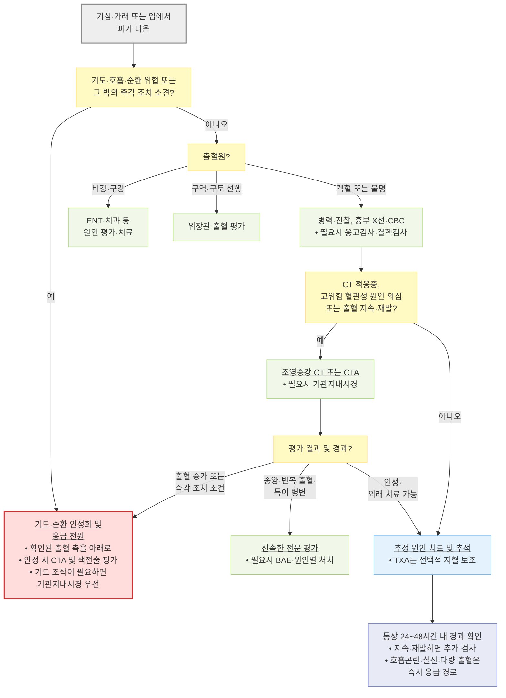

# 객혈 Hemoptysis

## <mark style="color:green;">일반 사항</mark>

* 객혈(hemoptysis) : 하기도에서 발생한 혈액을 기침과 함께 배출하는 것; blood-streaked sputum부터 다량의 혈액 배출까지 다양
* 소량 객혈은 점액농성 또는 화농성 가래에 혈액이 줄무늬 또는 점상으로 묻어 나오는 형태가 흔함
* 기관지 점막의 자극 또는 손상으로 발생할 수 있음
* 건강한 젊은 비흡연자에서 명확한 URI와 연관된 일회성 극소량 객혈은 초기 흉부 X선 평가 후 임상 판단에 따라 경과 관찰이 가능하지만, 지속·반복되거나 위험인자가 있으면 영상검사를 포함한 추가 평가 시행

### <mark style="color:$danger;">🚩 Red Flags!</mark>

<mark style="color:$danger;">**즉각 조치**</mark>

* 기도 폐쇄에 의한 질식(asphyxia), 가스교환 장애 또는 혈역학적 불안정을 초래하는 생명위협성 객혈(출혈량 무관)
* 다량 또는 빠른 출혈(예: ＞150 ㎖/24h 또는 ≥100 ㎖/h; 통일된 기준은 없음)
* 안정 시 지속되는 빈호흡(＞30회/분)
* 새로 발생한 저산소혈증 또는 빠르게 하강하는 SpO₂(실내공기 ＜90%, 또는 산소 투여가 필요한 경우) `급성 호흡 부전`
* 안정 시 호흡곤란
* 호흡음 감소(혈괴에 의한 기도 폐쇄 의심)
* 저혈압 또는 수액·승압제 투여가 필요한 혈역학적 불안정
* 실신 또는 의식 변화
* 응고장애 또는 혈소판감소증을 동반한 지속 출혈
* 즉각적인 수혈이 필요한 출혈
* 객혈과 관련된 급성 Hb 저하(기저치에서 ≥2 g/㎗ 감소)

<mark style="color:$warning;">**당일 평가**</mark>

* 새로 발생한 원인 불명 객혈·혈담
* Hb ＜8 g/㎗이면서 즉각 조치 기준에 해당하지 않는 경우
* 폐동맥류/가성동맥류(예: 결핵성 Rasmussen aneurysm), 폐동정맥기형(PAVM), aspergilloma 또는 병변의 폐동맥 침범 등 고위험 혈관성 원인 의심
* 거품 섞인 분홍색 가래 + 기좌 호흡·야간 발작성 호흡곤란 `심부전`
* 활동성 결핵을 의심하는 객혈(노출력, 지속 기침, 발열·야간 발한·체중 감소 등) `폐결핵`

<mark style="color:$info;">**조기 평가 및 추적**</mark>

* 원인 불명 체중 감소, 피로, 전신 권태감 `폐암`
* ＞40세이면서 ＞30갑년 흡연력이 있는 객혈 `폐암`
  * 위 기준에 해당하지 않더라도 반복 객혈, 원인 불명 체중 감소, 흉부 X선 이상이 있으면 폐암 가능성을 고려
* 소량이라도 반복되는 객혈 `폐암`

## <mark style="color:green;">원인 및 감별</mark>

* 심한 기침 : 보통 blood-streaked sputum
* 상기도(비인두) 출혈 : 코피, 구강 또는 인후부 출혈
* 폐렴 : 혈액이 묻은 화농성 가래, 발열/오한 동반
* 만성 기관지염의 악화 : 기존의 만성적 가래가 최근 양 또는 성상에 있어서 악화
* 기관지확장증 : 많은 양의 지속적 가래
  * 반복 객혈이 매우 흔하며 대량 객혈로 이행될 위험이 높음
* 결핵 : 결핵 의심 병력, 체중 감소, 일반적 치료에 반응하지 않는 지속되는 호흡기 증상
  * 비결핵 항산균(NTM) 폐질환은 기관지확장증과 강하게 연관되므로, 기관지확장증 환자에서는 NTM 폐질환 동반 여부를, NTM 폐질환 환자에서는 기관지확장증 동반 여부를 평가
* 결핵 후 공동 병변 등에서 발생하는 진균구(aspergilloma)/만성 폐아스페르길루스증 : 반복 또는 생명위협성 객혈의 중요한 원인
  * 재출혈 위험이 높아 조기 조영증강 CT 또는 CT angiography(CTA) 및 전문의 평가가 필요하며, 원인 치료와 별개로 활동성 출혈에는 기관지동맥색전술(BAE) 고려
* 폐농양 : 부패성 악취가 나는 가래, 발열
* 폐색전증 : 갑자기 시작되는 흉막염성 흉통, 호흡곤란 후 객혈; 객혈이 동반되면 폐경색을 시사
* 미만성 폐포출혈(diffuse alveolar hemorrhage, DAH)/폐-신 증후군 : ANCA 연관 혈관염(GPA, MPA), anti-GBM disease 등이 대표 원인
  * 양측성 폐침윤 또는 ground-glass opacity + Hb 감소 + 저산소혈증 ± 혈뇨·단백뇨·신기능 악화가 동반되면 의심
  * 일부 환자에서는 객혈이 없을 수 있으므로 객혈 부재만으로 배제하지 않음
* 심장 질환 : 활동 시 또는 야간 발작성 호흡곤란, 기좌 호흡, 피로, 거품이 있는 분홍색 가래
  * 승모판 협착증 : 좌심방 압력 상승 → 폐정맥 고혈압으로 객혈 유발
* 약제 유발
  * 항응고제(warfarin, DOAC, 헤파린/저분자량 헤파린) : 치료용량에서도 출혈 가능
    * 과량 투여·상호작용·신기능 저하 등에서 위험 증가
  * 항혈소판제(aspirin, P2Y12 억제제) : 특히 항응고제와 병용 시
  * 항혈관신생제(bevacizumab) : 특히 편평세포폐암에서 치명적 대량 출혈 위험
  * 세포독성 항암제 : 일부 약제에서 폐출혈 유발 가능
* 의인성(iatrogenic) : 기관지내시경 생검, 경피적 폐 생검, BAL 후 발생 가능 - 최근 시술력 확인을 요함
* 기도 또는 폐 외상 : 외상력
* 이물 : 이물 흡인 병력, 특히 영유아에서는 병력이 불명확해도 고려
* 종양 : 흡연력, 체중 감소
  * 소량이라도 반복되는 객혈은 폐암의 초기 소견일 수 있음
* 위장관 출혈을 오인 : 구역/구토, 위장/식도 질환력, NSAID 장기 복용, 흑색 변, 알코올 남용 등에 의한 위장관 출혈을 객혈로 오인

## <mark style="color:green;">진단</mark>

### <mark style="color:orange;">객혈 vs 토혈 vs 상기도/구강 출혈 감별</mark>

* 기도·호흡·순환의 안정 여부를 먼저 확인한 뒤 출혈원을 평가
  * 구인두 후벽에서 흐르는 혈액이 기침과 섞여 나와 객혈로 오인될 수 있음
  * 구강·비강 시진 우선 시행; 구강(잇몸, 혀, 인두) 및 비강을 육안으로 먼저 확인
  * 필요시 후두경 또는 비경 검사로 상기도 출혈원 확인

<table><thead><tr><th width="113">항목</th><th width="162">객혈</th><th width="172">토혈</th><th>상기도/구강 출혈 (Pseudohemoptysis)</th></tr></thead><tbody><tr><td><strong>선행 증상</strong></td><td>기침</td><td>구역/구토</td><td>비충혈, 후비루, 구강·인후 불편감</td></tr><tr><td><strong>색깔</strong></td><td>선홍색 또는 분홍색</td><td>암적색 또는 커피색</td><td>선홍색 (코피와 동일)</td></tr><tr><td><strong>성상</strong></td><td>거품 있음, 액상 또는 혈괴</td><td>음식 잔류물 혼재 가능</td><td>거품 없음, 인두 타고 넘어옴</td></tr><tr><td><strong>pH</strong></td><td>알칼리성</td><td>산성</td><td>-</td></tr><tr><td><strong>기저질환</strong></td><td>폐/심장 질환</td><td>위장/식도 질환</td><td>비염, 비중격 질환, 구강·인후두 질환</td></tr><tr><td><strong>이후 증상</strong></td><td>혈성 가래 지속 가능</td><td>흑색 변 동반 가능</td><td>구강·비강 검진 시 출혈원 확인</td></tr></tbody></table>

> _<mark style="color:$info;">표의 소견은 병력·진찰과 함께 참고하는 보조적 지표이며, 개별 소견만으로 단정하지 않음(예: 혈액을 삼킨 후 구토하거나, 객혈이 혈괴 형태·거품 없는 양상으로 나타나는 예외가 있을 수 있음).</mark>_\
> _<mark style="color:$info;">pH는 참고 항목이며 실제 임상에서 직접 측정은 거의 이루어지지 않음.</mark>_\
> _<mark style="color:$info;">음식물 잔류물(food particles) 유무는 감별에 참고할 수 있는 소견 중 하나임.</mark>_\
> _<mark style="color:$info;">최종 감별은 병력·구강 및 비강 진찰, 필요시 후두경·상부위장관 내시경을 종합하여 판단.</mark>_

### <mark style="color:orange;">검사</mark>

* 흉부 X선, CBC : 초기 진단 검사
* 흉부 CT : 아래 중 하나라도 해당하면 적극 고려
  * 흉부 X선상 이상
  * 원인 불명 객혈
  * 다음에서는 흉부 X선이 정상이어도 조기에 조영증강 CT 시행 <mark style="color:$info;">\[Korean J Radiol 2018]</mark>
    * 폐암 위험인자 두 가지를 모두 충족(＞40세 및 ＞30갑년 흡연력)
    * 중등도 객혈(＞30 ㎖/24h)
    * 객혈 반복
* 조영증강 CT 또는 CTA : 원인, 출혈 위치 및 책임 혈관 평가에 유용
  * 반복·중등도 이상 객혈 또는 BAE를 고려하는 경우 우선 선택
* 기관지내시경 검사 : CT에서 원인이 불명확하거나 출혈이 지속되는 경우, 또는 기도 내 혈액·혈괴 제거, 출혈 부위 직접 확인·지혈 등 즉각적인 기도 조작이 필요한 경우 시행
  * 안정된 환자 : CT/CTA로 원인 및 책임 혈관을 먼저 평가하는 것이 우선
  * 활동성 출혈 또는 기도 내 혈괴로 즉각적인 기도 조작이 필요한 경우 : 기관지내시경이 CT보다 우선될 수 있으며, 기도 확보·혈괴 제거·출혈 위치 확인에 사용 (활동성 출혈 중 또는 중단 후 24\~48시간 이내 시행 시 출혈 부위 확인율이 높음)
* 가래 검사 : 결핵 의심 시 공기매개 격리 후 객담 항산균(AFB) 도말·배양 및 결핵균 핵산증폭검사(NAAT). 그 외 세균성 감염 의심 시 일반 가래 배양
* 응고 검사 : coagulopathy 병력, 항응고제 사용 중인 경우 고려
* 중등도 이상 또는 지속 출혈 시 추가 검사
  * 활력징후 및 연속 SpO₂ 모니터링
  * CBC(혈소판 포함), PT/INR, aPTT, 전해질, BUN/Cr(조영제 및 DOAC 축적 평가), 간기능
    * DOAC 복용 환자에서는 정상 PT/aPTT만으로 잔존 항응고 효과를 배제할 수 없음에 유의
  * 혈액형 검사 및 type & screen/crossmatch
  * 호흡부전 시 동맥혈가스검사(ABGA)
* 폐색전증 의심 시 : 임상확률에 따른 D-dimer·CT 폐동맥조영술(CTPA) 등 별도 진단 경로 적용
* 미만성 폐포출혈/폐-신 증후군 의심 시 : U/A, Cr, ANCA, anti-GBM Ab 등 추가 평가 및 긴급 의뢰

***



<p align="center"><strong>객혈 관리 알고리듬</strong><br><em><mark style="color:$info;">저자 재구성 (참고 문헌 : ACR Appropriateness Criteria® Hemoptysis 2020,</mark></em><br><em><mark style="color:$info;">Society of Chest Imaging and Interventions Consensus Guidelines 2023,</mark></em><br><em><mark style="color:$info;">2018 Korean Clinical Imaging Guideline for Hemoptysis 등)</mark></em></p>

> _<mark style="color:$info;">Red Flags의 당일 평가 항목에 해당하면 알고리듬 경로와 관계없이 당일 평가</mark>_

***

## <mark style="background-color:$warning;">Management</mark>

### <mark style="color:orange;">응급 관리</mark>

* 생명을 위협하는 객혈 : 즉시 응급 의뢰
  * 출혈량보다 기도·가스교환·혈역학적 안정 여부를 우선 평가하고 기도 확보를 최우선으로 함
* 자세 : 의식이 명료하고 스스로 기도를 보호할 수 있는 환자에 적용
  * 출혈 부위가 불명확한 경우 : 상체를 30\~45° 거상한 Semi-Fowler’s position
  * 출혈 부위가 확인된 경우 : 출혈 측을 아래로 하는 측와위로 건측 폐로의 혈액 유입을 방지
  * 의식 저하·호흡부전이 있으면 체위만으로 해결되지 않으므로 즉시 기도 확보 평가
* 산소 공급 : 저산소혈증이 있으면 목표 SpO₂ 94\~98%
  * 고탄산혈증성 호흡부전 위험 환자는 88\~92% 목표로 조절 후 동맥혈가스검사로 재평가
  * 상급 병원에서 저산소증이 지속되면 고유량 비강 캐뉼러(HFNC)를 고려할 수 있으나, 활동성 다량 출혈에서는 HFNC로 산소포화도가 유지되더라도 기관삽관·기도 내 혈괴 제거 등 확정적 기도 조치를 미루지 않음
* 원인 치료
  * 감염(폐렴, 결핵, 폐농양) : 적절한 항균제 투여
  * 항응고제 관련 : 마지막 복용·투여 시간·신기능·출혈 중증도·혈전색전 위험을 함께 평가하여 중단 및 reversal 필요성 결정 (☞ 처방례 3)
  * 심부전 : 울혈 시 이뇨제 투여 (☞ [호흡곤란](007_-dyspnea.md#management))
    * nitrate는 혈압이 충분히 유지되는 경우(특히 고혈압성 급성 폐부종) 선택적으로 고려
* 소량\~중등도 객혈 지혈 보조 : tranexamic acid
  * 경구 : 보통 성인 1일 750\~2,000 ㎎을 3\~4회 분할 투여(예: 500 ㎎ tid). 단기 사용 고려 <mark style="color:blue;">\[</mark>[<mark style="color:blue;">트란사민</mark>](https://www.health.kr/drug/2020102900016)<mark style="color:blue;">]</mark>
    * 금기 : 활동성 혈전색전증, 중증 신부전, 트롬빈 투여 중인 환자, 이 약 또는 구성성분에 대한 과민반응
    * 신중 투여 : 혈전증 병력 또는 고위험 상태(DVT·PE 병력 등), 신부전(혈중농도 상승 가능)
    * 혈뇨, 특히 상부요로 출혈 시 혈괴에 의한 요로폐쇄 가능성 고려
  * 흡입 : 허가 외 사용으로 의료기관에서 선택적으로 시행 (☞ 처방례 4)
    * 용법 : 주사용 제제 500 ㎎/5 ㎖를 nebulizer로 q8h (일부 RCT 근거; TXA-NEB 2025에서는 2일)
    * 시행 전 사용 제제·무균 조제·희석·장비 적합성과 기관 protocol 확인
    * 기도 확보·색전술을 대체하지 않음
* [기침 억제](../223_/060_-common-cold.md#antitussive) : codeine, dextromethorphan, levodropropizine
  * 객담·혈액 배출에 필요한 productive cough는 억제하지 않는 것이 원칙
  * 생명을 위협하거나 다량의 객혈 시에는 사용하지 않음 (기도 내 혈액 저류 → 질식 위험이 기침 자체보다 큼)
  * 성인의 소량 객혈 시에는 객담 배출이 원활한지 먼저 확인한 후 단기·제한적으로 고려
  * 19세 미만 소아·청소년에서는 기침 억제 목적의 codeine을 사용하지 않음
* 소량 객혈, 안정적 환자 : 원인 파악 후 외래 추적; 통상 24\~48시간 이내 경과 확인, 지속·재발하면 추가 영상검사·전문의 평가

#### <mark style="color:$primary;">위험도 분류 및 처치 방향</mark>

<table><thead><tr><th width="80">위험도</th><th>기준</th><th>처치</th></tr></thead><tbody><tr><td><strong>고위험</strong></td><td>life-threatening hemoptysis, 빠르게 지속·증가하는 출혈, 기도·가스교환·혈역학을 위협하는 출혈 또는 Red Flags의 즉각 조치 기준에 해당하는 경우</td><td>즉시 응급실 의뢰, 기도 평가 및 필요시 확보; CTA/기관지내시경 및 BAE 가능 기관으로 전원</td></tr><tr><td><strong>중위험</strong></td><td>즉각 조치 기준에 해당하지 않으나 Red Flags의 당일 평가 항목, 암 의심, 반복 객혈, 흉부 X선 이상 또는 항응고제 사용 중 지속·반복 출혈·Hb 감소</td><td>당일 평가 항목은 당일 평가, 그 외는 수일 내 전문과 의뢰; 결핵 의심 시 감염관리</td></tr><tr><td><strong>저위험</strong></td><td>젊은 비흡연자, 단발성 극소량, 명확한 URI 상황, 위험인자 없음</td><td>흉부 X선 평가 후 외래 경과 관찰; 지속·반복 시 CT</td></tr></tbody></table>

<p align="center"><em><mark style="color:$info;">저자 재구성 (참고 문헌 : ACR Appropriateness Criteria® Hemoptysis 2020;</mark></em><br><em><mark style="color:$info;">Society of Chest Imaging and Interventions Consensus Guidelines 2023;</mark></em><br><em><mark style="color:$info;">ACC Expert Consensus Decision Pathway on Management of Bleeding in Patients on Oral Anticoagulants 2020 등)</mark></em></p>

#### <mark style="color:$primary;">확정적 지혈 치료</mark>

* 생명위협성 또는 반복 객혈에서 출혈 혈관에 따라 색전술 선택
  * 체순환 동맥계 출혈 : 기관지동맥색전술(BAE; 필요시 비기관지 체순환 동맥 포함)이 주요 확정적 지혈 치료
  * 폐동맥 가성동맥류(Rasmussen aneurysm 등)·PAVM : 해당 폐동맥 병변의 색전술 등을 시행

#### <mark style="color:$primary;">전원 기준</mark>

* 응급 전원 : Red Flags의 즉각 조치 기준에 해당
* 기관지내시경·BAE가 가능한 상급 기관에 신속 의뢰
  * 원인 불명으로 추가 평가(기관지내시경, 혈관 조영술) 필요
  * 종양 의심
  * 적절한 치료에도 객혈 지속 또는 반복
  * 항응고제(warfarin, DOAC, 헤파린/저분자량 헤파린 등) 사용 중 지속·반복 출혈, Hb 감소, 과량 항응고 의심 또는 신기능 저하

#### <mark style="color:$primary;">항응고제 ↔ 역전제(해독제)</mark>

* 역전제·비특이적 지혈제는 생명위협성 출혈 또는 초기 조치에도 조절되지 않는 중증 출혈에서 잔존 항응고 효과 등을 고려하여 해당 전문의가 결정
* 4F-PCC의 기관별 확보·사용 가능 여부를 확인
* aPCC <mark style="color:blue;">\[</mark>[<mark style="color:blue;">훼이바</mark>](https://www.health.kr/drug/A11AOOOOO9849)<mark style="color:blue;">]</mark> : 허가 적응증은 응고인자 억제인자를 보유한 혈우병 환자의 출혈 관리
  * DOAC 역전 목적 사용은 허가 외 사용이므로 혈액학·수혈의학 전문의 및 기관 protocol에 따름
  * 투여 후 약 6\~12시간 이내에는 전신 항섬유소용해제(TXA 등)를 사용하지 않음
* dabigatran <mark style="color:blue;">\[</mark>[<mark style="color:blue;">프라닥사</mark>](https://www.health.kr/drug/2011022100003)<mark style="color:blue;">]</mark> ↔ idarucizumab <mark style="color:blue;">\[</mark>[<mark style="color:blue;">프락스바인드</mark>](https://health.kr/drug/2016030700001)<mark style="color:blue;">]</mark>
* rivaroxaban <mark style="color:blue;">\[</mark>[<mark style="color:blue;">자렐토</mark>](https://www.health.kr/drug/A11AKP09D0131)<mark style="color:blue;">]</mark>·apixaban <mark style="color:blue;">\[</mark>[<mark style="color:blue;">엘리퀴스</mark>](https://www.health.kr/drug/2011120100001)<mark style="color:blue;">]</mark>·edoxaban <mark style="color:blue;">\[</mark>[<mark style="color:blue;">릭시아나</mark>](https://health.kr/drug/2015082600013)<mark style="color:blue;">]</mark> ↔ 국내에 승인·공급되는 특이 역전제 없음
  * rivaroxaban·apixaban의 특이 역전제였던 andexanet alfa는 미국 판매 종료, 국내 미공급 <mark style="color:$info;">\[FDA 2025]</mark>
  * Xa 억제제 관련 생명위협성 출혈에서는 전문의 및 기관 protocol에 따라 4F-PCC를 비특이적 지혈 대안으로 고려하며, 확보 여부 확인 때문에 응급 이송을 지연하지 않음
  * FFP와 vitamin K는 Xa 억제제의 역전 목적으로 사용하지 않음
* warfarin(중증 출혈) : 즉시 중단하고 IV vitamin K 5\~10 ㎎ 투여 <mark style="color:$info;">\[ACC 2020]</mark>
  * 역전이 필요한 경우 4F-PCC 병용이 우선이며, 4F-PCC를 사용할 수 없으면 FFP
* UFH(미분획 헤파린)/LMWH(저분자량 헤파린) : 생명위협성 출혈 시 즉시 중단하고 protamine 고려 (LMWH는 부분적 중화만 가능)

***

## <mark style="color:red;">질병코드</mark>

* R04.2 객혈 Hemoptysis

***

## <mark style="color:purple;">처방례</mark>


**TXA는 지혈 보조제임.** 활동성 결핵·종양 등 근본 원인에 대한 평가가 TXA 투여로 인해 지연되어서는 안 됨.


> **처방례 1. 소량 객혈 - 지역사회획득폐렴(CAP)이 임상적으로 의심되는 경우**
>
> ```
> 오구멘틴정 625 ㎎ 1T tid × 7일 (amoxicillin 500 ㎎ + clavulanate 125 ㎎, CAP 치료)
> 트란사민캡슐 250 ㎎ 1회 2C tid × 3~5일 (지혈 보조가 필요한 경우 선택)
> ```
>
> 약제 정보: <mark style="color:blue;">\[</mark>[<mark style="color:blue;">오구멘틴정</mark>](https://www.health.kr/drug/A11A1130A0289)<mark style="color:blue;">]</mark> 625 ㎎ · <mark style="color:blue;">\[</mark>[<mark style="color:blue;">트란사민캡슐</mark>](https://www.health.kr/drug/2020102900016)<mark style="color:blue;">]</mark> 250 ㎎
>
> _✽ 외래 치료가 가능한 안정된 CAP 예시. 항생제는 식사 시작 시 복용하고 48\~72시간 내 반응·임상 안정성을 재평가하여 기간을 조정. TXA는 모든 CAP에 병용하지 않음_
>
> _✽ 항생제는 중증도·동반질환·비정형 병원체 가능성과 지역 내성 양상에 따라 선택함. 2018 성인 지역사회획득폐렴 지침은 β-lactam 단독요법을 인정하며, 비정형 폐렴이 의심되면 macrolide 병용을 고려함 (☞_ [_폐렴_](../223_/068_-pneumonia.md)_)_
>
> _✽ 객혈 자체는 항생제 적응증이 아니며, 세균성 감염이 임상적으로 의심되거나 확인되면 해당 질환의 지침에 따라 투여; 단순 급성 기관지염에서는 일률적인 항생제 투여를 권고하지 않음. 기관지확장증의 감염성 악화가 의심되는 경우 가능하면 항생제 투여 전 객담 배양검사를 시행하고, 이전 배양 결과·지역 내성 양상·임상적 중증도를 고려하여 항생제를 선택(중증 환자에서는 배양 결과를 기다리느라 치료를 지연하지 않음); Pseudomonas 과거 배양력이 있으면 해당 감수성 결과에 따른 항녹농균 항생제 고려_
>
> _✽ tranexamic acid는 활동성 혈전색전증에 금기이며, DVT·PE 병력이 있으면 신중 투여_

> **처방례 2. 소량 혈담을 동반한 기관지염 - 자극성 마른기침에 선택적 증상 완화**
>
> ```
> 트란사민캡슐 250 ㎎ 1회 2C tid × 3~5일 (지혈 보조가 필요한 경우 선택)
> 레보투스정 60 ㎎ 1T tid, 적어도 6시간 간격 (필요시, 단기간)
> ```
>
> 약제 정보: <mark style="color:blue;">\[</mark>[<mark style="color:blue;">트란사민캡슐</mark>](https://www.health.kr/drug/2020102900016)<mark style="color:blue;">]</mark> 250 ㎎ · <mark style="color:blue;">\[</mark>[<mark style="color:blue;">레보투스정</mark>](https://www.health.kr/drug/A11APPPPP1200)<mark style="color:blue;">]</mark> 60 ㎎
>
> _✽ 진해제가 필요한 경우에만 선택하며 객혈의 확정적 지혈 치료가 아님. 가래가 많거나 점액섬모 청소기능이 저하된 경우, 중증 간장애에서는 레보드로프로피진을 사용하지 않음. 통상 24\~48시간 이내 경과를 확인하고, 악화·객혈 증가 시 즉시 진료_
>
> _✽ tranexamic acid는 활동성 혈전색전증에 금기이며, DVT·PE 병력이 있으면 신중 투여_
>
> _✽ 생명을 위협하거나 다량의 객혈 시에는 진해제를 사용하지 않음(혈액 배출 억제로 질식 위험); 가래 배출에 필요한 기침은 억제하지 않는 것이 원칙(☞_ [_진해제_](../223_/060_-common-cold.md#antitussive)_)_

> **처방례 3. 항응고제 사용 중 객혈**
>
> ```
> ※ 역전제·비특이적 지혈제는 생명위협성 출혈 또는 초기 조치에도 조절되지 않는 중증 출혈에서
>    잔존 항응고 효과 등을 고려하여 해당전문의가 결정
>
> [와파린]
> ※ 판단 기준 : 출혈 중증도, INR, 혈전색전 위험을 함께 평가
> → 비중증 소량 객혈 : warfarin 일시 중단 여부를 개별 결정하고 INR 확인; routine vitamin K는 일반적으로 필요하지 않음
> → major/life-threatening bleeding : 즉시 warfarin 중단·응급 전원
>    IV vitamin K 5~10 ㎎(서서히 주입)
>    역전이 필요한 경우 역전 가능 기관에서 4F-PCC 병용이 우선(제품별 속도로 주입); 4F-PCC 사용 불가 시 FFP
>
> [DOAC]
> ※ 판단 기준 : 마지막 복용량·복용 시간, 혈청 Cr 및 최근 변화(급성 신손상 여부), CrCl(Cockcroft-Gault) 확인
> → 비중증 출혈 : 일시 중단 여부를 출혈 정도와 혈전색전 위험에 따라 결정
> → major/life-threatening bleeding : 즉시 중단하고 응급 전원
>    역전이 필요한 경우:
>       dabigatran → idarucizumab [프락스바인드] 총 5 g IV(2.5 g/50 ㎖ 2바이알)
>       rivaroxaban·apixaban·edoxaban → 국내에 승인된 특이 역전제 없음
>          전문의 및 기관 protocol에 따라 4F-PCC를 비특이적 지혈 대안으로 고려
>          FFP와 vitamin K는 역전 목적으로 사용하지 않음; 제제 확보 때문에 응급 이송을 지연하지 않음
>
> [UFH/LMWH]
> → 생명위협성 출혈 시 즉시 중단하고 protamine 고려 (LMWH는 부분적 중화만 가능)
> ```
>
> 약제 정보: <mark style="color:blue;">\[</mark>[<mark style="color:blue;">프락스바인드주사제</mark>](https://health.kr/drug/2016030700001)<mark style="color:blue;">]</mark> 2.5 g/50 ㎖
>
> _✽ warfarin 관련 중증 출혈에서 역전이 필요한 경우 4F-PCC가 우선 권고됨. 확보 여부는 이송 기관에 확인하고 사용 불가 시 FFP + IV vitamin K를 대안으로 사용; 제제 확보·역전제 투여 때문에 응급 이송을 지연하지 않음_
>
> _✽ andexanet alfa는 안전성 문제(혈전색전증·혈전 관련 사망 증가)로 2025년 12월 미국에서 판매 중단되었고 국내에는 공급되지 않음; aPCC(FEIBA)의 DOAC 역전 목적 사용은 허가 외 사용_

> **처방례 4. tranexamic acid 흡입 (nebulizer)**
>
> ```
> tranexamic acid 500 ㎎/5 ㎖ nebulizer 흡입 q8h (의료기관 내 허가 외 사용)
> 예: 2일 투여 후 반응 평가(TXA-NEB 2025); 기간은 기관 protocol에 따라 조정
> ※ 사용 주사제의 농도·첨가제·무균 조제·흡입 장비 적합성 확인
> ※ 희석 여부(NS 혼합 등)는 제품 농도 및 기관별 protocol에 따름
> ```
>
> _✽ 객혈에 대한 흡입 투여는 허가 외 사용(off-label); 비생명위협성 객혈에서 효과를 보고한 소규모 RCT들이 있으나 최적 용량·장기 안전성 근거는 제한적. 국소 지혈 보조를 기대할 때 고려하며, 생명을 위협하는 객혈에서는 기도 확보·CTA·기관지내시경·BAE를 지연해서는 안 됨_
>
> _✽ TXA-NEB는 정맥 TXA를 포함한 표준치료에 흡입 TXA를 추가한 소규모 시험으로, 이 시험에서는 흡입 단독요법의 효과를 평가하지 않았음_
>
> _✽ TXA-NEB 시험은 항응고제·항혈소판제 복용 환자 및 신기능 저하 환자(혈청 Cr ＞1.5 ㎎/㎗) 등을 제외하였으므로, 해당 환자군에 효과·안전성을 일반화하는 데 제한이 있음_
>
> _✽ 천식·COPD 환자에서는 흡입 시 기관지 경련(bronchospasm) 가능성에 주의_

***

### <mark style="color:$success;">핵심 복약 지도</mark>

> **tranexamic acid (트란사민) - 경구/흡입**
>
> * 경구는 보통 성인 1일 750\~2,000 ㎎을 3\~4회 분할 투여하며(제품별 허가사항 확인), 단기(3\~5일) 지혈 보조 목적으로 사용합니다. 결핵·종양 등 근본 원인 평가를 지연시키지 않아야 합니다
> * 활동성 혈전색전증·중증 신부전 환자 및 트롬빈 투여 중인 환자에게는 투여하지 않으며, DVT·PE 병력·고위험 상태에서는 신중히 투여합니다
> * 혈뇨, 특히 상부요로 출혈에서는 혈괴에 의한 요로폐쇄 가능성을 설명합니다
> * 흡입(nebulizer) 투여는 허가 외 사용(off-label)이며 천식·COPD 환자에서 기관지 경련 가능성을 사전에 설명합니다

> **기침 억제제 사용 원칙**
>
> * 생명을 위협하거나 다량의 객혈에는 원칙적으로 사용하지 않습니다 - 기침 억제로 인한 기도 내 혈액 저류가 기침 자체보다 질식 위험이 큽니다
> * 성인의 소량 객혈에서만, 객담 배출이 원활함을 확인한 후 단기·제한적으로 사용합니다
> * 레보드로프로피진도 졸림을 유발할 수 있으므로 운전·음주를 피하십시오. 가래가 많거나 배출이 어려우면 복용 전 의료진에게 알리십시오
> * codeine은 일반적인 기침의 routine 치료로 권하지 않습니다. 단일제의 진해 적응증은 19세 이상이며, 제품별 금기를 적용합니다. 복용 중 숨이 느려지거나 깨우기 어려우면 119에 연락하십시오
> * codeine 함유 제제는 제품별 마약류/한외마약 분류 및 처방·관리 요건을 처방 전에 확인합니다

> **항응고제 사용 중 객혈**
>
> * 출혈 중증도와 혈전색전 위험을 함께 평가하여 중단 여부를 개별적으로 결정합니다. 임의로 자가 중단하지 않도록 안내합니다
> * major/life-threatening bleeding이면 즉시 중단하고 역전 치료가 가능한 기관으로 응급 전원합니다. 역전제 사용 여부는 잔존 항응고 효과와 초기 조치에 대한 반응 등을 고려하여 결정합니다(andexanet alfa는 미국에서 안전성 문제로 판매가 중단되었으며 국내에는 승인·공급되지 않음)

> **언제 다시 병원을 방문해야 하나요?**
>
> * 외래 치료 중에도 통상 24\~48시간 이내 경과를 확인하십시오. 객혈량·빈도가 늘면 예정일을 기다리지 말고 재진하십시오
> * 호흡곤란, 저산소증, 어지럼·실신 등 새로운 증상이 동반되면 즉시 응급실로 가십시오
> * 검사에서 빈혈이 심해졌다는 설명을 듣거나 항응고제 관련 출혈 가능성을 안내받았다면 주치의의 재진·전원 지시를 따르십시오

***

## <mark style="color:green;">주요 참고문헌 및 확인 자료</mark>

### <mark style="color:orange;">임상 근거</mark>

* [Kang MJ, et al. 2018 Korean Clinical Imaging Guideline for Hemoptysis. Korean J Radiol. 2018;19(5):866-871.](https://doi.org/10.3348/kjr.2018.19.5.866) - 결핵·결핵 후유증을 고려한 흉부 X선·조영증강 CT 적응증
* [Olsen KM, et al. ACR Appropriateness Criteria® Hemoptysis. J Am Coll Radiol. 2020;17(5S):S148-S159.](https://pubmed.ncbi.nlm.nih.gov/32370959/) - 객혈의 중증도·재발에 따른 영상검사와 색전술 평가
* [Singhal R, et al. Society of Chest Imaging and Interventions Consensus Guidelines for the Interventional Radiology Management of Hemoptysis. Indian J Radiol Imaging. 2023;33(3):361-372.](https://doi.org/10.1055/s-0043-1762552) - 생명위협 객혈의 기도·순환 안정, 출혈 위치 확인과 기관지동맥색전술
* [Tomaselli GF, et al. 2020 ACC Expert Consensus Decision Pathway on Management of Bleeding in Patients on Oral Anticoagulants. J Am Coll Cardiol. 2020;76(5):594-622.](https://pubmed.ncbi.nlm.nih.gov/32680646/) - 항응고제 관련 중증 출혈의 약물 중단·역전·재개 판단; 이후 안전성 정보와 함께 해석
* [U.S. Food and Drug Administration. Update on the Safety of Andexxa by AstraZeneca: FDA Safety Communication. December 18, 2025.](https://www.fda.gov/safety/medical-product-safety-information/update-safety-andexxa-astrazeneca-fda-safety-communication) - 혈전색전증 안전성 문제와 미국 판매 중단 관련 자료
* [Agrawal A, et al. Efficacy and safety of tranexamic acid nebulization to control bleeding of hemoptysis: The TXA-NEB randomized controlled clinical trial. Indian J Pharmacol. 2025;57(6):392-400.](https://pubmed.ncbi.nlm.nih.gov/41221568/) - 비생명위협성 객혈에서 500 ㎎/5 ㎖ q8h, 2일 보조치료 연구
* [McDonagh TA, et al. 2021 ESC Guidelines for the diagnosis and treatment of acute and chronic heart failure. Eur Heart J. 2021;42(36):3599-3726.](https://academic.oup.com/eurheartj/article/42/36/3599/6358045) - 급성 심부전에서 혈압에 따른 혈관확장제 선택
* [Steffel J, et al. 2021 European Heart Rhythm Association Practical Guide on the Use of Non-Vitamin K Antagonist Oral Anticoagulants in Patients with Atrial Fibrillation. Europace. 2021;23(10):1612-1676.](https://academic.oup.com/europace/article/23/10/1612/6247378) - DOAC의 신기능·CrCl 평가
* [Lee MS, et al. Guideline for Antibiotic Use in Adults with Community-acquired Pneumonia. Infect Chemother. 2018;50(2):160-198.](https://doi.org/10.3947/ic.2018.50.2.160) - 외래 CAP의 경험적 항생제 선택

### <mark style="color:orange;">허가·급여 확인 자료</mark>

* [식품의약품안전처. 의약품안전나라 - 의약품 품목허가정보.](https://nedrug.mfds.go.kr/index) - 제품별 적응증·용법·금기 및 허가 상태 확인

***

## <mark style="color:blue;">환자 안내서</mark>


**피가 섞인 가래나 기침은 반드시 원인을 확인해야 합니다**

대부분의 소량 객혈은 심각하지 않지만, 원인 파악이 우선입니다. 당황하지 말고 차분히 대처하십시오.


#### <mark style="color:$primary;">객혈이란 무엇인가요?</mark>

* 기침할 때 피가 섞여 나오거나 피 자체를 뱉는 것을 객혈이라 합니다
* 원인은 기관지염·폐렴 같은 흔한 감염부터 결핵, 기관지확장증, 드물게 폐암까지 다양합니다
* 소화관 출혈(위·식도)이나 코·구강 출혈과 혼동될 수 있으므로, 피가 나오기 전에 기침·구토·코피가 있었는지와 피의 양·색을 주치의에게 알려 주십시오

#### <mark style="color:$primary;">객혈 시 이렇게 하세요</mark>

* **자세** : 의식이 명료하고 출혈 위치를 모르면 상체를 세우십시오. 의료진이 출혈하는 폐의 방향을 확인해 알려 주었다면 **출혈하는 쪽을 아래로** 누워 반대쪽 폐를 보호하십시오. 숨쉬기 힘들거나 의식이 흐리면 즉시 119에 연락하십시오
* **기록** : 객혈량(티스푼·밥숟갈 단위 어림), 색(선홍색·갈색), 동반 증상(발열·기침·흉통)을 기억해 두십시오
* **금식** : 많은 양의 객혈, 의식 저하, 심한 호흡곤란 등 흡인 위험이 있는 경우에는 음식물과 물을 섭취하지 마십시오; 소량의 안정된 객혈에서는 일률적으로 금식할 필요는 없습니다
* **임의 약물 복용 금지** : 지혈제, 진해제를 주치의의 처방 없이 임의로 복용하지 마십시오. 복용 중인 항응고제·항혈소판제와 마지막 복용 시간을 의료진에게 알리십시오
* **재진** : 처음 생긴 원인 불명 혈담도 당일 진료로 확인하십시오. 외래 관찰을 안내받았다면 보통 24\~48시간 이내 경과를 확인하고, 소량이라도 반복되면 추가 검사를 받으십시오

#### <mark style="color:$primary;">이럴 때는 즉시 119에 연락하거나 응급실로 가세요</mark>

* 피 섞인 가래가 아니라 피 자체가 반복해서 나오거나 양이 점점 늘어나는 경우
* 객혈과 함께 숨쉬기 힘든 경우
* 피 때문에 기도가 막히는 느낌, 극심한 호흡곤란, 어지럼·실신 또는 의식 변화가 동반되는 경우
* 짧은 시간에 많은 양의 피가 나오는 경우
* 항응고제(와파린, 아픽사반 등)를 복용 중이며 객혈이 지속·반복되거나 양이 증가하는 경우
