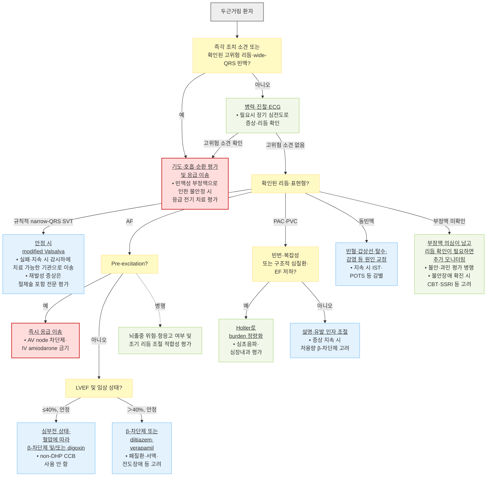

# 두근거림 Palpitation

## <mark style="color:green;">일반 사항</mark>

* 빠르게, 세게, 불규칙하게 또는 건너뛰는 것처럼 불쾌하게 심장 박동을 자각하는 증상
* 증상 발생 당시 실제 심박수와 리듬은 정상일 수도 있음
* 원인 : 크게 심장성, 정신과적, 대사/전신성, 약물/물질 관련 요인으로 나뉨
  * 위 같은 원인 없이 생리적으로 발생하거나 뚜렷한 병인 없이 특발성으로 남는 경우도 많음
* 예후 : 기저 원인에 따라 달라짐
  * 구조적 심장 질환이나 지속성 부정맥 동반 여부에 따라 위험도가 크게 달라지므로 초기 단계에서 고위험군을 선별하는 것이 중요함

### <mark style="color:$danger;">🚩 Red Flags!</mark>

<mark style="color:$danger;">**즉각 조치**</mark>

* 지속적이거나 허혈성이 의심되는 심한 흉통
* 저혈압(SBP ＜90 ㎜Hg), 쇼크 징후 또는 의식 변화
* 심한 호흡 곤란, 기좌 호흡, 급성 심부전 소견
* 지속성 빈맥에 저혈압·의식 변화·허혈성 흉통·급성 심부전 등 혈역학적 불안정 동반
* [실신](../221_/021_-syncope.md) 또는 실신 전 증상 동반
  * 특히 지속성 빈맥·비정상 ECG·구조적 심장 질환이 함께 있는 경우
* High-grade AV block, 지속성 심실빈맥, pre-excited AF(WPW pattern을 동반한 AF)
* 운동 중 실신 또는 두근거림 직후의 실신 `악성 심실부정맥` `비후성 심근병증`
* 갑작스러운 편측 마비·안면 마비·언어 장애 등 새로운 국소 신경학적 증상 `뇌졸중` `색전증`


성인 빈맥성 부정맥에서 HR은 흔히 ≥150회/분임. 응급 여부는 혈역학적 상태와 리듬을 기준으로 판단하며, 불안정 소견이 있으면 빈맥이 그 원인인지 평가. HR ＜150회/분이라도 혈역학적 불안정 또는 고위험 리듬이 있으면 즉시 평가.


<mark style="color:$warning;">**당일\~수일 내 평가**</mark>

* 증상과 연관된 비정상 ECG나 구조적 심장 질환 의심 또는 확인
* 반복되거나 임상적으로 유의한 시간 동안 지속되는 tachyarrhythmia가 의심되는 병력
  * 실제 위험도는 리듬 종류·심박수·혈역학적 영향 및 기저 심질환을 종합하여 판단
* 운동 중 발생하는 두근거림
* 고위험 구조적 심장 질환(비후성 심근병증 등)·유전성 심장 질환 또는 부정맥성 돌연사 증후군(SADS) 가족력
* 경미한 흉부 불편감이 반복 동반되면서 수면을 방해할 정도로 지속되는 두근거림
* 하지 부종 등 심부전 가능성을 시사하는 소견
* 박동기 또는 심장 제세동기 삽입 환자에서 새로운 두근거림 `기기 오작동` `부정맥`

<mark style="color:$info;">**조기 평가 및 추적**</mark>

* 새로 발생하거나, 빈도 또는 지속시간이 증가하는 반복성 두근거림 `발작성 부정맥`
* PVC burden ≥10%의 빈번한 PVC `PVC 유발 심근병증`

## <mark style="color:green;">원인</mark>

### <mark style="color:orange;">심장 원인</mark>

* 부정맥과 구조적 심장 질환이 주요 원인

#### <mark style="color:$primary;">부정맥</mark>

* [심방세동](../225_/099_1-atrial-fibrillation.md)(AF) : 불규칙한 두근거림의 흔한 심장 원인
  * 뚜렷한 P파 없음, 불규칙한 RR 간격
  * 기저 원인으로 고혈압, 심부전, 갑상선항진증, OSA, 과도한 음주 확인
  * Holiday heart : 폭음 후 발생하는 AF; 음주력 청취 시 확인 필요
* 심실상성빈맥(SVT)

#### <mark style="color:$primary;">증상 표현에 따른 리듬 추정</mark>

1. "심장이 덜컥 내려앉는다", "한 번 멈췄다가 쿵 하고 뛴다" : 심방 또는 심실의 조기 수축(PAC/PVC)
2. "가슴이 빠르게 벌렁거린다"
   * 규칙적으로 빠르게 뜀 : 동빈맥, SVT 또는 VT
   * 불규칙하게 빠르게 뜀 : AF, 가변 방실전도를 동반한 AFL, MAT
3. "목에서 쿵쿵 뛰는 게 느껴진다"
   * 빠르고 규칙적인 목 박동감은 전형적 AVNRT를 시사할 수 있음
   * 심방과 심실이 거의 동시에 수축하면 진찰에서 뚜렷한 경정맥 박동(cannon A wave 양상)이 관찰될 수 있음

#### <mark style="color:$primary;">동반 증상·유발 상황에 따른 단서</mark>

* 흉통 동반 → 허혈성 심질환 등
  * 몸을 앞으로 숙일 때 흉통이 호전되면 심막 질환 고려
* 어지럼(light-headedness), 실신 전 증상 또는 실신 → 저혈압, 중증 부정맥
* 운동·힘든 작업 시 발생 → 동빈맥, SVT, 심실성 부정맥, 허혈성 심질환, 판막 질환·심근병증
  * 필요시 운동부하검사 또는 운동 중 ECG 기록으로 확인

### <mark style="color:orange;">동빈맥 및 자율신경 관련 증후군</mark>

#### <mark style="color:$primary;">생리적·이차성 동빈맥</mark>

* 운동, 발열, 임신, 빈혈, 탈수/저혈량, 기립성 저혈압 등

#### <mark style="color:$primary;">부적절 동빈맥(Inappropriate Sinus Tachycardia, IST)</mark>

* 안정 시 동성 심박수 ＞100회/분 및 24시간 평균 심박수 ＞90회/분이면서 이차 원인으로 설명되지 않고 불편한 두근거림이 동반되는 증후군 <mark style="color:$info;">\[HRS 2015]</mark>
* 경미한 활동에도 과도한 심박수 반응을 보일 수 있음
* 불안장애로 오진되는 경우 많음 - 구조적 심질환 및 이차 원인 배제 후 진단

#### <mark style="color:$primary;">체위성 기립성 빈맥 증후군(</mark>[<mark style="color:$primary;">POTS</mark>](../221_/030_-autonomic-dysfunction.md)<mark style="color:$primary;">)</mark>

* 다음을 모두 충족할 때 진단 <mark style="color:$info;">\[CMAJ 2022]</mark>
  1. 누운 자세에서 5\~10분 안정한 뒤 측정한 값에 비해, 기립 후 10분 이내 HR이 ≥30회/분(12\~19세에서 ≥40회/분) 지속적으로 증가
     * 일시적 상승은 해당하지 않음; 1분 이상 간격의 2회 이상 측정에서 확인
  2. 유의한 기립성 저혈압(기립 후 3분 이내 지속적 SBP ≥20 ㎜Hg 또는 DBP ≥10 ㎜Hg 감소) 없음
  3. 기립 시 악화되고 누우면 호전되는 두근거림·어지럼·피로·brain fog 등 기립불내성 증상이 ≥3개월 지속
  4. 빈혈·탈수·발열·갑상선항진증·약물 등 이차성 동빈맥 원인으로 설명되지 않음

### <mark style="color:orange;">비심장 원인</mark>

#### <mark style="color:$primary;">정신적 요인</mark>

* 흔한 비심장성 원인으로 공포, 불안, 우울, 신체화 증상, 스트레스 등이 관련
* 증상 지속 시간만으로 심장성 원인과 구분하기 어려움
* 과호흡, hand tingling, 과민 반응 시 불안, 공황장애 의심


심장성 원인 평가와 불안·공황 평가는 병행하는 것이 원칙이며, 부정맥·구조적 심질환이 완전히 배제되어야만 불안을 고려할 수 있는 것은 아님.\
기질적 심장 질환이 뚜렷하지 않은 경우 심장 감각 과민 상태로 설명할 수 있음 - 다만 이는 별도의 진단 요건(과도한 사고·불안·행동, 지속성 등)이 충족될 때 신체증상장애로 진단하며, 정상 심장검사 소견만으로 진단할 수 없음.\
"심장에 이상이 없다"는 단순 부정보다 "심장이 예민해진 상태"라는 설명이 환자 수용도가 높음


#### <mark style="color:$primary;">대사·전신성 이상</mark>

<mark style="color:cyan;">**빈혈**</mark>

* 두근거림의 흔한 전신성 원인
* CBC로 확인하며 빈혈의 중증도와 발생 속도에 따라 증상 가능성이 증가

<mark style="color:cyan;">**전해질 이상**</mark>

* 저칼륨혈증, 저마그네슘혈증은 부정맥의 흔한 유발 원인
* 이뇨제 복용 환자에서 특히 확인 필요

<mark style="color:cyan;">**내분비 이상**</mark>

* 갑상선중독증(thyrotoxicosis)·갑상선항진증 : 체중 감소, 미세한 손 떨림(fine tremor), 심부건반사 항진
* 갈색세포종(pheochromocytoma), 부신경절종(paraganglioma) : 두통·발한·두근거림, 발작성 또는 지속성 고혈압, 창백·불안
* 저혈당
* 폐경기증후군 : 혈관운동증상과 두근거림이 동반될 수 있으나, 새로 발생하거나 지속되는 불규칙한 두근거림은 연령만으로 폐경 증상으로 단정하지 말고 부정맥 등 심장 원인을 감별

#### <mark style="color:$primary;">수면무호흡증(OSA)</mark>

* 야간 두근거림, 심방세동의 독립적 위험인자
* 코골이, 주간 과다졸음, 비만 동반 시 의심

#### <mark style="color:$primary;">약물</mark>

* 교감 신경 항진제(예: 다이어트 약물, 충혈 제거제, β₂ 작용제 흡입제), 항부정맥제, 혈관 확장제, 항콜린제, β-차단제 금단, 카페인(예: 커피, 코코아, 초콜릿, 에너지 드링크), 니코틴, 코카인, 암페타민, 알코올
* ADHD 치료제(methylphenidate 등 중추신경자극제), theophylline
* GLP-1 수용체 작용제(<mark style="color:blue;">\[</mark>[<mark style="color:blue;">삭센다</mark>](https://www.health.kr/drug/2017072400024)<mark style="color:blue;">]</mark>, <mark style="color:blue;">\[</mark>[<mark style="color:blue;">오젬픽</mark>](https://www.health.kr/drug/2022042900013)<mark style="color:blue;">]</mark> 등) : 경도의 심박수 증가(평균 2\~4회/분) 유발 가능
* levothyroxine : 과잉 투여 시 빈맥·두근거림 유발 - TSH 확인 필수
* SGLT2 억제제 : 체액 감소·저혈압이 동반된 경우 이차적 빈맥·두근거림이 나타날 수 있으므로 수분 상태와 혈압을 함께 평가(직접적인 부정맥 유발 약물은 아님)
* 항암 치료 : 일부 tyrosine kinase inhibitor는 QT 연장·AF·심실성 부정맥을, anthracycline은 심근손상/심부전을 통해 이차적으로 두근거림을 유발할 수 있음

#### <mark style="color:$primary;">허브·영양보충제</mark>

* 마황(ephedra) 함유 제품, 고용량 카페인 함유 보충제·다이어트 보조제, 요힘빈 등

## <mark style="color:green;">진단</mark>

### <mark style="color:orange;">초기 평가</mark>

* 병력 청취 : 발생 양상(규칙/불규칙), 지속 시간, 유발·완화 요인(운동·식사·음주·스트레스), 동반 증상(흉통·실신·호흡 곤란)
* 신체 검진 : 맥박(rate·rhythm), 혈압, 갑상선 촉진, 심잡음
* 기본 검사 : 12-lead ECG는 기본 시행
  * CBC, 전해질(K, Mg)·신기능, TSH, 혈당 등은 병력·진찰 및 의심 원인에 따라 선택
* 심초음파(ECHO) : 구조적 심장 질환이 의심되는 경우 시행
  * 심잡음 청취, 비정상 ECG(좌심실 비대, ST 변화, pre-excitation 등), 심부전·심근병증·판막 질환 의심 → 심초음파 적극 시행
  * 운동 중 두근거림 또는 실신 동반 → 구조적 심장 질환 여부에 따라 심초음파 및 필요시 운동부하 평가/심장내과 의뢰 고려
* [BNP/NT-proBNP](../225_/098_-heart-failure.md#dx) : 하지 부종·호흡 곤란 등 심부전이 시사되는 경우 기본 검사에 추가 고려


**정상 ECG로 간헐적 부정맥을 배제할 수 없음.** 특히 SVT, 발작성 AF는 증상이 없는 시점의 ECG에서 정상 소견을 보일 수 있음. Red flag가 없고 매우 짧고 드물며 치료 결정에 영향을 주지 않는 증상까지 모두 장기 모니터링이 필수인 것은 아니지만, 반복되거나 설명되지 않는 증상으로 부정맥 가능성이 남아 있고 리듬 확인이 진단·치료 결정에 영향을 주는 경우에는 증상 빈도에 맞는 보행성 ECG를 시행.


### <mark style="color:orange;">장기 심전도 모니터링</mark>


**증상-맥박 불일치 확인 (Pulse-Symptom Correlation)**

두근거림을 호소하지만 진료실 맥박이 정상인 경우, 증상 발생 시점의 실제 심박수와 리듬을 확인하는 것이 핵심임. 환자에게 증상 발생 시 요골동맥을 짚어 맥박수와 규칙성을 확인하거나, 스마트워치·휴대형 ECG 등으로 기록하도록 교육할 수 있음. 다만 wearable의 알림·자동 판정은 참고 자료이며, 진단은 임상의가 기록된 ECG 파형을 직접 확인하여 내림.

* 증상 중 평균 심박수가 정상 범위여도 PAC/PVC 또는 짧은 간헐성 부정맥을 배제할 수 없음 → 반복 증상이 있으면 증상 시 ECG 또는 ambulatory ECG로 symptom-rhythm correlation 확인
* 증상 중 맥박수가 뚜렷하게 빠르거나 불규칙하고 원인이 불명확 → 간헐적 부정맥 감별 → 증상 빈도에 맞춘 장기 심전도 모니터링 적극 고려
* 평소와 같은 증상이 나타난 동안 기록한 심전도에서 부정맥이 확인되지 않고 구조적 심장 질환도 뚜렷하지 않다면 불안·cardiac hypervigilance 등 비심장성 원인의 비중을 높여 고려; 다만 심장성 평가를 완전히 종결한 뒤에만 비심장성 원인을 논의할 수 있는 것은 아니며, 두 갈래 평가는 병행하는 것이 원칙


* 증상 빈도에 따라 권장 검사

<table><thead><tr><th width="299">증상 빈도</th><th>권장 검사</th></tr></thead><tbody><tr><td><strong>매일</strong></td><td>24~48시간 Holter 검사</td></tr><tr><td><strong>수일 ~ 수주</strong></td><td>패치형 장기 심전도(예: 메모패치) - 수일~수주 연속 기록</td></tr><tr><td><strong>수주 ~ 수개월</strong></td><td>이벤트/외부 루프 기록기 또는 환자 작동형 휴대 ECG(예: KardiaMobile) - 증상 발생 시 기록; 환자 작동형은 의식이 유지되고 증상이 기록할 만큼 지속될 때 적합</td></tr><tr><td><strong>수개월에 1회 등 매우 드물고 실신·고위험 부정맥이 의심됨</strong></td><td>이식형 루프 기록기(ILR) - 상급병원 의뢰</td></tr></tbody></table>

* 스마트워치 ECG : 환자가 증상 발생 시 직접 기록한 ECG를 외래에서 활용 가능
  * 불규칙 맥박 알림·자동 판정만으로 AF를 진단하지 않음 - 위양성 주의
  * 기록된 ECG는 임상의가 파형의 질과 리듬을 직접 확인하면 진단에 활용할 수 있으며, 판독이 불확실하면 12-lead ECG 또는 추가 모니터링 시행
* 증상 기록지(Symptom diary) : 심전도 데이터와 함께 당시의 활동(운동·식사·음주 등) 및 감정 상태(불안·스트레스 등)를 병기하도록 안내 - 진단 효율을 크게 높임

### <mark style="color:orange;">두근거림 표현형 분류</mark>

<table><thead><tr><th width="290">표현형</th><th>시사 진단</th><th>우선 확인</th></tr></thead><tbody><tr><td><strong>빠르고 규칙적, 갑자기 시작·종료</strong></td><td>PSVT, VT도 감별</td><td>ECG, Holter/이벤트 기록</td></tr><tr><td><strong>완전 불규칙</strong></td><td>AF, 가변 전도 AFL, MAT</td><td>ECG, TSH, 음주력</td></tr><tr><td><strong>건너뜀·쿵 느낌 (flip-flop)</strong></td><td>PAC/PVC</td><td>ECG, Holter/이벤트 기록</td></tr><tr><td><strong>서서히 시작, 점진적 빈맥</strong></td><td>동빈맥, IST</td><td>CBC, TSH, 탈수 여부</td></tr><tr><td><strong>기립 시 심해짐 + 피로·brain fog</strong></td><td>POTS</td><td>기립 전후 HR·BP 측정</td></tr><tr><td><strong>정상 범위의 맥박인데 두근거림 느낌</strong></td><td>불안·과민, PAC/PVC 등</td><td>증상-리듬 상관관계 확인</td></tr></tbody></table>

* "두근거림이 갑자기 시작해서 갑자기 끝나나요?" → 예 → PSVT 가능성
* "맥이 규칙적인가요, 불규칙한가요?" → 불규칙 → AF 가능성
* "어지럼이나 실신이 동반되나요?" → 예 → 고위험 부정맥 배제 필요

### <mark style="color:orange;">PSVT vs AF vs 불안·과민 감별</mark>

<table data-search="false"><thead><tr><th width="119">항목</th><th>PSVT</th><th>AF</th><th>불안·과민</th></tr></thead><tbody><tr><td><strong>시작·종료</strong></td><td>갑작스럽게 시작·종료</td><td>발작성 AF는 갑자기 시작하거나 종료할 수 있음</td><td>대개 서서히 시작; 급성 불안·공황은 갑자기 시작 가능</td></tr><tr><td><strong>리듬</strong></td><td>매우 규칙적</td><td>완전히 불규칙 (irregularly irregular)</td><td>대체로 규칙적</td></tr><tr><td><strong>심박수(회/분)</strong></td><td>150~220</td><td>다양함(variable)</td><td>80~130</td></tr><tr><td><strong>환자 표현</strong></td><td>갑자기 확 올라갔다 꺼짐</td><td>불규칙하게 두근거림</td><td>심장이 계속 신경 쓰임</td></tr><tr><td><strong>Neck pounding</strong></td><td>AVNRT 등에서 규칙적이고 현저할 수 있음</td><td>드묾</td><td>드묾 (완전 배제 불가)</td></tr><tr><td><strong>유발 요인</strong></td><td>대개 spontaneous하나 운동·카페인·수면 부족 등이 촉발할 수 있음</td><td>음주·감염·수면 부족</td><td>스트레스·불안·과호흡</td></tr><tr><td><strong>ECG</strong></td><td>대개 규칙적인 narrow-QRS 빈맥</td><td>뚜렷한 반복 P파 없음, 불규칙 RR</td><td>정상 동율동 또는 동빈맥</td></tr></tbody></table>

> _PSVT=Paroxysmal Supraventricular Tachycardia(주로 AVNRT·orthodromic AVRT), AVNRT=Atrioventricular Nodal Reentrant Tachycardia_
>
> _위 심박수·양상 범위는 흔한 경향이며 절대적 진단 기준은 아님. 고령자·AV node 차단제 복용자에서는 PSVT가 150회/분 미만일 수 있고, 공황·탈수·갑상선항진증에서는 130회/분을 넘을 수 있음_

### <mark style="color:orange;">저위험으로 경과 관찰이 가능한 경우</mark>

* Red Flags가 없고 아래에 해당하면 설명·안심과 경과 관찰을 우선할 수 있음
  * 초기 병력·진찰·ECG에서 고위험 소견이 없고 짧고 드물게 발생하는 빠르거나 쿵거리는 느낌
  * 단독 PAC/PVC가 의심되고 정상 ECG이며 구조적 심장 질환·고위험 가족력이 없고, 빈번하지 않으며 다형성·쌍발(couplet)·NSVT 양상이 아님
  * 느린 박동감이 있으나 정상 ECG이고 증상성 서맥·실신이 없으며 구조적 심장 질환·고위험 가족력이 없음
* 증상이 반복·지속되어 수면을 방해하거나 양상이 변하면, 증상 빈도에 맞춘 장기 심전도 모니터링으로 재평가
* 쌍발 PVC는 추가 평가가 필요한 복잡성 소견이나, 그것만으로 PVC 유발 심근병증을 시사하지는 않음
  * 다형성·NSVT·운동 관련 악화·기저 심질환이 동반되면 위험도에 따라 당일\~수일 내 평가

### <mark style="color:orange;">빈번한 PAC/PVC - burden 확인이 필요한 경우</mark>

* 단독·산발적 PAC/PVC는 대개 양성이나, 다음 상황에서는 단순 안심 대상으로 분류하지 말고 Holter로 burden을 정량화하고 심초음파·심장내과 평가를 고려
  * 반복적 또는 매우 빈번한 PVC
  * 다형성 PVC, 쌍발 PVC, NSVT(non-sustained VT)
  * 운동 시 증가하는 양상
  * 구조적 심질환·실신·돌연사 가족력 동반
  * 좌심실 기능 저하 동반
* 설명되지 않는 EF 저하와 PVC burden ≥10%가 확인되면 PVC-induced cardiomyopathy를 고려

### <mark style="color:orange;">심방세동(AF) 의심 시</mark>

* AF는 임상의가 ECG tracing을 직접 확인하여 진단
* 전형적 ECG 소견 : 뚜렷하고 규칙적으로 반복되는 P파가 없고, 방실전도가 유지될 때 RR 간격이 불규칙함
  * 가변 방실전도를 동반한 심방조동 등 유사 리듬과 감별
* 새로 진단된 AF
  * 심초음파와 CBC·전해질·신기능·갑상선기능검사 등 기본 평가를 시행하여 기저 질환과 치료에 영향을 주는 요인을 확인
  * 심박수 조절만으로 종결하지 말고 위험인자 관리·항응고 여부·조기 rhythm-control 적합성을 함께 평가
* 뇌졸중 위험도 평가
  * 2024 ESC AF Guideline은 CHA₂DS₂-VA를 제시하나, 2023 ACC/AHA 지침 및 국내 진료에서는 CHA₂DS₂-VASc가 여전히 통용됨
    * 소속 기관 적용 지침 확인
  * 항응고 요법, 심박수 조절, 의뢰 기준 등 세부 관리는 [심방세동](../225_/099_1-atrial-fibrillation.md) 참조

### <mark style="color:orange;">Pre-excitation 확인 시</mark>

* ECG에서 delta wave(ventricular pre-excitation pattern) 확인 시 - 증상 유무와 관계없이 심장내과 의뢰
* pre-excitation과 관련된 빈맥 증상이 동반되면 WPW syndrome으로 평가
  * 전기생리학적 검사(EPS)는 부전도로(accessory pathway)의 전도 특성·돌연사 위험 평가 및 catheter ablation 계획을 위해 고려
* pre-excited AF 동반 시 AV node 차단제 및 IV amiodarone은 금기 → 즉시 응급 이송

***



<p align="center"><strong>두근거림 - 확인된 리듬별 초기 관리 알고리듬</strong><br><em><mark style="color:$info;">저자 재구성 (참고 문헌 : AHA Adult Advanced Life Support 2025, ESC AF Guideline 2024,</mark></em><br><em><mark style="color:$info;">ACC/AHA/ACCP/HRS AF Guideline 2023, ESC Ventricular Arrhythmia Guideline 2022,</mark></em><br><em><mark style="color:$info;">ESC SVT Guideline 2019, REVERT trial 2015 등)</mark></em></p>

> _AF/LVEF ≤40% 분기의 β-차단제 및/또는 digoxin은 혈역학적으로 안정된 만성 rate control 상황에 한함; 급성 대상부전 심부전은 LVEF와 관계없이 즉각 조치 대상으로 별도 접근._
>
> _뇌졸중 위험·항응고 필요성 및 조기 리듬 조절 적합성은 LVEF 확인 여부와 관계없이 평가. 응급 소견이 있으면 안정화와 이송을 우선._
>
> _LVEF 미확인 시 심부전 소견·기왕력과 기존 검사를 확인하고, 좌심실 수축기능 저하가 의심되면 diltiazem·verapamil을 피하며 심초음파·전문 평가로 연결._
>
> _혈역학적 불안정을 일으킨 빈맥성 부정맥은 응급 동기화 심율동전환의 대상이며, 지속성 다형성 VT에는 즉시 비동기화 전기충격을 적용._
>
> _혈역학적으로 안정되어 보여도 지속성 wide-QRS 빈맥은 VT 가능성을 우선 고려하여 감시하에 응급 평가·이송하며, 기원이 확인되지 않은 wide-QRS 빈맥에 경험적 verapamil·diltiazem 투여는 피함._

***

## <mark style="background-color:$warning;">Management</mark>

### <mark style="color:orange;">치료 방침</mark>

* 원인 질환에 대한 치료가 우선
* 원인이 명확하고 위험성이 낮은 경우(예: 단독 PAC/PVC, 정상 ECG + 구조적 심질환 없음)에는 약물 치료 없이 경과 관찰 가능
* 혈역학적으로 안정된 규칙적 narrow-QRS SVT 동반 두근거림 : Modified Valsalva Maneuver 우선 시도
* 불안, 스트레스 해소 : 명상, 바이오피드백
* 규칙적인 유산소 운동 : 매일 또는 주 대부분의 날, 활발한 신체 활동
* 적당한 체중 유지
* 카페인 : 통상적 섭취를 모든 환자에게 일률적으로 금지할 근거는 부족함
  * 본인이 증상 촉발을 명확히 경험하는 경우에 한해 감량 권고
* 술 등 다른 유발 요인도 개별 반응에 따라 조정
  * AF 환자는 본인이 유발 요인으로 느끼는지와 관계없이 재발 감소를 위해 절주·금주를 권고
* 금연
* 감기약, 허브 등 흥분을 일으키는 약물을 피함

#### <mark style="color:$primary;">Modified Valsalva Maneuver</mark>

* 표준 Valsalva에 비해 동율동 전환 성공률이 약 43% vs 17%로 유의하게 높음 <mark style="color:$info;">\[Lancet 2015; ESC 2019]</mark>
* 적응증 : 혈역학적으로 안정된 규칙적 narrow-QRS SVT(AVNRT·orthodromic AVRT)
* 주의 : 대동맥 박리, 최근 심근경색 등 복압·흉강내압 상승이 이론적으로 위험할 수 있는 상황에서는 시행 전 위험-이익을 개별적으로 판단
* [방법](https://youtu.be/NVFAr9-THKo?si=nD1fBVNqbv6KuWFr)&#x20;
  1. 환자를 45° 반좌위로 앉힘
  2. 40 ㎜Hg로 15초간 Valsalva 시행
     * 압력 확인 : 아네로이드 혈압계의 커프를 분리하고 연결관에 마우스피스(예: 10 ㎖ 주사기 몸통)를 끼워 불게 하면 바늘로 확인 가능; 전자 혈압계는 사용할 수 없음
     * 대용 방법 : 10 ㎖ 주사기 피스톤을 불어 움직이는 방법을 쓸 수 있으나, 주사기 종류에 따라 필요한 압력이 달라 정확히 40 ㎜Hg를 보장하지 않음
  3. 불기를 멈추자마자 즉시 수평으로 눕히고 다리를 45° 거상, 이 자세를 15초 유지
  4. 다시 45° 반좌위로 돌아와 약 45초 후 12-lead ECG 또는 monitor rhythm strip으로 동율동 전환 여부 확인(시행 중에도 모니터링 유지)
* Valsalva 실패 후 빈맥이 지속되는 경우 → ECG monitoring 및 adenosine 투여가 가능한 의료기관으로 즉시 의뢰/이송
* 경동맥동 마사지는 다음에 해당하면 피함 : 경동맥 잡음 또는 알려진 유의한 경동맥 협착, 최근 TIA·뇌졸중, 기타 뇌색전 고위험 상황

### <mark style="color:orange;">대증 치료</mark>

#### <mark style="color:$primary;">불안·기능성 두근거림</mark>

* 고위험 심장성 원인을 평가하고 치료 가능한 원인을 교정한 뒤 비약물 치료를 우선하며, 독립적인 불안장애·공황장애가 진단된 경우에 한해 약물 치료 고려 (☞ [흉통](002_-chest-pain.md), [불안장애](../221_/025_-anxiety-disorder.md), [공황장애](../221_/026_-panic-disorder.md))
* 항불안제 : 범불안장애의 급성 위기에서 단기 완화가 필요한 경우에 한하며, 최소 유효용량으로 시작 <mark style="color:$info;">\[NICE CG113]</mark>
  * alprazolam 1회 0.25\~0.5 ㎎ tid로 시작(불안에 대한 개시 용법) <mark style="color:blue;">\[</mark>[<mark style="color:blue;">자낙스</mark>](https://www.health.kr/drug/A11ABBBBB0920)<mark style="color:blue;">]</mark>
  * lorazepam 1일 1\~4 ㎎ 2\~3회 분할 <mark style="color:blue;">\[</mark>[<mark style="color:blue;">아티반</mark>](https://www.health.kr/drug/A11ABBBBB0915)<mark style="color:blue;">]</mark>

#### <mark style="color:$primary;">확인된 부정맥 또는 증상성 동빈맥·PAC/PVC</mark>

* 리듬 종류·구조적 심질환·LVEF 및 동반 질환에 따라 약제를 선택
* [β-차단제](../225_/095_-hypertension.md#v-v-adrenergic-receptor-blocker-bb) : 일차진료에서는 저용량으로 시작해 반응·내약성에 따라 서서히 증량
  * propranolol 1회 10\~30 ㎎ tid\~qid <mark style="color:blue;">\[</mark>[<mark style="color:blue;">인데놀</mark>](https://www.health.kr/drug/A11ABBBBB0903)<mark style="color:blue;">]</mark>
  * bisoprolol 2.5\~10 ㎎/d <mark style="color:blue;">\[</mark>[<mark style="color:blue;">콩코르</mark>](https://www.health.kr/drug/A11AJJJJJ0165)<mark style="color:blue;">]</mark>
  * metoprolol tartrate <mark style="color:blue;">\[</mark>[<mark style="color:blue;">베타록</mark>](https://www.health.kr/drug/A11A0450A0329)<mark style="color:blue;">]</mark> (2026년 상반기부터 공급 중단 상태)
* [non-DHP계 CCB](../225_/095_-hypertension.md#calcium-channel-blocker-ccb) : 제형별 용법·용량을 구분하여 조절
  * diltiazem 서방정 90 ㎎ bid <mark style="color:blue;">\[</mark>[<mark style="color:blue;">헤르벤</mark>](https://www.health.kr/drug/A11A0100A0232)<mark style="color:blue;">]</mark>(부정맥 치료 목적은 허가 외 사용)
  * verapamil 즉방형 40\~80 ㎎ tid <mark style="color:blue;">\[</mark>[<mark style="color:blue;">이솦틴</mark>](https://www.health.kr/drug/A11A1130B0001)<mark style="color:blue;">]</mark>

<mark style="color:cyan;">**β-차단제 금기·주의**</mark>

* 안정 시 맥박 ＜55회/분은 감량·보류를 고려할 기준이나 모든 환자에게 동일하게 적용되는 절대 기준은 아님
  * 운동선수·평소 서맥이 있는 무증상 환자에서는 정상일 수 있으므로 증상·혈압·AV conduction·기저 심박수를 함께 고려
* 기능하는 인공심박동기가 없는 2도 또는 3도 AV block 또는 동기능부전(sick sinus syndrome)
* 중증 천식·활동성 기관지경련에서는 사용을 피함
  * 안정된 기도질환에서 강한 심혈관 적응증이 있는 경우 β₁-선택성 약물의 저용량 사용을 전문적으로 판단
  * COPD 자체는 모든 β-차단제의 절대 금기는 아니며 심혈관 적응증이 있으면 β₁-선택성 약제를 신중히 사용할 수 있음
* 심인성 쇼크 또는 급성 대상부전 심부전에서는 새로 시작하거나 증량하지 않음
  * 기존 복용약의 유지·감량 여부는 혈역학적 상태에 따라 판단
* 증상성 저혈압

<mark style="color:cyan;">**인데놀(propranolol) 처방 시 주의**</mark>

* 비선택적 β-차단제로 기관지경련 위험 - COPD·천식·기관지경련이 일어날 수 있는 환자에게는 금기
  * 기도질환 환자에게 강한 심혈관 적응증으로 β-차단제가 필요하면, 기도질환의 종류·중증도와 기관지경련 여부를 평가하여 [β₁-선택성 약물](../225_/095_-hypertension.md#v-v-adrenergic-receptor-blocker-bb)의 저용량 사용을 고려하고 호흡기 증상을 면밀히 모니터링
* 투여 전 및 추적 시 맥박 확인 : 안정 시 맥박 ＜55회/분은 감량·보류를 고려할 기준이지만, 평소 서맥이 있는 무증상 환자 등에서는 증상·혈압·AV conduction을 함께 보아 개별화
* 당뇨 환자 주의 : β-차단제(특히 비선택적 인데놀)는 저혈당 시 나타나는 두근거림·떨림 등의 경고 증상을 은폐할 수 있음 - 당뇨 환자에서 설명 필수
* 중증 말초순환장애에는 금기이며, Raynaud 현상·간헐성 파행 등 경증 말초순환장애는 악화될 수 있으므로 주의

<mark style="color:cyan;">**non-DHP CCB 금기·주의**</mark>

* LVEF ≤40% 또는 중증 수축기능 저하·대상부전 심부전에서는 사용하지 않음(2024 ESC AF 지침의 수치 기준 적용)
* 기능하는 인공심박동기가 없는 2도 또는 3도 AV block 또는 동기능부전(sick sinus syndrome)
* 중증 저혈압


**β-차단제와 diltiazem/verapamil 병용** 시 서맥·저혈압·고도 AV block 위험이 증가하므로 병용을 피하거나 병용이 불가피하면 면밀히 모니터링



**pre-excited AF - AV node 차단제 및 IV amiodarone 금기.** pre-excitation이 동반된 AF 환자에게 β-차단제·non-DHP CCB·digoxin·adenosine 등 AV node 차단제 또는 IV amiodarone을 투여하면 부전도로(accessory pathway) 전도가 촉진되어 매우 빠른 심실 반응 및 심실세동(VF)으로 이행할 위험이 있음 → 즉시 응급 의뢰


***

## <mark style="color:red;">질병코드</mark>

* R00.2 두근거림 Palpitations

***

## <mark style="color:purple;">처방례</mark>

> **처방례 1. 이차 원인이 배제되었거나 충분히 교정된 뒤에도 지속되는 증상성 동빈맥 또는 PAC/PVC - 구조적 심질환 배제 후 저용량 β-차단제**
>
> ```
> 인데놀정10㎎ 1T bid (저용량 시작 예시)
> ※ 증상성 서맥·저혈압 또는 의료진이 정한 개인별 맥박 기준 미만이면 보류·문의
> ※ 반응·내약성에 따라 서서히 증량
> ```
>
> 약제 정보: [인데놀정10㎎](https://www.health.kr/drug/A11ABBBBB0903)
>
> _✽ 이 예시는 저용량 시작 방식이며, 제품의 부정맥 일반 용법은 1회 10\~30 ㎎, 1일 3\~4회이다. 증상·혈압·심박수와 내약성에 따라 빈도·용량을 조정한다_
>
> _✽ 구조적 심질환·고위험 부정맥이 배제되고, 발열·빈혈·탈수·갑상선항진증·저혈당·감염·약물 등 이차성 동빈맥 원인이 배제되었거나 충분히 교정된 뒤에도 증상성 동빈맥 또는 빈번한 PAC/PVC가 지속되는 경우에 한해 저용량 β-차단제 사용을 고려한다. 이차 원인 평가 없이 심박수·부정맥 유형이 확인되지 않은 두근거림에 경험적으로 β-차단제를 투여하면 보상성 동빈맥을 원인 교정 없이 억제하는 결과가 될 수 있다. IST가 의심되면 β-차단제의 증상 개선 효과가 제한적일 수 있으므로, 효과가 없거나 피로·저혈압이 생기면 반복 증량보다 전문 평가를 고려한다_

> **처방례 2. 범불안장애 진단 환자에서 급성 위기 시 단기 완화**
>
> ```
> 자낙스정0.25㎎ 1T tid (1~2주 이내)
> ```
>
> 약제 정보: [자낙스정0.25㎎](https://www.health.kr/drug/A11ABBBBB0920)
>
> _✽ 범불안장애는 환자와 상의하여 CBT 등의 심리치료 또는 SSRI를 선택한다. 벤조디아제핀은 급성 위기에서 단기 완화가 필요한 경우에 한해 고려하고 1\~2주 이내 재평가한다. alprazolam은 두근거림 자체의 치료제가 아니다. 반복·만성 불안이 있으면_ [_불안장애_](../221_/025_-anxiety-disorder.md) _챕터를 참조하여 SSRI 또는 CBT 기반 치료를 진행하고, 중증·난치성 또는 진단이 불분명한 경우 정신건강의학과 협진을 고려한다. 실제 진단이 성립한 경우에만 해당 진단코드를 사용한다_

> **처방례 3. 재발성 AVNRT/orthodromic AVRT (안정 시 ECG에 pre-excitation 없음) - ablation을 원하지 않거나 시행하기 어려운 경우의 약물 치료**
>
> ```
> 헤르벤서방정90㎎ 1회 1T bid (1일 총 180 ㎎)
> ```
>
> 약제 정보: [헤르벤서방정90㎎](https://www.health.kr/drug/A11A0100A0232)
>
> _✽ 2019 ESC SVT Guideline은 증상성 재발성 AVNRT·AVRT에서 catheter ablation을 우선 권고한다. 절제술을 시행하기 어렵거나 환자가 원하지 않으면 AVNRT에서 diltiazem·verapamil·β-차단제를 고려할 수 있으며, orthodromic AVRT에서는 안정 시 ECG에 pre-excitation이 없는 경우 이들 약제를 고려할 수 있다. 안정 시 ECG에 delta wave(WPW pattern)가 있는 환자에게는 사용하지 않는다. LVEF ≤40% 또는 대상부전 심부전에는 non-DHP CCB를 사용하지 않으며, 천식·COPD에서는 non-DHP CCB 또는 임상 상황에 따라 β₁-선택성 β-차단제를 고려할 수 있다. 이 약(헤르벤서방정 90 ㎎)의 허가 적응증은 협심증·본태성고혈압이며, AVNRT/AVRT에 대한 사용은 허가 외 사용(off-label)임을 환자에게 설명하고 처방을 결정한다. 불안장애·공황장애가 동반되면_ [_불안장애_](../221_/025_-anxiety-disorder.md)·[_공황장애_](../221_/026_-panic-disorder.md) _챕터의 진단 및 치료 원칙을 따른다_

> **처방례 4. 확인된 심방세동(AF), 혈역학적으로 안정되고 pre-excitation이 없으며 심박수 조절이 필요한 경우**
>
> ```
> 콩코르정2.5㎎ 1T qd
> ```
>
> 약제 정보: [콩코르정2.5㎎](https://www.health.kr/drug/A11AJJJJJ0165)
>
> _✽ 혈역학적으로 안정된 AF 환자에서 β₁-선택성 β-차단제로 심박수 조절을 시작한다. 치료 시작 전 HR ＜60회/분의 서맥에는 투여하지 않는다(콩코르 허가사항; 복용 중 감량·보류 기준과 구분). β-차단제는 LVEF와 관계없이 사용할 수 있으나 심부전 상태·혈압·서맥 및 전도장애를 함께 고려한다. 목표 심박수는 증상에 따라 개별화하되 안정 시 대개 100\~110회/분 미만을 목표로 한다. 다만 이는 주로 심부전이 없는 환자에 적용되는 목표이며, 심부전·tachycardia-induced cardiomyopathy·증상 지속 환자에게 일률 적용하지 않는다 <mark style="color:$info;">\[ACC/AHA/ACCP/HRS 2023]</mark>. 이 약(콩코르정 2.5 ㎎)의 허가 적응증은 좌심실 수축기능이 저하된 안정형 만성 심부전이며, AF 심박수 조절 목적의 사용은 허가 외 사용(off-label)임을 환자에게 설명하고 처방을 결정한다. 뇌졸중 위험도(CHA₂DS₂-VASc 등) 평가 및 항응고 여부는_ [_심방세동_](../225_/099_1-atrial-fibrillation.md) _챕터 참조; 새로 진단된 AF는 심박수 조절만으로 종결하지 않는다_

***

### <mark style="color:$success;">핵심 복약 지도</mark>

> **propranolol (인데놀) · bisoprolol (콩코르) - β-차단제**
>
> * 약을 갑자기 끊으면 심박수가 급격히 빨라지거나 혈압이 오를 수 있습니다. 중단이 필요하면 반드시 주치의와 상의하여 서서히 줄이십시오.
> * 측정한 맥박이 의료진이 알려드린 개인별 기준보다 낮으면 다음 복용을 보류하고 의료진에게 문의하십시오. 심한 어지럼·호흡 곤란·실신이 동반되면 즉시 119 또는 응급실로 도움을 요청하십시오.
> * 천식 또는 만성 폐쇄성 폐질환(COPD)이 있으신 분은 반드시 주치의에게 알려 주십시오.
> * 당뇨 환자 : 이 약은 저혈당 시 나타나는 두근거림·떨림 같은 경고 증상을 느끼지 못하게 할 수 있습니다. 혈당 측정을 더 자주 하시고, 식은땀·의식 변화 등 다른 저혈당 증상에 주의하십시오.

> **diltiazem (헤르벤) · verapamil (이솦틴) - 칼슘채널차단제**
>
> * 어지럼, 저혈압 증상(갑자기 일어날 때 핑 도는 느낌)이 생길 수 있으므로 천천히 움직이십시오.
> * 발목 부종이 새로 생기거나 심해지면 알려 주십시오.
> * verapamil은 변비를 일으킬 수 있습니다.
> * 서방형은 부수거나 씹지 말고 통째로 삼키십시오. 제품마다 복용 횟수가 다르므로 처방된 제형·용법을 지키십시오.
> * 자몽 주스는 약 농도를 높여 부작용을 악화시킬 수 있으므로 피하십시오.
> * 심부전이 있으신 분은 반드시 주치의에게 알려 주십시오. 좌심실 기능이 많이 저하되었거나 급성으로 악화된 심부전에서는 이 계열 약을 사용하지 않습니다.

> **alprazolam (자낙스) · lorazepam (아티반) - 항불안제**
>
> * 졸음, 집중력 저하가 생길 수 있으므로 운전이나 기계 조작을 삼가 주십시오.
> * 술·수면제·다른 진정제·오피오이드와 함께 복용하면 심한 졸림·호흡억제 위험이 커집니다. 수면무호흡증·중증 호흡부전에서는 사용하지 않으며, 복용 중인 약과 호흡기질환을 미리 알려 주십시오.
> * 의사 처방 없이 용량을 늘리거나 임의로 중단하지 마십시오. 의존성과 금단 위험은 용량·기간에 따라 증가하므로 짧게 사용하더라도 중단 계획을 확인하십시오.
> * 이 약은 범불안장애의 급성 위기 때 불안과 두근거림을 단기간 완화하기 위한 것입니다. 증상이 반복된다면 주치의와 상의하여 상담이나 다른 약물 치료를 받을 수 있습니다.

> **언제 다시 병원을 방문해야 하나요?**
>
> * 측정한 맥박이 의료진이 알려드린 개인별 기준보다 낮으면 복용을 보류하고 문의하십시오. 심한 어지럼·실신이 동반되면 즉시 119 또는 응급실로 도움을 요청하십시오.
> * 새로운 흉통, 호흡 곤란, 하지 부종이 나타나거나 악화되는 경우
> * 항불안제 복용에도 두근거림·불안 증상이 반복되거나 악화되는 경우 - 근본적 치료로 전환 상담 필요
> * 처방약 복용 중 견디기 힘든 부작용(과도한 졸림, 기립성 어지럼 등)이 생겨 용량 조정이 필요한 경우

***

## <mark style="color:green;">주요 참고문헌 및 확인 자료</mark>

### <mark style="color:orange;">임상 근거</mark>

* [Wigginton JG, et al. Part 9: Adult Advanced Life Support: 2025 American Heart Association Guidelines for Cardiopulmonary Resuscitation and Emergency Cardiovascular Care. Circulation. 2025;152(16 Suppl 2):S538-S577.](https://doi.org/10.1161/CIR.0000000000001376) - 혈역학적 불안정 빈맥·서맥과 응급 전기·약물 치료
* [Brugada J, et al. 2019 ESC Guidelines for the management of patients with supraventricular tachycardia. Eur Heart J. 2020;41(5):655-720.](https://doi.org/10.1093/eurheartj/ehz467) - AVNRT·AVRT의 급성·장기 치료, pre-excitation의 약물 제한과 절제술
* [Van Gelder IC, et al. 2024 ESC Guidelines for the management of atrial fibrillation developed in collaboration with the European Association for Cardio-Thoracic Surgery (EACTS). Eur Heart J. 2024;45(36):3314-3414.](https://doi.org/10.1093/eurheartj/ehae176) - AF 심박수 조절·뇌졸중 예방과 CHA₂DS₂-VA; 2023 미국 지침의 점수 체계와 구분
* [Joglar JA, et al. 2023 ACC/AHA/ACCP/HRS Guideline for the Diagnosis and Management of Atrial Fibrillation. Circulation. 2024;149(1):e1-e156.](https://doi.org/10.1161/CIR.0000000000001193) - AF 진단·심박수 조절·항응고와 CHA₂DS₂-VASc의 적용; 지침명은 2023, 출판은 2024년
* [Zeppenfeld K, et al. 2022 ESC Guidelines for the management of patients with ventricular arrhythmias and the prevention of sudden cardiac death. Eur Heart J. 2022;43(40):3997-4126.](https://doi.org/10.1093/eurheartj/ehac262) - PVC burden·구조적 심질환 평가와 심실부정맥 위험 관리
* [National Institute for Health and Care Excellence. Generalised anxiety disorder and panic disorder in adults: management (CG113). 2011, updated 2020.](https://www.nice.org.uk/guidance/cg113) - 범불안장애의 일차 치료와 벤조디아제핀의 급성 위기 단기 사용 제한
* [Sheldon RS, et al. 2015 Heart Rhythm Society Expert Consensus Statement on POTS, IST, and Vasovagal Syncope. Heart Rhythm. 2015;12(6):e41-e63.](https://pmc.ncbi.nlm.nih.gov/articles/PMC5267948/) - IST·POTS의 정의와 이차 원인 평가
* [Raj SR, et al. Diagnosis and management of postural orthostatic tachycardia syndrome. CMAJ. 2022;194(10):E378-E385.](https://doi.org/10.1503/cmaj.211373) - POTS 진단 기준과 기립 심박수 측정 조건
* [Appelboam A, et al. Postural modification to the standard Valsalva manoeuvre for emergency treatment of supraventricular tachycardias (REVERT): a randomised controlled trial. Lancet. 2015;386(10005):1747-1753.](https://doi.org/10.1016/S0140-6736\(15\)61485-4) - 안정된 SVT에서 modified Valsalva의 시행 방법과 전환 효과

### <mark style="color:orange;">허가·급여 확인 자료</mark>

* [식품의약품안전처. 의약품안전나라 - 의약품 품목허가정보.](https://nedrug.mfds.go.kr/index) - 제품별 적응증·용법·금기 및 허가 상태 확인

***

## <mark style="color:blue;">환자 안내서</mark>


**두근거림은 대부분 일시적이지만, 원인에 따라 치료가 필요할 수 있습니다**

심장이 빠르게 뛰거나 쿵쿵거리는 느낌이 들면 당황하지 말고 차분히 상태를 살피십시오.


#### <mark style="color:$primary;">두근거림이란 무엇인가요?</mark>

* 평소보다 심장이 빠르게 뛰거나, 세게 뛰거나, 불규칙하게 뛰는 느낌을 말합니다
* 원인은 불안·스트레스·과로, 카페인·음주, 갑상선 기능 이상, 부정맥 등 다양합니다
* 대부분은 일시적이고 무해하지만, 실신·흉통·호흡 곤란을 동반하면 즉시 평가가 필요합니다

#### <mark style="color:$primary;">두근거림 발생 시 이렇게 하세요</mark>

* **안정** : 활동을 멈추고 앉거나 누운 자세로 깊게 천천히 호흡하십시오
* **기록** : 발생 시각, 지속 시간, 동반 증상(어지럼·흉통·실신)과 함께 **당시의 활동(운동·식사·음주 등) 및 감정 상태(불안·스트레스 등)도 함께** 메모하십시오. 스마트워치나 스마트폰 심박 기록 기능을 활용하면 도움이 됩니다
* **미주신경 자극법** : 이전에 심전도로 규칙적인 발작성 심실상성빈맥임이 확인되었고 현재 상태가 안정적일 때만 의료진에게 교육받은 발살바 방법(힘주기 방법)을 시도하십시오. 흉통·호흡 곤란·기절할 것 같은 느낌이 있으면 발살바 방법을 시도하지 말고 즉시 119에 연락하십시오. 목의 경동맥을 스스로 마사지하지 마십시오

#### <mark style="color:$primary;">생활 속 실천 사항</mark>

* **카페인·음주** : 에너지 음료나 과량 섭취는 피하고, 본인에게 증상을 유발하거나 악화시키는 것이 확인되면 줄이십시오. 심방세동을 진단받은 분은 증상과 관계없이 술을 줄이거나 끊으면 재발을 줄이는 데 도움이 됩니다
* **규칙적인 수면과 스트레스 관리** : 수면 부족과 만성 스트레스는 두근거림의 흔한 원인입니다
* **금연** : 니코틴은 심박수를 높이고 부정맥 위험을 증가시킵니다
* **처방약 지속 복용** : 부정맥 치료약은 임의로 중단하면 위험할 수 있습니다. 반드시 주치의와 상의하십시오

#### <mark style="color:$primary;">이럴 때는 즉시 119를 부르거나 응급실로 가세요</mark>

* 두근거림과 함께 실신하거나 기절할 것 같은 느낌이 드는 경우
* 심하거나 지속되는 흉통, 심한 호흡 곤란, 의식 변화, 식은땀·창백이 동반되는 경우
* 갑자기 한쪽 팔다리에 힘이 빠지거나 얼굴이 처지고, 말이 어눌해지는 등 새로운 신경학적 증상이 발생한 경우

#### <mark style="color:$primary;">이럴 때는 당일 의료기관에서 평가받으세요</mark>

* 새로운 빠른 두근거림이 안정 후에도 가라앉지 않거나 이전보다 빈도·강도가 증가하는 경우 - 수시간을 기다릴 필요는 없습니다
* 이전에 구조적 심장 질환을 진단받은 분에서 새로운 두근거림이 발생한 경우
* 반복적인 두근거림과 함께 어지럼, 운동 시 증상, 하지 부종 등이 동반되는 경우
