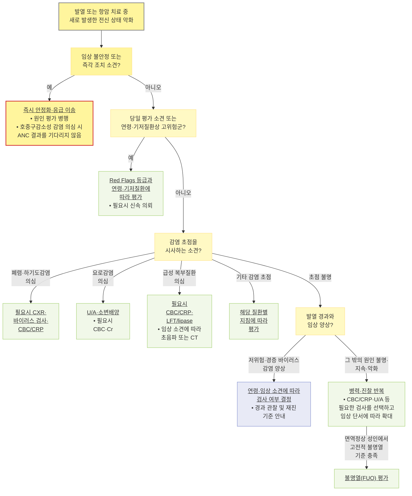
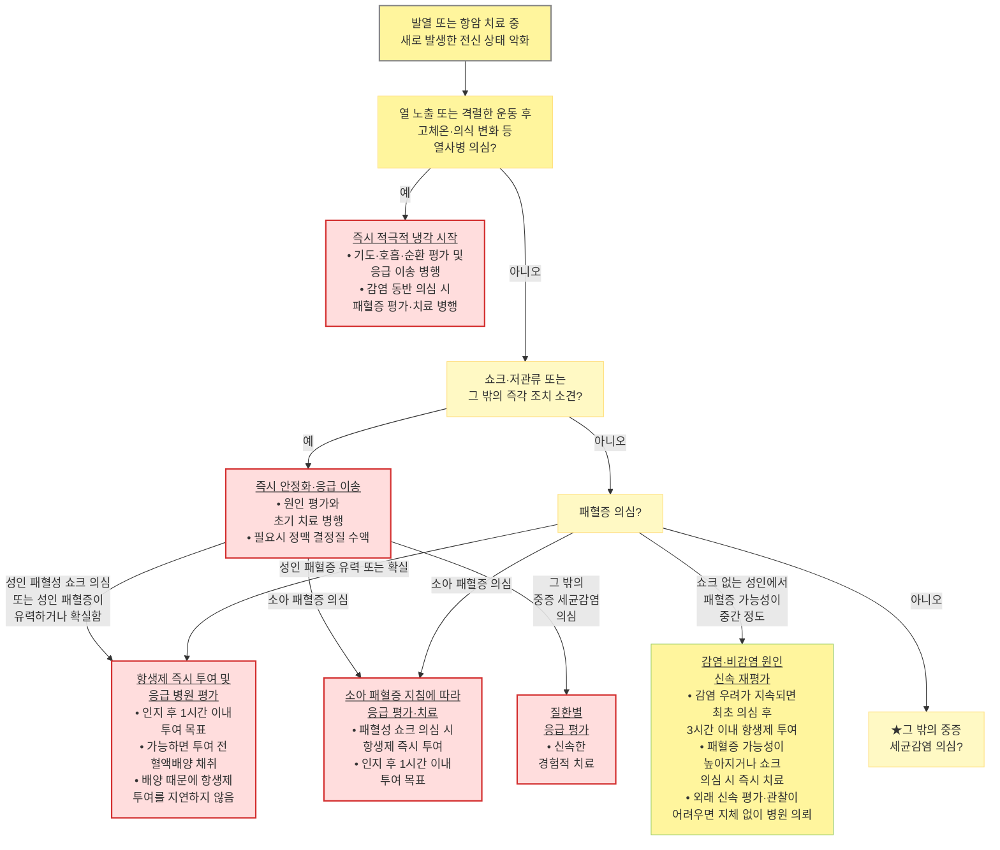
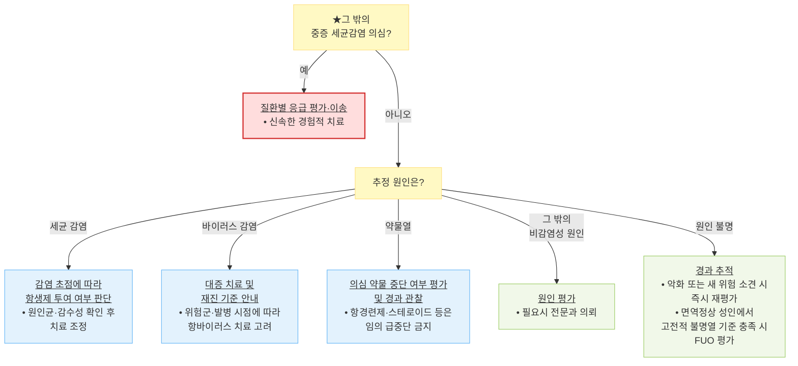

# 발열 Fever

## <mark style="color:green;">일반 사항</mark>

* 발열 : 일상적 변화 이상의 체온 상승
* 발열의 위해 : O<sub>2</sub> 소모량과 CO<sub>2</sub> 생성량을 늘리고 심혈관계 부담을 높일 수 있음 <mark style="color:$info;">\[Am J Respir Crit Care Med 1995]</mark>
  * 현저하게 높은 체온은 빈혈, 심/폐질환, 대사 질환(예: 당뇨병) 등 만성 질환의 상태를 악화시킬 수 있음
* 체온은 측정 부위, 연령, 시간대, 측정기기 및 개인에 따라 달라짐
  * 일중 변동 : 하루 중 약 0.5℃ 내외로 변동; 대개 새벽에 가장 낮고 늦은 오후\~초저녁에 가장 높음
  * 기타 영향 요인 : 식사, 운동, 수면, 월경주기
    * 배란 후 황체기에는 기초체온이 대개 약 0.3\~0.5℃ 상승하여 월경 시작 무렵까지 유지될 수 있음
* 건강한 성인의 측정 부위별 집단 평균 체온 : 직장 약 37.0℃, 구강 약 36.6℃, 고막 약 36.6℃, 겨드랑이 약 36.0℃
  * 부위별 차이는 여러 요인에 영향을 받으므로 일정한 값을 더하거나 빼서 다른 부위 체온으로 환산하지 않음
* 측정 부위별 통상 발열 기준
  * 직장·구강·고막·측두동맥 : 일반적으로 ≥38.0℃
    * 구강 체온은 일부 자료에서 ≥37.8℃를 발열 기준으로 적용
    * 고막 체온은 외이도를 막는 귀지, 체온계의 삽입 방향, 주변 온도의 영향을 받을 수 있음
  * 겨드랑이 : 자료에 따라 ≥37.2℃ 또는 ≥37.5℃를 발열 선별 기준으로 사용
  * 평소 체온이 알려져 있으면 같은 부위에서 잰 체온을 비교하여 상승 여부도 고려
    * IDSA는 장기요양시설 고령자에서 평소 체온보다 ＞1.1℃ 상승한 경우를 발열 기준 중 하나로 제시함 <mark style="color:$info;">\[IDSA 2008 Update]</mark>
  * 고막·측두동맥·겨드랑이 측정값이 발열 기준에 가깝거나 임상 소견과 맞지 않으면 연령과 진료 상황에 적절한 방법으로 재확인
* 소아의 체온 측정법은 연령과 적용 지침에 따라 다름
  * 생후 ＜4주 : 겨드랑이 전자체온계 사용 권고
  * 4주\~5세 : 겨드랑이 또는 적절한 고막체온계를 고려
  * 영국 지침은 0\~5세 소아의 일상적 체온 측정에 구강·직장 경로를 권하지 않음 <mark style="color:$info;">\[NICE NG143]</mark>
  * 반면 북미의 생후 ≤90일 영아 위험 분류 경로는 직장 체온 ≥38.0℃를 기준으로 검증되었으므로, 이 경로를 적용할 때는 겨드랑이 측정값을 그대로 대입하지 않음 (☞ 생후 90일 이하 영아의 발열)
  * 체온 기록 시 측정 부위와 기기를 함께 기록
* 다음과 같은 특수 상황에는 일반 외래의 부위별 기준과 구분되는 별도의 조작적 정의를 적용
  * 항암 치료 관련 호중구감소성 발열 : 일회성 구강 체온 ≥38.3℃ 또는 ≥38.0℃가 1시간 이상 지속
  * 성인 ICU에서 발생한 새로운 발열 : 단회 체온 ≥38.3℃ <mark style="color:$info;">\[SCCM/IDSA 2023]</mark>
  * 정확한 체온이 진단·치료 결정에 중요한 중환자에서 폐동맥카테터·방광카테터·식도 탐침 등의 thermistor가 이미 삽입되어 있거나 이를 통한 중심체온 측정이 가능하면 이를 우선하지만(체온 측정만을 위해 이러한 장치를 새로 삽입하지 않음), 그렇지 않으면 겨드랑이·고막·비접촉 측두동맥보다 구강 또는 직장 체온을 우선 고려 <mark style="color:$info;">\[SCCM/IDSA 2023]</mark>
* 이상의 절단값은 해당 임상 상황의 평가를 표준화하기 위한 기준이며 중증 감염을 배제하는 기준이 아님
  * 영아·고령자·면역저하자·중환자는 중증 감염이 있어도 기준 이상의 발열이 없거나 저체온으로 나타날 수 있으므로, 임상적으로 중증 감염이나 패혈증이 의심되면 체온 기준 충족을 기다리지 않고 평가

#### <mark style="color:$primary;">발열 용어</mark>

* hyperpyrexia : ＞41.5℃의 극심한 발열
  * 중증 감염, CNS 손상, 약물·독성 원인 등의 감별을 요함
  * 체온 ＞41℃는 응급 조치가 필요한 위험 신호임 (☞ Red Flags)
* 고체온증(hyperthermia; 열사병 등) : 시상하부 set-point의 상승 없이 체온이 오르는 것
  * 해열제가 효과 없으며 냉각 요법이 우선임 (☞ [열질환](../230_/205_-heat-illness.md))
* 지속열(sustained 또는 continuous fever) : 정상 체온까지 내려가지 않고 일중 변동 폭이 작은 발열
* 이장열(remittent fever) : 일중 변동 폭이 비교적 크지만 정상 체온까지 내려가지는 않는 발열
* 소모열(hectic 또는 septic fever) : 하루 중 최고 체온과 최저 체온의 차이가 매우 큰 발열
* 간헐열(intermittent fever) : 하루 중 체온이 정상 범위로 돌아오는 때가 있는 발열
* 재귀열(relapsing fever) : 한 질환의 경과에서 무열기를 사이에 두고 발열이 다시 나타나는 양상 (예: 삼일열말라리아의 재발)
* 이중 매일열(double quotidian fever) : 하루에 체온이 두 차례 뚜렷하게 치솟는 양상 (예: 성인형 스틸병)
* 이상성 발열(biphasic fever) : 한 질환의 경과 중 열이 일시적으로 가라앉았다가 다시 오르는 양상 (예: 황열, 뎅기열, 렙토스피라증, 일부 엔테로바이러스 감염)
* 주기열(periodic fever) : 발열이 비교적 일정한 간격으로 반복되는 양상 (예: [PFAPA syndrome](../222_/054_-stomatitis.md#pfapa))

#### <mark style="color:$primary;">발열 치료에 대한 논란</mark>

* 한 번의 체온 상승은 측정 오류, 운동, 환경 등의 영향을 받을 수 있으므로 적절한 방법으로 재측정
  * 실제 발열이면 전신 상태와 위험군(면역저하, 영아, 고령 등) 여부에 따라 평가
* 발열의 잠재적 이익 : 세포·동물 실험에서 발열 범위의 온도 상승이 일부 병원체의 증식을 억제하고 숙주의 일부 면역반응을 촉진함. 사람에서 이러한 효과가 감염 경과나 예후 개선으로 이어지는지는 확립되지 않음 <mark style="color:$info;">\[Heliyon 2019, Nat Immunol 2006]</mark>
* 발열은 일부 뇌전증 환자에서 발작을 유발할 수 있음(예: 드라베 증후군) <mark style="color:$info;">\[Epilepsy Behav 2015]</mark>
* 통상적인 감염성 발열 자체가 뇌 손상을 일으킨다는 근거는 없음. 열사병 등 고체온증이나 뇌염·수막염 등 원인 질환에 따른 뇌 손상과 구분 <mark style="color:$info;">\[Pediatrics 2011]</mark>
* 감염 환자에서 해열제를 일률적으로 투여해 예후가 개선된다는 근거는 확립되지 않음 <mark style="color:$info;">\[BMJ 2022, SSC 2026]</mark>
  * 해열제의 주목적은 통증·보챔 등 불편감 완화임. 체온 수치를 낮추기 위한 일률적 투여는 피함
  * 해열제 투여 후 체온이 내려가거나 전신 상태가 일시적으로 좋아져도 그 반응만으로 중증 세균 감염을 배제하지 않음 <mark style="color:$info;">\[NICE NG143]</mark>
* 단순 열성경련 자체가 뇌의 구조적 손상이나 장기적인 인지·발달 장애를 일으킨다는 근거는 없음 <mark style="color:$info;">\[AAP 2008, N Engl J Med 1998]</mark>
  * 열성경련 : 중추신경계 감염이나 발작을 설명할 대사 이상이 없고 이전 무열성 발작 병력이 없는 생후 6\~60개월 소아에서 발열과 함께 발생하는 발작 <mark style="color:$info;">\[AAP 2008]</mark> (ILAE의 역학 연구용 정의는 생후 1개월 이후를 포함 <mark style="color:$info;">\[ILAE 1993]</mark>)
  * 단순 열성경련 : 전신성 열성경련이 15분 미만 지속되고 24시간 이내에 반복되지 않는 경우 <mark style="color:$info;">\[AAP 2008]</mark>
  * 강직간대 발작이 5분 이상 지속되면 경련중첩증으로 보고 응급 치료를 시작 <mark style="color:$info;">\[ILAE 2015]</mark>
  * 열성경련이 30분 이상 지속되거나 의식을 회복하지 못한 채 30분 이상 반복된 소아를 추적한 FEBSTAT 연구에서는 일부에서 급성 해마 손상을 시사하는 MRI 소견이 나타났고, 그중 일부에서 추적 MRI상 해마경화가 확인됨 <mark style="color:$info;">\[Epilepsia 2024]</mark>

## <mark style="color:green;">원인</mark>

* 감염
  * 바이러스 감염 : 급성 발열의 가장 흔한 원인
    * 원인 바이러스와 환자 위험도에 따라 발열 기간과 경과가 다양함
    * 대부분의 단순 급성 바이러스 감염은 수일\~1주 이내 호전됨
  * 세균 감염 : 적절한 항생제 사용 시 보통 수일 내 임상적 호전이 나타남
    * TB·농양·심내막염 등은 적절한 항생제를 사용해도 호전이 늦을 수 있으며, 농양은 배농 등 원인 조절이 필요할 수 있음
* 염증, 종양
* 자가면역/자가 염증 반응
* 약물

#### <mark style="color:$primary;">약물 유발열 (Drug fever)</mark>

* 약물 투여 중 발생하고 원인 약물 중단 후 호전되는 발열로, 다른 원인을 배제한 후에 내리는 배제 진단(diagnosis of exclusion)
  * 감염·염증질환 등을 먼저 배제하며, 원인 약물 중단 후 해열되면 진단을 뒷받침함
* 약물 중단 후 대개 48\~72시간 내 소실되지만 약물·기전에 따라 더 오래 지속될 수 있음
* 발열에도 불구하고 환자 컨디션이 비교적 양호한 경우가 있지만, 항상 나타나는 특징은 아님
* 발열 정도에 비해 심박수 증가가 적은 '상대적 서맥'(Faget sign)이 관찰되기도 함
  * 다만 상대적 서맥의 판정 기준은 일정하지 않고 진단적 민감도·특이도가 확립되지 않았음
  * 장티푸스·브루셀라·레지오넬라 등 일부 감염병에서도 나타나므로 보조적 단서로만 해석
* 백혈구는 정상·증가·감소 모두 가능하며 호산구 증가증이 동반될 수 있으나 빈도와 정의가 연구마다 다양함
* 발진, 점막 병변, 안면부종, 림프절병증, 간·신장 손상 또는 현저한 호산구 증가가 동반되면 단순 약물열로 간주하지 말고 DRESS, SJS/TEN 등 중증 약물이상반응을 우선 감별
* 발현 시점과 기전은 다양함
  * 과민 반응 : 투여 1\~3주 후; 동일 약물 재노출 시에는 수 시간\~수일 내로 단축될 수 있음
    * 예: penicillin, cephalosporin, sulfonamides, nitrofurantoin, phenytoin, quinidine
  * 주입반응·사이토카인 방출 : 투여 직후\~수일
    * 예: amphotericin B, 일부 항암제·생물학적 제제
  * 약물유발 자가면역질환 : 수주\~수개월 이상 후
    * 예: hydralazine, procainamide 등에 의한 drug-induced lupus

<mark style="color:cyan;">**약물성 고체온증**</mark>

* 항콜린제·교감신경흥분제에 의한 고체온증 및 serotonin syndrome, neuroleptic malignant syndrome, 악성 고열증(malignant hyperthermia; 휘발성 흡입마취제·succinylcholine) 등에서는 시상하부 set-point 상승 없이 체온이 오름
* 약물열과 다른 기전이며, 해열제의 효과를 기대할 수 없음
* 응급 평가, 원인 약물 중단 및 증후군별 치료(냉각 포함)를 시행
  * 마취 관련 악성 고열증이 의심되면 유발 약제를 즉시 중단하고 dantrolene을 신속히 투여 <mark style="color:$info;">\[MHAUS]</mark>

### <mark style="color:$danger;">🚩 Red Flags!</mark>

<mark style="color:$danger;">**즉각 조치**</mark>

* 전신 상태가 양호해 보일지라도 생후 ≤28일 영아의 체온이 ≥38.0℃ 또는 ＜36.0℃ `침습성 세균 감염`
* 의식 변화 `패혈증` `수막염·뇌염`
* 저혈압·빈맥 등 쇼크 소견(구토·설사 등 원인 불문) `패혈성 쇼크` `저혈량성 쇼크`
* 심한 호흡곤란 또는 빈호흡 `중증 폐렴` `패혈증`
* ＞41℃의 극심한 고열 `열사병` `중증 감염`
* 열 노출 또는 격렬한 운동 후 고체온과 의식 변화·경련(체온이 41℃를 넘지 않아도 해당) `열사병`
* 감염이 의심되며 새로 발생한 장기기능장애(핍뇨, 저산소증, 혼돈 등) 또는 말초 저관류 소견(모세혈관 재충전 지연, 얼룩덜룩한 피부, 차가운 사지) `패혈증`
* 발열과 경부 강직·광선공포·심한 두통 등으로 세균성 수막염이 의심되거나, 의식 변화·경련 또는 새로운 국소신경학적 결손이 동반 `세균성 수막염` `뇌염`
* 빠르게 진행·확산하는 비창백성 점상출혈·자반, 전신 상태와 무관한 2 ㎜를 넘는 비창백성 출혈성 자반, 또는 비창백성 발진에 전신 상태 불량 동반 `수막구균혈증`
* <mark style="background-color:yellow;">골수억제 항암 치료 중 발열 또는 감염을 의심할 만한 새로운 전신 상태 악화(ANC 미확인 포함)</mark> `호중구감소성 발열` `호중구감소성 패혈증`
* 열과 함께 점막 침범, 광범위 수포 또는 표피박리 `SJS/TEN`
* 의심 약물 노출 후 수분\~수시간 내 발생한 기관지경련·후두 증상 또는 저혈압 `아나필락시스` <mark style="color:$info;">\[WAO 2020]</mark>
* 약물 과민반응이 의심되며 빠르게 진행하는 간·신장 손상 등 중증 장기 침범 `중증 DRESS`
* 영유아의 담즙성(짙은 녹색) 구토 `장폐색` <mark style="color:$info;">\[RCH 구토 지침]</mark>
* 경구 수분 보충이 불가능한 중증 탈수
* 처짐·수유 불량·호흡곤란·피부색 변화 등 전신 상태가 불량한 생후 ≤90일 영아(체온이 기준 범위에 들지 않아도 해당) `침습성 세균 감염`

<mark style="color:$warning;">**당일 평가**</mark>

* 발열과 새로 발생한 심한 두통이 있으나 경부 강직·광선공포·의식 변화 등 수막염을 시사하는 소견이 뚜렷하지 않음 `수막염` `뇌염`
* 즉각 조치에 해당하는 소견 없이 전신 상태가 양호한 원인 불명의 비창백성 점상출혈 `수막구균혈증` `혈소판감소증`
* 광범위 발진과 안면부종, 호산구증가·이형림프구, 림프절병증 또는 간·신장 기능 이상 동반(중증 장기 침범·혈역학적 불안정이 없어도 해당) `DRESS`
* 구토·설사와 함께 탈수 진행, 혈변 또는 심한 지속성 복통(쇼크·의식 변화·복막자극징후가 동반되면 즉각 조치 대상) `급성 복증` `침습성 장염`
* 전신 상태가 양호해 보이는 생후 29\~60일 영아의 체온이 ≥38.0℃ 또는 ＜36.0℃ `침습성 세균 감염`
* 생후 61\~90일 영아의 체온이 ≥38.0℃ 또는 ＜36.0℃ `요로감염` `침습성 세균 감염`
* 생후 3\~6개월 영아의 체온이 ≥39.0℃ `중증 감염`
* 중증 면역저하자의 발열 `기회감염`
* 소아에서 5일 이상 지속되는 발열(발진·결막충혈 등 주요 소견이 없거나 이미 사라졌어도 해당) `가와사키병(불완전형 포함)` <mark style="color:$info;">\[NICE NG143]</mark>
* SARS-CoV-2 감염·노출 후 수주 내 발생한 발열과 위장관 증상, 결막충혈·발진 등 점막피부 소견 또는 심혈관 이상 동반 `MIS-C`
* 최근 12개월 이내 해외 말라리아 유행 지역 여행력 또는 국내 말라리아 위험지역의 거주·방문·군 복무력과 함께 발생한 발열 `말라리아`
* 열대·아열대 지역에서 귀국 후 14일 이내 발열 `뎅기열`
* 진드기 노출·야외 활동 후 발열 `쯔쯔가무시증` `SFTS`

<mark style="color:$info;">**조기 평가 및 추적**</mark>

* 예상과 달리 지속 또는 심해지는 열, 해열 후 재발한 열 또는 새로운 국소 증상 동반 `세균성 이차감염` `농양`
* 경미한 수분 섭취 저하·소변량 감소 `탈수`
* 원인이 밝혀지지 않은 지속성 발열(≥3주) `FUO`

## <mark style="color:green;">진단</mark>

* 진찰 소견으로 감별하며, 의심되는 질환에 대한 진단 검사를 고려
* 발열의 원인이 감별되지 않는 경우에는 의뢰를 고려
* <mark style="background-color:yellow;">항암 치료 중 호중구감소성 감염이 의심되면 ANC 결과를 기다리지 않고 응급 평가·치료가 가능한 병원으로 즉시 의뢰 <mark style="color:$info;">\[NICE CG151]</mark></mark>

***



<p align="center"><strong>발열의 초기 평가 알고리듬</strong><br><em><mark style="color:$info;">저자 재구성 (참고 문헌 : NICE NG143·<mark style="background-color:yellow;">CG151</mark>, Canadian Paediatric Society 영아 발열 지침, SCCM/IDSA 2023, Surviving Sepsis Campaign 2026, Wright et al., Clin Infect Dis 2026 등)</mark></em></p>

***

### <mark style="color:orange;">초기 평가 검사</mark>

* 임상적으로 안정한 저위험 환자에서 명백한 급성 바이러스 감염 임상상이라면 보통 검사는 불필요함
* 발열 기간이 짧더라도 호중구감소성 발열 의심, 혈역학적 불안정, 중증 국소 감염 등 즉각 조치 소견이 있으면 즉시 평가
  * <mark style="background-color:yellow;">호중구감소성 발열의 진단에 사용하는 ANC 기준은 ＜500/㎣이거나 48시간 내 ＜500/㎣로 감소할 것으로 예상되는 경우임. 발열 기준은 위 체온 측정 절 참조</mark>
  * 상태가 안정된 영아·면역저하자·쇠약한 고령자 등 고위험군은 연령별 평가 경로와 Red Flags 등급에 따라 평가

#### <mark style="color:$primary;">임상 적응증에 따라 고려할 혈액 검사</mark>

* 아래의 검사를 모든 발열 환자에게 일괄적으로 시행하지 않으며, 연령·전신 상태·면역상태·발열 기간과 병력·진찰에서 의심되는 원인에 따라 선택
* CBC with differential : 감염·염증 및 혈액학적 이상 평가. 단, 단독으로 세균·바이러스 감염을 구별하지 못함
* CRP, ESR : 비특이적 염증 지표; 임상 소견 및 경과와 함께 해석
* procalcitonin(PCT) : 세균 감염 시 갑상선 외의 전신 조직(간, 폐, 신장, 지방조직)에서 다량으로 합성·분비됨
  * 세균 감염 가능성 판단의 보조 지표로 활용
  * 신기능 저하(특히 eGFR ＜30 또는 투석), 중증 외상·화상 등에서는 세균 감염 없이도 상승할 수 있음
  * 초진 수치와 경과 중 변화 추세를 임상 맥락과 함께 해석
  * 패혈증은 임상 진단이므로 PCT로 진단하지 않으며, 단독 cut-off로 세균 감염을 확진·배제하지 않음
  * 성인 패혈증 의심 시 항생제 시작은 임상 평가로 결정하며 PCT 결과를 기다리지 않음 <mark style="color:$info;">\[SSC 2026]</mark>
  * 감염원 조절이 충분하고 적정 치료 기간이 불명확할 때 PCT 추세를 임상 소견과 함께 항생제 중단 판단에 활용
* 혈당, BUN/Cr, 전해질 : 대사 이상·탈수 평가
* LFT : 간염, 패혈증 관련 간기능 저하 확인

#### <mark style="color:$primary;">감염 초점·원인 확인 검사</mark>

* 혈액 배양 : 패혈증·균혈증 의심 시 가능한 한 항생제 투여 전 채취하되, 중증 환자에서 배양 때문에 항생제 투여를 지연하지 않음
* 요로감염 의심 시 소변 검사(U/A)와 소변 배양
* [A군 연쇄구균 인두염](../223_/061_-acute-pharyngitis.md) 의심 시 인두 도말 신속항원검사 또는 배양
* [인플루엔자](../223_/069_-influenza.md) 의심 시 적절한 호흡기 검체로 신속분자검사 또는 항원검사
* 폐렴 의심 시 흉부 X선

#### <mark style="color:$primary;">특수 상황별 추가 검사</mark>

* 말라리아 노출력(해외 유행 지역 여행 또는 국내 위험지역 거주·방문·군 복무)이 있는 경우
  * 말라리아 도말검사(후도말·박도말) ± 신속항원검사
  * 첫 도말이 음성이어도 의심이 높으면 12\~24시간 간격으로 총 3세트까지 반복
* 뎅기열 노출력이 있는 경우
  * 증상 발생 후 0\~7일에는 NAAT와 IgM 또는 NS1 항원검사와 IgM을 함께 시행
  * 8일째부터는 IgM을 우선 검사 <mark style="color:$info;">\[CDC 뎅기열 검사 지침]</mark>
* 진드기 노출 병력
  * 쯔쯔가무시증 : 유행 시기·야외 활동·가피·발진을 종합하고 급성기에는 PCR을 고려
    * 항체는 발병 초기 음성일 수 있어 회복기 혈청 또는 진단 확인에 활용
  * 중증열성혈소판감소증후군(SFTS) : SFTS 바이러스 혈액 PCR 검사
* 면역억제 환자 : β-D-glucan, galactomannan, CMV PCR 등은 일괄 선별검사로 시행하지 않고 숙주 위험인자, 의심 증후군 및 영상 소견에 따라 선택
* 임상 소견(발열·발진·호흡기 증상 등)과 역학력(해외여행·확진자 접촉 등)을 종합해 홍역, MERS, 바이러스출혈열 등 법정감염병의 의사환자 기준에 해당하면 신속히 분리하고 질환별 격리·보호구 지침에 따라 조치(예: 홍역은 공기주의)
  * 법정감염병 신고기준에 해당하면 의무적으로 신고(제1급은 즉시, 제2·3급은 24시간 이내)

#### <mark style="color:$primary;">패혈증 선별</mark>

* 패혈증은 감염 의심과 장기 기능장애를 종합해 판단하는 임상 진단으로, 단일 점수나 biomarker만으로 진단·배제하지 않음
* 성인 패혈증 의심 시 병원 초기 평가에서 혈중 젖산 측정을 고려하며, 채혈이나 결과 확인 때문에 이송·치료를 지연하지 않음 <mark style="color:$info;">\[SSC 2026]</mark>
* 급성 성인 입원 환자의 단독 선별 도구로는 [NEWS2](https://www.mdcalc.com/calc/10083/national-early-warning-score-2-news2), [SIRS](https://www.mdcalc.com/calc/1096/sirs-sepsis-septic-shock-criteria), [MEWS](https://www.mdcalc.com/calc/1875/modified-early-warning-score-mews-clinical-deterioration) 등을 활용 (소아·임신 환자에게 그대로 적용하지 않음)
  * SIRS : ① 체온 ＞38.0℃ 또는 ＜36.0℃, ② 심박수 ＞90회/분, ③ 호흡수 ＞20회/분 또는 PaCO<sub>2</sub> ＜32 ㎜Hg, ④ 백혈구 ＞12,000/㎣ 또는 ＜4,000/㎣ 또는 미성숙 호중구 ＞10% 중 2개 이상
  * [qSOFA](https://www.mdcalc.com/calc/2654/qsofa-quick-sofa-score-sepsis)(빈호흡 ≥22회/분, 의식 변화, 수축기혈압 ≤100 ㎜Hg 중 2개 이상)는 민감도가 낮아 단독 선별 도구로 사용하지 않으며, 불량 예후 위험 파악에 참고

### <mark style="color:orange;">동반 증상에 따른 감별</mark>

* 표의 위험 소견 중 Red Flags 즉각 조치에 해당하는 소견(저혈압, 패혈증 소견, 복막자극징후 등)이 있으면 안정화와 응급 의뢰를 우선

<table data-search="false"><thead><tr><th width="147">동반 증상</th><th>주요 감별 진단</th><th>위험 소견·진단 단서</th><th>초기 조치</th></tr></thead><tbody><tr><td><strong>두통·의식 변화</strong></td><td>수막염, 뇌염</td><td>경부 강직, 광선공포, 경련</td><td>응급 의뢰·요추천자 검토¹⁾</td></tr><tr><td><strong>기침·호흡곤란</strong></td><td>폐렴, 바이러스 하기도감염, 폐색전증</td><td>SpO₂ 저하, 빈호흡</td><td>CXR ± 호흡기 PCR. 필요시 산소·항생제</td></tr><tr><td><strong>흉통</strong></td><td>심근염, 심낭염, 폐렴, 폐색전증</td><td>저혈압, 부정맥</td><td>ECG·troponin·CXR. 필요시 심초음파</td></tr><tr><td><strong>요통·국소 골통</strong></td><td>척추 경막외 농양, 골수염</td><td>국소 척추 압통, 신경학적 결손</td><td>척추 감염 의심 시 신속히 MRI. 신경학적 결손 시 응급 의뢰</td></tr><tr><td><strong>배뇨 증상</strong></td><td>요로감염, 신우신염</td><td>옆구리 통증, 패혈증 소견</td><td>U/A·소변배양. 신우신염 의심 시 항생제</td></tr><tr><td><strong>복통</strong></td><td>충수염, 담낭염, 복강 농양</td><td>반발 압통</td><td>복막자극징후가 있으면 응급 의뢰. 영상검사(복부 초음파 또는 CT)는 임상 소견에 따라 선택</td></tr><tr><td><strong>발진</strong></td><td>수막구균혈증, 바이러스 감염, 약물열·중증 약물이상반응</td><td>비창백성 점상출혈·자반, 점막 침범, 수포·표피박리</td><td>위험 소견에 따라 즉각 또는 당일 평가²⁾</td></tr><tr><td><strong>심잡음·색전 소견</strong></td><td>감염성 심내막염</td><td>정맥주사 약물 사용력, 색전 징후</td><td>혈액배양·심초음파³⁾</td></tr><tr><td><strong>야간 발한·</strong><br><strong>체중 감소</strong></td><td>결핵, 림프종 등 악성 종양</td><td>만성 경과</td><td>임상 단서에 따라 CXR·결핵 검사·CBC/LDH. 필요시 CT·조직검사</td></tr><tr><td><strong>소아의 지속 발열</strong></td><td>가와사키병(불완전형 포함)</td><td>발열 ≥5일, 결막충혈, 발진, 구강·손발 변화, 경부 림프절 비대</td><td>소아청소년과 의뢰·심초음파⁴⁾</td></tr><tr><td><strong>코로나19 감염·노출 후 수주 내 발열</strong></td><td>MIS-C</td><td>저혈압, 심기능 이상, 심한 복통</td><td>응급 평가⁵⁾</td></tr><tr><td><strong>뚜렷한 국소 증상 없음</strong></td><td>약물열, 결핵, 악성 종양, 심내막염</td><td>상대적 서맥(보조 단서)</td><td>병력·진찰 반복, 약물 검토⁶⁾</td></tr></tbody></table>

> ¹⁾_**수막염·뇌염** : 새 국소 신경학적 소견·경련, 유두부종, 심한 의식 저하 등으로 두개내압 상승이나 공간점유 병변이 의심되면 요추천자 전에 뇌 영상검사를 시행. 세균성 수막염 의심 시 영상검사나 요추천자 때문에 경험적 항생제를 지연하지 않으며, 적응증이 있으면 dexamethasone 병용. 뇌염 의심 시 검사 결과를 기다리지 않고 경험적 IV acyclovir 시작_
>
> ²⁾_**발진** : 비창백성 발진은 Red Flags의 평가 등급을 따름. 수막구균혈증이 의심되면 즉시 응급 이송하며, 항생제 투여 때문에 이송을 지연하지 않음. 중증 약물이상반응이 의심되면 응급 평가_
>
> ³⁾_**감염성 심내막염** : 가능하면 항생제 투여 전 말초정맥 혈액배양을 최소 3세트 채취. 혈역학적으로 불안정하면 배양 때문에 항생제 투여나 이송을 지연하지 않음_
>
> ⁴⁾_**가와사키병** : 발열이 5일 이상 지속되면 주요 소견이 없거나 이미 사라졌어도 평가. 주요 소견이 4개 이상이면 발열 4일째에도 완전형 진단 가능. CBC·CRP/ESR·LFT·U/A 등은 임상 소견에 따라 시행_
>
> ⁵⁾_**MIS-C** : 응급 평가에서 염증 및 심장 침범을 확인하기 위해 CRP·troponin·BNP, ECG·심초음파 등을 고려_
>
> ⁶⁾_**국소 증상 없는 발열** : 위험도·발열 기간·임상 단서에 따라 U/A·혈액검사·배양·영상검사를 선택. 약물열이 의심되면 원인 약물의 중단 여부를 평가하고 경과를 추적_

### <mark style="color:orange;">열 패턴에서 참고할 수 있는 고전적 연관성</mark>

* 열 패턴은 특이도가 낮고 해열제·항생제 사용 등에 의해 변형될 수 있으므로, 단독 진단 근거로 사용하지 않고 병력·노출·진찰 및 검사 소견과 함께 보조적으로만 해석

<table><thead><tr><th width="361">패턴</th><th>참고할 수 있는 연관 질환</th></tr></thead><tbody><tr><td><strong>상대적 서맥 (Faget sign)</strong></td><td>약물열, 장티푸스, 브루셀라, 레지오넬라</td></tr><tr><td><strong>biphasic (2회 발열기)</strong></td><td>뎅기열, 황열, 일부 엔테로바이러스 감염, 렙토스피라증</td></tr><tr><td><strong>야간 발열 (nocturnal)</strong></td><td>TB, 림프종</td></tr><tr><td><strong>relapsing (발열-정상 반복)</strong></td><td>삼일열말라리아의 재발</td></tr><tr><td><strong>double quotidian (일 2회 정점)</strong></td><td>성인형 스틸병에서 볼 수 있음</td></tr><tr><td><strong>Pel-Ebstein fever (수일 발열 후 수일 정상 반복)</strong></td><td>호지킨 림프종과의 역사적 연관성; 드물고 진단적 신뢰도가 낮음</td></tr></tbody></table>

***

### <mark style="color:orange;">생후 90일 이하 영아의 발열</mark>

* 생후 ≤90일 영아에서 체온 ≥38.0℃가 확인되면 열의 높이만으로 위험도를 판단하지 않고 정확한 일령, 전신 상태, 재태 연령, 기저질환, 최근 항생제 사용 및 국소 세균 감염 여부를 확인; ＜36.0℃의 저체온도 중증 감염 위험 신호이며, 특히 어린 영아에서는 발열과 유사하게 평가
* 보호자가 가정에서 확인한 발열은 내원 시 체온이 정상이어도 무시하지 않으며, 측정 부위·기기·방법을 확인하여 해석. 검증된 영아 위험 분류 경로는 주로 직장 체온 ≥38.0℃를 기준으로 하므로 겨드랑이 선별값을 그대로 대입하지 않고, 겨드랑이 체온이 기준 미만이라는 이유로 중증 감염을 배제하지도 않음 <mark style="color:$info;">\[CPS 2026]</mark>
* 생후 세 번째 달(연구상 60\~90일)의 이전에 건강하고 전신 상태가 양호했던 발열 영아를 분석한 메타분석에서 침습성 세균 감염(균혈증 또는 세균성 수막염)은 1.11%, 균혈증은 1.01%, 세균성 수막염은 0.11%였음 <mark style="color:$info;">\[JAMA Pediatr 2026]</mark>
* 사회적 미소, 눈맞춤·상호작용, 각성도, 수유 상태 등은 전신 상태 평가에 도움이 되는 보조 소견이나, 사회적 미소나 양호한 외관만으로 침습성 세균 감염을 배제하지 않음
* 생후 ≤28일에서 체온 ≥38.0℃ 또는 ＜36.0℃이면 전신 상태가 양호해 보여도 즉시 응급 평가; 생후 29\~60일은 지체 없이 소아 진료가 가능한 기관에서 긴급 평가
  * 생후 ≤28일은 저위험으로 분류되더라도 입원 관찰
  * 전신 상태가 양호한 생후 ≤60일 발열 영아에서는 CBC 및 백혈구 감별계산, PCT 또는 CRP, 혈액배양, 소변검사 및 소변배양을 기본으로 시행. 요추천자·입원·경험적 항생제는 일령과 위험도에 따라 결정
* 생후 61\~90일의 이전에 건강하고 전신 상태가 양호했던 영아는 당일 평가하며, 요로감염이 상대적으로 흔하므로 소변검사와 소변배양을 시행. 혈액검사·혈액배양·요추천자·입원 여부는 전신 상태, 소변검사, 염증표지자, 보호자의 관찰 능력 및 신속한 재진 가능성을 종합하여 결정
* 생후 ≤90일 발열 영아의 소변배양 검체는 도뇨 또는 치골상부 방광천자를 우선하며 청결 채취도 가능. 소변백 검체는 배양용으로 사용하지 않음 <mark style="color:$info;">\[CPS 2026]</mark>
* PCT는 검증된 위험 분류 도구에서 다른 소견과 조합해 해석하며, 조합 항목은 도구마다 다름 <mark style="color:$info;">\[CPS 2026]</mark>
  * PCT를 시행할 수 없으면 해당 기관의 PCT 미사용 경로를 적용하며, PECARN·Step-by-Step의 PCT 항목에 CRP를 대신 넣지 않음
  * PECARN 규칙(생후 29\~60일) : 소변검사 음성(백혈구 에스테라제·아질산염 음성, 요침사 백혈구 ≤5/HPF), ANC ≤4,000/㎕, PCT ≤0.5 ng/㎖를 모두 충족하면 저위험
  * Step-by-Step(생후 22\~90일) : 전신 상태 양호, 소변검사 백혈구 음성, PCT ＜0.5 ng/㎖, CRP ≤20 ㎎/L, ANC ≤10,000/㎕를 모두 충족하면 저위험
* 미숙아 출생(재태연령 ＜37주), 이전 입원 또는 신생아실 장기 재원, 만성질환·염색체 이상·의료기기 의존, 면역저하, 최근 항생제 사용 또는 국소 세균 감염이 있거나, 전신 상태 평가가 불확실하면 저위험 경로를 적용하지 않고 더 적극적으로 평가
* 여러 합리적인 검사·관찰 선택지가 있는 생후 29\~90일 저위험 영아에서는 보호자와 공유의사결정을 시행 <mark style="color:$info;">\[CPS 2026]</mark>
  * 귀가 요건을 충족해 귀가하는 경우 24\~48시간 이내 재평가를 마련하고, 배양검사 결과의 확인·연락 담당자와 즉시 재내원할 악화 징후를 명확히 안내

## <mark style="color:green;">불명열 (Fever of Unknown Origin)</mark>

<table><thead><tr><th width="98">항목</th><th>고전적 불명열 (Classic)</th><th>원내 발생 불명열 (nosocomial FUO)</th></tr></thead><tbody><tr><td><strong>정의</strong></td><td>정상 면역 성인에서 반복적으로 확인되는 체온 ≥38.3℃, 기간 ≥3주, 적절한 최소 표준 진단평가 후에도 원인 불명</td><td>입원 당시 감염이 존재하거나 잠복 중이지 않았던 환자에서 반복적으로 체온 ≥38.3℃가 확인되고, 최소 3일간의 적절한 평가(미생물 배양을 최소 2일간 관찰하는 것을 포함) 후에도 원인 불명</td></tr><tr><td><strong>환자 위치</strong></td><td>지역 사회, 병원</td><td>급성 질환을 다루는 병원</td></tr><tr><td><strong>흔한 원인</strong></td><td>감염, 비감염성 염증질환, 악성 종양</td><td>원내 감염, 수술 후 합병증, drug fever</td></tr><tr><td><strong>병력</strong></td><td>여행, 접촉, 동물/벌레 노출, 약물, 예방접종, 가족력, 심장 판막 이상</td><td>수술, 시술, 장치 삽입, 해부학적 이상, 약물</td></tr></tbody></table>


**고전적 불명열의 진단 기준 변화** : Petersdorf & Beeson(1961)의 전통적 정의는 '≥3주 지속, 반복적으로 ≥38.3℃, **입원 1주 평가** 후에도 원인 불명'; Durack & Street(1991)는 이를 **외래 방문 또는 입원 기간**을 이용한 기준으로 수정함.\
최근에는 특정 입원 기간보다 **적절한 최소 표준 진단평가를 완료**했음에도 원인이 밝혀지지 않았는지를 더 중시. 다만 ≥3주 지속 기준은 여전히 고전적 FUO의 기본 틀로 사용하며, 1주 집중 평가 기준 등은 대안적·역사적 기준으로 이해.\
Durack & Street 분류에는 호중구감소성 FUO와 HIV 관련 FUO도 포함되며, 이 챕터에서는 고전적·원내 발생 불명열만 다룸


#### <mark style="color:$primary;">원인</mark>

* 주요 범주 : 감염, 비감염성 염증질환(자가면역/자가염증), 악성 종양, 기타(약물열·혈전색전성 질환·인위성 발열 등), 미진단
* 원인 분포는 지역·연령·referral setting·진단 기술에 따라 크게 달라지므로 고정된 백분율보다 임상 단서에 따른 단계적 접근이 중요

#### <mark style="color:$primary;">검사</mark>

* 최소 표준 혈액 검사
  * 전혈 검사 : CBC with differential, ESR
  * 생화학 : comprehensive metabolic panel(Ca·LFT 포함), TSH
  * 염증 표지자 : CRP, ferritin
  * 자가항체 : RF, ANA, ANCA
* 미생물 검사
  * 혈액 배양 : 말초정맥에서 간격을 두고 최소 3세트 채취, 통상 5일 배양
  * U/A 및 필요시 소변 배양
  * HIV 1/2 선별검사
  * 결핵 피부반응검사 또는 interferon-γ release assay
* 영상 검사
  * 기본 : 복부 초음파와 흉부 PA·측면 X선, 또는 흉부·복부·골반 CT
  * FDG-PET/CT : 최소 표준 진단평가 후에도 원인이 불명이고 염증 소견이 지속될 때, 이용 가능성과 임상 단서를 고려하여 시행
* 추가 검사 : CPK, LDH, protein electrophoresis와 기타 혈청·영상·조직 검사는 일률적인 기본검사가 아니라 임상 단서에 따라 선택 <mark style="color:$info;">\[Clin Infect Dis 2026]</mark>

***

## <mark style="background-color:$warning;">Management</mark>

### <mark style="color:orange;">치료 방침</mark>

* 원인에 따른 치료 시행
* 소위 shotgun approach(불필요한 경험적 다제 투여)는 증상/징후를 모호하게 하여 진단을 어렵게 하고 의도하지 않은 문제를 일으킬 수 있으므로 삼가야 함

#### <mark style="color:$primary;">시험적 치료</mark>

* 안정적인 고전적 불명열에서는 경험적 항생제·스테로이드가 진단 단서를 가릴 수 있으므로 원칙적으로 피함
* 호중구감소·중증 면역저하·혈역학적 불안정 등에서 중증 감염이 의심되면 가능한 한 항균제 투여 전 검체를 채취하되, 채취 때문에 치료를 지연하지 않음
* 거대세포동맥염이 강하게 의심되면, 특히 시각 증상이 있으면 생검 등 확진 검사를 기다리지 않고 스테로이드를 시작

#### <mark style="color:$primary;">항생제</mark>

* 성인 패혈성 쇼크(의심 포함) 또는 쇼크가 없는 probable/definite sepsis에서는 즉시 시작(인지 후 이상적으로 1시간 이내) <mark style="color:$info;">\[SSC 2026]</mark>
* 성인 possible sepsis without shock : 감염 가능성을 신속히 재평가하고, 임상적으로 세균 감염 가능성이 지속되면 최초 의심 후 3시간 이내 항생제 시작 <mark style="color:$info;">\[SSC 2026]</mark>
  * <mark style="background-color:yellow;">3시간은 최초 의심 시점부터의 항생제 투여 목표임. 외래에서 신속한 평가와 면밀한 관찰이 불가능하면 지체 없이 병원으로 의뢰</mark>
* 항암 치료를 받는 성인의 호중구감소성 발열에서는 내원 후 초기 분류(triage)부터 1시간 이내에 첫 경험적 항균제를 투여 <mark style="color:$info;">\[ASCO/IDSA 2018]</mark>
* 기타 중증 세균 감염에서는 임상적으로 신속히 시작
* 안정적이고 바이러스 감염이 의심되며 세균 감염 근거가 부족한 경우에는 관찰 가능
* PCT·CRP 등 biomarker의 단일 cut-off만으로 항생제 시작 또는 보류를 결정하지 않음

#### <mark style="color:$primary;">해열제</mark>

* 체온 수치 자체보다 통증·보챔 등 불편감(distress)이 있는 환자에서 투여 고려
* 주목적은 불편감 완화임. 감염 예후 개선을 위한 일률적 투여의 이익은 확립되지 않음
* 열성경련 예방 목적으로 해열제를 사용하지 않음

### <mark style="color:orange;">발열 치료 알고리듬</mark>

***





<p align="center"><strong>발열 치료 알고리듬</strong><br><em><mark style="color:$info;">저자 재구성 (참고 문헌 : Surviving Sepsis Campaign 2026 성인·소아 지침, SCCM Heat Stroke Guideline 2025, SCCM/IDSA 2023 등)</mark></em></p>

***

## <mark style="color:green;">비-약물 치료 및 예방</mark> <a href="#non-drug-treatment" id="non-drug-treatment"></a>

* 탈수를 예방하도록 수분을 보충
  * 소아와 노인에서 특히 유의
  * 심부전·진행된 신장질환 등으로 수분 제한을 처방받았다면 이를 고려하여 개별 조정
* 오한과 불편감을 유발할 수 있으므로 발열 시 tepid sponging(미온수 닦기·미온수 목욕), 찬물·얼음물 입욕 등 적극적 물리적 냉각을 routine으로 권하지 않음 <mark style="color:$info;">\[NICE NG143]</mark>
* 피부 흡수·흡입에 의한 알코올 중독(저혈당·의식 저하) 위험이 있으므로, 특히 영유아에서 알코올 마사지·알코올 찜질은 권하지 않음
* 환자를 과도하게 벗기거나 두껍게 감싸지 말고 편안한 환경과 의복을 유지
* [열사병](../230_/205_-heat-illness.md#management) 등 hyperthermia는 해열제가 효과적이지 않으며 신속한 active cooling이 핵심 치료

## <mark style="color:green;">약물 치료</mark> <a href="#drug-treatment" id="drug-treatment"></a>

### <mark style="color:orange;">해열제</mark>

* 선택제 : acetaminophen, NSAID(예: ibuprofen)
* 뎅기열이 의심되거나 배제되지 않은 여행 후 발열에서는 출혈 위험 때문에 aspirin과 ibuprofen 등 NSAID를 피하고 acetaminophen을 우선 사용
* 해열제는 발열 시 상승한 시상하부 체온 조절 set-point를 낮춤
  * 과도한 체온강하·허탈·사지냉각이 발생할 수 있으므로, 특히 소아·고령자·소모성 질환 환자에서 투여 후 상태를 관찰
* 해열제는 정상 체온에는 임상적으로 의미 있는 영향을 주지 않음
* 소아 발열에서는 acetaminophen 또는 ibuprofen 단독 제제를 체중에 맞는 정량으로 투여
  * 한 약제로 불편감(distress)이 충분히 완화되지 않으면 다른 약제로 변경 고려
  * 다음 투약 가능 시점 전에 불편감이 지속 또는 재발하는 특수 상황에서만 제한적으로 교대 투여를 고려
  * 두 약을 동시에 투여하지 않으며, 교대 시 투약 오류·중복·과량 투여 위험에 특히 주의
  * 해열제 교대 투여는 routine으로 권장하지 않음
* 성인 통증에서는 acetaminophen과 NSAID 병용의 임상적 근거가 있으나, 해열만을 위한 routine 병용은 권고하지 않음
* NSAID 두 종류의 병용은 피함
* fentanyl·buprenorphine 패치 사용 중 발열이 발생하면 흡수 증가로 인한 과다 진정·호흡억제에 유의하고 필요시 용량 조정; 패치 부위의 외부 열 노출을 피함 (☞ [통증](001_-pain.md))

#### <mark style="color:$primary;">Acetaminophen</mark>

* 복합제 중에는 acetaminophen을 함유하고 있는 경우가 많으므로 성분표를 확인하고 이를 합산하여 복용량을 결정해야 함
* 일반 성인의 허용 최대 4 g/d. 반복·장기 사용에서는 3 g/d 이하를 보수적으로 권장
  * 고령·쇠약·저체중·영양불량·지속적인 과음 등에서는 위험요인의 정도·체중·사용기간에 따라 감량; 고령 또는 신기능 저하만을 이유로 일률적인 2 g/d 상한을 적용하지 않음
  * 간경변에서는 임상 지침상 통상 최대 2 g/d 범위로 제한. 단, 심한 간장애·심한 신장애는 수록 제품의 투여 금기이므로 감량 사용과 구분 <mark style="color:$info;">\[AASLD 2022]</mark>
* 속방형 : 500\~650 ㎎ q4\~6h PRN 또는 1,000 ㎎ q6h PRN
  * 제품 허가 용법 : 만 12세 이상에서 필요시 1회 1\~2정, 4\~6시간 간격으로 1일 3\~4회, 1일 최대 8정(4 g) <mark style="color:blue;">\[</mark>[<mark style="color:blue;">타이레놀</mark>](https://health.kr/drug/2021082400002)<mark style="color:blue;">]</mark>(500 ㎎)
* 서방형 : 12세 이상에서 650 ㎎ × 2정 q8h PRN; 24시간 최대 6정(3,900 ㎎) <mark style="color:blue;">\[</mark>[<mark style="color:blue;">타이레놀8시간이알</mark>](https://health.kr/drug/2022020300026)<mark style="color:blue;">]</mark>
  * 씹거나 쪼개거나 분쇄하지 말고 그대로 삼킴
  * 2정씩 1일 3회는 3,900 ㎎이므로 3 g/d 이하로 제한하려는 환자에게는 맞지 않음
* 금기 : 소화성궤양, 심한 혈액이상·심한 간장애·심한 신장애·심한 심장기능저하, aspirin 천식 또는 그 병력, 바르비탈계 약물·삼환계 항우울제(TCA) 복용 환자, 음주 상태
* Warfarin 병용 : 수일 이상 규칙적으로 복용하면 INR 상승 가능성이 있어 INR을 확인하고 필요시 추적 간격을 조정; 특히 2 g/d 이상 반복 투여 시 유의 <mark style="color:$info;">\[Eur J Clin Pharmacol 2011]</mark>
* 소아 : 10\~15 ㎎/㎏ q4\~6h PRN; 최대 5회/d 및 75 ㎎/㎏/d
  * 체중 기준 계산량이 성인 1회 최대량 1,000 ㎎·1일 최대량 4 g을 넘지 않도록 함
  * [세토펜현탁액](https://www.health.kr/drug/A11A0610B0025)(32 ㎎/㎖) : 1회 약 0.31\~0.47 ㎖/㎏; 실용적으로 0.4 ㎖/㎏/회
  * 허가 용량표는 생후 4개월부터 제시하며, 만 ＜2세는 투여 전 의사와 상담하도록 명시
    * 생후 ＜4개월은 허가 용량표에 제시되지 않으므로 연령·체중·진단을 확인하여 개별 판단
* 임신 중 해열제가 필요하면 acetaminophen을 우선 고려하며, 의료진과 상의하여 최소 유효용량을 필요한 최단기간 사용

#### <mark style="color:$primary;">Ibuprofen</mark>

* 성인 : 감기·발열에 [200](https://health.kr/drug/A11A0500A0097)\~[400 ㎎](https://www.health.kr/drug/A11A0500A0131) tid\~qid; 연령·증상과 제품별 허가사항에 따라 조절 <mark style="color:blue;">\[부루펜]</mark>
* 소아 : 국제 지침 기준 1회 5\~10 ㎎/㎏ q6\~8h PRN, 최대 40 ㎎/㎏/d (생후 ≥6개월에서 사용)
  * [어린이부루펜시럽](https://health.kr/drug/2019101800001)(20 ㎎/㎖) : 체중 기준 용량을 환산하면 1회 0.25\~0.5 ㎖/㎏
  * 해당 제품의 허가 용량표는 1세부터 제시(1일 3\~4회); 만 2세 미만은 투여 전 의사 또는 약사와 상의
  * 체중으로 계산한 1회량과 1일 총량이 각각 연령별 상한을 넘지 않는지 확인(예: 3\~6세 1회 150 ㎎, 1일 600 ㎎)
* 부루펜의 주요 금기 : 위장관 궤양·출혈 또는 그 병력, 기관지천식 또는 그 병력, aspirin/NSAID 과민반응 또는 그 병력, 심한 신·간·심장기능 장애 등 (☞ [통증](001_-pain.md))
  * 시럽 등 다른 품목은 금기 항목이 다를 수 있으므로 해당 제품의 허가사항을 적용
* 신기능 주의
  * 탈수·섭취 저하, 신장질환 또는 심부전이 있으면 급성 신손상 위험에 주의하고 acetaminophen 등 대안을 우선 고려
  * eGFR ＜30 ㎖/min/1.73㎡에서는 전신 NSAID를 원칙적으로 피함(심한 신장애 금기)
* 수두 : 침습성 A군 연쇄구균 피부·연조직 감염과의 연관성이 보고되어 ibuprofen 사용을 피함
* 임신 : 20주 이후에는 태아 신기능 저하·양수과소증 위험 때문에 원칙적으로 회피하며, 부루펜은 임신 말기 3개월 투여 금기
* 저용량 aspirin 복용 중 : 항혈소판 효과 간섭과 출혈 위험 때문에 ibuprofen 병용을 가급적 피하고 대안을 고려; 단순 투약 시간 간격 조정으로 해결되지 않음 (☞ [통증 - NSAIDs](001_-pain.md#nsaids))

#### <mark style="color:$primary;">Aspirin</mark>

* 성인에서 허가된 해열·진통제이나 일반적인 1차 해열제로 routine 사용하지 않음
* 사용 시 소화성궤양·출혈 위험, 항응고제 병용, 신장질환, 과민반응 및 임신 여부 확인
* 용법 : 1회 500\~1,000 ㎎(1\~2정)을 최소 4시간 이상 간격으로 경구 투여, 1일 최대 4 g(8정); 만 15세 이상 <mark style="color:blue;">\[</mark>[<mark style="color:blue;">바이엘아스피린</mark>](https://health.kr/drug/A11A1380A0008)<mark style="color:blue;">]</mark>(500 ㎎)
* 소아·청소년의 감염성 발열에 자가 투여 금지(라이 증후군 위험); 가와사키병 등 특수 적응증에서는 전문의 처방에 따라 사용

***

## <mark style="color:red;">질병코드</mark>

* R50 기타 및 원인미상의 열 Fever of other and unknown origin
* R50.2 약물유발 열 Drug-induced fever
* R50.8 기타 명시된 열 Other specified fever
* R50.90 불명열\[FUO] Fever of unknown origin
* R50.99 상세불명의 열 Fever, unspecified

***

## <mark style="color:purple;">처방례</mark>

> **처방례 1. 간독성 위험요인이 없는 성인의 단기 감염성 발열 - acetaminophen 서방정**
>
> ```
> 타이레놀8시간이알서방정 650 ㎎/T 2T q8h PRN, 24시간 최대 6T(3,900 ㎎)
> ※ 반드시 통째로 삼키고 씹거나 쪼개지 말 것; 효과가 늦게 느껴져도 추가 복용하지 않음
> ```
>
> 약제 정보: [타이레놀8시간이알서방정·650 ㎎](https://health.kr/drug/2022020300026)
>
> _✽ 불편감(distress)이 있을 때만 사용하며 다음 복용까지 최소 8시간 간격을 둠. 다른 acetaminophen 함유 제품을 추가하지 않음; 이 서방정의 24시간 상한은 6정(3,900 ㎎)_
>
> _✽ 2정씩 1일 3회는 3,900 ㎎이므로 반복·장기 사용 또는 3 g/d 이하 제한이 필요한 환자에게 그대로 적용하지 않음. 고령·쇠약·저체중·영양불량·지속적인 과음·간질환 등에서는 본문의 위험군 원칙에 따라 용량·제형을 별도로 선택; TCA·바르비탈계 약물 복용, 알코올 복용, 심한 간/신장애 등 제품의 금기는 별도 적용_

> **처방례 2. 소아 발열 (5\~6세, 체중 20 ㎏ 기준) - acetaminophen 또는 ibuprofen**
>
> ```
> 세토펜현탁액 32 ㎎/㎖ 8 ㎖ (256 ㎎, 약 12.8 ㎎/㎏) q4~6h PRN, 이 처방례에서는 1일 최대 4회
> 또는
> 어린이부루펜시럽 20 ㎎/㎖ 7 ㎖ (140 ㎎, 약 7 ㎎/㎏) q6~8h PRN, 1일 최대 4회
> ```
>
> 약제 정보: [세토펜현탁액·32 ㎎/㎖](https://www.health.kr/drug/A11A0610B0025) · [어린이부루펜시럽·20 ㎎/㎖](https://health.kr/drug/2019101800001)
>
> _✽ 두 약 중 하나를 선택하여 사용하며, 동시 투여는 하지 않음; 한 약제로 불편감이 충분히 완화되지 않을 때만 다른 약제로 변경을 고려하고, routine 교대 투여는 권장하지 않음_
>
> _✽ acetaminophen 10\~15 ㎎/㎏ q4\~6h(1일 최대 5회, 75 ㎎/㎏/d), ibuprofen 5\~10 ㎎/㎏ q6\~8h(최대 40 ㎎/㎏/d) 범위 내에서 제품 농도·체중에 맞게 조정하되 해당 제품의 연령별 허가 상한도 구분하여 적용; acetaminophen의 체중 계산량이 성인 1회량·1일 최대량을 넘지 않도록 함; 탈수·섭취 저하 또는 신장질환이 있으면 ibuprofen은 급성 신손상 위험에 주의_
>
> _✽ 뎅기열이 의심되거나 배제되지 않은 여행 후 발열에는 출혈 위험 때문에 ibuprofen 대신 acetaminophen을 우선 사용_

***

### <mark style="color:$success;">핵심 복약 지도</mark>

> **아세트아미노펜 (타이레놀)**
>
> * 성인 속방형은 일반적으로 1회 500\~650 ㎎을 4\~6시간 간격 또는 1,000 ㎎을 6시간 간격으로 복용합니다. 하루 동안 복용한 모든 아세트아미노펜 함유 제품을 합산하여 4 g을 초과하지 마십시오. 반복·장기 사용은 하루 3 g 이하를 보수적으로 권하며, 쇠약·저체중·영양불량·지속적인 과음 등이 있으면 더 적은 용량이 필요할 수 있습니다. 간경변에서는 통상 하루 2 g 이하로 제한하지만, 심한 간장애·심한 신장애는 해당 제품의 투여 금기이므로 임의로 감량하여 복용하지 마십시오. 타이레놀정500 ㎎은 필요할 때 1회 1\~2정을 4\~6시간 간격으로 복용하십시오. 하루 4회, 총 8정을 넘지 마십시오.
> * **서방형(타이레놀8시간이알서방정)** : 12세 이상에서 필요시 1회 2정씩, 최소 8시간 간격으로 복용하고 24시간 동안 6정(3,900 ㎎)을 초과하지 마십시오. 반드시 통째로 삼키고 씹거나 쪼개거나 분쇄하지 마십시오. 효과가 늦게 느껴진다고 추가 복용하지 마십시오. 주치의가 하루 3 g 이하로 제한한 경우에는 2정씩 하루 3회 복용하면 그 제한을 넘습니다.
> * 감기약·두통약·수면제 및 울트라셋·마이폴 등 복합 진통제에도 아세트아미노펜이 들어 있습니다. 중복 복용에 주의하십시오. 마이폴에는 이부프로펜과 코데인도 들어 있으므로 부루펜 등을 추가하지 마시고, 어린이에게 임의로 먹이지 마십시오.
> * 권장량보다 많이 복용했거나 중복 복용으로 총량을 알 수 없으면, 증상이 없어도 즉시 의료기관에 연락하거나 응급실을 방문하십시오.
> * 주치의나 약사의 지시 없이 열 때문에 3일 이상 계속 복용하지 마십시오.
> * 에트라빌 등 삼환계 항우울제나 바르비탈계 약물을 복용 중이거나 아스피린 천식 병력이 있으면 복용 전 주치의에게 알려 주십시오.
> * 술을 마신 상태에서는 이 약을 복용하지 마십시오. 매일 세 잔 이상 정기적으로 술을 마시는 분은 복용 전에 주치의 또는 약사와 상의하십시오.
> * 와파린을 복용 중이면 아세트아미노펜을 수일 이상 규칙적으로 복용할 때 의료진에게 알려 INR 검사를 받으십시오.
> * 공복에 복용해도 위 자극이 적어 식사와 무관하게 복용 가능합니다.

> **이부프로펜 (부루펜)**
>
> * 위장장애를 줄이기 위해 가능하면 식후 또는 음식과 함께 복용하십시오. 음식과 함께 복용해도 위장관 궤양·출혈을 완전히 예방하지는 못합니다.
> * 탈수되었거나 잘 먹지 못하는 경우, 위장관 궤양·출혈 또는 그 병력, 천식 또는 그 병력, 신장 질환 또는 심부전이 있으면 복용 전에 반드시 주치의에게 알려 주십시오. 부루펜정 등은 이 중 일부 상태에서 투여 금기이므로 제품별로 확인해야 합니다.
> * 임신 중에는 소염진통제를 임의로 복용하지 마십시오. 임신 20주 이후에는 태아의 신장 기능 저하와 양수 감소 위험 때문에 원칙적으로 피하며, 부루펜은 임신 말기 3개월에 사용하지 않습니다.
> * 다른 NSAIDs(예: 아스피린, 나프록센)와 함께 복용하지 마십시오. 심근경색·뇌졸중 예방을 위해 저용량 아스피린을 복용 중이면 이부프로펜을 임의로 추가하지 마십시오.
> * 수두에 걸린 경우에는 이부프로펜을 임의로 복용하지 마십시오.
> * 뎅기열이 의심되거나 배제되지 않은 여행 후 발열에는 출혈 위험 때문에 이부프로펜·아스피린을 복용하지 말고 진료를 받으십시오.

> **해열제 공통 주의사항**
>
> * 액상약은 제품 농도를 확인하고 잘 흔든 뒤 전용 계량도구로 재십시오. 주방 숟가락으로 용량을 재지 마십시오.
> * 해열제 복용 뒤 발진·입안 헐음·물집이 생기면 복용을 중단하고 즉시 진료받으십시오.
> * 소아에게는 반드시 체중에 맞는 용량으로 복용하십시오. 어른 약을 임의로 나눠 주지 마십시오. 두 해열제를 동시에 먹이거나 임의로 번갈아 먹이지 마십시오.
> * 펜타닐·부프레노르핀 패치를 사용 중 열이 나면 의료진에게 알리십시오. 패치 부위에 온찜질을 하거나 전기장판 등 직접적인 열을 가하지 마십시오.
> * 아스피린은 소아·청소년의 감염성 발열에 임의로 사용하지 마십시오(라이 증후군 위험). 가와사키병 등 특수한 경우에만 전문의 처방에 따라 사용합니다.
> * 열이 내려갔다고 원인 질환이 나은 것이 아닙니다. 주치의가 지시한 기간까지 원인 치료약을 계속 복용하십시오.
> * 해열제로 체온이 내려가는지보다 전신 상태가 좋아지는지가 중요합니다. 열이 예상보다 오래 지속되거나 악화되거나, 새로운 증상이 생기면 다시 진료받으십시오.

***

## <mark style="color:green;">주요 참고문헌 및 확인 자료</mark>

### <mark style="color:orange;">임상 근거</mark>

* [Geneva II, et al. Normal Body Temperature: A Systematic Review. Open Forum Infect Dis. 2019;6(4):ofz032.](https://pmc.ncbi.nlm.nih.gov/articles/PMC6456186/) - 측정 부위·연령 등에 따른 체온 차이와 정상 체온 해석
* [Manthous CA, et al. Effect of cooling on oxygen consumption in febrile critically ill patients. Am J Respir Crit Care Med. 1995;151(1):10-14.](https://doi.org/10.1164/ajrccm.151.1.7812538) - 발열 중환자에서 체온과 산소 소모량·이산화탄소 생성량의 관계
* [High KP, et al. Clinical Practice Guideline for the Evaluation of Fever and Infection in Older Adult Residents of Long-Term Care Facilities: 2008 Update by the Infectious Diseases Society of America. Clin Infect Dis. 2009;48(2):149-171.](https://doi.org/10.1086/595683) - 장기요양시설 고령자의 발열 기준 및 평소 체온 대비 상승폭
* [Yamaya M, et al. Effects of high temperature on pandemic and seasonal human influenza viral replication and infection-induced damage in primary human tracheal epithelial cell cultures. Heliyon. 2019;5(2):e01149.](https://doi.org/10.1016/j.heliyon.2019.e01149) - 사람 기관 상피세포 배양에서 발열 범위 온도와 인플루엔자 바이러스 증식
* [Chen Q, et al. Fever-range thermal stress promotes lymphocyte trafficking across high endothelial venules via an interleukin 6 trans-signaling mechanism. Nat Immunol. 2006;7(12):1299-1308.](https://doi.org/10.1038/ni1406) - 동물 실험에서 발열 범위 온도와 림프구 이동
* [Verbeek NE, et al. Seizure precipitants in Dravet syndrome: What events and activities are specifically provocative compared with other epilepsies? Epilepsy Behav. 2015;47:39-44.](https://doi.org/10.1016/j.yebeh.2015.05.008) - 드라베 증후군의 발작 유발 요인
* [Sullivan JE, Farrar HC. Fever and antipyretic use in children. Pediatrics. 2011;127(3):580-587.](https://doi.org/10.1542/peds.2010-3852) - 소아에서 발열과 고체온증의 구분 및 해열제 사용 목적
* [Holgersson J, et al. Fever therapy in febrile adults: systematic review with meta-analyses and trial sequential analyses. BMJ. 2022;378:e069620.](https://doi.org/10.1136/bmj-2021-069620) - 발열 성인의 해열 치료와 사망·중대한 이상사건
* [NICE. Fever in under 5s: assessment and initial management. NICE guideline NG143. 2019; updated 2021.](https://www.nice.org.uk/guidance/ng143/chapter/Recommendations) - 5세 미만 발열의 위험 분류·검사·해열제와 재진 안내
* [American Academy of Pediatrics. Febrile seizures: clinical practice guideline for the long-term management of the child with simple febrile seizures. Pediatrics. 2008;121(6):1281-1286.](https://doi.org/10.1542/peds.2008-0939) - 단순 열성경련의 정의 및 구조적 뇌 손상에 관한 근거
* [Commission on Epidemiology and Prognosis, International League Against Epilepsy. Guidelines for epidemiologic studies on epilepsy. Epilepsia. 1993;34(4):592-596.](https://doi.org/10.1111/j.1528-1157.1993.tb00433.x) - 역학 연구용 열성경련 정의(생후 1개월 이후)
* [Verity CM, Greenwood R, Golding J. Long-term intellectual and behavioral outcomes of children with febrile convulsions. N Engl J Med. 1998;338(24):1723-1728.](https://doi.org/10.1056/NEJM199806113382403) - 열성경련을 경험한 소아의 장기 인지·학업·행동 추적
* [Trinka E, et al. A definition and classification of status epilepticus: Report of the ILAE Task Force on Classification of Status Epilepticus. Epilepsia. 2015;56(10):1515-1523.](https://doi.org/10.1111/epi.13121) - 전신 강직간대경련에서 응급 치료를 시작하는 5분 기준
* [Lewis DV, et al. Hippocampal sclerosis and temporal lobe epilepsy following febrile status epilepticus: The FEBSTAT study. Epilepsia. 2024;65(6):1568-1580.](https://doi.org/10.1111/epi.17979) - 열성경련지속상태 후 해마 손상과 장기 추적
* [Malignant Hyperthermia Association of the United States. Managing a crisis.](https://www.mhaus.org/healthcare-professionals/managing-a-crisis/) - 악성 고열증 초기 대응과 dantrolene 투여
* [Cardona V, et al. World Allergy Organization anaphylaxis guidance 2020. World Allergy Organ J. 2020;13(10):100472.](https://doi.org/10.1016/j.waojou.2020.100472) - 아나필락시스의 임상 진단 기준
* [Royal Children’s Hospital Melbourne. Clinical Practice Guidelines: Vomiting.](https://www.rch.org.au/clinicalguide/guideline_index/Vomiting/) - 소아 담즙성 구토의 응급 평가
* [Centers for Disease Control and Prevention. Clinical Testing Guidance for Dengue.](https://www.cdc.gov/dengue/hcp/diagnosis-testing/index.html) - 증상 발생 시점에 따른 뎅기열 검사 조합
* [Canadian Paediatric Society. Management of well-appearing febrile young infants aged ≤90 days. 2023; updated May 27, 2026.](https://cps.ca/en/documents/position/management-of-well-appearing-febrile-young-infants-aged-90-days) - 전신 상태가 양호한 90일 이하 발열 영아의 연령별 검사·치료·추적; 전신 상태 불량 영아와 구분
* [Dionisopoulos Z, et al. Prevalence of Invasive Bacterial Infections Among Febrile Infants Aged 60 to 90 Days: A Systematic Review and Meta-Analysis. JAMA Pediatr. 2026;180(8):838-850.](https://doi.org/10.1001/jamapediatrics.2026.1815) - 60\~90일 발열 영아의 균혈증·수막염 위험 추정과 연구 대상의 범위
* [O'Grady NP, et al. Society of Critical Care Medicine and the Infectious Diseases Society of America Guidelines for Evaluating New Fever in Adult Patients in the ICU. Crit Care Med. 2023;51(11):1570-1586.](https://www.idsociety.org/practice-guideline/new-fever-in-critically-ill-patients/) - 성인 ICU의 새로운 발열·체온 측정과 표적 검사; 일반 외래에 일괄 적용하지 않음
* [Prescott HC, et al. Surviving Sepsis Campaign: International Guidelines for Management of Sepsis and Septic Shock 2026. Crit Care Med. 2026;54(4):725-812.](https://doi.org/10.1097/CCM.0000000000007075) - 성인 패혈증·패혈성 쇼크의 조기 인지·소생술·항균제와 체온 관리
* [Weiss SL, et al. Surviving Sepsis Campaign International Guidelines for the Management of Sepsis and Septic Shock in Children 2026. Pediatr Crit Care Med. 2026;27(4):379-434.](https://doi.org/10.1097/PCC.0000000000003927) - 소아 패혈증·패혈성 쇼크의 초기 평가·치료 및 항균제 투여 시점
* [Taplitz RA, et al. Outpatient Management of Fever and Neutropenia in Adults Treated for Malignancy: ASCO/IDSA Clinical Practice Guideline Update. J Clin Oncol. 2018;36(14):1443-1453.](https://doi.org/10.1200/JCO.2017.77.6211) - 항암 치료를 받는 성인의 호중구감소성 발열 및 초기 경험적 항균제 투여 시점
* <mark style="background-color:yellow;">[NICE. Neutropenic sepsis: prevention and management in people with cancer. CG151. 2012.](https://www.nice.org.uk/guidance/cg151/chapter/recommendations) - 항암 치료 중 호중구감소성 패혈증이 의심될 때의 즉시 의뢰와 치료</mark>
* [Wright WF, et al. State-of-the-Art Review: Contemporary Ambulatory Approach to Adult Fever of Unknown Origin. Clin Infect Dis. 2026;82(6):909-926.](https://doi.org/10.1093/cid/ciag158) - 성인 외래 불명열의 단계별 평가와 임상 단서에 따른 추가 검사
* [Barletta JF, et al. Society of Critical Care Medicine guidelines for the treatment of heat stroke. Crit Care Med. 2025;53(2):e490-e500.](https://sccm.org/clinical-resources/guidelines/guidelines/guideline-for-the-treatment-of-heat-stroke) - 열사병의 적극적 냉각·초기 치료; 감염성 발열의 해열과 구분
* [Rogal SS, et al. AASLD Practice Guidance: Palliative care and symptom-based management in decompensated cirrhosis. Hepatology. 2022;76(3):819-853.](https://doi.org/10.1002/hep.32378) - 간경변에서 acetaminophen의 통상 최대 2 g/d 사용; 수록 제품의 심한 간장애 금기와 구분
* [Zhang Q, et al. Interaction between acetaminophen and warfarin in adults receiving long-term oral anticoagulants: a randomized controlled trial. Eur J Clin Pharmacol. 2011;67(3):309-314.](https://doi.org/10.1007/s00228-010-0975-2) - acetaminophen 2\~3 g/d 반복 투여에 따른 INR 상승과 모니터링
* [U.S. Food and Drug Administration. FDA recommends avoiding use of NSAIDs in pregnancy at 20 weeks or later because they can result in low amniotic fluid.](https://www.fda.gov/drugs/drug-safety-and-availability/fda-recommends-avoiding-use-nsaids-pregnancy-20-weeks-or-later-because-they-can-result-low-amniotic) - 임신 20주 이후 태아 신기능·양수과소증 위험; 수록 제품의 임신 후기 금기와 구분
* [U.S. Food and Drug Administration. Concomitant Use of Ibuprofen and Aspirin: Potential for Attenuation of the Anti-Platelet Effect of Aspirin. 2006.](https://www.fda.gov/media/76636/download) - 속방형 aspirin 81 ㎎과 ibuprofen 400 ㎎의 투약 간격 자료 및 장용·반복 투여의 한계

### <mark style="color:orange;">허가·급여 확인 자료</mark>

* [식품의약품안전처. 의약품안전나라 - 의약품 품목허가정보.](https://nedrug.mfds.go.kr/index) - 제품별 적응증·용법·금기 및 허가 상태 확인

***

## <mark style="color:blue;">환자 안내서</mark>


**열이 날 때 당황하지 마세요 - 올바른 대처법을 알려드립니다**

열은 흔히 감염에 대한 면역 반응으로 나타나지만 염증질환·약물 등 다른 원인도 있습니다. 적절히 관리하면 대부분 안전하게 회복됩니다.


#### <mark style="color:$primary;">발열이란 무엇인가요?</mark>

* 대체로 체온이 **38℃ 이상**이면 발열로 보지만 측정 부위·연령·측정 방법에 따라 판단이 달라질 수 있습니다
* 대부분의 급성 발열은 바이러스·세균 감염에 대한 면역 반응이지만, 감염 이외의 원인도 있습니다
* 열 자체가 위험한 경우는 드물며 원인 질환의 치료가 우선입니다. 단, 열사병 등 고체온증과 41℃를 넘는 극심한 고열은 응급상황입니다

#### <mark style="color:$primary;">가정에서 이렇게 하세요</mark>

* **충분한 수분 보충** : 열이 나면 수분이 빠르게 손실됩니다. 물·경구수분보충액·죽 등을 자주 섭취하고, 이온음료는 당분 과다에 유의하십시오. 심장·콩팥 질환으로 수분 제한을 처방받은 분은 의료진의 지시에 맞추십시오
* **얇은 옷과 편안한 환경** : 두꺼운 이불로 땀을 내려 하면 오히려 열이 오를 수 있습니다. 시원하고 편안하게 유지하십시오
* **무리한 냉각은 피하기** : 열이 날 때는 미온수 마사지·찬물 입욕 등 물리적 냉각을 일상적으로 권하지 않습니다. 오한이 들 정도로 차갑게 하지 말고, 알코올 찜질은 피하십시오
* **상태 관찰** : 체온 숫자만 반복해서 확인하기보다 의식 상태, 호흡, 수분 섭취, 소변량, 통증·보챔 등 전신 상태를 함께 관찰하십시오

#### <mark style="color:$primary;">이럴 때는 즉시/당일 병원을 방문하세요</mark>

* 처음으로 경련을 했거나, 경련이 5분 이상 계속되거나, 경련 사이에 의식이 돌아오지 않거나, 숨쉬기 힘들어하면 즉시 119를 호출하십시오
* 열이 나면서 목이 뻣뻣해지면 즉시 응급실을 방문하십시오
* 눌러도 사라지지 않는 반점이 빠르게 퍼지거나 자주색 멍 같은 반점이 생기면 즉시 응급실을 방문하십시오
* 몸 상태가 괜찮아 보여도 눌러도 사라지지 않는 붉은 점이 새로 생기면 당일 진료를 받으십시오
* 심한 두통, 가슴 통증, 호흡곤란 또는 의식 변화가 동반되면 즉시 응급실을 방문하십시오
* 생후 28일 이하 아기의 체온이 38.0℃ 이상이거나 36.0℃ 미만이면 전신 상태가 양호해 보여도 즉시 응급실을 방문하십시오
* 생후 29\~60일 아기의 체온이 38.0℃ 이상이거나 36.0℃ 미만이면 전신 상태가 양호해 보여도 지체 없이 소아 진료가 가능한 기관을 방문하십시오
* 생후 61\~90일 아기의 체온이 38.0℃ 이상이거나 36.0℃ 미만이면 당일 진료를 받으십시오
* 생후 90일 이하 아기가 잘 먹지 못하거나 많이 처지고, 숨쉬기 힘들거나 피부색이 나빠지면 체온과 관계없이 즉시 응급실을 방문하십시오
* 아이가 짙은 녹색 구토를 하면 즉시 응급실을 방문하십시오
* 생후 3\~6개월 아기의 체온이 39℃ 이상이면 당일 진료를 받으십시오
* 어린이의 열이 5일 이상 계속되면 다른 증상이 없어도 당일 진료를 받으십시오
* <mark style="background-color:yellow;">항암 치료 중 열이 나거나 오한·심한 처짐 등 몸 상태가 갑자기 나빠지면 즉시 항암 치료팀에 연락하거나 응급실로 가십시오. 열이 없거나 혈액검사 결과를 아직 모르는 경우에도 지체하지 마십시오</mark>
* <mark style="background-color:yellow;">그 밖에 면역억제 치료로 감염 위험이 높은 분은 열이 나면 몸 상태가 괜찮아 보여도 즉시 진료를 받으십시오</mark>
* 최근 1년 이내 해외 말라리아 유행 지역을 여행했거나 국내 말라리아 위험지역에 거주·방문·군 복무한 뒤 오한이 없더라도 열이 나면 당일 진료를 받으십시오. 진드기에 물렸을 가능성이 있는 야외 활동 후 열이 나도 당일 진료를 받으십시오

#### <mark style="color:$primary;">이럴 때는 다시 진료를 받으세요</mark>

* 열이 예상보다 오래 지속되거나 악화되거나, 수분 섭취 저하·지속되는 심한 통증·새로운 증상이 생기는 경우
