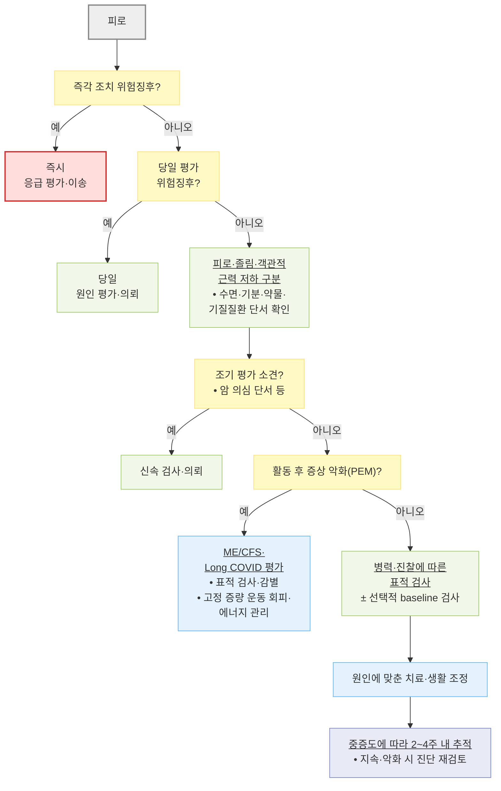

# 피로 Fatigue

## <mark style="color:green;">일반 사항</mark>

* 피로 : 육체적·정신적 활력이 떨어져 기진맥진하고, 활동을 시작하거나 유지하기 어려우며 쉽게 지치는 증상
  * 졸림(sleepiness)이나 객관적 근력 저하(weakness)와 구별
* 1차 진료에서 매우 흔한 증상이지만 원인이 명확하지 않은 경우가 많으며, 심리적·생활 습관적 요인부터 내과적 기질질환까지 원인 범위가 넓음
* 이 챕터에서는 지속 기간을 급성(＜1개월), 아급성(1\~6개월), 만성(＞6개월)으로 구분하여 기술함. 기간 구분은 문헌마다 다름
  * 아급성·만성 피로에서는 우울·불안, 갑상선 질환, 빈혈, 수면 장애, 악성 종양 등을 감별해야 함
  * '만성 피로'라는 증상과 '[근육통성뇌척수염/만성피로증후군](../230_/194_-cfs.md)(ME/CFS)'이라는 질환은 구별해야 함. ME/CFS는 활동 후 증상 악화(PEM)와 비회복성 수면에 인지장애 또는 기립불내성이 동반될 때 의심
* 검사 범위 : 병력·진찰상 단서 없이 광범위한 실험실검사를 일률적으로 시행하면 진단적 가치가 낮음
  * 증상의 기간·중증도·기능 저하와 임상 단서에 따라 최소 검사를 선택
  * 초기 검사가 정상이면 증상 변화 없이 같은 검사를 반복하지 않음
* 원인 평가가 필요한 임상 단서 : 충분히 쉬어도 회복되지 않는 지속적 피로, 사회적·직업적 기능 저하

## <mark style="color:green;">원인 및 위험 인자</mark>

* 흔히 원인이 명확하지 않음

#### <mark style="color:$primary;">급성 (＜1개월)</mark>

* 감염
* 스트레스
* 수면 부족
* 급격한 다이어트
* 만성 피로 원인들의 단기 악화

#### <mark style="color:$primary;">아급성 (1\~6개월), 만성 (＞6개월)</mark>

* 인구학적 위험 인자 : 고령, 여성
* 생활 습관/환경 : 지나친 활동 또는 비활동, 비만, 영양 결핍(비건·채식 식이의 경우 Vit B12 결핍 위험), 만성적 수면 부족, 음주, 흡연
* 임신 : 가임기 여성에서 반드시 고려해야 할 생리적 원인; 초기 임신에서 피로가 흔함
* 만성피로증후군(ME/CFS)
* 심장/호흡기 : CHF, COPD, 폐쇄수면무호흡증
* 내분비/대사 : 갑상선저하증/항진증, 부신피질기능저하증(원발성인 Addison's disease에서는 Na↓·K↑·색소침착이 동반될 수 있음), 당뇨병(조절되지 않는 고혈당, 저혈당 반복), 만성 신/간질환, Na↓, Ca↑
* 혈액/종양 : 빈혈(철결핍성·만성 질환성·거대적아구성), 악성 종양
* 감염 : 단핵구증후군, 바이러스 간염, HIV 감염, 아급성 심내막염, 결핵, Long COVID\*

> _\*Post-COVID condition : SARS-CoV-2 감염이 의심되었거나 확인된 사람에서 COVID-19 발병 후 통상 3개월 무렵에도 존재하며 적어도 2개월 지속되고 다른 진단으로 설명되지 않는 증상군. 급성기부터 지속되거나 회복 후 새로 나타날 수 있음. 피로·PEM·인지 저하·호흡곤란·수면장애·기립성 증상 등이 흔함 (_[_WHO 사례 정의_](https://www.who.int/publications/i/item/WHO-2019-nCoV-Post_COVID-19_condition-Clinical_case_definition-2021.1)_)_

* 자율신경 이상([POTS](../221_/030_-autonomic-dysfunction.md)) : Long COVID 이후 피로와 함께 기립성 증상이 동반되면 적극 고려
  * 누워서 5\~10분 안정 후 측정한 심박수를 기준으로, 기립 후 10분 이내 지속적 심박수 증가 ≥30 bpm(12\~19세 ≥40 bpm)이 있고 유의한 기립성 저혈압(수축기 ≥20 또는 이완기 ≥10 ㎜Hg 감소)은 없음
  * 기립 시 악화되는 증상이 통상 ≥3개월 지속되고 빈혈·탈수·발열·갑상선항진증·약물 등 다른 빈맥 원인이 배제될 때 의심
* 신경계 질환·후유증 : 다발경화증, 파킨슨병, 뇌졸중 후 피로
* 류마티스 : 섬유근육통, polymyalgia rheumatica
* 정신 : 우울장애, 불안장애, 신체증상장애 등. 검사상 원인이 확인되지 않았다는 이유만으로 신체증상장애를 진단하지 않으며, 증상에 대한 과도한 사고·감정·행동 등 별도의 진단 기준을 평가
* 약물/치료
  * 중추신경 진정/억제 : 항우울제, 항불안제, 항정신병제, 근이완제, 항경련제, 1세대 항히스타민제, 마약성 진통제(opioids), 항콜린제
  * 심혈관/체액·전해질 : β-차단제, 이뇨제(탈수·기립성 저혈압·저Na/저K)
  * 근육 증상 : statin(근육통·근력 저하 동반 여부 확인)
  * 대사·영양소 결핍 유발 : PPI 장기 복용(Vit B12·Mg 결핍), metformin(Vit B12 결핍)
  * 항암 치료 관련 : 세포독성 항암제·일부 표적치료제·면역관문억제제


면역관문억제제 치료 중 새로운 피로는 단순 약물 부작용뿐 아니라 갑상선기능장애·뇌하수체염·부신기능저하증 등 immune-related adverse event 가능성도 평가. 부신위기 소견은 Red Flags 즉각 조치에 해당


### <mark style="color:$danger;">🚩 Red Flags!</mark>

<mark style="color:$danger;">**즉각 조치**</mark>

* 새로 발생한 국소 신경학적 결손 또는 의식 변화 - 마비·감각 저하·언어장애·보행 장애 등 `뇌졸중`
* 지속되는 심한 흉통·흉부 압박감 또는 중증 호흡곤란 `ACS` `PE` `대동맥박리`
* 흉통·숨참·두근거림을 동반한 실신, 실신 후 불완전한 회복 또는 저혈압 등 혈역학적 불안정 `부정맥` `ACS` `PE`
* ACS 의심 소견과 함께 현재 흉통이 지속·반복되거나, 최근 12시간 이내 흉통이 있었고 현재는 소실되었으나 ECG 이상 또는 ECG 시행 불가 `ACS`
* 급성 PE 또는 대동맥박리 의심 소견(활력징후가 안정적인 경우 포함) `PE` `대동맥박리`
* 대량 또는 지속되는 위장관 출혈(토혈·혈변·흑색변 등) `위장관 출혈`
* 출혈과 함께 어지럼·실신·빈맥·저혈압 등 순환기 불안정 소견 `출혈성 쇼크`
* 대량·지속 객혈 또는 객혈과 함께 호흡곤란·저산소증 등 기도·호흡 위협 소견 `폐출혈`
* 부신기능저하증, 장기 glucocorticoid 사용·최근 중단 또는 면역관문억제제 치료력이 있는 환자의 저혈압·허탈, 반복 구토 또는 의식 변화 `부신위기`
* 감염 의심과 함께 저혈압, 새로 발생한 의식 변화, 현저한 빈호흡 또는 새로운 산소 요구 등 고위험 소견 `패혈증`
* 자살 계획·의도, 위해수단 접근, 자해·자살 시도 직후 또는 스스로 안전을 유지할 수 없는 상태

<mark style="color:$warning;">**당일 평가**</mark>

* 즉각 조치 기준에 해당하지 않는 새로 발생하거나 빠르게 악화되는 운동성 흉통·호흡곤란 또는 심폐 질환 의심 소견 `협심증` `심부전`
* ACS 의심 소견이 있으나 즉각 조치 기준에 해당하지 않으며, 최근 12시간 이내 흉통이 있었으나 현재 소실되었고 안정 시 ECG가 정상이거나 마지막 흉통이 12\~72시간 전 `ACS`
* 활력징후가 안정적이고 대량·지속 출혈 소견이 없는 토혈 또는 새로 생긴 타르변 `상부위장관 출혈`
* 즉각 조치 기준에 해당하지 않으나 병색이 뚜렷하거나 지속성 고열 등 중증 감염·전신질환이 의심되는 경우 `심내막염` `중증 감염`
* 즉각 조치 기준에 해당하지 않는 반복 실신 전조·실신 또는 심한 기립성 증상 `부정맥` `구조적 심질환`
* 즉각 조치 기준에 해당하지 않는 의미 있는 객혈 또는 급격히 악화되는 호흡기 증상 `폐암` `결핵`
* 구체적인 계획·의도가 확인되지 않은 자살사고 `우울장애`
* 의식 수준·주의력 변화 없이 새로 발생하거나 급격히 진행하는 사고·행동 변화 `정신병적 장애` `조증`

<mark style="color:$info;">**조기 평가 및 추적**</mark>

* 설명할 수 없는 체중 감소 : 식단 변화나 운동 없이 6\~12개월 이내 평소 체중의 5% 이상 감소 `악성 종양`
* 원인 불명의 발열·야간 발한 또는 비정상적 림프절병증 `림프종` `결핵`
* 새로 만져지는 고형 종괴 `악성 종양`
* 진행성 연하곤란 또는 지속·악화되는 소화기 증상 `식도암` `위암`
* 폐경 후 질 출혈 `자궁내막암`


충분한 휴식 후에도 회복되지 않는 피로, 기상 시 심한 피로, 사회적·직업적 기능 저하는 중요한 임상 단서(clinical clue)이지만 그 자체로 응급 Red Flag는 아니며, ME/CFS·수면장애·우울증 및 기질질환 평가의 근거로 활용


## <mark style="color:green;">진단</mark>

#### <mark style="color:$primary;">진단 단계</mark>

**Step 1 : Red flags 확인**

**Step 2 : Fatigue vs Sleepiness vs Weakness 감별**

* Fatigue-피곤한가요? (에너지 부족, 활동을 시작·유지하기 어려움)
* Sleepiness-졸려서 잠들 것 같은가요? (수면 부족·수면 장애·진정성 약물 등)
* Weakness-힘을 주어도 실제로 힘이 빠지나요? (객관적 근력 저하)

**Step 3 : Sleep / Mood / Medications? Fatigue phenotype 분류**

* Sleep-driven fatigue → OSA / insomnia
* Mood-driven fatigue → depression / anxiety
* 약물 관련 피로 → 진정성 약물·β-차단제 등
* Medical fatigue → anemia / thyroid / chronic disease
* 활동 후 증상 악화(Post-exertional malaise, PEM) → ME/CFS / PEM이 동반된 Long COVID
* Lifestyle fatigue → stress / overwork / inactivity
* 분류는 문진을 돕는 틀이며 서로 배타적이지 않음. 여러 원인이 공존할 수 있음

**Step 4 : 병력·진찰과 임상 단서에 따라 표적 검사 ± 선택적 baseline 검사**

**Step 5 : 평가 시점과 추적 간격 결정**

* 진행성 연하곤란, 폐경 후 질 출혈, 설명할 수 없는 체중 감소 등 조기 평가 소견이 있으면 필요한 검사·의뢰를 신속히 진행
* 즉각·당일·조기 평가 소견이 없으면 중증도·기능 저하에 따라 2\~4주 내 추적

#### <mark style="color:$primary;">감별 항목 : 'DEAD, TIRED'</mark>

<table data-header-hidden><thead><tr><th></th><th></th></tr></thead><tbody><tr><td><strong>D</strong>epression<br><strong>E</strong>nvironment/Lifestyle<br><strong>A</strong>nxiety, Anemia<br><strong>D</strong>rugs (Alcohol)</td><td><strong>T</strong>hyroid, Tumors<br><strong>I</strong>nfection, Insomnia<br><strong>R</strong>heumatologic<br><strong>E</strong>ndocarditis/Cardiovascular<br><strong>D</strong>iabetes/Endocrine</td></tr></tbody></table>

* **언제 가장 피곤합니까?**
  * 아침부터 피곤 → 비회복성 수면, 수면 부족·불면·OSA, 기분 증상 등을 함께 평가
    * 시간대만으로 우울증을 판정하지 않음
  * 활동 중 숨참·흉통·어지럼과 함께 악화 → 심폐질환·빈혈 등을 평가
  * 하루 종일 피곤 → 비특이적 소견이며 기질질환, 수면, 약물, 기분 문제, ME/CFS 등을 병력과 진찰로 감별
  * 경미한 활동 후 지연되고 오래 지속되는 여러 증상의 악화(PEM) → ME/CFS / PEM이 동반된 Long COVID 의심. 일반적인 운동 후 일시적 피로와 구분
* **복용하는 약물이 있나요?**
  * 항히스타민, BZD, opioid, β-blocker, statin
  * PPI / metformin → B12 결핍
* **병력과 진찰의 핵심**
  * 병력
    * 피로 양상 : 발병 시점·기간·일중 변동, PEM
    * 동반 증상 : 수면·기분, 식사·체중 변화
    * 노출 : 감염·여행·직업 노출, 음주·물질 사용
    * 약물 : 모든 처방약·일반약·보충제
  * 신체 진찰 : 활력징후를 측정하고, 심폐·신경계(객관적 근력 포함), 갑상선, 림프절, 피부·점막을 진찰
    * 기립 시 악화되는 피로·어지럼·두근거림이 있으면 기립성 혈압·심박수를 평가하고, POTS가 의심되면 능동 기립 검사에서 기립 후 10분까지 측정
  * 검진력 : 연령·성별·위험도에 맞는 국가암검진 등 권장 선별검사의 시행 여부와 결과 확인

### <mark style="color:orange;">검사</mark>

* 무분별한 실험실검사는 도움이 되지 않으며, 검사 순서와 범위는 병력·진찰 및 흔한 원인에 따라 결정
* 경미한 급성 피로에 명확한 생활 습관적·일과성 원인이 있고 Red Flag가 없다면 즉시 광범위한 검사를 시행하지 않고 경과를 볼 수 있음
* 원인이 불명확하거나 증상이 지속되고 기능 저하가 있으면 초기 최소검사를 선택적으로 시행
  * 초기 결과가 정상이면 동일 검사의 반복은 최소화
* 피로 환자의 대부분은 검사상 근육 약화가 없으며, 근육 약화가 있는 경우 신경계 질환 등을 고려

<mark style="color:cyan;">**초기 검사**</mark>

* CBC, 혈당 또는 HbA1c, creatinine/eGFR, 전해질·Ca, LFT, TSH, U/A
  * 병력·진찰과 동반 질환에 따라 선택하며 모든 항목이 필수인 것은 아님
* 성인의 지속적 피로에서는 백혈병 감별을 위해 CBC를 48시간 이내 시행하는 것을 고려 <mark style="color:$info;">\[NICE NG12]</mark>
* 임신 가능성·월경 지연이 있거나 임신 여부가 검사·치료 결정에 영향을 주는 경우 소변 hCG 검사 시행
* 선택적 검사 고려 상황 : 다음 중 하나 이상이면 증상 기간과 관계없이 임상 단서에 맞는 검사를 고려
  1. 일상·업무에 영향을 주는 기능 저하 동반
  2. 당뇨, CKD 등 만성질환 위험군 동반
  3. 병력·진찰상 기질질환의 단서가 있거나 원인이 불명확함
  4. 추적 관찰이 어렵거나 검사 결과가 즉시 치료·처방 결정에 영향을 줌

<mark style="color:cyan;">**지속적·설명되지 않는 피로 또는 ME/CFS 의심 시 추가 고려**</mark>

* 임상상에 따라 추가 고려 : CBC with differential, ESR/CRP, 전해질·Ca·P, 혈당, 신·간기능, TSH ± free T4, iron studies(ferritin/serum iron/TIBC 또는 transferrin/TSAT), U/A
* celiac disease 선별 : 위장관 증상·철결핍 등 단서가 있으면 고려하며, ME/CFS가 의심되면 위장관 증상이 없어도 NICE NG206 초기 감별검사 목록에 따라 고려
* CK : 근육통·객관적 근력 저하·statin 복용 등 임상 단서가 있으면 고려하며, NICE ME/CFS 초기 평가 목록에도 포함됨
* Vit B12, 엽산, Vit D(25(OH)D), ANA, 흉부 X선, 가정 수면무호흡검사(HSAT) 또는 수면다원검사(PSG), 복부 초음파 등은 해당 임상 단서가 있을 때 시행
  * 이종항체검사 : 감염단핵구증이 의심되는 청소년·성인에서 초기 검사로 고려. 어린 소아나 발병 초기에는 위음성이 흔하므로 임상 의심이 높으면 EBV 특이항체 검사 고려
* CBC에서 빈혈이 확인되면 MCV·reticulocyte와 iron studies를 우선 해석
  * 거대적아구성 빈혈에서는 Vit B12·엽산을 평가
  * B12 결핍은 빈혈·거대적혈구증 없이 신경 증상으로 나타날 수도 있음
* ESR·CRP는 염증 여부를 판단하는 보조지표이며 만성질환빈혈을 단독으로 진단하지 못함
* 철결핍빈혈·소화기 출혈 단서가 있으면 원인 평가와 필요시 내시경을 계획
  * 분변 잠혈검사/FIT 음성만으로 출혈이나 소화기 악성종양을 배제하지 않음
* [철결핍](../230_/193_-iron-def-anemia.md) 평가 : 성인(월경 중인 사람·임신부 포함)에서 ferritin ≤30 ng/㎖이면 철결핍을 시사 <mark style="color:$info;">\[ASH 2026]</mark>
  * 철결핍 관련 증상·징후나 지속적인 위험 인자가 있는 비월경·비임신 성인, 과다월경·철결핍 관련 증상 등이 있는 월경군, 빈혈이 동반된 임신부에서는 ferritin ≤50 ng/㎖를 진단·치료 결정에 사용할 수 있음 <mark style="color:$info;">\[ASH 2026]</mark>
  * 빈혈 환자의 위장관 평가 지침에서 사용하는 철결핍 진단 기준은 ferritin ＜45 ng/㎖ <mark style="color:$info;">\[AGA 2020]</mark>
  * Ferritin은 급성기 반응물질이므로 염증 시 정상 또는 상승할 수 있어 CRP와 TSAT를 함께 해석하며, CKD·심부전·IBD 등에서는 질환별 기준을 적용
  * 염증성 빈혈이 있는 성인에서는 ferritin ＜100 ng/㎖ 또는 TSAT ＜20%이면 철결핍을 고려 <mark style="color:$info;">\[ASH 2026]</mark>
* IDWA(빈혈 없는 철결핍) : Hb가 정상이어도 ferritin ≤30 ng/㎖이면 철결핍을 고려
  * Ferritin이 30 ng/㎖ 초과 50 ng/㎖ 이하이면 철결핍을 시사하는 증상·징후, 과다월경 등 출혈 위험, 식이, TSAT 및 염증 여부를 함께 판단
* 갑상선 : 뇌하수체 질환(두통·시야장애 등) 또는 이차성 갑상선기능저하증이 의심되면 TSH가 정상이어도 free T4를 함께 측정
  * 정상 TSH의 비특이적 피로만을 이유로 Anti-TPO Ab를 일률적으로 추가하지 않음
* 부신기능저하증 의심 시 : 상태가 안정적인 환자에서 체중 감소, 저혈압/기립성 증상, 식욕저하·구역, 저Na/고K, 색소침착 등의 단서가 있으면 8\~9 AM serum cortisol ± ACTH 시행
  * 생리적 용량 이상의 glucocorticoid를 복용 중이면 일률적으로 검사하지 않으며, 감량·중단 중에는 약제 종류와 마지막 투여 시점을 고려하여 검사 시기를 정함
  * 부신위기가 의심되면 오전 채혈이나 검사 결과를 기다리지 않고 즉시 hydrocortisone 100 ㎎을 정맥 또는 근육주사하고 응급 이송. 가능하면 투여 전 cortisol·ACTH 검체를 채취하되 결과를 기다리지 않음
* Vit D : 골질환·흡수장애·저칼슘혈증 등 결핍 위험 또는 임상적 적응증이 있을 때 선택적으로 측정하고 확인된 결핍은 교정
  * 피로 개선만을 목적으로 특정 25(OH)D 목표농도(예: ≥30 ng/㎖)를 설정하지 않음

<mark style="color:cyan;">**수면 무호흡 선별**</mark>

* 코골이, 주간 졸림, 목격된 무호흡 등으로 OSA가 의심되면 아래 'STOP-BANG' 설문 시행
* 주간 졸림의 정도는 'Epworth Sleepiness Scale(ESS)'을 병행해 정량화할 수 있음

<mark style="color:cyan;">**우울증 감별**</mark>

* 'DEAD, TIRED' 항목 중 우울/불안(Depression/Anxiety) 비중이 높다면 초기부터 [PHQ-9](../221_/027_-depression.md#phq-9) 시행
* PHQ-9 점수 ≥10은 우울증 가능성을 시사하는 양성 선별 결과이지 진단이나 약물치료 기준이 아님
  * 임상 면담으로 증상 기간·기능 저하·주요우울장애 진단 기준을 확인하고 양극성장애, 물질·약물 및 신체질환을 감별한 뒤 중증도와 환자 선호에 따라 상담·정신치료·약물치료 등을 결정
* PHQ-9 9번 문항이 양성이면 총점과 관계없이 자살 사고의 구체성·계획·수단·의도와 보호 요인을 평가

#### <mark style="color:$primary;">피로 평가 척도</mark>

<mark style="color:cyan;">**FSS (Fatigue Severity Scale)**</mark>

* 피로 상태를 평가하고 치료 효과를 추적하는 데 활용
* 9개 항목에 대해 지난 1주간의 상태를 1점(전혀 동의하지 않음)\~7점(매우 동의함)으로 평가하고 평균을 계산
  * FSS는 저작권이 있는 척도로 본문에서는 점수 해석만 요약함 (☞ [계산기](https://www.mdapp.co/fatigue-severity-scale-fss-calculator-372/))
* 평균 ≥4점은 연구와 일부 임상에서 흔히 사용하는 참고 기준이지만 질환·집단에 따라 최적 cutoff가 다르며, FSS만으로 원인 질환을 진단하지 않음

<mark style="color:cyan;">**전반적 피로 강도 (숫자 평가 척도, NRS)**</mark>

* FSS와 별개의 단일 문항 평가로, 전반적인 피로 강도를 0점(없음)\~10점(상상할 수 있는 최악의 피로) 사이의 한 숫자로 표시하도록 함
  * 문항 예 : "지난 1주 동안 느낀 피로가 평균적으로 어느 정도였는지 0점(전혀 피곤하지 않음)부터 10점(상상할 수 있는 가장 심한 피로) 사이의 숫자로 말씀해 주십시오."
* 치료 전후 단일 수치 비교에 유용

#### <mark style="color:$primary;">수면 무호흡 선별 설문</mark>

<mark style="color:cyan;">**STOP-BANG**</mark>

* 피로를 주소로 내원한 환자에서 코골이, 주간 졸림, 목격된 무호흡 등으로 OSA가 의심되면 시행
* 8개 항목(① Snoring, ② Tiredness, ③ Observed apnea, ④ high blood Pressure, ⑤ BMI, ⑥ Age, ⑦ Neck circumference, ⑧ Gender)에 대하여 해당하면 각 1점 (☞ [계산기](https://www.mdcalc.com/calc/3992/stop-bang-score-obstructive-sleep-apnea))
* 판정
  * 0\~2점 : 저위험
  * 3\~4점 : 중간 위험 - 증상·동반 위험 인자를 이용해 추가 분류하고 객관적 수면검사 여부를 결정
  * ≥5점 : 고위험 - HSAT/PSG 등 객관적 검사 적극 고려
  * STOP 4개 항목 중 2개 이상에 해당하면서 남성, BMI ＞35 ㎏/㎡, 목둘레 ＞40 ㎝ 중 하나 이상에 해당하면 고위험으로 분류할 수 있음. 목둘레 항목은 원저 기준 ＞40 ㎝(성별 구분 없음)이며, 설문 판본에 따라 '40 ㎝ 이상'으로 표기하기도 함
* 중요한 심폐질환이나 저환기가 의심되는 등 HSAT가 적합하지 않은 경우에는 처음부터 PSG로 평가
  * HSAT가 음성·불확실하거나 기술적으로 불충분하면 PSG로 평가 <mark style="color:$info;">\[AASM 2017]</mark>

<mark style="color:cyan;">**ESS (엡워스졸림척도)**</mark>

* 주간 졸림의 정도를 정량화하는 보조 척도로 병행 가능 (☞ [한국형 자가평가](https://www.sleep.or.kr/html/?pmode=sleepiness))
* STOP-BANG과 ESS는 선별 도구이며 확진 검사가 아님

#### <mark style="color:$primary;">만성피로증후군(ME/CFS) 감별</mark>

* 기능 저하와 피로에 아래 핵심 증상이 동반되면 기간이 짧더라도 ME/CFS를 의심하고 평가·증상 관리를 시작함
* 다음은 NAM/IOM 2015 진단 기준의 요약이며, 의심 시점과 확정 진단의 기간 요건을 구별해야 함

**필수 3항목**

1. 기능 저하 동반 피로 : 질병 발생 전보다 직업·교육·사회·개인 활동 능력이 상당히 감소한 상태가 6개월을 초과하여 지속되며, 새로 발생했거나 발병 시점이 명확하고 지속적인 과도한 활동으로 설명되지 않으며 휴식으로 실질적으로 호전되지 않음
2. 활동 후 증상 악화(PEM, Post-Exertional Malaise) : 신체적·인지적·정서적 활동 후 흔히 수 시간\~수일 뒤 증상이 악화하고 회복이 지연됨 - 단순 피로와 ME/CFS를 구분하는 가장 중요한 특징
3. 비회복성 수면 : 충분히 자도 개운하지 않음

**다음 중 1개 이상**

1. 인지 기능 저하(Brain fog) : 집중력·기억력·정보처리능력 저하
2. 기립불내성(Orthostatic intolerance) : 서거나 앉은 자세에서 어지럼·두근거림·인지 증상 등이 악화하고 누우면 호전

* PEM·비회복성 수면의 빈도와 중증도를 확인하고, 인지장애가 있는 경우에도 이를 평가
  * 해당 증상이 적어도 절반의 시간에 중등도 이상으로 나타나지 않으면 NAM 진단을 재고함
  * 병력·진찰·표적검사로 전체 임상상을 더 잘 설명하는 다른 질환을 평가하고 동반질환은 함께 치료
* NICE NG206은 기능 저하와 4가지 증상(쇠약성 피로·PEM·비회복성 수면/수면장애·인지장애)이 모두 있고 다른 질환으로 설명되지 않을 때, 성인에서 6주 이상, 소아·청소년에서 4주 이상 지속되면 [ME/CFS](../230_/194_-cfs.md)를 의심함
  * 같은 조건에서 증상이 3개월 지속되면 진단 가능. NAM과 기간·필수 증상 구성을 혼합하지 않음
* PEM이 있는 환자에게 고정적으로 활동량을 증가시키는 운동 프로그램을 적용하면 증상이 악화될 수 있으므로 ME/CFS 의심 시 운동 처방 전 확인

#### <mark style="color:$primary;">ME/CFS vs 우울증 vs OSA 감별표</mark>

<table data-search="false"><thead><tr><th width="118">항목</th><th>ME/CFS</th><th>우울증</th><th>OSA</th></tr></thead><tbody><tr><td><strong>핵심 특징</strong></td><td>PEM(활동 후 증상 악화)</td><td>우울감 또는 흥미·즐거움 저하</td><td>코골이·목격된 무호흡·주간 졸림</td></tr><tr><td><strong>피로 패턴</strong></td><td>활동 후 흔히 수 시간~수일 뒤 악화</td><td>개인별·일중 변동 가능</td><td>아침 피로 또는 낮 졸림</td></tr><tr><td><strong>휴식 후 회복</strong></td><td>실질적 회복 없음</td><td>일정하지 않음</td><td>충분한 수면시간에도 지속 가능</td></tr><tr><td><strong>수면</strong></td><td>비회복성 수면</td><td>불면·과다수면 혼재</td><td>수면 중 호흡장애·분절</td></tr><tr><td><strong>주간 졸림</strong></td><td>동반될 수 있으나 피로와 구분 필요</td><td>동반 가능</td><td>흔하지만 없을 수도 있음</td></tr><tr><td><strong>활동 반응</strong></td><td>가벼운 활동으로도 PEM이 유발될 수 있음</td><td>개인별 차이; 일부에서 활동 후 기분 개선</td><td>일정하지 않음</td></tr><tr><td><strong>기분 증상</strong></td><td>이차적 우울 동반 가능</td><td>핵심 증상</td><td>이차적 우울 동반 가능</td></tr><tr><td><strong>인지 기능</strong></td><td>brain fog 흔함</td><td>집중력·사고력 저하 가능</td><td>수면 분절·졸림에 따른 저하 가능</td></tr><tr><td><strong>자율신경 증상</strong></td><td>Orthostatic intolerance 흔함; 일부에서 POTS 동반</td><td>전형적이지 않음</td><td>전형적이지 않음</td></tr><tr><td><strong>동반 힌트</strong></td><td>코로나19 등 감염 후 발병 가능</td><td>스트레스·삶의 사건</td><td>비만·큰 목둘레·고혈압</td></tr></tbody></table>

> _각 특징은 가능성을 높이는 단서이며 단독 감별·진단 기준이 아님._\
> _ME/CFS, 우울증, OSA는 서로 동반될 수 있음._


**흔한 진단 오류 (Pitfalls)**

* **"우울로 단정"** → 실제 갑상선저하증·빈혈·수면 무호흡 등 기질 원인을 놓칠 수 있음
* **"검사 정상 = 이상 없음"** → ME/CFS·POTS는 표준 검사에서 정상 결과가 나올 수 있으며, 증상 패턴으로 감별함; 적절한 초기 평가 후 중대한 기질질환 가능성이 낮다면 수면장애, 우울·불안, 스트레스 및 기능성 증상도 함께 평가
* **statin 유발 피로 간과** → 근육통 동반 여부 확인; 필요시 용량 조정 또는 약제 변경 고려
* **수면 무호흡 과소 진단** → 비만이나 전형적인 코골이가 없다는 이유만으로 OSA를 배제하지 않으며, 주간 졸림·목격된 무호흡·고혈압 등 전체 임상상을 평가
* **철결핍(빈혈 없는 경우) 누락** → Hb 정상이어도 ferritin/TSAT 및 출혈 위험을 함께 평가; 염증성 질환은 질환별 기준 적용
* **POTS 누락** → 특히 젊은 여성·Long COVID 이후 기립성 증상 동반 시 적극 평가


***



<p align="center"><strong>피로 평가 알고리듬</strong><br><em><mark style="color:$info;">저자 재구성 (참고 문헌 : NICE NG206·NG12; CDC NAM/IOM 2015;</mark></em> <br><em><mark style="color:$info;">Latimer KM, et al. Am Fam Physician 2023)</mark></em></p>

> _ME/CFS·Long COVID 의심 환자도 즉각·당일·조기 평가 소견이 없으면 중증도·기능 저하에 따라 2\~4주 내 재평가. 추적 중 새 위험징후가 발생하거나 증상이 악화하면 평가 시점을 앞당김_

***

## <mark style="background-color:$warning;">Management</mark>

### <mark style="color:orange;">치료 방침</mark>

* 원인 치료 : 확인된 원인 질환은 해당 지침에 따라 치료
  * 우울장애·불안장애가 진단되면 해당 챕터에 따라 치료
  * 진정성 약물이 피로에 기여하는지 확인
  * 벤조디아제핀 등 금단 위험이 있는 약제는 처방의와 상의하여 필요시 단계적으로 감량하고, 환자에게 임의로 중단하지 않도록 안내
* 자살 위험 : 위험이 높으면 환자를 혼자 두지 않고 가능한 범위에서 위해수단 접근을 차단하며 119·112 또는 응급실로 연계
  * 자살예방상담전화 109는 응급 이송·평가를 대신하지 않음
* 환자·가족 교육 : 가능한 원인과 예상 경과, 증상 악화 시 재진 기준을 설명하고 필요시 가족 상담
* 수면·활동·증상 일지 : 1\~2주간 수면 시간·활동·증상을 기록
  * 활동 당일과 이후 며칠간의 변화를 기록하고, 활동 시점·증상 악화까지 걸린 시간·회복에 걸린 시간을 확인
* 원인이 불명확한 경우 : 수면 환경을 개선하고 통증·영양 문제를 관리
  * 인지행동치료 : 불면·우울·불안에는 각각의 적응증에 따라 고려
    * ME/CFS 환자가 원하면 증상 관리와 일상 기능을 돕는 방법으로 제안할 수 있으나 완치 치료는 아님
* 추적 : 즉각·당일·조기 평가 소견이 없으면 중증도·기능 저하에 따라 2\~4주 내 재평가
  * 호전 → 유지
  * 지속 → 놓친 원인과 수면·기분·복용 약물을 재평가하고 필요시 표적 검사
  * 악화 또는 새 위험징후 발생 → 평가 시점을 앞당기고 응급도를 다시 판단

## <mark style="color:green;">비-약물 치료 및 예방</mark> <a href="#non-drug-treatment" id="non-drug-treatment"></a>

* 활동 전 PEM(활동 후 증상 악화) 여부를 확인
  * PEM이 없고 급성·중증 질환이 배제된 경우 : 현재 체력과 동반 질환에 맞추어 유산소·근력 활동을 낮은 강도부터 점진적으로 시행
  * PEM이 있거나 ME/CFS가 의심되는 경우
    * Pacing : 신체·인지 활동과 휴식을 견딜 수 있는 범위에서 조절하여 PEM을 줄임
    * 정해진 단계에 따라 활동량을 늘리는 GET(Graded Exercise Therapy)은 시행하지 않음
      * 신체 활동을 늘리고 싶다면 증상이 악화되지 않는 수준에서 시작하고, 이후 증상과 회복에 따라 활동량을 유연하게 조절
* 금연
* 음주 제한
* 카페인(커피) : 각성 효과는 있으나 휴식이나 수면을 대체할 수 없음
  * 불면증이나 불안을 악화시킬 수 있으므로 개인의 취침 시간·민감도를 고려하여 대체로 취침 6시간 전부터 피하고, 과다 섭취 중이면 단계적으로 감량
* 적절한 체중 유지
* 규칙적이고 충분한 수면 : 성인은 대체로 하루 7\~9시간 수면, 개인차 고려
  * 일반 수면위생 지도에서는 필요시 낮잠을 20\~30분 이내로 하고 늦은 오후 낮잠은 피함. 만성 불면증에서는 낮잠을 피함(단, ME/CFS에서는 개별화)
* 균형 있는 식사 : 충분한 열량·단백질과 비타민·미네랄을 섭취하고 과도한 식이 제한을 피함
  * 질환별 영양 제한은 따로 적용하며 피로만을 이유로 지방 섭취를 일률적으로 제한하지 않음
* 업무량 조절 및 효율적인 시간 계획으로 휴식 시간을 늘림
* 스트레스 대처 : 매일 쉽게 할 수 있는 이완 운동, 긍정적인 경험에 대한 연상, 이완 호흡
  * 어려운 일이 생길 때는 친구나 가족들과 대화하고 도움을 요청
* 습관성 약물 사용을 피함

## <mark style="color:green;">약물 치료</mark> <a href="#drug-treatment" id="drug-treatment"></a>

* **SSRI** : 피로 자체의 치료제가 아님 (☞ [우울증](../221_/027_-depression.md))
  * 주요우울장애 또는 불안장애가 진단되고 약물치료의 적응증이 있을 때 해당 지침에 따라 선택
  * 초기 졸림·피로 또는 불면 등 이상반응을 추적
* **철분제** : 철결핍성 빈혈이 확인되면 출혈·흡수장애 등 원인 교정과 함께 보충 (☞ [철결핍빈혈](../230_/193_-iron-def-anemia.md))
  * 경구 철분 시작 후 2\~4주에 Hb 반응을 확인
  * **Hb 정상화 후 약 3개월** 추가 투여하여 저장 철을 보충하며, ferritin·지속 출혈·내약성에 따라 조정
  * 빈혈 없는 철결핍도 확인되면 원인과 증상에 따라 보충을 고려하나, 비특이적 피로만으로 경험적 투여하지 않음
* **Vit D** : 임상적 적응증에 따라 검사하여 결핍이 확인된 경우 교정 (☞ [골다공증](../228_/149_-osteoporosis.md#vit-d))
  * 제품별 허가 용량과 환자의 연령·신기능·흡수장애 여부를 고려하여 경구 치료를 우선하고 필요시 추적 검사
  * 피로 개선만을 목적으로 특정 혈중 목표농도를 설정하지 않으며, 결핍이 없는 환자에서 경험적 고용량 투여는 권하지 않음
* **Vit B12** : 결핍을 확인한 뒤 원인·중증도와 흡수장애 여부에 따라 경구 또는 주사 보충을 선택 (☞ [빈혈](../230_/192_-anemia.md#vit-b12-cobalamin-deficiency))
  * 결핍 위험군 : PPI 장기 복용자, metformin 복용자, 고령, 비건 식이
  * B12 결핍에 의한 거대적아구성 빈혈이 의심되고 신경학적 증상이 동반되면 가능하면 치료 전 검체를 채취하되, 검사 결과를 기다리느라 보충을 지연하지 않음 <mark style="color:$info;">\[NICE NG239]</mark>
* **ME/CFS** : 현재 승인된 ME/CFS 특이 약물치료는 없음
  * 통증·수면장애·기립불내성 등 가장 부담이 큰 증상을 우선하여 개별적으로 치료하되, 약물 과민성과 PEM을 고려
* **methylphenidate** : 암 관련 피로 또는 ME/CFS에서 일관된 효과가 입증되지 않아 routine 사용하지 않음
  * 암 관련 피로에서도 psychostimulant의 일률적 사용을 권하지 않으며, 선택된 완화의료 상황 등에서 전문가 판단으로 제한적으로 고려 <mark style="color:$info;">\[ASCO-SIO 2024]</mark>
  * 암 관련 피로·ME/CFS 치료에 사용하는 것은 허가 외 사용이며, 허가 여부와 급여 인정은 별개임
* **CoQ10, L-carnitine** : 비특이적 피로·ME/CFS에 대한 근거가 불충분하여 routine으로 권하지 않음
* **식욕 자극제** : 원인 불명의 체중 감소나 피로 자체에는 사용하지 않음 (☞ [체중 감소](013_-weight-loss.md))
  * 원인 평가와 영양 중재를 우선
  * 암 악액질이나 특정 완화의료 상황 등 명확한 적응증에서 기대효과와 혈전·부종·부신억제 등의 위해를 비교하여 선택

***

## <mark style="color:red;">질병코드</mark>

* R53 병감 및 피로 Malaise and fatigue
* G93.3 바이러스후피로증후군 Postviral fatigue syndrome (근통성 뇌척수염 포함; ME/CFS 진단 시 참고)
* U09.9 상세불명의 코로나19 이후 병태 Post COVID-19 condition, unspecified

***

## <mark style="color:purple;">처방례</mark>

> **처방례 1. 성인 Vit D 결핍 확인 환자 - 경구 치료 예**
>
> ```
> 팩타민디쓰리정25000IU 2T 매주 1회 × 6주
> (1회 총 50,000 IU; 매일 복용하지 않음)
> (결핍 치료 후 유지: 25,000 IU 1T 매월 1회; 결핍 위험이 높으면 매월 2T까지)
> ```
>
> 약제 정보: [팩타민디쓰리정25000IU·25,000 IU](https://www.health.kr/drug/2019071000005)
>
> _✽허가사항에 따른 성인 비타민 D 결핍치료 용량. 유지요법 시작 후 약 3\~4개월에 25(OH)D를 확인하여 조정. 피로 개선만을 위한 특정 목표농도 설정은 권하지 않음._

> **처방례 2. Vit D 결핍 - 흡수장애 등으로 주사제가 필요한 성인**
>
> ```
> 바이타디주 200,000 IU/㎖, 1 ㎖ IM 1회 (비고령 성인, 총 200,000 IU)
> 바이타디주 200,000 IU/㎖, 0.5 ㎖ IM 1회 (고령자, 총 100,000 IU)
> ```
>
> 약제 정보: [바이타디주·200,000 IU/㎖, 1 ㎖](https://www.health.kr/drug/2015060300273)
>
> _✽바이타디주(콜레칼시페롤 5 ㎎/㎖ = 200,000 IU/㎖)의 앰플 용량과 처방된 실제 투여량(㎖)을 각각 확인. 주요 금기에는 신장애, 고칼슘혈증·고칼슘뇨증, 칼슘결석 또는 그 병력·위험, 병상에서 움직일 수 없는 환자, 사르코이드증 등이 포함됨. 성인은 투여 후 3개월 이내에 효과·내약성을 평가하고 25(OH)D와 혈청 Ca를 확인하여 재투여 여부를 결정. 연간 총량은 600,000 IU 이하. 경구 치료를 우선하며 이 처방례는 흡수장애 등 경구 치료가 어려운 경우에 한함._

> **처방례 3. 철결핍성 빈혈 동반 피로** (☞ 철결핍빈혈 [처방례](../230_/193_-iron-def-anemia.md) 참조)
>
> ```
> 훼로바-유서방정(철 80 ㎎/T) 1T qd 식후
> (치료 반응과 저장 철 회복을 확인하며 유지 기간 조정)
> ```
>
> 약제 정보: [훼로바-유서방정·원소철 80 ㎎](https://health.kr/drug/A11AHHHHH0249)
>
> _✽훼로바-유서방정을 사용할 때의 허가 용법 예. BSG 지침은 일반 경구 철염 제제(황산·푸마르산·글루콘산제일철) 1일 1회를 초기 치료로 권고하며, 서방형 철분제는 권고하지 않음._

> **관련 처방례**
>
> * **Vit B12 결핍 동반 피로 (PPI·metformin 장기 복용자, 고령, 비건 식이)**. B12 결핍의 원인·중증도와 흡수장애 여부에 따라 경구 또는 주사 보충을 선택. 구체적인 교정 요법은 ☞ [빈혈 - Vit B12 결핍](../230_/192_-anemia.md#vit-b12-cobalamin-deficiency) 처방례 참조
>   * _✽mecobalamin 500 μg 제제는 제품별 허가 효능이 B12 결핍 치료와 일치하지 않을 수 있으므로 원인 질환 챕터의 표준 보충요법을 적용_
> * **우울 동반 피로** (☞ 우울증 [처방례](../221_/027_-depression.md) 참조)

***

### <mark style="color:$success;">핵심 복약 지도</mark>

> **비타민 D (Vit D)**
>
> * 비타민 D 결핍이 확인된 경우에는 처방된 용량대로 보충하십시오. 피로는 원인이 다양하므로 비타민 D 보충만으로 반드시 호전되는 것은 아닙니다.
> * 지용성 비타민이므로 경구제는 식사와 함께 복용할 수 있습니다.
> * 25,000 IU 고함량 정제는 매일 먹는 비타민이 아닙니다. 결핍 치료 시 매주, 유지요법 시 매월 등 처방된 간격을 정확히 지키십시오. 주사제와 경구제·건강보조제의 비타민 D를 임의로 중복하지 마십시오.
> * 과다 복용 시 고칼슘혈증(구역, 구토, 변비, 피로 악화)이 생길 수 있으므로 임의로 용량을 늘리지 마십시오.
> * 재검 시점은 제제·용량과 임상 상황에 따라 담당 의사가 정합니다.

> **철분제 (**[**훼로바-유**](https://health.kr/drug/A11AHHHHH0249) **등)**
>
> * 철분제는 제제별 허가 용법을 따르십시오. 일반적인 철분제는 위장 장애가 없으면 흡수를 고려해 식사와 떨어뜨려 복용할 수 있습니다.
> * 훼로바-유서방정은 식후에 복용하며, 씹거나 빨거나 부수지 말고 물과 함께 통째로 삼키십시오. 삼키기 어렵거나 사레가 잘 들리면 다른 제형을 상담하십시오.
> * 훼로바-유서방정을 복용하는 동안에는 칼슘염·인산염 제제, 제산제, 경구 테트라사이클린계 항생제를 함께 복용하지 마십시오. 이 약의 허가사항은 비스포스포네이트, 티록신(레보티록신), 세프디니르와 2\~3시간 이상 간격을 두도록 안내합니다. 함께 복용하는 약에서 더 긴 간격을 요구하면 그 간격을 따르십시오. 복용 중인 약이 있다면 먼저 의사나 약사에게 알리십시오.
> * 녹차·홍차 등 탄닌을 함유한 차와 우유·유제품은 복용 전후에 피하십시오. 비타민 C를 일률적으로 함께 복용할 필요는 없습니다.
> * 철분제 때문에 변이 짙은 녹색이나 검게 보일 수 있습니다.
> * 끈적하고 윤기 있는 타르 같은 검은 변이 새로 나오거나 피를 토하면 다른 증상이 없어도 당일 응급실에서 평가받으십시오. 출혈이 많거나 멈추지 않거나 어지럼·식은땀·실신이 함께 있으면 즉시 응급실로 가십시오.
> * Hb가 정상화된 후에도 저장 철을 보충하기 위해 보통 약 3개월 더 복용하며, 검사 결과와 출혈 여부에 따라 담당 의사가 기간을 조정합니다.
> * 철분제는 어린이가 닿지 않는 곳에 보관하십시오. 어린이가 철분제를 실수로 먹었다면 증상이 없어도 즉시 의료진이나 응급센터에 연락해 복용량과 필요한 조치를 확인하십시오.

> **비타민 B12 보충**
>
> * 비타민 B12가 부족하면 피로, 손발 저림, 기억력 저하, 빈혈이 생길 수 있습니다.
> * 위장약(PPI)이나 당뇨약(메트포르민)을 오래 복용하면 B12 흡수가 줄어들 수 있습니다. 빈혈·손발 저림 등 증상과 복용 기간 및 다른 위험 요인에 따라 담당 의사가 검사 필요성을 결정합니다.
> * 투여 경로와 복용법은 처방된 제품에 따라 따르십시오. 혈액학적 반응은 비교적 일찍 나타날 수 있지만 신경학적 증상의 회복에는 수개월 이상 걸리거나 불완전할 수 있으므로 추적 진료가 필요합니다.

> **언제 다시 병원을 방문해야 하나요?**
>
> * 충분히 쉬어도 피로가 4주 이상 지속되는 경우
> * 4주가 되지 않았더라도 일상생활에 뚜렷한 지장이 있거나 빠르게 악화하는 경우
> * 피로와 함께 체중 감소, 발열, 식은땀, 림프절 비대가 동반되는 경우
> * 가벼운 신체적·인지적 활동 후 흔히 수 시간\~수일 뒤 증상이 비정상적으로 악화되고 회복이 지연되는 경우(PEM)
> * 원인에 맞는 치료를 시행했는데도 피로가 지속되거나 악화되는 경우

***

## <mark style="color:green;">주요 참고문헌 및 확인 자료</mark>

### <mark style="color:orange;">임상 근거</mark>

* [Latimer KM, et al. Fatigue in Adults: Evaluation and Management. Am Fam Physician. 2023;108(1):58-69.](https://www.aafp.org/pubs/afp/issues/2023/0700/fatigue-adults.html) - 일차의료의 피로 감별, 병력·진찰에 따른 검사와 원인 치료
* Centers for Disease Control and Prevention. [IOM 2015 Diagnostic Criteria](https://www.cdc.gov/me-cfs/hcp/diagnosis/iom-2015-diagnostic-criteria-1.html); [Diagnosing ME/CFS](https://www.cdc.gov/me-cfs/hcp/diagnosis/index.html); [Evaluation of ME/CFS](https://www.cdc.gov/me-cfs/hcp/diagnosis-testing/evaluation-of-me-cfs.html). - NAM/IOM 진단 기준, 의심·확정 시점과 감별 검사; 활동 후 증상 악화(PEM) 평가
* [NICE. Myalgic encephalomyelitis (or encephalopathy)/chronic fatigue syndrome: diagnosis and management. NICE guideline NG206. 2021.](https://www.nice.org.uk/guidance/ng206/chapter/recommendations) - ME/CFS 의심·진단 기간 요건, 에너지 관리와 고정 증량 운동의 제한; NAM/IOM 기준과 구분
* [Snook J, et al. British Society of Gastroenterology guidelines for the management of iron deficiency anaemia in adults. Gut. 2021;70(11):2030-2051.](https://pmc.ncbi.nlm.nih.gov/articles/PMC8515119/) - 철결핍·철결핍빈혈의 원인 평가와 보충·반응 추적
* [Powers JM, et al. American Society of Hematology 2026 guidelines for diagnosis of iron deficiency. Blood Adv. 2026;10(21):7353-7374.](https://doi.org/10.1182/bloodadvances.2025015950) - 대상별 ferritin 기준 및 염증이 있는 경우의 해석
* [Ko CW, et al. AGA Clinical Practice Guidelines on the Gastrointestinal Evaluation of Iron Deficiency Anemia. Gastroenterology. 2020;159(3):1085-1094.](https://gastro.org/clinical-guidance/gastrointestinal-evaluation-of-iron-deficiency-anemia/) - 빈혈 환자의 철결핍 진단과 위장관 평가
* [NICE. Suspected cancer: recognition and referral. NICE guideline NG12. 2015 (2026 개정).](https://www.nice.org.uk/guidance/ng12/chapter/recommendations-organised-by-site-of-cancer) - 성인의 지속적 피로에서 백혈병 감별을 위한 신속 CBC(권고 1.10.1)
* [Kapur VK, et al. Clinical Practice Guideline for Diagnostic Testing for Adult Obstructive Sleep Apnea. J Clin Sleep Med. 2017;13(3):479-504.](https://pubmed.ncbi.nlm.nih.gov/28162150/) - HSAT와 PSG의 선택 및 HSAT 음성·불충분 시 후속 검사
* [Bower JE, et al. Management of Fatigue in Adult Survivors of Cancer: ASCO-Society for Integrative Oncology Guideline Update. J Clin Oncol. 2024;42(20):2456-2487.](https://doi.org/10.1200/JCO.24.00541) - 암 관련 피로의 비약물 치료와 psychostimulant의 일률적 사용 제한; 일반 피로·ME/CFS와 구분
* [NICE. Vitamin B12 deficiency in over 16s: diagnosis and management. NG239. 2024.](https://www.nice.org.uk/guidance/ng239/chapter/recommendations) - 빈혈 없는 B12 결핍과 신경 증상 동반 시 신속한 보충
* [World Health Organization. A clinical case definition of post COVID-19 condition by a Delphi consensus. 2021.](https://www.who.int/publications/i/item/WHO-2019-nCoV-Post_COVID-19_condition-Clinical_case_definition-2021.1) - Post COVID-19 condition의 정의와 지속 피로·활동 후 증상 악화를 동반하는 코로나19 후유증의 감별
* [NICE. Recent-onset chest pain of suspected cardiac origin: assessment and diagnosis. Clinical guideline CG95. 2010 (2016 개정).](https://www.nice.org.uk/guidance/cg95) - ACS 의심 시 최근 흉통 시점(12시간 이내, 12\~72시간)과 ECG에 따른 응급·당일 평가 기준
* [Laine L, et al. ACG Clinical Guideline: Upper Gastrointestinal and Ulcer Bleeding. Am J Gastroenterol. 2021;116(5):899-917.](https://pubmed.ncbi.nlm.nih.gov/33929377/) - 급성 상부위장관 출혈의 응급 평가와 위험도 분류
* [NICE. Adrenal insufficiency: identification and management. NICE guideline NG243. 2024.](https://www.nice.org.uk/guidance/ng243/chapter/recommendations) - 부신위기 의심 소견과 즉각적인 hydrocortisone 치료
* [NICE. Suspected sepsis in people aged 16 or over: recognition, assessment and early management. NICE guideline NG253. 2025.](https://www.nice.org.uk/guidance/ng253) - 감염 의심 환자의 패혈증 위험도와 응급 평가 소견

### <mark style="color:orange;">허가·급여 확인 자료</mark>

* [식품의약품안전처. 의약품안전나라 - 의약품 품목허가정보.](https://nedrug.mfds.go.kr/index) - 제품별 적응증·용법·금기 및 허가 상태 확인

***

## <mark style="color:blue;">환자 안내서</mark>


**지속적인 피로는 몸이 보내는 신호입니다**

피로는 단순한 기력 부족이나 의지 부족이 아닙니다.\
원인이나 악화 요인을 확인하고 적절히 치료·관리하면 호전될 수 있습니다.


#### <mark style="color:$primary;">피로란 무엇인가요?</mark>

* 육체적·정신적 기운이 줄어 활동을 시작하거나 유지하기 어려운 상태입니다. 충분히 쉬어도 지속되거나 일상생활에 지장을 주면 원인을 평가해야 합니다
* 원인은 빈혈, 갑상선 기능 저하, 당뇨, 수면 무호흡증, 우울증, 만성 감염 등 다양합니다
* 피로가 오래 지속된다는 사실만으로 ME/CFS가 되는 것은 아닙니다. 가벼운 활동 후 오래 악화되는 증상, 개운하지 않은 수면과 인지·기립 증상 등이 동반될 때 평가합니다

#### <mark style="color:$primary;">만성피로증후군(ME/CFS)이 의심될 때</mark>

다음 특징이 함께 있으면 주치의와 상의하십시오. **평가를 시작하기 위해 6개월을 기다릴 필요는 없습니다.** 진단에 필요한 기간과 증상은 적용하는 기준에 따라 다릅니다.

* 발병 전보다 활동 능력이 뚜렷하게 줄고 휴식으로 충분히 회복되지 않는 피로가 지속된다
* **가벼운 활동 후 흔히 수 시간\~수일 뒤 증상이 심해진다** (이것이 가장 중요한 특징입니다)
* 충분히 자도 개운하지 않다
* 집중력·기억력이 떨어지거나, 일어설 때 어지럽다


**PEM이 있다면 무리한 운동과 정해진 일정에 따른 운동량 증량을 피하십시오.** 증상이 악화되기 전에 쉬고 견딜 수 있는 범위에서 활동하는 활동량·속도 조절(pacing)이 중요합니다. 안정된 뒤 활동을 바꿀 때도 이후의 증상을 확인하고 의료진과 상의하십시오. 악화되면 활동량을 줄이고 현재 견딜 수 있는 수준을 다시 정합니다.


#### <mark style="color:$primary;">생활 속 실천 사항</mark>

* **규칙적인 수면** : 매일 비슷한 시간에 자고 일어나십시오. 성인은 대체로 하루 7\~9시간의 수면이 필요하지만 개인차가 있습니다. 낮잠이 필요하면 20\~30분 이내로 하고 늦은 오후는 피하십시오. 불면증이 오래되었다면 낮잠을 피하는 것이 좋습니다. ME/CFS에서는 에너지 관리 계획에 따라 조절하십시오
* **신체 활동** : 가벼운 활동 후 흔히 수 시간\~수일 뒤 증상이 악화되는지 먼저 확인하십시오. 그런 증상(PEM)이 없고 의료진이 운동을 제한할 급성·중증 질환이 없다고 판단했다면 현재 체력에 맞추어 낮은 강도부터 서서히 늘리십시오. **ME/CFS가 의심되면 정해진 운동량을 억지로 늘리지 말고** 주치의와 활동 계획을 상의하십시오
* **균형 잡힌 식사** : 충분한 열량과 단백질을 섭취하고, 비타민과 미네랄을 골고루 섭취할 수 있도록 균형 있게 드십시오
* **카페인·음주 절제** : 카페인은 개인의 취침 시간과 민감도를 고려하여 대체로 취침 6시간 전부터 피하십시오. 카페인에 지나치게 의존하면 효과가 줄고 효과가 사라질 때 피로가 나타날 수 있습니다. 음주는 수면의 질을 떨어뜨립니다
* **스트레스 관리** : 이완 운동, 복식 호흡, 취미 활동 등을 통해 정신적 피로를 줄이십시오
* **업무량 조절** : 무리한 일정을 피하고 충분한 휴식 시간을 확보하십시오


**이럴 때는 즉시 응급실 평가가 필요합니다**

* 갑자기 발생한 마비·언어장애·의식 변화
* 갑자기 생긴 심한 가슴 통증·압박감이나 심한 숨참, 또는 쉬는 중에도 계속되거나 반복되는 가슴 통증·압박감
* 가슴 통증·숨참·두근거림과 함께 실신했거나, 실신 후 의식·기운이 완전히 돌아오지 않는 경우
* 많은 양의 토혈·혈변·객혈, 멈추지 않는 출혈, 또는 출혈과 함께 어지럼·식은땀·실신이 있는 경우
* 기침할 때 피가 나오면서 숨이 차거나 숨쉬기 어려운 경우
* 부신기능저하증이 있거나, 스테로이드를 오래 복용 중이거나 장기 복용 후 최근 중단했거나, 면역항암제 치료를 받은 사람에게 쓰러질 듯한 어지럼, 반복 구토 또는 의식 변화가 생긴 경우
* 감염이 의심되면서 갑자기 정신이 흐려지거나 숨이 매우 가쁘거나 쓰러질 듯 어지러운 경우. 열이 없어도 이런 증상이 있으면 응급 평가가 필요합니다
* 자살 계획·의도가 있거나 자해·자살 시도 직후, 스스로 안전을 유지하기 어려운 경우 - 혼자 있지 말고 **119·112 또는 응급실**에 즉시 도움을 요청하십시오. 상담전화 109가 응급 평가를 대신하지 않습니다



**이럴 때는 진료가 필요합니다**

* 구체적인 계획은 없더라도 자살사고가 들면 당일 의료진에게 알리십시오. 자살예방상담전화 109에서도 도움을 받을 수 있습니다
* 응급 증상은 없지만 다음과 같은 경우에는 당일 평가를 받으십시오
  * 새로 생기거나 빠르게 악화하는 운동 시 가슴 통증·숨참
  * 반복되는 실신
  * 고열과 함께 몹시 아파 보이는 경우
  * 소량의 피가 반복해서 가래에 섞이는 경우
* 피를 토했거나 끈적하고 윤기 있는 타르 같은 검은 변이 새로 나오면 다른 증상이 없어도 당일 응급실에서 평가받으십시오
* 충분히 쉬어도 피로가 4주 이상 지속되는 경우
* 4주가 되지 않았더라도 일상생활에 뚜렷한 지장이 있거나 빠르게 악화하는 경우
* 피로와 함께 체중 감소, 발열, 식은땀, 림프절 비대가 동반되는 경우
* 우울감, 무기력감, 의욕 저하가 함께 오는 경우
* 가벼운 신체적·인지적 활동 후 흔히 수 시간\~수일 뒤 증상이 비정상적으로 악화되고 회복이 지연되는 경우(PEM)

