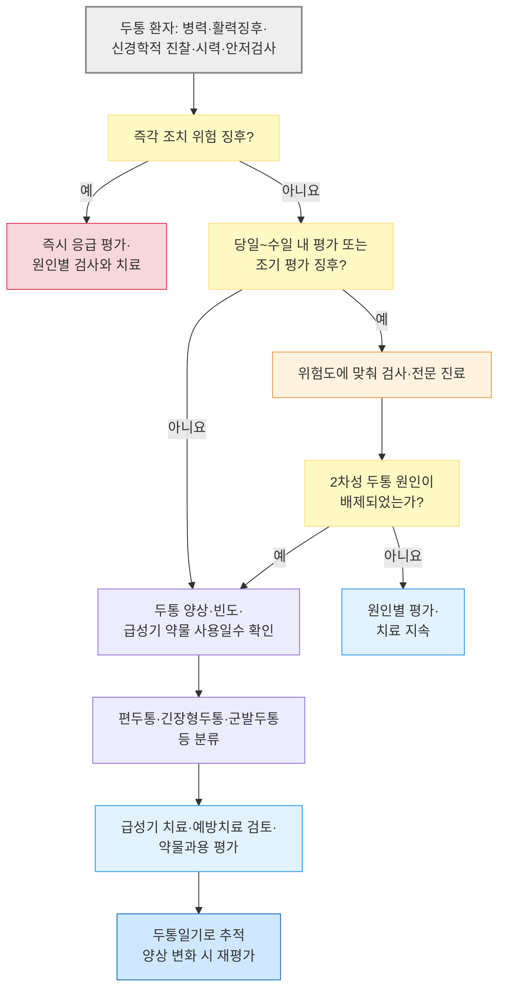

# 두통 Headache

## <mark style="color:green;">일반 사항</mark>

* 두통은 눈확귀길선(orbitomeatal line) &/or 목덜미능선(nuchal ridge) 위쪽의 머리에 생기는 통증이며, 그 아래 얼굴의 통증은 안면통으로 구분 <mark style="color:$info;">\[ICHD-3]</mark>
* 재발성 두통의 가장 흔한 형태는 편두통과 긴장형두통이며, 종종 약물과용두통도 해당됨
* 병력 청취와 진찰을 통해 2차성 두통 가능성을 선별하고 필요한 검사·의뢰를 결정하는 것이 긴요
* 두통 평가 시 [SNNOOP10](015_-headache.md#snnoop10) 경고 징후를 활용하여 2차성 두통 가능성을 체계적으로 평가

### <mark style="color:orange;">분류</mark> <mark style="color:$info;">\[</mark>[<mark style="color:$info;">ICHD-3</mark>](https://ichd-3.org/)<mark style="color:$info;">]</mark>

<mark style="color:cyan;">**1차성 두통 (Primary headache)**</mark>

* Migraine (편두통)
* Tension-type headache (긴장형두통)
* Trigeminal autonomic cephalalgias (삼차자율신경두통) - 군발두통(cluster headache), [paroxysmal hemicrania](018_-chronic-headache.md#short-lasting-headache), SUNCT/SUNA, [hemicrania continua](018_-chronic-headache.md#hemicrania-continua) 등
* Other primary headache disorders (기타 1차성 두통) - primary cough/exercise/sexual activity headache, primary thunderclap headache\*, [hypnic headache](018_-chronic-headache.md#hypnic-headache), [new daily persistent headache(NDPH)](018_-chronic-headache.md#ndph) 등

> _\*primary thunderclap headache(1차 **벼락두통**)는 1분 미만에 최고조에 이르고 ≥5분 지속되는 폭발적인 심한 두통으로, 지주막하출혈(SAH), 가역성 뇌혈관수축증후군(RCVS), 뇌정맥동혈전증(CVST), 뇌동맥박리, 뇌내출혈, 뇌하수체졸중 등 2차 원인을 충분히 배제한 후에 진단해야 함_

<mark style="color:cyan;">**2차성 두통 (Secondary headache)**</mark>

* 두부·경부 외상
* 두개·경부 혈관 질환 - 뇌졸중, RCVS, CVST, 동맥박리 등
* 비혈관성 두개내 질환 - 종양, IIH, 뇌압 이상 등
* 약물 또는 금단 - 약물과용두통 포함
* 감염 - 두개내 또는 전신
* 항상성 장애 - 저산소증, 고혈압, 갑상선기능저하 등
* 두개·경부·안구·이비인후·치아 등 인접 구조 질환 - 경추성두통, 녹내장, 부비동염, 턱관절 장애(TMD) 등
* 정신질환에 기인한 두통 - 신체화장애, 정신병적 장애 등

<mark style="color:cyan;">**뇌신경의 통증성 병변과 기타 안면통 (Painful lesions of the cranial nerves and other facial pain)**</mark>

* 삼차신경통, 설인신경통, 후두신경통 등

### <mark style="color:orange;">두통 유발 인자</mark>

* 식이 : 술, 초콜릿, 치즈, MSG, 아스파탐, 카페인, 견과류, nitrite
* 호르몬 변화 : 월경, 배란, 외인성 호르몬의 시작·중단 또는 변동
* 감각 자극 : 강한 빛/깜박이는 빛, 냄새, 큰 소리/소음
* 스트레스 : let-down period, 강한 활동, 상실감/변화(죽음, 이별, 직장 변화, 이사)
* 습관/환경 변화 : 날씨, 계절, 시차가 큰 여행, 고도 변화, 출퇴근 시간 변화, 수면 패턴 변화(수면 부족 및 과다 모두), 식사 패턴 변화, 끼니 거름, 불규칙 생활
* 탈수


유발 인자는 개인차가 크므로 일률적으로 제한하기보다 두통일기로 실제 연관성을 확인.\
특히 식품은 두통과의 일관된 인과성이 확립되지 않은 경우가 많음


### <mark style="color:$danger;">🚩 Red Flags!</mark> <a href="#red-flags" id="red-flags"></a>

<mark style="color:$danger;">**즉각 조치**</mark>

* 벼락두통 또는 수 분 내 최고조에 이르는 새로운 중증 두통 `SAH` `RCVS`
* 발열과 함께 경부 강직, 의식 변화, 점상·자반성 발진, 면역저하 등이 동반되거나 그 밖에 중추신경계 감염이 의심되는 두통 `수막염` `뇌염`
* 갑자기 생긴 국소 신경학적 증상(편마비·감각 소실·실어증·복시 등) - 회복 여부 무관 `뇌졸중` `TIA` `동맥 박리`
* 단일 비운동성 조짐 증상이 60분을 넘어 지속(여러 조짐이 이어질 때는 각 증상별로 판단) `뇌졸중` `TIA`
* 새로 발생한 경련 또는 급성 혼돈·의식 저하 `뇌졸중` `뇌염`
* 밀폐 공간에서 연소기구 등에 노출된 뒤 발생한 두통, 특히 동거인 등의 동시 증상 `일산화탄소 중독`
* 눈의 심한 통증·시야 혼탁·충혈 동반 `급성 폐쇄각녹내장`
* 중등도\~중증 두부 외상 직후 발생한 두통, 또는 외상 후 의식 변화·새로운 국소 신경학적 이상·경련·반복 구토 `경막하혈종` `경막외혈종`
* 최근 두부 외상 후 두통이 지속되거나 악화되어 처음 내원(외상 후 아직 평가받지 않음) `경막하혈종` `경막외혈종`
* 항응고제·항혈소판제(아스피린 단독 제외) 복용 중 두부 외상 `경막하혈종` `경막외혈종`
* 임신 중 또는 산후 새로 발생한 심한 두통, 갑작스러운 두통 또는 지속·악화되는 두통, 또는 혈압 상승·시각 이상·경련을 동반한 새 두통(임신 20주 이후·산후 6주 이내는 자간전증 유의) `자간전증` `CVST` `RCVS`
* ≥50세의 새로운 두통에 시력 상실·복시 등 시각 증상이 동반(일시적인 경우 포함) `거대세포동맥염`
* 새 두통·경부통에 부분 Horner 증후군(눈꺼풀 처짐·동공수축)이 동반되거나, 최근 경부 외상·경부 수기조작 후 새로 생긴 편측 두통·경부통 (☞ [경추성두통 Red Flags](019_-cervicogenic-headache.md#red-flags)) `경동맥 박리` `척추동맥 박리`

<mark style="color:$warning;">**당일\~수일 내 평가**</mark>

* **(당일)** ≥50세의 새로운 두통에 턱 파행(jaw claudication), 두피 또는 측두동맥 압통 등이 동반 `거대세포동맥염`
* **(당일)** 임신 중 또는 산후 새로 발생한 두통 중 즉각 조치 항목에 해당하지 않는 경우 `자간전증` `뇌혈관질환` `뇌하수체 병변`
* **(당일)** 유두부종, 반복 구토 등 두개내압 상승 의심 `IIH` `CVST` `두개내 종괴`
* **(당일)** 처음 발생했거나 기존과 다른 양상의 시각·감각 조짐이 서서히 퍼졌다가 완전히 회복된 경우 `조짐편두통` `TIA`
* **(당일)** 두부 외상(경미한 외상 포함) 후 급성기 평가를 받았으나 수일\~수주에 걸쳐 두통이 악화(특히 고령자·항응고제 복용자) `만성 경막하혈종`
* 기침·발살바 조작·운동·성행위 시 새로 유발되는 두통 `후두와 종괴` `Chiari 기형`
* 뚜렷한 체위성 두통(기립 시 악화 또는 누울 때 현저히 악화) `저뇌척수압` `두개내압 상승` `CVST`
* 면역 저하 환자(HIV, 면역억제제·스테로이드 장기 복용 등)의 새로운 두통 `기회감염` `중추신경계 림프종`
* 악성 종양 병력이 있는 환자의 새로운 두통 또는 기존 두통의 뚜렷한 변화 `뇌전이` `암성 수막염`

<mark style="color:$info;">**조기 평가 및 추적**</mark>

* 두통 양상의 상당한 변화 또는 점진적 악화
* ≥50세에서 새로 발생한 두통(뇌혈관·신경학적 위험 징후가 없는 경우)
* 새로 발생한 야간/기상 시 두통이 반복되거나 점차 악화
* 의도하지 않은 체중 감소 동반
* 성격 변화 또는 새로 발생한 인지기능 장애
* 적절한 기존 치료에도 반응하지 않음

## <mark style="color:green;">진단</mark>

* 활력징후(혈압 포함), 신경학적 진찰, 시력 및 안저검사

### <mark style="color:orange;">검사</mark> <a href="#headache-testing" id="headache-testing"></a>

#### <mark style="color:$primary;">실험실검사</mark>

* 경고 징후가 없는 전형적 1차성 두통에서는 일상적인 혈액검사가 필요하지 않음
* 2차 원인이 의심되면 원인에 따라 선택
  * 거대세포동맥염(GCA) 의심 : ESR/CRP와 CBC(혈소판 포함)를 측정하고 신속히 전문 진료 의뢰
  * 중추신경계 감염 의심 : CBC, CRP, 혈액배양. 금기를 확인한 후 LP(요추천자) 직전에 혈당을 측정하고(뇌척수액 당과 비교), LP로 뇌척수액 검사(세포수·단백·당·그람염색·배양, 필요시 PCR)를 시행
    * 세균성 수막염이 의심되면 응급 이송이 우선이며, LP나 영상검사 때문에 항생제 투여를 지연하지 않음
  * 일산화탄소 중독 의심 : 혈중 carboxyhemoglobin(COHb) 측정. 일반 맥박산소측정기로는 배제할 수 없음
  * 임신 20주 이후·산후의 자간전증 의심 : 소변 단백, CBC(혈소판), 간기능, 크레아티닌
  * [갑상선저하증](../226_/105_-hypothyroidism.md) 등 전신 질환 의심 : 해당 검사


**거대세포동맥염(GCA)** : ≥50세에서 대동맥과 머리·목의 주요 분지(측두동맥, 안동맥 등)를 침범하는 대혈관 혈관염. 과거 명칭은 측두동맥염

* **≥50세**의 새로운 두통에 다음이 동반되면 **GCA를 의심**\
  ∘ 턱 파행(씹을 때 턱 통증), 두피 압통, 측두동맥 압통·박동 감소\
  ∘ 시력 상실·복시 등 시각 증상(일시적인 경우 포함)\
  ∘ 류마티스성 다발근육통 증상(어깨·골반 부위 통증과 조조강직)\
  ∘ 발열·체중 감소·피로 등 전신 증상
* ESR/CRP 상승은 진단을 뒷받침하나, 정상이어도 GCA를 완전히 배제하지 못함
* 시각 증상이 있거나 위 소견이 여럿 겹쳐 의심이 높으면 확진검사 결과를 기다리지 않고 당일 치료가 가능한 기관으로 의뢰


#### <mark style="color:$primary;">영상검사</mark>

* 경고 징후 또는 기질적 문제가 의심되는 경우 원인과 임상 상황에 따라 CT, MRI, 혈관영상(CTA/MRA, CTV/MRV)을 선택 (☞ 검사 방법별 특징은 [영상검사](../232_/251_-neuro-tests.md#brain-imaging-selection) 챕터참조)
* SAH가 의심되는 급성 중증 두통(벼락두통 등) : 우선 비조영 뇌 CT로 평가 <mark style="color:$info;">\[Stroke 2023]</mark>
  * 다음에 모두 해당 시 동맥류성 SAH 가능성이 매우 낮음 : ① 발병 후 ＜6시간에 촬영한 고품질 비조영 뇌 CT를 신경영상 전문의가 판독해 음성, ② 새로운 신경학적 결손 없음
    * 발병 후 ＜6시간에 촬영했더라도 CT의 질·판독 조건이 불충분하거나 임상적 의심이 지속되면 추가 평가
  * 다음 중 하나라도 해당 시 CT가 음성이어도 금기를 확인한 후 LP로 추가 평가 : ① 발병 후 ≥6시간에 CT 촬영, ② 새로운 신경학적 결손 있음
  * CTA는 임상 상황과 기관 프로토콜에 따라 선택
    * 우연히 발견된 미파열 동맥류를 두통의 원인으로 오인하지 않도록 주의
* RCVS, 경동맥·척추동맥 박리, 뇌정맥동혈전증(CVST), 후두와·뇌하수체 병변 등은 비조영 뇌 CT가 정상이어도 배제되지 않음. Red Flags에서 이들 질환을 시사하는 소견이 있으면 혈관영상이나 MRI가 가능한 기관으로 의뢰
* 긴장형두통, 편두통, 군발두통, 또는 약물과용두통으로 이미 진단된 환자에서 단순히 안심시킬 목적의 뇌영상검사는 권고하지 않음 <mark style="color:$info;">\[한국정신신체의학회 2019; NICE CG150]</mark>
* 경고 징후가 없고 신경학적 검사가 정상인 전형적 편두통·긴장형두통에서는 뇌영상검사를 일상적으로 시행하지 않음. 경고 징후 없이 안정된 만성 두통에도 같은 원칙을 적용 <mark style="color:$info;">\[ACR AC 2022; Public Health Wkly Rep 2025]</mark>
* 첫 군발기에는 2차 원인을 확인하기 위한 뇌 MRI 필요성을 신경과와 상의 <mark style="color:$info;">\[NICE CG150; ACR AC 2022]</mark>

### <mark style="color:orange;">감별</mark>

<table data-search="false"><thead><tr><th>두통 특성</th><th>우선 고려 진단</th></tr></thead><tbody><tr><td>양측·압박감, 경증~중등도, 구역·구토 없음(삽화형)</td><td><strong>긴장형두통</strong></td></tr><tr><td>편측 또는 양측·흔히 박동성, 구역·구토 또는 빛공포와 소리공포, 4~72시간</td><td><strong>편두통</strong></td></tr><tr><td>≥15일/월, ＞3개월 지속</td><td><strong>만성 두통</strong> - 만성편두통·만성긴장형두통·MOH 감별</td></tr><tr><td>편측·극심, 눈 주변, 동측 자율신경 증상 또는 안절부절못함·초조, 15~180분</td><td><strong>군발두통</strong></td></tr><tr><td>편측, 경부 움직임으로 유발, ROM 감소</td><td><strong>경추성두통</strong></td></tr><tr><td>갑작스럽게 시작하여 수 분 내 최고조에 이르는 새로운 중증 두통</td><td><strong>SAH·RCVS</strong> 등 → 즉각 응급 평가</td></tr><tr><td>발열과 경부 강직·의식 변화·점상 또는 자반성 발진 등</td><td><strong>수막염·뇌염</strong> → 즉각 응급 평가</td></tr></tbody></table>

#### <mark style="color:$primary;">1차성 두통의 감별</mark>

<table><thead><tr><th width="105">두통 특성</th><th>긴장형두통</th><th>편두통</th><th>군발두통</th></tr></thead><tbody><tr><td><strong>통증 부위</strong>¹⁾</td><td>양측</td><td>편측 또는 양측</td><td>엄격한 편측 안와·안와상부 및/또는 측두부</td></tr><tr><td><strong>통증 양상</strong></td><td>압박감/조임(비박동성)</td><td>박동성</td><td>찌르거나 타는 듯한 통증</td></tr><tr><td><strong>통증 세기</strong></td><td>경증~중등도</td><td>중등도 이상</td><td>중증 이상</td></tr><tr><td><strong>생활에 미치는 영향</strong></td><td>일상 신체 활동에 의해 악화되지 않음</td><td>일상 신체 활동에 의하여 악화되거나 활동을 회피하게 됨</td><td>초조 또는 동요</td></tr><tr><td><strong>기타 증상</strong></td><td>•삽화형은 구역·구토 없음. 빛공포 또는 소리공포 중 하나는 동반 가능. •만성형은 빛공포·소리공포·경한 구역 중 최대 하나를 동반할 수 있으며, 중등도 이상의 구역이나 구토는 없음</td><td>구역 &#x26;/or 구토, 또는 빛공포와 소리공포 모두. •조짐(aura)²⁾: 완전히 가역적인 시각·감각·언어 등의 증상으로, 대개 점진적으로 발생하며 각 비운동 조짐 증상은 보통 5~60분 지속</td><td>동측 자율신경 증상 &#x26;/or 안절부절못함·초조. •자율신경 증상: 결막충혈 &#x26;/or 눈물, 코막힘 &#x26;/or 콧물, 눈꺼풀부종, 이마와 얼굴의 땀, 동공수축 &#x26;/or 눈꺼풀 처짐</td></tr><tr><td><strong>두통 지속 시간</strong></td><td>•삽화형: 30분~7일. •만성형: 수시간~수일 또는 지속적</td><td>4~72시간(치료하지 않았거나 치료 실패 시, 18세 미만 2~72시간)</td><td>치료하지 않았을 때 15~180분</td></tr></tbody></table>

<mark style="color:cyan;">**두통 또는 발작 빈도**</mark>

* 긴장형두통 : 삽화긴장형두통 - ＜15일/월
  * 만성긴장형두통³⁾ - ≥15일/월, ＞3개월
* 편두통 : 삽화편두통(조짐 또는 무조짐) - ＜15일/월
  * 만성편두통³⁾ : 두통 ≥15일/월이 ＞3개월 지속되고, 그중 ≥8일/월은 편두통 기준에 해당
* 군발두통 : 군발기 중 발작 빈도 2일에 1회\~1일 8회⁴⁾
  * 삽화군발두통 - 치료하지 않았을 때 7일\~1년 지속되는 군발기가 ≥2회, 군발기 사이 관해기⁵⁾ ≥3개월
  * 만성군발두통 - 발작이 ≥1년 반복되며, 관해기가 없거나 각 관해기가 ＜3개월

> _¹⁾정의상 두통은 머리의 통증이지만, 일부 두통 질환에서는 통증이 얼굴이나 목까지 퍼질 수 있음._\
> _&#xB2;⁾조짐편두통은 ICHD-3의 6가지 시간적·임상적 특성 중 3가지 이상을 충족해야 하며, 여러 증상이 연속되면 총 지속시간은 60분을 넘을 수 있고 운동 조짐은 대개 72시간 이내에 소실됨._ _편두통_ _참조_\
> _&#xB3;⁾만성 두통에서는 월 편두통일수와 약물과용을 함께 평가. 만성편두통의 월 ≥8일에는 무조짐편두통의 통증·동반 증상 기준이나 조짐 기준을 충족하는 날, 또는 두통 시작 시 환자가 편두통으로 판단했고 트립탄이나 맥각유도체로 완화된 날을 포함. 만성편두통과 MOH의 진단기준을 모두 충족하면 두 진단을 함께 기록._ _만성 두통_ _및 편두통 챕터 참조_\
> _&#x2074;⁾삽화형과 만성형에 공통 적용하는 군발기 중 발작 빈도_\
> _&#x2075;⁾군발기들 사이의 무통증 기간_

#### <mark style="color:$primary;">2차성 두통 선별을 위한 SNNOOP10 경고 징후</mark> <a href="#snnoop10" id="snnoop10"></a>

<table data-search="false"><thead><tr><th width="60">기호</th><th>경고 징후</th><th>특징</th><th>감별 진단</th></tr></thead><tbody><tr><td><strong>S</strong></td><td>Systemic symptoms</td><td>발열, 오한, 야간 발한, 체중 감소 등 전신 증상</td><td>감염(CNS, 전신), 전신 염증성 질환</td></tr><tr><td><strong>N1</strong></td><td>Neoplasm history</td><td>활동성 또는 과거 악성종양 병력</td><td>뇌전이, 암성수막염(leptomeningeal metastasis)</td></tr><tr><td><strong>N2</strong></td><td>Neurologic deficit/dysfunction</td><td>국소 신경학적 이상 또는 의식 저하</td><td>뇌졸중, 종괴 병변, 뇌염</td></tr><tr><td><strong>O1</strong></td><td>Onset sudden or abrupt</td><td>벼락두통(1분 미만에 최고조 도달)</td><td>SAH, RCVS, CVST, 동맥박리, 뇌하수체졸중</td></tr><tr><td><strong>O2</strong></td><td>Older age</td><td>고령⁶⁾에 새로이 발생한 두통</td><td>거대세포동맥염(GCA), 종괴 병변</td></tr><tr><td><strong>P1</strong></td><td>Pattern change</td><td>기존과 다른 양상으로 변화 또는 새로 발생</td><td>종괴 병변, 감염(CNS, 전신)</td></tr><tr><td><strong>P2</strong></td><td>Positional</td><td>기립 시 악화 또는 누울 때 악화</td><td>저뇌척수압(CSF leak), CVST, 종괴 병변</td></tr><tr><td><strong>P3</strong></td><td>Precipitated by sneezing, coughing, or exercise</td><td>기침, 재채기, 운동으로 유발</td><td>두개내/후두와 종괴, Chiari malformation</td></tr><tr><td><strong>P4</strong></td><td>Papilledema</td><td>안저검사에서 시신경유두 경계 불명확·융기</td><td>IIH, 두개내 종양, 수두증, 뇌정맥동혈전증</td></tr><tr><td><strong>P5</strong></td><td>Progressive, atypical presentation</td><td>점진적 악화 또는 비전형적 양상</td><td>종괴 병변</td></tr><tr><td><strong>P6</strong></td><td>Pregnancy/<br>Postpartum</td><td>임신 중 또는 산후 새로 발생</td><td>CVST, 자간전증/자간증, RCVS, 뇌하수체 병변</td></tr><tr><td><strong>P7</strong>⁷⁾</td><td>Painful eye with autonomic features</td><td>눈 통증과 함께 결막충혈·눈물 등 자율신경 증상</td><td>급성 폐쇄각녹내장 등 안과 질환, 해면정맥동·뇌하수체 주변·후두와 병변, Tolosa-Hunt 증후군</td></tr><tr><td><strong>P8</strong></td><td>Post-traumatic onset</td><td>두부·경부 외상 후 발생</td><td>급·만성 경막하혈종, 경막외혈종, 외상후두통</td></tr><tr><td><strong>P9</strong></td><td>Pathology of immune system</td><td>HIV, 면역억제제 장기 복용 등</td><td>기회감염, 중추신경계 림프종</td></tr><tr><td><strong>P10</strong></td><td>Painkiller overuse/new drug</td><td>진통제 과용 또는 새로운 약물 시작과 시점이 일치</td><td>약물과용두통(MOH), 약물유발두통</td></tr></tbody></table>

> _<mark style="color:$info;">RCVS=reversible cerebral vasoconstriction syndrome; CVST=cerebral venous sinus thrombosis; IIH=idiopathic intracranial hypertension; MOH=medication overuse headache; TACs=trigeminal autonomic cephalalgias</mark>_
>
> _⁶⁾<mark style="color:$info;">SNNOOP10 원저 \[Neurology 2019]의 고령 신규 두통 기준은 표 1에서</mark>_ ＞_<mark style="color:$info;">50세, 본문에서</mark>_ ＞_<mark style="color:$info;">65세 로 제시됨. 이 장에서는 거대세포동맥염을 고려하여</mark>_ ≥_<mark style="color:$info;">50세에서 새로 발생한 두통도 평가함</mark>_
>
> _⁷⁾<mark style="color:$info;">P7 소견은 1차성 삼차자율신경두통(TACs)에서도 나타나므로, TACs로 판단하기 전에 표의 2차 원인을 먼저 감별</mark>_

#### <mark style="color:$primary;">2차성 두통의 감별</mark>

* 지주막하출혈 : 폭발적인 심한 두통(벼락두통); 수 분에 걸쳐 최고조에 이른 급성 중증 두통도 평가 대상


**Ottawa SAH Clinical Decision Rule** : SAH 검사가 필요한 환자를 선별하는 도구. 전향적 검증 연구에서 민감도 100%, 특이도 13.6% <mark style="color:$info;">\[CMAJ 2017]</mark>

* 적용 대상 : ≥16세, 의식 명료(GCS 15), 신경학적 결손이 없고, 새로 발생한 중증 비외상성 두통이 시작 후 1시간 이내에 최고 강도에 도달했으며 발병 14일 이내에 내원한 환자
* 적용 제외 : 새로운 국소 신경학적 결손 또는 유두부종, 뇌동맥류·SAH·뇌종양·수두증·뇌실 단락술 병력, 내원 전 7일 이내 직접 두부 외상, 현재 두통과 양상·강도가 같은 두통이 6개월을 넘는 기간에 3회 이상 있었던 경우, 같은 두통으로 이미 뇌 CT와 LP를 모두 시행받고 재내원한 경우, 타 병원에서 SAH가 확진되어 전원된 경우
* Rule : 적용 대상 중 다음 하나라도 있으면 SAH 평가가 필요함 : ① ≥40세, ② 경부 통증 또는 뻣뻣함, ③ 목격된 의식 소실, ④ 힘을 쓰는 활동 중 두통 발생, ⑤ 벼락두통(시작과 동시에 최고 강도에 도달), ⑥ 신체검사상 목 굴곡 제한(턱이 가슴에 닿지 않거나, 바로 누운 자세에서 머리를 침상면에서 8 ㎝ 들어 올릴 수 없음)
* 초기 검사 : 비조영 뇌 CT. CT 음성 후 추가 평가는 위 [영상검사](015_-headache.md#headache-testing)의 SAH 항목을 따름 <mark style="color:$info;">\[Stroke 2023]</mark>


* 가역성 뇌혈관수축증후군(RCVS) : 벼락두통이 수일\~수주에 걸쳐 반복되면 적극 고려
  * SAH와 임상 양상이 유사하며, 초기 CT·LP가 음성인 경우가 많으나 일부에서는 convexity SAH가 동반될 수 있어 음성 결과만으로 RCVS를 배제하지 않음
  * 출산 후, 세로토닌성 약물(트립탄·SSRI·SNRI), 코카인 또는 교감신경작용성 비충혈제거제(예: pseudoephedrine) 등이 유발 요인으로 보고됨. 의심되면 해당 약물을 중단·회피
* 급·만성 경막하혈종 : 외상 경력; 의식 변화, 신경학적 장애
* 뇌염(Encephalitis) : 신경학적 이상, 혼동, 의식 변화
* 수막염(Meningitis) : 발열, 경부 강직, 뇌막 자극 증상
* 두개내 종양 : 점진적 악화, 새로운 신경학적 이상, 인지·성격 변화, 경련, 유두부종
  * 기상 시 또는 누운 자세에서 두드러질 수 있으나 비특이적
* 거대세포동맥염(측두동맥염) : ≥50세, 두피 또는 측두동맥 압통, 턱 파행(씹을 때 턱 통증), 시각 변화
  * 일시적 시력 상실(amaurosis fugax) 여부를 반드시 확인 - 치료 지연 시 영구 실명 위험
* 급성 폐쇄각녹내장 : 눈의 통증, 시야 혼탁, 구역/구토, 빛 주위 halo
  * 안과 응급
* 턱관절 장애(TMD) : 턱관절 통증 및 압통. 저작 시 악화
* 삼차신경통(Trigeminal neuralgia) : 삼차신경 분포에서 대개 1초 미만\~2분간 지속되는 전기충격 같은 발작성 통증; 세수·말하기·씹기·가벼운 접촉 등 무해한 자극으로 유발
* 고혈압 응급(hypertensive emergency) : 심한 혈압 상승(수축기혈압 ＞180 ㎜Hg 또는 이완기혈압 ＞120 ㎜Hg)에 급성 표적장기 손상(고혈압성 뇌병증, 급성 신손상, 급성 심부전·폐부종 등)이 동반된 경우
  * 혈압 수치만으로 두통의 원인을 단정하지 않음 <mark style="color:$info;">\[AHA/ACC 2025]</mark>
* 일산화탄소 중독 : 난방기 사용 또는 밀폐 공간 노출, 동거인·동일 공간 인원의 동시 두통·오심·어지럼
  * 실외에서 호전되는 양상 확인. 일반 맥박산소측정기는 CO 중독 배제에 부적합
* 경추성두통(Cervicogenic headache) : 목 또는 후두부에서 시작해 전두·측두·안와부로 퍼질 수 있으며, 목 움직임이나 지속 자세로 악화되고 경추 운동 범위가 감소할 수 있음
  * 경추 병변과 두통 사이의 인과관계를 확인하며, 영상의 퇴행성 변화만으로 진단하지 않음
* 부비동염 : 화농성 비루·코막힘·후각저하·안면 압박감과 객관적 비부비동염 소견 및 두통의 시간적 연관성을 확인
* 유두부종(Papilledema) : 안저검사에서 시신경 유두 경계 불명확·융기 확인 시 뇌압 상승 시사
  * [특발성 두개내고혈압(IIH)](018_-chronic-headache.md#iih), 두개내 종양, 수두증, 뇌정맥동혈전증 감별 → 긴급 뇌영상검사(MRV 또는 CTV 포함)로 종괴·수두증·뇌정맥동혈전증을 배제하고, 금기가 없고 IIH가 의심되면 LP로 개방압과 뇌척수액 성상 확인

### <mark style="color:orange;">환자 자가 평가</mark> <a href="#headache-diary" id="headache-diary"></a>

* 두통의 원인 진단 및 치료 효과 모니터링을 위하여 고려

<mark style="color:cyan;">**두통일기**</mark>

* 진단 목적으로 다음 사항을 최소 8주간 기록; 치료 중에도 반응 평가를 위해 계속 기록 <mark style="color:$info;">\[NICE CG150]</mark>
  1. 두통의 빈도, 지속 시간 및 강도
  2. 연관되어 나타나는 증상들
  3. 두통 완화를 위해 복용한 모든 약물(처방약·일반의약품 포함)
  4. 가능한 유발 요인들
  5. 두통과 월경의 연관성
* 모바일 앱 '[대한두통학회 두통일기](https://play.google.com/store/apps/details?id=com.m2comm.headache)' 활용 가능(☞ [안내 영상](https://www.youtube.com/watch?v=8ATnCgbL2Wg))
  * 위 항목 외에 통증의 위치·양상, 조짐 유무와 전구 증상, 약의 효과, 일상·사회·직장 생활의 지장 정도도 기록
  * 두통 일수, 약 복용 일수, 주요 유발 요인을 1·3·6개월 단위로 확인할 수 있어 약물과용 감시와 치료 반응 평가에 유용

<mark style="color:cyan;">**HIT-6 (Headache Impact Test, 두통 영향 평가)**</mark>

* 통증, 사회 기능, 역할 기능, 인지 기능, 심리적 고통, 활력도를 평가하는 6가지 문항 (☞ [한국어판 HIT-6 연구](https://www.jkna.org/upload/pdf/200901001.pdf) Table 1)
* 배점 : 응답(한 번도 없음·드물게·때때로·매우 자주·항상)에 각각 6·8·10·11·13점을 배정하여 합산(최저 36점\~최고 78점)
* 판정 : 36\~49점 = 영향이 없거나 경미; 50\~55점 = 일부 영향; 56\~59점 = 상당한 영향; 60\~78점 = 심각한 영향
* HIT-6는 두통으로 인한 기능 장애 정도를 정량화하는 도구임
* 예방치료 여부는 HIT-6 단일 cutoff가 아니라 월 두통일수·기능장애·급성기 치료 반응·환자 선호 등을 종합하여 결정

***



<p align="center"><strong>두통 환자의 초기 평가 및 관리 알고리듬</strong><br><em><mark style="color:$info;">저자 재구성 (참고 문헌 : ICHD-3; NICE CG150; Hoh BL, et al. Stroke 2023;</mark></em><br><em><mark style="color:$info;">Do TP, et al. Neurology 2019)</mark></em></p>

***

## <mark style="background-color:$warning;">Management</mark>

### <mark style="color:orange;">치료 원칙</mark>

* 이 챕터는 두통의 초기 분류와 2차성 두통 가능성 평가를 중심으로 하며, 1차성 두통의 상세 약물 선택은 각 질환별 챕터를 참조
  * [편두통](016_-migraine.md)
  * [긴장형두통](017_-tension-type-headache.md)
  * [만성 두통 및 약물과용두통](018_-chronic-headache.md)
  * [경추성두통](019_-cervicogenic-headache.md)
* 급성기 치료는 가능한 한 두통 초기에 시행하고, 반복적 진통제 사용 시 약물과용두통(MOH) 위험을 항상 확인
* MOH 진단의 핵심 : 기존 두통 환자에서 두통이 ≥15일/월이고, 급성기/증상완화 약물의 규정된 과용이 ＞3개월 지속
  * 단순진통제·NSAIDs 등 non-opioid analgesic : ≥15일/월. acetaminophen, aspirin, NSAID는 한 약물군으로 합산
  * triptan, ergotamine, opioid, 복합진통제는 각각 ≥10일/월
    * 서로 다른 약물군을 함께 사용하면 각 약물군의 개별 과용 기준에 미달하더라도 합산 ≥10일/월이면 과용에 해당. 같은 날 여러 약을 복용했으면 전체 사용일수는 1일로 계산
* 환자 교육 시 사용일수 상한
  * 단순진통제, NSAIDs만 복용 : 합산 월 15일 미만
  * triptan·복합진통제를 사용하거나, 서로 다른 약물군(예: 트립탄과 단순진통제)을 함께 또는 번갈아 사용하는 경우 : 합산 월 10일 미만

### <mark style="color:orange;">군발두통 치료 요약</mark> <a href="#cluster-treatment" id="cluster-treatment"></a>

* 군발두통은 통증이 매우 심하고 발작 빈도가 높아 진단 시 신경과/두통 전문 진료를 고려
* 급성 발작 <mark style="color:$info;">\[Eur J Neurol 2023; Headache Pain Res 2026]</mark>
  * 1차 선택 : 다음 중 하나
    * 100% 산소(저장백이 달린 비재호흡 마스크, ≥12 L/min, 15\~20분)
    * sumatriptan 6 ㎎ SC(국내 유통 확인 안 됨)
  * 피하·비강 트립탄 이용이 제한될 때
    * 대한두통학회는 비강분무 트립탄(zolmitriptan, sumatriptan)과 경구 zolmitriptan도 권고하나, 피하·비강 트립탄은 이용이 제한됨
    * 피하·비강 제형을 쓸 수 없으면 경구 zolmitriptan을 고려할 수 있음(군발두통에는 허가 외 사용. 임상시험에서 1회 5 ㎎과 10 ㎎을 평가). 제품은 <mark style="color:blue;">\[</mark>[<mark style="color:blue;">조믹</mark>](https://www.health.kr/drug/A11AMMMMM2196)<mark style="color:blue;">]</mark> 2.5 ㎎ 정
* 예방 : verapamil <mark style="color:blue;">\[</mark>[<mark style="color:blue;">이솦틴</mark>](https://www.health.kr/drug/A11A1130B0002)<mark style="color:blue;">]</mark>이 대표적 1차 예방약 <mark style="color:$info;">\[Eur J Neurol 2023; Headache Pain Res 2026]</mark>
  * 허가 외 사용이며, 군발두통 예방의 급여 여부는 별도 확인
  * 시작 전·매 증량 후·유지 용량 도달 후 정기적으로 심전도 추적이 필요
* verapamil 효과가 나타나기 전(대개 2\~3주)에는 대후두신경 스테로이드 차단술(GON block) 또는 단기 경구 스테로이드(prednisolone 등)를 이행기 치료로 병행할 수 있음
* 삽화군발두통 예방 : 전문 진료에서 galcanezumab을 고려할 수 있음(강한 권고, 중간 근거수준) <mark style="color:$info;">\[Headache Pain Res 2026]</mark>
  * 군발두통 적응증이 있던 100 ㎎/㎖ 제형은 허가 취하되었고, 120 ㎎/㎖ 제형의 허가 적응증은 편두통 예방임 <mark style="color:$info;">\[의약품안전나라]</mark>
* 세부 치료는 환자 특성·금기·허가·급여를 고려하여 결정

### <mark style="color:orange;">예방치료 적응증</mark>

* 주로 편두통에서 다음과 같은 경우 예방치료를 고려하며, 단일 수치보다 두통 빈도·기능장애·급성기 치료 반응·환자 선호를 종합
  * 빈번한 두통(예: 편두통 ≥4일/월)
  * 두통으로 인한 기능 장애가 중등도 이상이거나 일상생활이 현저히 제한됨
  * 급성기 치료 반응이 불충분하거나 금기/부작용이 있음
  * 급성기 약물 사용이 잦아 MOH 위험이 높거나 MOH가 반복됨
* 예방치료 목표는 두통 빈도·강도와 기능장애를 의미 있게 감소시키는 것임
  * 대부분의 편두통 예방약은 권장 내약 용량에 도달한 뒤 최소 8\~12주(약 2\~3개월) 투여 후 효과를 판정하며, onabotulinumtoxinA는 24주 후 판정 <mark style="color:$info;">\[AAN/AHS 2026]</mark>
  * 긴장형두통 등 다른 두통의 평가 시점과 구체적인 예방 약제 선택은 각 질환별 챕터 참조

***

## <mark style="color:red;">질병코드</mark>

* R51 두통 Headache
* G44 기타 두통증후군 Other headache syndromes
* G44.0 군발두통증후군 Cluster headache syndrome

***

## <mark style="color:purple;">처방례</mark>

> **처방례 1. 군발두통 급성 발작**
>
> ```
> 100% 산소  저장백이 달린 비재호흡 마스크로 ≥12 L/min
> 발작 시작 시 15~20분간 흡입
> ```
>
> _✽산소 요법은 부작용이 적은 군발두통 급성기 1차 치료임. 산소 사용 중 흡연·화기 접근을 금지. 일반 저유량 비강 캐뉼라는 이 요법을 대체하지 못함. 군발두통만으로는 가정용 산소치료 기기 대여 요양비가 적용되지 않음(2026년 11월 확인)_

> **처방례 2. 군발두통 예방**
>
> ```
> 일성이솦틴정 80 ㎎  1회 1T  1일 3회로 시작
> ※ 수축기혈압 ＜90 ㎜Hg이면 투여하지 않으며, 서맥·전도 이상 위험은 시작 전 평가. 고령 등에서는 더 낮은 시작 용량 고려
> ※ 반응·내약성에 따라 보수적 증량 예로 2주 간격으로 1일 총량을 80 ㎎씩 증량
> ※ 유지 용량 예: 240~480 ㎎/일, 분할 투여
> ※ 투여 시작 전, 매 증량 후 및 다음 증량 전 심전도 확인(PR 간격 연장·방실차단 여부). 유지 용량 도달 후에도 정기적으로 확인
> ※ 고용량이 필요한 경우 신경과·두통클리닉 전문의와 협진하여 증량
> ```
>
> 약제 정보: [일성이솦틴정 80 ㎎](https://www.health.kr/drug/A11A1130B0002)
>
> _✽verapamil의 군발두통 예방은 허가 외 사용이며 급여 여부를 별도 확인. 중증 울혈성 심부전, 저혈압, 급성 심근경색, 심인성 쇼크, 동기능부전·동방차단·2·3도 방실차단(인공심박동기 없는 경우), 부전도로를 동반한 심방세동·심방조동(예: WPW), ivabradine 병용 등 금기를 확인. β차단제 등 심박수·전도에 영향을 주는 병용약을 검토하고, 임의 증량·중단하지 않도록 교육. 삽화군발두통은 군발기가 끝나면 서서히 감량하여 중단_

***

### <mark style="color:$success;">핵심 복약 지도</mark>

> **급성기 진통제 사용 원칙**
>
> * 두통 초기에 복용해야 효과적이며, 두통이 심해진 후에는 효과가 떨어질 수 있음을 설명
> * 단순진통제·NSAIDs만 복용하면 합산 월 15일 미만, triptan·복합진통제 또는 서로 다른 약물군(예: 트립탄과 단순진통제)을 함께 또는 번갈아 사용하는 경우 합산 월 10일 미만으로 교육
> * 급성기 약물이 주 2일을 넘겨 반복적으로 필요하면 예방치료 필요성을 검토
> * 진통제 사용일수가 늘거나 두통이 ≥15일/월로 증가하면 약물과용두통(MOH) 여부를 반드시 재평가

> **예방약 복용 안내**
>
> * 편두통 예방약은 즉효성 약물이 아니므로 권장 용량에 도달한 뒤 8\~12주(약 2\~3개월) 이상 복용한 후 효과를 판단하도록 설명
> * 효과가 있다고 느껴도 임의로 중단하지 않도록 안내
> * verapamil은 시작 전·매 증량 후 및 유지 용량 도달 후의 정기 심전도 검사 일정을 안내. 실신·심한 어지럼·현저한 서맥이 생기면 즉시 평가하고, 변비·발목부종도 확인
> * 산소 치료 중 흡연과 화기 접근을 금지

> **언제 다시 병원을 방문해야 하나요?**
>
> * 새로 발생한 두통이 **갑자기 시작해 수 분 안에 매우 심해지는 경우** - 즉시 응급실
> * 두통과 함께 발열·목 뻣뻣함·의식 변화 등 수막염 의심 증상이 나타나는 경우 - 즉시 응급실
> * 갑자기 한쪽 팔다리 힘이 빠지거나, 말하기 어렵거나, 물체가 두 개로 보이는 경우(잠시 후 좋아졌어도 해당) - 즉시 응급실
> * 응급 신호가 없더라도 기존 치료에 반응하지 않거나 두통 양상이 뚜렷이 변화하는 경우 - 외래 재평가

***

## <mark style="color:green;">주요 참고문헌 및 확인 자료</mark>

### <mark style="color:orange;">임상 근거</mark>

* \[ICHD-3] [Headache Classification Committee of the International Headache Society (IHS). The International Classification of Headache Disorders, 3rd edition. Cephalalgia. 2018;38(1):1-211.](https://ichd-3.org/) - 두통의 분류·진단 기준 및 약물과용 기준
* \[한국정신신체의학회 2019] [한국정신신체의학회. 두통 진료지침. 2019.](https://www.guideline.or.kr/guide/view.php?cate=A\&number=1082) - 1차 두통의 진단·영상검사 등을 다룬 13개 핵심질문
* \[AAN/AHS 2026] [Potrebic S, et al. Pharmacologic Treatment for Migraine Prevention in Adults: Practice Guideline Recommendations. Headache. 2026;66(9):2173-2184.](https://doi.org/10.1111/head.70199) - 편두통 예방약의 효과 판정 시점
* \[NICE CG150] [NICE. Headaches in over 12s: diagnosis and management. Clinical guideline CG150. 2012; updated June 3, 2025.](https://www.nice.org.uk/guidance/cg150/chapter/recommendations) - 두통 감별·영상검사 및 급성·예방 치료의 적용 범위
* \[ACR AC 2022] [Utukuri PS, et al. ACR Appropriateness Criteria® Headache: 2022 Update. J Am Coll Radiol. 2023;20(5S):S70-S93.](https://doi.org/10.1016/j.jacr.2023.02.018) - 신경학적 이상이 없는 1차성 두통의 영상검사 비권고와 2차성 두통 의심 시 영상 선택
* [Do TP, et al. Red and orange flags for secondary headaches in clinical practice: SNNOOP10 list. Neurology. 2019;92(3):134-144.](https://doi.org/10.1212/WNL.0000000000006697) - 2차성 두통의 경고 징후와 평가
* [Jung JS, et al. 2017년 근거기반 임상영상 가이드라인에서 연구된 두통 환자 진단을 위한 한국형 영상 검사 권고안. J Korean Soc Radiol. 2019;80(5):880-895.](https://doi.org/10.3348/jksr.2019.80.5.880) - 두통 영상검사 권고안
* [Choi CH. Development of the 2024 Korean Guidelines for the Justification of Patient Imaging. Public Health Wkly Rep. 2025;18(46):1835-1852.](https://doi.org/10.56786/PHWR.2025.18.46.1) - 벼락두통, 임신·산후 두통과 편두통·긴장형두통의 영상검사 권고
* [Chu MK, et al. Validity and Reliability Assessment of Korean Headache Impact Test-6 (HIT-6). J Korean Neurol Assoc. 2009;27(1):1-6.](https://www.jkna.org/upload/pdf/200901001.pdf) - 한국어판 HIT-6의 타당도·신뢰도
* [May A, et al. European Academy of Neurology guidelines on the treatment of cluster headache. Eur J Neurol. 2023;30(10):2955-2979.](https://doi.org/10.1111/ene.15956) - 고유량 산소, 트립탄과 예방치료·심전도 추적
* [대한두통학회. 군발두통치료 진료지침. 2025년 6월 19일 발간.](https://www.headache.or.kr/bbs/board.php?bo_table=3_5_1_1\&wr_id=5) - 군발두통 급성기 및 예방치료의 학회 권고
* [Kim BS, et al. Guideline for the Treatment of Cluster Headache: A Clinical Practice Guideline from the Korean Headache Society. Headache Pain Res. 2026;27(2):124-144.](https://www.e-hpr.org/journal/view.php?number=949) - 제형별 트립탄 권고·이용 제한과 예방치료 근거
* [Hoh BL, et al. 2023 Guideline for the Management of Patients With Aneurysmal Subarachnoid Hemorrhage. Stroke. 2023;54:e314-e370.](https://doi.org/10.1161/STR.0000000000000436) - 발병 시점과 신경학적 소견에 따른 CT·LP 검사 경로
* [Perry JJ, et al. Validation of the Ottawa Subarachnoid Hemorrhage Rule in patients with acute headache. CMAJ. 2017;189:E1379-E1385.](https://doi.org/10.1503/cmaj.170072) - Ottawa SAH Rule 적용 대상과 전향적 검증 결과
* [NICE. Head injury: assessment and early management. NG232. 2023.](https://www.nice.org.uk/guidance/ng232/chapter/recommendations) - 두부 외상 후 응급실 의뢰 기준
* [NICE. Meningitis (bacterial) and meningococcal disease: recognition, diagnosis and management. NG240. 2024.](https://www.nice.org.uk/guidance/ng240/chapter/Recommendations) - 수막염의 임상 경고 징후와 응급 의뢰
* [ACOG. Headaches in Pregnancy and Postpartum. Obstet Gynecol. 2022;139(5):944-972.](https://doi.org/10.1097/AOG.0000000000004766) - 임신·산후의 2차성 두통 평가
* [Amin HP, et al. Diagnosis, Workup, Risk Reduction of Transient Ischemic Attack in the Emergency Department Setting. Stroke. 2023;54(3):e109-e121.](https://doi.org/10.1161/STR.0000000000000418) - 증상이 회복된 환자의 TIA 응급 평가
* [Yaghi S, et al. Treatment and Outcomes of Cervical Artery Dissection in Adults. Stroke. 2024;55(3):e91-e106.](https://doi.org/10.1161/STR.0000000000000457) - 경부동맥 박리 의심 소견과 혈관영상
* [Jones DW, et al. 2025 AHA/ACC High Blood Pressure Guideline. Circulation. 2025;152(11):e114-e218.](https://doi.org/10.1161/CIR.0000000000001356) - 고혈압 응급과 급성 표적장기 손상

### <mark style="color:orange;">허가·급여 확인 자료</mark>

* [식품의약품안전처. 의약품안전나라 - 의약품 품목허가정보.](https://nedrug.mfds.go.kr/index) - 제품별 적응증·용법·금기 및 허가 상태 확인
* [국민건강보험공단. 산소치료(가정용·휴대용) 기기 대여료.](https://www.nhis.or.kr/static/html/wbma/c/wbmac0207.html) - 가정용 산소치료 기기 대여 요양비 적용 기준

***

## <mark style="color:blue;">환자 안내서</mark>


**두통, 언제 걱정해야 할까요?**

대부분의 반복성 두통은 편두통이나 긴장형두통 같은 1차성 두통이지만, 일부는 즉각적인 치료가 필요한 위험 신호일 수 있습니다.


#### <mark style="color:$primary;">즉시 응급실로 가야 하는 두통</mark>

* 갑자기 시작해 **수 분 안에 매우 심해지는** 새로운 두통
* 두통과 함께 열이 나면서 목이 뻣뻣하거나, 의식이 흐려지거나, 눌러도 사라지지 않는 붉거나 자주색 반점이 생기는 경우
* 갑자기 한쪽 팔다리에 힘이 빠지거나, 말이 어눌해지거나, 물체가 두 개로 보이는 경우(잠시 후 좋아졌어도 해당)
* 두통과 함께 새로 경련이 생기거나 갑자기 심하게 혼란스러워지는 경우
* 새로 생긴 두통이나 목 통증과 함께 한쪽 눈꺼풀이 처지거나 한쪽 동공이 작아진 경우
* 머리를 다친 뒤 두통이 계속되거나 심해지는 경우
* 머리를 다친 뒤 의식이 흐려지거나, 반복해서 토하거나, 팔다리에 힘이 빠지는 경우
* 항응고제나 항혈소판제를 복용하는 사람이 머리를 다친 경우(아스피린만 복용하는 경우는 제외)
* 심한 눈 통증과 충혈·시야 흐림이 함께 발생하는 경우
* 임신 중 또는 출산 후 새로 생긴 심한 두통, 갑작스러운 두통, 계속되거나 악화되는 두통, 또는 시야가 흐리거나 번쩍이는 증상을 동반한 두통
* 50세 이상에서 새로 생긴 두통과 함께 시력을 잃거나 물체가 두 개로 보이는 경우(잠깐 나타났다 사라졌더라도 해당)
* 난방기·연소기구 사용 중 두통이나 어지럼, 메스꺼움이 생기면 즉시 밖으로 나와 119에 연락하십시오. 같은 공간에 있던 사람에게 비슷한 증상이 있으면 특히 의심합니다.

#### <mark style="color:$primary;">빠른 진료가 필요한 경우</mark>

* 50세 이상에서 새 두통과 함께 씹을 때 턱이 아프거나 두피가 아프면 당일 진료를 받으십시오.
* 임신 중 또는 출산 후 새로 생긴 그 밖의 두통은 당일 진료를 받으십시오.
* 두통이 점점 심해지거나 기존과 다른 양상으로 바뀌면 빠르게 진료를 받으십시오.

#### <mark style="color:$primary;">진통제 복용 시 꼭 지켜주세요</mark>

* 진통제는 두통이 시작된 초기에 복용하는 것이 효과적입니다.
* 단순진통제·소염진통제만 복용한다면 합산 **한 달 15일 미만**, 트립탄이나 복합진통제는 **한 달 10일 미만**으로 사용하십시오.
* 트립탄과 단순진통제처럼 서로 다른 계열의 두통약을 함께 쓰거나 번갈아 먹는 경우, 복용한 날을 모두 합해 한 달 10일 미만으로 하십시오. 같은 날 여러 약을 먹어도 하루로 셉니다.
* 두통약을 일주일에 2일 넘게 반복해서 먹어야 한다면 예방치료가 필요한지 주치의와 상의하십시오.
* 진통제를 자주 복용할수록 두통이 더 잦아지는 **약물과용두통**이 생길 수 있습니다. 복용일수가 늘면 진료 시 반드시 알려주십시오.

#### <mark style="color:$primary;">두통을 줄이는 생활 습관</mark>

* 규칙적인 수면과 식사 시간을 유지하고 끼니를 거르지 마십시오.
* 탈수를 피하고, 카페인은 과도하게 섭취하거나 갑자기 끊지 말고 일정한 섭취 패턴을 유지하십시오.
* 규칙적인 유산소 운동과 목·어깨 스트레칭을 시행하십시오.
* 두통의 빈도, 지속 시간, 동반 증상, 약물 사용일수, 가능한 유발요인을 **두통일기**에 기록하십시오.
* 군발두통으로 진단받은 환자는 **군발기(cluster period) 동안 알코올이 발작을 유발할 수 있으므로 피하는 것이 좋습니다.**
