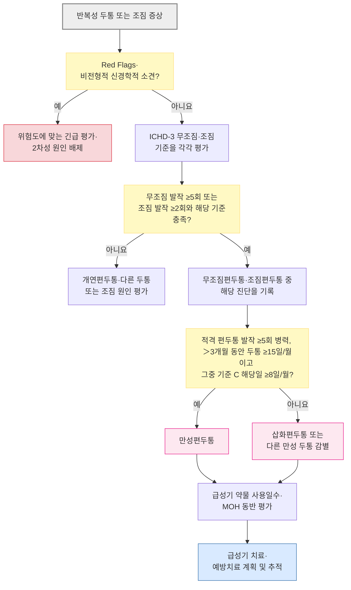
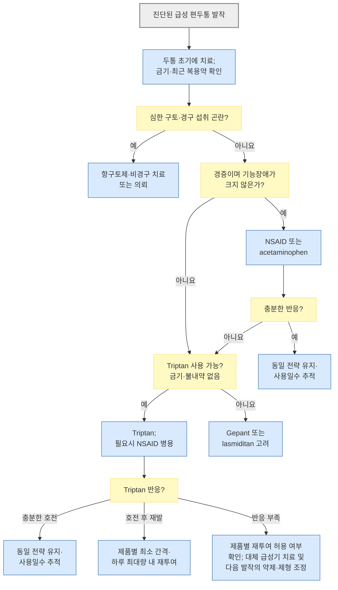

# 편두통 Migraine

## <mark style="color:green;">일반 사항</mark>

* 반복적인 발작성 두통을 특징으로 하는 만성 신경계 질환
  * 두통 발작은 전형적으로 편측성·박동성의 중등도\~중증 통증이 성인에서 4\~72시간 지속되며 구역·구토 또는 빛공포증·소리공포증을 동반
  * 환자의 약 25\~30%에서 시각·감각 등의 조짐(aura)이 두통 전이나 두통 중에 나타나며, 두통 없이 조짐만 생길 수도 있음
  * 만성편두통 : 월 두통일수가 ≥15일이고, 그중 ≥8일에 편두통 특징을 보이는 양상이 ＞3개월 지속
* 발작 빈도는 1년에 1회\~1주에 수회로 다양함
  * 연령이 증가하면서 강도와 빈도가 감소할 수 있음
* 국내 1년 유병률 : 5\~6% - 2009 Korean Headache Survey 6.1%(여성 9.2%, 남성 2.9%) <mark style="color:$info;">\[J Clin Neurol 2012]</mark>, 2018 Korean Sleep-Headache Survey 5.2% <mark style="color:$info;">\[J Clin Neurol 2021]</mark>; 여성에서 약 3배 흔함
* 편두통은 전 세계 질병부담연구에서 장애생존연수(years lived with disability, YLD) 기준의 주요 원인으로, 1차 진료에서 저평가·저치료되는 경향이 있음

### <mark style="color:orange;">분류</mark> <mark style="color:$info;">\[ICHD-3]</mark>

* 1.1 Migraine without aura
* 1.2 Migraine with aura
  * 1.2.1 Migraine with typical aura
    * 1.2.1.1 Typical aura with headache
    * 1.2.1.2 Typical aura without headache
  * 1.2.2 Migraine with brainstem aura
  * 1.2.3 Hemiplegic migraine
    * 1.2.3.1 Familial hemiplegic migraine
    * 1.2.3.2 Sporadic hemiplegic migraine
  * 1.2.4 Retinal migraine
* 1.3 Chronic migraine
* 1.4 Complications of migraine
* 1.5 Probable migraine
* 1.6 Episodic syndromes that may be associated with migraine
  * 1.6.1 Recurrent gastrointestinal disturbance
    * 1.6.1.1 Cyclic vomiting syndrome
    * 1.6.1.2 Abdominal migraine
  * 1.6.2 Benign paroxysmal vertigo
  * 1.6.3 Benign paroxysmal torticollis
* 월경편두통(Menstrual migraine; ICHD-3 부록 진단) : 월경 시작일을 day 1로 할 때(day 0은 없음) day -2\~+3에, 최소 3주기 중 2주기 이상 발생
  * 순수 월경편두통(pure menstrual migraine) : 이 기간에만 편두통이 발생
  * 월경 관련 편두통(menstrually-related migraine) : 이 기간 외에도 편두통이 발생
  * cf. 비월경 편두통(non-menstrual migraine) : 월경 전후 기간과의 연관이 위 기준을 충족하지 않음
  * 월경과 발작의 관련성이 불확실하면 최소 3주기 동안 전향적 두통일기로 확인하는 것을 권장
* Status migrainosus(편두통지속상태) : 지속시간과 중증도를 제외하면 이전 발작과 전형적으로 유사하며, 72시간을 초과해 지속되고 통증 또는 동반 증상이 일상 기능을 현저히 저해하는 편두통 발작; 수면·약물로 인한 12시간 이내의 일시적 호전은 허용

## <mark style="color:green;">원인</mark>

* 편두통은 trigeminovascular system의 활성화와 CGRP 신호, 뇌간·시상·피질을 포함한 통증 조절 네트워크의 기능 이상이 관여하는 신경계 질환으로 이해됨
* 조짐(aura)에는 cortical spreading depolarization이 중요한 기전으로 관여
* 1차적인 혈관 문제는 원인으로 고려하지 않음

### <mark style="color:orange;">위험 인자</mark>

* 가족력 : 환자의 약 50\~70%에서 편두통의 가족력이 있음
* 여성(20\~50대에서 호발)

### <mark style="color:orange;">유발 인자</mark>

* 스트레스, 정서적 변화
* 수면 변화(부족 또는 과다)
* 월경/호르몬 변화
* 장시간 공복, 식사 거름
* 날씨/기압 변화, 높은 고도
* 음식(아래 목록 참조), 알코올(특히 적포도주)
* 탈수
* 빛 자극 : 밝은 빛, 형광 빛, 깜박이는 빛
* 소음, 강한 냄새(향수), 공기 오염
* 약물 : estrogen, 피임제, 혈관 확장제(nitrate), 니코틴

**음식 관련 유발 인자**

* 비교적 흔히 보고되는 요인 : 알코올, 카페인 과다 섭취 또는 갑작스러운 중단, 식사 거름
* 음식 영향은 개인차가 크고 근거가 일관되지 않으므로 특정 음식 또는 첨가제(숙성 치즈, 가공육, 초콜릿, MSG, 인공감미료 등)를 일률적으로 제한하지 않으며, 반복적으로 연관성이 확인되는 경우에만 제한
* 두통일기로 시간적 연관성이 반복 확인되는 음식만 개인별로 조절하며, 음식에 대한 갈망 자체가 편두통 전구증상일 수도 있음

## <mark style="color:green;">임상 양상</mark>

* 두통 발작은 치료하지 않거나 치료가 제대로 되지 않았을 때는 보통 4\~72시간 지속
* 주로 편측성·박동성이고 중등도\~중증이며 일상적 신체 활동으로 악화되지만, 양측성(30\~40%)·비박동성(40%)도 흔함
* 동반 증상 : 구역, 구토, 빛공포증, 소리공포증, 어지럼증, 근육 압통, 감정 변화 등
* 편두통 발작은 '전구기 → 조짐(일부 환자) → 두통기 → 후구기'의 시간적 단계로 나타날 수 있음
  * 전구기(prodrome) : 두통 발생 수 시간\~최대 48시간 전(조짐편두통에서는 aura 이전)에 피로, 하품, 집중력 저하, 목 경직/통증, 기분 변화, 특정 음식에 대한 갈망 등이 나타날 수 있음
  * 조짐(aura) : 시각·감각·언어 등 완전히 가역적인 국소 신경학적 증상으로 보통 5\~60분 지속하며, 운동 증상은 대개 72시간 이내이나 드물게 수주간 지속될 수 있음; 편두통 환자의 약 25\~30%에서 발생
  * 후구기(postdrome) : 두통이 소실된 뒤 최대 48시간 동안 피로, 집중력 저하, 기분 변화, 목 경직/통증 등이 지속될 수 있음


전구기는 aura와 다른 개념이며, aura는 일시적인 국소 신경학적 증상을 의미함


### <mark style="color:$danger;">🚩 Red Flags!</mark> <a href="#red-flags" id="red-flags"></a>

* 두통의 일반적인 경고 징후는 [두통 Red Flags](015_-headache.md#red-flags), <mark style="background-color:red;">2차성 두통</mark> 선별 기준은 [SNNOOP10](015_-headache.md#snnoop10) 참조
* 아래는 편두통에 특이적인 위험 신호임

<mark style="color:$danger;">**즉각 조치**</mark>

* 새로 발생한 운동 조짐(편마비 등) 또는 기존보다 악화된 운동 조짐 `뇌졸중` `반신마비편두통`
* 단일 비운동성 조짐 증상이 60분을 초과하여 지속 `뇌졸중` `TIA`
* 갑자기 발생한 편측 위약·감각 소실·언어장애·한쪽 눈 시력 소실 또는 완전히 회복되지 않는 결손 - 증상이 사라졌더라도, 지속시간과 무관 `뇌졸중` `TIA`
* 처음 발생한 구음장애, 현훈, 이명, 청력저하, 복시, 운동실조, 의식저하 등 뇌간 증상 `뇌졸중` `뇌간조짐편두통`
* Status migrainosus(＞72시간 지속) 중 탈수·전해질 불균형 동반

<mark style="color:$warning;">**당일\~수일 내 평가**</mark>

* **(당일)** 서서히 퍼졌다가 완전히 회복된 첫 시각·감각 조짐 `조짐편두통`
* 평소와 확연히 다른 두통 양상 또는 급격한 악화 <mark style="background-color:red;">`2차성 두통`</mark>
* 평소와 다른 양상의 조짐 `조짐편두통` <mark style="background-color:red;">`2차성 두통`</mark>

<mark style="color:$info;">**조기 평가 및 추적**</mark>

* 적절한 급성기·예방 치료에도 반응이 미흡
* 두통 빈도 증가로 약물과용두통(MOH) 위험이 있음
* 만성편두통으로 진행
* 이미 진단된 뇌간조짐편두통·반신마비편두통 환자의 발작 빈도 증가 또는 치료 반응 변화

## <mark style="color:green;">진단</mark>

* 편두통을 확진하는 검사 방법은 없음; 필요시 다른 질환 감별을 위한 검사 시행
* 신경학적 검사 : 보행, 대/소근육 운동 기능, mental status, 단기 기억력, papilledema
* 영상검사 : 일률적인 영상검사는 권고하지 않음; 경고 징후에 해당되는 경우 고려
* 설문지 작성 : 통증의 수준과 장애 정도 및 치료 경과 파악
  * MIDAS(Migraine Disability Assessment Test, 편두통 장애 평가 검사)
    * 지난 3개월 동안 두통으로 인해 학교·직장, 가사, 가족·사회·여가 활동에서 상실되거나 생산성이 절반 이하로 감소한 일수를 합산하는 5문항 자가평가 도구 (☞ [MIDAS 영문서식](https://headaches.org/wp-content/uploads/midas.pdf), [한국인 연구](https://www.jkna.org/upload/pdf/200003005.pdf))
    * 판정 : 0\~5점(MIDAS Ⅰ)=장애가 없거나 미약; 6\~10점(MIDAS Ⅱ)=경도 장애; 11\~20점(MIDAS Ⅲ)=중등도 장애; ≥21점(MIDAS Ⅳ)=중증 장애
* 편두통 vs [긴장형두통](017_-tension-type-headache.md) 감별

#### <mark style="color:$primary;">Migraine without aura (무조짐편두통)</mark>

* A. 진단 기준 B\~D를 충족하는 발작이 최소한 5번 발생¹⁾
* B. 두통 발작이 (치료하지 않거나 치료가 제대로 되지 않았을 때) 4\~72시간 지속²⁾³⁾
* C. 다음 네 가지 두통의 특성 중 ≥2가지 해당
  1. 편측 위치
  2. 박동 양상
  3. 중등증 또는 중증의 통증 강도
  4. 일상적 신체 활동(예: 걷기, 계단 오르기)에 의해 악화되거나 신체 활동을 피하게 됨
* D. 두통이 있는 동안 다음 중 ≥1가지 해당
  1. 구역 &/or 구토
  2. 빛공포증 & 소리공포증
* E. 다른 ICHD-3 진단으로 더 잘 설명되지 않음

> ¹⁾ _무조짐편두통의 모든 진단 기준을 충족하지만 ＜5번의 발작만 있었으면 개연무조짐편두통(Probable migraine without aura)으로 분류_\
> ²⁾ _편두통 상태에서 잠이 들었다가 잠에서 깰 때 두통이 없었다면 깨어날 때까지의 시간을 발작 시간으로 간주_\
> ³⁾ _18세 미만에서는 발작 지속시간 2\~72시간_

#### <mark style="color:$primary;">Migraine with aura (조짐편두통)</mark>

* A. 진단 기준 B와 C를 충족하는 발작이 최소한 2번 발생
* B. 완전히 가역적인 다음의 조짐 증상 중 ≥1가지 해당
  1. 시각
  2. 감각
  3. 말(speech) &/or 언어(language)
  4. 운동(motor)
  5. 뇌간
  6. 망막
* C. 다음의 여섯 가지 특징 중 ≥3가지 해당
  1. 최소 한 가지 조짐 증상이 ≥5분에 걸쳐 서서히 퍼짐
  2. ≥2가지의 증상이 연속해서 발생
  3. 각 조짐 증상은 5\~60분 지속¹⁾
  4. 최소한 한 가지 조짐 증상은 편측 발생²⁾
  5. 최소한 한 가지 조짐 증상은 양성 증상³⁾
  6. 조짐과 함께 두통이 나타나거나 조짐이 끝난 뒤 60분 이내에 두통이 발생
* D. 다른 ICHD-3 진단으로 더 잘 설명되지 않음

> ¹⁾ _예: 한 번의 조짐 동안 비운동성 증상 3가지가 연속해서 생길 때 기준 C3의 최대 허용 시간은 3×60분. 운동 증상은 대개 72시간 이내이나 드물게 수주간 지속될 수 있음_\
> ²⁾ _실어증은 항상 편측 증상으로 간주함; 구음장애는 때에 따라 다름_\
> ³⁾ _섬광과 따끔거림은 조짐의 양성 증상임_

#### <mark style="color:$primary;">Chronic migraine (만성편두통)</mark> <a href="#chronic-migraine" id="chronic-migraine"></a>

* A. ＞3개월 동안 ≥15일/월의 두통(migraine- or tension type-like)이 발생하고 B & C를 충족시킴
* B. 무조짐편두통의 B\~D &/or 조짐편두통의 B & C에 해당되는 발작이 최소한 5번 발생
* C. 다음 중 어느 하나가 ＞3개월 동안 ≥8일/월 발생
  1. 무조짐편두통 진단 기준의 C & D
  2. 조짐편두통의 진단 기준의 B & C
  3. 증상이 시작될 때 환자가 편두통이라고 믿으며 triptan 또는 ergotamine으로 호전됨
* D. 다른 ICHD-3 진단 기준에 더 부합하지 않음
* 만성편두통과 약물과용두통(MOH)의 진단 기준을 모두 충족하면 두 진단을 함께 내림

***



> _두통 없는 조짐도 가능하며, 조짐은 무조짐편두통의 통증 기준 충족 여부와 독립적으로 판단. 기준 C에 해당하는 날은 편두통 특징이 있는 날 또는 발작 시작 시 편두통으로 판단해 triptan·ergotamine으로 호전된 날_

<p align="center"><strong>편두통 진단 알고리듬</strong><br><em><mark style="color:$info;">저자 재구성 (참고 문헌 : ICHD-3; NICE CG150)</mark></em></p>

***

### <mark style="color:orange;">감별</mark>

* 유사한 양상으로 내원할 수 있는 질환, 특히 놓치면 위험한 <mark style="background-color:red;">2차성 두통</mark>과의 감별이 중요

<table><thead><tr><th width="145">질환</th><th>편두통과의 차이점</th><th>핵심 감별 포인트</th></tr></thead><tbody><tr><td><strong>긴장형두통</strong></td><td>양측성·압박성, 일상 활동에 의한 악화 없음, 구역/구토 드묾</td><td>통증 강도 경함, 구역 동반 적음</td></tr><tr><td><a href="015_-headache.md#cluster-treatment"><mark style="background-color:red;"><strong>군발두통</strong></mark></a></td><td>편측 안와/측두부 극심한 통증, <mark style="background-color:red;">동측 자율신경 증상(눈물, 코막힘) 또는 안절부절못함·초조</mark>, 15~180분의 짧은 발작</td><td>발작이 훨씬 짧고 반복적(1일 수회), 초조·안절부절 양상</td></tr><tr><td><strong>지주막하출혈(SAH)</strong></td><td>돌발적 "벼락두통"(thunderclap), 생애 최악의 두통</td><td>1분 미만에 최고 강도 도달(벼락두통) → 즉시 영상검사. 수 분에 걸쳐 최고조에 이른 급성 중증 두통도 SAH 평가 대상</td></tr><tr><td><strong>거대세포동맥염(GCA)</strong></td><td>새로 발생한 두통(주로 ≥50세), 측두동맥 압통, 턱파행</td><td>ESR/CRP 상승, 시력 저하 위험 → 즉시 스테로이드 및 안과/류마티스내과 의뢰</td></tr><tr><td><strong>뇌졸중 / TIA</strong></td><td>국소 신경학적 결손이 조짐과 유사하게 나타날 수 있음</td><td>단일 비운동성 조짐 ＞60분, 갑작스러운 음성 증상, 새 운동 조짐, 불완전 회복 → 영상검사</td></tr><tr><td><a href="018_-chronic-headache.md#medication-overuse-headache-moh"><mark style="background-color:red;"><strong>약물과용두통(MOH)</strong></mark></a></td><td>기존 편두통 환자에서 두통이 매일 또는 거의 매일 발생</td><td>진통제·트립탄 사용일수 증가 병력</td></tr></tbody></table>

***

## <mark style="background-color:$warning;">Management</mark>

### <mark style="color:orange;">치료 원칙</mark>

* 생활 습관 개선
* 필요시 약물 치료 : 급성 편두통 증상 완화, 편두통 예방
  * 약물 과사용 예방을 위해 <mark style="background-color:red;">단순진통제(acetaminophen·aspirin·NSAID)는 복용일을 합산해 월 15일 미만, triptan·복합진통제는 월 10일 미만으로 사용</mark>
* acetaminophen, aspirin, NSAID는 비마약성 진통제 한 약물군으로 합산하여 사용일수를 계산
  * 서로 다른 급성기 약물군의 합산 기준은 [약물과용두통](018_-chronic-headache.md#medication-overuse-headache-moh) 참조

## <mark style="color:green;">비-약물 치료 및 예방</mark> <a href="#non-drug-treatment" id="non-drug-treatment"></a>

* 조용하고 어두운 방에서 휴식, 두통 부위 냉찜질 또는 온찜질
* 유발 인자 조절 : 과로, 개인별로 반복 확인된 음식, 장시간 공복, 탈수
* 생활 습관 개선 : 수면 환경 개선, 규칙적 생활(수면, 식사, 운동, 스트레칭 등)
* 행동 치료 : 이완 훈련, 인지행동 요법, 바이오피드백
* [두통일기](015_-headache.md#headache-diary) 작성: 발작 날짜·지속시간·강도·동반 증상, 급성기 약 복용일, 의심 유발 인자, 월경 주기를 기록
  * 유발 인자 확인, 약물과용(사용일수) 감시, 예방 치료 필요성과 반응 평가에 활용

## <mark style="color:green;">급성기 약물 치료</mark>

* 급성기 치료 전략 (stratified approach)
  * 경증 : 1차 치료제로 NSAID 또는 acetaminophen 사용
  * 중등도 이상 또는 NSAID로 충분히 호전되지 않는 경우 : triptan으로 전환
  * 초기부터 기능 장애가 심하거나 중증 발작이 예상되는 경우 : triptan을 처음부터 1차 선택 가능
* 중증 시 triptan과 진통제를 병용할 수 있으며 필요시 항구토제를 추가
* 두통 발생 초기에 투여하는 것이 더 효과적
  * triptan은 두통 시작 시점에 투여하는 것을 권장
    * 두통 없이 조짐만 있는 단계에서는 효과가 제한적이며, 조짐이 남아 있더라도 두통이 시작되면 투여
* 저용량을 자주 투여하는 것보다 충분한 용량을 한 번에 투여하는 것이 효과적
* 구역/구토가 심한 경우 비경구 투여를 고려
* 효과, 용량, 부작용 면에서 환자 개개인에 맞는 약물을 찾는 과정이 필요
* barbiturate는 과사용과 의존 위험, opioid는 반동성 두통과 약물과용두통 위험이 있으므로 피함

### <mark style="color:orange;">진통제</mark>

* 제품별 금기 확인 : 공통적으로 중증 간장애·신장애에서는 사용을 피함(☞ [통증](../220_/001_-pain.md) 참조)
  * NSAID : 위장관 궤양·출혈 또는 그 병력에서 금기; PPI 병용으로 금기가 해소되지는 않음
  * acetaminophen : 일부 품목은 TCA 복용 환자 투여 금기가 있으므로 amitriptyline·nortriptyline 예방요법 중에는 확인
* 초기 치료에 반응이 불충분하면 triptan 등 다른 계열 전환 필요성을 재평가
* ibuprofen : 400 ㎎부터 시작 <mark style="color:blue;">\[</mark>[<mark style="color:blue;">부루펜</mark>](https://www.health.kr/drug/A11A0500A0131)<mark style="color:blue;">]</mark>
  * 문헌에서 제시되는 400\~800 ㎎ 범위와 부루펜의 경증\~중등도 통증 허가 용법(200\~400 ㎎, 1일 3\~4회)을 구분하며, 800 ㎎은 이 제품의 1회량 범위와 다르므로 별도 근거·위험 평가가 필요함
* naproxen : 편두통 용법은 초회 750 ㎎, 필요시 초회 투여 30분 후 250\~500 ㎎ 추가, 1일 최대 1,250 ㎎ <mark style="color:blue;">\[</mark>[<mark style="color:blue;">낙센 250 ㎎</mark>](https://www.health.kr/drug/A11A0120A0286)<mark style="color:blue;">]</mark>
* naproxen sodium : 편두통 용법은 초회 825 ㎎, 필요시 초회 투여 30분 후 275\~550 ㎎ 추가, 1일 최대 1,375 ㎎ <mark style="color:blue;">\[</mark>[<mark style="color:blue;">아나프록스 275 ㎎</mark>](https://www.health.kr/drug/A11ABBBBB2070)<mark style="color:blue;">]</mark>
* aspirin : 500\~1,000 ㎎ <mark style="color:blue;">\[</mark>[<mark style="color:blue;">바이엘아스피린 500 ㎎</mark>](https://www.health.kr/drug/A11A1380A0008)<mark style="color:blue;">]</mark>
* dexketoprofen : 25 ㎎ (경구 단일제 유통 확인 안 됨)
* acetaminophen : 두통 시작 시 속방형 1,000 ㎎ <mark style="color:blue;">\[</mark>[<mark style="color:blue;">타이레놀 500 ㎎</mark>](https://www.health.kr/drug/2021082400002)<mark style="color:blue;">]</mark>; 반복 시 최소 6시간 간격<mark style="background-color:red;">(허가 용법은 4\~6시간 간격이나 이 장에서는 보수적으로 적용)</mark>. 모든 공급원의 합산 최대 4 g/d, 반복·장기 사용에서는 통상 3 g/d 이하를 보수적으로 권장하며 위험요인별 감량. NSAID보다 효과가 적다는 보고가 있음
  * 서방형 : 650 ㎎ 2정(1,300 ㎎) q8h·최대 6정/24시간 (급성 발작 치료에는 속방형이 적합)

### <mark style="color:orange;">Triptan</mark>

* 기전 : 5-HT1B/1D receptor 작용 → vasoactive neuropeptide(CGRP 등) 분비 억제 및 삼차신경 통증 전달 억제
* 대상 : 중증 편두통 또는 다른 약제로 호전되지 않는 경증\~중등도 편두통
* 보통 복용 2시간 내 통증 호전
  * 재투여 조건은 제제마다 다름 - sumatriptan, naratriptan, frovatriptan은 첫 투여로 호전된 뒤 재발한 경우, zolmitriptan은 증상이 지속되거나 24시간 이내 재발한 경우에 제품별 최소 간격 후 추가 투여
* 첫 투여에 충분한 반응이 없으면(zolmitriptan의 증상 지속 시 재투여는 예외) 동일 발작에서 반복 투여하기보다 다음 발작에서 용량·제형 조정, 다른 triptan 또는 다른 계열 치료로의 변경을 고려
* 제제별 효과는 대체로 유사하나 발현 속도, 반감기, 재발률과 제형이 다르므로 발작 특성, 구역·구토 여부, 이전 반응과 비용을 함께 고려하여 선택
* 부작용 : 흉부 압박감(triptan sensation - 심혈관 질환이 없어도 발생 가능하나, 심혈관 고위험군에서는 실제 혈관 수축 위험이 있으므로 구분 필요), 홍조, 더운 느낌, 쇠약, 어지럼증, 감각 이상(예: 팔/다리 저림)
* 금기
  * 허혈성 심혈관 질환, 뇌혈관 질환, 말초혈관 질환, 조절되지 않는 고혈압
  * 반신마비편두통, 뇌간조짐편두통
  * ergotamine 또는 다른 triptan과 허가된 금지 간격 내 병용
* 주의
  * MAO 억제제와의 병용 제한은 제제별 확인
  * SSRI/SNRI 병용 시 세로토닌 증후군 가능성은 매우 낮으나 증상 발생 시 주의 관찰; 이미그란은 SSRI·clomipramine·리튬 투여 환자를 투여 금기로 명시하므로 제품별 확인

<table data-search="false"><thead><tr><th width="219">성분명 [상품명]</th><th width="361">용량·최소 재투여 간격 [허가 최대]</th><th>반감기 (h)</th></tr></thead><tbody><tr><td><strong>sumatriptan</strong> <mark style="color:blue;">[</mark><a href="https://www.health.kr/drug/A11ABBBBB1485"><mark style="color:blue;">이미그란</mark></a><mark style="color:blue;">]</mark></td><td>50 ㎎; 최소 2시간 후 재투여 [300 ㎎/d]¹⁾⁴⁾</td><td>2</td></tr><tr><td><strong>rizatriptan</strong>²⁾</td><td>5~10 ㎎; 최소 2시간 후 재투여 [30 ㎎/d]³⁾</td><td>2~3</td></tr><tr><td><strong>zolmitriptan</strong> <mark style="color:blue;">[</mark><a href="https://www.health.kr/drug/A11AMMMMM2196"><mark style="color:blue;">조믹</mark></a><mark style="color:blue;">]</mark></td><td>초회 2.5 ㎎, 효과가 부족하면 이후 발작에서 5 ㎎<br>최소 2시간 후 재투여 [10 ㎎/d]⁴⁾</td><td>3</td></tr><tr><td><strong>almotriptan</strong> <mark style="color:blue;">[</mark><a href="https://www.health.kr/drug/A11AKP08C0251"><mark style="color:blue;">알모그란</mark></a><mark style="color:blue;">]</mark></td><td>12.5 ㎎; 최소 2시간 후 재투여 [25 ㎎/d]</td><td>3~4</td></tr><tr><td><strong>eletriptan</strong>²⁾</td><td>20~40 ㎎; 최소 2시간 후 재투여 [80 ㎎/d]</td><td>4</td></tr><tr><td><strong>naratriptan</strong> <mark style="color:blue;">[</mark><a href="https://www.health.kr/drug/A11AJJJJJ0032"><mark style="color:blue;">나라믹</mark></a><mark style="color:blue;">]</mark></td><td>2.5 ㎎; 최소 4시간 후 재투여 [5 ㎎/d]</td><td>6</td></tr><tr><td><strong>frovatriptan</strong> <mark style="color:blue;">[</mark><a href="https://www.health.kr/drug/2009071505961"><mark style="color:blue;">미가드</mark></a><mark style="color:blue;">]</mark></td><td>2.5 ㎎; 최소 2시간 후 재투여 [5 ㎎/d]</td><td>25</td></tr></tbody></table>

> ¹⁾_sumatriptan 국내 및 유럽 허가 기준 최대 300 ㎎/d, 미국 FDA 허가 기준 최대 200 ㎎/d_\
> ²⁾_rizatriptan, eletriptan : 유통 제품 없음_\
> ³⁾_propranolol과 rizatriptan의 병용은 인데놀 허가사항상 금기. 해외 rizatriptan 감량 용법을 병용 허용으로 해석하지 않음_\
> ⁴⁾_급여 인정 상한 : sumatriptan 단일제 200 ㎎/일, zolmitriptan 5 ㎎/일(고시 제2024-178호)_
>
> _✽ 용량과 재투여 간격은 허가사항을 우선 확인_

### <mark style="color:orange;">Gepants (CGRP receptor antagonist)</mark>

* 기전 : CGRP 수용체 차단 → 삼차신경 통증 전달 억제; triptan과 달리 혈관 수축 작용 없음
* 심혈관 질환 등 triptan 금기 환자에서 대안으로 고려
* rimegepant와 atogepant는 급성기 치료와 예방 치료에 모두 사용 가능; ubrogepant는 급성기 전용
* 약물과용두통(MOH) 위험은 낮은 것으로 보이나 장기·고빈도 사용 자료가 제한적이므로 허가된 용법을 준수
* 부작용 : 구역, 복통/소화불량(rimegepant), 변비·피로/졸림(atogepant)
  * 과민반응, 고혈압 및 Raynaud 현상에 주의
* rimegepant : 75 ㎎ 구강붕해정 <mark style="color:blue;">\[</mark>[<mark style="color:blue;">너텍</mark>](https://www.health.kr/drug/2025032500010)<mark style="color:blue;">]</mark>(비급여) - 급성기 1정(최대 75 ㎎/24시간); 삽화성 편두통 예방은 75 ㎎ 격일 복용
  * 중증 간장애, 말기 신질환(CLcr ＜15 ㎖/min)에서는 사용을 피함
  * 급성치료 시 30일 동안 18회 초과 투여의 안전성은 확립되지 않음
* atogepant : 60 ㎎ <mark style="color:blue;">\[</mark>[<mark style="color:blue;">아큅타</mark>](https://www.health.kr/drug/2023111600013)<mark style="color:blue;">]</mark>(비급여) - 급성기 필요시 1정, 1일 최대 60 ㎎ (2026년 11월 급성치료 적응증 추가)
  * 예방 목적으로 60 ㎎을 복용한 날에는 발작이 생겨도 추가 복용하지 않음(1일 최대량 초과)
  * 예방 용법·용량 조절은 하단 「CGRP 수용체 길항제 (Gepant 계열, 경구 예방제)」 참조

### <mark style="color:orange;">Ditans</mark>

* 5-HT1F agonist
  * triptan과 달리 혈관 수축 작용이 없으나 서맥·일시적 혈압 상승 등에 주의
* 기전 : neuropeptide 방출 억제 및 삼차신경 통증 전달 경로 억제
* lasmiditan : 발작 시 1회 [50 ㎎](https://www.health.kr/drug/2022051200013)·[100 ㎎](https://health.kr/drug/2022051200014)·200 ㎎ 중 선택 <mark style="color:blue;">\[레이보우]</mark>(비급여); 24시간 이내 추가 투여하지 않음
  * 복용 후 최소 8시간 동안 운전·기계 조작을 피할 수 있는 환자에게 처방(졸음 유무와 무관)
  * 약물과용두통 예방을 위해 월 10일 미만 사용
  * 30일 동안 평균 4회를 초과하는 발작에 대한 투여 안전성은 확립되지 않음
* 부작용 : 졸음, 어지럼증

### <mark style="color:orange;">Ergotamine</mark>

* 효과와 안전성의 한계로 routine 사용하지 않으며, 다른 급성기 치료를 사용할 수 없는 경우에만 고려 (시판 단일제 없음)
* 반동성 두통 위험 - ≤2일/주 사용 원칙, 이를 초과하면 약물과용두통 위험 증가
* 부작용 : 구역, 혈관 수축
* 주의/금기 : 고혈압, 심혈관·말초혈관 질환, 간/신 장애, 패혈증, 임신, 수유부, 반신마비편두통, 뇌간조짐편두통, triptan과 서로 24시간 이내 병용, 강력한 CYP3A4 억제제 병용
* caffeine 복합제(ergo. 1 ㎎ + caff. 100 ㎎) : 초회 2정 → 필요시 30분마다 1정 추가(최대 6정/일·10정/주) <mark style="color:blue;">\[</mark>[<mark style="color:blue;">크래밍</mark>](https://www.health.kr/drug/A11AEEEEE0589)<mark style="color:blue;">]</mark>

### <mark style="color:orange;">항구토제</mark>

* dopamine 수용체 차단제는 편두통 증상을 감소시키는 부가 효과를 지님
* 'acetaminophen 1,000 ㎎ + metoclopramide 10 ㎎'는 경구 sumatriptan 100 ㎎과 2시간 두통 완화 효과가 비슷했다는 보고가 있음 <mark style="color:$info;">\[Cochrane 2013]</mark>
* 구역/구토가 있거나 위정체로 경구 진통제 흡수가 불량할 것으로 판단되는 경우 추가 고려
  * 모든 환자에게 일률적으로 병용하지 않음
* 부작용 : QT interval 연장 (특히 domperidone에서 위험이 더 큼; metoclopramide도 주의), 추체외로 증상(EPS; 급성 근긴장이상·정좌불능증 - 특히 고용량·젊은 여성에서; 장기 사용 시 지연성 운동장애 위험)
* metoclopramide : 1회 1\~2정 <mark style="color:blue;">\[</mark>[<mark style="color:blue;">맥페란</mark>](https://www.health.kr/drug/A11A0570A0089)<mark style="color:blue;">]</mark>; 1일 최대 3회, 재투여 간격 ≥6시간, 최대 5일
  * <mark style="color:blue;">맥페란</mark> 1정에는 염산메토클로프라미드 5 ㎎(metoclopramide 3.84 ㎎)이 들어 있음
  * 1일 최대 6정(염산염 30 ㎎); 체중 60 ㎏ 미만에서는 체중 기준 상한(염산염 0.5 ㎎/㎏)이 더 낮아지므로 감량; 신·간기능에 따라 감량
* domperidone : 발작 시 10 ㎎ 1회 <mark style="color:blue;">\[</mark>[<mark style="color:blue;">돔피돈</mark>](https://health.kr/drug/A11A0570A0382)<mark style="color:blue;">]</mark>; 최대 30 ㎎/일, 통상 1주 이내 사용
  * QT 연장, 유의한 전해질 이상, 심부전 등 심장 기저질환, 중등도\~중증 간장애, QT 연장 약물·강력한 CYP3A4 억제제 병용은 금기. metoclopramide와 병용하지 않음

***



<p align="center"><strong>급성 편두통 약물 치료 알고리듬</strong><br><em><mark style="color:$info;">저자 재구성 (참고 문헌 : IHS 2024 급성기 치료 권고; 제품별 허가사항)</mark></em></p>

***

## <mark style="color:green;">예방 약물 치료</mark>

### <mark style="color:orange;">예방 치료 대상</mark>

* 생활습관 개선과 적절한 급성기 치료에도 불구하고 편두통으로 인한 유의미한 일상생활 장애
* 두통 빈도가 적더라도 급성기 치료에 반응하지 않거나 두통으로 인한 장애가 있는 경우
* 월 편두통일수 ≥4일 또는 월 중등도\~중증 두통일수 ≥4일인 경우 예방 치료 제공을 권고 <mark style="color:$info;">\[AAN/AHS 2026]</mark>
* 급성기 약물 사용일수가 약물과용두통 기준(<mark style="background-color:red;">단순진통제</mark> ≥15일/월, triptan·ergotamine·<mark style="background-color:red;">복합진통제</mark> 또는 여러 계열 합산 ≥10일/월)에 해당하거나 근접한 경우(약물과용두통 우려가 있으므로 예방 치료 권고)
* 뇌간조짐편두통, 반신마비편두통 등 특수 아형
* 급성기 치료의 의학적 금기가 있는 경우
* 환자가 예방 치료를 선호하는 경우

### <mark style="color:orange;">예방 치료 용법</mark>

* 예방 치료 목표 : 일반적으로 두통 빈도 ≥50% 감소를 목표로 하되, 만성편두통에서는 두통일수 ≥30% 감소와 기능·삶의 질 개선도 임상적으로 의미 있는 반응으로 평가할 수 있음
  * 빈도, 강도, 동반 증상, 급성약 사용, 환자별 목표를 함께 평가
* 저용량 투여 → 2\~4주마다 효과와 부작용 평가 → 효과가 나타날 때까지 증량
* 효과 및 부작용 모니터링을 위하여 두통일기 작성 권고
* 대부분의 예방약은 권장 내약 용량에서 최소 8\~12주 투여 후 효과 판정 <mark style="color:$info;">\[AAN/AHS 2026]</mark>
  * 8주째 반응이 불충분하면 최대 내약 용량 또는 근거가 있는 최대 용량까지 최적화
* onabotulinumtoxinA는 권장 용량으로 24주 후 효과 판정 <mark style="color:$info;">\[AAN/AHS 2026]</mark>
* 예방 치료가 효과적인 경우 최소 6개월 치료 후 감량·중단의 이득과 재발 위험을 환자와 논의 → 재발 시 증량 또는 재개 <mark style="color:$info;">\[AAN/AHS 2026]</mark>

### <mark style="color:orange;">경구 예방약</mark>

* 기존 경구 예방약 <mark style="color:$info;">\[AAN/AHS 2026]</mark>
  * 근거 확실성 중등도 이상 : propranolol, topiramate, valproate
  * 삽화편두통에서 근거 확실성 낮음 : amitriptyline, metoprolol, flunarizine
* valproate는 강력한 기형 유발 위험으로 가임기 여성에서는 피함

#### <mark style="color:$primary;">β-차단제</mark>

* 편두통 예방은 모두 허가 외 사용
* propranolol : 40\~160 ㎎/d #2 <mark style="color:blue;">\[</mark>[<mark style="color:blue;">인데놀</mark>](https://www.health.kr/drug/A11ABBBBB0903)<mark style="color:blue;">]</mark>
* metoprolol : 50\~200 ㎎/d (속방형은 보통 2회 분복) <mark style="color:blue;">\[</mark>[<mark style="color:blue;">베타록</mark>](https://www.health.kr/drug/A11A0450A0329)<mark style="color:blue;">]</mark> (현재 생산 중단 상태)
* 부작용 : 우울, 발기부전, 피로, 무기력, 악몽, 서맥, 저혈압
* 주의/금기 : 천식 또는 기관지경련성 질환, 증상성 서맥·저혈압, 고도 방실차단
  * 고령에서는 기립성 저혈압과 낙상 위험을 고려

#### <mark style="color:$primary;">항경련제</mark>

* 임신·가임기 여성
  * <mark style="background-color:red;">공통 : 태아 선천기형(topiramate는 구강안면열, valproate는 신경관 결손 등), 태아 성장제한, 신경발달장애 위험이 있어 편두통 예방 목적으로 임부에게 투여하지 않음</mark>
  * <mark style="background-color:red;">topiramate : 가임기 여성은 매우 효과적인 피임법을 사용할 때만 투여</mark>
  * <mark style="background-color:red;">divalproex·valproate : 가임기 여성은 임신예방프로그램 요건을 모두 충족할 때만 투여</mark>
  * 가임기 여성은 투여 전 임신검사를 시행하고, 임신 계획 시 다른 예방약으로 전환
* topiramate : 보통 25 ㎎ hs로 시작하여 1주 이상 간격으로 25 ㎎/일씩 증량, 권장 목표 100 ㎎/일을 2회 분복; 내약성에 따라 더 낮은 용량 사용 <mark style="color:blue;">\[</mark>[<mark style="color:blue;">토파맥스</mark>](https://www.health.kr/drug/2020080600008)<mark style="color:blue;">]</mark>
  * 부작용 : 감각 이상(저림), 복통, 구역, 피로, 맛 변화, 설사, 체중 감소, 기억/집중력 장애, 신결석
  * 주의 : 신결석 병력; 급성 근시·이차 폐쇄각녹내장 가능성. 갑작스러운 시력 저하·안통 시 즉시 중단·긴급 안과 평가
  * 200 ㎎/d 초과 용량에서는 호르몬 피임 효과가 감소할 수 있음을 설명
  * 신장애 : CrCl ＜70 ㎖/min/1.73 m²에서 시작·유지 용량을 1/2로 감량
* divalproex 서방정 : 500 ㎎ qd로 1주 시작 후 1,000 ㎎ qd <mark style="color:blue;">\[</mark>[<mark style="color:blue;">데파코트서방 500 ㎎</mark>](https://www.health.kr/drug/A11AOOOOO4807)<mark style="color:blue;">]</mark>
* valproate sodium 서방정 : 500\~1,500 ㎎/d <mark style="color:blue;">\[</mark>[<mark style="color:blue;">오르필서방</mark>](https://www.health.kr/drug/A11A1310A0200)<mark style="color:blue;">]</mark> (허가 외 사용)
* valproate 제제 공통
  * 부작용 : 구역, 체중 증가, 떨림, 탈모, 졸림
  * 주의/금기 : 간질환, 췌장염, 저혈소판증
  * 가임기 여성에서는 적절한 대안이 없고 임신예방프로그램 요건을 모두 충족한 경우에 한해 예외적으로 고려
  * 다낭성 난소 증후군(PCOS) 병력 여성에서도 주의 - 안드로겐 과잉 및 배란 장애를 악화시킬 수 있음

#### <mark style="color:$primary;">항우울제</mark>

* 편두통 예방은 모두 허가 외 사용. amitriptyline은 해당 용도로 급여 인정(고시 제2018-18호)
* amitriptyline : 10\~50 ㎎/d hs <mark style="color:blue;">\[</mark>[<mark style="color:blue;">에트라빌</mark>](https://www.health.kr/drug/A11A0570B0082)<mark style="color:blue;">]</mark>
  * 부작용 : 졸음, 입마름, 변비, 소변 저류, 심장 전도 장애, 체중 증가
  * 주의/금기 : 고령, BPH, 녹내장, 발작, 심장 질환
  * 대안 : nortriptyline 10\~75 ㎎/d hs <mark style="color:blue;">\[</mark>[<mark style="color:blue;">센시발</mark>](https://www.health.kr/drug/A11A1130A0032)<mark style="color:blue;">]</mark> - amitriptyline의 활성 대사체로 항콜린 부작용이 다소 적어 내약성이 우수하나 편두통 예방에 대한 직접 근거는 amitriptyline보다 약함 (보험주의: 편두통 예방 급여 인정 대상 제외)
* venlafaxine XR : 37.5\~150 ㎎/d <mark style="color:blue;">\[</mark>[<mark style="color:blue;">이팩사 XR</mark>](https://www.health.kr/drug/A11ADDDDD0700)<mark style="color:blue;">]</mark>
  * 부작용 : 구역, 혈압 상승
    * 조절되지 않는 고혈압은 먼저 조절하고, 투여 중 혈압 모니터링

#### <mark style="color:$primary;">칼슘통로차단제</mark>

* flunarizine : 65세 미만 10 ㎎, 65세 이상 5 ㎎을 1일 1회 저녁에 시작 <mark style="color:blue;">\[</mark>[<mark style="color:blue;">씨베리움</mark>](https://www.health.kr/drug/2021101900007)<mark style="color:blue;">]</mark>
  * 2개월 투여 후에도 개선되지 않으면 중단
  * 유지 : 같은 1회 용량을 격일 투여하거나 주 5일 투여 후 2일 휴약하고, 증상이 없어도 초회 투여 6개월 후 중단
  * 부작용 : 체중 증가, 졸림, 입마름, 어지럼증, 저혈압, 우울
  * 주의/금기 : 우울 증상 또는 그 병력, 파킨슨병, 추체외로 증상

#### <mark style="color:$primary;">항고혈압제 (ARB·ACE 억제제)</mark>

* 편두통 예방은 모두 허가 외 사용
* 삽화편두통 예방에 telmisartan, nifedipine, enalapril의 근거를 낮은 확실성으로 평가, 널리 사용되는 candesartan은 해당 지침의 분석 기준상 근거 불충분 <mark style="color:$info;">\[AAN/AHS 2026]</mark>
  * 대한두통학회는 candesartan(근거수준 I, 약한 찬성)과 lisinopril(근거수준 IV, 약한 찬성)을 고려할 수 있는 약제로 제시하고 nifedipine·telmisartan은 권고하지 않아 지침 간 차이가 있음 <mark style="color:$info;">\[Headache Pain Res 2025]</mark>
  * AAN/AHS 2026의 체계적 고찰은 2024년 6월까지의 연구를 바탕으로 함. 이후 발표된 삽화편두통 무작위시험에서 candesartan 16 ㎎/d가 위약보다 월 편두통일수를 유의하게 줄였음 <mark style="color:$info;">\[Lancet Neurol 2025]</mark>; 국내 지침과 동반 고혈압을 종합하여 선택
* candesartan : 4\~16 ㎎/d <mark style="color:blue;">\[</mark>[<mark style="color:blue;">아타칸</mark>](https://www.health.kr/drug/A11ABBBBB1383)<mark style="color:blue;">]</mark>
  * 부작용 : 저혈압, 고칼륨혈증, 신기능 악화
  * 금기 : 임부·임신 가능성이 있는 여성, 수유부
  * 주의 : 중증 신기능 저하, 고칼륨혈증 위험
* lisinopril : 10\~20 ㎎/d <mark style="color:blue;">\[</mark>[<mark style="color:blue;">제스트릴</mark>](https://www.health.kr/drug/A11A3060A0278)<mark style="color:blue;">]</mark>
  * 부작용 : 어지럼증, 두통, 기침, 피로, 저혈압
  * 금기 : 혈관부종 또는 그 병력, 임부·임신 가능성이 있는 여성, 수유부

#### <mark style="color:$primary;">Gabapentinoid</mark>

* gabapentin : 삽화편두통 예방에 사용하지 않을 것을 제안(근거수준 II, 약한 반대) <mark style="color:$info;">\[Headache Pain Res 2025]</mark>

#### <mark style="color:$primary;">기타</mark>

* 아래 약제는 편두통 예방에 대한 근거가 제한적이고 대부분 허가 외 사용이므로 routine으로 권고하지 않음
* tizanidine(근이완) : 문헌의 편두통 예방 연구 용량 4\~24 ㎎/d <mark style="color:blue;">\[</mark>[<mark style="color:blue;">솝튼</mark>](https://www.health.kr/drug/2011091400003)<mark style="color:blue;">]</mark> (허가 외 사용; 근연축 허가 용량 1\~2 ㎎ tid와 구분). 일반 처방의 증량 목표로 일률 적용하지 않으며 전문진료에서 판단; ciprofloxacin·fluvoxamine 병용 금기 및 저혈압·진정·간기능 이상에 주의(☞ [통증](../220_/001_-pain.md)·[경추성두통](019_-cervicogenic-headache.md)·[불안장애](025_-anxiety-disorder.md) 참조)
* memantine(NMDA 수용체 길항제) : 5\~20 ㎎/d <mark style="color:blue;">\[</mark>[<mark style="color:blue;">에빅사</mark>](https://www.health.kr/drug/A11AOOOOO2372)<mark style="color:blue;">]</mark>; 편두통 예방은 허가 외이며 근거가 제한적임. 5 ㎎/d부터 통상 1주 간격으로 5 ㎎/d씩 점진 증량하는 안전성 원칙을 참고하되 전문의가 개별화하고, CrCl별 감량을 적용(☞ [통증](../220_/001_-pain.md) 참조)
* cyproheptadine(항히스타민)
* zonisamide(항전간) : 50\~100 ㎎/d <mark style="color:blue;">\[</mark>[<mark style="color:blue;">엑세그란</mark>](https://www.health.kr/drug/A11A0150A0558)<mark style="color:blue;">]</mark>
* 대체 요법(근거 제한적) : Mg 600 ㎎/d, riboflavin 400 ㎎/d, feverfew(MIG-99) 6.25 ㎎ tid, coenzyme Q10 100 ㎎ tid

### <mark style="color:orange;">CGRP 표적 예방치료</mark>

#### <mark style="color:$primary;">표적 치료제 (Anti-CGRP monoclonal antibody)</mark>

* 기전 : CGRP 또는 CGRP 수용체에 결합하여 편두통 발생을 예방
* 만성편두통 또는 삽화편두통에서 1차 치료 옵션으로 고려
  * 기존 경구 예방약제보다 대체로 내약성과 치료 지속성이 양호함
  * 기존 예방약 실패 없이도 초기 선택 가능 <mark style="color:$info;">\[AHS 2024]</mark>
  * 국내에서는 비용 및 급여 기준으로 인해 일반적으로 2차 이후 사용
  * 급여(아조비·앰겔러티) : ICHD-3 기준 만 18세 이상 만성편두통 중 다음을 모두 충족
    * 편두통 병력 ≥1년, 투여 전 ≥6개월간 월 두통일수 ≥15일(그중 편두통형 ≥8일)
    * MIDAS ≥21점 또는 HIT-6 ≥60점
    * 지정된 편두통 예방약제(topiramate, divalproex, amitriptyline, flunarizine, propranolol 또는 nadolol) 3종 이상에서 치료 실패 - 각 약제를 최대 내약 용량으로 적어도 8주 이상 투여해도 월 편두통일수가 50% 이상 감소하지 않거나, 부작용·금기로 사용할 수 없는 경우
    * 투여 시작 전 최근 1개월 이내 및 투여 후 3개월마다 반응 평가(두통일기·MIDAS 등), 기저치 대비 월 편두통일수 50% 이상 감소하지 않으면 중단; 투여 기간 최대 12개월, CGRP 약제 간 교체 투여 불인정
* 매달 또는 분기마다 피하 주사 (eptinezumab은 IV)
* 부작용 : 주사 부위 통증/발적, 상기도 감염; 변비(erenumab에서 더 빈번)
* 금기 : 성분 또는 첨가제에 대한 중대한 과민반응
* 주의 : 임신·수유 중 안전성 자료가 제한적이므로 사용을 피하거나 위험-편익을 개별 평가
  * 고혈압 및 Raynaud 현상 발생 여부를 모니터링
* fremanezumab <mark style="color:blue;">\[</mark>[<mark style="color:blue;">아조비</mark>](https://www.health.kr/drug/2021072800006)<mark style="color:blue;">]</mark> : 225 ㎎/월 또는 675 ㎎/분기 SC (조건부 급여)
  * 체중 45 ㎏ 이상 6\~17세 소아·청소년 삽화성 편두통 예방 : 225 ㎎ SC 월 1회(675 ㎎ 분기 투여는 성인 용법); 급여기준 대상 아님 (2026년 5월)
* galcanezumab <mark style="color:blue;">\[</mark>[<mark style="color:blue;">앰겔러티</mark>](https://www.health.kr/drug/2019090900019)<mark style="color:blue;">]</mark> : 120 ㎎/월 SC (초회 240 ㎎) (조건부 급여)
  * <mark style="background-color:red;">군발두통 적응증이 있던 100 ㎎/㎖ 제형은 2024년 7월 16일 허가 취하되었고, 현재 품목(120 ㎎/㎖)은 성인 편두통 예방 적응증만 있음</mark>
* erenumab(Aimovig) : 70\~140 ㎎/월 SC (수용체 결합형; 2026년 9월 기준 미허가·미출시)
* eptinezumab <mark style="color:blue;">\[</mark>[<mark style="color:blue;">바이엡티</mark>](https://health.kr/drug/2026052600004)<mark style="color:blue;">]</mark> : 100 ㎎(필요시 300 ㎎)을 12주 간격 IV (0.9% 생리식염수 100 ㎖ 희석 후 약 30분간 정맥 점적 주입); 국내 최초 CGRP 정맥주입 예방치료제 (2026년 5월 허가, 미공급)

#### <mark style="color:$primary;">CGRP 수용체 길항제 (Gepant 계열, 경구 예방제)</mark>

* 기전 : CGRP 수용체를 경쟁적으로 차단 (소분자 경구 제제)
* atogepant와 rimegepant 모두 급성기 치료와 예방에 사용(rimegepant 예방은 삽화성 편두통에 한함)
* atogepant는 기존 경구 예방치료 2\~4종에 실패한 삽화편두통 환자에서도 효과가 입증됨(ELEVATE 임상)
* 부작용 : 구역, 변비, 졸림/피로; 드물게 간효소 상승
* 금기 : 성분 과민증, 중증 간장애(Child-Pugh C)
* 용량 조절 : 강력한 CYP3A4 억제제 또는 OATP 억제제 병용, 중증 신장애(CLcr 15\~29 ㎖/min)·ESRD에서 [10 ㎎](https://www.health.kr/drug/2023111600012) qd
* atogepant <mark style="color:blue;">\[</mark>[<mark style="color:blue;">아큅타</mark>](https://www.health.kr/drug/2023111600013)<mark style="color:blue;">]</mark> : 예방 60 ㎎ qd (삽화성·만성편두통 모두 적응); 급성기 용법은 위 「Gepants」 참조
  * 국내 최초 경구 CGRP 예방치료제로 2023년 11월 식약처 허가, 2026년 11월 급성치료 적응증 추가(비급여)

### <mark style="color:orange;">OnabotulinumtoxinA</mark> <mark style="color:blue;">\[</mark>[<mark style="color:blue;">보톡스</mark>](https://www.health.kr/drug/A11AKP08G2664)<mark style="color:blue;">]</mark>

* 만성편두통 예방에 사용; 위약 대비 편두통 발생 약 2일/월 감소 효과
* 155 U (5 U씩 31군데 근육 주사)
* 부작용 : 안검하수(blepharoptosis), 근육 약화, 경부 통증, 주사 부위 통증
* 12주 간격으로 반복 투여
* 금기 : 보툴리눔독소 또는 첨가제 과민반응, 예정 주사 부위 감염
* 주의 : 신경근육 질환(예: 중증 근무력증), 근이완제·aminoglycoside 등 신경근 전달을 방해하는 약제 병용
  * 임신·수유는 자료가 제한적이므로 위험-편익을 개별 평가

### <mark style="color:orange;">특수 상황</mark>

#### <mark style="color:$primary;">월경편두통 예방</mark>

* 표준 급성기 치료로 충분히 조절되지 않고 월경 주기가 규칙적이어서 발작 시기를 예측할 수 있는 경우, 월경 시작 2일 전부터 월경 시작일을 제1일로 하여 제3일까지(총 5일) 단기 예방 요법 고려
* frovatriptan : 반감기가 길어 단기 예방에 적합; 대표 연구에서는 예상 발작 2일 전부터 6일간 투여
  * 2.5 ㎎ bid <mark style="color:blue;">\[</mark>[<mark style="color:blue;">미가드</mark>](https://www.health.kr/drug/2009071505961)<mark style="color:blue;">]</mark> (허가 외 사용)
* naratriptan : 1 ㎎ bid <mark style="color:blue;">\[</mark>[<mark style="color:blue;">나라믹</mark>](https://www.health.kr/drug/A11AJJJJJ0032)<mark style="color:blue;">]</mark> (허가 외 사용)
  * 근거 연구에서 사용된 대안 용량이지만 유통 제형은 2.5 ㎎ 정으로 처방 실행에 제한이 있음
* NSAID(예: naproxen 500 ㎎ bid)도 단기 예방에 사용 가능(허가 외 사용; 위장관·신장·심혈관 위험 평가)

#### <mark style="color:$primary;">조짐편두통과 호르몬 피임</mark>

* 조짐편두통에서는 허혈성 뇌졸중 위험을 고려하여 estrogen 함유 복합호르몬피임제(복합경구피임제·패치·질링)를 원칙적으로 피함
* 흡연, 고혈압, 고령 등 혈관 위험인자가 있으면 위험이 더욱 증가할 수 있음
* Progestin-only 또는 비호르몬 피임법을 고려하고, 호르몬 피임 중 새 조짐이 발생하거나 양상이 변하면 즉시 재평가

## <mark style="color:green;">급성기·예방 약제의 CYP3A4 상호작용</mark>

* rimegepant : 강력한 CYP3A4 억제제(예: clarithromycin, itraconazole)와 병용을 피하고, 중등도 CYP3A4 억제제 또는 강력한 P-gp 억제제 병용 시 48시간 이내 추가 복용을 피함. 강력한·중등도 CYP3A 유도제와의 병용을 피함
* atogepant : 강력한 CYP3A4 억제제 또는 OATP 억제제 병용 시 10 ㎎ qd로 감량
* Triptans : eletriptan은 강력한 CYP3A4 억제제(ketoconazole, itraconazole, clarithromycin, ritonavir, nefazodone 등) 투여 중 및 투여 중단 후 최소 72시간 이내 병용 금기(유통 제품 없으나 안전성 정보로 기재)
* Ergotamine 계열 : 강력한 CYP3A4 억제제와 병용 금기(혈관 수축 부작용·맥각 중독 위험)

## <mark style="color:green;">편두통지속상태와 응급실 치료</mark>

* 지속시간과 중증도를 제외하면 이전 발작과 전형적으로 유사하며, 72시간을 초과해 지속되고 통증 또는 동반 증상이 일상 기능을 현저히 저해하는 편두통 발작(정의는 위 「분류」 참조). 탈수·전해질 불균형 동반 가능
  * 약물과용두통 기준도 충족하면 해당 편두통 아형과 MOH를 함께 진단하고, 편두통지속상태를 별도로 진단하지 않음
* 응급실 의뢰 고려
* 아래 비경구 치료 근거의 상당 부분은 status migrainosus만을 대상으로 한 연구가 아니라, 응급실에서 비경구 치료가 필요한 급성 편두통 전반의 연구에서 도출됨 <mark style="color:$info;">\[AHS ED 2025]</mark>
* IV 수액 : 탈수·경구 섭취 불량·저혈압이 있는 경우 0.9% 생리식염주사액 또는 하트만액 등 등장성 결정질액으로 교정; 모든 환자에게 일률적으로 투여하지 않음
* IV metoclopramide(Level B) <mark style="color:blue;">\[</mark>[<mark style="color:blue;">맥페란주</mark>](https://www.health.kr/drug/A11A0570A0304)<mark style="color:blue;">]</mark>
  * 제품 허가상 정맥 주입은 최소 3분에 걸쳐 시행
* IV prochlorperazine은 원 지침에서 제공해야 하는(Level A) 우선 권고 약제이나 주사제는 유통 확인 안 됨 <mark style="color:$info;">\[AHS ED 2025]</mark>
* IV ketorolac(Level B) : 지침 근거 용량 30\~60 ㎎ IV <mark style="color:blue;">\[</mark>[<mark style="color:blue;">케토신주사</mark>](https://www.health.kr/drug/A11AOOOOO1574)<mark style="color:blue;">]</mark> (허가 용량 : 초회 10 ㎎, 유지 10\~30 ㎎ q4\~6h, 1일 최대 90 ㎎(고령자·신장애·체중 50 ㎏ 이하 60 ㎎), 최대 2일)
  * 금기 : 탈수·저혈량증, 중등도 이상 신부전, 소화성궤양·위장관 출혈 또는 그 병력, 다른 NSAID·항응고제 병용
* IV dexketoprofen(Level B) : 주사제 유통 확인 안 됨
* IV valproate 500\~1,000 ㎎(Level C) : 난치성 또는 다른 1차 응급치료가 적절하지 않은 경우 대안으로 고려(주사제 유통 확인 안 됨)
  * 근거 수준은 prochlorperazine·metoclopramide·ketorolac보다 낮음
* dexamethasone 10 ㎎ IV <mark style="color:blue;">\[</mark>[<mark style="color:blue;">제일덱사메타손주사액</mark>](https://www.health.kr/drug/A11A0490A0019)<mark style="color:blue;">]</mark> : 응급실 치료 후 재발 예방 목적으로 추가(Level B)
  * 급성 두통 완화 목적은 Level C
  * 제품 함량은 덱사메타손포스페이트이나트륨 5 ㎎/㎖이며, 제품 허가 용량은 덱사메타손포스페이트 기준임. 문헌 용량과 제품의 함량 표기 기준을 확인해 투여량 산정
* Greater occipital nerve block : 원 지침에서는 적절한 경우 제공해야 하는(Level A) 권고이나, 숙련도와 진료 환경을 고려해 전문 치료로 구분 <mark style="color:$info;">\[AHS ED 2025]</mark>
* dihydroergotamine IV : 난치성 경우 고려할 수 있으나 주사제 유통 확인 안 됨; triptan 투여 후 24시간 이내 사용 금기

***

## <mark style="color:red;">질병코드</mark>

* G43 편두통 Migraine
* G43.0 조짐이 없는 편두통\[일반편두통] Migraine without aura
* G43.1 조짐이 있는 편두통\[고전적 편두통] Migraine with aura
* G43.2 편두통지속상태 Status migrainosus
* G43.3 합병된 편두통 Complicated migraine (IHS의 ICHD-3/ICD-10 NA 대응표에서 만성편두통에 대응)
* G43.8 기타 편두통 Other migraine
* G43.9 상세불명의 편두통 Migraine, unspecified

***

## <mark style="color:purple;">처방례</mark>

> **처방례 1. 급성 편두통 (경증)**
>
> ```
> 부루펜정400㎎  1회 1T (두통 발생 시 즉시; 필요시 6~8시간 후 반복, 최대 3회/d)
> 맥페란정  1회 1~2T (구역 동반 시)
> ※ 맥페란 재투여 간격 ≥6시간, 최대 5일
> ※ 이 예시의 상한은 1회 2정, 1일 3회(최대 6정/일). 체중별 허가 상한과 신·간기능에 따른 감량 기준을 우선 적용
> ```
>
> 약제 정보: [부루펜정·400 ㎎](https://www.health.kr/drug/A11A0500A0131) · [맥페란정·3.84 ㎎](https://www.health.kr/drug/A11A0570A0089)
>
> _✽경증\~중등도에서 400 ㎎으로 시작하는 예시임. 반응이 불충분하면 다른 계열로의 전환을 재평가하고, 문헌의 800 ㎎ 용량은 부루펜의 경증\~중등도 통증 허가 1회량과 구분하여 판단함. 제품별 금기·병용약과 위장관·신장·심혈관 위험을 확인. <mark style="background-color:red;">단순진통제</mark>는 월 15일 미만으로 사용(약물과용두통 예방)_

> **처방례 2. 급성 편두통 (중등증\~중증, triptan)**
>
> ```
> 이미그란정50㎎  1회 1T (두통 발생 초기 즉시 복용; 첫 복용으로 호전된 뒤 재발하면 첫 복용 2시간 후부터 1T 추가, 급여 대상 기준 충족 시 최대 200 ㎎/일)
> 맥페란정  1회 1~2T (구역 동반 시)
> ※ 맥페란 재투여 간격 ≥6시간, 최대 5일
> ※ 이 예시의 상한은 1회 2정, 1일 3회(최대 6정/일). 체중별 허가 상한과 신·간기능에 따른 감량 기준을 우선 적용
> ```
>
> 약제 정보: [이미그란정·50 ㎎](https://www.health.kr/drug/A11ABBBBB1485) · [맥페란정·3.84 ㎎](https://www.health.kr/drug/A11A0570A0089)
>
> _✽두통 없이 조짐(aura)만 있는 단계에서는 복용하지 않고, 조짐이 남아 있더라도 두통이 실제로 시작되면 복용; 허혈성 심혈관·뇌혈관 질환, 조절되지 않는 고혈압, 반신마비편두통·뇌간조짐편두통에서는 금기. 트립탄·복합진통제는 월 10일 미만으로 사용. 이미그란은 MAO 억제제(중단 후 2주 이내 포함)·SSRI·clomipramine·리튬 투여 환자에게 금기_

> **처방례 3. 편두통 예방 (β-차단제)**
>
> ```
> 인데놀정10㎎  1회 2T  1일 2회 (아침, 저녁; 총 40 ㎎/일)
> ```
>
> 약제 정보: [인데놀정·10 ㎎](https://www.health.kr/drug/A11ABBBBB0903)
>
> _✽편두통 예방은 허가 외 사용. 시작 용량(40 ㎎/d); 효과 및 내약성에 따라 2\~4주마다 평가하며 최대 160 ㎎/d까지 점진적 증량_

> **처방례 4. 편두통 예방 (항경련제)**
>
> ```
> 토파맥스정25㎎  1회 1T  취침 전 × 1~2주
> 이후 1주 이상 간격으로 25 ㎎/일씩 증량; 목표 100 ㎎/일을 2회 분복
> (내약성에 따라 50 ㎎/일 등 더 낮은 용량 사용)
> ```
>
> 약제 정보: [토파맥스정·25 ㎎](https://www.health.kr/drug/2020080600008)
>
> _✽저용량으로 시작해 서서히 증량(신결석·인지기능 부작용 최소화 목적). 임부와 <mark style="background-color:red;">매우 효과적인</mark> 피임법을 사용하지 않는 가임기 여성에게는 투여 금기 - 투여 전 임신검사, 치료 중 <mark style="background-color:red;">매우 효과적인</mark> 피임법 사용_

> **처방례 5. 편두통 예방 (항우울제)**
>
> ```
> 에트라빌정10㎎  1회 1T  취침 전 (편두통 예방은 허가 외 사용, 급여 인정[고시 제2018-18호])
> ```
>
> 약제 정보: [에트라빌정·10 ㎎](https://www.health.kr/drug/A11A0570B0082)
>
> _✽저용량 취침 전 투여로 시작하며 졸림·입마름·변비·소변 저류 등 항콜린성 부작용에 주의. 고령자, BPH, 녹내장, 심장 전도장애 환자에서는 신중 사용; 우울증 동반 시 특히 유용할 수 있음. TCA 복용 중에는 타이레놀정500㎎ 등 해당 투여 금기가 있는 acetaminophen 품목을 병용하지 않고 돌발 두통의 급성기 약제를 별도로 선택_ (☞ [통증](../220_/001_-pain.md) 참조)

***

### <mark style="color:$success;">핵심 복약 지도</mark>

> **트립탄 계열 (이미그란, 조믹, 나라믹 등)**
>
> * **두통 발생 초기에 즉시 복용**하십시오. 통증이 심해진 후에는 효과가 떨어집니다.
> * ⚠️ **두통 없이 조짐(aura)만 있는 단계에서는 복용하지 마시고, 두통이 시작되면 복용하십시오.** 조짐이 남아 있더라도 두통이 시작됐다면 처방받은 지침에 따라 복용하십시오.
> * 첫 복용으로 좋아졌다가 두통이 다시 생기면 약마다 정해진 간격이 지난 뒤 추가 복용할 수 있습니다. 첫 복용에 효과가 부족하면 처방받은 재복용 지침을 따르십시오. 조믹은 증상이 지속되는 경우에도 첫 복용 최소 2시간 후 추가 복용하도록 처방할 수 있습니다.
> * 협심증, 심근경색, 뇌졸중 병력이 있거나 조절되지 않는 고혈압이 있는 경우 반드시 주치의에게 알리십시오.
> * 복용 후 지속적이거나 심한 흉통·호흡곤란이 생기면 추가 복용하지 말고 즉시 응급 평가를 받으십시오. 다른 트립탄·맥각제와 임의로 병용하지 마십시오.
> * SSRI 계열 항우울제(예: 렉사프로, 졸로푸트)를 함께 복용하는 경우 반드시 주치의에게 알리십시오 (세로토닌 증후군 가능성은 매우 낮으나, 이상 증상 발생 시 즉시 보고).

> **라스미디탄 (레이보우)**
>
> * 트립탄과 달리 혈관수축 작용이 없어 심혈관 질환으로 트립탄 사용이 어려운 환자에서 대안이 될 수 있습니다. 다만 심장질환·고혈압·서맥이 있으면 복용 전 주치의와 상의하십시오.
> * ⚠️ **복용 후 최소 8시간 동안 운전이나 기계 조작을 하지 마십시오.** 졸음을 느끼지 못하더라도 반드시 지켜야 합니다.
> * 24시간 내 추가 복용하지 말고 음주를 피하십시오.
> * 약물과용두통을 막기 위해 한 달 10일 미만으로 복용하십시오.

> **맥페란 (metoclopramide)**
>
> * 복용 후 목·턱이 뻣뻣해지거나 눈이 돌아가는 이상 움직임이 생기면 복용을 중단하고 즉시 진료를 받으십시오.

> **편두통 예방약 (인데놀·토파맥스·에트라빌 등)**
>
> * 예방약은 효과가 나타나기까지 수 주가 걸리며, 충분한 효과 평가는 보통 권장 내약 용량에서 **8\~12주** 후 시행합니다. 임의로 중단하지 마십시오.
> * 토파맥스(topiramate)는 물을 충분히 마셔야 신결석 위험을 줄일 수 있습니다.
> * 가임기 여성은 토파맥스(topiramate) 시작 전 임신검사를 받고, 치료 중에는 <mark style="background-color:red;">매우 효과적인</mark> 피임법을 사용하십시오.
> * 인데놀(propranolol) 복용 중에는 갑자기 중단하지 마십시오.
> * 토파맥스 복용 중 갑자기 시력이 떨어지거나 눈이 아프면 즉시 응급 진료를 받으십시오.

> **진통제 과다 사용 주의**
>
> * 트립탄 또는 <mark style="background-color:red;">복합진통제</mark>는 **한 달 10일 미만**, <mark style="background-color:red;">단순진통제</mark>(NSAIDs, 아세트아미노펜)는 **한 달 15일 미만**으로 사용하십시오.
> * 트립탄과 진통제를 번갈아 먹은 날도 모두 '약 먹은 날'로 합쳐 세며, 합쳐서 한 달 10일 이상이면 주치의와 상의하십시오.
> * 이 기준 이상의 잦은 사용이 3개월 넘게 지속되면 '약물과용두통' 위험이 증가하며, 두통이 한 달 15일 이상 발생할 수 있습니다.

> **언제 다시 병원을 방문해야 하나요?**
>
> * 편두통 발작이 72시간을 넘어 지속되는 경우
> * 팔다리 마비·말 어눌함·언어 장애·한쪽 눈 시력 소실이 **갑자기** 생기면, 증상이 사라졌더라도 즉시 응급실을 방문하십시오.
> * 새로 생긴 신경 증상이 완전히 회복되지 않은 경우에도 즉시 응급실을 방문하십시오.
> * 처음 생겼거나 평소보다 심해진 마비·힘 빠짐은 조짐이라도 즉시 응급실을 방문하십시오.
> * 평소와 같은 조짐이라도 **하나의 비운동성 신경 증상**이 1시간을 넘게 지속되면 즉시 응급실을 방문하십시오.
> * 위 응급 징후 없이, 처음 생기거나 평소와 다른 시각·감각 증상이 서서히 퍼졌다가 완전히 사라졌다면 당일 진료를 받으십시오.
> * 두통 빈도가 늘거나 트립탄·복합진통제를 한 달 10일 이상, 또는 <mark style="background-color:red;">단순진통제</mark>를 한 달 15일 이상 복용하게 되는 경우

***

## <mark style="color:green;">주요 참고문헌 및 확인 자료</mark>

### <mark style="color:orange;">임상 근거</mark>

* \[ICHD-3] [Headache Classification Committee of the International Headache Society (IHS). The International Classification of Headache Disorders, 3rd edition. Cephalalgia. 2018;38(1):1-211.](https://ichd-3.org/) - 두통의 분류·진단 기준 및 약물과용 기준
* \[AAN/AHS 2026] [Potrebic S, et al. Pharmacologic Treatment for Migraine Prevention in Adults: Practice Guideline Recommendations. Headache. 2026;66(9):2173-2184.](https://doi.org/10.1111/head.70199) - 예방치료 대상·약제 선택 및 약물과용 동반 환자의 치료
* \[AHS ED 2025] [Robblee J, et al. 2025 guideline update to acute treatment of migraine for adults in the emergency department: The American Headache Society evidence assessment of parenteral pharmacotherapies. Headache. 2026;66(1):53-76.](https://doi.org/10.1111/head.70016) - 응급실 비경구 치료·신경차단술; status migrainosus만의 근거와 구분
* \[J Clin Neurol 2012] [Kim BK, et al. Prevalence and impact of migraine and tension-type headache in Korea. J Clin Neurol. 2012;8(3):204-211.](https://doi.org/10.3988/jcn.2012.8.3.204) - 2009 Korean Headache Survey의 국내 편두통 유병률
* \[J Clin Neurol 2021] [Kim KM, et al. Prevalence, disability, and management patterns of migraine in Korea: nationwide survey data from 2009 and 2018. J Clin Neurol. 2021;17(1):77-85.](https://pmc.ncbi.nlm.nih.gov/articles/PMC7840323/) - 2018 Korean Sleep-Headache Survey의 국내 편두통 유병률
* \[Headache Pain Res 2025] [Kim BS, et al. Evidence-based recommendations on pharmacologic treatment for migraine prevention: a clinical practice guideline from the Korean Headache Society. Headache Pain Res. 2025;26(1):5-20.](https://doi.org/10.62087/hpr.2024.0019) - 예방치료 약제별 근거수준·권고 등급
* [Puledda F, et al. International Headache Society global practice recommendations for the acute pharmacological treatment of migraine. Cephalalgia. 2024;44(8):3331024241252666.](https://pubmed.ncbi.nlm.nih.gov/39133176/) - 편두통 급성기 약제 선택·단계적 치료 및 과용 방지
* \[Cochrane 2013] [Derry S, Moore RA. Paracetamol (acetaminophen) with or without an antiemetic for acute migraine headaches in adults. Cochrane Database Syst Rev. 2013;(4):CD008040.](https://doi.org/10.1002/14651858.CD008040.pub3) - acetaminophen 단독·metoclopramide 병용의 급성기 효과와 sumatriptan 비교
* \[AHS 2024] [Charles AC, et al. Calcitonin gene-related peptide-targeting therapies are a first-line option for the prevention of migraine: An American Headache Society position statement update. Headache. 2024;64(4):333-341.](https://doi.org/10.1111/head.14692) - CGRP 표적 예방치료의 초기 선택; 국내 급여 기준과 구분
* \[Lancet Neurol 2025] [Øie LR, et al. Candesartan versus placebo for migraine prevention in patients with episodic migraine: a randomised, triple-blind, placebo-controlled, phase 2 trial. Lancet Neurol. 2025;24(10):817-827.](https://doi.org/10.1016/S1474-4422\(25\)00269-8) - 삽화편두통에서 candesartan 예방 효과
* [NICE. Headaches in over 12s: diagnosis and management (CG150). Updated 2025.](https://www.nice.org.uk/guidance/cg150/chapter/recommendations) - 1차 진료의 진단·급성기 치료·예방 권고

### <mark style="color:orange;">허가·급여 확인 자료</mark>

* [식품의약품안전처. 의약품안전나라 - 의약품 품목허가정보.](https://nedrug.mfds.go.kr/index) - 제품별 적응증·용법·금기 및 허가 상태 확인
* [한국애브비. 아큅타정60밀리그램 제품설명서 (2026-11-05).](https://www.abbvie.co.kr/content/dam/abbvie-com2/kr/documents/products/hp-pi-aquipta-60mg-2026-11-05.pdf) - 급성치료·예방 용법 및 1일 최대량
* [건강보험심사평가원. 삼환계 항우울제 급여기준. 고시 제2018-18호 (2018-02-01 시행).](https://www.hira.or.kr/rc/insu/insuadtcrtr/InsuAdtCrtrPopup.do?mtgHmeDd=20180201\&mtgMtrRegSno=0006\&sno=1) - amitriptyline의 편두통 예방 급여 인정 (확인일 2026-11-22)
* [건강보험심사평가원. 편두통 치료제 급여기준. 고시 제2024-178호 (2024-09-01 시행).](https://www.hira.or.kr/rc/insu/insuadtcrtr/InsuAdtCrtrPopup.do?mtgHmeDd=20240901\&mtgMtrRegSno=0001\&sno=3) - 급성기 약제의 급여 대상과 용량 상한 (확인일 2026-11-22)
* [건강보험심사평가원. Fremanezumab 주사제(아조비) 급여기준. 고시 제2024-130호 (2024-07-01 시행).](https://www.hira.or.kr/rc/insu/insuadtcrtr/InsuAdtCrtrPopup.do?mtgHmeDd=20240701\&sno=4\&mtgMtrRegSno=0005) - 투여 대상·평가·기간 확인 (확인일 2026-11-22)
* [건강보험심사평가원. Galcanezumab 주사제(앰겔러티) 급여기준. 고시 제2024-130호 (2024-07-01 시행).](https://www.hira.or.kr/rc/insu/insuadtcrtr/InsuAdtCrtrPopup.do?mtgHmeDd=20240701\&sno=4\&mtgMtrRegSno=0006) - 투여 대상·평가·기간 및 약제관리 기준 확인 (확인일 2026-11-22)

***

## <mark style="color:blue;">환자 안내서</mark>


**편두통, 잘 알고 잘 다스리기**

편두통은 적절한 치료와 생활 습관 개선으로 발작 횟수와 강도를 크게 줄일 수 있습니다.


#### <mark style="color:$primary;">편두통이란 무엇인가요?</mark>

* 보통 한쪽 머리에서 시작되는 박동성(쿵쿵 뛰는 듯한) 심한 두통으로, 성인에서는 4\~72시간 지속됩니다.
* 구역·구토, 빛과 소리에 예민해지는 증상이 함께 나타나는 경우가 많습니다.
* 일부 환자는 두통 전에 시야에 반짝이는 빛이나 시야 장애(조짐, aura)가 나타납니다.

#### <mark style="color:$primary;">어떻게 치료하나요?</mark>

* **급성기 치료** : 두통 발생 즉시 소염진통제 등 진통제 또는 트립탄을 복용합니다. 조용하고 어두운 곳에서 휴식을 취하십시오.
* **예방 치료** : 편두통이 한 달에 4일 이상이거나 빈도가 적어도 일상생활에 큰 지장을 준다면 예방약을 고려합니다. 효과는 수 주에 걸쳐 서서히 나타납니다.

#### <mark style="color:$primary;">약 복용 시 꼭 지켜주세요</mark>

* **두통이 시작될 때 바로** 복용하세요. 늦게 먹을수록 효과가 줄어듭니다.
* 트립탄·복합진통제는 **한 달 10일 미만**, <mark style="background-color:red;">단순진통제</mark>는 **한 달 15일 미만**으로 사용하세요.
* 예방약은 임의로 중단하지 말고 주치의와 상의하여 서서히 줄이십시오.

#### <mark style="color:$primary;">생활 속 실천 사항</mark>

* **유발 요인 파악** : 두통일기로 술·특정 음식·수면 변화·스트레스 등 나만의 유발 요인을 찾아보세요.
* **규칙적인 생활** : 수면·식사·기상 시간을 일정하게 유지하고 장시간 공복이나 식사 거름을 피하세요.
* **수분 섭취** : 탈수는 편두통을 유발할 수 있습니다. 수분 제한이 필요한 질환이 없다면 충분한 수분을 섭취해 탈수를 피하십시오.
* **운동** : 규칙적인 유산소 운동이 예방에 도움이 됩니다. 발작 중에는 운동을 삼가십시오.

#### <mark style="color:$primary;">이럴 때는 진료가 필요합니다</mark>

* 팔다리 마비·말 어눌함·언어 장애·한쪽 눈 시력 소실이 갑자기 생기면, 증상이 사라졌더라도 즉시 응급실로 가십시오.
* 새로 생긴 신경 증상이 완전히 회복되지 않은 경우에도 즉시 응급실로 가십시오.
* 처음 생겼거나 평소보다 심해진 마비·힘 빠짐은 조짐이라도 즉시 응급실로 가십시오.
* 평소와 같은 조짐이라도 하나의 비운동성 조짐 증상이 1시간을 넘게 지속되면 즉시 응급실로 가십시오.
* 위 응급 징후 없이, 처음 생기거나 평소와 다른 시각·감각 증상이 서서히 퍼졌다가 완전히 사라졌다면 당일 진료를 받으십시오.
* 두통이 72시간을 넘게 지속되면 당일 진료를 받으십시오. 물을 못 마시거나 탈수·의식 변화가 있으면 즉시 응급실로 가십시오.
* 평소와 전혀 다른 심한 두통이 갑자기 나타나면 즉시 응급실로 가십시오.

***
