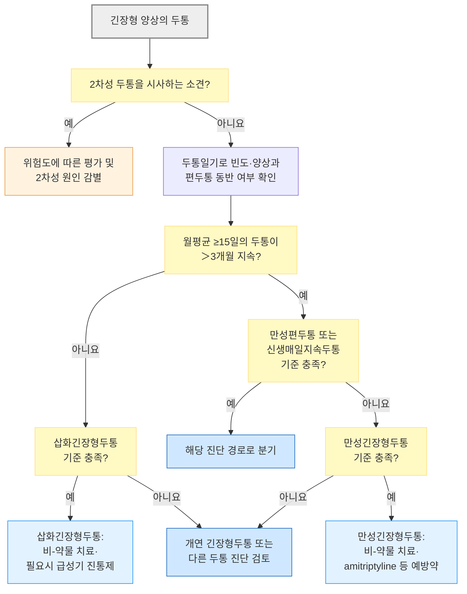

# 긴장형두통 Tension-type Headache

## <mark style="color:green;">일반 사항</mark>

* 다음의 특징을 갖는, 대개 두부 양측의 압박 또는 조이는 느낌의 두통
  * 중등도 이하의 강도
  * 스트레스, 수면 장애, 두개·경부 근육의 통증 자극 등과 연관되어 유발·악화될 수 있음
  * 동반 소견 : 두부/경부/어깨 근육 경직·압통, 피로, 과민, 집중력 저하가 나타날 수 있음
* 역학
  * <mark style="background-color:red;">1차성 두통</mark>의 가장 흔한 형태임
  * 유병률 : 최근 1년 이하 기간 유병률의 전 세계 추정치 약 26% <mark style="color:$info;">\[J Headache Pain 2022]</mark>
  * 삽화형 유병률은 중년 이후 감소하는 경향을 보이며, 만성형 유병률과 연령의 관련성은 연구마다 일관되지 않음
  * 질병부담 : 두통질환 전체의 YLD(years lived with disability)는 15\~49세에서 특히 큼 <mark style="color:$info;">\[J Headache Pain 2024]</mark>
* [두통일기](015_-headache.md#headache-diary)(headache diary) : 초진 시 작성을 권고하고 1개월 후 첫 재평가에 활용
  * 진단 목적으로 사용할 때는 최소 8주간 기록 <mark style="color:$info;">\[NICE CG150]</mark>

### <mark style="color:orange;">분류</mark> <mark style="color:$info;">\[ICHD-3]</mark>

* 2.1 Infrequent episodic TTH
  * 2.1.1 associated with pericranial tenderness
  * 2.1.2 not associated with pericranial tenderness
* 2.2 Frequent episodic TTH
  * 2.2.1 associated with pericranial tenderness
  * 2.2.2 not associated with pericranial tenderness
* 2.3 Chronic TTH
  * 2.3.1 associated with pericranial tenderness
  * 2.3.2 not associated with pericranial tenderness
* 2.4 Probable TTH
  * 2.4.1 probable infrequent episodic tension-type headache
  * 2.4.2 probable frequent episodic tension-type headache
  * 2.4.3 probable chronic tension-type headache

### <mark style="color:$danger;">🚩 Red Flags!</mark> <a href="#red-flags" id="red-flags"></a>

☞ [두통 Red Flags](015_-headache.md#red-flags)

<mark style="color:$danger;">**즉각 조치**</mark>

* 벼락두통 `지주막하출혈`
* 두통과 함께 새 마비·언어 장애·의식 변화 `뇌졸중` `두개내 병변`
* 발열과 경부 강직 `수막염`
* ≥50세의 새 두통에 일시적 시력상실 또는 복시 동반 `거대세포동맥염`
* 임신 중 또는 산후의 새 두통이 다음 중 하나에 해당 `자간전증` `뇌정맥동혈전증` `가역성 뇌혈관수축증후군`
  * 심하거나 갑작스러운 두통, 지속·악화되는 두통
  * 혈압 상승·시각 이상·경련 동반

<mark style="color:$warning;">**당일\~수일 내 평가**</mark>

* **(당일)** 임신 중 또는 산후 새로 발생한 <mark style="background-color:red;">그 밖의</mark> 두통 `자간전증` `뇌혈관질환` `뇌하수체 병변`
* **(당일)** ≥50세의 새 두통에 턱 파행 또는 두피·측두동맥 압통 동반 `거대세포동맥염`
* 새로 발생하거나 진행하는 두통 <mark style="background-color:red;">`2차성 두통`</mark>
* 암·면역저하 등 위험 배경이 있는 새 두통 `두개내 전이` `중추신경계 감염`

<mark style="color:$info;">**조기 평가 및 추적**</mark>

* 급성기 진통제가 주 2일을 넘겨 반복적으로 필요하거나 사용 일수가 증가 `약물과용두통`
* 예방 치료를 내약 가능한 유지용량에 도달한 뒤 약 1\~2개월 사용했음에도 의미 있는 호전이 없음 `다른 두통 진단` `약물과용두통`

## <mark style="color:green;">원인</mark>

* 정확한 원인은 완전히 밝혀지지 않았으며, 단순한 근육 긴장만으로 설명되는 질환은 아님

### <mark style="color:orange;">추정 기전</mark>

* 삽화긴장형두통에서는 두개 주위 근막·근육의 말초 통각 자극(peripheral myofascial nociception)이 중요한 역할을 하는 것으로 추정
* 만성긴장형두통에서는 반복되는 통각 자극과 함께 중추 감작(central sensitization) 및 통증 조절계의 변화(altered pain modulation)가 관여하는 것으로 추정

### <mark style="color:orange;">흔한 유발·악화 및 연관 요인</mark>

* 정신적 스트레스 : 흔한 유발·악화 요인이며 개인별 연관성을 두통일기로 확인
* 불안·우울 : 만성 TTH와 흔히 동반되며 두통 부담과 치료 반응에 영향을 줄 수 있음
* 수면 장애 : 수면 부족·불규칙한 수면과 두통 빈도 증가가 연관될 수 있음
* 장시간 고정 자세 / 경부·어깨 부담 : 두개 주위 근육 압통과 연관될 수 있으나 TTH의 단일 구조적 원인으로 단정하지 않음
* 식사 거름 / 탈수, 육체적 과로 : 일부 환자에서 유발·악화 요인으로 작용
* 턱관절 장애(TMD) / 이갈이 : 측두근·교근 통증이 동반되면 별도 평가 및 치료 고려
* 월경 주기, 카페인·알코올, 흡연, 냄새·소음·빛 등 : 개인별 연관성이 다양하며 편두통과의 감별도 함께 고려
* 약물 : nitrate 등 두통 유발 가능 약물의 시작·증량과 시간적 관련성이 있으면 약물성 두통 가능성 평가

## <mark style="color:green;">임상 양상 및 진단</mark>

### <mark style="color:orange;">Episodic tension-type headache (삽화긴장형두통)</mark>

* A. 진단 기준 B\~D를 충족하는 두통이 10회 이상 발생하고 다음 빈도 기준을 충족
  * Infrequent(저빈도) : 월평균 ＜1일, 연간 ＜12일 발생(연간 환산값)
  * Frequent(고빈도) : ＞3개월 동안 월평균 1\~14일, 연간 12\~179일 발생(연간 환산값; 1년 관찰을 요구하는 것은 아님)
* B. 지속 시간 : 30분\~7일
* C. 다음 네 가지 두통 특성 중 ≥2가지 해당
  1. 양측
  2. 압박 또는 조임(비-박동성)
  3. 경증\~중등증 강도
  4. 걷기, 계단 오르기 등 일상적 신체 활동에 의해 악화되지 않음
* D. 다음 모두에 해당
  1. 구역 또는 구토 없음
  2. 빛공포증 또는 소리공포증 모두 없거나 하나만 존재
* E. 다른 ICHD-3 진단으로 더 잘 설명되지 않음¹⁾

> ¹⁾_개연편두통과 삽화긴장형두통의 진단 기준을 모두 충족하면 해당 삽화긴장형두통 아형(저빈도형 또는 고빈도형)으로 진단_

### <mark style="color:orange;">Chronic tension-type headache (만성긴장형두통)</mark>

* A. 진단 기준 B\~D를 충족하는 두통이 ＞3개월 동안 월평균 ≥15일, 연간 ≥180일에 해당(연간 환산값; 진단에 1년 관찰은 필요하지 않음)
* B. 지속 시간 : 수 시간\~수 일, 또는 지속(unremitting)
* C. 다음 네 가지 두통의 특성 중 ≥2가지 해당
  1. 양측
  2. 압박 또는 조임(비-박동성)
  3. 경증\~중등증 강도
  4. 일상적 신체 활동(예: 걷기, 계단 오르기)에 의해 악화되지 않음
* D. 다음 모두에 해당
  1. 빛공포증, 소리공포증 또는 경미한 구역 중 모두 없거나 하나만 존재
  2. 중등도 이상의 구역이나 구토는 없음
* E. 다른 ICHD-3 진단으로 더 잘 설명되지 않음¹⁾⁻³⁾

> ¹⁾_한 달에 25일간 두통이 있고, 그중 8일은 편두통에, 17일은 긴장형두통에 부합하는 양상이 ＞3개월 지속되어 두 진단 기준을 모두 충족하면 만성편두통으로만 진단함_\
> ²⁾_진단 기준 A\~E를 만족하는 두통이 처음 발생 시점을 뚜렷이 기억하고, 발생 24시간 이내부터 매일 중단 없이 지속되어 ＞3개월이 되었다면 신생매일지속두통으로 분류하며, 두통 발생시점을 기억하지 못하거나 불확실하다면 만성긴장형두통으로 분류(☞_ [_신생매일지속두통_](018_-chronic-headache.md#ndph)_)_\
> ³⁾_약물과용두통과 만성긴장형두통의 진단 기준을 모두 충족하는 경우 둘 다 진단함. 약물 과용 중단 후 두통 양상과 빈도를 재평가하여 진단을 조정하며, 만성 두통 지속만으로 금단 치료의 실패를 단정하지 않음(☞_ [_만성 두통 및 약물과용두통_](018_-chronic-headache.md#medication-overuse-headache-moh)_)_

### <mark style="color:orange;">긴장형두통 vs 편두통 감별</mark>

<table data-search="false"><thead><tr><th width="120">구분</th><th>긴장형두통(TTH)</th><th>편두통(Migraine)</th></tr></thead><tbody><tr><td><strong>통증 부위</strong></td><td>대개 양측성</td><td>편측성이 흔하나 양측도 가능</td></tr><tr><td><strong>통증 양상</strong></td><td>압박감, 조이는 느낌(Band-like, 비박동성)</td><td>박동성이 흔함</td></tr><tr><td><strong>통증 강도</strong></td><td>경증~중등증</td><td>중등증~중증이 흔함</td></tr><tr><td><strong>신체 활동</strong></td><td>일상적 신체 활동으로 악화되지 않음</td><td>일상적 신체 활동으로 악화되는 경우가 흔함</td></tr><tr><td><strong>구역/구토</strong></td><td>삽화형에서는 없음; 만성형은 경미한 구역이 하나의 동반 증상으로 가능</td><td>구역 및/또는 구토가 흔함</td></tr><tr><td><strong>빛·소리 공포</strong></td><td>둘 다 없거나 하나만 존재</td><td>빛공포증과 소리공포증이 함께 흔함</td></tr><tr><td><strong>조짐</strong></td><td>없음</td><td>일부 환자에서 시각·감각·언어 조짐 동반</td></tr><tr><td><strong>지속 시간</strong></td><td>삽화형 30분~7일; 만성형은 수시간~수일 또는 지속</td><td>치료하지 않거나 치료가 실패한 성인에서 대개 4~72시간</td></tr><tr><td><strong>흔한 유발·악화 요인</strong></td><td>스트레스, 수면 장애, 지속 자세 부담 등과 연관 가능</td><td>호르몬 변화, 수면 변화, 스트레스, 감각 자극 등 개인별 유발 요인</td></tr></tbody></table>

* 혼합형 주의 : 긴장형두통과 편두통은 동일 환자에서 공존할 수 있으므로, 두통일기로 각각의 두통 양상과 빈도를 구분하여 진단

### <mark style="color:orange;">긴장형두통 vs 경추성두통(CGH) 감별</mark>

<table data-search="false"><thead><tr><th width="124">구분</th><th>긴장형두통(TTH)</th><th>경추성두통(CGH)</th></tr></thead><tbody><tr><td><strong>분류</strong></td><td><mark style="background-color:red;">1차성 두통</mark></td><td><mark style="background-color:red;">2차성 두통</mark>(경추 또는 경부 연부조직 병변과 인과관계)</td></tr><tr><td><strong>통증 부위</strong></td><td>대개 양측성(전두부·측두부·후두부)</td><td>편측·side-locked 경향이 흔하며 양측성도 가능</td></tr><tr><td><strong>통증 양상</strong></td><td>압박감, 조이는 느낌(Band-like)</td><td>대개 비박동성; 후두·경부에서 전두·안와부로 방사 가능</td></tr><tr><td><strong>발생 기전</strong></td><td>말초 근막성 통각 자극과 중추 통증 조절 변화가 관여</td><td>경추/경부 구조에서 발생한 통증의 연관통(Referred pain)</td></tr><tr><td><strong>유발 요인</strong></td><td>스트레스, 피로, 수면 장애 등이 흔한 연관 요인</td><td>목의 움직임, 지속 자세, 경추 유발 검사로 악화</td></tr><tr><td><strong>경추 가동 범위</strong></td><td>대개 보존(근육 경직·압통은 있을 수 있음)</td><td>ROM 감소가 흔하며 통증 유발 가능</td></tr><tr><td><strong>동반 증상</strong></td><td>빛/소리 공포는 모두 없거나 하나만; 삽화형에서는 구역·구토 없음</td><td>동측 경부·어깨·상지 통증이 동반될 수 있음</td></tr><tr><td><strong>진찰 소견</strong></td><td>두개 주위 근육 압통이 있을 수 있음</td><td>상부 경추/경부 구조의 압통·가동성 저하 및 유발 검사 양성</td></tr><tr><td><strong>진단 단서</strong></td><td>ICHD-3 임상 기준에 따른 진단</td><td>경추·경부 병변의 근거와 인과성 소견 ≥2가지¹⁾</td></tr></tbody></table>

> ¹⁾_두통을 유발할 수 있는 경추·경부 병변의 임상 또는 영상 근거가 있고, 다음 중 ≥2가지로 인과관계를 확인_\
> _&#x2460; 병변 발생과 두통 시작의 시간적 연관_\
> _&#x2461; 병변 호전과 함께 두통이 뚜렷이 호전되거나 소실_\
> _&#x2462; 경추 가동범위 감소와 유발검사에서 두통의 뚜렷한 악화_\
> _&#x2463; 경추 구조 또는 그 지배 신경의 진단적 차단술 후 두통 소실_

☞ [경추성두통](019_-cervicogenic-headache.md)

### <mark style="color:orange;">진찰 및 검사</mark>

* 진단은 ICHD-3 임상 기준에 따르며, <mark style="background-color:red;">2차성 두통</mark>을 시사하는 소견이 없고 전형적인 양상과 정상 신경학적 진찰 소견이면 혈액검사·영상검사가 필요하지 않음
* 영상검사
  * 긴장형두통으로 진단된 환자에게 안심 목적만으로 뇌영상검사를 시행하지 않음 <mark style="color:$info;">\[NICE CG150]</mark>
  * <mark style="background-color:red;">2차성 두통</mark>이 의심되면 원인과 긴급도에 따라 영상검사·혈액검사 또는 전문 진료 의뢰를 결정(☞ [<mark style="background-color:red;">두통 - 검사</mark>](015_-headache.md#headache-testing))
* 혈액검사 : <mark style="background-color:red;">2차성</mark> 원인이 의심될 때 선택적으로 시행
  * ≥50세의 새 두통에서 거대세포동맥염이 의심되면 ESR·CRP·CBC(혈소판 포함). 시각 증상이 있거나 임상적 의심이 높으면 결과를 기다리지 않고 긴급 의뢰
* 경추 영상 : 경추성두통이 의심될 때 고려. 단, 경추의 퇴행성 변화는 무증상 성인에서도 흔하므로 영상 소견만으로 인과관계를 판단하지 않음
* 수면검사 : 아침 두통에 코골이·목격된 무호흡·주간졸림이 동반되면 고려(☞ 아래 「동반 질환 고려」)

#### <mark style="color:$primary;">두개 주위 근육 촉진(Pericranial Palpation)</mark>

* ICHD-3는 긴장형두통을 두개 주위 근육 압통 유무에 따라 하위 분류함
  * 촉진은 진단의 객관성을 높이고 치료 전후 비교에 활용. 단, 압통 여부가 진단의 필수 조건은 아님
* 검사 부위 : 전두근(Frontal), 측두근(Temporal), 교근(Masseter), 익돌근(Pterygoid), 흉쇄유돌근(SCM), 두판상근(Splenius), 승모근(Trapezius)
* 검사 방법 : 둘째·셋째 손가락으로 작은 원을 그리듯 회전하며 일정한 압력으로 촉진
* 점수화 : 각 부위를 좌우 각각 0\~3점의 Local tenderness score로 기록하고, 각 부위 점수를 합산하여 Total tenderness score(TTS)로 기록
  * 동일 환자를 추적할 때는 가능한 한 같은 부위·같은 순서·유사한 압력으로 반복 측정하여 치료 전후 변화를 비교
  * ICHD-3는 0\~3점 점수 사용과 합산을 제시하지만 각 점수의 세부 행동 기준(예: 표정·회피 반응)은 명시하지 않으므로, 별도 검증된 평가척도를 사용하는 경우가 아니면 임의 기준을 추가하지 않음

***



<p align="center"><strong>긴장형 양상의 두통 평가 및 치료 알고리듬</strong><br><em><mark style="color:$info;">저자 재구성 (참고 문헌 : ICHD-3; VA/DoD 2023; NICE CG150)</mark></em></p>

***

## <mark style="background-color:$warning;">Management</mark>

### <mark style="color:orange;">치료 원칙</mark>


**Clinical Pearl** : 양측성·압박성·활동으로 악화되지 않고 구역·구토가 없는 두통 → 긴장형두통을 우선 고려


* 삽화형 : 급성기 진통제 투여 + 유발 인자 교정
* 만성형 : 예방 약물(항우울제) + 비-약물 치료 병행; 급성기 진통제 병용 가능
* 약물과용두통(MOH) 주의
  * 잦은 급성기 약물 사용은 두통의 만성화 및 MOH와 연관될 수 있음
  * ICHD-3 MOH : 기존 두통 환자에서 두통 ≥15일/월이 있으면서, 급성/대증 약물을 ＞3개월 과용하고 다른 ICHD-3 진단으로 더 잘 설명되지 않을 때 진단
  * 약물 과용 기준 : 아래 사용일수가 ＞3개월 지속
    * 비마약성 진통제(acetaminophen·aspirin·NSAIDs) : 한 약물군으로 합산하여 ≥15일/월
    * 복합진통제·opioid·triptan 등 : 각각 ≥10일/월
    * 서로 다른 급성기 약물군을 함께 쓰는 경우의 합산 기준은 [약물과용두통](018_-chronic-headache.md#medication-overuse-headache-moh) 참조
  * 예방을 위해 급성기 약물은 가능하면 주 2일 이하로 제한하고, 더 자주 필요하면 예방치료 적응증과 진단을 재평가

## <mark style="color:green;">비-약물 치료 및 예방</mark> <a href="#non-drug-treatment" id="non-drug-treatment"></a>

* [두통일기](015_-headache.md#headache-diary) 작성 : 두통 양상·빈도와 진통제 사용 일수, 유발 요인과의 연관성을 확인
* 규칙적 식사와 수면, 충분한 수분 섭취; 개인별 유발·악화 요인을 확인하여 교정
* 규칙적 유산소 운동 및 점진적 근력 강화 운동을 환자의 체력과 동반 질환에 맞추어 시행
* 경부·어깨 통증 및 자세 부담이 동반되면 스트레칭, 운동치료 및 물리치료 고려
* 장시간 고정 자세를 피하고 작업 환경을 조정하며, 일정 간격으로 자세를 바꾸고 가볍게 움직임
* 스트레스 관리 및 행동치료 : 이완 요법, 명상, 인지행동치료(CBT), 바이오피드백 등
* 온·냉찜질, 마사지 등은 증상 완화를 위해 개인별로 시도 가능
* Dry needling : 근막 유발점이 뚜렷한 일부 환자에서 단기 통증·기능 개선 가능성이 보고되었으나 연구 이질성이 커 표준 치료로 확립되지는 않음
* 침 치료 : 만성긴장형두통 예방을 위해 5\~8주간 최대 10회 시행을 고려 <mark style="color:$info;">\[NICE CG150]</mark>
* 페퍼민트 오일 : 국소 도포의 효과가 일부 연구에서 보고되었으나 근거는 제한적

## <mark style="color:green;">약물 치료</mark> <a href="#drug-treatment" id="drug-treatment"></a>

* 편두통 특이 치료제(예: CGRP 표적 치료제, triptan)는 순수 TTH의 표준 치료가 아님
  * 이러한 약제가 필요해 보이거나 효과가 있으면 편두통 동반 여부를 임상 특징과 두통일기로 재평가

### <mark style="color:orange;">1차 선택 - 급성기 진통제</mark>

* ibuprofen : 400 ㎎ 두통 시작 시 필요시 복용 <mark style="color:blue;">\[</mark>[<mark style="color:blue;">부루펜</mark>](https://www.health.kr/drug/A11A0500A0131)<mark style="color:blue;">]</mark>
  * 급성 TTH에 ibuprofen 400 ㎎을 제안 <mark style="color:$info;">(약한 권고)</mark> <mark style="color:$info;">\[VA/DoD 2023]</mark>
  * 반복 복용 시 NSAID의 최소 유효용량·최단기간 원칙 적용
* naproxen : 250\~500 ㎎ 필요시 <mark style="color:blue;">\[</mark>[<mark style="color:blue;">낙센</mark>](https://www.health.kr/drug/A11A0120A0286)<mark style="color:blue;">]</mark> 또는 naproxen sodium 275\~550 ㎎ 필요시 <mark style="color:blue;">\[</mark>[<mark style="color:blue;">아나프록스</mark>](https://www.health.kr/drug/A11ABBBBB2070)<mark style="color:blue;">]</mark>
  * 낙센정·아나프록스정의 두통 관련 허가 적응증은 편두통이며, 긴장형두통 치료는 허가 외 사용
* acetaminophen : 1,000 ㎎ 두통 시작 시 필요시 복용 <mark style="color:blue;">\[</mark>[<mark style="color:blue;">타이레놀</mark>](https://www.health.kr/drug/2021082400002)<mark style="color:blue;">]</mark>
  * 급성 TTH에 acetaminophen 1,000 ㎎을 제안 <mark style="color:$info;">(약한 권고)</mark> <mark style="color:$info;">\[VA/DoD 2023]</mark>
  * 효과
    * 고빈도삽화긴장형두통에서 acetaminophen 1,000 ㎎의 위약 대비 이득은 작음(2시간 무통 도달 NNT 22, 95% CI 15\~40) <mark style="color:$info;">\[Cochrane 2016]</mark>
    * ibuprofen 400 ㎎과의 직접 비교에서는 2시간 무통 도달률에 통계적으로 유의한 차이가 확인되지 않았으며, 근거의 확실성은 낮음 <mark style="color:$info;">\[Cochrane 2016]</mark>
    * 이 장의 처방례에서는 NSAID 사용에 제약이 없으면 ibuprofen을 먼저 고려하고, NSAID 사용이 어려우면 품목별 금기를 확인한 뒤 acetaminophen을 대안으로 선택
  * 용량 : 속방형 1회 최대 1,000 ㎎, 반복 시 4\~6시간 간격, 1일 최대 4 g
    * 반복·장기 사용 시 1일 3 g 이하를 보수적으로 권장
    * 연령·체중·간질환·음주 등을 고려하여 용량 결정
    * acetaminophen 함유 감기약·진통제와 중복 복용을 피함(☞ [통증](../220_/001_-pain.md))
* 주요 금기(타이레놀정) : 소화성궤양, 심한 신장애·심한 간장애, 아스피린 천식 또는 그 병력, 바르비탈계 약물·삼환계 항우울제(TCA) 복용, 음주
  * NSAID를 사용하기 어려워 대체하는 경우에도 품목별 금기를 먼저 확인
* aspirin : 500\~1,000 ㎎ 필요시 <mark style="color:blue;">\[</mark>[<mark style="color:blue;">바이엘아스피린</mark>](https://www.health.kr/drug/A11A1380A0008)<mark style="color:blue;">]</mark>
  * 이 품목은 만 15세 미만 금기. NICE는 라이증후군 위험을 고려해 만 16세 미만 환자의 긴장형두통에 사용하지 않도록 권고 <mark style="color:$info;">\[NICE CG150]</mark>

### <mark style="color:orange;">2차 선택 - 급성기</mark>

#### <mark style="color:$primary;">Caffeine 복합제</mark>

* 효과는 있으나 1차로 권장되지 않음. 비마약성 진통제 단독 사용보다 약물과용 위험이 높으므로 사용을 최소화
* 연구 조합 : acetaminophen 500 ㎎ + aspirin 500 ㎎ + caffeine 130 ㎎ (1회 총용량)
  * 시판 복합제 예 : <mark style="color:blue;">\[</mark>[<mark style="color:blue;">스피다</mark>](https://health.kr/drug/2025082600001)<mark style="color:blue;">]</mark> 1정 = acetaminophen 250 ㎎ + aspirin 250 ㎎ + caffeine 50 ㎎. 품목 용법은 1회 1정이며 만 15세 미만 금기
* 복합진통제를 ≥10일/월, ＞3개월 사용하면서 두통이 ≥15일/월이면 MOH 진단을 고려

### <mark style="color:orange;">급성기에 권장하지 않는 치료</mark>

* Opioid / tramadol : 약물과용두통·의존·두통 만성화 위험이 있어 긴장형두통 급성 치료에 사용하지 않음
  * tramadol/acetaminophen 저용량 복합제(예: [<mark style="color:blue;">울트라셋세미</mark>](https://health.kr/drug/2022032300004))도 같음
  * 예방약(TCA, venlafaxine, mirtazapine) 복용 중에는 세로토닌 증후군과 경련 위험도 있음

### <mark style="color:orange;">예방 치료</mark>

* 다음 중 하나에 해당할 때 예방 치료 고려
  * 만성긴장형두통(월 ≥15일, ＞3개월)
  * 고빈도삽화긴장형두통 중 두통 빈도·장애가 크고 비-약물 치료와 적절한 급성기 치료만으로 조절되지 않음
  * 급성기 약물 사용 빈도가 증가하여 약물과용 위험이 높음
* 내약 가능한 유지용량에 도달한 뒤 약 1\~2개월 동안 두통 일수·강도·급성기 약물 사용 일수로 효과를 평가
* 효과가 안정적으로 유지되면 6\~12개월마다 감량 또는 중단 가능성을 재평가

#### <mark style="color:$primary;">1차 - amitriptyline</mark>

* 만성긴장형두통 예방약 중 amitriptyline의 근거가 가장 확립되어 있으며, 예방약으로 제안 <mark style="color:$info;">(약한 권고)</mark> <mark style="color:$info;">\[VA/DoD 2023]</mark>
* amitriptyline : [10 ㎎](https://www.health.kr/drug/A11A0570B0082)/d 취침 시 시작 → [25 ㎎](https://www.health.kr/drug/A11A0570A0148)\~75 ㎎/d까지 내약성에 따라 점진 증량 <mark style="color:blue;">\[에트라빌]</mark>
  * 100 ㎎/d에서 4주·8주 두통 일수 감소가 보고되었으나 근거 확실성이 낮고 이상반응 우려가 있어 일상적인 증량은 권장하지 않음 <mark style="color:$info;">\[Ann Med 2026]</mark>
  * 반응 불충분 : 내약 가능한 유지용량으로 약 1\~2개월 사용 후에도 반응이 불충분하면 진단, 복약 순응도, MOH를 재평가하고 신경과 의뢰 고려
  * 부작용 : 구갈, 졸림, 변비, 체중 증가 등; 고령자에서는 섬망·낙상·요폐 위험도 고려
  * TCA는 과량 복용 시 치명적일 수 있으므로 자살 위험이 있는 환자에서는 약제 선택과 처방량을 신중히 결정 <mark style="color:$info;">\[VA/DoD 2023]</mark>

#### <mark style="color:$primary;">대안 - 기타 항우울제</mark>

* nortriptyline : [10](https://www.health.kr/drug/A11A1130A0032)\~50 ㎎/d 취침 시 <mark style="color:blue;">\[</mark>[<mark style="color:blue;">센시발</mark>](https://www.health.kr/drug/A11A1130A0033)<mark style="color:blue;">]</mark>
  * amitriptyline의 항콜린 부작용이 문제될 때 전환을 고려. TTH 직접 근거가 amitriptyline보다 제한적이며 항콜린 부작용은 남을 수 있음
* mirtazapine : [15 ㎎](https://www.health.kr/drug/A11ABBBBB1118)/d 취침 시 시작 → 필요시 [30 ㎎](https://www.health.kr/drug/A11AKP08K0193)/d <mark style="color:blue;">\[레메론]</mark>
  * amitriptyline 내약성이 좋지 않은 경우 대안
  * TTH 예방 효과 근거는 주로 30 ㎎/d 연구에 기반
* venlafaxine XR : [37.5](https://www.health.kr/drug/A11ADDDDD0700)\~[75 ㎎](https://www.health.kr/drug/A11ABBBBB1493)/d로 시작 → 내약성에 따라 점진 증량 <mark style="color:blue;">\[이팩사 XR]</mark>
  * TTH 예방 효과 근거는 주로 150 ㎎/d 연구에 기반
  * 우울·불안 동반 시 선택을 고려하며 혈압 모니터링
  * NSAID를 병용하면 위장관 출혈 위험이 증가할 수 있으므로 궤양·출혈 병력과 항혈소판제·항응고제 복용 여부 확인
* SSRI는 TCA에 비해 TTH 예방 근거가 부족하며, 동반 우울·불안 치료 목적으로는 활용 가능
* 위 항우울제의 긴장형두통 예방 목적 사용은 허가 외 사용

#### <mark style="color:$primary;">근거가 제한되거나 권장되지 않는 예방 치료</mark>

* Trigger-point injection(lidocaine ± corticosteroid) : 근막통 치료로 선택적으로 시행되기도 하나 TTH 자체의 표준 예방치료로 확립되지 않음
* Botulinum toxin : 일부 연구에서 효과 신호가 있으나 근거의 질과 결과의 일관성이 부족하여 만성긴장형두통 예방 목적으로 사용하지 않을 것을 권고 <mark style="color:$info;">(약한 권고)</mark> <mark style="color:$info;">\[VA/DoD 2023]</mark>
* 근이완제(cyclobenzaprine, tizanidine 등) : TTH의 표준 예방치료로 권장되지 않음
  * 1차 진료에서 eperisone, afloqualone 등이 경부·어깨 근긴장을 이유로 병용되는 경우가 있으나, 긴장형두통 자체의 치료 효과를 뒷받침하는 근거는 부족하며 표준 치료로 권장되지 않음
  * 동반된 별도의 경부 근골격계 질환에 대한 적응증과 TTH 치료 적응증을 구분하여 처방
* topiramate, valproate, riboflavin 등은 순수 TTH의 표준 예방치료가 아님. 편두통이 별도로 공존하는 경우에는 편두통 적응증에 따라 선택(☞ [편두통](016_-migraine.md))

### <mark style="color:orange;">동반 질환 고려</mark>

* 턱관절 장애(TMD) / 이갈이 : 측두근·교근 압통이 심한 경우 구강 내 장치(Splint) 또는 치과 협진 고려; 단순 두통 치료만으로는 호전 제한적
* 수면 무호흡증 : 아침 두통에 코골이·목격된 무호흡·주간졸림 등이 동반되면 수면 무호흡증을 평가하고, 임상적 의심도에 따라 수면검사 의뢰 고려
* 불안·우울 동반 : 두통 부담 및 치료 반응과 연관될 수 있으므로 선별·치료를 병행; 예방약 선택 시 동반 이환, 부작용, 환자 선호를 함께 고려

***

## <mark style="color:red;">질병코드</mark>

* G44.2 긴장형두통 Tension-type headache

***

## <mark style="color:purple;">처방례</mark>

> **처방례 1. 급성기 - 일반**
>
> ```
> 부루펜정400㎎  1회 1T  두통 시작 시 필요시
> ※ 필요시 6~8시간 후 반복; 이 예시에서는 최대 3회/일
> ※ 다른 NSAID와 중복하지 않으며 최소 유효용량·최단 기간 사용
> ```
>
> 약제 정보: [부루펜정·400 ㎎](https://www.health.kr/drug/A11A0500A0131)
>
> _✽ibuprofen 사용이 어렵거나 대안이 필요한 경우에는 처방례 2 적용_

> **처방례 2. 급성기 - NSAIDs 사용을 피해야 하거나 사용하기 어려운 경우**
>
> ```
> 타이레놀정500㎎  1회 2T  두통 시작 시 필요시
> ※ 반복 시 4~6시간 간격, 1일 최대 4 g. 반복·장기 사용에서는 통상 3 g/d 이하 권장
> ※ 연령·체중·간질환·음주 여부와 품목별 투여 금기를 확인. acetaminophen 함유 감기약·진통제와 중복 복용을 피함
> ```
>
> 약제 정보: [타이레놀정·500 ㎎](https://www.health.kr/drug/2021082400002)
>
> _✽NSAID 사용이 어려운 환자 중 타이레놀정 자체의 금기에 해당하지 않는 경우에 고려. 소화성궤양, 심한 신장애·심한 간장애, 아스피린 천식 또는 그 병력, TCA 복용 등에서는 투여하지 않으며, 위장관 출혈·신기능 저하의 원인과 중증도를 먼저 평가함. warfarin 복용 중 수일 이상 반복 사용하면 INR 상승 가능성을 고려(☞_ [_통증_](../220_/001_-pain.md)_)_

> **처방례 3. 만성, 예방 - 일반**
>
> ```
> 에트라빌정10㎎  1회 1T  취침 시
> 아나프록스정275㎎  1회 1T  두통 시작 시 필요시
> ※ amitriptyline은 10 ㎎부터 시작하여 내약성에 따라 점진 증량
> ※ 심근경색 회복 초기, 부정맥, 녹내장, 전립선비대 등 배뇨장애, MAO 억제제 복용 등 품목별 금기 확인
> ※ 고령자에서는 항콜린 부작용, 섬망·낙상·요폐 위험 때문에 TCA 사용을 피하거나 더욱 신중하게 결정
> ※ nortriptyline 10~50 ㎎/d 취침 시(센시발)로 전환을 고려할 수 있으나, 항콜린 부작용이 완전히 없어지는 것은 아님
> ```
>
> 약제 정보: [에트라빌정·10 ㎎](https://www.health.kr/drug/A11A0570B0082) · [아나프록스정·275 ㎎](https://www.health.kr/drug/A11ABBBBB2070) · [센시발정·10 ㎎](https://www.health.kr/drug/A11A1130A0032)
>
> _✽만성긴장형두통 예방의 1차 선택; TTH 예방약 중 amitriptyline의 근거가 가장 확립되어 있으며, 돌발 두통에 naproxen sodium을 필요시 사용하기 전 품목별 금기를 확인(긴장형두통에 허가 외 사용). TCA 복용 중에는 타이레놀정500㎎ 등 해당 투여 금기가 있는 acetaminophen 품목을 병용하지 않음. 아나프록스와 다른 NSAID의 중복도 피함(☞_ [_통증_](../220_/001_-pain.md)_)_

> **처방례 4. 만성, 예방 - amitriptyline 부작용으로 전환 시**
>
> ```
> 레메론정15㎎  1회 1T  취침 시
> 아나프록스정275㎎  1회 1T  두통 시작 시 필요시
> ※ 내약성 확인 후 필요시 30 ㎎/d로 증량 고려
> ```
>
> 약제 정보: [레메론정·15 ㎎](https://www.health.kr/drug/A11ABBBBB1118) · [아나프록스정·275 ㎎](https://www.health.kr/drug/A11ABBBBB2070)
>
> _✽amitriptyline 내약성이 좋지 않은 경우의 대안. TTH 예방 근거는 주로 30 ㎎/d 연구에 기반. 아나프록스는 긴장형두통에 허가 외 사용이며, 급성기 진통제는 품목별 금기에 따라 선택_

> **처방례 5. 만성, 예방 - 우울·불안 동반 시**
>
> ```
> 이팩사엑스알서방캡슐37.5㎎  1회 1C  1일 1회 아침 식사와 함께
> 타이레놀정500㎎  1회 2T  두통 시작 시 필요시
> ※ venlafaxine XR은 내약성에 따라 단계적으로 증량하고 혈압 모니터링
> ※ 타이레놀정의 반복 간격·최대 용량·투여 금기와 중복 복용 주의는 처방례 2 참조
> ```
>
> 약제 정보: [이팩사엑스알서방캡슐·37.5 ㎎](https://www.health.kr/drug/A11ADDDDD0700) · [타이레놀정·500 ㎎](https://www.health.kr/drug/2021082400002)
>
> _✽우울·불안이 동반된 만성긴장형두통에서 amitriptyline 대신 고려할 수 있는 선택지. TTH 예방 근거는 주로 150 ㎎/d 연구에 기반. venlafaxine과 NSAID 병용 시 위장관 출혈 위험이 증가할 수 있어 이 예시에서는 acetaminophen을 선택_

***

### <mark style="color:$success;">핵심 복약 지도</mark>

> **급성기 진통제(부루펜·타이레놀·아나프록스 등)**
>
> * 두통이 시작될 때 처방된 약을 복용하십시오. 소염진통제는 위장 불편을 줄이기 위해 식후에 복용할 수 있지만 음식이 궤양·출혈을 예방하지는 않습니다.
> * 에트라빌·센시발 등 삼환계 항우울제를 복용 중이거나, 위궤양·십이지장궤양 또는 심한 신장·간 질환이 있거나 아스피린·소염진통제로 천식 발작이 있었던 경우에는 타이레놀을 복용하지 말고 의료진과 상의하십시오.
> * 타이레놀을 복용할 때는 아세트아미노펜이 든 다른 감기약·진통제를 함께 복용하지 마십시오.
> * 진통제를 너무 자주 사용하면 약물과용두통이 생기거나 두통이 만성화될 수 있습니다. **가능하면 주 2일 이내**로 사용하십시오.
> * 아세트아미노펜·아스피린·소염진통제 사용일수가 합산 월 15일 이상이거나 카페인 함유 복합진통제 복용이 월 10일 이상 반복되면 약물과용 위험이 커집니다. 이 정도로 자주 필요하면 임의로 계속 복용하지 말고 진료를 받으십시오.

> **예방약 - 에트라빌(amitriptyline) 등 항우울제**
>
> * 에트라빌·센시발·레메론은 보통 취침 전에 복용합니다. 이팩사 XR은 음식과 함께 매일 같은 시간에 복용하고, 서방캡슐을 씹거나 부수지 마십시오.
> * 처음에는 소량으로 시작하여 의사의 지시에 따라 서서히 늘립니다.
> * 두통 예방 목적이므로 우울증이 없어도 처방될 수 있습니다. 용도를 오해하지 마십시오.
> * 에트라빌·센시발은 입마름·졸음·변비를, 레메론은 졸음·식욕 증가·체중 증가를 일으킬 수 있습니다. 이팩사 XR은 구역·혈압 상승에 주의합니다.
> * 졸음·어지럼이 있으면 운전하지 마십시오. 예방약은 임의로 갑자기 끊지 말고 감량 계획을 상의하십시오.
> * 초기 효과가 나타나기까지 **2\~4주**가 걸릴 수 있으며, 내약 가능한 유지용량에 도달한 뒤 약 1\~2개월 동안 효과를 평가합니다. 임의로 중단하지 마십시오.

> **언제 다시 병원을 방문해야 하나요?**
>
> * 두통 빈도나 강도가 점점 심해지는 경우
> * 진통제가 **주 2일을 넘겨 자주 필요하거나** 사용 일수가 점점 늘어나는 경우
> * 두통과 함께 팔다리 힘 빠짐·언어 장애·시야 이상이 나타난 경우 - 즉시 응급실 방문

***

## <mark style="color:green;">주요 참고문헌 및 확인 자료</mark>

### <mark style="color:orange;">임상 근거</mark>

* \[ICHD-3] [Headache Classification Committee of the International Headache Society (IHS). The International Classification of Headache Disorders, 3rd edition. Cephalalgia. 2018;38(1):1-211.](https://ichd-3.org/) - 두통의 분류·진단 기준 및 약물과용 기준
* \[VA/DoD 2023] [Department of Veterans Affairs/Department of Defense. VA/DoD Clinical Practice Guideline for the Management of Headache. 2023.](https://www.healthquality.va.gov/guidelines/Pain/headache/index.asp) - 긴장형두통의 급성·예방 치료와 권고 강도
* \[NICE CG150] [NICE. Headaches in over 12s: diagnosis and management. Clinical guideline CG150. 2012; updated 2025.](https://www.nice.org.uk/guidance/cg150/chapter/recommendations) - 두통일기와 감별, 급성기 치료, 만성긴장형두통의 침 치료
* \[J Headache Pain 2022] [Stovner LJ, et al. The global prevalence of headache: an update, with analysis of the influences of methodological factors on prevalence estimates. J Headache Pain. 2022;23(1):34.](https://doi.org/10.1186/s10194-022-01402-2) - 긴장형두통 유병률 추정치
* \[J Headache Pain 2024] [Steiner TJ, et al. GBD2021: headache disorders and global lost health – a focus on children, and a view forward. J Headache Pain. 2024;25:91.](https://doi.org/10.1186/s10194-024-01795-2) - 연령별 두통질환 부담
* \[Ann Med 2026] [Tao QF, et al. Comparative effects of pharmacological interventions in the prophylactic treatment of tension-type headache: systematic review and network meta-analysis. Ann Med. 2026;58(1):2616972.](https://doi.org/10.1080/07853890.2026.2616972) - amitriptyline 100 ㎎/d의 효과와 근거의 확실성

### <mark style="color:orange;">허가·급여 확인 자료</mark>

* [식품의약품안전처. 의약품안전나라 - 의약품 품목허가정보.](https://nedrug.mfds.go.kr/index) - 제품별 적응증·용법·금기 및 허가 상태 확인

***

## <mark style="color:blue;">환자 안내서</mark>


**긴장형두통, 생활 관리와 올바른 진통제 사용이 중요합니다**

긴장형두통의 정확한 원인은 완전히 밝혀지지 않았으며, 스트레스·수면 문제·두개와 목 주변의 통증 자극 및 통증을 조절하는 신경계의 변화 등이 함께 관여하는 것으로 생각됩니다. 생활 관리와 적절한 치료로 증상을 줄일 수 있습니다.


#### <mark style="color:$primary;">긴장형두통이란 무엇인가요?</mark>

* 긴장형두통은 대표적인 \*\*<mark style="background-color:red;">1차성 두통</mark>\*\*으로, 머리를 띠로 조이는 듯한 압박감이나 조이는 느낌이 특징적입니다.
* 보통 양쪽 머리에서 느껴지며 경증\~중등증인 경우가 많습니다.
* 삽화형에서는 구역·구토가 없고, 걷기나 계단 오르기 같은 일상적 활동으로 심해지지 않는 것이 특징입니다.

#### <mark style="color:$primary;">어떻게 치료하나요?</mark>

* **급성기** : 이부프로펜(부루펜), 나프록센(낙센), 아세트아미노펜(타이레놀) 등 진통제 중 환자에게 적합한 약을 선택하여 복용합니다.
* **만성형 예방** : 항우울제(에트라빌 등)를 취침 전 소량 복용하면 두통이 생기는 날을 줄이는 데 도움이 됩니다.
* **비-약물 치료**도 매우 중요합니다(아래 참조).

#### <mark style="color:$primary;">생활 속 실천 사항</mark>

* **목·어깨 운동과 스트레칭** : 장시간 같은 자세를 피하고, 불편하지 않은 범위에서 규칙적으로 시행하십시오.
* **규칙적 생활** : 수면 시간과 식사 시간을 일정하게 유지하고 충분한 수분을 섭취하십시오.
* **운동** : 자신의 체력에 맞는 규칙적인 유산소 운동과 근력 강화 운동을 하십시오.
* **온열 요법·마사지** : 뒷목과 어깨의 통증이나 긴장을 줄이는 데 도움이 되면 활용할 수 있습니다.
* **스트레스 관리** : 이완 요법, 명상, 산책, 인지행동치료 등이 도움이 될 수 있습니다.

#### <mark style="color:$primary;">진통제 복용 시 꼭 지켜주세요</mark>

* 진통제는 가능하면 **주 2일 이내**로 사용하십시오. 너무 자주 사용하면 오히려 두통이 잦아질 수 있습니다.
* 진통제가 그보다 자주 필요하거나 사용 일수가 점점 늘어나면 예방 치료가 필요한지 주치의와 상의하십시오.
* 소염진통제를 여러 종류 함께 복용하지 마십시오. 에트라빌·센시발을 복용한다면 타이레놀을 임의로 추가하지 마십시오.
* 예방약은 두통이 없는 날에도 정해진 일정에 따라 복용하고, 갑자기 중단하지 마십시오.

#### <mark style="color:$primary;">이럴 때는 진료가 필요합니다</mark>

* **즉시 응급실 방문** : 갑자기 매우 심한 두통이나 평소와 전혀 다른 심한 두통이 생긴 경우. 두통과 함께 팔다리 힘 빠짐, 말하기 어려움, 의식 변화, 갑작스러운 시력 저하나 물체가 둘로 보이는 증상, 발열과 목 뻣뻣함이 나타난 경우에도 즉시 방문하십시오. 임신 중이거나 출산 후에 새로 생긴 두통이 계속되거나 심해질 때, 또는 두통과 함께 측정한 혈압이 높거나 시야 이상·경련이 나타날 때도 즉시 방문하십시오.
* **당일 진료** : 임신 중이거나 출산 후에 두통이 새로 생긴 경우. 50세 이상에서 새 두통과 함께 씹을 때 턱이 아프거나 두피를 누를 때 아픈 경우도 해당합니다.
* **재진** : 두통의 빈도나 강도가 점점 증가하거나 기존과 양상이 달라지는 경우, 또는 진통제가 주 2일을 넘겨 반복적으로 필요한 경우

***
