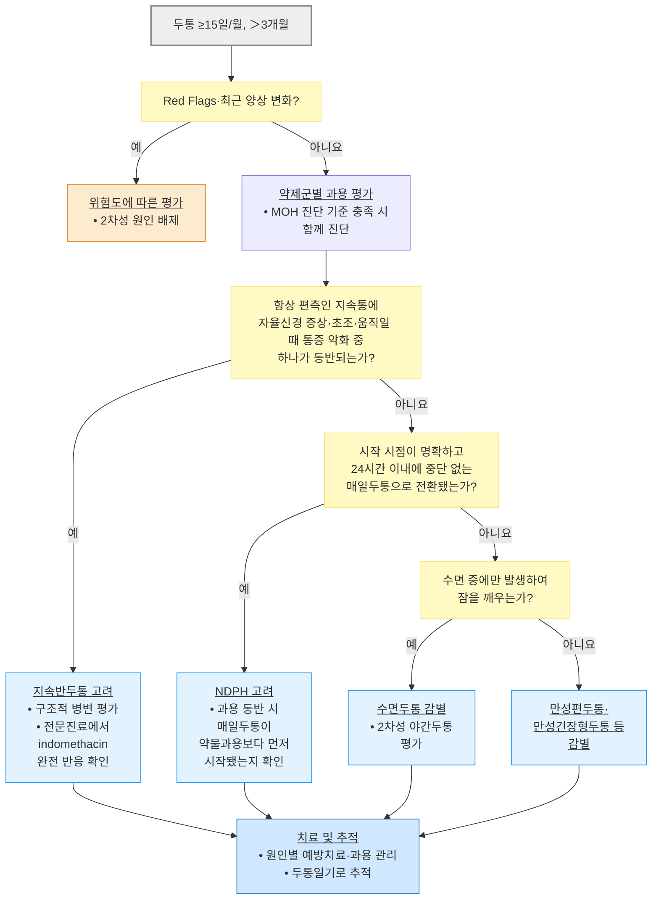

# 만성 두통 Chronic Headache

## <mark style="color:green;">일반 사항</mark>

* 만성 두통은 일반적으로 ≥15일/월, ＞3개월 지속되는 두통을 가리키는 임상적 포괄 용어이며, 그 자체가 하나의 ICHD-3 진단명은 아님
* 1차성 두통의 만성형, 신생매일지속두통 등의 기타 1차성 두통, 지속반두통 등의 삼차자율신경두통, 약물과용두통을 포함한 2차성 두통 등이 만성 두통의 범주에 해당
* 1차 진료에서는 위험 신호를 확인하여 생명을 위협하는 원인 질환을 조기에 감별하는 것이 중요

### <mark style="color:$danger;">🚩 Red Flags!</mark> <a href="#red-flags" id="red-flags"></a>

☞ [두통 Red Flags](015_-headache.md#red-flags) 참조

<mark style="color:$danger;">**즉각 조치**</mark>

* 벼락두통, 새 마비·언어 장애·의식 변화, 발열과 경부 강직, 급격한 시력 저하 등 `2차성 두통 의심`
* 임신 중 또는 산후의 새 두통이 심하거나 갑작스럽거나 지속·악화되는 경우, 또는 혈압 상승·시각 이상·경련 동반 `자간전증` `뇌정맥동혈전증` `가역성 뇌혈관수축증후군`

<mark style="color:$warning;">**당일\~수일 내 평가**</mark>

* **(당일)** 유두부종·반복 구토·진행성 시력 증상 `두개내압 상승 의심`
* **(당일)** 임신 중 또는 산후 새로 발생한 두통 중 즉각 조치 항목에 해당하지 않는 경우 `2차성 두통 의심`
* 암·면역저하 환자의 신규 또는 진행성 두통 `2차성 두통 의심`

<mark style="color:$info;">**조기 평가 및 추적**</mark>

* 두통 빈도·양상의 변화, 적절한 예방치료에도 지속되는 기능장애
* 급성기 약물 사용 증가 `약물과용두통`

## <mark style="color:green;">감별</mark>

* 최근 시작, 최근 변화, 증상 진행 → 2차성 두통
* 발열, 체중 감소, 악성 종양 과거력 → 전신적 질환, 2차성 두통
* ≥15일/월 중 ≥8일/월 편두통형 두통(환자가 두통 시작 시점부터 편두통으로 인식하고 트립탄 또는 에르고트계 약물로 호전된 날 포함) → [만성편두통](016_-migraine.md#chronic-migraine)
* ≥15일/월이면서 만성편두통 기준을 충족하지 않고 긴장형두통 양상이 우세 → [긴장형두통](017_-tension-type-headache.md)의 만성형
* 시작 시점을 명확히 기억하고, 발생 후 24시간 이내에 지속적이고 중단 없는 매일두통으로 전환 → [신생매일지속두통](018_-chronic-headache.md#ndph)
* 기존 두통질환이 있고 ≥15일/월 두통이 있으면서 급성기·대증 두통약을 약제군별 기준 이상으로 ＞3개월 사용 → [약물과용두통](018_-chronic-headache.md#medication-overuse-headache-moh)
* 심한 두통, 편측, 눈물/콧물, 시계 같은 규칙성, 군집성 발생, 치료하지 않을 때 보통 15\~180분 → [군발두통](015_-headache.md#cluster-treatment)
* 목 움직임·지속 자세로 평소 두통이 유발되거나 악화되고 경추 운동 범위가 감소 → [경추성두통](019_-cervicogenic-headache.md) 의심
* 경부 외상(편타손상) 후 새로 시작 → 외상 후 두통 의심(☞ [경추성두통](019_-cervicogenic-headache.md))
* 일시적 시각장애, 박동성 이명, 복시, 유두부종 → [특발성 두개내고혈압](018_-chronic-headache.md#iih) 의심
  * 유두부종이 확인되면 당일 의뢰
* 불안, 우울 동반 → 정신과적 동반 질환(comorbidity)으로 병행 관리; 2차성 두통 가능성도 배제
* 턱관절 움직임 제한·통증, 씹을 때 악화 → 턱관절 장애
* 두통의 2차 원인 감별을 위한 [SNNOOP10](015_-headache.md#snnoop10)

***



> _수면두통은 ＞3개월 동안 ≥10일/월이면 진단할 수 있으므로, 이 알고리듬의 시작 기준(≥15일/월)에 미치지 않는 환자에서도 고려_

<p align="center"><strong>만성 매일두통 감별 알고리듬</strong><br><em><mark style="color:$info;">저자 재구성 (참고 문헌 : ICHD-3; EAN MOH 2020)</mark></em></p>

***

## <mark style="color:green;">1차성 두통</mark>

### <mark style="color:orange;">장시간 지속 또는 지속성 두통의 감별</mark>

* 종류 : [Chronic migraine](016_-migraine.md#chronic-migraine), [Chronic tension-type headache](017_-tension-type-headache.md), New daily persistent headache, Hemicrania continua

#### <mark style="color:$primary;">신생매일지속두통 (New daily persistent headache, NDPH)</mark> <a href="#ndph" id="ndph"></a>

* 매일 지속되는 두통, 시작 시점을 명확히 기억함
* 통증은 특징적 양상이 없으며 편두통 또는 긴장형두통 요소를 모두 가질 수 있음
* 전형적으로 과거 두통의 병력이 없는 사람에서 발생

**진단 기준**

* A. 진단 기준 B와 C를 충족하는 지속되는 두통
* B. 뚜렷하고 확실히 기억되는 시작이 있으며, 발생 후 24시간 이내에 지속적이고 중단 없는 통증으로 전환
* C. ＞3개월 존재
* D. 다른 ICHD-3 진단으로 더 잘 설명되지 않음¹⁾⁻⁴⁾

> ¹⁾_전형적으로 과거 두통의 병력이 없는 사람에서 발생하여 시작부터 매일 중단 없이 지속함. 과거 편두통 또는 긴장형두통 병력이 있어도 배제되지는 않지만, NDPH 발생 전에 두통 빈도가 점차 증가했거나 약물과용과 함께 악화된 경과여서는 안 됨. 환자가 시작 시점을 기억하여 정확히 묘사할 수 없다면 다른 진단을 고려_\
> ²⁾_두통이 만성편두통 또는 만성긴장형두통의 진단 기준을 충족하더라도 NDPH 기준에 맞으면 NDPH로 진단함. NDPH와 지속반두통의 기준을 모두 충족하면 지속반두통으로 진단_\
> ³⁾_약물과용 기준을 초과하더라도 매일두통의 발생이 약물과용보다 명확하게 선행한 경우에만 NDPH를 진단할 수 있으며, 이때 NDPH와 약물과용두통을 함께 진단_\
> ⁴⁾_모든 경우에서 2차성 두통(예: 두부외상 후 두통, 뇌척수액 고압·저압 두통)을 적절한 검사로 배제해야 함 <mark style="color:$info;">\[ICHD-3]</mark>_

#### <mark style="color:$primary;">지속반두통 (Hemicrania continua)</mark> <a href="#hemicrania-continua" id="hemicrania-continua"></a>

* 항상 편측으로 발생하는 지속적인 통증으로, 악화기에 같은 쪽의 결막 충혈, 눈물, 코막힘, 콧물, 이마와 얼굴의 땀, 동공 수축, 눈꺼풀 처짐, 눈꺼풀 부종 중 하나 이상을 동반하거나 안절부절·초조 또는 움직임에 따른 통증 악화를 보임
* 두통은 indomethacin에 매우 민감하게 반응
* 새로 발생한 지속적인 strictly side-locked headache 또는 삼차자율신경두통 양상에서는 구조적 병변 배제를 위해 뇌 MRI를 적극 고려

**진단 기준**

* A. 진단 기준 B\~D를 충족하는 편측 두통
* B. ＞3개월 지속되며, 중등도 이상의 악화기(exacerbation)를 동반
* C. 다음 중 하나 이상 해당
  1. 두통과 동측으로 다음 중 ≥1가지 존재
     1. 결막 충혈 &/or 눈물
     2. 코막힘 &/or 콧물
     3. 눈꺼풀 부종
     4. 이마 및 안면 발한
     5. 동공 축소 &/or 눈꺼풀 처짐
  2. 안절부절, 초조, 또는 움직임에 의해 통증 악화
* D. 치료 용량의 indomethacin에 절대적으로 반응함¹⁾
* E. 다른 ICHD-3 진단으로 더 잘 설명되지 않음

> ¹⁾_ICHD-3는 성인의 진단적 투여량으로 경구 indomethacin ≥150 ㎎/일, 필요시 225 ㎎/일까지 제시함. 인도메타캡슐의 품목 허가사항에 따른 최대량은 200 ㎎/일임. 진단적 투여와 고용량 증량은 전문진료에서 판단. 실제 임상에서는 위장관·신장 부작용을 줄이기 위해 25 ㎎ tid에서 시작해 내약성을 보며 단계적으로 증량할 수 있음. 저용량 반응이 불충분하면 충분한 용량에서 반응을 평가하고, 완전 반응 확인 후 최소 유효 용량으로 감량_

### <mark style="color:orange;">주로 짧은 발작을 보이는 두통의 감별</mark> <a href="#short-lasting-headache" id="short-lasting-headache"></a>

* 종류 : [Chronic cluster headache](015_-headache.md#cluster-treatment), Chronic paroxysmal hemicrania, Hypnic headache, Primary stabbing headache, Short-lasting unilateral neuralgiform headache attacks
  * Primary stabbing headache와 SUNCT/SUNA는 이 챕터에서 다루지 않음


만성 군발두통과 만성 돌발반두통의 '만성'은 만성 두통 기준(≥15일/월, ＞3개월)과 다른 개념으로, 한 달 발생일수가 아니라 **관해기의 유무와 길이**로 정함 <mark style="color:$info;">\[ICHD-3]</mark>

• 만성형 : 관해기가 없거나 ＜3개월인 상태가 1년 이상 지속\
• 삽화형 : 7일\~1년 지속되는 발작기가 두 차례 이상이고, 그 사이 ≥3개월의 무통 관해기가 있음\
• 발작기에는 하루 수 회 발작이 나타나 삽화형도 ≥15일/월을 쉽게 넘을 수 있으므로 발생일수로 판단하지 않음


#### <mark style="color:$primary;">수면두통 (Hypnic headache)</mark> <a href="#hypnic-headache" id="hypnic-headache"></a>

* 수면 중에만 반복적으로 발생하여 잠에서 깨어나게 하는 두통(일명 alarm clock headache)
* 특징적인 동반 자율신경 증상이 없으며 다른 병리에 기인하지 않음
* 보통 50세 이후에 발생
* 둔한 두통, 종종 양측성

**진단 기준**

* A. 진단 기준 B\~E를 충족하는 반복되는 두통 발작
* B. 잠자는 동안에만 발생하여 잠에서 깨게 함
* C. ＞3개월 동안 ≥10일/월 발생
* D. 잠에서 깬 후 15분\~4시간 지속
* E. 자율신경 증상이나 안절부절못함은 없음
* F. 다른 ICHD-3 진단으로 더 잘 설명되지 않음¹⁾²⁾

> ¹⁾_효과적인 치료를 위하여 삼차자율신경두통(특히 군발두통)과의 감별이 필요_\
> ²⁾_수면 중 발생하여 잠에서 깨어나게 하는 두통의 다른 가능한 원인들(예: 수면무호흡증, 야간 고혈압, 저혈당, 약물과용, 두개내질환)을 감별. 폐쇄수면무호흡증이 병존한다는 사실만으로 수면두통이 배제되지는 않으며 두통과의 인과관계를 평가_


**주의 - 2차성 원인 배제 후 진단 :** 50세 이후 처음 발생하는 수면 중 두통은 두개내종양, 폐쇄수면무호흡증(OSA), 야간 고혈압, 저혈당, 약물과용 등을 우선 평가. 새로 발생한 야간 두통에서는 2차성 두개내병변 배제를 위해 뇌 MRI를 적극 고려


## <mark style="color:green;">2차성 두통</mark>

### <mark style="color:orange;">종류</mark>

* 두경부 외상 또는 손상에 기인한 두통 : 외상 후 두통, 경막하혈종 등
* 두개·경부 혈관질환에 기인한 두통 : 동맥박리, 뇌정맥동혈전증, 혈관염, 거대세포동맥염, 동정맥기형 등
* 비혈관성 두개내질환에 기인한 두통 : 두개내종양, 특발성 두개내고혈압, 자발두개내압저하 등
* 물질 또는 금단에 기인한 두통 : 약물과용두통 등
* 감염 또는 항상성 장애에 기인한 두통 : 중추신경계감염, 폐쇄수면무호흡증, 저산소증·고탄산혈증 등
* 두개·경부·안면 구조물의 질환에 기인한 두통·안면통 : 경추성두통, 턱관절 장애, 안과·이비인후과·치과 질환 등 <mark style="color:$info;">\[ICHD-3]</mark>

### <mark style="color:orange;">특발성 두개내고혈압 (Idiopathic intracranial hypertension, IIH)</mark> <a href="#iih" id="iih"></a>

* 가임기 비만 여성에서 흔하나 남성·비비만·고령에서도 발생하므로 인구학적 특징만으로 판단하지 않음
* 의심 단서
  * 매일 또는 거의 매일 지속되는 두통(편두통 양상도 흔함), 누우면 악화되거나 아침에 심한 두통
  * 일시적 시력 흐림(transient visual obscuration), 박동성 이명, 수평 복시(외전신경 마비)
  * 안저검사에서 유두부종
* 2차성 두개내압 상승과 관련된 약물·상황 : tetracycline계, vitamin A·retinoid, lithium, 스테로이드 감량·중단 등 - 투약력을 확인
* 평가
  * 유두부종이 확인되면 당일 의뢰하여 시력·시야를 평가
  * 뇌 MRI와 MRV(또는 CT·CTV)로 두개내 종괴·뇌정맥동혈전증을 배제한 뒤 요추천자로 개방압과 뇌척수액 성분을 확인 - 전문진료에서 시행
* 치료는 전문진료와 함께 결정 : 과체중·비만이 동반된 경우 체중 감량이 질환 조절의 핵심이며, acetazolamide 등 약물 치료와 시력 위협 시 수술적 치료를 판단
* IIH의 두통에는 약물과용두통이 흔히 동반되므로 급성기 진통제 사용일수를 확인 <mark style="color:$info;">\[J Neurol Neurosurg Psychiatry 2018]</mark>

### <mark style="color:orange;">약물과용두통 (Medication overuse headache, MOH)</mark> <a href="#medication-overuse-headache-moh" id="medication-overuse-headache-moh"></a>

* 기존 두통질환이 있는 환자에서 ≥15일/월 두통이 있으면서, 급성기·대증 치료 약제를 ＞3개월 동안 다음 기준 이상 과용하면 약물과용두통을 고려
  * 다음 약제를 한 달에 ≥10일 복용 : triptan, opioid, ergotamine, 복합진통제
  * 다음 약제를 한 달에 ≥15일 복용 : acetaminophen, aspirin, NSAID 등 단순진통제
  * acetaminophen·aspirin·NSAID는 비마약성 진통제 한 약물군으로 합산하여 ≥15일/월 기준을 적용
  * 서로 다른 급성기 약물군(ergotamine·triptan·비마약성 진통제·opioid)을 번갈아 또는 함께 사용하고 개별 약물군은 과용 기준에 미달하더라도, 합계 ≥10일/월이면 복수 약물군 과용을 고려. 같은 날 여러 약을 썼으면 전체 사용일수에서는 1일로 계산
* MOH는 기저 두통질환을 대체하는 개념이 아니며, 만성편두통·긴장형두통 등과 각각의 기준을 충족하면 함께 진단

**진단 기준**

* A. 기존 두통질환이 있는 환자에서 ≥15일/월 발생하는 두통
* B. 급성기 &/or 대증 치료로 사용될 수 있는 ≥1가지의 약물을 ＞3개월 동안 규칙적으로 과용¹⁾⁻³⁾
* C. 다른 ICHD-3 진단으로 더 잘 설명되지 않음

> ¹⁾_각 환자는 과용한 약물의 종류와 해당 진단 기준에 따라 한 가지 이상의 아형으로 분류할 수 있음(예: 트립탄과용두통, 단순진통제과용두통, 복합진통제과용두통)_\
> ²⁾_개별 약물군은 과용 기준에 해당하지 않지만, 서로 다른 급성기 약물군의 합산 사용일수가 ≥10일/월이고 ＞3개월 지속된 경우 ‘개별적으로는 과용되지 않은 복수 약물군의 과용에 의한 두통’으로 진단_\
> ³⁾_복수 약물군을 합계 ≥10일/월, ＞3개월 과용했으나 약물명·용량·사용 양상을 정확히 확인할 수 없으면 ‘확인되지 않은 복수 약물군에 의한 약물과용두통’으로 진단. 두통일기나 처방·구매 내역을 통해 세부 내용을 확인 <mark style="color:$info;">\[ICHD-3]</mark>_

***

## <mark style="background-color:$warning;">Management</mark>

### <mark style="color:orange;">치료 원칙</mark>

* 생활 치료 : 수면 개선, 규칙적 유산소 운동, 스트레스 관리, [두통일기](015_-headache.md#headache-diary) 작성
* 유발 요인 제거, 만성편두통 또는 만성긴장형두통 치료
* 불안·우울 등 정신건강 문제 동반 시 병행 치료
* 스테로이드 사용 주의
  * 만성 두통 자체를 치료하기 위한 장기 전신 스테로이드 요법은 권고하지 않음

## <mark style="color:green;">질환별 치료</mark>

### <mark style="color:orange;">신생매일지속두통 (NDPH)</mark>

* 양질의 무작위시험 근거가 부족하고 치료 반응이 제한적인 경우가 많음
* 편두통형 또는 긴장형 양상에 따라 해당 예방치료를 준용하는 phenotype-guided 치료가 일반적임
* [편두통형](016_-migraine.md#management) : amitriptyline, topiramate, divalproex 등
* [긴장형](017_-tension-type-headache.md#management) : amitriptyline, nortriptyline, mirtazapine 등
* 위 약제의 NDPH 치료는 허가 외 사용임
* topiramate·divalproex는 임부에게 투여하지 않음
  * 가임기 여성 : topiramate는 매우 효과적인 피임법을 사용할 때만, divalproex는 임신예방프로그램 요건을 모두 충족할 때만 투여
* doxycycline, mexiletine 등이 증례 수준에서 보고되었으나 근거가 매우 제한적이므로 표준 치료로 권고하지 않음
* Self-limiting subtype은 수개월 내 자연 소실 가능
* Refractory subtype은 적극적인 치료에도 반응이 제한적이며 장기간 지속될 수 있음
* 진단 시 2차 원인 배제가 필요하고 난치성이 많으므로 신경과 의뢰를 적극 고려

### <mark style="color:orange;">지속반두통 (Hemicrania continua)</mark>

* 아래 약제는 모두 지속반두통에 대한 허가 외 사용임
* 1차 치료 : indomethacin <mark style="color:$info;">\[ICHD-3; Cephalalgia 2023]</mark>
  * 치료 용량에서 두통이 완전히 소실되는 반응 자체가 진단 기준(criterion D)이므로 진단적 치료를 겸함
  * 25 ㎎ tid부터 시작하여 내약성을 확인하며 증량하되, 진단에 충분한 용량에 도달하기 전에는 무반응으로 판단하지 않음 <mark style="color:blue;">\[</mark>[<mark style="color:blue;">인도메타 25 ㎎</mark>](https://www.health.kr/drug/2011080300001)<mark style="color:blue;">]</mark>
  * 투여 전후 위장관 출혈·궤양, 신기능, 혈압·심혈관 위험 및 병용약을 평가. PPI는 위장관 위험을 줄이지만 신장·심혈관 위험을 예방하지 않음
* indomethacin 불내성 시 대안(근거 제한적)
  * celecoxib : 200 ㎎ bid <mark style="color:blue;">\[</mark>[<mark style="color:blue;">쎄레브렉스 200 ㎎</mark>](https://www.health.kr/drug/A11ABBBBB1346)<mark style="color:blue;">]</mark> - 골관절염 권장량(200 ㎎/일)보다 높음
    * <mark style="color:blue;">쎄레브렉스</mark>는 확립된 허혈성 심장질환·말초동맥질환·뇌혈관질환, NYHA II\~IV 심부전, CrCl ＜30 ㎖/min, 활동성 궤양·출혈 등에서 투여금기. PPI를 병용해도 투여금기는 적용됨(☞ [통증](../220_/001_-pain.md))
  * topiramate : 50\~100 ㎎/d <mark style="color:blue;">\[</mark>[<mark style="color:blue;">토파맥스 25 ㎎</mark>](https://www.health.kr/drug/2020080600008)<mark style="color:blue;">]</mark> (임신 관련 주의는 신생매일지속두통 항목 참조)
  * melatonin : 3\~10 ㎎ 취침 전 - 처방용 제품은 주로 2 ㎎ 서방형이므로 문헌의 용량·제형과 직접 대응하지 않음
* 후두신경차단술(Occipital nerve block) : indomethacin 반응은 있으나 장기 복용이 어려운 경우 보조적 선택지로 고려 가능 (근거 제한적)

### <mark style="color:orange;">수면두통 (Hypnic headache)</mark>

* 아래 치료는 모두 수면두통에 대한 허가 외 사용이며, 특히 lithium은 고령자에서 내약성과 상호작용을 면밀히 평가
* 1차 치료 : 취침 전 caffeine 40\~60 ㎎ 등 저용량으로 시도
  * 커피의 카페인 함량은 종류·용량에 따라 달라 고정 용량으로 간주하지 않음
  * 불면·야간뇨가 악화될 수 있음
  * 근거는 주로 증례·관찰연구 수준
* 대안
  * lithium carbonate : <mark style="color:blue;">\[탄산리튬]</mark> [150 ㎎](https://www.health.kr/drug/2015102800003)\~[300 ㎎](https://www.health.kr/drug/A11A0920A0030) 취침 전
    * 투여금기 : 신장애, 심혈관질환, 쇠약·탈수, 나트륨 섭취 제한, 티아지드계 이뇨제 복용 등
    * 투여 전 신기능·갑상선기능·전해질·칼슘 확인. 고령자에서 필요시 ECG 확인
    * 시작·용량 변경 약 1주 후 혈중농도를 확인(마지막 복용 약 12시간 후 채혈)하고 안정될 때까지 추적. 유지 중 혈중농도는 약 월 1회 측정하고 신기능·갑상선기능·칼슘은 정기 추적
    * NSAID·ACE 억제제·ARB·이뇨제와의 상호작용을 확인
    * sumatriptan·chlorthalidone·spironolactone은 lithium과 DUR 병용금기
  * indomethacin : 25\~50 ㎎ 취침 전
  * melatonin : 3\~5 ㎎ 취침 전

### <mark style="color:orange;">약물과용두통 (MOH)</mark>

* 치료의 핵심 : 환자 교육, 과용 약물 중단·감량, 기저 두통의 예방 치료
* 과용 약물별 중단 방법
  * 단순진통제·복합진통제(opioid·barbiturate 비함유, 카페인 복합제 등)·triptan·ergotamine : 대부분 외래에서 즉시 중단(abrupt withdrawal) 가능
  * opioid·barbiturate 함유 약물 : 의존·금단 위험을 평가하여 점진적으로 감량
    * 외래 중단이 어렵거나 고용량·복합 의존이 있으면 신경과·중독 전문진료 또는 입원 치료를 고려
  * benzodiazepine : ICHD-3의 MOH 원인 약제군은 아니나, 병용·의존이 있으면 MOH와 별개로 점진적 감량 계획을 세움
* 예방치료 시작 시점 <mark style="color:$info;">\[AAN/AHS 2026]</mark>
  * 약물과용을 동반한 편두통에서는 예방치료 단독도 급성기 약물 중단을 병행한 전략과 비슷한 효과를 보일 수 있음
  * 다만 opioid·barbiturate 함유 약물 과용에는 이를 일반화할 근거가 부족함
  * 일률적인 중단만 강조하지 않고, 환자 상황에 맞추어 예방치료를 조기에 시작하면서 과용 약물을 감량·중단

<mark style="color:cyan;">**브릿지 요법 (선별적 사용)**</mark>

* 약물 중단 후 초기 수일간 반동 두통·구역·수면장애 등이 악화될 수 있음을 사전에 설명
* 브릿지 요법 전반의 근거는 제한적이며 모든 환자에게 일상적으로 필요하지 않음
  * naproxen : 250\~500 ㎎ bid를 단기간(대개 수일\~1주) 선별적으로 고려 <mark style="color:blue;">\[</mark>[<mark style="color:blue;">낙센</mark>](https://www.health.kr/drug/A11A0120A0286)<mark style="color:blue;">]</mark> - MOH 브릿지 요법은 허가 외 사용
    * 연장이 필요하면 재평가
    * NSAID 과용 환자에서는 피함. 위장관·신장·심혈관 고위험 환자는 다른 방법을 우선 고려
    * 처방 전 NSAID 금기 및 병용약 확인
  * 스테로이드 : 일부 연구에서 사용되었으나 효과가 일관되지 않아 일상적 브릿지 요법으로 권고하지 않음
* MOH 재발 예방을 위해 급성기 두통약은 가급적 주 2일 이하로 제한
* ICHD-3의 과용 기준은 약제군에 따라 ≥10일/월 또는 ≥15일/월이므로 환자 교육 시 두 기준을 구분

<mark style="color:cyan;">**예방 치료**</mark>

* 약물 중단과 동시 또는 조기에 시작
* 편두통형 : topiramate, divalproex, amitriptyline 등
  * topiramate·divalproex는 임부에게 투여하지 않음
    * 가임기 여성 : topiramate는 매우 효과적인 피임법을 사용할 때만, divalproex는 임신예방프로그램 요건을 모두 충족할 때만 투여
* 긴장형 : amitriptyline (1차), nortriptyline, mirtazapine
* amitriptyline·nortriptyline 등 TCA를 예방약으로 선택할 때 급성기 약제도 함께 검토
  * <mark style="color:blue;">\[</mark>[<mark style="color:blue;">타이레놀 500 ㎎</mark>](https://www.health.kr/drug/2021082400002)<mark style="color:blue;">]</mark> 등 TCA 복용 환자 투여금기가 있는 acetaminophen 품목은 병용하지 않음
  * 대체 진통제도 자체 금기와 MOH 위험을 확인(☞ [통증](../220_/001_-pain.md))
* 만성편두통 동반 시 근거가 있는 예방약을 우선 고려 <mark style="color:$info;">\[AAN/AHS 2026]</mark>
  * AAN/AHS는 만성편두통 예방약으로 atogepant, eptinezumab, erenumab, fremanezumab, galcanezumab, onabotulinumtoxinA, topiramate, valproate를 제시
  * MOH 동반 편두통에서도 예방치료를 제공하며, 근거가 있는 CGRP 단클론항체, atogepant, onabotulinumtoxinA, topiramate를 우선 고려
  * onabotulinumtoxinA <mark style="color:blue;">\[</mark>[<mark style="color:blue;">보톡스</mark>](https://www.health.kr/drug/A11AKP08G2664)<mark style="color:blue;">]</mark> 100 U : 155 U를 31곳에 근육주사, 12주 간격
  * gepant는 단순진통제·triptan과 같은 MOH 유발 신호가 확립되지 않아 기존 진통제·triptan 과용 환자에서 유용할 수 있으나 장기 자료는 제한적
  * 실제 사용 순서는 허가사항과 급여 기준에 따라 달라지며, 약제별 용법·허가·급여 기준은 [편두통](016_-migraine.md)의 「CGRP 표적 예방치료」 참조

<mark style="color:cyan;">**추적 관찰**</mark>

* 2주 : 금단 증상, 약물 사용일수 및 순응도 확인
* 4\~8주 : 두통 빈도·강도, 급성기 약물 사용일수, 예방치료 반응 재평가
* 8주 전후 : 치료 전략을 재조정하는 시점이며, ICHD-3상 MOH의 '진단 확정 시점'을 의미하지 않음
* 중단 후에도 만성 두통이 지속되면 기저 1차성 두통의 예방 치료를 강화

***

## <mark style="color:red;">질병코드</mark>

* G44.2 긴장형두통 Tension-type headache
* G44.3 만성 외상후 두통 Chronic post-traumatic headache
* G44.4 달리 분류되지 않은 약물유발 두통 Drug-induced headache, NEC
* G44.8 기타 명시된 두통증후군 Other specified headache syndromes
* G93.2 양성 두개내압상승 Benign intracranial hypertension
* 편두통(G43 계열)은 [편두통](016_-migraine.md) 질병코드 참조

***

## <mark style="color:purple;">처방례</mark>

> **처방례 1. 신생매일지속두통 - 편두통형**
>
> ```
> 에트라빌정10㎎  1회 1T  취침 전
>   → 2~4주 간격으로 반응·내약성에 따라 10 ㎎씩 증량, 50 ㎎/일까지 고려
> 또는 토파맥스정25㎎  1회 1T  취침 전
>   → 반응·내약성에 따라 2~4주마다 1일 용량을 25 ㎎씩 증량, 목표 50~100 ㎎/일을 2회 분복
> ※ 토피라메이트는 임부 금기. 가임기 여성은 매우 효과적인 피임법 사용 시에만 투여
> ```
>
> 약제 정보: [에트라빌정·10 ㎎](https://www.health.kr/drug/A11A0570B0082) · [토파맥스정·25 ㎎](https://www.health.kr/drug/2020080600008)
>
> _✽NDPH에 대한 phenotype-guided 허가 외 사용이며, 두 약제를 처음부터 routine 병용하지 않음_

> **처방례 2. 지속반두통 (Hemicrania continua) - 진단 및 1차 치료**
>
> ```
> 인도메타캡슐25㎎  1회 1C  1일 3회 (식사와 함께 또는 식후)
>   → 불완전 반응이면 내약성을 확인하며 단계적으로 증량
>   → 진단에 충분한 용량과 완전 반응을 전문진료에서 확인
>   → 완전 반응 확인 후 최소 유효 용량으로 감량
> 오메드정20㎎  1회 1T  1일 1회 식전 (위장 보호)
> ※ ICHD-3는 ≥150 ㎎/일(필요시 225 ㎎/일)을 제시. 인도메타캡슐의 품목 허가사항에 따른 최대량은 200 ㎎/일
> ※ 225 ㎎/일을 일반 외래 처방 목표로 적용하지 않음
> ※ 투여 전후 위장관 출혈·궤양, 신기능, 혈압·심혈관 위험 및 병용약 평가
> ※ 고용량 증량이 필요하거나 진단이 불확실하면 신경과 협진 권장
> ```
>
> 약제 정보: [인도메타캡슐·25 ㎎](https://www.health.kr/drug/2011080300001) · [오메드정·20 ㎎](https://www.health.kr/drug/A11A1890A0146)
>
> _✽indomethacin의 지속반두통 치료는 허가 외 사용임_
>
> _✽indomethacin 불내성 시 celecoxib 등 대안을 고려할 수 있으나, 대체약 반응은 hemicrania continua의 진단 기준을 대신하지 않음. celecoxib를 고려할 때는 심혈관질환·NYHA II\~IV 심부전·중증 신장애·활동성 궤양·출혈 등 투여금기를 먼저 확인하고 대체 여부를 판단(☞_ [_통증_](../220_/001_-pain.md)_)_

> **처방례 3. 수면두통 (Hypnic headache)**
>
> ```
> [1차] 취침 전 caffeine 40~60 ㎎ 등 저용량으로 시도
> ※ 커피는 함량 변이가 커 같은 용량으로 간주하지 않음
> [대안] 명인탄산리튬정150㎎  1회 1T  취침 전
>   → 반응·혈중농도·내약성에 따라 300 ㎎ 취침 전까지 조정
>   → 치료 전 신장애·심혈관질환·쇠약·탈수·나트륨 섭취 제한·티아지드계 이뇨제 복용 등 투여금기 확인
>   → 치료 전 신기능·갑상선기능·전해질·칼슘, 고령자에서 필요시 ECG 확인
>   → 시작·용량 변경 약 1주 후 혈중농도 확인(마지막 복용 약 12시간 후 채혈)
>   → NSAID·ACE 억제제·ARB·이뇨제 등 상호작용·병용금기 확인
> 또는 인도메타캡슐25㎎  1회 1C  취침 전 (식사 또는 간식과 함께)
> ```
>
> 약제 정보: [명인탄산리튬정·150 ㎎](https://www.health.kr/drug/2015102800003) · [명인탄산리튬정·300 ㎎](https://www.health.kr/drug/A11A0920A0030) · [인도메타캡슐·25 ㎎](https://www.health.kr/drug/2011080300001)
>
> _✽수면두통에 대한 위 약제 치료는 허가 외 사용이며, 근거는 주로 증례·관찰연구 수준_

> **처방례 4. 약물과용두통 (MOH) - 약물 중단 + 예방 치료**
>
> ```
> [과용 약물 중단]
> 단순진통제·복합진통제(opioid·barbiturate 비함유)·triptan 과용 → 원칙적으로 즉시 중단
> opioid·barbiturate 과용 → 점진적 감량 및 전문진료 고려
>
> [필요시 단기 브릿지 - NSAID 과용이 아니고 금기·병용약 확인 후 선별 사용]
> 낙센정250㎎  1회 1~2T  1일 2회 × 5~7일
>   → 위장관·신장·심혈관 고위험 환자는 다른 방법을 우선 고려
>   → 투여가 적절하면 최소 유효 용량으로 최단기간 사용, 반복·장기 사용 피함
>
> [예방 치료 - 동시 또는 조기 시작]
> 토파맥스정25㎎  1회 1T  취침 전 (편두통 동반 시)
>   → 1주 이상 간격으로 1일 용량을 25 ㎎씩 증량, 권장량 100 ㎎/일을 2회 분복
>   → 내약성이 낮으면 증량 간격을 늘리고, 50 ㎎/일에서 반응이 충분하면 유지 가능
> 또는 에트라빌정10㎎  1회 1T  취침 전부터 시작하여 반응·내약성에 따라 증량 (긴장형두통 동반 시 고려)
> ※ 토피라메이트는 임부 금기. 가임기 여성은 매우 효과적인 피임법 사용 시에만 투여
> ```
>
> 약제 정보: [낙센정·250 ㎎](https://www.health.kr/drug/A11A0120A0286) · [토파맥스정·25 ㎎](https://www.health.kr/drug/2020080600008) · [에트라빌정·10 ㎎](https://www.health.kr/drug/A11A0570B0082)
>
> _✽naproxen 브릿지 요법은 허가 외 사용임. 스테로이드 브릿지 요법은 효과가 일관되지 않아 일상적으로 사용하지 않음_

***

### <mark style="color:$success;">핵심 복약 지도</mark>

> **약물과용두통(MOH) - 진통제 중단 안내**
>
> * 현재 두통이 자주 나타나고 진통제를 반복 복용하고 있다면, 약물이 두통의 악화·만성화에 기여할 수 있습니다.
> * 특히 **약국에서 처방 없이 구입할 수 있는 카페인 함유 복합진통제**(게보린정, 펜잘큐정 등)는 효과가 빠르게 느껴져 자주 복용하게 되지만, MOH를 일으키는 주요 원인입니다.
> * **복용 중인 진통제(특히 카페인 복합제·트립탄·오피오이드)를 줄이거나 중단하고 기저 두통에 맞는 예방치료를 병행**하는 것이 중요합니다. 재발 예방을 위해 급성기 두통약은 가급적 주 2일 이하로 사용하십시오.
> * 중단 후 **2\~10일간 두통·구역·수면장애가 일시적으로 악화될 수 있습니다.** 호전 속도는 개인마다 다르며, 견디기 어렵거나 탈수가 생기면 진료를 받으십시오.
> * 팔다리 마비·언어 장애·시야 이상 등 새로운 신경 증상이 생기면 즉시 응급실을 방문하십시오.
> * 오피오이드·바르비투르산계·벤조디아제핀을 장기간 복용했다면 갑자기 끊지 말고 반드시 주치의와 감량 계획을 세우십시오.

> **예방약 (토파맥스·에트라빌 등)**
>
> * 효과는 수 주에 걸쳐 나타나며 편두통 예방약은 보통 충분한 내약 용량에서 **8\~12주** 후 효과를 평가합니다. 임의로 중단하지 마십시오.
> * 토파맥스(topiramate)는 물을 충분히 마시면 신결석 위험을 줄이는 데 도움이 됩니다. 시야 흐림·눈 통증이 갑자기 생기면 즉시 진료받으십시오.
> * 토파맥스는 태아에 해를 줄 수 있습니다. 가임기 여성은 복용 중 매우 효과적인 피임법을 사용하고, 임신을 계획하거나 임신 사실을 알게 되면 바로 주치의와 상의하십시오.
> * 에트라빌(amitriptyline)은 취침 전 복용하며, 구갈·졸음이 생길 수 있습니다.

> **인도메타신 (지속반두통)**
>
> * 인도메타신에 완전히 반응하는지가 지속반두통 진단의 중요한 기준입니다.
> * 음식과 함께 또는 식후에 복용하고, 처방받은 위산분비억제제도 지시대로 복용하십시오. 음식·위장약이 출혈이나 신장 부작용을 모두 막지는 못합니다.
> * 흑색변·토혈·심한 복통·소변량 감소가 생기면 복용을 중단하고 즉시 진료를 받으십시오. 다른 소염진통제를 임의로 추가하지 마십시오.
> * 증상이 조절되면 최소 유효 용량으로 감량합니다.

> **리튬(수면두통)**
>
> * 정해진 혈액검사 일정을 지키고 물·염분 섭취를 일정하게 유지하십시오. 탈수·설사·구토가 생기면 주치의에게 알리십시오.
> * 심한 떨림·비틀거림·말 어눌함·혼동·반복 구토가 생기면 추가 복용하지 말고 즉시 응급 평가를 받으십시오.
> * 일반 진통제·혈압약·이뇨제를 새로 복용하기 전에 상호작용을 확인하십시오.

> **언제 다시 병원을 방문해야 하나요?**
>
> * 진통제를 줄인 뒤에도 두통이 지속되거나 악화되어 일상생활이 어려운 경우
> * 두통 양상이 갑자기 변하거나 신경 증상이 새로 생긴 경우 - 즉시 응급실 방문
> * 예방약을 2개월 넘게 복용해도 두통 빈도가 줄지 않는 경우(용량과 복용 상태 점검)

***

## <mark style="color:green;">주요 참고문헌 및 확인 자료</mark>

### <mark style="color:orange;">임상 근거</mark>

* \[ICHD-3] [Headache Classification Committee of the International Headache Society (IHS). The International Classification of Headache Disorders, 3rd edition. Cephalalgia. 2018;38(1):1-211.](https://ichd-3.org/) - 두통의 분류·진단 기준 및 약물과용 기준
* \[AAN/AHS 2026] [Potrebic S, et al. Pharmacologic Treatment for Migraine Prevention in Adults: Practice Guideline Recommendations. Headache. 2026;66(9):2173-2184.](https://doi.org/10.1111/head.70199) - 예방치료 대상·약제 선택 및 약물과용 동반 환자의 치료
* [Diener HC, et al. European Academy of Neurology guideline on the management of medication-overuse headache. Eur J Neurol. 2020;27(7):1102-1116.](https://doi.org/10.1111/ene.14268) - 과용 약물 중단·감량과 예방치료
* [Mollan SP, et al. Idiopathic intracranial hypertension: consensus guidelines on management. J Neurol Neurosurg Psychiatry. 2018;89(10):1088-1100.](https://doi.org/10.1136/jnnp-2017-317440) - 유두부종·두개내압 상승 의심 환자의 평가와 시력 보호
* [NHS Specialist Pharmacy Service. Lithium monitoring.](https://www.sps.nhs.uk/monitorings/lithium-monitoring/) - 혈중농도 채혈 시점·추적 및 독성 평가
* [Dodick DW, et al. The hypnic ("alarm clock") headache syndrome. Cephalalgia. 1998;18(3):152-156.](https://pubmed.ncbi.nlm.nih.gov/9595209/) - 수면두통 증례군
* [Bahra A. Paroxysmal hemicrania and hemicrania continua: review on pathophysiology, clinical features and treatment. Cephalalgia. 2023;43(11):3331024231214239.](https://doi.org/10.1177/03331024231214239) - indomethacin 반응과 치료
* [Lindner D, et al. Hypnic Headache – What do we know in 2022? Cephalalgia. 2023;43(3):03331024221148659.](https://doi.org/10.1177/03331024221148659) - 취침 전 카페인 및 수면두통 예방치료의 근거

### <mark style="color:orange;">허가·급여 확인 자료</mark>

* [식품의약품안전처. 의약품안전나라 - 의약품 품목허가정보.](https://nedrug.mfds.go.kr/index) - 제품별 적응증·용법·금기 및 허가 상태
* [식품의약품안전처. 명인탄산리튬정150밀리그램 품목정보.](https://nedrug.mfds.go.kr/pbp/CCBBB01/getItemDetailCache?cacheSeq=201507389aupdateTs2026-09-19+13%3A58%3A35.0b) - 투여금기
* [약학정보원. 데파코트서방정500㎎.](https://www.health.kr/drug/A11AOOOOO4807) 및 [토파맥스정25㎎.](https://www.health.kr/drug/2020080600008) - 편두통 예방 시 임신 관련 금기
* [한국애브비. 보톡스주 제품설명서.](https://www.abbvie.co.kr/content/dam/abbvie-dotcom/kr/documents/Botox%20100U_KR%20label\(KR\)_web.pdf) - 만성편두통 예방 권장 용량

***

## <mark style="color:blue;">환자 안내서</mark>


**만성 두통, 올바른 이해가 치료의 시작입니다**

만성 두통은 적절한 치료와 생활 습관 개선으로 충분히 호전될 수 있습니다. 진통제를 자주 복용하고 있다면 약물과용 여부를 확인하고 사용을 줄이는 것이 중요한 치료 목표입니다.


#### <mark style="color:$primary;">만성 두통이란 무엇인가요?</mark>

* 한 달에 15일 이상 두통이 3개월 넘게 지속되는 상태입니다.
* 만성편두통, 만성긴장형두통, 약물과용두통 등 다양한 형태가 있습니다.

#### <mark style="color:$primary;">약물과용두통이란 무엇인가요?</mark>

* 두통을 가라앉히려고 진통제를 자주 먹다 보면 약물이 두통의 악화·만성화에 기여하여 악순환이 생길 수 있습니다.
* 한 달에 15일 이상 두통이 있으면서 두통약을 다음 빈도로 3개월 넘게 복용하면 약물과용두통일 수 있습니다.
  * 트립탄·오피오이드·카페인 복합제 : **한 달 10일 이상**
  * 단순진통제 : **한 달 15일 이상**(여러 종류를 먹었다면 복용일을 합산)
  * 트립탄과 단순진통제처럼 서로 다른 계열의 두통약을 번갈아 또는 함께 먹은 경우 : 각 계열의 기준에 미치지 않아도 복용일을 합해 **한 달 10일 이상**(같은 날 여러 약을 먹어도 하루로 셈)
* 치료의 핵심은 과용 약물을 줄이거나 중단하고, 필요한 경우 예방 치료를 함께 시행하는 것입니다. 중단 초기에는 수일간 두통이 더 심해질 수 있으며 호전 속도는 개인마다 다릅니다.

#### <mark style="color:$primary;">어떻게 치료하나요?</mark>

* **진통제 중단 또는 감량** : 약물과용두통의 핵심 치료입니다. 주치의와 함께 계획을 세우세요. 오피오이드·일부 의존성 약물은 갑자기 끊으면 위험할 수 있어 단계적으로 줄입니다.
* **예방약 복용** : 두통 빈도를 줄이기 위한 예방약을 처방받아 꾸준히 복용합니다.
* **생활 습관 개선** : 규칙적인 수면, 운동, 스트레스 관리, 수분 섭취가 중요합니다.

#### <mark style="color:$primary;">생활 속 실천 사항</mark>

* **두통일기 작성** : 두통이 언제, 얼마나 자주, 어떤 상황에서 발생하는지와 약 이름·복용 날짜를 기록하십시오. 모바일 앱 '[대한두통학회 두통일기](https://play.google.com/store/apps/details?id=com.m2comm.headache)와 [안내 영상](https://www.youtube.com/watch?v=8ATnCgbL2Wg)'을 활용해도 좋습니다.
* **규칙적인 생활** : 수면·식사·기상 시간을 일정하게 유지하십시오.
* **카페인 조절** : 과도한 섭취는 줄이되, 매일 많이 섭취했다면 갑자기 끊을 때 금단 두통이 생길 수 있어 서서히 줄이십시오. 수면두통으로 취침 전 카페인을 처방받았다면 주치의의 지시를 따르십시오.

#### <mark style="color:$primary;">이럴 때는 즉시 병원을 방문하세요</mark>

* 두통 양상이 갑자기 변하거나 팔다리 마비·언어 장애·시야 이상이 생긴 경우
* 두통이 평소와 달리 갑자기 극심하게 시작된 경우
* 열이 나면서 목이 뻣뻣해진 경우

***
