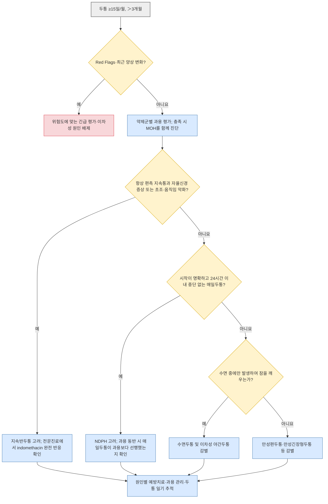

# 만성 두통 Chronic Headache

## <mark style="color:green;">일반 사항</mark>

* 만성 두통은 일반적으로 ≥15일/월, ＞3개월 지속되는 두통을 가리키는 임상적 포괄 용어이며, 그 자체가 하나의 ICHD-3 진단명은 아님
* 원발두통의 만성형, 신생매일지속두통 등의 기타 원발두통, 지속반두통 등의 삼차자율신경두통, 약물과용두통을 포함한 2차두통 등이 만성 두통의 범주에 해당
* 1차 진료에서는 위험 신호를 확인하여 생명을 위협하는 원인 질환을 조기에 감별하는 것이 중요

### <mark style="color:$danger;">🚩 Red Flags!</mark> <a id="red-flags"></a>

☞ [두통 Red Flags](015_-headache.md#red-flags) 참조

<mark style="color:$danger;">**즉각 조치**</mark>

* 벼락두통, 새 마비·언어 장애·의식 변화, 발열과 경부 강직, 급격한 시력 저하 등 : 기존 만성 두통이 있어도 즉시 응급 평가

<mark style="color:$warning;">**당일~수일 내 평가**</mark>

* 유두부종·반복 구토·진행성 시력 증상은 당일 긴급 평가. 암·면역저하·임신·산후의 신규 또는 진행성 두통도 신속 평가

<mark style="color:$info;">**조기 평가 및 추적**</mark>

* 두통 빈도·양상의 변화, 급성기 약물 사용 증가, 적절한 예방치료에도 지속되는 기능장애

### <mark style="color:orange;">감별</mark>

* 최근 시작, 최근 변화, 증상 진행 → 2차성 두통
* 발열, 체중 감소, 악성 종양 과거력 → 전신적 질환, 2차성 두통
* ≥15일/월 중 ≥8일/월 편두통형 두통 → [만성 편두통](016_-migraine.md#chronic-migraine)
* ≥15일/월이면서 만성 편두통 기준을 충족하지 않고 긴장형두통 양상이 우세 → [긴장형두통](017_-tension-type-headache.md)의 만성형
* 시작 시점을 명확히 기억하고, 발생 후 24시간 이내에 지속적이고 중단 없는 매일두통으로 전환 → 신생매일지속두통
* 급성기·대증 두통약을 약제군별 기준 이상으로 ＞3개월 사용 → 약물과용두통
* 심한 두통, 편측, 눈물/콧물, 시계 같은 규칙성, 군집성 발생, 치료하지 않을 때 보통 15~180분 → [군발두통](015_-headache.md#cluster-treatment)
* 경부 외상력, 목 움직임으로 유발 → [경추성두통](019_-cervicogenic-headache.md)
* 일시적 시각장애, 박동성 이명, 복시, 유두부종 → 특발성 두개내고혈압; 안저·시야평가 필요(비만 여성에서 흔하지만 인구학적 특징만으로 판단하지 않음)
* 불안, 우울 동반 → 정신과적 동반 질환(comorbidity)으로 병행 관리; 2차성 두통 가능성도 배제
* 경추/턱관절 움직임 제한 또는 통증 → 경추성두통, 턱관절 이상
* 두통의 2차 원인 감별을 위한 [SNNOOP10](015_-headache.md#snnoop10)

***



수면두통은 월 ≥10일 기준으로도 진단할 수 있으며 이 도표의 만성 매일두통 범위 밖에서도 평가. 저자 재구성(참고 문헌: ICHD-3; EAN MOH 2020).

***

## <mark style="color:green;">1차성 두통</mark>

### <mark style="color:orange;">장시간 지속 또는 지속성 두통의 감별</mark>

* 종류 : Chronic migraine, Chronic tension type headache, New daily persistent headache, Hemicrania continua

#### <mark style="color:$primary;">신생매일지속두통 (New daily persistent headache, NDPH)</mark>

* 매일 지속되는 두통, 시작 시점을 명확히 기억함
* 통증은 특징적 양상이 없으며 편두통 또는 긴장형두통 요소를 모두 가질 수 있음
* 전형적으로 과거 두통의 병력이 없는 사람에서 발생

A. 아래의 진단 기준 B, C를 충족시키는 지속되는 두통

B. 뚜렷하고 확실히 기억되는 시작이 있으며, 발생 후 24시간 이내에 지속적이고 중단 없는 통증으로 전환

C. ＞3개월 존재

D. 다른 ICHD-3 진단으로 더 잘 설명되지 않음<sup>1\~4)</sup>

> ¹⁾_전형적으로 과거 두통의 병력이 없는 사람에서 발생하여 시작부터 매일 중단 없이 지속함. 과거 편두통 또는 긴장형두통 병력이 있어도 배제되지는 않지만, NDPH 발생 전에 두통 빈도가 점차 증가했거나 약물과용과 함께 악화된 경과여서는 안 됨. 환자가 시작 시점을 기억하여 정확히 묘사할 수 없다면 다른 진단을 고려_\
> ²⁾_두통이 만성 편두통 또는 만성 긴장형두통의 진단 기준을 충족하더라도 NDPH 기준에 맞으면 NDPH로 진단함. NDPH와 지속반두통의 기준을 모두 충족하면 지속반두통으로 진단_\
> ³⁾_약물과용 기준을 초과하더라도 매일두통의 발생이 약물과용보다 명확하게 선행한 경우에만 NDPH를 진단할 수 있으며, 이때 NDPH와 약물과용두통을 함께 진단_\
> ⁴⁾_모든 경우에서 2차두통(예: 두부외상 후 두통, 뇌척수액 고압·저압 두통)을 적절한 검사로 배제해야 함 <mark style="color:$info;">\[ICHD-3]</mark>_

#### <mark style="color:$primary;">지속반두통 (Hemicrania continua)</mark>

* 항상 편측으로 발생하는 지속적인 통증으로 같은 쪽의 결막 충혈, 눈물, 코 막힘, 콧물, 이마와 얼굴의 땀, 동공 수축, 눈꺼풀 처짐, 눈꺼풀 부종을 동반
* 두통은 indomethacin에 매우 민감하게 반응
* 새로 발생한 지속적인 strictly side-locked headache 또는 삼차자율신경두통 양상에서는 구조적 병변 배제를 위해 뇌 MRI를 적극 고려

A. 아래의 진단 기준 B\~D를 충족시키는 편측 두통

B. ＞3개월 지속되며, 중등도 이상의 악화기(exacerbation)를 동반

C. 다음 중 하나 이상 해당

1. 두통과 동측으로 다음 중 ≥1가지 존재
   1. 결막 충혈 &/or 눈물
   2. 코 막힘 &/or 콧물
   3. 눈꺼풀 부종
   4. 이마 및 안면 발한
   5. 동공 축소 &/or 눈꺼풀 처짐
2. 안절부절, 초조, 또는 움직임에 의해 통증 악화

D. 치료 용량의 indomethacin에 절대적으로 반응함¹⁾

E. 다른 ICHD-3 진단으로 더 잘 설명되지 않음

> ¹⁾_ICHD-3의 성인 치료 용량은 경구 indomethacin ≥150 ㎎/d이며 필요 시 225 ㎎/d까지 제시함. **인도메타캡슐의 허가상 최대량은 200 ㎎/일이므로 225 ㎎/일을 일반 처방의 증량 목표로 적용하지 않으며**, 해당 두통의 진단적 투여·고용량 사용은 전문진료에서 판단. 실제 임상에서는 위장관·신장 부작용을 줄이기 위해 25 ㎎ tid에서 시작하여 단계적으로 증량할 수 있으나, 저용량에서의 불충분한 반응만으로 indomethacin 무반응으로 판단하지 않음. 완전 반응 확인 후 최소 유효 용량으로 감량_

### <mark style="color:orange;">주로 짧은 발작을 보이는 두통의 감별</mark>

* 종류 : Chronic cluster headache, Chronic paroxysmal hemicrania, Hypnic headache, Primary stabbing headache, Short-lasting unilateral neuralgiform headache attacks


만성 군발두통과 만성 발작성반두통에서 '만성'은 이 챕터가 쓰는 빈도·기간 기준(≥15일/월, ＞3개월)과는 다른 개념. 두 질환은 발작기(bout)와 관해기가 반복되는 구조이며, 발작기 중에는 하루 수 회 발작이 나타나 오히려 ≥15일/월 기준을 쉽게 넘길 수 있음. 따라서 만성형 여부는 한 달 발생일수가 아니라 관해기의 유무·길이로 정의됨 - 관해기가 전혀 없거나 있어도 ＜3개월인 상태가 최소 1년간 지속되면 만성형(반대로 관해기가 ≥3개월이면 삽화성)<mark style="color:$info;">\[ICHD-3]</mark>


#### <mark style="color:$primary;">수면두통 (Hypnic headache)</mark>

* 수면 중에만 반복적으로 발생하여 잠에서 깨어나게 하는 두통(일명 alarm clock headache)
* 특징적인 동반 자율신경 증상이 없으며 다른 병리에 기인하지 않음
* 보통 50세 이후에 발생
* 둔한 두통, 종종 양측성

**진단 기준**

A. 아래의 진단 기준 B\~E를 충족하는 반복되는 두통 발작

B. 잠자는 동안에만 발생하여 잠에서 깨게 함

C. ＞3개월 동안 ≥10일/월 발생

D. 잠에서 깬 후 15분\~4시간 지속

E. 자율 신경 증상이나 안절부절못함은 없음

F. 다른 ICHD-3 진단으로 더 잘 설명되지 않음<sup>1,2)</sup>

> ¹⁾_효과적인 치료를 위하여 삼차자율신경두통들(군발두통)과의 감별이 필요_\
> ²⁾_수면 중 발생하여 잠에서 깨어나게 하는 두통의 다른 가능한 원인들(예: 수면무호흡증, 야간 고혈압, 저혈당, 약물과용, 두개내질환)을 감별. 폐쇄수면무호흡증이 병존한다는 사실만으로 수면두통이 배제되지는 않으며 두통과의 인과관계를 평가_


**주의 - 이차성 원인 배제 후 진단 :** 50세 이후 처음 발생하는 수면 중 두통은 두개내종양, 폐쇄수면무호흡증(OSA), 야간 고혈압, 저혈당, 약물과용 등을 우선 평가. 새로 발생한 야간 두통에서는 이차성 두개내병변 배제를 위해 뇌 MRI를 적극 고려


## <mark style="color:green;">2차성 두통</mark>

### <mark style="color:orange;">종류</mark>

* 두경부 외상 또는 손상에 기인한 두통 : 외상 후 두통, 경막하혈종 등
* 두개·경부 혈관질환에 기인한 두통 : 동맥박리, 뇌정맥혈전증, 혈관염, 거대세포동맥염, 동정맥기형 등
* 비혈관성 두개내질환에 기인한 두통 : 두개내종양, 특발성 두개내고혈압, 자발두개내압저하 등
* 물질 또는 금단에 기인한 두통 : 약물과용두통 등
* 감염 또는 항상성 장애에 기인한 두통 : 중추신경계감염, 폐쇄수면무호흡증, 저산소증·고탄산혈증 등
* 두개·경부·안면 구조물의 질환에 기인한 두통·안면통 : 경추성두통, 턱관절질환, 안과·이비인후과·치과 질환 등 <mark style="color:$info;">\[ICHD-3]</mark>

### <mark style="color:orange;">약물과용두통 (Medication overuse headache, MOH)</mark> <a id="medication-overuse-headache-moh"></a>

* 기존 두통질환이 있는 환자에서 ≥15일/월 두통이 있으면서, 급성기·대증 치료 약제를 ＞3개월 동안 다음 기준 이상 과용하면 약물과용두통을 고려
  * 다음 약제를 한 달에 ≥10일 복용 : triptan, opioid, ergotamine, 복합진통제
  * 다음 약제를 한 달에 ≥15일 복용 : acetaminophen, aspirin, NSAID 등 단순진통제
  * acetaminophen·aspirin·NSAID는 **비마약성 진통제 한 약물군으로 합산**하여 ≥15일/월 기준을 적용
  * 서로 다른 급성기 약물군을 번갈아 사용하고 개별 약물군은 과용 기준에 미달하더라도, 합계 ≥10일/월이면 복수 약물군 과용을 고려. 같은 날 여러 약을 썼으면 전체 사용일수에서는 1일로 계산
* MOH는 기저 두통질환을 대체하는 개념이 아니며, 만성 편두통·긴장형두통 등과 각각의 기준을 충족하면 함께 진단

#### <mark style="color:$primary;">진단 기준</mark>

A. 기존 두통질환이 있는 환자에서 ≥15일/월 발생하는 두통

B. 급성기 &/or 대증 치료로 사용될 수 있는 ≥1가지의 약물을 ＞3개월 동안 규칙적으로 과용<sup>1\~3)</sup>

C. 다른 ICHD-3 진단으로 더 잘 설명되지 않음

> ¹⁾_각 환자는 과용한 약물의 종류와 해당 진단 기준에 따라 한 가지 이상의 아형으로 분류할 수 있음(예: 트립탄과용두통, 단순진통제과용두통, 복합진통제과용두통)_\
> ²⁾_여러 진통제를 병용하지만 개별 약물군은 과용 기준에 해당하지 않지만 서로 다른 급성기 약물군의 합산 사용일수가 ≥10일/월인 경우 ‘개별적으로는 과용되지 않은 복수 약물군의 과용에 의한 두통’으로 진단_\
> ³⁾_두통의 급성기 또는 대증 치료 목적으로 약물을 과용하지만 약물명·용량이 명확하지 않은 경우 정확한 정보가 확인될 때까지 ‘확인되지 않은 복수 약물군에 의한 약물과용두통’으로 진단 <mark style="color:$info;">\[ICHD-3]</mark>_

***

## <mark style="background-color:$warning;">Management</mark>

### <mark style="color:orange;">치료 원칙</mark>

* 생활 치료 : 수면 개선, 규칙적 유산소 운동, 스트레스 관리, 두통 일지 작성
* 유발 요인 제거, 만성 편두통 또는 만성 긴장형두통 치료
* 불안·우울 등 정신건강 문제 동반 시 병행 치료
* 스테로이드 사용 주의
  * 만성 두통 자체를 치료하기 위한 장기 전신 스테로이드 요법은 권고하지 않음. 확진된 부신기능저하증의 호르몬 대체치료는 별도 적응증
  * MOH 약물 중단 시 corticosteroid를 단기 bridge로 사용한 연구가 있으나 효과는 일관되지 않아 일상적 표준 요법으로 권고하지 않음

#### <mark style="color:$primary;">신생매일지속두통 (NDPH)</mark>

* 양질의 무작위시험 근거가 부족하고 치료 반응이 제한적인 경우가 많음
* 편두통형 또는 긴장형 양상에 따라 해당 예방치료를 준용하는 phenotype-guided 치료가 일반적임
* 편두통형 : amitriptyline, topiramate, valproate 등
* 긴장형 : amitriptyline, nortriptyline, mirtazapine 등
* 위 약제의 NDPH 치료는 국내 허가 외 사용이며, valproate·topiramate는 임신 가능성이 있는 환자에서 태아 위해를 고려하여 가급적 피하고 피임·임신 계획을 확인
* doxycycline, mexiletine, naltrexone 등이 증례 수준에서 보고되었으나 근거가 매우 제한적이므로 표준 치료로 권고하지 않음
* Self-limiting subtype은 수개월 내 자연 소실 가능
* Refractory subtype은 수년간 지속되며 예후가 다름
* 진단 시 2차 원인 배제가 필요하고 난치성이 많으므로 신경과 의뢰를 적극 고려

#### <mark style="color:$primary;">지속반두통 (Hemicrania continua)</mark>

* 1차 치료 : indomethacin - 진단 기준(criterion D)에 포함될 만큼 완전 반응이 중요함(진단적 치료). 실제 임상에서는 25 ㎎ tid부터 시작하여 내약성을 확인하며 증량하되, 진단적 충분 용량에 도달하기 전에 무반응으로 판단하지 않음 [인도메타](https://www.health.kr/drug/2011080300001)
* 투여 전후 위장관 출혈·궤양, 신기능, 혈압·심혈관 위험 및 병용약을 평가. PPI는 위장관 위험을 줄이지만 신장·심혈관 위험을 예방하지 않음
* indomethacin 불내성 시 대안(모두 근거가 제한된 허가 외 사용)
  * celecoxib : 200 ㎎ bid [쎄레브렉스](https://www.health.kr/drug/A11ABBBBB1346) - 지속반두통에 대한 근거 제한적 허가 외 용량으로, 일반 골관절염 용량과 구분
    * 국내 제품은 확립된 허혈성 심장질환·말초동맥질환·뇌혈관질환, NYHA II–IV 심부전, CrCl ＜30 ㎖/min, 활동성 궤양·출혈 등에서 투여 금기. 단순 위험인자 평가와 금기를 구분하고 PPI 병용으로 금기가 해소되는 것으로 설명하지 않음(001 참조)
  * topiramate : 50\~100 ㎎/d [토파맥스](https://www.health.kr/drug/2020080600008)
  * melatonin : 3\~10 ㎎ 취침 전 - 국내 처방용 제품은 주로 2 ㎎ 서방형이므로 문헌의 용량·제형과 직접 대응하지 않음
* 후두신경차단술(Occipital nerve block) : indomethacin 반응은 있으나 장기 복용이 어려운 경우 보조적 선택지로 고려 가능 (근거 제한적)

#### <mark style="color:$primary;">수면두통 (Hypnic headache)</mark>

* 1차 치료 : 취침 전 caffeine 40~60 ㎎ 등 저용량으로 시도(커피의 카페인 함량은 종류·용량에 따라 달라 고정 용량으로 간주하지 않음) - 불면·야간뇨 악화 가능성을 고려하며 근거는 주로 증례·관찰연구 수준
* 대안
  * lithium carbonate : 150\~[300 ㎎](https://www.health.kr/drug/A11A0920A0030) 취침 전 [명인탄산리튬 150 ㎎](https://www.health.kr/drug/2015102800003)
    * 투여 전 신기능·갑상선기능·전해질·칼슘, 고령자에서 필요 시 ECG 확인
    * 시작·용량 변경 약 1주 후 혈중 농도를 확인(마지막 복용 약 12시간 후 채혈), 안정될 때까지 추적. NSAID·ACE 억제제·ARB·이뇨제의 상호작용 및 제품별 병용금기(예: sumatriptan, chlorthalidone, spironolactone)를 확인
  * indomethacin : 25\~50 ㎎ 취침 전
  * melatonin : 3\~5 ㎎ 취침 전
* 위 치료는 모두 수면두통에 대한 국내 허가 외 사용이며, 특히 lithium은 고령자에서 내약성과 상호작용을 면밀히 평가

#### <mark style="color:$primary;">약물과용두통 (MOH)</mark>

* 치료의 핵심은 환자 교육 + 과용 약물 중단/감량 + 기저 두통의 예방 치료임
* 단순진통제·triptan·ergotamine 과용은 대부분 외래에서 즉시 중단(abrupt withdrawal) 가능
* opioid·barbiturate 함유 약물 과용은 의존·금단 위험을 평가하여 점진적 감량을 계획하며, 외래 중단이 어렵거나 고용량·복합 의존이 있으면 신경과/중독 전문진료 또는 입원 치료를 고려
* benzodiazepine은 ICHD-3의 MOH 원인 약제군은 아니지만, 병용·의존이 있으면 급격히 중단하지 말고 MOH와 별개로 점진적 감량 계획을 세움
* 약물과용을 동반한 편두통에서는 예방치료 단독도 예방치료와 급성기 약물 중단을 병행한 전략과 유사한 효과를 보일 수 있음. 다만 오피오이드 또는 바르비투르산 함유 약물 과용에는 이를 일반화할 근거가 부족함. 따라서 일률적인 중단만을 강조하기보다 환자 상황에 맞추어 예방치료를 조기에 시작하고 과용 약물을 감량·중단 <mark style="color:$info;">\[AAN/AHS 2026]</mark>

<mark style="color:cyan;">**브릿지 요법 (선별적 사용)**</mark>

* 약물 중단 후 초기 수일간 반동 두통·오심·수면장애 등이 악화될 수 있음을 사전에 설명
* bridge therapy 전반의 근거는 제한적이며 모든 환자에게 일상적으로 필요하지 않음
  * naproxen : 250\~500 ㎎ bid를 단기간(대개 수일~1주; 연장 필요 시 재평가) 고려할 수 있음
    * NSAID 과용 환자에서는 동일 계열이므로 피함
  * corticosteroid : 일부 연구에서 사용되었으나 효과가 일관되지 않아 routine bridge로 권고하지 않음
* MOH 재발 예방을 위해 급성기 두통약은 가급적 주 2일 이하로 제한
* ICHD-3의 과용 기준은 약제군에 따라 ≥10일/월 또는 ≥15일/월이므로 환자 교육 시 두 기준을 구분

<mark style="color:cyan;">**예방 치료**</mark>

* 약물 중단과 동시 또는 조기에 시작
* 편두통형 : topiramate, valproate, amitriptyline 등
  * 임신 가능성이 있는 환자에서는 valproate·topiramate의 태아 위해를 고려
* 긴장형 : amitriptyline (1차), nortriptyline, mirtazapine
* Amitriptyline·nortriptyline 등 TCA를 예방약으로 선택할 때 급성기 약제도 함께 검토. [타이레놀정500㎎](https://www.health.kr/drug/2021082400002) 등 TCA 복용 환자 투여 금기가 있는 acetaminophen 품목은 병용하지 않으며, 대체 진통제도 자체 금기와 MOH 위험을 확인함(001 참조)
* 만성 편두통 동반 시 OnabotulinumtoxinA(PREEMPT protocol 기반, 155\~195 units), CGRP 단클론항체, atogepant 또는 topiramate를 우선 고려할 수 있으며 국내 허가·급여 기준 확인 <mark style="color:$info;">\[AAN/AHS 2026]</mark>

<mark style="color:cyan;">**추적 관찰**</mark>

* 2주 : 금단 증상, 약물 사용일수 및 순응도 확인
* 4\~8주 : 두통 빈도·강도, 급성기 약물 사용일수, 예방치료 반응 재평가
* 8주 전후 : 치료 전략을 재조정하는 시점이며, ICHD-3상 MOH의 '진단 확정 시점'을 의미하지 않음
* 중단 후에도 만성 두통이 지속되면 기저 원발두통의 예방 치료를 강화

#### <mark style="color:$primary;">편두통 예방치료제 요약 (CGRP 표적 치료 포함; MOH 동반 환자)</mark>

* 만성 편두통에서 atogepant, eptinezumab, erenumab, fremanezumab, galcanezumab, onabotulinumtoxinA, topiramate, valproate 고려 <mark style="color:$info;">\[AAN/AHS 2026]</mark>
* MOH 동반 편두통에서도 예방치료를 제공하며, 근거가 있는 CGRP 단클론항체, atogepant, onabotulinumtoxinA, topiramate를 우선 고려 <mark style="color:$info;">\[AAN/AHS 2026]</mark>
* 단, 국내 실제 사용 순서는 각 성분의 허가사항과 보험 급여 기준에 따라 달라질 수 있음

<table><thead><tr><th width="142">구분</th><th width="223">성분명 [상품명]</th><th>용법 · 국내 현황</th></tr></thead><tbody><tr><td rowspan="3">항체 주사제 (SC)</td><td>Galcanezumab [앰겔러티](https://www.health.kr/drug/2019090900019)</td><td>120 ㎎/월 SC (초회 240 ㎎); 기준 충족 시 급여</td></tr><tr><td>Fremanezumab [아조비](https://www.health.kr/drug/2021072800006)</td><td>225 ㎎/월 or 675 ㎎/분기 SC; 기준 충족 시 급여</td></tr><tr><td>Erenumab (Aimovig)</td><td>70~140 ㎎/월 SC; <em>국내 미도입</em></td></tr><tr><td>항체 주사제 (IV)</td><td>Eptinezumab <mark style="color:blue;">[바이엡티]</mark></td><td>100 ㎎/12주 IV, 일부 환자 300 ㎎/12주; <em>2026년 5월 국내 허가, 출시·급여 여부 최신 확인</em></td></tr><tr><td rowspan="2">경구용 Gepant¹⁾</td><td>Rimegepant [너텍](https://www.health.kr/drug/2025032500010)</td><td>75 ㎎; 급성기 치료 + 삽화성 편두통 예방(격일 복용); 만성 편두통 예방 적응증 없음; 2026년 9월 국내 출시, 비급여</td></tr><tr><td>Atogepant [아큅타](https://www.health.kr/drug/2023111600013)</td><td>60 ㎎ qd; 강력한 CYP3A4 억제제·OATP 억제제 병용 또는 중증 신장애·ESRD 시 [10 ㎎](https://www.health.kr/drug/2023111600012) qd; 삽화성·만성 편두통 예방; 비급여</td></tr></tbody></table>

> ¹⁾_Gepant는 현재까지 기존 단순진통제·triptan과 같은 MOH 유발 신호가 확립되지 않았으나 장기 자료는 제한적임. 기존 진통제·triptan 과용 환자에서 유용할 수 있음_
>
> ※ [Fremanezumab 급여기준](https://www.hira.or.kr/rc/insu/insuadtcrtr/InsuAdtCrtrPopup.do?mtgHmeDd=20240701\&sno=4\&mtgMtrRegSno=0005) 및 [Galcanezumab 급여기준](https://www.hira.or.kr/rc/insu/insuadtcrtr/InsuAdtCrtrPopup.do?mtgHmeDd=20240701&mtgMtrRegSno=0006&sno=4) : galcanezumab·fremanezumab은 ICHD-3에 부합하는 만 18세 이상 만성 편두통 환자 중 ① 최소 1년 이상 편두통 병력 및 투여 전 최소 6개월간 월 두통일수 ≥15일(그중 편두통형 두통 ≥8일), ② MIDAS ≥21점 또는 HIT-6 ≥60점, ③ topiramate, divalproex, amitriptyline, flunarizine, propranolol 또는 nadolol 중 3종 이상의 편두통 예방약 치료 실패(각 약제를 최대 내약 용량으로 8주 이상 투여해도 월 편두통일수가 50% 이상 감소하지 않았거나, 부작용 또는 금기로 사용할 수 없는 경우)를 모두 충족할 때 급여 인정. 투여 후 3개월마다 반응을 평가하며 월 편두통일수가 기저치 대비 50% 이상 감소한 경우 지속 투여를 인정하고 최대 급여 인정기간은 12개월. 경구 gepant는 비급여. 급여 기준은 변경될 수 있으므로 최신 HIRA 고시 확인

***

## <mark style="color:red;">질병코드</mark>

* G44.2 긴장형두통 Tension-type headache
* G44.3 만성 외상후 두통 Chronic post-traumatic headache
* G44.4 달리 분류되지 않은 약물유발 두통 Drug-induced headache, NEC
* G44.8 기타 명시된 두통증후군 Other specified headache syndromes
* G93.2 양성 두개내고혈압/특발성 두개내고혈압 Benign intracranial hypertension
* 편두통(G43 계열)은 별도 편두통 챕터의 질병코드 참조

***

## <mark style="color:purple;">처방례</mark>

> **처방례 1. 신생매일지속두통 - 편두통형**
>
> ```
> 에트라빌정10㎎  1회 1T  취침 전
>   → 2~4주마다 10 ㎎씩 증량, 목표 25~75 ㎎/d
> 또는 토파맥스정25㎎  1회 1T  취침 전
>   → 2~4주마다 25 ㎎씩 증량, 목표 50~100 ㎎/d
> ※ 임신 가능성이 있는 환자에서는 topiramate를 가급적 피하고 피임·임신 계획 확인
> ```
>
> 약제 정보: [에트라빌정·10 ㎎](https://www.health.kr/drug/A11A0570B0082) · [토파맥스정·25 ㎎](https://www.health.kr/drug/2020080600008)
>
> _✽NDPH에 대한 phenotype-guided 허가 외 사용이며, 두 약제를 처음부터 routine 병용하지 않음_

> **처방례 2. 지속반두통 (Hemicrania continua) - 진단 및 1차 치료**
>
> ```
> 인도메타캡슐25㎎  1회 1C  1일 3회 (식사와 함께 또는 식후)
>   → 불완전 반응이면 내약성을 확인하며 단계적으로 증량
>   → 진단적 충분 용량과 반응을 전문진료에서 확인
> ※ ICHD-3는 ≥150 ㎎/일(필요시 225 ㎎/일)을 제시하나, 이 제품 허가상 최대량은 200 ㎎/일
> ※ 225 ㎎/일을 일반 외래 처방 목표로 적용하지 않음
>   → 완전 반응 확인 후 최소 유효 용량으로 감량
> 오메드정20㎎  1회 1T  1일 1회 식전 (위장 보호)
> ※ 투여 전후 위장관 출혈·궤양, 신기능, 혈압·심혈관 위험 및 병용약 평가
> ※ 고용량 증량이 필요하거나 진단이 불확실하면 신경과 협진 권장
> ```
>
> 약제 정보: [인도메타캡슐·25 ㎎](https://www.health.kr/drug/2011080300001) · [오메드정·20 ㎎](https://www.health.kr/drug/A11A1890A0146)
>
> _✽indomethacin 불내성 시 celecoxib 등 대안을 고려할 수 있으나, 대체약 반응은 hemicrania continua의 진단 기준을 대신하지 않음. Celecoxib도 국내 제품의 심혈관질환·NYHA II–IV 심부전·중증 신장애·활동성 궤양/출혈 등 금기를 먼저 확인하며, indomethacin을 사용할 수 없다는 이유만으로 자동 대체하지 않음(001 참조)_

> **처방례 3. 수면두통 (Hypnic headache)**
>
> ```
> [1차] 취침 전 caffeine 40~60 ㎎ 등 저용량으로 시도
> ※ 커피는 함량 변이가 커 같은 용량으로 간주하지 않음
> [대안] 명인탄산리튬정150㎎  1회 1T  취침 전
>   → 반응·혈중농도·내약성에 따라 300 ㎎ 취침 전까지 조정
>   → 치료 전 신기능·갑상선기능·전해질·칼슘, 고령자에서 필요 시 ECG 확인
>   → 시작·용량 변경 약 1주 후 혈중농도 확인(마지막 복용 약 12시간 후 채혈)
>   → NSAID·ACE 억제제·ARB·이뇨제 등 상호작용·병용금기 확인
> 또는 인도메타캡슐25㎎  1회 1C  취침 전 (식사 또는 간식과 함께)
> ```
>
> 약제 정보: [명인탄산리튬정·150 ㎎](https://www.health.kr/drug/2015102800003) · [명인탄산리튬정·300 ㎎](https://www.health.kr/drug/A11A0920A0030) · [인도메타캡슐·25 ㎎](https://www.health.kr/drug/2011080300001)
>
> _✽수면두통 치료는 국내 허가 외 사용이며 근거는 주로 증례·관찰연구 수준_

> **처방례 4. 약물과용두통 (MOH) - 약물 중단 + 예방 치료**
>
> ```
> [과용 약물 중단]
> 단순진통제·triptan 과용 → 원칙적으로 즉시 중단
> opioid·barbiturate 과용 → 점진적 감량 및 전문진료 고려
>
> [필요 시 단기 브릿지 - NSAID 과용이 아닌 경우]
> 낙센에프정500㎎  1회 1T  1일 2회 × 5~7일
>   → 증상에 따라 최단기간 사용, 반복·장기 사용 피함
>
> [예방 치료 - 동시 또는 조기 시작]
> 토파맥스정25㎎  1회 1T  취침 전 → 2~4주 간격으로 단계적 증량 (목표 용량은 반응·내약성에 따라 조정)
> 또는 에트라빌정10㎎  1회 1T  취침 전부터 시작하여 반응·내약성에 따라 증량 (긴장형두통 동반 시 고려)
> ※ 임신 가능성이 있는 환자에서는 topiramate의 태아 위해를 고려하여 피임·임신 계획 확인
> ```
>
> 약제 정보: [낙센에프정·500 ㎎](https://www.health.kr/drug/A11A0120A0594) · [토파맥스정·25 ㎎](https://www.health.kr/drug/2020080600008) · [에트라빌정·10 ㎎](https://www.health.kr/drug/A11A0570B0082)
>
> _✽corticosteroid bridge는 효과가 일관되지 않아 routine으로 사용하지 않음_

***

### <mark style="color:$success;">핵심 복약 지도</mark>

> **약물과용두통(MOH) - 진통제 중단 안내**
>
> * 현재 두통이 자주 나타나고 진통제를 반복 복용하고 있다면, 약물이 두통의 악화·만성화에 기여할 수 있습니다.
> * 특히 **약국에서 처방 없이 구입할 수 있는 카페인 함유 복합 진통제**(게보린, 펜잘 등)는 효과가 빠르게 느껴져 자주 복용하게 되지만, MOH를 일으키는 주요 원인입니다.
> * **복용 중인 진통제(특히 카페인 복합제·트립탄·오피오이드)를 줄이거나 중단하고 기저 두통에 맞는 예방치료를 병행**하는 것이 중요합니다. 재발 예방을 위해 급성기 두통약은 가급적 주 2일 이하로 제한하고, 약제군별 과용 기준(10일/월 또는 15일/월)을 넘지 않도록 하십시오.
> * 중단 후 **2~10일간 두통·구역·수면장애가 일시적으로 악화될 수 있습니다.** 호전 속도는 개인마다 다르며, 견디기 어렵거나 탈수·새 신경 증상이 생기면 진료를 받으십시오.
> * 오피오이드·바르비투르산계·벤조디아제핀을 장기간 복용했다면 갑자기 끊지 말고 반드시 담당 의사와 감량 계획을 세우십시오.

> **예방약 (토파맥스·에트라빌 등)**
>
> * 효과는 수 주에 걸쳐 나타나며 편두통 예방약은 보통 충분한 내약 용량에서 **8~12주** 후 효과를 평가합니다. 임의로 중단하지 마십시오.
> * 토파맥스(topiramate)는 물을 충분히 마시면 신결석 위험을 줄이는 데 도움이 됩니다. 시야 흐림·눈 통증이 갑자기 생기면 즉시 진료받으십시오.
> * 에트라빌(amitriptyline)은 취침 전 복용하며, 구갈·졸음이 생길 수 있습니다.

> **인도메타신 (지속반두통)**
>
> * 지속반두통 진단 시 인도메타신에 완전히 반응하는 것이 진단의 중요한 기준입니다.
> * 음식과 함께 또는 식후에 복용하고, 처방받은 위산분비억제제도 지시대로 복용하십시오. 음식·위장약이 출혈이나 신장 부작용을 모두 막지는 못합니다.
> * 흑색변·토혈·심한 복통·소변량 감소가 생기면 복용을 중단하고 즉시 진료를 받으십시오. 다른 소염진통제를 임의로 추가하지 마십시오.
> * 증상이 조절되면 최소 유효 용량으로 감량합니다.

> **리튬(수면두통)**
>
> * 정해진 혈액검사 일정을 지키고 물·염분 섭취를 일정하게 유지하십시오. 탈수·설사·구토가 생기면 담당 의사에게 알리십시오.
> * 심한 떨림·비틀거림·말 어눌함·혼동·반복 구토가 생기면 추가 복용하지 말고 즉시 응급 평가를 받으십시오.
> * 일반 진통제·혈압약·이뇨제를 새로 복용하기 전에 상호작용을 확인하십시오.

> **언제 다시 병원을 방문해야 하나요?**
>
> * 진통제를 줄인 뒤에도 두통이 지속되거나 악화되어 일상생활이 어려운 경우
> * 두통 양상이 갑자기 변하거나 신경 증상이 새로 생긴 경우 - 즉시 응급실 방문
> * 예방약 복용 2개월 후에도 두통 빈도가 줄지 않는 경우

***

## <mark style="color:green;">주요 참고문헌 및 확인 자료</mark>

### <mark style="color:orange;">임상 근거</mark>

* \[ICHD-3] [Headache Classification Committee of the International Headache Society (IHS). The International Classification of Headache Disorders, 3rd edition. Cephalalgia. 2018;38(1):1-211.](https://ichd-3.org/) - 두통의 분류·진단 기준 및 약물과용 기준
* \[AAN/AHS 2026] [Potrebic S, et al. Pharmacologic Treatment for Migraine Prevention in Adults: Practice Guideline Recommendations. Headache. 2026;66(9):2173-2184.](https://doi.org/10.1111/head.70199) - 예방치료 대상·약제 선택 및 약물과용 동반 환자의 치료
* [Diener HC, et al. European Academy of Neurology guideline on the management of medication-overuse headache. Eur J Neurol. 2020;27(7):1102-1116.](https://doi.org/10.1111/ene.14268) - 과용 약물 중단·감량과 예방치료
* [Mollan SP, et al. Idiopathic intracranial hypertension: consensus guidelines on management. J Neurol Neurosurg Psychiatry. 2018;89(10):1088-1100.](https://doi.org/10.1136/jnnp-2017-317440) - 유두부종·두개내압 상승 의심 환자의 평가와 시력 보호

* [NHS Specialist Pharmacy Service. Lithium monitoring.](https://www.sps.nhs.uk/monitorings/lithium-monitoring/) - 혈중농도 채혈 시점·추적 및 독성 평가

* [The hypnic ("alarm clock") headache syndrome.](https://pubmed.ncbi.nlm.nih.gov/9595209/) - 카페인·리튬 치료의 소규모 관찰 근거

### <mark style="color:orange;">허가·급여 확인 자료</mark>

* [식품의약품안전처. 의약품안전나라 - 의약품 품목허가정보.](https://nedrug.mfds.go.kr/) - 국내 제품별 적응증·용법·금기 및 허가 상태 확인
* [건강보험심사평가원. Fremanezumab 주사제(아조비) 급여기준. 고시 제2024-130호 (2024-07-01 시행).](https://www.hira.or.kr/rc/insu/insuadtcrtr/InsuAdtCrtrPopup.do?mtgHmeDd=20240701&sno=4&mtgMtrRegSno=0005) - 본문 연결 고시의 투여 대상·평가·기간 확인; 다른 CGRP 약제는 제품별 기준 별도 조회 (확인일 2026-10-11)


***

## <mark style="color:blue;">환자 안내서</mark>


**만성 두통, 올바른 이해가 치료의 시작입니다**

만성 두통은 적절한 치료와 생활 습관 개선으로 충분히 호전될 수 있습니다. 진통제를 자주 복용하고 있다면 약물과용 여부를 확인하고 사용을 줄이는 것이 중요한 치료 목표입니다.


#### <mark style="color:$primary;">만성 두통이란 무엇인가요?</mark>

* 한 달에 15일 이상 두통이 3개월 넘게 지속되는 상태입니다.
* 만성 편두통, 만성 긴장형두통, 약물과용두통 등 다양한 형태가 있습니다.

#### <mark style="color:$primary;">약물과용두통이란 무엇인가요?</mark>

* 두통을 가라앉히려고 진통제를 자주 먹다 보면 약물이 두통의 악화·만성화에 기여하여 악순환이 생길 수 있습니다.
* 트립탄·오피오이드·카페인 복합제는 **한 달 10일 이상**, 단순 진통제는 **한 달 15일 이상** 복용 시 약물과용두통이 생길 수 있습니다.
* 치료의 핵심은 과용 약물을 줄이거나 중단하고, 필요한 경우 예방 치료를 함께 시행하는 것입니다. 중단 초기에는 수일간 두통이 더 심해질 수 있으며 호전 속도는 개인마다 다릅니다.

#### <mark style="color:$primary;">어떻게 치료하나요?</mark>

* **진통제 중단 또는 감량** : 약물과용두통의 핵심 치료입니다. 의사와 함께 계획을 세우세요. 오피오이드·일부 의존성 약물은 갑자기 끊으면 위험할 수 있어 단계적으로 줄입니다.
* **예방약 복용** : 두통 빈도를 줄이기 위한 예방약을 처방받아 꾸준히 복용합니다.
* **생활 습관 개선** : 규칙적인 수면, 운동, 스트레스 관리, 수분 섭취가 중요합니다.

#### <mark style="color:$primary;">생활 속 실천 사항</mark>

* **두통 일기 작성** : 두통이 언제, 얼마나 자주, 어떤 상황에서 발생하는지 기록하면 치료에 큰 도움이 됩니다.
* **규칙적인 생활** : 수면·식사·기상 시간을 일정하게 유지하십시오.
* **카페인 조절** : 과도한 섭취는 줄이되, 매일 많이 섭취했다면 갑자기 끊을 때 금단 두통이 생길 수 있어 서서히 줄이십시오. 수면두통으로 취침 전 카페인을 처방받았다면 담당 의사의 지시를 따르십시오.

#### <mark style="color:$primary;">이럴 때는 즉시 병원을 방문하세요</mark>

* 두통 양상이 갑자기 변하거나 팔다리 마비·언어 장애·시야 이상이 생긴 경우
* 두통이 평소와 달리 갑자기 극심하게 시작된 경우

***
