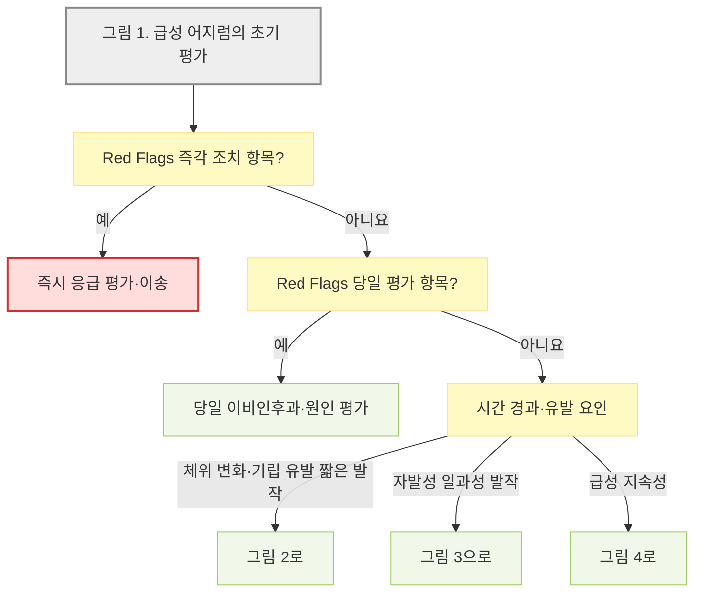
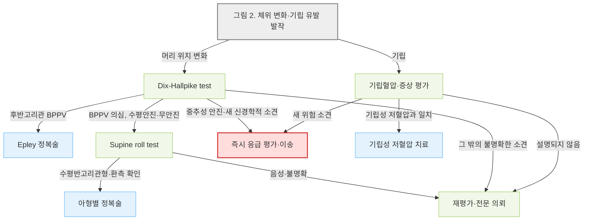
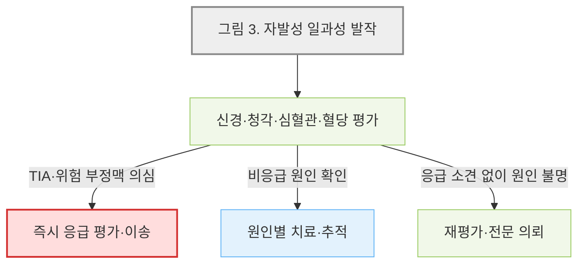
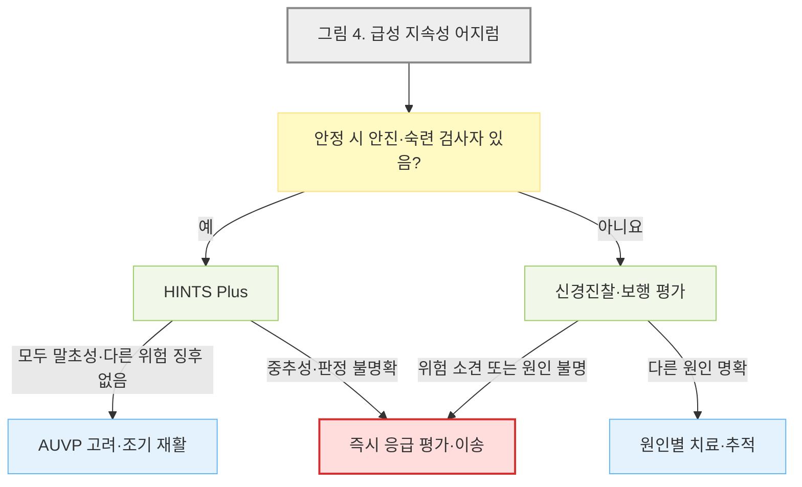

# 어지럼증 Dizziness

## <mark style="color:green;">일반 사항</mark>

* 이 장에서 ‘어지럼’은 현훈, 불안정감, 실신감 등을 포괄하는 일반적인 표현으로 사용
* 현훈(vertigo) : 실제 움직임이 없는데 자신이나 주변이 움직인다고 느끼거나, 실제 움직임을 왜곡하여 느끼는 증상. 회전감뿐 아니라 흔들림·기울어짐 등도 포함
* 어지럼(dizziness, 좁은 의미) : 움직임의 착각 없이 공간적 방향감각이 흐트러지는 느낌. 진단기준에서 현훈과 구별하여 기술할 때는 이 의미로 사용 <mark style="color:$info;">\[J Vestib Res 2009]</mark>
* 경고 증상의 긴급도에 따라 평가하며, 뇌졸중 등 응급 원인이 의심되면 이송 등 신속한 조치를 요함

### <mark style="color:orange;">증상/징후 중심 분류</mark>

* vertigo, disequilibrium, presyncope, lightheadedness는 환자의 증상 표현을 정리하는 보조 분류이며, 이 분류만으로 원인을 결정하는 것은 곤란함

#### <mark style="color:$primary;">Vertigo</mark>

* 증상 : 회전감(“방이 돈다”), 실제 움직임이 없는데 움직이는 듯한 느낌
* 원인
  * 말초성 : vertigo 원인의 대부분을 차지; BPPV, AUVP(과거 전정신경염), 미로염, Ménière Dz
  * 중추성 : 소뇌종양, 뇌졸중/TIA, 전정편두통

#### <mark style="color:$primary;">Disequilibrium</mark>

* 증상 : 불안정성, 불균형, 흔들리는 느낌
* 원인 : 파킨슨병, 말초신경병증, 진정제, 전정 신경 질환, 소뇌 장애, 시각 장애, 경추 강직, (보행 장애 관련) 근골격 질환

#### <mark style="color:$primary;">Pre-syncope</mark>

* 증상 : 실신감, 거의 기절할 것 같은 느낌, 창백, 발한, 구역, 흐릿한 시각
  * 보통 서 있거나 똑바로 앉아 있을 때 발생
    * 누워 있을 때 발생하면 부정맥 등 심장성 원인의 가능성이 증가
  * 지속 시간 : 수 초\~수 분
* 원인 : 반사성(혈관미주신경성) 실신, 기립성 저혈압 및 유발 약물, 탈수·출혈, 부정맥, 대동맥판협착 등 구조적 심질환, 심근경색·관상동맥병

#### <mark style="color:$primary;">Lightheadedness</mark>

* 증상 : 막연한 어지럼, 머리에 혈액이 부족한 느낌
* 원인 : 과호흡증후군, 공황장애, 불안증, 알코올 남용

#### <mark style="color:$primary;">Non-specific dizziness</mark>

* 원인 : 정신적 문제(스트레스, 우울), 과호흡, 두부 외상, 약물(항콜린제, 항우울제), 대사 장애(저혈당), 특정 어지럼증의 가벼운 형태

### <mark style="color:orange;">Timing-Triggers에 따른 분류</mark>

* 다음의 이유 등으로 증상·징후 중심 분류만으로는 원인을 감별하기 어려움
  * 어지럼의 여러 형태가 혼재하고, 환자는 회전감·붕 뜸·기절할 것 같음을 정확히 구분해 말하지 못하는 경우가 많음
  * 같은 환자도 질문 방식에 따라 다르게 답하므로 질적 증상 표현의 신뢰도가 낮음
* 이에 비하여 “언제 시작됐고, 얼마나 지속되며, 무엇이 유발했는가”에 대한 정보는 비교적 일관되게 얻을 수 있으므로, 시간 경과와 유발 요인을 1차 분류축으로 하는 TiTrATE(Timing, Triggers, Targeted Examination)를 활용
  * “급성으로 시작해 지속되는가, 일과성 발작인가, 자세로 유발되는가”를 파악하면 다음 검사와 치료를 결정하는 데 유용
  * 지속성 어지럼이 머리 움직임으로 심해지는 경우와, 증상이 없던 상태에서 움직임이 새 발작을 유발하는 경우를 구분함

<table><thead><tr><th width="90">분류</th><th width="380">시간 경과·유발 특징</th><th>대표 원인</th></tr></thead><tbody><tr><td><strong>t-EVS</strong></td><td>특정 동작·자세 변화가 증상이 없던 상태에서 짧은 발작을 유발</td><td>BPPV, 기립성 저혈압</td></tr><tr><td><strong>s-EVS</strong></td><td>뚜렷한 유발 요인 없이 발생하는 일과성 발작(첫 발작 포함). 진찰 시점에는 이미 소실된 경우가 흔함</td><td>TIA, 부정맥, 전정편두통, 메니에르병, 저혈당, 공황발작</td></tr><tr><td><strong>AVS</strong></td><td>급성으로 발생하여 지속되는 어지럼(보통 24시간 이상). 진찰 시점에도 증상 존재</td><td>AUVP, 미로염, 후순환 뇌졸중, 약물·독소</td></tr></tbody></table>

> _t-EVS = Triggered Episodic Vestibular Syndrome (유발성 삽화성 전정 증후군)_\
> _&#x73;-EVS = Spontaneous Episodic Vestibular Syndrome (자발성 삽화성 전정 증후군)_\
> _&#x41;VS = Acute Vestibular Syndrome (급성 전정 증후군)_

## <mark style="color:green;">원인</mark>

* ‘말초성’은 내이 전정기관·전정신경의 장애를 뜻하며, ‘중추성’은 중추 신경계와 관련된 원인을 뜻함
* ‘기타 어지럼 원인’에는 기능성 전정질환, 감각 통합·전신 요인, 약물 관련 원인 등을 함께 수록함. 원인에 따라 말초·중추 기전이 관여할 수 있으며, 응급 여부는 분류명과 별도로 판단함
* 말초성 전정질환 : BPPV, AUVP, Ménière Dz, otosclerosis, 미로염, cholesteatoma, 외림프누공, superior canal dehiscence syndrome, 전정신경초종, 중이염
* 중추성 질환 : 전정편두통, 뇌간·소뇌 뇌졸중/TIA, 소뇌·뇌간 종양, 다발성경화증
  * 중추성 원인의 비율은 진료 환경과 대상군에 따라 크게 달라 고정된 수치로 일반화하기 어려움
* 기타 어지럼 원인 : PPPD, 멀미, 말초신경병증, 약물, 고령, 기립성 저혈압, 부정맥, 정신적 문제, 급격한 다이어트 등
  * 고령 : 불안/우울, 균형 감각 손상, 심뇌혈관질환 과거력, 청력·시력 저하, 기립성 저혈압, 다제약물 등 여러 요인이 복합적으로 작용


국내 의뢰 기반 어지럼 클리닉 연구에서 BPPV 24.1%, 정신과적 어지럼 또는 PPPD 20.8%, 혈관성 질환 12.9%, 전정편두통 10.2%, 메니에르병 7.2%, 전정신경염 5.4% 순이었으며, 19\~64세에서는 정신과적 어지럼 또는 PPPD(26.3%), ≥65세에서는 BPPV(28.2%)가 가장 흔한 원인으로 보고됨 <mark style="color:$info;">\[J Neurol 2020]</mark>


## <mark style="color:green;">말초성 전정질환</mark>

### <mark style="color:orange;">양성발작성체위성어지럼증 (Benign paroxysmal positional vertigo, BPPV)</mark>

* 다른 이름 : 이석증, 돌발성체위성현훈증
* vertigo의 가장 흔한 원인
* 말초성 vertigo
* 호발 : 50\~70대, 여성(2배)
* 기전 : 이석(otoconia)의 이탈·이동 또는 부착
  * 유리이석형(canalolithiasis) : 이석이 떨어져 세반고리관 안에서 움직이면서 체위성 현훈을 일으킴
  * 팽대부릉정결석형(cupulolithiasis) : 이석이 팽대부릉정에 부착된 형태
* 원인 : 특발성(특히 고령), 외상(젊은 연령), viral neurolabyrinthitis
* 위험인자 : 두부 외상, 내이 허혈, AUVP, 귀 수술, 우울, 움직이지 않는 생활
* 발생 부위 : post. canal - 60\~90% ＞ lat.(horizontal) canal - 10\~30% ＞ ant.(sup.) canal - rare
* 재발 : 회복 후에도 재발이 흔하며, 추적 기간이 길수록 누적 재발률이 높아짐(치료 후 추적 연구에서 1년 재발률 10\~18%) <mark style="color:$info;">\[AAO-HNS 2017]</mark>
  * 재발 관련 요인 : 관찰연구에서 당뇨병, 비-후반고리관형(lat./ant. canal) 이환, Vit D 결핍, 고령, 편두통·불안·불면 동반, 폐경 후 여성의 낮은 estradiol 등이 보고되었으나, 인과관계와 개별 환자에서의 예측력은 제한적임 <mark style="color:$info;">\[Front Neurol 2026, 2025, 2024]</mark>

#### <mark style="color:$primary;">임상 양상</mark>

* 체위(특정 자세나 머리 움직임)에 따라 심한 회전감 발생
* 경과 : 돌발적 발생 → 자세를 바꾸고 안정하면 수 초\~1분 이내 호전 (대개 10\~30초)
  * 수일\~수주 동안 반복될 수 있으나 진단에 필요한 최소 지속기간은 없음
* 동반 증상 : 구역
  * 청력 이상이나 신경학적 이상은 없음
* 안진 : 말초성
* 검사 : Dix-Hallpike test(post canal), Supine roll test(lat canal)

### <mark style="color:orange;">메니에르병 (Ménière Dz)</mark>

* 병태생리 : 내림프수종(endolymphatic hydrops)과 연관되지만 이것만으로 모든 임상 양상을 설명할 수 없으며 병태생리는 완전히 규명되지 않음
* 원인 : 불명. 알레르기·감염·자가면역 등 여러 연관 기전이 제안되었으나 확정되지 않음

#### <mark style="color:$primary;">임상 양상</mark>

* Definite Ménière disease 진단기준 <mark style="color:$info;">\[J Vestib Res 2015]</mark>
  * 20분\~12시간 지속되는 자발성 현훈 발작 2회 이상
  * 발작 전·중 또는 후 적어도 한 번의 청력검사에서 확인된 환측 저\~중주파수 감각신경성 난청
  * 환측의 변동성 청각 증상(난청, 이명 또는 귀 충만감)
  * 다른 전정질환으로 더 잘 설명되지 않음
* Probable Ménière disease 진단기준 <mark style="color:$info;">\[J Vestib Res 2015]</mark>
  * 20분\~24시간 지속되는 현훈 또는 어지럼 발작 2회 이상
  * 환측의 변동성 청각 증상(난청, 이명 또는 귀 충만감)
  * 다른 전정질환으로 더 잘 설명되지 않음
* 동반 증상 : 귀 충만감(± 불편감), 구역, 구토, 두통 악화
  * 신경학적 이상은 없음
* 안진 : 발작 중 주로 수평-회선성 안진이 관찰되지만 질병 단계와 발작 경과에 따라 방향이 변할 수 있으므로 단일한 방향으로 고정되지 않음

### <mark style="color:orange;">급성단측전정병증 (Acute unilateral vestibulopathy, AUVP)</mark>

* 말초성 vertigo의 흔한 원인 중 하나
* 용어 : 전정신경염(vestibular neuritis)으로도 불리며, 염증성 원인이 확정되지 않아 중립적인 표현인 급성단측전정병증(AUVP)을 사용 <mark style="color:$info;">\[국제 전정장애 분류(ICVD)]</mark>
* 30\~50세 호발
* 원인 : 불명; 바이러스 재활성화 또는 염증성 기전 등이 가설로 제시되지만 확정되지 않음

#### <mark style="color:$primary;">임상 양상</mark>

* 경과 : 급성 또는 아급성으로 발생하여 24시간 이상 지속 → 1\~2일째 가장 심함 → 수일\~수 주 동안 점차 완화
  * 초진 시 증상이 3시간을 넘겨 지속되었으나 24시간 미만이고 나머지 진단기준을 충족하면, 진행 중인 AUVP(AUVP in evolution)로 분류할 수 있음 <mark style="color:$info;">\[국제 전정장애 분류(ICVD)]</mark>
  * 불안정성은 수개월 동안 지속될 수 있음
  * 발병 후 15%에서 BPPV가 발생할 수 있음
* 동반 증상 : 구역·구토(처음 수일 동안 심함)
* 청각 증상 : 새로운 청력 저하·이명 등 급성 청각 증상이 없어야 함
* 안진 : 급성기에 방향고정성 수평-회선성 자발안진이 나타나며, 시고정을 제거하면 증가
* 신경학적 소견 : 병변 측으로 치우치거나 넘어질 수 있으나 중추성 신경학적·안구운동 소견은 없어야 함
* 검사 : 병변 측 전정안반사(vestibulo-ocular reflex) 저하를 침상 Head impulse test 또는 vHIT 등으로 확인
  * 중추성 원인 평가는 초진 때 시행
  * 새 청각 증상이나 중추성 소견이 있으면 AUVP로 단정하지 않음

### <mark style="color:orange;">미로염 (내이염, Labyrinthitis)</mark>

* 원인 : 바이러스성 또는 세균성 내이 염증
  * 중이염·유양돌기염·수막염에 속발한 세균성 미로염은 응급 전문 치료가 필요

#### <mark style="color:$primary;">임상 양상</mark>

* 심한 정도의 움직이는 느낌, 방이 도는 느낌
* 경과 : 돌발적 → 보통 수 시간\~수일 지속
* 동반 증상 : 구역, 구토; 원인에 따른 증상 발생(예: 수막염 시 두통, 중이염 시 귀의 통증)
* 청력 이상 : 편측 돌발성 난청
  * 신경학적 이상은 없음(수막염 제외)
* 안진 : spontaneous, fine horizontal nystagmus. horizontal-torsional 병합도 가능

### <mark style="color:orange;">외림프누공 (Perilymphatic fistula)</mark>

* 기전 : 난원창·정원창 등에 비정상적인 연결 또는 결손이 생겨 외림프가 내이에서 중이 쪽으로 누출되는 상태
* 원인 : 머리·귀 외상, 압력 손상(잠수·비행·심한 힘주기·코 풀기·재채기 등), 귀 수술, 만성 중이염·진주종 등
* 증상 : 갑자기 발생하는 난청, 현훈, 이명

### <mark style="color:orange;">기타</mark>

* Cholesteatoma : 각질화 편평상피가 중이·유양돌기에 증식하는 병변
  * 미로누공 등 합병증이 발생하면 현훈이 동반될 수 있음
* Herpes zoster oticus (Ramsay Hunt syndrome) : 심한 이통과 외이도·귓바퀴 수포, 급성 말초성 안면마비가 핵심
  * 난청·이명·현훈이 동반될 수 있음
* Otosclerosis : otic capsule의 비정상적 골재형성으로 등골 고정이 발생하는 질환
  * 전형적으로 전음성 난청과 이명이 주 증상이며 일부에서 어지럼 동반
* Vestibular schwannoma(전정신경초종, acoustic neuroma) : 전정신경 기원의 종양
  * 서서히 진행하는 일측 난청·이명·불균형이 흔하고 급성 회전성 현훈은 드묾
  * 종양이 커져 뇌간·소뇌를 압박하면 중추성 소견이 동반될 수 있음

## <mark style="color:green;">중추성 질환</mark>

### <mark style="color:orange;">전정편두통 (Vestibular migraine)</mark>

* 편두통과 관련하여 발생하는 어지럼증
  * 발작 중 두통이 없을 수 있으므로 두통 동반 여부만으로 배제하지 않음

#### <mark style="color:$primary;">임상 양상</mark>

* 진단기준 <mark style="color:$info;">\[Bárány Society/IHS 2022]</mark>
  * 중등도\~중증 전정 증상이 5분\~72시간 지속되는 발작이 5회 이상
  * 현재 또는 과거의 전조성/무전조성 편두통 병력
  * 전정 발작의 50% 이상에서 다음 중 하나 이상 동반
    * 편두통성 두통(편측성, 박동성, 중등도 이상 강도, 일상 신체활동으로 악화 중 2가지 이상), 빛공포와 소리공포, 시각조짐
  * 다른 전정질환 또는 ICHD 진단으로 더 잘 설명되지 않음
* 전정 증상
  * 자발성·체위성·시각유발 현훈
  * 머리 움직임으로 유발되는 증상 - 현훈 또는 구역을 동반한 어지럼
* 동반 증상 : 두부 압박감, 구역, 구토, 빛·소리 과민
  * 이명·귀 충만감·변동성 청각 증상이 동반될 수 있음
  * 뚜렷한 진행성 일측 난청은 메니에르병 등 다른 질환을 우선 감별
* 유발 요인 : 카페인, 알코올, 수면 부족, 호르몬 변화, 특정 음식(티라민 함유 식품), 시각적 자극(복잡한 패턴, 대형 스크린, 스크롤)

### <mark style="color:orange;">기타</mark>

* Cerebrovascular disease : TIA, 뇌졸중
* 소뇌·뇌간 종양, meningioma 등 : 뇌간·소뇌 압박이나 침범으로 중추성 어지럼·불균형을 유발할 수 있음
* Multiple sclerosis : white matter의 demyelination
* 파킨슨병 : disequilibrium; resting tremor, rigidity, bradykinesia

## <mark style="color:green;">기타 어지럼 원인</mark>

### <mark style="color:orange;">멀미 (Motion sickness)</mark>

* 실제 또는 감지된 움직임에 반응하여 발생하는, 위장 및 신경 증상을 포함하는 증후군 (☞ [멀미](024_-motion-sickness.md))
* 원인 : 불명
  * 기전 : 신체 움직임에 대한 visual receptor, vestibular receptor 및 body proprioceptor 사이의 불일치에 따른 생리적 반응으로 추정
* 회전·직선·상하·수평 움직임 및 시각적 움직임 모두에서 발생할 수 있으며, 특히 저주파수 움직임에서 흔함
  * 발생 정도는 움직임의 방향·주파수·가속도·노출 시간과 개인 감수성에 따라 달라짐
* 동반 증상 : epigastric fullness, 트림, 구역, 구토, 발한, 창백, 침 분비 증가, 하품, 과호흡
* 신경학적 이상, 청력 이상 : 없음

### <mark style="color:orange;">지속성 체위지각 어지럼증 (Persistent postural-perceptual dizziness, PPPD)</mark>

* 직립 자세, 움직임, 시각 자극으로 증상이 악화되는 만성 기능성 전정질환으로 ICD-11에 수록됨

#### <mark style="color:$primary;">임상 양상</mark>

* 진단 기준 <mark style="color:$info;">\[Bárány Society 2017]</mark> - 다음 기준을 모두 충족
  * 지속성 : 3개월 이상 대부분의 날 발생하는 어지럼, 불안정감(unsteadiness) 또는 비회전성 현훈
    * 증상은 수 시간에 걸쳐 지속되고 강도는 달라질 수 있으며, 하루 종일 지속될 필요는 없음
  * 악화 요인 : 증상은 뚜렷한 유발 요인 없이도 지속되며, 다음 세 가지 모두에 의해 악화됨
    1. 직립 자세
    2. 방향과 관계없는 능동적·수동적 움직임
    3. 움직이는 시각 자극 또는 복잡한 시각 패턴
  * 선행 요인 : 급성·삽화성·만성 전정 증후군, 다른 신경계·내과 질환 또는 심리적 고통 등 어지럼이나 균형장애를 일으키는 상태
  * 임상적으로 유의한 고통 또는 기능장애
  * 다른 질환으로 더 잘 설명되지 않음

### <mark style="color:orange;">기타</mark>

<mark style="color:cyan;">**Cervical dizziness**</mark>

* 원인·관련 요인 : 경부 고유감각 이상 등이 가설로 제시되었으나, 경부 병변과 어지럼 사이의 인과관계는 확립되지 않음
* 어지럼 양상 : 목 움직임과 연관된 일과성 불안정감·비특이적 어지럼이 보고됨
* 동반 소견 : 경부 통증·뻣뻣함
  * 새로 발생한 경부·후두부 통증과 어지럼이 함께 있으면 척추동맥박리를 먼저 감별 (☞ Red Flags)
* 평가·감별 : 보편적 진단기준이 없으므로 배제진단으로만 고려하며, 경부 소견만으로 원인을 단정하지 않음
  * BPPV·전정편두통 등 흔한 원인을 먼저 평가
  * 목을 특정 방향으로 돌릴 때마다 현훈·안진·시야 이상 등이 재현되면 드문 회전성 척추동맥증후군 등 혈관성 원인도 감별

<mark style="color:cyan;">**말초신경병증**</mark>

* 원인·관련 요인 : 당뇨병, 만성적인 과음, 비타민 B12 결핍, 만성콩팥병, 약물(항암제 등), 유전성 질환 등. 원인을 확인하지 못하는 경우도 있음
* 어지럼 양상 : 서거나 걸을 때 불안정한 disequilibrium 양상
  * 위치감각 저하가 있으면 어두운 곳이나 눈을 감은 상태에서 불안정성이 심해질 수 있음
* 동반 소견 : 하지(특히 발) 감각 저하·저림, 진동감각·위치감각 저하
* 평가·감별 : Romberg 검사·진동감각·위치감각 검사로 확인하고, 혈당(HbA1c)·비타민 B12 등 원인 검사를 고려

<mark style="color:cyan;">**약물 유발성**</mark>

* 원인 약물 : 향정신성 약물, 항경련제, aspirin, aminoglycosides, α-/β-blockers, furosemide, nitrates, amiodarone, 항콜린제, 근이완제, 발기부전치료제(PDE5i), 인슐린·설포닐우레아(저혈당), 알코올
* 기전 : 약물에 따라 진정·운동실조, 기립성 저혈압, 이독성, 저혈당 등을 통해 어지럼을 유발
* 어지럼 양상 : 약물에 따라 멍함·불안정감, 기립 시 실신감 또는 현훈 등 다양
* 평가·감별 : 약물의 시작·증량·병용과 증상 발생의 시간적 관련성을 확인하고, 기립성 저혈압·진정 작용·이독성·저혈당 등 가능한 기전을 평가
  * 고령·다제약물 복용자에서 특히 흔함

<mark style="color:cyan;">**심리·정신적 요인 (Psychological)**</mark>

* 관련 질환·요인 : 불안장애, 공황장애, 우울장애 등. 스트레스가 증상을 유발하거나 악화시킬 수 있으나, 뚜렷한 스트레스 없이 발생하기도 함
* 어지럼 양상 : 비특이적 어지럼·불안정감이 발작적으로 반복되거나 지속될 수 있음
* 동반 소견 : 불안·우울·공황·신체화 증상
* 평가·감별 : 불안·우울이 동반된다는 이유만으로 어지럼의 원인을 단정하지 않으며, 전정질환·PPPD의 공존 여부를 평가

<mark style="color:cyan;">**기립성 저혈압**</mark>

* 원인·관련 요인 : 탈수·출혈 등에 의한 순환혈액량 감소, 약물(이뇨제·혈관확장제·일부 향정신성 약물 등), 자율신경기능장애(당뇨병성 자율신경병증·파킨슨병 등)
* 어지럼 양상 : 기립하거나 서 있는 동안 발생하는 실신감(presyncope)·불안정감. 앉거나 누우면 완화
* 동반 소견 : 시야 흐림, 전신 무력감 등이 동반될 수 있음
* 진단 : 기립 후 3분 이내 수축기 혈압 ≥20 ㎜Hg 또는 이완기 혈압 ≥10 ㎜Hg의 지속적인 감소
  * 혈압 저하와 증상의 관련성을 함께 평가
  * 맥박 반응은 원인에 따라 다르며 신경성 기립성 저혈압에서는 증가가 미미할 수 있음

<mark style="color:cyan;">**과호흡**</mark>

* 원인·관련 요인 : 불안·공황, 통증, 발열 등. 저산소증이나 대사산증에 대한 반응으로도 발생할 수 있으므로 심리적 원인으로 단정하지 않음
* 어지럼 양상 : 과호흡과 함께 발생하는 lightheadedness·실신감
* 동반 소견 : 빠르거나 깊은 호흡, 호흡곤란, 불안·두근거림, 입 주위·손발 저림, 심하면 손발 강직(수족연축)
* 평가·감별 : 과호흡을 불안 때문으로 단정하지 않고 심폐질환·대사 이상 등 원인 질환과 위험 징후를 먼저 평가

### <mark style="color:$danger;">🚩 Red Flags!</mark>

<mark style="color:$danger;">**즉각 조치**</mark>

* 신경학적 이상 : 복시·시야결손, 구음·연하 장애, 안면마비, 새 일측성 팔/다리 위약·감각저하, 사지실조 `뇌간·소뇌 뇌졸중`
* 중추성 안진 (수직·순수 회선성 안진, 주시 방향에 따른 방향변환성 안진) `소뇌·뇌간 병변`
* 흉통 동반 / 실신·허탈 `심근경색` `대동맥박리` `부정맥`
* 갑자기 시작하여 1분 이내 최고 강도에 도달한 심한 두통(thunderclap headache) `지주막하출혈` `동맥박리` `후순환 뇌졸중`
* 새로 발생한 심한 후두부·경부 통증 또는 부분 Horner 증후군 동반 `경부동맥박리(척추·내경동맥)`
* 심한 체간·보행 불안정(부축 없이 앉거나 서기 어렵거나 보행 불가), 의식 변화·혼돈 `소뇌 경색·출혈`
* 지속되는 급성 어지럼(AVS) + 새로 발생한 일측성 청력 저하 `AICA 경색` `미로 경색`
* 급성 자발성 발작성 어지럼에서 뇌허혈이 의심되는 경우(새 신경·안구운동·보행 이상, 과거 뇌졸중과 유사한 발작 등. 증상이 소실된 경우 포함) `TIA` `뇌졸중 재발`
* 두부 직접 충격 후 새 어지럼과 함께 의식소실·기억상실·지속되는 두통/구토, 항응고제 복용 또는 신경학적 이상이 있는 경우 `두개내출혈`
* 발열과 함께 경부 강직·의식 변화·새로운 심한 두통 또는 패혈증 소견 `수막염` `패혈증`
* 이통·이루·유양돌기 압통 등 귀 감염 소견과 함께 현훈·청력 저하 `세균성 미로염` `유양돌기염 합병증`

<mark style="color:$warning;">**당일 평가**</mark>

* 새로 발생한 청력 저하가 주 증상이고 지속성 AVS가 뚜렷하지 않음 `돌발성 감각신경성 난청`
* 원인 미상의 발열(＞38℃) 동반 `미로염` `중이염·유양돌기염 합병증`

<mark style="color:$info;">**조기 평가 및 추적**</mark>

* 서서히 진행하는 일측성 난청 또는 지속되는 일측성 이명 `전정신경초종`
* 진단이 불확실하거나 예상 경과와 달리 악화·지속되는 경우

## <mark style="color:green;">진단</mark>

* 혈압 : 5분간 누운 뒤 혈압·맥박을 측정하고 기립 1분·3분에 재측정
* 신경학적 검사, 귀 검사 : 청력 검사, Rinne test, Weber test, 안진
  * electronystagmography, vestibular-evoked myogenic potentials
* 수기 검사 : Dix-Hallpike test, Supine roll test, Head impulse test, Test of skew
* 실험실검사 : 일률적인 실험실검사는 필요 없음
  * 당뇨 환자에서 혈당 등 검사 고려
* 심장 질환 의심 시 ECG, 필요에 따라 ambulatory ECG monitoring 고려
* 영상검사 : 일차진료에서 뇌졸중·TIA 등 급성 중추성 원인이 의심되면 영상 확보를 기다리지 않고 뇌졸중 진료가 가능한 기관으로 즉시 이송함. 영상검사는 수용기관의 급성 뇌졸중 경로에 따름
  * 비조영 뇌 CT는 응급 경로에서 출혈 배제에 쓰이나 후순환 허혈을 배제하기에는 민감도가 낮음
  * 중추성 또는 판정이 불명확한 HINTS Plus, 그 밖의 후순환 허혈 의심 소견은 수용기관에서 MRI(DWI) 및 필요시 혈관영상으로 평가
  * 초기 DWI 음성도 후순환 소경색을 완전히 배제하지 못하므로 임상 의심이 지속되면 신경과 평가·반복 영상 고려
  * 전형적 BPPV 등 명확한 말초성 어지럼에서는 routine 촬영 불필요
  * 후순환 TIA·동맥박리 또는 대혈관 병변이 의심되면 두개내·경부 후순환을 포함한 CTA/MRA 고려
  * carotid Doppler는 후순환성 어지럼의 일반 선별검사가 아님

#### <mark style="color:$primary;">Dix-Hallpike test</mark>

* 안전성 : 최근 경부 외상, 경추 불안정 또는 경부동맥박리가 의심되면 체위검사·정복술을 보류하고 해당 원인을 우선 평가함. 경추가 안정적이지만 가동 범위가 제한되면 변형법 또는 전문 평가를 고려함
* 방법 ([시연 자료: figure\_e-2.jpg, video\_1.wmv](https://www.neurology.org/doi/10.1212/01.wnl.0000313378.77444.ac))
  * 침대에 무릎을 뻗은 상태로 길게 앉힘\
    → 머리를 45° 옆으로 돌린 상태에서 턱을 약간 쳐들게 잡고, 머리가 수평보다 30° 더 내려가게 빠르게 눕히고(머리를 침대 밖으로 늘어뜨림) 30초간 안진 관찰\
    → 다시 앉게 하고 30초간 안진 관찰\
    → 반대 방향으로 머리를 돌려 다시 시행
* 진단 : 검사한 귀가 아래로 향했을 때 일시적 torsional-upbeating 안진과 전형적 현훈이 유발되면 해당 쪽 posterior canal BPPV
  * 전형적으로 수초의 잠복기 후 안진 강도가 증가했다가 감소하는 crescendo-decrescendo 양상을 보이며 대개 1분 이내 소실됨. 피로성 확인만을 위해 검사를 반복할 필요는 없음
  * 비전형적·지속성 안진은 중추성 체위안진 등 감별

#### <mark style="color:$primary;">Supine roll test</mark>

* 적용 : BPPV에 합당한 병력이 있고 Dix-Hallpike test에서 수평안진이 유발되거나 안진이 관찰되지 않는 경우 시행
* 방법 ([시연 자료: video\_2.wmv](https://www.neurology.org/doi/10.1212/01.wnl.0000313378.77444.ac))
  * 환자를 반듯이 눕히고 고개를 약간 굴곡시킨 상태에서 한쪽으로 빠르게 90도 돌린 후 30초간 어지럼 및 안진을 관찰\
    → 30초간 정면을 향하게 한 후 반대쪽도 시행
* 진단 : 양쪽 머리 회전에서 모두 수평안진이 유발될 수 있으므로 단순히 증상이 생긴 쪽을 환측으로 판단하지 않음
  * Geotropic형 : 일반적으로 안진이 더 강한 쪽이 환측
  * Apogeotropic형 : 일반적으로 안진이 더 약한 쪽이 환측
  * 안진 방향·강도가 불분명하면 bow-and-lean test 등 보조검사 또는 전문 평가 고려

#### <mark style="color:$primary;">Head impulse test</mark>

* 방법 ([Figure](https://www.nuemblog.com/blog/hints))
  * 검사자와 마주 앉아 검사자의 코를 주시하게 하고 검사자가 환자의 얼굴을 잡고 (환자는 예측하지 못한 상태에서) 한쪽으로 빠르게 15° 돌림\
    → 천천히 정면을 향하게 하고 반대쪽으로 다시 시행
* 음성 (정상) : 시선이 표적에 고정됨. HINTS 적용 대상인 AVS에서는 정상 HIT가 중추성 원인을 시사할 수 있음
* 양성 (비정상) : 시선이 머리 회전을 따라간 뒤 교정성 단속운동으로 표적에 돌아옴
  * 회전시킨 쪽의 vestibulo-ocular reflex 결손을 시사
  * 단, AICA 경색 등 중추성 병변에서도 비정상일 수 있으므로 HIT 단독으로 말초성 확정 불가

#### <mark style="color:$primary;">기타</mark>

* [Test of skew](https://www.youtube.com/watch?v=CdnQNUarZr8\&t=1s) : 양쪽 눈을 번갈아 cover & uncover 하며 안구의 수직 움직임을 관찰
  * 양성 (수직 재정렬 움직임 발생) : 뇌간·소뇌 등 중추성 병변 의심
* 누공 검사 : 통기 이경으로 고막에 음압/양압을 가해 안진과 현훈 유발
  * 양성 (증상 발생) : 외림프누공 의심
* [Vestibular function testing](https://my.clevelandclinic.org/health/diagnostics/21518-vestibular-test-battery) : 진단이 불확실하거나 치료에 반응하지 않을 때 시행
* vHIT(video Head Impulse Test) : 각 반고리관의 고주파수 vestibulo-ocular reflex gain과 교정성 단속운동을 정량화하여 AUVP·양측전정기능저하의 확인과 추적에 유용. 저주파수 수평반고리관 기능을 주로 평가하는 caloric test와 결과가 불일치할 수 있으며, HINTS 전체나 뇌영상의 대체검사는 아님

#### <mark style="color:$primary;">HINTS Plus Exam</mark>

* 다음 4가지 검사로 구성 : Head impulse test, Nystagmus, Test of Skew, New hearing loss
* 급성 지속성 어지럼에서는 새 국소 신경학적 이상, 중추성 안진, 새 심한 두통·경부 통증, 심한 체간·보행 불안정 등 중추성 위험 징후를 먼저 확인함. 위험 징후가 있으면 HINTS 결과와 무관하게 뇌졸중 등 중추성 원인을 평가함
* 중추성 위험 징후가 없고 진찰 당시 안정 시 안진이 관찰되는 급성전정증후군(AVS) 환자에서, 적절히 훈련된 검사자가 시행
  * 정면 주시 또는 좌우 주시에서 관찰되는 안정 시 안진을 확인함. 체위검사에서만 유발된 안진은 HINTS 적용 조건에 해당하지 않음
  * 발작성·체위성 어지럼, 안정 시 안진이 없는 환자 또는 검사 협조가 어려운 환자에게 적용하지 않음
* 말초성(Peripheral) 패턴 : 아래 소견이 모두 충족될 때 AUVP를 시사
  * Head Impulse Test (+) : 환측으로 머리 회전 시 교정성 단속운동(catch-up saccade) 관찰
  * Nystagmus : 단방향 수평 안진(Direction-fixed); 주시 방향을 바꿔도 안진의 방향이 변하지 않음
  * Test of Skew (-) : 수직 안구 편위 없음
  * New hearing loss (-) : 양측을 비교한 finger rub 등 침상 청력 선별검사에서 새 일측성 청력 저하 없음 → 말초성 판정 유지. 이상이 있으면 정식 청력검사를 병행
* 중추성 또는 판정 불명확 패턴 : <mark style="background-color:red;">다음 중 하나라도 있거나 검사 결과가 불명확하면 뇌졸중 경로로 즉시 이송하고, 수용기관에서 MRI(DWI) 및 필요시 혈관영상으로 평가</mark>
  * <mark style="background-color:red;">정상 Head impulse test</mark>
  * <mark style="background-color:red;">수직·순수 회선성 또는 주시 방향에 따른 방향변환성 안진</mark>
  * <mark style="background-color:red;">skew deviation</mark>
  * <mark style="background-color:red;">새 일측성 청력 저하</mark>
* 새 일측성 청력 저하는 HINTS에 추가하면 AICA 경색 탐지 민감도를 높이는 위험 신호이지만 단독 확진 소견은 아님
  * 미로염·돌발성 감각신경성 난청 등 말초성 원인도 가능하므로 응급 뇌졸중 평가와 청각 평가를 병행
* 안정 시 안진이 없는 AVS에서는 HINTS로 중추성 여부를 판정하지 않음. 새로 발생한 객관적 보행 장애가 있으면 뇌졸중 평가를 의뢰하고, 보행 이상이 뚜렷하지 않아도 다른 위험 징후와 임상 경과에 따라 평가함

<p align="center"><em><mark style="color:$info;">Ref. Sars C, et al. When to Use the HINTS Examination in Patients With Dizziness: A Review. JAMA Neurol. 2026;83(11):1129-1134. doi:10.1001/jamaneurol.2026.2942.</mark></em></p>

### <mark style="color:orange;">감별</mark>

<mark style="background-color:red;">**국소 신경학적 이상 또는 중추성 위험 소견을 동반한 급성 어지럼**</mark>

* 예: 수직·순수 회선성·주시 방향변환성 안진, 새 국소 신경학적 이상, 심한 체간 불안정, AVS에 동반된 새 일측성 청력 저하
* 당뇨가 있으면 저혈당 확인
* 중추성 위험 소견이 있으면 BPPV·기립성 저혈압 소견의 동반 여부와 관계없이 <mark style="background-color:red;">뇌졸중 감별을 위해 즉시 의뢰함</mark>
  * <mark style="background-color:red;">저혈당이 확인되면 교정 후 재평가하고, 증상이 지속되면 같은 원칙을 따름</mark>

<mark style="background-color:red;">**급성 전정 증상**</mark>

* 예: 어지럼, 구역/구토, 보행 불안정
* 먼저 중추성 위험 징후를 확인하고, 해당 소견이 있으면 즉시 의뢰함
* 급성 지속성 증상은 위 [HINTS Plus](020_-dizziness.md#hints-plus-exam) 항목의 순서를 따르며, HINTS Plus는 안정 시 안진이 있는 AVS에서 훈련된 검사자가 시행할 때만 적용함
* HINTS Plus를 적절히 수행·판독할 수 없고 BPPV 또는 기립성 저혈압으로 명확히 설명되지 않으면 즉시 의뢰

<mark style="background-color:red;">**기능성 신경학적 장애 환자의 재발성 어지럼**</mark>

* 이미 functional neurological disorder로 진단받은 경우 반복되는 어지럼증은 장애 증상일 수 있음
* 새로운 증상이 발생하면 재평가 필요

#### <mark style="color:$primary;">중추성 vs 말초성 감별</mark>

<table><thead><tr><th width="165">소견</th><th>말초성 패턴</th><th>중추성 위험 소견</th></tr></thead><tbody><tr><td>자발안진</td><td>방향고정성 수평-회선성</td><td>주시 방향에 따른 방향변환성, 수직 또는 순수 회선성</td></tr><tr><td>Head impulse</td><td>병변 측 교정성 단속운동</td><td>AVS에서 정상 반응. 단, 비정상 반응도 AICA 경색을 배제하지 못함</td></tr><tr><td>Skew</td><td>없음</td><td>수직 안구 재정렬</td></tr><tr><td>보행·체간</td><td>불안정할 수 있으나 대개 보조하여 보행 가능</td><td>부축 없이 앉거나 서기 어렵거나 보행 불가</td></tr><tr><td>청각</td><td>질환에 따라 난청·이명 동반 가능</td><td>AVS와 새 일측성 청력 저하가 동반되면 AICA 경색 위험 증가</td></tr><tr><td>기타 신경학적 소견</td><td>없음</td><td>복시, 구음·연하 장애, 편측 위약·감각저하, 사지실조 등</td></tr></tbody></table>


**급성 어지럼과 새 청력 저하**

* 미로염 : 현훈과 청력 저하가 함께 나타남
* AUVP : 새로운 청력 저하·이명 등 급성 청각 증상이 없음
* 급성 어지럼 + 새로운 청력 저하 → labyrinthitis, AICA(anterior inferior cerebellar artery) 경색, 돌발성 감각신경성 난청, 외림프누공 감별
* 급성전정증후군(AVS) + 새 일측성 청력 저하 → AICA 경색 감별을 위해 즉시 뇌졸중 평가. 청각 평가 병행
* 지속성 AVS가 뚜렷하지 않고 돌발성 난청이 주 증상이며 외이·중이 원인으로 설명되지 않음 → 24시간 이내 이비인후과 평가


> _<mark style="color:$info;">증상 강도·구역·청각 증상만으로 중추성과 말초성을 구분하지 않음.</mark>_\
> _<mark style="color:$info;">HINTS Plus는 중추성 위험 징후를 먼저 확인한 뒤, 안정 시 안진이 있는 AVS에서 훈련된 검사자가 시행함. 말초성 패턴이라도 다른 중추성 위험 징후가 있으면 뇌졸중 평가가 필요함.</mark>_

#### <mark style="color:$primary;">체위성 안진: 말초성 vs 중추성</mark>

<table><thead><tr><th width="100">특징</th><th>전형적 canalolithiasis BPPV</th><th>중추성 체위안진 의심</th></tr></thead><tbody><tr><td>잠복기</td><td>짧은 잠복기 후 발생할 수 있음</td><td>즉시 발생할 수 있음</td></tr><tr><td>방향</td><td>해당 반고리관 평면에 맞는 특징적 안진</td><td>순수 수직·순수 회선성 또는 반고리관 평면과 맞지 않는 비전형적 안진</td></tr><tr><td>지속·경과</td><td>대개 1분 미만이고 감소</td><td>지속성, 반복해도 감소하지 않거나 정복술에 반응하지 않음</td></tr><tr><td>동반 소견</td><td>국소 신경학적 이상 없음</td><td>새 신경학적 소견, 심한 체간실조 등이 동반될 수 있음</td></tr></tbody></table>

* 팽대부릉정결석형(cupulolithiasis)에서도 체위안진이 지속될 수 있으므로 지속성 단독으로 중추성을 판단하지 않음

<p align="center"><em><mark style="color:$info;">Ref. Bárány Society BPPV diagnostic criteria; AAO-HNS BPPV guideline.</mark></em></p>

#### <mark style="color:$primary;">Vertigo 원인별 특징</mark>

<table data-search="false"><thead><tr><th width="127">원인</th><th>Timing·trigger</th><th>핵심 소견</th><th>주요 검사·조치</th></tr></thead><tbody><tr><td><strong>BPPV</strong></td><td>자세로 유발되는 반복성 짧은 발작(대개 1분 미만)</td><td>청각·신경학적 이상 없음</td><td>Dix-Hallpike 또는 supine roll test; 정복술</td></tr><tr><td><strong>AUVP</strong></td><td>24시간 이상 지속되는 급성 현훈</td><td>방향고정성 수평-회선성 안진, 일측 VOR 저하; 새 청각·중추성 소견 없음</td><td>적절한 대상에서 HINTS Plus; 조기 전정재활</td></tr><tr><td><strong>Ménière disease</strong></td><td><mark style="background-color:red;">20분~12시간</mark> 자발성 발작</td><td>변동성 환측 난청·이명·귀 충만감</td><td>청력검사; 전정편두통 감별</td></tr><tr><td><strong>Vestibular migraine</strong></td><td><mark style="background-color:red;">5분~72시간</mark> 반복 발작</td><td>50% 이상 발작에서 편두통 특징; 이명·귀 충만감 가능</td><td>임상 진단·다른 원인 배제</td></tr><tr><td><strong>PPPD</strong></td><td>3개월 이상 대부분의 날</td><td>직립·움직임·복잡한 시각 자극으로 악화</td><td>전정재활·CBT; 약물은 개별화</td></tr><tr><td><strong>후순환 TIA</strong></td><td>유발 요인 없는 일과성 발작(첫 발작 포함)</td><td>혈관 위험, 신경·보행·안구운동 이상이 일시적일 수 있음</td><td>응급 신경학적 평가; 필요시 CTA/MRA</td></tr><tr><td><strong>뇌간·소뇌 뇌졸중</strong></td><td>급성 지속성 증상</td><td>중추성 HINTS, 심한 체간실조, 국소 신경학적 소견; AICA 경색은 새 난청 가능</td><td>뇌졸중 경로로 즉시 이송. 수용기관에서 MRI(DWI) 및 필요시 혈관영상으로 평가(초기 DWI 위음성 주의)</td></tr></tbody></table>

<p align="center"><em><mark style="color:$info;">Ref. Bárány Society ICVD criteria; GRACE-3 acute dizziness guideline.</mark></em></p>

***

* 아래 알고리듬은 급성 어지럼을 대상으로 함. 만성 어지럼은 경고 증상을 확인한 뒤 PPPD·약물·감각 저하 등 원인별로 평가함
* 그림 1에서 초기 선별 후 증상 패턴에 따라 그림 2·3·4로 진행함. 평가 중 새 위험 소견이 발견되면 해당 그림의 응급 경로를 따름
* 응급 이송 후에는 수용기관에서 의심 원인별 응급 평가를 시행함



<p align="center"><strong>그림 1. 급성 어지럼의 초기 평가</strong><br><em><mark style="color:$info;">저자 재구성 (참고 문헌 : Newman-Toker DE, Edlow JA. Neurol Clin 2015; Edlow JA, et al. Acad Emerg Med 2023; Sars C, et al. JAMA Neurol 2026)</mark></em></p>

* 적용 : 그림 1의 초기 선별 후, 체위 변화·기립으로 유발되는 짧은 발작
* 최근 경부 외상·경추 불안정·경부동맥박리 의심 시 체위검사·정복술을 보류하는 등 위의 검사 안전성 원칙을 따름



<p align="center"><strong>그림 2. 체위 변화·기립으로 유발되는 짧은 발작의 평가</strong><br><em><mark style="color:$info;">저자 재구성 (참고 문헌 : Bhattacharyya N, et al. Otolaryngol Head Neck Surg 2017; Newman-Toker DE, Edlow JA. Neurol Clin 2015)</mark></em></p>

* 적용 : 그림 1의 초기 선별 후, 뚜렷한 유발 요인 없는 일과성 발작(첫 발작 포함)
* TIA·위험 부정맥이 의심되면 증상이 소실된 경우에도 응급 평가함



<p align="center"><strong>그림 3. 자발성 일과성 발작의 평가—첫 발작 포함</strong><br><em><mark style="color:$info;">저자 재구성 (참고 문헌 : Newman-Toker DE, Edlow JA. Neurol Clin 2015; Edlow JA, et al. Acad Emerg Med 2023)</mark></em></p>

* 적용 : 그림 1의 초기 선별 후, 급성 지속성 어지럼. 24시간 경과를 기다리지 않고 평가함
* HINTS Plus는 안정 시 안진이 관찰되는 AVS에서 훈련된 검사자가 시행할 때만 적용함



<p align="center"><strong>그림 4. 급성 지속성 어지럼의 평가</strong><br><em><mark style="color:$info;">저자 재구성 (참고 문헌 : Edlow JA, et al. Acad Emerg Med 2023; Sars C, et al. JAMA Neurol 2026)</mark></em></p>

***

## <mark style="background-color:$warning;">Management</mark>

## <mark style="color:green;">비-약물 치료 및 예방</mark> <a href="#non-drug-treatment" id="non-drug-treatment"></a>

* 금연

<mark style="color:cyan;">**전정 재활 운동**</mark>

* AUVP·말초전정기능저하·PPPD 등 진단과 기능장애에 맞추어 시선 안정화, 습관화, 균형·보행 운동을 개별화함
* 심한 증상 악화나 낙상을 유발하지 않는 범위에서 시행하고 고령자·보행 불안정 환자는 치료사 지도 또는 보호자·고정 지지물 등 안전 대책을 마련
* [예](https://youtu.be/KkKAoHZdUnI)
  1. 고개를 양 옆으로 움직임,
  2. 정면을 보고 위 아래로 움직임,
  3. 옆으로 45도 돌리고 위 아래로 움직임 & 반대편에서 반복
  * 시선 안정화 운동은 눈을 뜨고 정면의 표적을 선명하게 유지하면서 머리를 움직임. 천천히 시작하여 표적이 흐려지지 않고 경미한 증상 범위에서 점차 속도·시간을 늘림
  * 운동 종류·횟수·기간은 전정기능과 증상에 따라 조절하며, 일률적으로 눈을 감는 단계로 진행하지 않음

<mark style="color:cyan;">**Balance exercise**</mark>

* [예](https://www.uhsussex.nhs.uk/resources/vestibular-and-cawthorn-cooksey-exercises/)
  1. 앞에는 의자 등, 뒤에는 벽을 두고(필요하면 이를 지지) 팔을 붙이고 발을 모으고 30초간 서 있음 (Romberg exercise)
  2. 어깨 넓이로 발을 벌리고 서서 앞-뒤로, 좌-우로 기울임, 20번 반복
  3. 제자리 걷기(가급적 무릎을 높게 올림)
  4. 발을 약간 벌리고 서서 180° turn
  * 처음에는 눈을 뜨고 고정 지지물 가까이에서 시행. 눈 감기, 좁은 지지면, 회전 등 난이도 증가는 개인별 낙상 위험을 평가한 뒤 필요한 환자에게만 보호자 또는 치료사 감독하에 적용

## <mark style="color:green;">약물 치료</mark> <a href="#drug-treatment" id="drug-treatment"></a>

* 일부 약제는 어지럼증 상병으로는 보험 적용 안 됨

### <mark style="color:orange;">전정 안정제</mark>

* 진정 작용으로 인하여 낙상 등의 위험이 있음. 항콜린제 부작용 위험이 있음; 증상 회복 기간을 단축시켜 주지는 못함

#### <mark style="color:$primary;">Benzodiazepine</mark>

* 급성 현훈에서 benzodiazepine은 항히스타민제보다 단회 투여 후 2시간째 증상 완화 효과가 낮았음 <mark style="color:$info;">\[JAMA Neurol 2022]</mark>. 진정·호흡억제·섬망·보행실조·의존 위험이 있으므로 일상적으로 사용하지 않음
* 다른 방법으로 조절되지 않는 심한 급성 증상에서만 환자의 호흡기질환·수면무호흡·낙상 위험과 알코올·opioid 등 중추신경억제제 병용 여부를 확인한 후 최소 유효용량으로 2\~3일 이내 고려
* 고령 환자에서는 가능하면 피함

#### <mark style="color:$primary;">Antihistamine</mark>

* meclizine [<mark style="color:blue;">염산메클리진</mark>](https://www.health.kr/drug/A11A2240B0022)
  * 멀미에 의한 구역·구토·어지러움 : 25\~50 ㎎을 승차 1시간 전에 1회 투여하고, 여행 중 필요시 24시간마다 반복
  * 미로염·메니에르증후군·방사선·숙취에 의한 구역·구토·어지러움 : 1회 25 ㎎, 1일 2\~3회; 최대 75 ㎎/d
  * BPPV·AUVP 등 허가사항에 명시되지 않은 원인의 어지럼에 사용하는 경우에는 적응증과 근거를 별도로 검토
* dimenhydrinate [<mark style="color:blue;">보나링에이</mark>](https://www.health.kr/drug/A11A0950A0043)
  * 임상적 단기 대증치료 시 25\~50 ㎎ bid\~qid
  * 품목 용법은 1회 50 ㎎, 1일 3\~4회이며 원칙적으로 1일 200 ㎎을 초과하지 않음
  * 협우각형 녹내장, 전립선비대 등 배뇨장애, 뇌전증 환자 및 MAO 억제제 투여 중인 환자에는 투여 금기

#### <mark style="color:$primary;">항콜린제</mark>

* scopolamine 경피제 : 멀미에 적용
  * 출발 최소 4시간 전에 귀 뒤에 1매 부착(72시간 동안 효과) [<mark style="color:blue;">키미테패취</mark>](https://www.health.kr/drug/A11A3180A0092)
  * 성인용 제품은 만 16세 이상에서 사용. 과거 8\~15세용 어린이키미테패취는 2020년 7월 허가 유효기간 만료. 만 16세 미만에게 성인용 패취를 분할하거나 대신 사용하지 않음

### <mark style="color:orange;">항구토제</mark>

* metoclopramide
  * 염산메토클로프라미드 기준 1일 10\~30 ㎎을 2\~3회 분할, 식전 투여; 1일 최대 30 ㎎ 또는 0.5 ㎎/㎏ 중 작은 용량, 투여 간격 ≥6시간, 최대 5일 [<mark style="color:blue;">맥페란</mark>](https://www.health.kr/drug/A11A0570A0089)
  * 본문 용량은 염산염 기준이며, 맥페란정의 표시 함량은 1정당 메토클로프라미드 3.84 ㎎임
  * 신장애 : <mark style="background-color:red;">CrCl 15\~60 ㎖/min은 1일 용량 50% 감량, ≤15 ㎖/min은 75% 감량</mark>
  * <mark style="background-color:red;">중증 간장애 : 50% 감량</mark>
  * <mark style="background-color:red;">고령 환자 : 신·간기능과 쇠약도를 고려해 감량</mark>
  * 파킨슨병·뇌전증·메토클로프라미드 유발 지연성 이상운동증 병력 환자, 위장관 출혈·기계적 폐색·천공 환자 및 levodopa·도파민효능제 병용 환자에는 금기. 고령자에서는 추체외로 증상과 지연성 이상운동증 위험 때문에 특히 신중히 사용
  * 다른 진정성 전정억제제와의 불필요한 병용을 피함

### <mark style="color:orange;">이뇨제</mark>

* hydrochlorothiazide : 메니에르병에서 선택적으로 고려(국내 허가 외 사용)
  * 12.5\~25 ㎎ qd\~bid [<mark style="color:blue;">다이크로짇</mark>](https://www.health.kr/drug/A11A0450A0076)
  * 예방 효과의 근거는 제한적이며 혈압·신기능·Na/K를 모니터링

### <mark style="color:orange;">혈관 위험인자 관리 및 근거 불충분 약제</mark>

* TIA·뇌졸중 등 혈관성 진단 또는 별도 적응증이 확인되면 해당 지침에 따라 혈압·지질을 관리하고 항혈전제를 사용
* 어지럼증만을 이유로 항혈전제를 경험적으로 시작하지 않음
* ginkgo biloba extract : 유효성에 대한 근거 부족; 일상적 처방 권장되지 않음
  * [<mark style="color:blue;">기넥신에프 40 ㎎</mark>](https://www.health.kr/drug/A11ABBBBB1014) tid 또는 [<mark style="color:blue;">80 ㎎</mark>](https://www.health.kr/drug/A11A1890B0008) bid ([급여기준](https://www.hira.or.kr/rc/insu/insuadtcrtr/InsuAdtCrtrPopup.do?brdScnBltNo=4\&mtgHmeDd=20250301\&sno=1\&mtgMtrRegSno=0008))
* kallidinogenase [<mark style="color:blue;">카레스</mark>](https://www.health.kr/drug/2013071600001) : 유효성에 대한 근거 부족


**Trimetazidine은 어지럼증에 사용하지 않음.** 국내에서 혈관성 어지럼·메니에르병성 어지럼·이명 적응증이 삭제되었으며 안정형 협심증의 2차 추가요법으로 제한됨. 파킨슨병·파킨슨증상·진전·하지불안증후군 등 운동장애와 중증 신장애에서는 금기이며, 복용 중 운동장애가 새로 나타나면 중단하고 재평가함.


### <mark style="color:orange;">Betahistine</mark>

* 적응증 : 메니에르병에 의한 어지럼, 이명, 청력 소실
* 기전 : 전정 핵의 흥분성 조절 (H1 효현제 + H3 길항제), 내이 혈류 개선
* 용량 : 초기 16 ㎎ tid 식사와 함께 복용, 유지 24\~48 ㎎/d [<mark style="color:blue;">메네스에스</mark>](https://www.health.kr/drug/2016021600015)
  * 부신종양·갈색세포종 환자에게 금기. 소화성 궤양(병력 포함)·천식 환자 또는 항히스타민제 병용 시 신중 투여
  * 일정 기간 시험적으로 투여하고 임상적 이득이 없으면 지속하지 않음
* 고용량 144 ㎎/d까지 연구되었으나 BEMED 위약대조시험에서 48 ㎎/d와 144 ㎎/d 모두 발작 빈도·중증도·삶의 질을 유의하게 개선하지 못했으므로 일상적 고용량 증량은 권장하지 않음
* <mark style="background-color:red;">BPPV의 1차 치료는 이석정복술이며, 중추성 어지럼증에 대한 betahistine의 근거는 불충분함</mark>
* AAO-HNS는 유지치료의 선택지로 제시함. 위약대조시험과 체계적 문헌고찰에서 예방 효과의 근거는 불확실함 <mark style="color:$info;">\[AAO-HNS 2020, Cochrane 2023]</mark>

### <mark style="color:orange;">기타</mark>

* 전정편두통 : 아래 「질환별 치료 → 전정편두통」 참조
* SSRI/SNRI : PPPD에서 임상적으로 사용되지만 위약대조 RCT 근거는 없으며 국내 허가 외 사용. 동반 불안·우울, 증상 부담과 환자 선호를 고려하여 개별적으로 시도 (☞ [항우울제](../231_/213_-antidepressants-and-anxiolytics.md#selective-serotonin-reuptake-inhibitor-ssri))
* steroid : 진단이 확실하고 금기가 없는 AUVP 환자에서 증상 발현 3일 이내 단기 투여를 shared decision으로 고려할 수 있으나, 증상 및 장기 전정기능 개선 근거는 불확실함

## <mark style="color:green;">질환별 치료</mark>

### <mark style="color:orange;">BPPV</mark>

* 대부분 수주 내 자연 회복할 수 있으나 재발이 흔함
* 이석정복술은 현재 발작의 현훈과 안진을 빠르게 소실시키는 1차 치료이며 장기 재발 자체를 예방한다고 단정하지 않음

#### <mark style="color:$primary;">이석정복술 (Canalith repositioning maneuver)</mark>

* 정복술 도중 또는 이후 안진이 수평성으로 변하거나 증상 양상이 달라지면 반고리관 전환(canal conversion)을 고려
* 증상이 지속되거나 안진 양상이 변한 경우 Dix-Hallpike 및 supine roll test로 재평가하고, 확인된 아형에 맞는 정복술을 시행

<mark style="color:cyan;">**Epley maneuver**</mark>

* post canal BPPV의 가장 효과적인 치료법; 단회 정복술 후 성공률은 대상과 평가 시점에 따라 달라짐
* Epley·Semont는 Brandt<mark style="background-color:red;">-</mark>Daroff 운동 등 일부 비교에서 단기 효과가 높았고, Epley는 Semont보다 단기 완치율이 높았음 <mark style="color:$info;">\[Front Neurol 2026]</mark>. 다만 일부 연구의 비뚤림 위험이 높았고 장기 재발에 대한 근거 확실성은 낮았음
* [방법](https://www.youtube.com/watch?v=jBzID5nVQjk)
  * 무릎을 뻗은 상태로 침대에 길게 앉음 → 환측으로 머리를 45° 돌리고 턱을 약간 쳐들게 한 후 빠르게, 머리가 수평보다 30° 더 내려가게 눕히고(lay back, 머리를 침대 밖으로 늘어뜨림) 1분간 유지\
    → 이 상태에서 고개를 건측으로 90° 돌려 1분간 유지\
    → 머리와 몸을 건측으로 90° 더 돌려 얼굴이 45° 각도로 바닥을 향하게 하고 1분간 유지\
    → 이 상태를 유지하며 천천히 일어나 앉게 하고 30초간 유지
* 시술 중 구역 발생 가능성에 대하여 설명; 반복 시술할 수 있으며 시술 후 활동 제한은 필요 없음

<mark style="color:cyan;">**Semont-plus maneuver**</mark>

* post canal BPPV에 적용
* 무작위시험의 반복 자가치료 조건에서 증상 소실까지의 기간이 Epley maneuver보다 약 1일 짧았음(평균 SM-plus 2.0일 vs. EM 3.3일) <mark style="color:$info;">\[JAMA Neurol 2023]</mark>; 단일 연구 결과이므로 모든 진료 환경에서의 전반적 우월성으로 일반화하지 않음
* [방법](https://edhub.ama-assn.org/jn-learning/video-player/18794329)
  * \[오른쪽 후반고리관 BPPV가 확인된 경우] 침대 오른쪽에 걸터 앉아 왼쪽을 향해 얼굴을 45도 돌림\
    → 오른팔을 옆으로 뻗고 오른쪽(환측)으로, 머리가 침대 아래로 내려가도록(head 60 degree overextended) 150도 이상 옆으로 쓰러짐, 이 자세를 60초 유지\
    → 얼굴 각도를 유지한 채 왼쪽(건측)으로 240도 움직임. 60초 유지\
    → 일어나 앉아 정면을 보고 60초 유지
* 환측이 확인되고 시술 교육을 받은 환자의 연구상 자가치료 일정 : 오전·오후·밤에 각각 3회

<mark style="color:cyan;">**Lempert roll maneuver(Barbecue roll maneuver)**</mark>

* 주로 geotropic형 horizontal canal canalolithiasis에 적용하는 치료법
* 방법
  * 반듯이 누운 자세에서 환측 귀가 바닥을 향하도록 머리와 몸을 90° 돌림\
    → 건측 방향으로 90° 씩 순차적으로 회전하여 얼굴이 천장, 건측 귀가 바닥, 얼굴이 바닥을 향하는 자세를 거침\
    → 같은 방향으로 90° 더 돌아 환측 귀가 다시 바닥을 향하도록 총 360° 회전\
    → 천천히 일어나 앉음; 각 자세마다 30\~60초 또는 어지럼증이 사라질 때까지 유지함 (✽각 자세의 유지 시간과 눕는 각도에 대해서는 이견이 있음)
* ✽ horizontal canal BPPV는 geotropic·apogeotropic형에 따라 정복술이 달라지므로 병변 측과 아형이 불확실하면 전문 평가 후 시행

<mark style="color:cyan;">**Gufoni maneuver**</mark>

* lat canal BPPV 치료법; Lempert보다 시행이 간편하여 임상에서 선호도 높음
* 방법 (canalith repositioning type - geotropic 안진 시)
  * 환자를 건측으로 빠르게 눕힘 (2분 유지)\
    → 코가 바닥을 향하도록 고개를 45° 아래로 돌림 (2분 유지)\
    → 천천히 일어나 앉음
* ✽ 안진 방향(geotropic vs apogeotropic)에 따라 방법이 달라지므로 Supine roll test로 병변 측 확인 후 시행

<mark style="color:cyan;">**재활 운동**</mark>

* 전정 재활 운동 예: [Brandt-Daroff exercise](https://www.youtube.com/watch?v=voZXtTUdQ00\&t=31s)
  * 침대 가장자리에 똑바로 앉음\
    → 고개를 오른쪽으로 45도(또는 가능한 한) 돌림\
    → 왼쪽으로 빠르게 눕고 30초간(또는 어지럼이 진정될 때까지) 자세 유지\
    → 일어나 앉아 고개를 정면을 향하게 함\
    → 고개를 왼쪽으로 45도(또는 가능한 한) 돌림\
    → 오른쪽으로 빠르게 눕고 30초간(또는 어지럼이 진정될 때까지) 자세 유지\
    → 일어나 앉아 고개를 정면을 향하게 함

#### <mark style="color:$primary;">약물 치료</mark>

* 안정제 : 원칙적으로 권장하지 않음 <mark style="color:$info;">\[AAO-HNS 2017]</mark>
  * central compensation을 방해하고 낙상 위험을 증가시킴
  * 불가피한 경우 3일 이내로 제한하며 주의를 요함
* 항구토제 : 구역/구토가 심한 경우 단기 사용
* Vit D & Ca : 정복술 후 혈청 25(OH)D ＜20 ng/㎖인 경우 보충 시 BPPV 재발률이 유의하게 감소함 <mark style="color:$info;">\[Neurology 2020]</mark>; 정상 농도에서는 추가 효과 불분명
  * 단일기관 노인 대상 이중맹검 RCT(결핍자에서 13주 2,000 IU/d → 13주 1,000 IU/d 보충)에서 재발률 87% 감소, 인년당 임상 재발 0.75건 감소, 최초 재발까지 기간 연장이 보고됨. 대상과 표본 규모가 제한되어 효과 크기의 일반화에는 주의 <mark style="color:$info;">\[Otolaryngol Head Neck Surg 2025]</mark>
  * Cholecalciferol 400 IU + Calcium carbonate 500 ㎎(원소칼슘 200 ㎎) bid는 2020년 시험에서 사용한 용량. 보충량은 결핍 정도·식이섭취·신기능·결석 위험에 따라 조절하며 칼슘을 모든 환자에게 일률적으로 병용하지 않음

#### <mark style="color:$primary;">잔여 어지럼 (Residual dizziness, BPPV-RD)</mark>

* 정의 : 정복술 성공(체위유발 현훈·안진 소실) 후에도 남는 비특이적 어지럼(불안정감, 붕 뜨는 느낌 등)
* 빈도 : 31\~61%(연구 간 차이 있음) <mark style="color:$info;">\[Front Neurol 2024]</mark>
* 병태생리 : 단일 기전으로 설명되지 않음 - 이석 일부 잔류, utricle(이석기관) 기능 저하, 전정 보상 지연, 심인성 요인 등이 복합적으로 작용 <mark style="color:$info;">\[Front Neurol 2024]</mark>
* 약물 치료 : betahistine, trimetazidine, ginkgo biloba extract 등의 일상적 투여를 뒷받침하는 근거는 충분하지 않음. 특히 trimetazidine은 국내 어지럼 적응증이 삭제되어 사용하지 않음
* 지속되는 증상에는 전정 재활 운동을 우선 고려
* 대개 수일\~수 주 내 자연 호전
* 장기 지속 시 PPPD, 미인식 중추성 원인, 미해결 이석증(다른 반고리관) 등 감별 필요

### <mark style="color:orange;">급성단측전정병증 (AUVP; 전정신경염)</mark>

* 전정 재활 훈련 : 가능한 조기 시작; 회복 상태에 따라 수주\~수개월 시행하고 정기 재평가

#### <mark style="color:$primary;">약물 치료</mark>

* 전정억제제(안정제) : 중추 보상을 지연시킬 수 있으므로 3일 이내로 사용 제한
* 항구토제 : 구역·구토가 심할 때 단기 사용
* steroid : 진단이 확실하고 금기가 없는 환자에서 증상 발현 3일 이내 단기 경구 투여를 shared decision으로 고려할 수 있음
  * 근거 수준이 매우 낮고 위약대조시험에서 전정기능 회복이나 주관적 증상의 유의한 개선이 확인되지 않았음 <mark style="color:$info;">\[J Vestib Res 2025]</mark>. 일률적 고용량 정주·장기 점감요법은 권장하지 않음
* 항바이러스제와 betahistine의 일상적 사용을 뒷받침하는 근거는 부족하며, betahistine의 적응증은 메니에르병임

### <mark style="color:orange;">미로염</mark>

#### <mark style="color:$primary;">약물 치료</mark>

* 전정 안정제(단기 사용), 항구토제
* 중이염·유양돌기염·수막염에 속발한 세균성 미로염이 의심되면 즉시 응급 의뢰. 수용기관에서 정주 항생제와 원인 감염의 치료를 시행
* 항바이러스제 : 바이러스성 미로염에 일률적으로 사용하지 않음
  * 귀 수포·안면마비가 있는 Ramsay Hunt syndrome 등 명확한 적응증에서 해당 질환 지침에 따라 투여

### <mark style="color:orange;">메니에르병</mark>

* 생활요법
  * 과도한 염분 섭취를 피하고 규칙적인 식사·수면·수분 섭취를 유지
  * 카페인·음주·흡연 등 개인별 발작 유발요인을 확인하여 조절
  * 특정 식품이나 일률적 수분량을 모든 환자에게 강제할 근거는 제한적
* 알레르기 환자에서 알레르기 치료
* 비침습적 치료에 반응하지 않는 경우 이비인후과 의뢰
  * 고실 내 스테로이드·gentamicin 및 청력 상태에 따른 수술적 치료를 단계적으로 고려

#### <mark style="color:$primary;">약물 치료</mark>

* 전정 안정제, 항구토제 : 급성 발작기 단기 사용
* 이뇨제 : hydrochlorothiazide를 선택적으로 고려(국내 허가 외 사용)
  * 근거가 제한적이므로 발작 빈도와 혈압·신기능·전해질을 추적
* betahistine : 초기 16 ㎎ tid 식사와 함께 복용, 유지 24\~48 ㎎/d
  * 일부 지침에서 시험적 유지치료로 제시하지만 BEMED trial에서는 48 또는 144 ㎎/d 모두 위약 대비 발작 예방 효과가 확인되지 않음
  * 일정 기간 반응을 평가하고 유의한 이득이 없으면 지속하지 않음
* 고실 내 스테로이드 주입술(Intratympanic steroid injection, ITSI) : 비침습적 치료에 반응하지 않는 활동성 메니에르병에서 이비인후과가 고려할 수 있는 선택지

### <mark style="color:orange;">전정편두통</mark>

* 두통 치료 원칙은 [편두통](016_-migraine.md#management) 참조. 급성 전정 증상에 대한 트립탄 효과의 근거는 제한적임 <mark style="color:$info;">\[JAMA Neurol 2025]</mark>

### <mark style="color:orange;">지속성 체위지각 어지럼증 (PPPD)</mark>

* 전정 재활 훈련 : 습관화 운동을 중심으로 개별화하여 고려할 수 있으나, 장기 유효성을 뒷받침하는 근거의 확실성은 제한적임
* 인지행동치료(CBT) : 질환 교육, 회피행동·과도한 경계·불안에 대한 치료로 고려
* SSRI/SNRI : 위약대조 RCT 근거가 없어 효과는 불확실하며 PPPD에는 국내 허가 외 사용
  * 동반 불안·우울, 증상 부담과 환자 선호를 고려하여 저용량부터 개별적으로 시도하고 반응·부작용을 재평가
  * 유지기간은 관해 정도와 재발 위험에 따라 결정

### <mark style="color:orange;">외림프누공</mark>

* 초기에는 머리를 높이고 힘주기·무거운 물건 들기·코 풀기·비행·잠수 등 압력 상승을 유발하는 행동을 피하며 활동을 제한하는 보존적 치료를 고려
* 외상 후 진행성 난청, 지속되는 전정 증상 또는 보존치료 실패 시 이비인후과·이신경과 의뢰
  * 선택된 환자에서 시험적 고실개방술과 난원창·정원창 보강술을 고려

***

## <mark style="color:red;">질병코드</mark>

* R42 어지럼증 및 어지럼 Dizziness and giddiness
  * 실무 팁 : 확정 진단 전에는 R42를 사용할 수 있으며, 원인 질환이 확인되면 실제 진료기록과 진단에 맞는 질병코드를 사용함. 의심만으로 특정 질환 코드를 삭감 방지 목적으로 병기하지 않음
* H81.0 메니에르병 Meniere’s disease
* H81.1 양성 발작성 현기증 Benign paroxysmal vertigo
* H81.2 전정신경세포염 Vestibular neuronitis
* H81.8 전정기능의 기타 장애 Other disorders of vestibular function
* H81.9 전정기능의 상세불명 장애 Unspecified disorder of vestibular function
* H83.0 미로염 Labyrinthitis
* H83.1 미로루 Labyrinthine fistula
* I95.1 기립성 저혈압 Orthostatic hypotension

***

## <mark style="color:purple;">처방례</mark>

> **처방례 1.** 급성 말초성 어지럼증 - 심한 구역/구토의 단기 대증치료
>
> ```
> 보나링에이정 50 ㎎/T  0.5~1T  bid~tid prn  (최대 2~3일; 협우각형 녹내장·배뇨장애·뇌전증·MAO 억제제 병용 금기, 낙상 주의)
> [대안] 맥페란정 3.84 ㎎/T  1T  tid prn  식전  (투여 간격 ≥6시간; 최대 5일)
> ```
>
> 약제 정보: [<mark style="color:blue;">보나링에이정 50 ㎎</mark>](https://www.health.kr/drug/A11A0950A0043) · [<mark style="color:blue;">맥페란정 3.84 ㎎</mark>](https://www.health.kr/drug/A11A0570A0089)
>
> ✽ 항구토제는 한 가지부터 선택하며 불필요한 진정성 약물 병용을 피함. 맥페란은 파킨슨병·뇌전증 환자 및 levodopa·도파민효능제 병용 환자에게 금기.
>
> ✽ 중추성 원인이 배제되지 않은 급성 어지럼에 진정성 약물을 먼저 반복 투여하면 안진 진찰과 신경학적 평가가 어려워질 수 있음.

> **처방례 2.** BPPV - 재발 예방 (정복술 후 혈청 25(OH)D ＜20 ng/㎖)
>
> ```
> 비타민 D3 400 IU  1캡슐  bid
> [필요시] 탄산칼슘 500 ㎎  bid  (1회 원소칼슘 200 ㎎; 식이섭취·골다공증·결석 위험 등을 고려)
> ```

> **처방례 3.** 급성단측전정병증 - 급성기
>
> ```
> 보나링에이정 50 ㎎/T  0.5~1T  bid prn  (최대 2~3일; 협우각형 녹내장·배뇨장애·뇌전증·MAO 억제제 병용 금기, 낙상 주의)
> ```
>
> 약제 정보: [<mark style="color:blue;">보나링에이정 50 ㎎</mark>](https://www.health.kr/drug/A11A0950A0043)
>
> ✽ 조기 활동과 전정재활이 핵심. 스테로이드는 진단이 확실하고 금기가 없는 환자에서 발현 3일 이내 shared decision으로 고려할 수 있으나 최적 용량·기간과 임상적 이득이 확립되지 않아 일률적 처방례로 제시하지 않음.

> **처방례 4.** 메니에르병 - 예방 (발작 간기)
>
> ```
> [Option A]
> 메네스에스정 16 ㎎/T  1T  tid  식사와 함께  (시험적 투여; 반응을 평가하여 이득 없으면 중단)
>
> [Option B]
> 다이크로짇정 25 ㎎/T  1T  qd  (허가 외 사용; 아침 복용)
> ```
>
> 약제 정보: [<mark style="color:blue;">메네스에스정 16 ㎎</mark>](https://www.health.kr/drug/2016021600015) · [<mark style="color:blue;">다이크로짇정 25 ㎎</mark>](https://www.health.kr/drug/A11A0450A0076)
>
> ✽ Betahistine과 이뇨제 모두 근거가 제한적이므로 일률적으로 병용하지 않고 청력검사와 발작일지를 바탕으로 한 가지 치료의 효과·부작용을 먼저 재평가함. Hydrochlorothiazide 사용 시 혈압·신기능·Na/K를 확인하며, 병용은 단독요법 반응과 위험을 평가한 후 선택적으로 고려함.

> **처방례 5.** PPPD (지속성 체위지각 어지럼증)
>
> ```
> [Option A - SSRI]
> 렉사프로정 5 ㎎/T  1T  qd  조식 후  (내약 시 1~2주 후 10 ㎎으로 증량)
>
> [Option B - SNRI]
> 이팩사엑스알서방캡슐 37.5 ㎎/C  1C  qd  조식 후  (내약 시 1~2주 후 75 ㎎ qd로 증량)
> ```
>
> 약제 정보: [<mark style="color:blue;">렉사프로정 5 ㎎</mark>](https://www.health.kr/drug/A11AOOOOO5475) · [<mark style="color:blue;">렉사프로정 10 ㎎</mark>](https://www.health.kr/drug/A11AOOOOO5474) · [<mark style="color:blue;">이팩사엑스알서방캡슐 37.5 ㎎</mark>](https://www.health.kr/drug/A11ADDDDD0700) · [<mark style="color:blue;">이팩사엑스알서방캡슐 75 ㎎</mark>](https://www.health.kr/drug/A11ABBBBB1493)
>
> ✽ SSRI/SNRI의 PPPD 사용은 국내 허가 외이며 효과를 입증한 위약대조 RCT는 없음. 전정재활·CBT와 함께 개별적으로 시도하고 반응·부작용 및 유지기간을 재평가함. Escitalopram은 초기 불안 악화·성기능 이상·저나트륨혈증·QT 연장, venlafaxine은 혈압 상승·오심·중단증후군에 주의하며 고령자는 더 낮은 용량에서 시작하는 것을 고려함.

***

### <mark style="color:$success;">핵심 복약 지도</mark>

> **전정 안정제** (보나링에이 등)
>
> * **단기 사용 원칙** : 어지럼증이 심한 급성기(2\~3일)에만 사용하십시오. 장기 복용은 뇌의 균형 회복을 방해합니다.
> * **졸음·낙상 주의** : 복용 중 운전·기계 조작을 삼가고, 갑자기 일어날 때 천천히 움직이십시오.
> * **입마름·소변 불편** : 입마름이 생길 수 있습니다. 소변이 잘 나오지 않거나 소변 정체가 생기면 복용을 중단하고 진료를 받으십시오.
> * **보나링에이 복용 전 확인** : 배뇨장애·협우각형 녹내장·뇌전증이 있거나 MAO 억제제를 복용 중이면 보나링에이를 사용하면 안 됩니다. 해당 질환과 복용 중인 약을 주치의에게 알리십시오.

> **맥페란**
>
> * 구토했더라도 다음 복용까지 6시간 이상 간격을 두고, 5일을 넘겨 복용하지 마십시오.
> * 눈이 위로 돌아가거나 목·턱이 뻣뻣해지는 이상운동이 생기면 복용을 중단하고 즉시 진료를 받으십시오.

> **다이크로짇**
>
> * 아침에 복용하고 혈압·신기능·전해질 검사를 받으십시오. 심한 무기력·근육경련·두근거림·실신감이 생기면 진료를 받으십시오.

> **이석정복술(Epley maneuver) 후 안내**
>
> * 시술 직후 일시적인 어지럼이 생길 수 있으나 곧 가라앉습니다.
> * 시술 후 특별한 자세 제한은 필요하지 않습니다. 다만 어지럼이 남아 있으면 운전·고소 작업을 피하고 낙상에 주의하십시오.
> * <mark style="background-color:red;">혈액검사에서 비타민 D가 부족하면 재발 예방을 위해 보충제를 처방받으십시오.</mark>

> **전정 재활 운동 (AUVP·PPPD)**
>
> * AUVP에서는 어지럼이 완전히 없어질 때까지 기다리지 말고, 견딜 수 있는 경미한 증상 범위에서 조기에 운동을 시작하십시오. PPPD에서는 증상과 기능장애에 맞추어 운동을 개별화합니다.
> * 매일 꾸준히 시행하되 기간은 회복 상태에 따라 수주에서 수개월로 조절하고 정기적으로 재평가합니다.
> * 시선 안정화 운동은 눈을 뜨고 표적을 선명하게 유지하면서 시행합니다. 눈 감기·회전 등 난이도 증가는 낙상 위험을 평가한 뒤 의료진의 지시에 따라 안전한 환경에서만 시행하십시오.

> **메네스에스 (메니에르병)**
>
> * 일부 환자에서 시험적으로 사용할 수 있으나 발작 예방 효과는 확실하지 않습니다. 발작일지를 기록하고 일정 기간 후 효과를 평가하십시오.
> * 식사와 함께 복용하십시오.
> * 과도한 염분 섭취를 피하고 규칙적으로 식사·수분을 섭취하며, 본인의 발작 유발요인을 확인하십시오.

> **렉사프로·이팩사엑스알 (PPPD)**
>
> * 처음 1\~2주간 구역·불안·어지럼 등이 일시적으로 나타날 수 있습니다. 심하거나 지속되면 진료를 받으십시오.
> * 고령자에서는 저나트륨혈증과 낙상 위험에 주의하며, 두통·심한 무기력·혼돈이 새로 생기면 진료를 받으십시오.
> * 효과와 부작용을 정기적으로 평가하며 유지기간은 환자마다 다릅니다. 주치의와 상의 없이 갑자기 중단하지 마십시오.
> * 이팩사엑스알은 음식과 함께 일정한 시간에 복용하고 캡슐을 씹거나 부수지 마십시오. 혈압을 정기적으로 확인하십시오.
> * 인지행동치료(CBT) 또는 전정 재활 운동을 함께 시행할 수 있습니다.

> **언제 다시 병원을 방문해야 하나요?**
>
> * 팔다리 힘 빠짐, 발음 장애, 물체가 두 개로 보임, 얼굴 한쪽 마비 등 새로운 증상이 함께 생긴 경우 - 즉시 응급실
> * 갑자기 심한 두통이나 뒤통수·목 통증이 함께 생긴 경우 - 즉시 응급실
> * 부축 없이 서거나 걸을 수 없을 정도로 균형을 잡지 못하는 경우 - 즉시 응급실
> * 어지럼이 계속되면서 한쪽 청력이 새로 떨어진 경우 - 즉시 응급실
> * 가슴 통증이 있거나, 실신하거나, 의식이 흐려지는 경우 - 즉시 응급실
> * 두근거림과 함께 쓰러질 것 같은 느낌이 드는 경우 - 즉시 응급실
> * 어지럼이 계속되지는 않지만 한쪽 청력이 갑자기 떨어진 경우 - 24시간 이내 이비인후과 평가
> * <mark style="background-color:red;">이석증은 치료 후(또는 경과 관찰 중) 1개월 이내에 다시 진료를 받아 증상이 없어졌는지 확인하십시오.</mark>
> * 증상이 악화되거나 새로운 증상이 생기면 진료를 앞당기십시오.

***

## <mark style="color:green;">주요 참고문헌 및 확인 자료</mark>

### <mark style="color:orange;">임상 근거</mark>

* \[J Vestib Res 2009] [Bisdorff A, et al. Classification of vestibular symptoms: towards an international classification of vestibular disorders. J Vestib Res. 2009;19(1-2):1-13.](https://doi.org/10.3233/VES-2009-0343) - 현훈과 좁은 의미의 어지럼 등 전정 증상의 정의
* [Cha YH, et al. Motion sickness diagnostic criteria: Consensus Document of the Classification Committee of the Bárány Society. J Vestib Res. 2021;31(5):327-344.](https://doi.org/10.3233/VES-200005) - 멀미·시각유발멀미의 정의와 진단 기준
* [NIDCD. Vestibular Schwannoma (Acoustic Neuroma) and Neurofibromatosis.](https://www.nidcd.nih.gov/health/vestibular-schwannoma-acoustic-neuroma-and-neurofibromatosis) - 전정신경초종의 기원과 뇌간·소뇌 압박
* [NICE. Hearing loss in adults: assessment and management (NG98).](https://www.nice.org.uk/guidance/ng98/chapter/recommendations) - 돌발성 청력 저하의 의뢰 시점
* [Newman-Toker DE, Edlow JA. TiTrATE: A Novel, Evidence-Based Approach to Diagnosing Acute Dizziness and Vertigo. Neurol Clin. 2015;33(3):577-599.](https://doi.org/10.1016/j.ncl.2015.04.011) - 발생 시점·지속시간·유발 인자에 따른 분류와 표적 진찰
* [Edlow JA, et al. Guidelines for reasonable and appropriate care in the emergency department 3 (GRACE-3): Acute dizziness and vertigo in the emergency department. Acad Emerg Med. 2023;30(5):442-486.](https://doi.org/10.1111/acem.14728) - 시간 경과·유발 인자에 따른 어지럼 평가, HINTS와 영상검사
* [Sars C, et al. When to Use the HINTS Examination in Patients With Dizziness: A Review. JAMA Neurol. 2026;83(11):1129-1134.](https://doi.org/10.1001/jamaneurol.2026.2942) - HINTS 적용 대상과 검사자 숙련도·해석의 한계
* \[국제 전정장애 분류(ICVD)] [Strupp M, et al. Acute unilateral vestibulopathy/vestibular neuritis: Diagnostic criteria. Consensus document of the committee for the classification of vestibular disorders of the Bárány Society. J Vestib Res. 2022;32(5):389-406.](https://doi.org/10.3233/VES-220201) - AUVP 용어와 진단 기준
* \[J Vestib Res 2025] [Sjögren J, et al. Acute unilateral vestibulopathy and corticosteroid treatment - A randomized placebo-controlled double-blind trial. J Vestib Res. 2025;35(2):91-101.](https://doi.org/10.1177/09574271241307649) - AUVP에서 스테로이드의 임상적 이득 평가
* [von Brevern M, et al. Benign paroxysmal positional vertigo: Diagnostic criteria. J Vestib Res. 2015;25(3-4):105-117.](https://doi.org/10.3233/VES-150553) - Bárány Society BPPV 진단 기준
* \[AAO-HNS 2017] [Bhattacharyya N, et al. Clinical Practice Guideline: Benign Paroxysmal Positional Vertigo (Update). Otolaryngol Head Neck Surg. 2017;156(3 Suppl):S1-S47.](https://doi.org/10.1177/0194599816689667) - 체위검사·정복술 및 전정억제제의 비일상적 사용
* \[Front Neurol 2026] [Xin H, Fang N, Wu M. Comparative efficacy and safety of repositioning maneuvers for posterior canal benign paroxysmal positional vertigo: a network meta-analysis. Front Neurol. 2026;17:1762375.](https://doi.org/10.3389/fneur.2026.1762375) - 후반고리관 정복술 비교와 단기·장기 근거의 차이
* \[Neurology 2020] [Jeong SH, et al. Prevention of benign paroxysmal positional vertigo with vitamin D supplementation: A randomized trial. Neurology. 2020;95(9):e1117-e1125.](https://doi.org/10.1212/WNL.0000000000010343) - 비타민 D가 낮은 환자의 보충과 BPPV 재발 예방
* \[Otolaryngol Head Neck Surg 2025] [Chua KWD, et al. Randomized Controlled Trial Assessing Vitamin D’s Role in Reducing BPPV Recurrence in Older Adults. Otolaryngol Head Neck Surg. 2025;172(1):127-136.](https://doi.org/10.1002/ohn.954) - 소규모 노인 대상 비타민 D 보충 시험
* \[J Vestib Res 2015] [López-Escámez JA, et al. Diagnostic criteria for Menière’s disease. J Vestib Res. 2015;25(1):1-7.](https://doi.org/10.3233/VES-150549) - 확정 및 가능 메니에르병 진단 기준
* \[AAO-HNS 2020] [Basura GJ, et al. Clinical Practice Guideline: Ménière's Disease. Otolaryngol Head Neck Surg. 2020;162(2 Suppl):S1-S55.](https://doi.org/10.1177/0194599820909438) - 메니에르병 진단·청력 평가와 유지치료 선택
* \[Cochrane 2023] [Webster KE, et al. Systemic pharmacological interventions for Ménière’s disease. Cochrane Database Syst Rev. 2023;2:CD015171.](https://doi.org/10.1002/14651858.CD015171.pub2) - betahistine과 이뇨제 등 전신 약물의 근거 확실성
* [Lempert T, et al. Vestibular migraine: Diagnostic criteria (Update). J Vestib Res. 2022;32(1):1-6.](https://doi.org/10.3233/VES-201644) - Bárány Society·IHS 공동 전정편두통 진단 기준
* \[JAMA Neurol 2025] [Staab JP, et al. Rizatriptan vs Placebo for Attacks of Vestibular Migraine: A Randomized Clinical Trial. JAMA Neurol. 2025;82(7):676-686.](https://doi.org/10.1001/jamaneurol.2025.1006) - 전정편두통 발작 치료 1시간째 rizatriptan 효과 확인되지 않음
* \[JAMA Neurol 2022] [Hunter BR, et al. Efficacy of Benzodiazepines or Antihistamines for Patients With Acute Vertigo: A Systematic Review and Meta-analysis. JAMA Neurol. 2022;79(9):846-855.](https://doi.org/10.1001/jamaneurol.2022.1858) - 급성 현훈의 단기 대증치료 비교
* \[J Neurol 2020] [Kim HJ, Lee JO, Choi JY, Kim JS. Etiologic distribution of dizziness and vertigo in a referral-based dizziness clinic in South Korea. J Neurol. 2020;267(8):2252-2259.](https://doi.org/10.1007/s00415-020-09831-2) - 국내 의뢰 기반 어지럼 클리닉의 원인 분포
* \[JAMA Neurol 2023] [Strupp M, et al. The Semont-Plus Maneuver or the Epley Maneuver in Posterior Canal Benign Paroxysmal Positional Vertigo: A Randomized Clinical Study. JAMA Neurol. 2023;80(8):798-804.](https://doi.org/10.1001/jamaneurol.2023.1408) - 자가 정복술의 증상 소실 기간 비교
* [Liu J, et al. Research progress on risk factors of recurrence of benign paroxysmal positional vertigo. Front Neurol. 2026;16:1735898.](https://doi.org/10.3389/fneur.2025.1735898) - BPPV 재발 관련 요인 종설
* [Pan Q, et al. Risk factors and a nomogram model for recurrence of benign paroxysmal positional vertigo: a multicenter cross-sectional study. Front Neurol. 2025;16:1542090.](https://doi.org/10.3389/fneur.2025.1542090) - BPPV 재발 관련 관찰연구
* [Pan QC, et al. Risk factors and nomogram model for recurrence of benign paroxysmal positional vertigo in postmenopausal women: a multicenter cross-sectional study. Front Neurol. 2025;16:1595887.](https://doi.org/10.3389/fneur.2025.1595887) - 폐경 후 여성의 재발 관련 요인
* [Tang B, et al. Development and verification of a nomogram for recurrence risk of benign paroxysmal positional vertigo in middle-aged and older populations. Front Neurol. 2024;15:1483233.](https://doi.org/10.3389/fneur.2024.1483233) - 중·고령 환자의 재발 관련 요인
* [Özgirgin ON, et al. Residual dizziness after BPPV management: exploring pathophysiology and treatment beyond canalith repositioning maneuvers. Front Neurol. 2024;15:1382196.](https://doi.org/10.3389/fneur.2024.1382196) - 정복술 후 잔여 어지럼의 빈도·기전과 경과
* [Adrion C, et al. Efficacy and safety of betahistine treatment in patients with Meniere's disease: primary results of a long term, multicentre, double blind, randomised, placebo controlled, dose defining trial (BEMED trial). BMJ. 2016;352:h6816.](https://doi.org/10.1136/bmj.h6816) - betahistine 48·144 ㎎/d의 발작 예방 효과 없음
* \[Bárány Society 2017] [Staab JP, et al. Diagnostic criteria for persistent postural-perceptual dizziness (PPPD): Consensus document of the committee for the Classification of Vestibular Disorders of the Bárány Society. J Vestib Res. 2017;27(4):191-208.](https://doi.org/10.3233/VES-170622) - PPPD의 진단 기준과 감별
* [Bukovsky D, et al. Evaluating the effect of antidepressants for persistent postural-perceptual dizziness: A systematic review. J Vestib Res. Published online September 1, 2026.](https://doi.org/10.1177/09574271261468395) - 항우울제 연구의 근거 한계와 위약대조시험의 필요성

### <mark style="color:orange;">허가·급여 확인 자료</mark>

* [식품의약품안전처. 의약품안전나라 - 의약품 품목허가정보.](https://nedrug.mfds.go.kr/index) - 제품별 적응증·용법·금기 및 허가 상태 확인
* [식품의약품안전처. 어린이키미테패취 품목정보.](https://nedrug.mfds.go.kr/pbp/CCBBB01/getItemDetail?itemSeq=198802486) - 허가 유효기간 만료 확인
* [건강보험심사평가원. Ginkgo biloba extract 경구제 급여기준. 고시 제2025-34호 (2025-03-01 시행).](https://www.hira.or.kr/rc/insu/insuadtcrtr/InsuAdtCrtrPopup.do?brdScnBltNo=4\&mtgHmeDd=20250301\&sno=1\&mtgMtrRegSno=0008) - 허가 적응증과 급여 인정 범위의 구분 (확인일 2026-10-11)

***

## <mark style="color:blue;">환자 안내서</mark>


**어지럼증, 원인에 따라 치료가 달라집니다**

어지럼증은 귀의 전정기관뿐 아니라 뇌혈관·심장·혈압·약물·대사 이상 등 여러 원인으로 생길 수 있습니다. 발생 양상과 진찰에 따라 치료가 달라지며, 신경학적 증상이 동반되면 즉각 응급 평가가 필요합니다.


#### <mark style="color:$primary;">어지럼증의 흔한 원인은 무엇인가요?</mark>

* **이석증(BPPV)** : 귀 속 작은 돌(이석)이 제자리를 벗어나 특정 머리 움직임 때마다 대개 1분 미만의 심한 회전감이 생깁니다. 후반고리관 이석증은 에플리 정복술로 대부분 빠르게 호전됩니다. 시술 후에도 며칠\~몇 주간 붕 뜨는 듯한 가벼운 느낌(잔여 어지럼)이 흔히 남을 수 있습니다. 다만 체위성 회전감이 다시 생기거나 증상이 지속·악화되면 미해결 이석증·재발 또는 다른 원인을 재평가해야 합니다.
* **급성단측전정병증(전정신경염)** : 한쪽 전정기능이 갑자기 저하되어 수일간 심한 어지럼과 구역이 지속됩니다. 원인은 확실하지 않으며 조기 재활 운동이 회복에 중요합니다.
* **메니에르병** : 20분\~12시간 지속되는 어지럼 발작과 이명·난청·귀 충만감이 반복됩니다. 청력검사와 발작일지, 생활요법 및 개별화된 치료가 필요합니다.
* **지속성 체위지각 어지럼증(PPPD)** : 전정질환·편두통·실신·공황발작 등 이후 흔들림·불안정감이 3개월 이상 대부분의 날 나타나고 직립·움직임·복잡한 시각 자극으로 악화되는 상태입니다. 재활 운동과 인지행동치료를 고려하며 약물은 개별화합니다.

#### <mark style="color:$primary;">즉시 응급실로 가야 하는 어지럼증</mark>

* 팔다리 힘 빠짐, 발음 장애, 물체가 두 개로 보임, 얼굴 한쪽 마비 등 새로운 증상이 함께 생긴 경우
* 갑자기 심한 두통이나 뒤통수·목 통증이 함께 생긴 경우
* 부축 없이 서거나 걸을 수 없을 정도로 균형을 잡지 못하는 경우
* 어지럼이 계속되면서 한쪽 청력이 새로 떨어진 경우
* 가슴 통증이 있거나, 실신하거나, 의식이 흐려지는 경우
* 두근거림과 함께 쓰러질 것 같은 느낌이 드는 경우

한쪽 청력이 갑자기 떨어졌지만 어지럼이 계속되지는 않으면 24시간 이내 이비인후과 평가를 받으십시오.

#### <mark style="color:$primary;">전정 재활 운동은 어떻게 하나요?</mark>

* 급성단측전정병증 등으로 진단받고 의료진이 재활 운동을 권한 경우에는 어지럼이 완전히 사라질 때까지 기다리지 말고, **견딜 수 있는 경미한 증상 범위에서 조기에 시작**하십시오.
* 매일 꾸준히 시행하되 기간과 강도는 회복 상태에 따라 의료진과 조절하십시오.
* 시선 안정화 운동은 눈을 뜨고 표적을 선명하게 유지하면서 천천히 시작하십시오. 눈 감기·회전 등 난이도 증가는 낙상 위험을 평가한 뒤 의료진의 지시에 따라 안전한 환경에서만 시행하십시오.
* 이석정복술(에플리) 후 특별한 자세 제한은 필요하지 않습니다. 다만 어지럼이 남아 있으면 운전·고소 작업을 피하고 낙상에 주의하십시오.

#### <mark style="color:$primary;">생활 속 실천 사항</mark>

* **낙상 방지** : 어지럼 발작이 느껴지면 즉시 그 자리에 주저앉거나 고정된 물체(벽·가구)를 잡으십시오. 무리하게 걸으려 하지 마십시오.
* **메니에르병** : 과도한 염분 섭취를 피하고 규칙적인 식사·수면·수분 섭취를 유지하십시오. 카페인·알코올·흡연 등 발작을 유발하는 요인은 개인별로 확인하여 줄이십시오.
* **이석증 재발 예방** : 비타민 D가 부족한 경우 보충제를 복용하면 재발을 줄일 수 있습니다.
* 안정제(전정억제제)는 급성기 단기 사용에 한하며, 장기 복용은 뇌의 균형 회복을 방해합니다.
* 갑자기 일어날 때는 천천히 움직이십시오.
