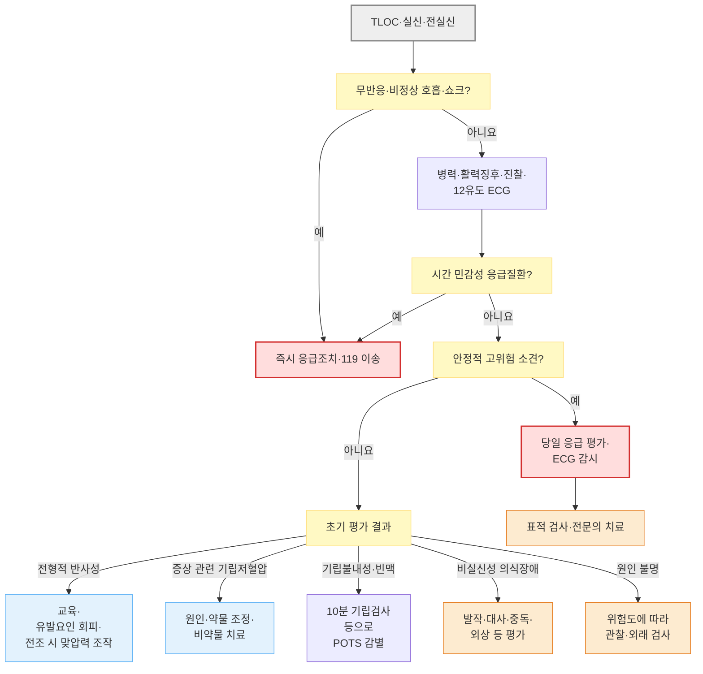

# 실신 Syncope

## <mark style="color:green;">일반 사항</mark>

### <mark style="color:orange;">일과성 의식 소실 (Transient loss of consciousness, TLOC)</mark>

* '짧은 의식 소실 + 기억 상실 + 운동 조절 소실 + 무반응'의 네 가지 특징을 공유하는 상태들을 묶은 상위 범주 <mark style="color:$info;">\[ESC 2018]</mark>
* 외상성 TLOC : 두부 외상(뇌진탕 등)에 의한 의식 소실
  * 실신으로 쓰러지면서 생긴 두부 외상과 구별
* 비외상성 TLOC
  * 실신(syncope) : 원인이 전반적 뇌 저관류(cerebral hypoperfusion)인 경우 - 반사성, 기립성 저혈압, 심혈관성
  * 뇌전증 발작 : 전신 발작(강직·간대·강직간대·무긴장 발작)
  * 심인성 TLOC : psychogenic pseudosyncope(심인성 가성실신), psychogenic non-epileptic seizure(PNES) - 실제 의식 소실이 아닌 외관상 TLOC
  * 드문 원인 : 척추뇌바닥동맥 TIA, 지주막하출혈, 청색증성 호흡정지 발작(breath-holding spell) 등
* TLOC와 혼동되는 상태 : 저혈당·저산소증·중독·대사 이상 등
  * 의식 소실이나 의식 변화를 일으킬 수 있으나, 지속 시간이 길거나 회복이 불완전하여 TLOC 정의를 항상 충족하지는 않음
  * 감별 대상으로 함께 고려

### <mark style="color:orange;">실신 (Syncope)</mark>

* 전반적 뇌 저관류로 인하여 갑자기 발생하고, 지속 시간이 짧으며, 특별한 처치 없이 자발적으로 완전히 회복되는 일시적 의식 소실
* 의식 소실 동안 사건에 대한 기억상실, 운동 조절 및 자세 긴장 소실, 자극에 대한 무반응이 동반됨
* 유병률 : 전체 인구의 약 40%가 평생 한 번 이상 경험; 응급실 방문의 약 1\~3% 차지
* 예후는 원인과 동반 질환에 따라 다름
  * 반사성 실신 : 사망 위험 증가 없이 대체로 양호
  * 심장성 실신 : 사망 위험이 뚜렷이 증가하여 예후 불량
  * 기립성 저혈압 : 중증 동반 질환과 연관될 수 있음
  * 원인 불명 실신 : 지역사회 코호트에서 약 ⅓을 차지하며 사망 위험이 다소 증가 - 위험도 평가와 추적, 필요시 장기 심전도 모니터링으로 원인 확인 <mark style="color:$info;">\[NEJM 2002]</mark>

### <mark style="color:orange;">전실신 (Presyncope)</mark>

* 전실신(presyncope; near-syncope) : 실신이 임박한 듯한 증상이 있으나 완전한 의식 소실 없이 회복되는 상태. 실신으로 진행할 수도 있음
* 증상 : [어지럼증](020_-dizziness.md)(dizziness, lightheadedness), 시각 이상(터널 시야, 일시적으로 눈앞이 캄캄해짐), 의식이 흐려지는 느낌(완전한 의식 소실은 아님), 구역, 오한, 복통, 창백, 자세 긴장 저하
* 응급실 전실신 환자도 부정맥 등 단기 중대 결과 위험이 실신과 비슷할 수 있으므로, 특히 고령·심질환자 또는 Red Flags 동반 시 실신과 같은 수준으로 평가

## <mark style="color:green;">종류</mark>

### <mark style="color:orange;">반사성 실신, 신경 매개성 실신 (Reflex syncope, Neurally mediated syncope)</mark>

* 실신의 가장 흔한 원인(약 30\~60%) (☞ [반사성 실신](022_-reflex-syncope.md))
* 양성 경과
* 젊은 환자에서 특히 흔하나 고령자에서도 발생(이봉형 연령 분포)
* 기전 : 부적절한 자율신경 반사로 교감신경성 혈관수축 저하, 심장억제에 따른 서맥 또는 무수축이 나타남. 두 기전은 함께 나타날 수 있음
* 유발 인자
  * Vasovagal(정서·기립 유발) : 스트레스, 공포, 통증, 불쾌한 장면/소리/냄새, 의료 시술, 더운 곳, 오래 서 있음
  * Situational : 기침, 큰 웃음, 연하, 배변, 배뇨, 운동 직후
  * Carotid sinus 관련 : 머리 회전, 목이 조이는 옷 등에 의한 carotid sinus 압박
* 특징
  * 비슷한 상황에서 반복되지만 악화되지 않는 실신 병력
  * 실신 전에 자율 신경 항진 증상(예: 창백, 식은땀, 구역, 구토)이 있음
  * 실신 후 피로감
  * 의식 소실 후 시작하는 짧고 불규칙·비동기적인 근간대성 움직임 또는 짧은 강직 자세가 동반될 수 있음
    * 지속 시간만으로 뇌전증 발작과 구별하지 않고, 움직임의 시작 시점·양상·횟수와 회복 과정을 함께 평가 (☞ 아래 「발작과의 감별」)
* 운동과의 관계
  * 운동 직후(회복기) 실신 : 반사성 기전이 흔함
  * 운동 중 실신 : 반사성으로 단정하지 말고 심장성 원인을 우선 배제

### <mark style="color:orange;">기립성 저혈압 실신 (Orthostatic hypotension syncope)</mark>

* Classic OH : 기립 후 3분 이내 지속적으로 수축기 혈압 ≥20 ㎜Hg 또는 이완기 혈압 ≥10 ㎜Hg 감소하거나, 수축기 혈압이 ＜90 ㎜Hg로 저하 (☞ [기립성 저혈압](../225_/096_-orthostatic-hypotension.md))
  * 누운자세 고혈압이 있는 환자에서는 수축기 혈압 ≥30 ㎜Hg 감소 기준을 고려
* Initial OH : 기립 15초 이내 수축기 혈압 ＞40 ㎜Hg 및/또는 이완기 혈압 ＞20 ㎜Hg가 일시적으로 저하된 후 빠르게 회복
  * 일반 커프 혈압계로 확진할 수 없고 연속 beat-to-beat 혈압 측정이 필요
* Delayed OH : 기립 3분 이후 지속적으로 수축기 혈압 ≥20 ㎜Hg 또는 이완기 혈압 ≥10 ㎜Hg 감소
  * 기립 10분이 지나서 나타나는 저하도 포함
    * 3분 기립 측정이 정상이어도 증상이 의심되면 기립 시간을 연장하거나 기립경사검사로 확인
  * 누운자세 고혈압이 있는 환자에서는 수축기 혈압 ≥30 ㎜Hg 감소 기준을 고려
* 원인
  * 1차성 자율신경부전 : pure autonomic failure, 다계통위축증, 파킨슨병, 루이소체치매
  * 2차성 자율신경부전 : 당뇨병, 아밀로이드증, 척수 손상 등
  * 약물 : 술, 혈관 확장제, 이뇨제, adrenergic blocker, 진정제
  * hypovolemia : 탈수, 출혈
* 특징
  * 갑자기 일어선 직후 또는 더운 곳에서 장시간 서 있을 때 발생
  * 최근 약물 복용 시작 또는 증량 병력
  * 고령, 기저질환자(예: 당뇨병, 자율신경병증)에서 호발

### <mark style="color:orange;">실신과 관련된 기립불내성 질환: 자세성 기립성 빈맥 증후군 (Postural orthostatic tachycardia syndrome, POTS)</mark>

* 실신 자체보다는 만성 기립불내성, 전실신, 두근거림·쇠약·시야 흐림·피로를 주로 일으키는 증후군
* 진단을 위해 다음을 모두 확인
  1. 기립 10분 이내 지속적 심박수 증가 ≥30회/분(12\~19세는 ≥40회/분)
     * 적어도 1분 간격의 2회 이상 측정에서 확인
  2. 지속적인 기립성 저혈압(수축기 혈압 ≥20 ㎜Hg 또는 이완기 혈압 ≥10 ㎜Hg 감소)이 없음
     * 일시적인 initial OH만으로 POTS를 배제하지 않음
  3. 기립 시 악화되고 누우면 빠르게 호전되는 증상이 매우 자주 나타나며 3개월 이상 지속
  4. 급성 탈수·출혈·빈혈·발열·갑상선기능항진·약물 등 빈맥을 설명할 다른 원인 배제
* 3분 기립 활력징후나 일회성 심박수 증가만으로 확진하지 않으며, 필요시 10분 능동기립검사·기립경사검사 또는 전문의 평가

### <mark style="color:orange;">심혈관성 실신 (Cardiovascular syncope)</mark>

* 원인
  * 부정맥/전도 장애(가장 흔한 심장 원인)
  * 심혈관 구조 이상 : 급성 심근허혈·심근경색에 따른 부정맥 또는 혈역학적 장애, 심근병증(비후성 심근병증 포함), 대동맥협착증
  * 기타 심폐질환 : 폐색전증, 폐동맥고혈압
* 특징
  * 운동 중 또는 앉아 있거나 누운 상태에서 발생
  * 전구 증상 없거나 짧음(＜10초)
  * 실신 전후 두근거림, 흉통, 호흡곤란
  * 비정상 ECG, 심장 또는 관상동맥 이상 병력, 심장 질환 가족력
  * 반복 실신은 반사성 실신에서 흔하지만, 전구 증상 없이 갑작스럽게 발생하거나 심장 질환 병력이 있는 경우에는 부정맥 원인을 반드시 배제해야 함

### <mark style="color:$danger;">🚩 Red Flags!</mark>

<mark style="color:$danger;">**즉각 조치**</mark>

* 의식 또는 활력징후가 신속히 회복되지 않음, 정상 호흡 없음, 지속되는 수축기 혈압 ＜90 ㎜Hg 또는 쇼크 `심정지` `쇼크` `대사성·중독성 의식장애`
* 지속성 중증 서맥·빈맥(지속성 심실빈맥 포함), 현재 ECG에서 확인되는 Mobitz II형 또는 3도 방실차단, 급성 심근허혈을 시사하는 ECG 변화, 심박동기·제세동기 기능 이상 `부정맥성 실신` `급성 관상동맥증후군` `기기 오작동`
* 지속되는 흉통·심한 호흡곤란·복통 또는 벼락두통 `급성 관상동맥증후군` `폐색전증` `대동맥박리` `중증 출혈` `지주막하출혈`
* 새로운 국소 신경학적 결손, 의식 회복 지연, 중증 두부 손상·골절 또는 기타 심한 외상 `뇌졸중` `두개내출혈` `비실신성 TLOC`
* 가임기 여성에서 임신 가능성과 함께 복통·질출혈·저혈압 `자궁외임신 파열`

<mark style="color:$warning;">**당일 평가**</mark>

* 운동 중 또는 누운자세에서 발생한 실신으로 완전히 회복되어 현재 안정적인 경우 `구조적 심질환` `부정맥`
* 갑작스러운 심계항진 직후 실신 `부정맥성 실신`
* 전구 증상 없이 또는 매우 짧은 전구 증상 후 발생한 실신이 구조적 심질환·관상동맥질환 또는 비정상 ECG와 동반 `부정맥성 실신`
* 알려진 구조적 심질환(심부전, 심근병증, 판막질환) 또는 관상동맥질환(이전 심근경색 포함) `구조적 심질환` `허혈성 심질환`
* 젊은 나이의 돌연사·원인 불명 익사 가족력 또는 유전성 부정맥 가족력 `유전성 부정맥`
* 처음 발생했거나 이전과 양상이 달라진 실신에서, 초기 평가로 반사성 실신을 확신하기 어려운 경우 `심장성 실신` `비실신성 TLOC`
* 회복 후 활력징후가 안정된 상태에서 확인된 고위험 ECG 소견 중 즉각 조치 항목에 해당하지 않는 경우 (☞ [고위험 ECG 소견](#high-risk-ecg)) `부정맥성 실신` `유전성 부정맥`
* 즉각 조치 소견이 없고 활력징후가 안정적이며, 실신과 관련된 중증 빈혈·출혈 소견 또는 유의한 전해질 이상이 있음 `빈혈` `출혈` `전해질 이상`

<mark style="color:$info;">**조기 평가 및 추적**</mark>

* 반복적이고 설명할 수 없는 실신 또는 원인불명 낙상(특히 고령자) `잠재성 부정맥`

## <mark style="color:green;">진단</mark>

### <mark style="color:orange;">초기 평가 원칙</mark>


**초기 평가의 핵심** : 병력 청취, 신체 검진(기립 활력징후 포함), 12유도 ECG. \
※ 일률적인 광범위 실험실검사·영상검사는 권고하지 않음 <mark style="color:$info;">\[대한부정맥학회 2024; ESC 2018; ACC/AHA/HRS 2017]</mark>


* 병력 청취 : 발생 상황, 전구 증상, 회복 과정, 목격자 진술, 복용 약물, 심장 질환 병력, 가족력
  * 가능하면 목격자 진술이나 스마트폰 영상을 확보
  * 고령자의 원인불명 낙상은 사건 기억상실로 실신이 숨겨질 수 있음
* 신체 검진 : 활력징후, 맥박, 심장·신경학적 검진, 출혈·외상 징후
  * 기립 활력징후 : 환자가 안정되고 안전하게 기립할 수 있을 때 측정
    * 누운자세 5분 안정 후 혈압·맥박 측정 → 기립 1분·3분에 반복
    * 증상이나 delayed OH가 의심되면 10분 이상 연장 또는 기립경사검사 고려
  * 일반 커프 혈압계의 기립 직후 측정만으로 initial OH를 진단하지 않음
    * 의심 시 연속 beat-to-beat 혈압 측정 필요
  * 양팔 혈압 차이가 크거나 대동맥박리·쇄골하동맥 질환이 의심될 때 양측 혈압 확인
  * 수축기 잡음 청취 시 HOCM(Valsalva 시 증강)·대동맥협착증 감별 고려
* ECG : 모든 실신 환자에서 반드시 시행

#### <mark style="color:$primary;">고위험 ECG 소견</mark> <a href="#high-risk-ecg" id="high-risk-ecg"></a>

* 단독으로 고위험인 소견 <mark style="color:$info;">\[ESC 2018]</mark>
  * 허혈·구조 : 급성 심근허혈 소견, 각차단·심실내 전도 장애, 심실비후, 허혈성 심질환·심근병증에 합당한 Q파
  * 서맥·전도 : Mobitz II형 또는 3도 AV block, 생리적·약물성 원인으로 설명되지 않는 각성 시 지속 서맥 ＜40회/분 또는 서맥성 AF ＜40회/분, ＞3초 동정지
  * 빈맥 : 비지속성 VT 또는 기록상 확인된 지속성 VT
  * 유전성 부정맥 : type 1 Brugada pattern, 반복 ECG에서 QTc ＞460 ㎳
* 부정맥성 실신에 합당한 병력이 동반되면 고위험으로 평가하는 소견
  * Mobitz I형, PR이 현저히 연장된 1도 AV block
  * 경도 서맥 또는 서맥성 AF(40\~50회/분)
  * 발작성 SVT·AF, pre-excitation
  * short QT(≤340 ㎳), 비전형 Brugada pattern
  * ARVC 시사 소견(우측 흉부유도 음성 T파, epsilon파)
* ＞3초 pause는 젊은 운동선수, 수면 중, 심박수가 조절된 AF 등 생리적 예외를 고려


**QTc 연장 확인 시 즉시 약물 검토** : 실신 환자에서 QTc ＞460 ㎳가 확인되면 반복 ECG, 전해질, 콩팥기능, 가족력 및 다음 QT 연장 유발 약물을 함께 검토할 것. QTc ＞500 ㎳는 torsades de pointes 위험이 더 높지만, QTc 수치만으로 선천성 long-QT syndrome을 확진하지 않음.

* 항정신병약, 일부 macrolide·fluoroquinolone, class IA·III 항부정맥제, 일부 항구토제·항진균제·항우울제 등 약제별 위험도가 다름.
* 2종 이상 병용, 고용량, 저칼륨·저마그네슘혈증, 서맥, 콩팥·간기능 저하는 위험을 높일 수 있음. \
  [CredibleMeds QTDrugs List](https://crediblemeds.org)에서 개별 약물의 Known/Possible/Conditional Risk 확인


***



> _시간 민감성 응급질환 : 고위험이 곧 심장성만을 의미하지는 않음. 폐색전증·대동맥박리·중증 출혈·지주막하출혈 등도 고려._
>
> _저위험 : 초기 평가에서 중대한 원인이 배제되고 전형적 반사성 실신 또는 증상과 연관된 OH가 확인된 경우. 나이만으로 귀가 여부를 결정하지 않음._

<p align="center"><strong>실신·전실신 환자 초기 평가 알고리듬</strong><br><em><mark style="color:$info;">저자 재구성 (참고 문헌 : 대한부정맥학회 2024; Möckel M, et al. Eur J Emerg Med 2024; Brignole M, et al. Eur Heart J 2018; Shen WK, et al. Circulation 2017)</mark></em></p>

***

### <mark style="color:orange;">추가 검사</mark>

* 고위험 부정맥 의심 → 즉각적인 병원 내 침상 또는 원격 심전도 모니터링
* 증상 빈도에 따른 외래 심전도 모니터링
  * 실신·전실신이 주 1회 이상 : Holter monitoring 고려
  * 증상 간격이 약 4주 이내 : 외부형 사건기록기(외부 루프 기록기 등)·패치형 연속 ECG 모니터 고려
  * 드물지만 반복되는 원인 불명 실신 : 재발 양상·위험도와 부정맥 의심 정도에 따라 implantable loop recorder(ILR) 고려
    * ILR은 장기 모니터링에 유용하며, 특히 부정맥이 의심되나 ECG·단기 모니터링에서 확인되지 않고 장치 배터리 수명 내 재발 가능성이 높은 경우 평가 초기 단계에서 고려 (☞ [급여기준](https://www.hira.or.kr/rc/insu/insuadtcrtr/InsuAdtCrtrPopup.do?mtgHmeDd=20220201\&sno=5\&mtgMtrRegSno=0002))
* 심박동기·제세동기 기능 이상 또는 기기 관련 부정맥 의심 → 기기 점검(interrogation)
  * 프로그래머로 기기에 저장된 부정맥 기록과 작동 상태를 확인
* 구조적 심질환 의심 → 심초음파
* 운동 중 또는 직후 실신 → exercise stress test(심전도·혈압 모니터링 및 응급소생이 가능한 환경)
* 반사성 실신, OH, POTS 또는 psychogenic pseudosyncope가 의심되나 초기 평가로 확진하기 어려운 경우 → head-up tilt-table test 고려
  * 양성 반응은 저혈압 감수성을 보여줄 수 있으며 특정 원인을 자동 확정하지 않음
  * 음성이라고 반사성 실신을 배제할 수 없음
* 진단적 carotid sinus massage : ＞40세의 원인불명 실신 중 반사성 기전에 합당한 경우, 지속 ECG 및 beat-to-beat 혈압 모니터링과 응급소생이 가능한 환경에서 고려
  * 시행법 : 누운자세에서 좌·우 경동맥동을 각각 약 10초간 마사지하고, 기립경사대를 이용한 기립 자세에서도 좌·우를 각각 검사. 각 검사 사이에는 혈압·심박수가 기저 수준으로 회복될 때까지 기다리며, 중단 기준에 해당하면 추가 검사를 시행하지 않음 <mark style="color:$info;">\[ESC 2018; Europace 2024]</mark>
  * 훈련된 검사자와 보조 인력 등 2인 이상이 참여하고 검사 전 금기·주의사항과 응급대응 준비를 확인
  * 금기 : 최근 3개월 이내 TIA·뇌졸중·심근경색 또는 확인된 고도 경동맥 협착 <mark style="color:$info;">\[Europace 2024]</mark>
    * 경동맥 잡음이 있거나 고도 협착이 의심되면 협착 가능성을 평가하고, 필요시 경동맥 초음파를 고려
  * ＞3초 무수축 및/또는 수축기 혈압 ＞50 ㎜Hg 저하만으로는 carotid sinus hypersensitivity이며, 자발성 실신과 합당한 증상이 재현되어야 carotid sinus syndrome 진단
* 실험실검사 : 임상적으로 필요한 경우에 한하여 시행
  * 출혈·빈혈 의심 시 CBC, 대사 이상 의심 시 혈당·전해질·콩팥기능, 심부전 의심 시 BNP/NT-proBNP, 심장 질환 또는 ACS 의심 시 hs-Troponin, 폐색전증 의심 시 임상확률에 따라 D-dimer 등 표적 검사
    * hs-Troponin은 무증상 저위험군에서 일률적 시행 불필요
  * 가임기 여성에서 임신 가능성이 있고 복통·질출혈·저혈압 등이 동반되면 임신 확인
  * 일률적·광범위한 실험실검사는 권고하지 않음
* EEG : 발작이 의심되는 경우 고려; 일률적인 EEG는 불필요
  * Psychogenic pseudosyncope 또는 경련성 실신 감별 시 필요하면 기립경사검사와 EEG·혈역학 모니터링을 병행
* 뇌 CT/MRI : 국소 신경학적 이상, 지주막하출혈 의심 또는 유의한 두부 외상이 있는 경우 고려
  * 신경학적 증상·외상 없는 단순 실신에서는 일률적인 촬영 불필요
* 경동맥 초음파(Carotid Doppler) : 단순 실신의 원인 평가를 위한 일률적 검사는 권고하지 않음
  * 국소 신경학적 증상 등 별도의 뇌혈관·경동맥 평가 적응증이 있거나, 경동맥동 마사지 전 협착 평가가 필요할 때 시행

### <mark style="color:orange;">저위험 - 외래 추적 또는 퇴원 가능</mark>

* 초기 평가에서 중대한 원인이 배제되고 다음과 같은 저위험 임상 양상이 모두 확인되면 외래 추적 또는 퇴원을 고려
  1. 전형적인 반사성 실신의 유발 인자와 전구 증상(오래 서 있음, 더위, 통증·감정, 채혈, 창백·발한·구역 등)이 있거나, 기립 후 발생하고 증상과 연관된 OH가 확인됨
  2. 구조적 심질환·관상동맥질환 병력, 고위험 가족력, 비정상 심장 진찰 및 고위험 ECG가 없음
  3. 활력징후가 회복되고 중증 외상·출혈·기타 응급질환이 없음
* 중대 결과 위험 예측 도구 활용 : Canadian Syncope Risk Score (CSRS)

**Canadian Syncope Risk Score (CSRS)**

* 응급실 내원 실신 환자의 30일 내 중대 결과 발생 위험 예측 도구
* 9개 항목(병력, 활력징후, ECG, troponin, 응급실 진단)으로 구성; 점수범위 −3\~+11점. (☞ [계산기](https://www.mdcalc.com/canadian-syncope-risk-score))
  * 매우 낮은 위험(−3, −2점) + 낮은 위험(−1, 0점) 30일 중대 결과 발생률 : 약 0.4%(개별군 0.2%, 0.7%) <mark style="color:$info;">\[JAMA Intern Med 2020]</mark>
  * 중간 위험(1\~3점) : 관찰·신속 추적 또는 입원을 임상적으로 결정
  * 높은 위험(4, 5점)·매우 높은 위험(≥6점) : 집중 평가와 입원을 고려
* 적용 범위와 한계
  * 원래 개발·검증 대상은 16세 이상 실신 환자이며, 어린 소아에게 그대로 적용하지 않음
  * 중요한 원인이 초기 응급실 평가에서 확인되지 않은 환자에서 보조적으로 사용
    * 외래 단독 평가나 명백한 응급질환의 배제 도구는 아님
  * 2026년 미국 전향적 외부 검증은 40세 이상의 실신 또는 전실신 환자를 포함하였으며, CSRS의 30일 중대 결과 예측 AUROC는 0.72로 캐나다 연구보다 낮았음 <mark style="color:$info;">\[JAMA Netw Open 2026]</mark>
  * 이 연구에서 CSRS ＜0을 저위험 절단값으로 사용했을 때 중대 결과 검출 민감도는 91.9%, 음성예측도는 97.5%였음
    * 저위험 점수만으로 퇴원을 결정하거나 중대한 원인을 배제하지 않음
    * 40세 미만이나 연구와 다른 진료 환경에 결과를 그대로 일반화하지 않음

### <mark style="color:orange;">감별</mark>

<mark style="color:cyan;">**Non-syncope TLOC 및 유사 상태**</mark>&#x20;

* 비실신성 의식 소실·의식 변화 또는 의식 소실 없는 쓰러짐 상태
* 뇌 저관류에 의하지 않는 TLOC → 뇌전증 발작, psychogenic pseudosyncope, 두부 외상(외상성 TLOC)
* TLOC와 혼동되는 의식 변화 → 대사 이상(예: 저혈당, 저산소증), 중독
* 의식 소실 없는 쓰러짐 → cataplexy, 기계적 낙상, 기능성 신경학적 증상
* [TIA](023_-tia.md)는 고립된 의식 소실의 일반적 원인이 아님
* 척추뇌바닥동맥 허혈(vertebrobasilar ischemia)은 드물게 의식 소실을 일으킬 수 있으나 복시·구음장애·운동실조·국소 신경학적 결손 등 후순환 증상이 동반될 때 고려

<mark style="color:cyan;">**발작과의 감별**</mark>

* 실신과 뇌전증 발작에서는 눈을 뜨고 있는 경우가 전형적이며, 눈을 계속 감고 있거나 눈뜨기에 저항하는 소견은 psychogenic pseudosyncope를 시사. 단독 소견으로 확진하지 않음
* 실신의 myoclonic jerk는 대개 의식 소실 이후 시작하고 불규칙·비동기·비대칭적이며 흔히 10회 미만
  * 뇌전증성 강직간대발작은 의식 소실과 거의 동시에 시작하고 동기성·대칭성 움직임이 흔하며 20회 이상이면 발작을 더 시사
  * 움직임 횟수와 지속 시간은 목격 상황에 따라 부정확할 수 있으므로 절대적인 감별 기준으로 사용하지 않고, 움직임의 시작 시점·양상과 의식 회복 과정을 함께 평가
* 측면 혀 깨물기와 수분 이상 지속되는 postictal confusion은 뇌전증을 강하게 시사
* 요실금·외상·사건 후 피로는 두 질환 모두에서 나타날 수 있어 단독 감별력이 낮음
* Psychogenic pseudosyncope : 외관상 무반응이나 사건 중 혈압·심박수는 정상 또는 상승하고 EEG에는 뇌 저관류·뇌전증성 변화가 없으며, 눈 감김·긴 지속시간·높은 발생 빈도가 단서
  * 기립경사검사 중 혈압·심박수·EEG 또는 video-EEG로 전형적 사건을 기록하면 감별에 유용

<mark style="color:cyan;">**실신 아형 감별표**</mark>

<table><thead><tr><th width="485">임상 특성</th><th>우선 고려 유형</th></tr></thead><tbody><tr><td>스트레스·통증·오래 서 있음, 전구 증상(창백·식은땀·구역)</td><td><strong>혈관미주신경성 실신</strong></td></tr><tr><td>기침·연하·배뇨·배변 또는 운동 직후 발생</td><td><strong>상황 실신</strong></td></tr><tr><td>기립 후 증상과 함께 혈압이 기준 이상 지속 저하</td><td><strong>기립성 저혈압 실신</strong></td></tr><tr><td>만성 기립불내성, 10분 이내 지속적 빈맥, 유의한 OH 없음</td><td><strong>POTS 의심</strong></td></tr><tr><td>운동 중 또는 누운자세 발생; 갑작스러운 심계항진 직후 발생; 비정상 ECG 또는 구조적 심질환</td><td><strong>심장성 실신 우선</strong> → 응급도에 따라 즉각 조치 또는 당일 응급 평가</td></tr><tr><td>국소 신경학적 결손·벼락두통·의식 회복 지연</td><td><strong>실신 외 신경학적 응급질환</strong></td></tr></tbody></table>

***

### <mark style="color:orange;">소아·청소년 실신</mark>

* 대부분은 반사성 실신
* 운동 중 또는 누운자세의 실신, 흉통·갑작스러운 심계항진 동반, 비정상 심잡음·ECG, 심근병증·부정맥 또는 젊은 연령 돌연사·원인 불명 익사 가족력은 심장성 원인을 우선 배제
* 최초 평가에는 성인과 마찬가지로 병력·가족력, 기립성 활력징후, 심장·신경학적 진찰과 12유도 ECG를 포함
* 운동 중 실신이면 비후성 심근병증, 대동맥 기시 관상동맥 이상(anomalous aortic origin of a coronary artery, AAOCA), 긴 QT 증후군, catecholaminergic polymorphic ventricular tachycardia 등을 고려하여 소아심장 전문 평가
  * 운동 중 실신이 발생한 소아·청소년은 심장성 원인이 배제되고 전문 평가가 완료될 때까지 경쟁 스포츠와 고강도 운동을 중단
  * 바이러스 전구 증상, 흉통, 호흡곤란, 운동능 저하와 함께 ECG·troponin 이상이 동반되면 급성 심근염(myocarditis)도 감별에 포함
* 소아·청소년(12\~19세) POTS 심박수 기준(기립 10분 이내 ≥40회/분 증가로 상향)은 POTS 항목 참조
* 탈수·섭식장애·저혈당·빈혈, breath-holding spell(주로 6개월\~6세), 임신 가능성 등 연령별 감별을 추가

***

## <mark style="background-color:$warning;">Management</mark>

### <mark style="color:orange;">치료 방침</mark>

* 확인된 원인과 기저질환을 치료하고, 재발·외상 위험을 함께 줄임
* 유발 가능 약물은 적응증, 용량, 시작·증량 시점, 복용 시간, 탈수·급성질환 여부를 검토하여 개별적으로 감량·교체·중단을 결정. 임의 중단 금지
  * 유발 가능 약물 : 혈압 강하제, 이뇨제, 질산염·기타 혈관 확장제, 진정성 약물 등
  * SGLT2 억제제는 이뇨·체액량 감소가, GLP-1 수용체 작용제는 구토·섭취 저하·급격한 체중 감소에 따른 탈수가 기립성 증상을 악화할 수 있음
  * sacubitril/valsartan(ARNI)은 이뇨제 병용 또는 체액·염분이 부족한 환자에서 증상성 저혈압 위험이 커질 수 있음
  * 정신작용약물(TCA, trazodone, quetiapine 등)은 기립성 저혈압·실신을 유발할 수 있어 시작·증량 시 확인
  * 알파 차단제(tamsulosin, silodosin, alfuzosin 등)는 특히 시작·증량 시 기립성 저혈압 위험을 확인. 요로선택성이 높은 약제도 위험이 없지는 않으므로 증상과 혈압을 바탕으로 조정
* 저위험 반사성 실신 : 교육 및 안심, 비약물 치료 우선
  * 전구 증상을 인지할 수 있는 반복성 저혈압형에서 [맞압력 조작](022_-reflex-syncope.md#counter-pressure-maneuver)을 교육하고, 증상 부담이 큰 일부 환자는 비약물 치료 후 midodrine 등을 고려
  * 반사성 실신 예방을 위한 midodrine은 허가 외 사용이며, 누운자세 고혈압·요저류 등의 위험과 제한적인 근거를 고려하여 선별적으로 사용
  * Cardioneuroablation은 선별된 중증 재발성 cardioinhibitory reflex syncope에서 논의되는 시술로, 근거와 장기 안전성이 확립 중이므로 실신·부정맥 전문센터에서만 고려
* 기립성 저혈압 실신 : 유발 약물 조정, 금기가 없을 때 수분·염분 섭취, 복대 또는 허리 높이 압박복을 우선 고려. 무릎 높이 압박스타킹만으로는 효과가 제한적
  * midodrine <mark style="color:blue;">\[</mark>[<mark style="color:blue;">미드론</mark>](https://www.health.kr/drug/A11A3180A0335)<mark style="color:blue;">]</mark>은 기립성·본태성·증후성 저혈압에 허가되어 있음
  * 미드론은 고혈압·심한 심질환·급성 신장염·갑상선기능항진증·크롬친화세포종·폐쇄우각형 녹내장·혈관경련/폐색·배뇨장애·빈맥성 부정맥 환자에게 금기. 누운자세 고혈압이 있으면 시작하지 않음
  * fludrocortisone <mark style="color:blue;">\[</mark>[<mark style="color:blue;">플로리네프</mark>](https://www.health.kr/drug/A11ABBBBB1694)<mark style="color:blue;">]</mark>는 기립성 저혈압에는 허가 외 사용이며, 효과 근거의 확실성이 낮고 체액저류·저칼륨혈증·누운자세 고혈압·심부전 악화 위험이 있어 신중하게 선택
* 심혈관성 실신 : 전문의 의뢰 및 원인 질환에 따른 치료
  * 부정맥 확인 시 : 항부정맥제, ablation, pacemaker, ICD 등
  * 구조적 심질환 : 원인 질환 치료
* 부상 예방 : 채혈 또는 주사 시 누워서 진행. 전조 증상이 발생하면 먼저 눕고 가능하면 다리를 올리며, 누울 수 없으면 안전한 곳에 앉음
* 운전 : 원인·전구 증상·치료 여부·재발 위험과 개인/직업 운전 여부에 따라 제한을 개별화하고, 현행 운전면허 관련 규정 확인. 원인 불명 또는 심장성 실신은 평가·치료 전 운전을 중단
  * 반사성 실신의 상세 운전 기준은 [반사성 실신](022_-reflex-syncope.md#non-drug-treatment) 참조

***

## <mark style="color:red;">질병코드</mark>

* R55 실신 및 허탈 Syncope and collapse
  * R55.0 혈관미주신경성 실신 Vasovagal syncope
  * R55.8 기타 실신 및 허탈 Other syncope and collapse
* I95.1 기립성 저혈압 Orthostatic hypotension

***

## <mark style="color:purple;">처방례</mark>

> **처방례 1.** 탈수·혈관내 용적 감소가 확인된 기립성 저혈압 실신 - 급성기 수액 보충
>
> ```
> 생리식염수(0.9% NaCl) 500 ㎖  IV  over 30분
> ```
>
> _✽ 투여 후 증상·혈압·폐음·소변량 재평가; 심부전·만성콩팥병·고령 환자는 용량과 속도를 개별화._
>
> _✽ 회복 후 경구 수분 섭취를 권고하고, 유발 가능 약물은 적응증을 확인하여 조정._

> **처방례 2.** 증상 부담이 큰 반복성 저혈압형 반사성 실신 - 선택적 외래 처방
>
> ```
> 미드론정 2.5 ㎎/T  1T  bid~tid
> ```
>
> 약제 정보: <mark style="color:blue;">\[</mark>[<mark style="color:blue;">미드론정 2.5 ㎎</mark>](https://www.health.kr/drug/A11A3180A0335)<mark style="color:blue;">]</mark>
>
> _✽ 깨어서 활동하는 낮 시간에 복용; 마지막 복용은 취침 최소 4시간 전이며, 낮 시간 복용 후에도 바로 눕지 않음. 누운자세 고혈압 주의._
>
> _✽ 허가 외 사용 : 미드론은 저혈압에 허가되어 있으나 반사성 실신 예방은 허가 적응증이 아님._
>
> _✽ 비약물 치료(충분한 수분·염분 섭취, 맞압력 조작) 실패 후 2차 선택._
>
> _✽ 수분·염분 목표는 고혈압·심부전·콩팥병·간경변 여부를 고려해 개별화._
>
> _✽ 누운자세·기립 혈압과 요저류를 확인하고 반응에 따라 용량 조정._
>
> _✽ 고혈압·심한 심질환·배뇨장애 등 금기를 먼저 확인. 자세한 처방은 반사성 실신 챕터에 수록._ (☞ [반사성 실신](022_-reflex-syncope.md))

> **처방례 3.** 기립성 저혈압 - 만성(신경인성, 약물 조정 후에도 지속 시)
>
> ```
> [1차 선택 예] 미드론정 2.5 ㎎/T  1T  tid
> [대안 또는 단계적 추가 고려] 플로리네프정 0.1 ㎎/T  0.5~1T(0.05~0.1 ㎎)  qd  조식 후
> ```
>
> 약제 정보: <mark style="color:blue;">\[</mark>[<mark style="color:blue;">미드론정 2.5 ㎎</mark>](https://www.health.kr/drug/A11A3180A0335)<mark style="color:blue;">]</mark> · <mark style="color:blue;">\[</mark>[<mark style="color:blue;">플로리네프정 0.1 ㎎</mark>](https://www.health.kr/drug/A11ABBBBB1694)<mark style="color:blue;">]</mark>
>
> _✽ 미드론은 깨어서 활동하는 낮 시간에 복용; 마지막 복용은 취침 최소 4시간 전. 누운자세 고혈압·요저류 주의._
>
> _✽ 플로리네프는 부종·체중 증가·저칼륨혈증·고혈압·심부전 악화를 모니터링. 기립성 저혈압 사용은 허가 외 사용이며 효과 근거의 확실성이 낮음._
>
> _✽ 두 약을 처음부터 병용하는 처방례가 아님. 한 약제로 시작해 반응·부작용을 평가하고, 병용은 전문적 판단하에 단계적으로 고려._
>
> _✽ 누운자세·기립 혈압, 체중·부종, 전해질·콩팥기능을 추적. 미드론은 고혈압·심한 심질환·배뇨장애 등 금기 환자에게 투여하지 않음. 플로리네프는 심부전에서 피하고, 중증 콩팥병·누운자세 고혈압에서는 특히 신중히 판단._
>
> _✽ 플로리네프 시작 또는 증량 후 약 1\~2주 내 혈압·체중·부종·혈청 K⁺/콩팥기능 첫 추적을 고려; 고령·심부전·콩팥병 또는 병용약물 위험이 있으면 더 일찍 평가._
>
> _✽ 복대 또는 허리 높이 압박복, 침대 머리 쪽을 올려 두부 거상 취침, 소량 빈번한 식사를 병행._

***

### <mark style="color:$success;">핵심 복약 지도</mark>

> **실신 후 일반 주의사항**
>
> * 의식을 완전히 회복하고 안정될 때까지 움직이지 마십시오.
> * 전조 증상(어지럼, 식은땀, 창백)이 느껴지면 먼저 눕고 가능하면 다리를 올리십시오. 누울 수 없으면 안전한 곳에 앉으십시오.
> * 회복 후 빠르게 일어나지 말고, 천천히 앉았다가 일어나는 습관을 들이십시오.
> * 심부전·콩팥병 등으로 수분 제한이 필요하면 먼저 의료진과 상의하십시오.
> * 기립성 저혈압이 있으면 장시간 서 있기 등이 예상될 때 15\~30분 전에 물 500 ㎖를 빠르게 마시면 예방에 도움이 될 수 있습니다. 의식과 삼킴이 정상일 때만 마십시오.
> * 이미 전조 증상이 시작되었다면 물을 마시기보다 먼저 눕거나 안전한 곳에 앉은 뒤, 다리를 교차해 하체에 힘을 주거나 양손을 맞잡아 서로 당기십시오.

> **미드론(Midodrine) 복용 시 주의사항**
>
> * 취침 4시간 전 이후에는 복용하지 마십시오.
> * 낮에 복용한 후에도 바로 눕지 마십시오.
> * 누운자세와 선 자세의 혈압을 기록하십시오. 심한 두통·시야 흐림·흉통·두근거림 또는 소변이 나오지 않는 증상이 생기면 복용을 보류하고 즉시 진료를 받으십시오.
> * 두피 가려움·따끔거림, 털세움(닭살)이 불편하면 주치의에게 알리십시오.

> **플로리네프 복용 시 주의사항**
>
> * 아침에 하루 한 번 처방량을 복용하고 임의로 증량하거나 중단하지 마십시오.
> * 혈압·체중·부종을 확인하고 혈액검사로 칼륨·콩팥기능을 추적합니다. 급격한 체중 증가·부종·숨참·심한 근육경련·두근거림이 생기면 진료를 받으십시오.
> * 플로리네프정은 밀폐하여 2\~8℃에서 냉장 보관하십시오.

> **운전 및 위험 활동**
>
> * 원인이 밝혀지지 않은 실신 또는 심혈관성 실신이 의심되는 경우, 원인 확인 및 치료 전까지 운전·기계 조작·고소 작업을 삼가십시오.
> * 주치의와 운전 재개 시점을 반드시 상의하십시오.

> **언제 다시 병원을 방문해야 하나요?**
>
> * 흉통·심한 두근거림·호흡곤란, 큰 외상, 의식 회복 지연, 운동 중·누운자세의 실신이 있으면 즉시 응급 평가를 받으십시오. 증상이 지속되거나 다시 쓰러지면 119를 부르십시오.
> * 원인이 뚜렷하지 않은 상태에서 전조 없이 쓰러졌거나, 이전과 다른 양상으로 실신했거나, 심장질환 또는 젊은 나이의 돌연사 가족력이 있으면 완전히 회복했더라도 당일 응급 평가를 받으십시오.
> * 이미 저위험 반사성 실신으로 평가받은 뒤 평소와 같은 양상으로 반복되면 외래 재평가를 받으십시오.

***

## <mark style="color:green;">주요 참고문헌 및 확인 자료</mark>

### <mark style="color:orange;">임상 근거</mark>

* \[대한부정맥학회 2024] [대한부정맥학회. 2024 대한부정맥학회 실신 진료지침.](https://k-hrs.org/expert/guide/faint) - 국내 실신 초기 평가·위험 분류·치료 원칙
* \[ESC 2018] [Brignole M, et al. 2018 ESC Guidelines for the diagnosis and management of syncope. Eur Heart J. 2018;39(21):1883-1948.](https://doi.org/10.1093/eurheartj/ehy037) - 실신의 진단·위험 평가 및 반사성 실신 치료
* \[ACC/AHA/HRS 2017] [Shen WK, et al. 2017 ACC/AHA/HRS Guideline for the Evaluation and Management of Patients With Syncope. Circulation. 2017;136(5):e60-e122.](https://doi.org/10.1161/CIR.0000000000000499) - 검사·입원 판단과 반사성 실신 치료의 적용 범위
* \[NEJM 2002] [Soteriades ES, et al. Incidence and prognosis of syncope. N Engl J Med. 2002;347(12):878-885.](https://doi.org/10.1056/NEJMoa012407) - 지역사회 코호트의 원인별 실신 예후
* \[Europace 2024] [de Lange FJ, et al. Carotid sinus massage in clinical practice: the Six-Step-Method. Europace. 2024;26(11):euae266.](https://doi.org/10.1093/europace/euae266) - 누운자세·기립 경동맥동 마사지의 단계별 시행법
* [Möckel M, et al. The syncope core management process in the emergency department: a consensus statement of the EUSEM syncope group. Eur J Emerg Med. 2024;31(4):250-259.](https://doi.org/10.1097/MEJ.0000000000001146) - 응급실 실신 평가·처치 과정
* \[JAMA Intern Med 2020] [Thiruganasambandamoorthy V, et al. Multicenter Emergency Department Validation of the Canadian Syncope Risk Score. JAMA Intern Med. 2020;180(5):737-744.](https://doi.org/10.1001/jamainternmed.2020.0288) - 캐나다 다기관 검증의 위험군별 30일 중대 결과
* \[JAMA Netw Open 2026] [Suh EH, et al. Validation of 2 Syncope Risk Scores and Comparison With Physician Risk Estimation. JAMA Netw Open. 2026;9(5):e2617362.](https://doi.org/10.1001/jamanetworkopen.2026.17362) - 40세 이상 실신·전실신 환자의 미국 외부 검증과 점수의 한계
* 질병관리청·대한심폐소생협회. [2025년 한국 심폐소생술 가이드라인.](https://www.kdca.go.kr/injury/biz/injury/recsroom/ruleNdManual/ruleNdManualView.do?no=213) - 일반인 구조자의 성인 심장정지 대응

### <mark style="color:orange;">허가·급여 및 안전성 확인 자료</mark>

* [식품의약품안전처. 의약품안전나라 - 의약품 품목허가정보.](https://nedrug.mfds.go.kr/index) - 제품별 적응증·용법·금기 및 허가 상태 확인
* [건강보험심사평가원. 이식형 사건기록기 급여기준.](https://www.hira.or.kr/rc/insu/insuadtcrtr/InsuAdtCrtrPopup.do?mtgHmeDd=20220201\&sno=5\&mtgMtrRegSno=0002) - 이식형 사건기록기(ILR) 급여 대상 확인
* [CredibleMeds. QTDrugs Lists.](https://crediblemeds.org/) - QT 연장·torsades de pointes 위험의 Known/Possible/Conditional Risk 분류

***

## <mark style="color:blue;">환자 안내서</mark>


**실신, 원인을 파악하는 것이 중요합니다**

대부분의 실신은 생명을 위협하지 않지만, 심장 질환이 원인인 경우에는 반드시 전문 진료가 필요합니다.


#### <mark style="color:$primary;">실신이란 무엇인가요?</mark>

* 뇌로 가는 혈류가 일시적으로 감소하여 수 초\~수 분간 의식을 잃었다가 저절로 회복되는 현상입니다.
* 가장 흔한 원인은 **혈관미주신경성 실신**으로, 극심한 긴장·통증·채혈·오랜 기립 등이 계기가 됩니다. 대부분 양성 경과를 보입니다.
* 심장 부정맥이나 구조적 심장 질환이 원인인 경우에는 즉각 전문 평가가 필요합니다.

#### <mark style="color:$primary;">즉시 응급실로 가야 하는 경우</mark>

* 실신과 함께 흉통·심한 두근거림·호흡곤란이 동반된 경우
* 운동 중 또는 누운자세에서 실신이 발생한 경우
* 의식이 빨리 완전히 회복되지 않거나, 한쪽 마비·말 어눌함·심한 두통·지속되는 혼돈이 있는 경우
* 심한 출혈, 임신 중 출혈·복통, 큰 외상이 동반된 경우

의식이 회복되지 않거나 흉통·호흡곤란·심한 두근거림이 지속되거나 큰 외상이 있으면 즉시 119에 신고하십시오.

#### <mark style="color:$primary;">완전히 회복했더라도 당일 응급 평가가 필요한 경우</mark>

* 전조 없이 갑자기 쓰러졌으며 원인이 뚜렷하지 않은 경우
* 이전과 다른 양상으로 실신한 경우
* 심장질환이 있거나 젊은 나이에 돌연사한 가족이 있는 사람이 실신한 경우

#### <mark style="color:$primary;">쓰러진 사람을 발견했을 때</mark>

* 반응이 없으면 즉시 119에 신고하고 자동심장충격기(AED)를 요청하십시오.
* 숨을 쉬지 않거나 헐떡이는 등 호흡이 비정상이면 즉시 가슴압박을 시작하십시오.
* 자동심장충격기가 도착하면 음성 안내를 따르십시오.
* 정상 호흡이 있으면 큰 외상이 의심되지 않는 한 회복자세로 옆으로 눕히고, 구급대가 올 때까지 호흡을 계속 관찰하십시오.
* 완전히 깨어 안전하게 삼킬 수 있을 때까지 물·음식·약을 주지 마십시오.

#### <mark style="color:$primary;">실신 전조 증상이 느껴질 때</mark>

전조 증상(어지럼·식은땀·창백·시야 흐림)이 오면 **먼저 눕고 가능하면 다리를 올리십시오.** 누울 수 없으면 안전한 곳에 앉으십시오. 안전한 자세를 취한 뒤 다음 동작을 시도하십시오.

* 다리를 교차하여 힘주기
* 양손을 맞잡고 서로 당기기
* **엉덩이·허벅지 근육에 강하게 힘주기**(증상이 나아질 때까지 가능한 만큼 유지)

동작 중에는 숨을 참지 말고 정상적으로 호흡하십시오.

흉통이나 한쪽 마비·말 어눌함 등이 함께 나타나면 이 동작을 하며 기다리지 말고 119에 신고하십시오.

#### <mark style="color:$primary;">생활 속 실천 사항</mark>

* **수분·염분 섭취** : 권장량은 원인과 동반 질환에 따라 다릅니다. 심부전·고혈압·콩팥병·간경변이 있거나 수분 제한을 안내받았다면 임의로 늘리지 말고 주치의와 상의하십시오.
* **물 500 ㎖ 마시기** : 완전히 깨어 안전하게 삼킬 수 있고 기립성 저혈압이 원인인 경우, 장시간 서 있기나 외출 등 예상되는 기립성 스트레스 15\~30분 전에 물 500 ㎖를 빠르게 마시는 방법이 예방에 도움이 될 수 있습니다. 임박한 실신을 즉시 멈추는 방법은 아니며, 전조 증상이 생기면 먼저 눕거나 안전한 곳에 앉은 뒤 다리 교차·양손 당기기 같은 동작을 하십시오.
* **천천히 일어나기** : 잠자리나 의자에서 일어날 때 빠르게 기립하지 마십시오.
* **유발 상황 파악** : 채혈·더운 환경·장시간 서 있기·식후 등 실신이 자주 일어나는 상황을 파악하고 미리 대비하십시오.
* **압박복** : 기립성 저혈압에서는 복대 또는 허리까지 올라오는 압박복이 무릎 높이 스타킹보다 효과적입니다. 착용 압력과 금기 여부는 의료진과 상의하십시오.
* **운전** : 원인이 확인되지 않은 실신, 특히 심혈관성이 의심되는 경우 주치의와 운전 재개 시점을 반드시 상의하십시오.
