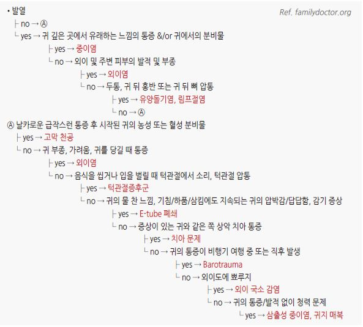
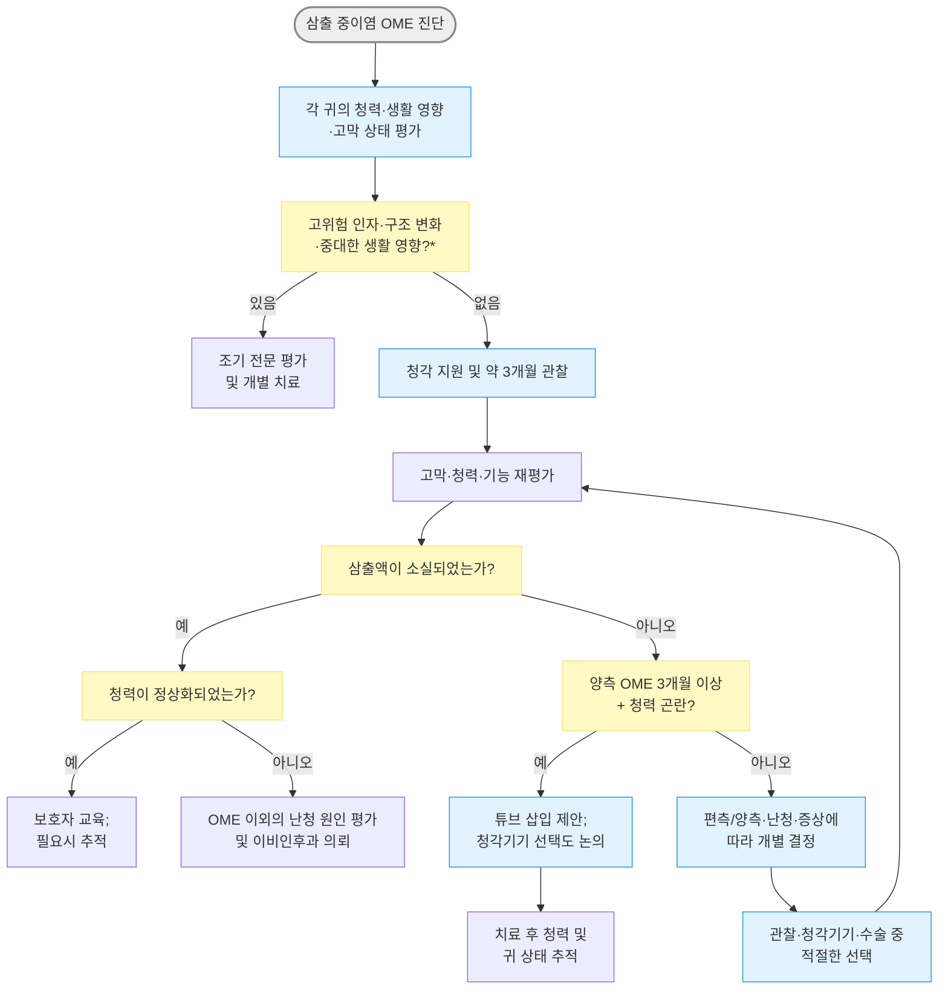

# 중이염 Otitis Media

## <mark style="color:green;">일반 사항</mark>

* 중이 점막의 염증. 보통 fluid collection(middle ear effusion, MEE) 동반
* 소아에서 항생제 처방과 일시적 전음성 난청의 흔한 원인
* AOM 빈도 : 3세까지 ≥80%의 소아가 ≥1회 경험
  * 소아 AOM 발생은 24개월 이후 나이가 들수록 감소. 성인 AOM은 드묾
* 치료 저해 요인 : 항생제 내성균, 불량한 순응도, 바이러스 동반 감염, 이관 기능 부전, 재감염, 면역 저하

<mark style="color:cyan;">**중이염의 분류**</mark>

* 급성 중이염 (AOM) : 중이 삼출액(MEE)과 함께 급성 염증 소견(고막 팽륜, 이통 등)이 갑자기 발생
* 삼출 중이염 (OME) : 급성 염증 소견 없이 MEE가 있는 상태; ≥3개월 지속 시 '만성 OME'
* 만성 화농성 중이염 (CSOM) : 고막 천공을 통한 지속·반복적 이루를 동반하는 만성 중이 염증; 기간 정의는 출처마다 다르며 3개월까지 평가를 미루지 않음
* 재발 중이염 (rAOM) : AOM이 최근 6개월 내 ≥3회, 또는 최근 12개월 내 ≥4회(그중 ≥1회는 최근 6개월 내) 반복

## <mark style="color:green;">원인 및 위험 인자</mark>

* 바이러스에 의한 상기도 감염 : 아데노이드 비대 및 이관 부종 → 비인두·중이 병원균 집락화 증가
* 담배 노출 : 직·간접 흡연은 염증 반응을 연장시키고, 이관을 통한 중이 분비물 배출 방해
* 면역 저하, 악안면 기형, 이관(Eustachian tube) 기능 부전
* 낮은 사회경제적 상태
* 겨울철 : 호흡기 바이러스 활동과 관련
* 6개월\~2세 : 발생 빈도가 가장 높은 연령
  * 관련 요인 : 낮은 면역 기능, 비인두 림프 조직 풍부, 짧고 수평인 이관(E-tube), 많은 누워 자는 시간
* 보육 시설 이용 : 가정 보육아 대비 발생률이 2\~3배 높음
* 남아, 유전, 가족력
* 조산(＜37주), 저체중 출산(＜2.5 ㎏), 모유 수유 부족

### <mark style="color:orange;">예방</mark>

아래 예방 항목은 주로 AOM·rAOM 위험 감소에 관한 내용이며, OME·CSOM 자체의 예방 효과와 구분함. 접종 일정·제제별 허가사항은 [예방접종](../231_/210_-vaccination.md) 참조.

* [폐렴구균 백신](../231_/210_-vaccination.md#pneumococcal-pneumonia) : 2025년 10월부터 PCV20(20가)이 소아 국가예방접종(NIP)에 신규 도입됨; 기존 PCV13으로 접종을 시작한 소아는 PCV20으로 교차접종 가능하며, PCV15로 시작한 경우 동일 백신으로 접종 완료 권장
  * 효과 : PCV7 연구에서 저위험 영아의 전체 원인 AOM은 약 6% 상대 감소; 고위험군에서는 예방 효과가 확립되지 않음(상대 감소율 −5%, 95% CI −25%\~12%) \[Cochrane 2020]. 이 수치를 PCV20의 예방 효과로 적용하지 않으며, PCV20의 소아 AOM 특이 장기 데이터는 축적 중
* [인플루엔자 백신](../231_/210_-vaccination.md#influenza) : 호흡기 질환 시즌 동안 influenza 관련 AOM 감소에 도움
* [RSV 예방](../231_/210_-vaccination.md#rsv-respiratory-syncytial-virus) : 단일클론항체·모체면역 백신의 본래 목적은 영아 RSV 하기도질환 예방이며, AOM 예방 자체가 적응증은 아님
  * nirsevimab은 관찰연구에서 AOM 및 항생제 노출 감소와의 연관성이 보고되었으나, 개인별 예방 효과를 확정한 무작위시험 결과는 아님 \[Eur J Pediatr 2026]. 이 결과를 clesrovimab·모체면역 백신에 동일하게 적용하지 않음
* Xylitol : 건강한 보육시설 이용 소아에서 상대위험 약 25% 감소가 보고되었으나, rAOM 소아·호흡기 감염 중 소아의 예방 효과는 확립되지 않음. 연구에서 잦은 투여가 필요했고 순응도 문제가 있어 일상적 권고는 제한적 \[Cochrane 2016]
* Vitamin D : 일부 관찰연구에서 혈중 농도와 재발 위험의 연관성이 보고되었으나, AOM 예방만을 위한 일률적 보충 근거는 부족함
* 예방적 항생제 : 내성균 발생 우려 크고 효과 미약 - 권고하지 않음

### <mark style="color:$danger;">🚩 Red Flags!</mark>

<mark style="color:$danger;">**즉각 조치**</mark>

* 두통, 고열, 구토, 의식 변화, 경부 강직 `뇌막염` `뇌농양` `경막외/하 농양`
* 유두부종, 외전신경 마비(복시) 또는 안와 뒤 통증 `S상정맥동 혈전증` `추체첨부염`
* 귀 뒤 발적·부종·파동, 이개의 전외방 돌출 `급성 유양돌기염` `골막하 농양`
* 안면 마비 `안면신경 침범`
* 자발 안진을 동반한 어지럼 또는 갑작스러운 심한 청력 저하 `미로염(내이염)`
* 생후 ＜3개월 영아의 ≥38℃ 발열(특히 ＜28일 신생아) `패혈증` `심부 세균 감염`

<mark style="color:$warning;">**당일 평가**</mark>

* 귀 뒤 압통이 발적·부종 없이 지속되거나 악화 `초기 유양돌기염`
* 적절한 항생제 치료 48\~72시간에도 호전 없거나 악화 `치료 실패` `내성균`
* 면역 저하자 또는 와우 이식자의 AOM `중증 감염` `이식물 감염`

<mark style="color:$info;">**조기 평가 및 추적**</mark>

* AOM이 ≥3회/6개월 또는 ≥4회/1년 재발 `재발 중이염`
* 6주 이상 지속되는 고막 천공 `지속 천공` `이루 동반 시 CSOM 평가`
* 악취 이루가 지속되거나 고막에 진주색 덩어리가 보임 `진주종`
* 삼출 중이염이 ≥3개월 지속, 또는 언어 지연·청력 저하 동반 `만성 OME`
* 성인에서 편측으로 지속되는 삼출·청력 저하(흡연력·경부 림프절 종대·비출혈이 없어도 해당) `비인두 병변`

***

<figure><figcaption><p><strong>증상/병력에 따른 귀 문제의 감별</strong></p></figcaption></figure>

***

## ■ 급성 중이염 Acute Otitis Media (AOM)

☞ [급성 중이염](049_1-acute-otitis-media-aom.md)

***

## ■ 삼출 중이염 Otitis Media with Effusion (OME)

## <mark style="color:green;">일반 사항</mark>

* 이통·발열 등 급성 염증 소견 없이 중이 내에 삼출액이 있는 상태
* 기전 : 중이 자극 → mucin 생성↑, 이관 기능 부전/폐쇄 → 중이 내 mucin-rich effusion 축적
* AOM 치료 2주 후 60\~70%, 1개월 후 40%, 3개월 후 10\~25%에서 중이에 삼출액 잔존
* 경과 : ＞3세 환자에서 3개월 내 50%가 자연 치유 (특히 AOM에 2차적으로 발생한 경우 잘 치유)
  * OME 소아의 30\~40%에서 재발 경과
* 지속 시 문제 : 전음성 난청과 의사소통·학습 영향, 고막 함몰·유착·이소골 손상·진주종 등 구조 변화
  * 언어 발달 영향은 지속 기간·양측 여부·기저 발달 상태에 따라 평가하며 일률적인 영구 언어 장애로 설명하지 않음
* 성인 지속성 편측 OME는 비인두 병변 등 원인 감별을 위해 이비인후과 평가
  * 흡연력·경부 종대·비출혈이 없어도 평가 대상이며 이들을 동반한 경우 신속 의뢰

## <mark style="color:green;">원인 및 위험 인자</mark>

* URI, 알레르기비염, AOM, 부비동 질환, 아데노이드 비대, 두경부 종양
* 영유아, 흡연

## <mark style="color:green;">임상 양상</mark>

* 명백한 증상이 없을 수 있음
  * 영유아에서는 표현이 모호할 수 있음 - 귀를 문지름, 보챔, 소리에 부적절한 반응
* 청력 감소, ear fullness, popping
* 이명, 균형 장애

## <mark style="color:green;">진단</mark>

* 고막 소견 : retracted 또는 neutral position, 운동성 감소, 불투명, 색깔 변화, air-fluid level·bubble
* pneumatic otoscopy : 1차 진단 도구 - 고막 운동성 감소 확인
* 고막운동성계측(tympanometry) : 진단이 불확실할 때 시행; 정상 외이도 용적을 동반한 type B는 MEE 지지
* 청력 검사 : OME가 의심되면 3개월을 기다리지 않고 연령에 맞는 청력 검사를 시행 \[NICE 2023]
  * 각 귀의 청력 저하 여부, 편측/양측 여부, 일상생활(언어·학습·행동)에 미치는 영향 확인
  * 청력 저하가 있으면 3개월 후 재평가(양측 OME는 권고, 편측은 고려) \[NICE 2023]
  * MEE가 ≥3개월 지속되거나, 언어 지연·학습 장애가 있거나 고위험군(☞ 아래 '조기 조치 대상자')이면 반드시 청력 검사 \[AAO-HNSF 2016]

***

## <mark style="background-color:$warning;">Management - OME</mark>

### <mark style="color:orange;">치료 방침</mark>

* 진단 시 청력·기능을 평가하고, OME 단독이고 고위험 인자·중대한 생활 영향·고막 구조 변화가 없으면 약물 요법 없이 3개월 경과 관찰; 3개월 후 고막 상태·청력·언어 발달을 재평가하여 추가 치료 결정 \[NICE 2023; AAO-HNSF 2016]
  * 단, 구개열·다운증후군·감각신경성 난청·언어 발달 지연 등 고위험군은 3개월 관찰 없이 즉시 의뢰 고려
* 약물 치료는 OME 자체에는 권장하지 않음
  * 알레르기비염 등 별도 치료가 필요한 동반 질환이 있는 경우에 한해 해당 질환의 치료를 고려
  * 보호자 불안이나 수술 거부 자체는 근거 없는 약물 치료의 적응증이 되지 않음
* 추적 관찰 : 삼출액 소실될 때까지 1\~3개월 간격 검진
  * 삼출액 소실 후에도 난청이 남으면 OME 이외의 난청 원인 평가 및 이비인후과 의뢰


**3개월 관찰은 최초 청력 검사를 미루라는 뜻이 아님.** 초기 평가에서 각 귀의 청력과 편측·양측 여부, 언어·학업·행동·생활 영향을 확인함. 수술 여부는 특정 ㏈ 수치 하나로 정하지 않으며, 고위험군·구조 변화·중대한 생활 영향은 조기 개입 고려.


### <mark style="color:orange;">조기 조치 대상자</mark>

* 아래에 해당하는 경우 조기에 청력 검사, 언어 평가, 수술 고려
  * OME와 별도의 감각신경성 난청
  * 교정 불가능한 시각 저하
  * 다운증후군·두개안면기형
  * 구개열
  * 자폐증 및 전반적 발달 장애
  * 언어·인지 기능 저하
  * 진단 시 중등도 이상 난청(예: ≥40 ㏈) 또는 언어 발달 지연 의심
  * 경과 관찰 중 고막의 비가역적 구조 변화 발생 또는 예측

## <mark style="color:green;">비-약물 치료</mark>

* 자가통기법 (Autoinflation) : 협조 가능한 소아에서 관찰 기간 중 고려하는 비침습적 선택지; 나이보다 정확한 동작 수행 가능 여부가 중요
  * 풍선형 장치(예: [Otovent](https://www.youtube.com/watch?v=O5Y_bUqmQ1o)) : 단기적으로 OME 지속·질환 관련 삶의 질에 도움이 될 가능성은 있으나, 청력 정상화 효과는 불확실 \[Cochrane 2023; NICE 2023]. 불편감·이통과 시행 부담을 설명
  * 장치 사용법에 따라 보통 하루 2\~3회 시행; 통증·어지럼 발생 시 중단하고 평가
* 하품·삼킴은 중이 압력 조절에 도움이 될 수 있음
* 껌 씹기나 일반 Valsalva 수기는 효과 근거가 없어 풍선 장치(자가 통기)의 대체 방법으로 권하지 않음
* 난청 지원 장치 : 청각 환경 개선과 함께 보청기 또는 골전도 청각기기 고려
  * 관찰 중 난청이 지속되거나 수술을 기다리는 경우·수술을 원하지 않는 경우에도 선택 가능
  * 청력 변동·이루·착용 가능성에 따라 청각 전문가와 결정 \[NICE 2023]

#### <mark style="color:$primary;">난청 동반 유소아 삼출 중이염 - 청각 환경 개선</mark>

* 배경 음악·TV 등 잡음을 끈다
* 1 m 이내로 접근해서 천천히 크게 또렷이 발음한다
* 대면하여 손동작을 더하며 이야기한다
* 교실에서 선생님과 가까운 거리에 앉도록 하고 FM 시스템 등 음향 증폭 장치를 사용한다

## <mark style="color:green;">약물 치료</mark>

* 항히스타민제, 코 울혈 제거제, 점액용해제 : 효과 없음 - 사용하지 않음
* 전신 스테로이드 : 청력 개선 효과 없음 \[Lancet 2018] - 권고하지 않음
* 비내 스테로이드 : OME 해소 효과 없음 - 권고하지 않음 (알레르기비염 동반 시 그 치료 목적으로는 사용 가능)
* 항생제 : OME 자체를 치료하기 위한 사용은 권고하지 않음. 동반 AOM·세균성 부비동염 등 별도 감염이 확진되면 해당 질환의 항생제 적응증에 따라 치료

## <mark style="color:green;">수술</mark>

* 일반적으로 3개월 경과 관찰 후 해당 시 고려
  * 양측 OME가 ≥3개월 지속 + 청력 저하가 객관적으로 확인(documented hearing difficulties)된 경우 고막튜브삽입술 제안 \[AAO-HNSF 고막튜브 지침 2022]
    * 특정 ㏈ 수치보다 청력 저하의 실재 여부와 기능적 영향(언어·학업·행동)을 우선 고려
  * 편측 OME에서는 이환 기간, 청력 수준, 동반 증상, 보호자 선호도 고려
  * 고위험군·고막의 비가역적 변화 예측 시 조기 수술 고려
* 지속성 OME의 수술적 환기는 고막튜브삽입술(tympanostomy tube insertion) 중심
  * 단순 고막절개술만으로 장기 환기 효과를 기대하기 어려움
* 튜브 삽입 시 아데노이드절제술 병행
  * AAO-HNSF 2022 : ≥4세에서 병행 고려; ＜4세는 별도 적응증(코막힘·아데노이드 감염 등)이 없으면 병행하지 않음. 튜브 재삽입 자체는 이 조건을 대신하지 않음
  * NICE 2023 : 튜브 수술 시 동반 절제를 더 넓게 고려하되 구개 이상이 있으면 별도 판단. 구개열·점막하 구개열·구개인두 기능 부전은 수술 전 전문 평가
* 수술 6주 후에 청력 검사 \[NICE 2023]
* 튜브 삽입 후 3개월 이내 귀 상태 확인, 이후 튜브 배출까지 정기 추적 \[AAO-HNSF 2022]

***



> _\*감각신경성 난청·교정 불가 시각 저하·다운증후군/두개안면기형·구개열·자폐증/발달 장애·언어/인지 기능 저하, 고막의 비가역적 변화 또는 난청으로 인한 중대한 생활 영향. 한쪽 귀의 난청도 기능에 영향을 줄 수 있어 좋은 쪽 역치만으로 결정하지 않음._

<p align="center"><strong>삼출 중이염 치료 알고리듬</strong><br><em><mark style="color:$info;">저자 재구성 (참고 문헌 : AAO-HNSF OME 지침 2016; AAO-HNSF 고막튜브 지침 2022; NICE 2023)</mark></em></p>

***

## <mark style="color:red;">질병코드 - OME</mark>

* H65.0 급성 장액성 중이염 Acute serous otitis media
* H65.2 만성 장액성 중이염 Chronic serous otitis media
* H65.3 만성 점액성 중이염 Chronic mucoid otitis media

***

## <mark style="color:purple;">처방례 - OME</mark>

> **처방례 1. OME - 경과 관찰 중 통증·발열 없이 청력 저하만 있는 소아**
>
> ```
> (약물 처방 없음 - 초기 청력 평가 후 청각 지원·경과 관찰)
> ```
>
> _✽OME 단독 진단 시 항생제·항히스타민제 등 약물 요법의 이득이 입증되지 않음. 초기 청력 검사 및 생활 영향 평가 후 약 3개월에 고막·청력 재평가 예약. 필요시 보청기·골전도 청각기기 고려. 언어 지연·고위험군·중대한 생활 영향은 조기 의뢰_

> **처방례 2. OME - 경과 중 AOM 병발**
>
> ```
> (급성 중이염 처방례에 준함)
> ```
>
> _✽OME 경과 중 이통·발열·고막 팽륜 등 급성 염증 소견이 생기면 AOM으로 진단하고 AOM 기준으로 치료 (☞_ [_급성 중이염_](049_1-acute-otitis-media-aom.md)_). OME 단독에는 항생제 불필요_

***

### <mark style="color:$success;">핵심 복약 지도 - OME</mark>

> **삼출 중이염(귀 안에 물이 찬 상태) 안내**
>
> * 삼출 중이염은 귀 안에 액체(삼출액)가 고인 상태로, 급성 중이염처럼 통증·고열이 심하지 않습니다.
> * 자연적으로 좋아지는 경우가 많아 약 없이 관찰할 수 있습니다. 청력과 생활에 미치는 영향은 처음부터 확인하며, 약 3개월에 다시 평가합니다.
> * **항생제, 항히스타민제, 코 막힘 약은 삼출 중이염에 효과가 없습니다.** 의사의 처방 없이 임의로 복용하지 마십시오.
> * 청력이 다소 감소할 수 있습니다. 아이가 말을 잘 못 듣거나 TV 볼륨을 높인다면 빠른 재진이 필요합니다.
> * 코를 세게 풀지 말고, 한 번에 한 쪽씩 부드럽게 풀어주십시오.

***

## <mark style="color:blue;">환자 안내서 - 삼출 중이염</mark>


**삼출 중이염(귀 안에 물이 찼어요)이란?**

고막 안쪽 중이에 액체(삼출액)가 고인 상태로, 통증이나 고열은 없거나 경미합니다. 감기 후나 급성 중이염 후에 잘 생깁니다. 대부분 시간이 지나면 저절로 회복되지만, 청력에 일시적인 영향을 줄 수 있어 추적 관찰이 필요합니다.


#### <mark style="color:$primary;">어떤 증상이 생기나요?</mark>

* 귀가 먹먹하거나 꽉 찬 느낌
* 소리가 울려 들리거나 TV 소리를 크게 해야 잘 들림
* 아이가 말을 자꾸 못 듣거나 반응이 늦어짐

#### <mark style="color:$primary;">치료는 어떻게 하나요?</mark>

* 청력을 확인한 뒤 약 없이 관찰할 수 있습니다. 보통 약 3개월에 다시 평가하지만, 말이나 생활에 영향이 크면 더 일찍 치료를 논의합니다.
* 협조 가능한 아이는 의사의 안내에 따라 풍선 장치로 자가 통기를 시도할 수 있습니다. 통증이 생기면 중단하십시오.
* 난청이 있으면 보청기 등 청각 지원을 고려할 수 있습니다. 지속 기간·청력·생활 영향을 함께 보고 고막튜브 수술 여부를 결정합니다.

#### <mark style="color:$primary;">이럴 때는 빨리 병원을 방문하세요</mark>

* 아이가 말을 잘 못 하거나 언어 발달이 느려 보일 때
* 3개월 이상 귀가 먹먹한 느낌이 지속될 때
* 갑자기 귀에서 분비물이 나오거나 통증이 생길 때

***

## ■ 만성 화농성 중이염 Chronic Suppurative Otitis Media (CSOM)

## <mark style="color:green;">일반 사항</mark>

* 고막 천공을 통한 지속·반복적 이루를 동반하는 중이·유양동의 만성 염증
* 기간 정의는 2주(WHO)\~수개월로 출처마다 다름
* 3개월까지 평가를 미루지 않음
* 이루 없는 건성 천공과 구분
* 진주종(cholesteatoma)을 동반할 수 있으며, 동반 시 침습적 경과를 보이고 수술 필요성이 높음
  * 유양동까지 진행하는 경우가 많음
* 원인균 : _P. aeruginosa_, _S. aureus_(MRSA 포함)가 가장 흔함
  * 그 외 _Proteus_·_Klebsiella_ 등 그람음성균, 혐기성균, 진균

## <mark style="color:green;">임상 양상</mark>

* 농성 이루 : 지속 또는 간헐적; URI 또는 물에 노출된 후 심해질 수 있음
* 통증 : 급성 악화기 외에는 흔하지 않음 (영아 - 귀를 만지거나 당김)
* 전음성 청력 소실 : 고막·이소골 손상에 의해 발생
* 이명, 현훈

## <mark style="color:green;">진단</mark>

* 청력 검사 : 각 귀의 청력·전음성/감각신경성 성분을 평가
  * 감염 치료 후에도 난청 지속 시 재평가
* 배양·항생제 감수성 검사 : 반복·난치성 이루, 내성 의심, 또는 초기 국소 치료 1\~2주 후에도 이루 지속 시 시행
  * 악화 시 조기 검사·의뢰
* 측두골 CT : 치료 실패, 진주종·골미란·합병증 의심 시
  * 잔존·재발 진주종 의심 : non-EPI DWI를 포함한 MRI
  * 두개 내 감염·정맥동혈전증 등 합병증 의심 : 조영증강 MRI 등 목적에 맞는 검사 구성 \[ESHNR 영상 권고, Eur Radiol 2025]

***

## <mark style="background-color:$warning;">Management - CSOM</mark>

### <mark style="color:orange;">귀 청소</mark>

* 분비물·잔해를 제거하여 병변 확인과 국소 약물 전달을 돕기 위해 시행
* 귀 청소 단독의 치료 효과는 불확실 \[Cochrane 2025]
* 흡인·청소는 적절한 장비와 숙련하에 시행
* 천공된 귀에는 물 세척(이강 세척)을 하지 않으며, 건식 청소 또는 흡인으로 분비물 제거

## <mark style="color:green;">약물 치료</mark>

### <mark style="color:orange;">국소 살균제</mark>

* 퀴놀론 점이액 : boric acid보다 1\~2주 이루 소실에 유리할 가능성
  * 다른 살균제와의 비교 효과·안전성 근거는 불확실 \[Cochrane 2025]
* Acetic acid, boric acid, povidone-iodine, aluminium acetate(Burow 용액) : 농도·용매(특히 알코올)·천공 여부에 따른 자극·이독성 검토가 필요
  * 천공 귀에 임의 조제·가정용 용액을 사용하지 않으며 전문의가 제제별 안전성을 확인한 경우에 한해 고려

### <mark style="color:orange;">국소 항생제</mark>

* 국소 항생제가 전신 항생제보다 단기 이루 소실에 유리할 가능성이 있으나 비교 근거의 확실성은 낮음 \[Cochrane 2025]. 귀 청소·배액 확보와 국소 치료를 우선
* fluoroquinolone 점이액(1차 선택) : aminoglycoside보다 이독성 우려가 적음
  * ofloxacin 0.3% <mark style="color:blue;">\[에펙신]</mark> : 성인 1회 6\~10방울 bid, 점이 후 약 10분 이욕. 초기 약 1\~2주 치료 후 반응 재평가; 총 기간은 병변·배양·반응에 따라 결정 (중이염·외이염 허가)
    * 국내 허가사항의 표준 기간은 4주이며, 연장 여부는 신중히 판단
    * 국내 허가 용법은 연령·증상에 따라 적절히 증감; 소아의 구체적인 방울 수는 제시되어 있지 않으며 1세 미만 안전성·유효성 미확립
  * <mark style="color:blue;">\[세트락살플러스]</mark>(ciprofloxacin/fluocinolone) : 국내 허가는 '정상 고막'의 급성 외이염(≥7세)에 한정되고 중이염에서의 안전성이 확립되지 않아, CSOM·튜브 이루에는 일반적으로 권하지 않음
* aminoglycoside : 고막 천공·튜브를 통해 중이에 노출되면 이독성 우려가 있어 일반적으로 피함

### <mark style="color:orange;">경구 항생제</mark>

* 경구제에 국소제를 추가하면 이루 소실에 도움이 될 가능성이 있음
  * 적절한 국소 항생제에 전신 항생제를 일률적으로 추가해도 이득은 작거나 불확실 \[Cochrane 2025]
* 적응증 : 전신 감염·주변 조직 확산·합병증 의심, 국소 약물 전달이 불가능하거나 적절한 국소 치료 실패 시 배양 결과와 전문의 판단에 따라 선택
* 경구 항생제 추가 전, 분비물이 많으면 먼저 귀 청소·흡인을 하고 점이액이 중이까지 전달되는지 확인
* 치료 기간은 감염 범위·배양·반응에 따라 결정
  * 일률적인 3주 또는 이루 중단 후 일정 기간까지 연장하는 규칙은 적용하지 않음
* ciprofloxacin : 성인에서 감수성 확인 후 고려. 용량·기간은 병변·신기능·허가사항에 따라 결정 <mark style="color:blue;">\[씨프로바이]</mark>
  * 소아는 제한적으로 전문의 판단하에 사용
* MRSA 의심 시 : 배양·감수성 결과에 따라 선택; 이비인후과 의뢰

## <mark style="color:green;">수술</mark>

* 적응증 : 진주종, 구조 손상, 지속 천공, 난청, 반복 이루
  * 모든 CSOM에서 수술이 필수인 것은 아님
* 수술 방법 : 병변 범위에 따라 선택
  * 천공만 있는 경우 : 고막성형술(myringoplasty) 또는 고실성형술(tympanoplasty)
    * 감염을 조절한 뒤 천공 지속·난청·반복 감염·생활 영향을 고려하여 결정
  * 진주종·유양동 병변 : 범위에 따라 유양돌기절제술(mastoidectomy) 병행 여부 결정. 작은 국한성 진주종은 제한적 경외이도·내시경 수술도 가능
  * 이소골 손상 : 이소골성형술 병행
* 천공 지속 기간(예: 6개월)은 수술 결정의 고정 조건이 아님

***

## <mark style="color:red;">질병코드 - CSOM</mark>

* H66.1 만성 이관고실의 화농성 중이염 Chronic tubotympanic suppurative otitis media
* H66.2 만성 상고실유돌동화농성 중이염 Chronic atticoantral suppurative otitis media
* H66.3 기타 만성 화농성 중이염 Other chronic suppurative otitis media

***

## <mark style="color:purple;">처방례 - CSOM</mark>

> **처방례 1. CSOM - 성인, 국소 항생제 (1차)**
>
> ```
> 에펙신이용액 0.3% 5 ㎖/병   1회 10방울   bid   × 14d
> (점이 후 약 10분 이욕; 치료 중 반응 재평가)
> ```
>
> _✽중이염에 허가된 ofloxacin 제제를 선택; 귀 청소 후 투여. 본 예시는 초기 14일 치료이며 1\~2주에 이루·고막·약물 전달을 재평가. 국내 허가 표준 기간은 4주이므로 반응·배양에 따라 총 기간 결정; 악화·무반응이면 조기 배양 및 의뢰._

> **처방례 2. CSOM - 국소 치료 실패 또는 전신 치료 필요시**
>
> ```
> (배양·감수성 검사 및 이비인후과 평가 후 전신 항생제·기간 결정)
> ```
>
> _✽분비물 과다만으로 전신제를 선택하지 않음. 귀 청소·약물 전달·진주종 여부를 먼저 확인하며, 전신 증상·조직 확산·합병증 의심 시 신속 의뢰. 경험적 ciprofloxacin 14\~21일을 모든 환자에게 적용하지 않음._

***

### <mark style="color:$success;">핵심 복약 지도 - CSOM</mark>

> **점이용액 올바른 사용법**
>
> * 아픈 귀를 위로 향하게 눕거나 머리를 기울이고 처방된 방울 수를 점이하십시오.
> * **약병을 겨드랑이에 1분간 끼워두거나 바지 앞주머니에 5분간 넣어 체온 가깝게 데운 후 사용하십시오.** 차가운 약이 들어가면 어지럼증이 생길 수 있습니다.
> * 귓바퀴를 부드럽게 당겨 약이 귀 안 깊이 들어가도록 하고, **에펙신은 약 10분간 그 자세를 유지**하십시오.
> * 점이 후 귀 앞의 작은 돌기(이주)를 손가락으로 여러 번 눌러 주면 약이 귀 안쪽까지 잘 들어갑니다.
> * 처방 기간을 끝까지 사용하십시오.

> **귀에 물 들어가지 않도록 하는 방법**
>
> * 샤워·세발 시 귀마개나 솜(바셀린 묻힘)으로 귀를 막으십시오.
> * 수영은 치료 기간 중 삼가십시오.
> * **면봉으로 귀 안을 후비지 마십시오.** 분비물을 귀 안쪽으로 밀어 넣고 상처를 줄 수 있습니다.

> **언제 즉시 병원을 방문해야 하나요?**
>
> * 귀 뒤가 빨갛게 부어오르거나 눌리면 아플 때 (유양돌기염 의심)
> * 얼굴 한쪽이 마비되거나 처지는 느낌이 들 때 **(즉시 응급실)**
> * 두통, 구토, 고열이 동반될 때 **(즉시 응급실)**
> * 초기 1\~2주 치료에도 분비물이 지속되거나 치료 중 악화될 때 (재평가·배양 및 의뢰 고려)

***

## <mark style="color:blue;">환자 안내서 - 만성 화농성 중이염</mark>


**만성 화농성 중이염이란?**

고막에 구멍(천공)이 생기고, 귀에서 고름 같은 분비물이 오랜 기간(수 주\~수개월) 반복적으로 나오는 상태입니다. 이관 기능, 반복 감염, 고막 천공, 진주종 등 여러 요인이 관련됩니다. 이미 천공이 있는 귀에 물이 들어가면 이루가 악화될 수 있습니다. 청력 저하가 동반될 수 있으며, 완치를 위해 수술이 필요한 경우도 있습니다.


#### <mark style="color:$primary;">어떤 증상이 생기나요?</mark>

* 귀에서 고름 같은 분비물이 나옴 (간헐적 또는 지속적)
* 청력 감소 (소리가 잘 안 들림)
* 이명(귀 울림)

#### <mark style="color:$primary;">치료 중 꼭 지켜야 할 것</mark>

* **활동성 이루·고막 천공이 있는 동안 귀에 물이 들어가지 않게 주의하십시오.** 샤워 시 보호하고, 수영 재개는 귀 상태를 확인한 뒤 의사와 상의하십시오.
* 귀약(점이용액)을 처방대로 끝까지 사용하십시오.
* 코를 세게 풀지 마십시오.

#### <mark style="color:$primary;">이럴 때는 즉시 병원을 방문하세요</mark>

* 귀 뒤쪽이 부어오르거나 통증이 심해질 때
* 얼굴 마비, 어지럼증이 갑자기 생길 때 **(즉시 응급실)**
* 초기 1\~2주 치료에도 분비물이 지속되거나 치료 중 악화될 때

***

## ■ 재발 중이염 Recurrent Acute Otitis Media (rAOM)

## <mark style="color:green;">일반 사항</mark>

* 정의 : 서로 분리된 AOM이 최근 6개월 내 ≥3회, 또는 최근 12개월 내 ≥4회(그중 ≥1회는 최근 6개월 내) 발생
* 치료 직후 증상이 지속·재출현하면 치료 실패, 기존 감염 재발, 새 감염을 평가
* 재발 위험에는 연령·이관 기능·호흡기 감염 노출 등이 관련; 불충분한 치료만으로 설명하지 않음

***

## <mark style="background-color:$warning;">Management - rAOM</mark>

* 치료 후 재출현 : AOM 진단·최근 사용 약제·복약·현재 중증도 확인 후 항생제 선택
  * 반복·난치성은 배양 또는 의뢰 고려
* 시간 간격만으로 기존 균의 재발과 다른 균의 재감염을 구분할 수 없음. 2주 이후라는 이유만으로 다른 균주로 간주하지 않음
* 예방적 항생제 : 예방 이득이 제한적이고 내성·부작용 위험이 있어 일상적으로 권고하지 않음

### <mark style="color:orange;">고막튜브삽입술 (Tympanostomy Tube Insertion)</mark>

* 6\~12개월 또는 12\~18개월 유지 후 자연 배출되도록 제작된 튜브 삽입
* 배출 후에도 재발·OME가 지속되면 재삽입 필요성을 평가
  * 약 14%가 5년 내 두 번째 튜브를 받음 \[AAO-HNSF 2022]
* 튜브 삽입 후 추적검사 원칙은 위 OME ‘수술’ 항목 참조
* 6\~35개월 rAOM에서 고막튜브삽입술과 약물 치료 사이에 2년간 AOM 발생률의 유의한 차이가 없었음 \[NEJM 2021]

<mark style="color:cyan;">**대상**</mark>

* rAOM : ≥3회/6개월 또는 ≥4회/12개월 (이 중 한 번은 6개월 내 발생) \[AAP 2013]
* 평가 시점에 양측 모두 MEE가 없으면 시행하지 않음. 한쪽 또는 양쪽 MEE가 있으면 양측 튜브 삽입을 제안하고 이득·위험을 설명 \[AAO-HNSF 2022]

<mark style="color:cyan;">**고막 튜브 유지 중 AOM 발생 시 관리**</mark>

* 고막 튜브를 통해 이루가 배출되며 통증은 없거나 경미할 수 있음
* 필요시 배양 검사 시행(진균 검사 포함)
* 귀 청소·점이액 전달 및 튜브 개방 상태 확인
* 합병증 없는 급성 튜브 이루는 국소 항생제 단독 \[AAO-HNSF 2022]
  * ofloxacin <mark style="color:blue;">\[에펙신]</mark> 등 국내 중이염 허가상 적합한 제제 선택
  * 소아는 연령·증상 및 제품 허가사항 확인
* 전신 항생제
  * 적응증 : 주변 연조직염, 중대한 전신 증상, 면역저하, 다른 전신 감염 또는 적절한 국소 치료 실패
  * 반응이 없으면 청소·튜브 폐쇄·배양·진균 등을 먼저 평가
* 활동성 이루 때는 오염된 물 노출에 주의
  * 튜브가 있다는 이유만으로 일상적인 귀마개·수영 제한을 일률적으로 권고하지 않음

<mark style="color:cyan;">**부작용**</mark>

* 이루, 고실 경화·고막 위축성 반흔, 지속 천공
* 발생 빈도·임상 영향은 다르며, 모두 드물거나 영구 난청을 유발하는 것은 아님

### <mark style="color:orange;">아데노이드절제술 (Adenoidectomy)</mark>

* 단독으로는 rAOM 예방 효과가 제한적. 튜브 삽입 시 아데노이드 감염·비폐색 등 직접 관련 증상이 있거나, ≥4세에서 향후 중이염 재발·튜브 재삽입 위험 감소를 위해 병행 고려 \[AAO-HNSF 2022]
  * ＜4세는 튜브 재삽입만을 이유로 병행하지 않으며, 아데노이드 관련 별도 적응증 확인
* 편도절제술은 중이염 적응증이 아님

<mark style="color:cyan;">**대상**</mark>

* 아데노이드 비대로 인한 기도 폐쇄 : 심한 코막힘, 수면 호흡 장애, 구강 호흡
* 아데노이드 관련 반복 감염
* 두개안면기형·발음 장애 자체를 포괄적인 절제 적응증으로 삼지 않음
* 구개열·점막하 구개열·구개인두 기능 부전은 수술 후 발음 악화 위험을 고려해 전문 평가

✽ 편도 절제 ☞ [편도염](../223_/064_-tonsillitis.md#undefined-12)

***

## <mark style="color:red;">질병코드 - rAOM</mark>

* 별도 코드 없음 - 각 에피소드에 급성 중이염 코드(H66.0, H65.1) 사용

***

## <mark style="color:purple;">처방례 - rAOM</mark>

> **처방례 1. rAOM - 급성 에피소드**
>
> ```
> (급성 중이염 처방례에 준함)
> ```
>
> _✽각 에피소드는 AOM 기준으로 진단·치료 (☞_ [_급성 중이염_](049_1-acute-otitis-media-aom.md)_). 최근 30일 내 amoxicillin 복용 시 amox-clav 선택. 반복·난치성은 배양 또는 의뢰 고려_

> **처방례 2. 고막튜브 이루 - 합병증 없는 경우 (1\~12세)**
>
> ```
> 에펙신이용액 0.3% 5 ㎖/병   1회 5방울   bid   × 10d
> (점이 후 이주를 여러 번 눌러 줌; 약 10분 이욕)
> ```
>
> _✽합병증 없는 급성 튜브 이루는 국소 항생제 단독이 원칙 \[AAO-HNSF 2022]. 점이 전 분비물을 닦아 내고 튜브 개방 여부 확인. 국내 허가사항은 연령·증상에 따라 적절히 증감하도록 하며 소아의 구체적 방울 수는 제시하지 않음. 본 예시의 1회 5방울 bid ×10일은 미국 ofloxacin 0.3%의 1\~12세 튜브 동반 AOM 허가 용법을 참고한 것임 \[DailyMed]. 이욕 시간은 에펙신 국내 허가에 맞춰 약 10분으로 안내. 7일째에도 이루가 지속되면 재평가하며, 주변 연조직염·전신 증상 또는 악화 시 조기 평가_

***

### <mark style="color:$success;">핵심 복약 지도 - rAOM</mark>

> **급성 에피소드 치료**
>
> * 매번의 급성 중이염은 처음과 같은 원칙으로 치료합니다 (☞ [급성 중이염](049_1-acute-otitis-media-aom.md)).
> * 최근 한 달 안에 항생제를 먹었다면 진료 시 꼭 알려 주십시오. 약 선택이 달라집니다.

> **고막튜브가 있는 아이의 귀에서 분비물이 나올 때**
>
> * 분비물이 나오는 것은 튜브를 통해 고름이 빠져나오는 것으로, 대부분 먹는 항생제 없이 귀약(점이액)만으로 좋아집니다.
> * 귀약을 넣기 전 귀 입구의 분비물을 깨끗한 휴지나 솜으로 닦아 내십시오.
> * 귀약을 넣은 뒤 귀 앞의 작은 돌기(이주)를 손가락으로 여러 번 눌러 주면 약이 튜브를 통해 안쪽까지 들어갑니다. 그 자세로 약 10분간 누워 있게 하십시오.
> * 처방된 기간 동안 사용하고, 7일이 지나도 분비물이 계속되면 다시 진료를 받으십시오.

> **물 노출**
>
> * 튜브가 있다는 이유만으로 샤워·목욕·수영 때 귀마개를 항상 할 필요는 없습니다.
> * 귀에서 분비물이 나오는 동안에는 물이 들어가지 않게 하십시오.

***

## <mark style="color:blue;">환자 안내서 - 재발 중이염</mark>


**재발 중이염이란?**

급성 중이염이 6개월 안에 3번 이상, 또는 1년 안에 4번 이상 생기는 경우입니다. 아이의 귀인두관(코와 귀를 잇는 관)이 짧고 수평이며, 감기에 자주 걸리는 시기여서 생깁니다. 치료를 잘못해서 생기는 것은 아니며, 대부분 자라면서 줄어듭니다.


#### <mark style="color:$primary;">재발을 줄이려면</mark>

* 폐렴구균·인플루엔자 예방접종을 일정대로 맞히십시오.
* 아이 주변에서 담배를 피우지 마십시오. 옷이나 집 안에 남은 담배 연기도 영향을 줍니다.
* 가능하면 모유 수유를 하고, 누운 자세로 젖병을 물려 재우지 마십시오.
* 감기가 유행할 때는 손 씻기를 생활화하십시오.

#### <mark style="color:$primary;">고막튜브 수술이란?</mark>

* 고막에 작은 관을 넣어 중이에 공기가 통하게 하는 수술입니다. 중이염이 자주 반복되면서 귀 안에 물이 차 있는 경우에 권할 수 있습니다.
* 튜브는 보통 6\~18개월 뒤 저절로 빠지며, 빠진 뒤 고막은 대부분 스스로 아뭅니다.
* 튜브가 있는 동안에는 정기적으로 귀 검진을 받으십시오.

#### <mark style="color:$primary;">이럴 때는 병원을 방문하세요</mark>

* 귀 통증, 발열, 귀에서 분비물이 나올 때
* 귀약을 7일 넘게 써도 분비물이 계속될 때
* 귀 뒤가 붓거나 빨개질 때, 고열이나 심한 처짐이 있을 때 **(즉시 진료)**
* 말을 잘 못 알아듣거나 TV 소리를 크게 할 때

***

## <mark style="color:green;">주요 참고문헌 및 확인 자료</mark>

### <mark style="color:orange;">임상 근거</mark>

* Rosenfeld RM, et al. Clinical practice guideline: otitis media with effusion (update). Otolaryngol Head Neck Surg 2016;154(1 Suppl):S1-S41.
* Rosenfeld RM, et al. Clinical practice guideline: tympanostomy tubes in children (update). Otolaryngol Head Neck Surg 2022;166(1 Suppl):S1-S55.
* NICE. Otitis media with effusion in under 12s (NG233). 2023.
* Lieberthal AS, et al. The diagnosis and management of acute otitis media. Pediatrics 2013;131(3):e964-e999.
* Touska P, Connor SEJ. ESR Essentials: imaging of middle ear cholesteatoma—practice recommendations by the European Society of Head and Neck Radiology. Eur Radiol 2025;35:2053-2064. [doi:10.1007/s00330-024-11021-x](https://doi.org/10.1007/s00330-024-11021-x).
* Hoberman A, et al. Tympanostomy tubes or medical management for recurrent acute otitis media. N Engl J Med 2021;384:1789-1799.
* Francis NA, et al. Oral steroids for resolution of otitis media with effusion in children (OSTRICH). Lancet 2018;392:557-568.
* Azarpazhooh A, et al. Xylitol for preventing acute otitis media in children up to 12 years of age. Cochrane Database Syst Rev 2016;8:CD007095.
* de Sévaux JLH, et al. Pneumococcal conjugate vaccines for preventing acute otitis media in children. Cochrane Database Syst Rev 2020;11:CD001480. [doi:10.1002/14651858.CD001480.pub6](https://doi.org/10.1002/14651858.CD001480.pub6).
* Webster KE, et al. Autoinflation for otitis media with effusion (OME) in children. Cochrane Database Syst Rev 2023;9:CD015253. [doi:10.1002/14651858.CD015253.pub2](https://doi.org/10.1002/14651858.CD015253.pub2).
* Bhutta MF, et al. Aural toilet (ear cleaning) for chronic suppurative otitis media. Cochrane Database Syst Rev 2025;6:CD013057. [doi:10.1002/14651858.CD013057.pub3](https://doi.org/10.1002/14651858.CD013057.pub3).
* Head K, et al. Antibiotics versus topical antiseptics for chronic suppurative otitis media. Cochrane Database Syst Rev 2025;6:CD013056. [doi:10.1002/14651858.CD013056.pub3](https://doi.org/10.1002/14651858.CD013056.pub3).
* Chong LY, et al. Topical versus systemic antibiotics for chronic suppurative otitis media. Cochrane Database Syst Rev 2025;6:CD013053. [doi:10.1002/14651858.CD013053.pub3](https://doi.org/10.1002/14651858.CD013053.pub3).
* Chong LY, et al. Systemic antibiotics for chronic suppurative otitis media. Cochrane Database Syst Rev 2025;6:CD013052. [doi:10.1002/14651858.CD013052.pub3](https://doi.org/10.1002/14651858.CD013052.pub3).
* Brennan-Jones CG, et al. Topical antibiotics for chronic suppurative otitis media. Cochrane Database Syst Rev 2025;6:CD013051. [doi:10.1002/14651858.CD013051.pub3](https://doi.org/10.1002/14651858.CD013051.pub3).
* Leskinen N, Renko M, Kuitunen I. Nirsevimab reduced acute otitis media infections in infants—a nationwide interrupted time-series analysis. Eur J Pediatr 2026;185:827. [doi:10.1007/s00431-026-07508-y](https://doi.org/10.1007/s00431-026-07508-y).

### <mark style="color:orange;">허가·급여 확인 자료</mark>

* 질병관리청. 폐렴구균 단백결합 백신(PCV20) 국가예방접종 도입 안내. 2025.
* 식품의약품안전처. 아브리스보 품목허가. 2026.
* 약학정보원 의약품 정보 : 에펙신이용액, 세트락살플러스점이액, 씨프로바이
* 한국표준질병·사인분류(KCD-9). 2026.
* DailyMed. Ofloxacin otic solution 0.3%: 미국 허가사항의 용법·용량(1\~12세 튜브 동반 AOM: 5방울 bid ×10일; ≥12세 CSOM: 10방울 bid ×14일). [제품 허가정보](https://dailymed.nlm.nih.gov/dailymed/fda/fdaDrugXsl.cfm?setid=5f1c5541-4492-4736-bb60-0b1a654b9cd4\&type=display). 국내 제제의 허가 용법과 구분하여 적용.
