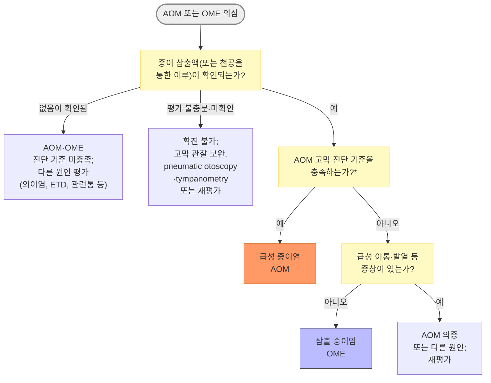
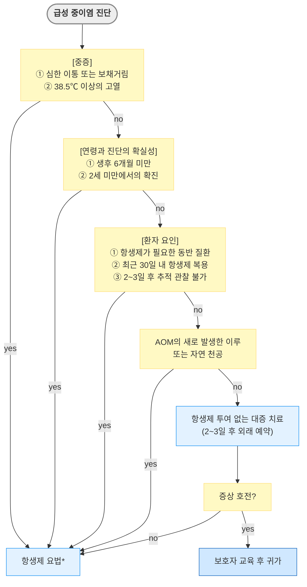
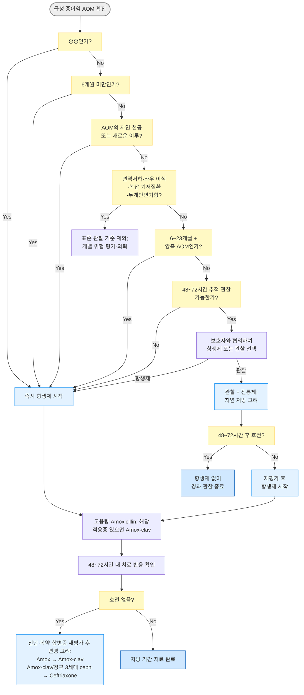

# 급성 중이염 Acute Otitis Media, AOM

## <mark style="color:green;">일반 사항</mark>

* 중이 삼출액(MEE)과 함께 급성 염증 소견(고막 팽륜, 이통 등)이 갑자기 발생
* 합병증 : 유양돌기염, 두개 내 감염, 안면 신경 마비, 만성 중이염
* 기전 : 상기도 바이러스 감염 선행 → 이관(Eustachian tube) 기능 부전, clearance 저하 → fluid·mucus 축적 → 2차 세균 감염

## <mark style="color:green;">원인</mark>

* 바이러스 : rhinovirus, RSV; 중이염 감염의 15\~44% 차지
  * 세균과 바이러스가 함께 검출되는 경우가 흔함
* 세균 : _S. pneumoniae_, 비피막형 _H. influenzae_, _M. catarrhalis_
  * PCV 도입 이후 \_H. influenzae\_의 비중이 증가하여 \_S. pneumoniae\_와 비슷하거나 더 높게 보고됨
  * _H. influenzae_·\_M. catarrhalis\_의 상당수가 β-lactamase를 생성 - amox-clav 적응증 판단의 근거
* 무균성

## <mark style="color:green;">임상 양상</mark>

* 귀 증상 : 보통 편측 발생; 통증(보챔, 귀를 만짐), 전음성 청력 저하, 이명, 귀 뒤 통증·압통이 있으면 유양돌기염 감별 필요; 발적·부종이 없어도 지속·악화 시 당일 평가
* 고막 파열 시 : 갑자기 통증 감소 + 이루 시작
  * 대부분 자연 치유, 지속 시 만성 중이염 발생 가능
* 귀 외 증상 : 발열, 어지럼, 식욕 저하, 구역, 구토, 설사

### <mark style="color:$danger;">🚩 Red Flags!</mark>

☞ [중이염 - Red Flags](048_-otitis-media.md#red-flags) (두개 내 합병증, 유양돌기염, 안면 마비, 미로염, 생후 ＜3개월 영아 발열 등)

## <mark style="color:green;">진단</mark>

### <mark style="color:orange;">이경 검사</mark>

* pneumatic otoscopy로 고막 위치·운동성 함께 확인
* 고막 소견 : 팽륜, 운동성 감소, 발적, 혼탁, 색깔 변화(흰색·노란색·호박색), air-fluid level, ossicular landmark 소실
  * 고막 팽륜 : 가장 신뢰할 만한 소견; 수일 후 감소하며 고막 파열로 이어질 수 있음
* 고막 파열 시 : 이루가 관찰되며 고막 관찰이 어려울 수 있음


**고막 발적(erythema)만으로는 AOM을 진단할 수 없음.** 고열이나 울음에 의한 홍조와 구별이 필요하며, 팽륜(bulging)이 가장 신뢰할 수 있는 진단 소견임


### <mark style="color:orange;">보조 검사</mark>

* 고막운동성계측(tympanometry) : 이경 소견이 불확실할 때 MEE 확인
  * Type B : 외이도 용적이 정상인 경우 MEE를 강력히 지지; 용적이 크면 고막 천공·개방된 튜브, 작으면 외이도 폐쇄·측정 문제 감별
  * Type C : 음압 증가(이관 기능 부전)의 참고 소견 - AOM 확진 근거로는 약함

### <mark style="color:orange;">급성 중이염 진단 기준</mark>

* 중이 삼출액(MEE)의 존재가 필수이며, 아래 3가지 기준 중 하나 이상을 충족하면 AOM으로 진단 <mark style="color:$info;">\[AAP 2013]</mark>
  * MEE가 확인되지 않으면 AOM으로 진단하지 않음

1. 중등도\~심한 TM 팽륜 (moderate to severe bulging)
2. 새로 발생한 이루 - 외이염에 기인하지 않는 경우
3. 경도 TM 팽륜 + (48시간 이내 발생한 이통(귀를 만지거나 비빔 포함) 또는 심한 TM 충혈)

<mark style="color:cyan;">**의증**</mark>

* 위 기준을 충족하지 않으나, MEE가 있고 급성으로(대개 48시간 이내) 발생한 이통(영유아는 귀를 잡아당기거나 비빔, 보챔)이나 발열 등이 동반된 경우
* 급성 증상 없이 MEE만 있으면 OME

<mark style="color:cyan;">**중증 급성 중이염 진단 기준**</mark>

* 급성 중이염에서 다음 중 ≥1개 해당
  * 중등도\~심한 이통 또는 보챔
  * ≥48시간 지속되는 이통
  * 최근 48시간 내 ≥39℃ <mark style="color:$info;">\[AAP 2013]</mark> (대한이과학회 ≥38.5℃)

### <mark style="color:orange;">감별</mark>

* AOM 오진 방지 / 항생제 시작 전 마지막 점검 포인트

<table data-search="false"><thead><tr><th width="264">상황</th><th width="266">먼저 생각할 진단</th><th>항생제</th></tr></thead><tbody><tr><td>TM 발적만 있음 (팽륜 없음)</td><td>AOM 확진 기준 미충족; 울음·고열에 의한 홍조 등 감별</td><td><mark style="color:red;">보류</mark></td></tr><tr><td>Bulging TM + 급성 이통</td><td>AOM 가능성 높음</td><td>고려</td></tr><tr><td>이루 + 갑작스러운 통증 완화</td><td>AOM + 고막 천공</td><td>필요</td></tr><tr><td>귀 충만감만 있음 (이통 없음)</td><td>OME 또는 ETD 우선</td><td><mark style="color:red;">보통 불필요</mark></td></tr><tr><td>이주(tragus) 압통 / 이개 당김 통증</td><td>외이염(OE) 우선</td><td><mark style="color:red;">경구 항생제 ✕</mark></td></tr><tr><td>씹을 때 통증 / 턱 클릭</td><td>TMJ disorder 우선</td><td><mark style="color:red;">불필요</mark></td></tr><tr><td>상악 구치부 통증</td><td>치성 방사통 우선</td><td><mark style="color:red;">불필요</mark></td></tr><tr><td>귀 뒤 부종·발적·압통</td><td>유양돌기염 의심</td><td>Red Flags 참조</td></tr><tr><td>어지럼 + 자발 안진</td><td>미로염(내이염) 의심</td><td>Red Flags 참조</td></tr><tr><td>안면 마비</td><td>안면신경 침범</td><td>Red Flags 참조</td></tr><tr><td>성인 편측 지속 삼출</td><td>NPC 감별 필요</td><td><mark style="color:red;">원인 평가 우선</mark></td></tr></tbody></table>

* 유양돌기염 : 귀 뒤의 통증/압통, 두통 동반
* Temporomandibular joint disorder : 입 벌릴 때 통증/소리, 씹을 때 심해지는 통증, 귓바퀴 앞 통증
* [이관 폐쇄](046_-eustachian-tube-dysfunction-etd.md#obstructive-dilatory-etd) : 귀의 멍멍한 느낌 또는 압박감
* 치아 문제 : 이환된 쪽 상악 치아 통증
* [Barotrauma](049_-ear-injury.md#ear-barotrauma) : 비행기 탑승, 잠수 경력

***



> \*_중등도\~심한 고막 팽륜, 새로 발생한 이루(외이염 제외), 또는 경도 팽륜 + 48시간 이내 이통 또는 심한 고막 충혈 (☞ 급성 중이염 진단 기준)_

<p align="center"><strong>급성 중이염 및 삼출 중이염의 감별</strong><br><em><mark style="color:$info;">저자 재구성 (참고 문헌 : Lieberthal AS 2013 Pediatrics;</mark></em><br><em><mark style="color:$info;">Rosenfeld RM 2016 Otolaryngol Head Neck Surg)</mark></em></p>

#### <mark style="color:$primary;">중이 이루의 감별 (Phenotype-first 접근)</mark>

* 소아·청소년 자연 천공 AOM에서 경구 항생제에 국소 항생제를 일률적으로 추가하는 것은 권고하지 않음(근거 수준 매우 낮음·전문가 의견) <mark style="color:$info;">\[이탈리아 다학회 합의문 2025]</mark>. 고막튜브 이루와 구분; 성인에 대한 직접 근거로 확대하지 않음
* 중이 결핵 : 만성 난치성 이루·결핵 위험요인 등 임상 맥락에서 감별; 분비물이 맑다는 이유만으로 결핵 검사·치료를 결정하지 않음 (☞ [결핵](../223_/070_-tuberculosis.md))

<table><thead><tr><th width="139">상황 / 이루 양상</th><th width="148">먼저 생각할 진단</th><th width="188">진단적 단서</th><th>치료 방향</th></tr></thead><tbody><tr><td>급성 화농성, 통증 후 배출</td><td>AOM의 자연 고막 천공</td><td>선행 상기도 감염; 배출 후 통증 호전</td><td>AOM 기준의 경구 항생제; 귀 청결·건조 유지. 점이액만으로 경구제를 일률적으로 대체하지 않으며, 경구제에 점이 항생제를 routine으로 추가하지 않음</td></tr><tr><td>고막튜브를 통한 급성 이루</td><td>급성 튜브 이루</td><td>튜브 확인; 통증이 없거나 경미할 수 있음</td><td>합병증 없으면 적절한 국소 항생제 단독; 전신제는 선택적으로 사용</td></tr><tr><td>만성 화농성·악취</td><td>CSOM ± cholesteatoma</td><td>고막 천공; 반복·지속 이루; 폴립·진주색 병변</td><td>귀 청소·국소 항생제, 청력 평가; 무반응 시 배양·의뢰. 진주종·합병증 의심 시 영상검사</td></tr><tr><td>맑은 물 같은 이루</td><td>천공·튜브·외이도 병변; CSF 누출 감별</td><td>고막 상태; 두부 외상·수술력; 지속적 물 같은 분비물</td><td>원인 평가. CSF 의심 시 이비인후과 평가, β₂-transferrin 등 검사 및 측두골 CT 고려. 고막이 온전한 OME·ETD는 외이도 이루를 만들지 않음</td></tr><tr><td>혈성 또는 지속 혈청성</td><td>외상·육아조직·종양</td><td>외상력; 종괴; 안면신경 증상</td><td>청력 검사·의뢰; 병변에 따라 측두골 CT/MRI (☞ [귀손상](049_-ear-injury.md#traumatic-tm-perforation))</td></tr><tr><td>박동성 이명 + 고막 뒤 혈관성 종괴</td><td>사구종양 / 혈관성 병변</td><td>편측 박동성 이명; 청력 저하; 혈관성 종괴</td><td>이비인후과 의뢰 및 CT/MRI; 이루의 박동성만으로 종양을 판단하지 않음</td></tr></tbody></table>

<p align="center"><em><mark style="color:$info;">저자 재구성 (AOM 치료 : Lieberthal AS 2013 Pediatrics;</mark></em> <br><em><mark style="color:$info;">튜브 이루 치료 : AAO-HNSF 고막튜브 지침 2022)</mark></em></p>

***

## <mark style="background-color:$warning;">Management</mark>

### <mark style="color:orange;">치료 방침</mark>

1. 진통제 : 모든 AOM에서 통증·발열 조절
2. 항생제 : 필요시 사용; 일률적 투여는 권고하지 않음
3. 수술 : 적응증 해당 시 고려

<mark style="color:cyan;">**합병증이 없는 AOM의 항생제 적용 기준**</mark>

* 본문·처방례 및 하단 AOM 항생제 결정 알고리듬은 AAP 기준 중심으로 제시함. 국내 2014 지침과의 차이는 별도 주석 및 비교용 알고리듬에 표시함. AAP 지침의 주 대상은 생후 6개월\~12세이며, ＜6개월 영아·면역저하자·와우 이식자는 별도 위험 평가 필요.

<table><thead><tr><th width="103">연령</th><th width="104">&#x3C;6개월</th><th width="104">≥6개월</th><th width="133">6~23개월</th><th>6~23개월</th><th>≥24개월</th></tr></thead><tbody><tr><td>중증도</td><td>무관</td><td>심함¹⁾</td><td>심하지 않음</td><td>심하지 않음</td><td>심하지 않음</td></tr><tr><td>이환 부위</td><td>무관</td><td>무관</td><td>양측</td><td>편측</td><td>양측/편측</td></tr><tr><td>항생제</td><td>투여</td><td>투여</td><td>투여</td><td>투여 또는 관찰²⁾</td><td>투여 또는 관찰²⁾</td></tr></tbody></table>

> ¹⁾_중등도\~심한 이통, ≥48시간 지속되는 이통, 최근 48시간 내 ≥39℃(대한이과학회 ≥38.5℃) 중 하나; 이루 동반 AOM과 추적 관찰이 불확실한 경우도 투여_\
> ²⁾_48\~72시간 동안 철저한 감시 및 대증 치료; 호전되지 않거나 악화되면 항생제 투여 시작_

<p align="center"><em><mark style="color:$info;">Ref. Lieberthal AS 2013 Pediatrics</mark></em></p>

<mark style="color:cyan;">**관찰 없이 즉시 항생제 투여 대상**</mark>

* 중증(연령 무관)
* ＜6개월아(중증도 무관)
* 6\~23개월 소아의 양측 확진 AOM <mark style="color:$info;">\[AAP 2013]</mark>; 국내 2014 지침은 ＜24개월 확진 AOM에서 편측도 즉시 투여 권고
* AOM의 자연 고막 천공 또는 새로 발생한 이루(튜브 이루·CSOM은 별도 기준)
* 동반 질환 : 감염 위험을 높이는 기저 질환·면역저하·와우 이식, 이전 AOM의 중증·합병증 병력은 개별 위험 평가 및 조기 치료·의뢰
* 48\~72시간 후 추적 관찰 불가
* 타병원을 포함하여 이미 48\~72시간 관찰했으나 호전되지 않았거나, 관찰 중 악화된 경우

<mark style="color:cyan;">**관찰 후 항생제 투여 결정 대상**</mark>

* 6\~23개월 소아의 편측·비중증 확진 AOM : 보호자와 협의 후 관찰 또는 항생제 선택. 의증이면 진단을 재평가
* ≥24개월의 비중증 AOM(편측·양측)


**지연 처방전 (Delayed prescription)** : 처방전을 진료 시 미리 교부하되, 48\~72시간 관찰 후에도 호전되지 않거나 그 전에 악화되면 조제/투약하도록 보호자에게 안내 → 불필요한 항생제 감소, 보호자 만족도 유지


## <mark style="color:green;">약물 치료</mark>

* 항히스타민제, 코 울혈 제거제는 효과 없고 부작용 가능성이 있어 권고하지 않는다


**합병증 없는 AOM 초치료 원칙 = Amoxicillin 고용량 우선.** AAP 기준에서 amoxicillin/clavulanate는 다음 상황에 초치료제로 선택: ① 최근 30일 이내 amoxicillin 복용, ② otitis-conjunctivitis syndrome(농성 결막염 동반), ③ amoxicillin 치료에 반응하지 않았던 재발성 AOM, ④ amoxicillin 초치료 실패. 다른 적응증이 없으면 amoxicillin을 먼저 사용하고 실패 시 amox-clav로 변경; 국내 2014 지침은 중증 AOM 초치료에 고용량 amox-clav를 권고


* 최근 항생제 사용력은 약제 선택에 반영. AAP 기준에서 모든 항생제 사용력이 단독 즉시 치료 조건은 아님; 국내 2014 지침은 최근 사용력을 즉시 치료 고려 조건에 포함

### <mark style="color:orange;">진통제</mark>

* AOM의 이통은 항생제 투여 여부와 관계없이 적극적으로 조절
* 통증이 심한 초기 2\~3일은 규칙적으로 투여; 외부 온열 치료(예: 적외선 램프)는 통증 완화에 약간의 효과 기대
* acetaminophen
  * 성인 : 500\~1,000 ㎎ q4\~6h PRN
    * 모든 acetaminophen 함유 제품을 합산하여 최대 4 g/d <mark style="color:blue;">\[타이레놀]</mark>
  * 소아 : 10\~15 ㎎/㎏ q4\~6h PRN; 최대 5회/d 및 75 ㎎/㎏/d
    * <mark style="color:blue;">\[세토펜]</mark>(32 ㎎/㎖) : 1회 약 0.31\~0.47 ㎖/㎏; 실용적으로 0.4 ㎖/㎏/회
      * 국내 허가 용량표는 생후 4개월부터 제시하며, 만 ＜2세는 투여 전 의사와 상담하도록 명시; 생후 ＜4개월에는 허가 용량이 없으므로 연령·체중·진단을 확인하여 개별 판단
* ibuprofen
  * 성인 400 ㎎ q6h PRN <mark style="color:blue;">\[부루펜]</mark>
  * 소아 체중 기준 용량(국제 지침) : 5\~10 ㎎/㎏ q6\~8h PRN; 최대 40 ㎎/㎏/d. 일반적으로 생후 ≥6개월에서 사용
    * 20 ㎎/㎖ 제제로 환산 시 1회 0.25\~0.5 ㎖/㎏; 아래 국내 제품의 연령별 허가 용량과 구분
  * <mark style="color:blue;">\[어린이부루펜]</mark>(20 ㎎/㎖) 국내 허가 용량 : 아래 1회 용량을 1일 3\~4회 투여; 1회 용량과 1일 최대 용량을 함께 확인
    * 1\~2세 : 1회 50\~100 ㎎(2.5\~5 ㎖); 최대 400 ㎎(20 ㎖)/d
    * 3\~6세 : 1회 100\~150 ㎎(5\~7.5 ㎖); 최대 600 ㎎(30 ㎖)/d
    * 7\~10세 : 1회 150\~200 ㎎(7.5\~10 ㎖); 최대 800 ㎎(40 ㎖)/d
    * 11\~14세 : 1회 200\~250 ㎎(10\~12.5 ㎖); 최대 1,000 ㎎(50 ㎖)/d
    * 국내 허가 용량표는 1세부터 제시하며, 만 ＜2세는 투여 전 의사와 상담하도록 명시
  * 탈수·섭취 저하, 신장질환 또는 심부전이 있으면 급성 신손상 위험에 주의하고 acetaminophen을 우선 고려
* 두 약의 동시 투여나 routine 교대 투여는 권장하지 않음. 한 약제로 통증이 충분히 조절되지 않을 때만 투약 간격과 1일 최대용량을 확인하여 다른 약제로 변경 또는 제한적 교대 투여를 고려

### <mark style="color:orange;">항생제</mark>

* 합병증이 없는 경증 AOM은 항생제 없이도 호전되는 경우가 많음
* 항생제는 첫 24시간 통증에는 영향이 없고 2\~3일째 통증을 약간 줄임(NNTB 약 20)
  * 고막 천공·반대편 AOM은 소폭 감소하나 구토·설사·발진 증가(NNTH 약 14) <mark style="color:$info;">\[Cochrane 2023]</mark>
* 항생제는 후기 AOM 재발을 줄이지 않으며, 장기 청력 개선 효과는 확립되지 않음
  * 2\~4주 시점의 비정상 tympanometry는 소폭 감소하지만, 3개월 시점에는 차이가 없음 <mark style="color:$info;">\[Cochrane 2023]</mark>
* 연령, 양측 이환 여부, 중증도, 이루, 추적 가능성에 따라 항생제 필요성 판단

#### <mark style="color:$primary;">항생제 선택 및 용법</mark>

<mark style="color:cyan;">**초치료 - 1차 (Amoxicillin 우선)**</mark>

<table><thead><tr><th width="300">1차 선택제</th><th>대체제 (Pc-allergy)</th></tr></thead><tbody><tr><td>Amox. 80~90 ㎎/㎏/d #2 (합병증 없는 AOM 원칙)<br>→ Amox-clav. 90 ㎎/㎏/d #2 (적응증 해당 시)</td><td>cefdinir 14 ㎎/㎏/d #1~2 / cefuroxime 30 ㎎/㎏/d #2 / cefpodoxime 10 ㎎/㎏/d #2 / ceftriaxone 50 ㎎/㎏ IM/IV 1회</td></tr></tbody></table>

<mark style="color:cyan;">**48\~72시간 초치료 실패 후**</mark>

<table><thead><tr><th width="220">이전 약제</th><th width="280">권장 변경</th><th>대체·추가 조치</th></tr></thead><tbody><tr><td>Amoxicillin</td><td>Amox-clav. 90 ㎎/㎏/d #2 PO</td><td>경구 투여 불가·알레르기 등 상황에 따라 ceftriaxone 50 ㎎/㎏ IM/IV qd ×3d 고려</td></tr><tr><td>Amox-clav. 또는 경구 3세대 cephalosporin</td><td>ceftriaxone 50 ㎎/㎏ IM/IV qd ×3d 고려</td><td>clindamycin 30~40 ㎎/㎏/d #3 ± 3세대 cephalosporin; 알레르기 유형·병원체 커버 범위 확인</td></tr></tbody></table>

* 진단·복약·합병증 재평가 후 변경 여부 결정; 두 차례 적절한 항생제 치료에도 실패하면 고막천자·배양 및 이비인후과 의뢰 고려

<mark style="color:cyan;">**투여 기간**</mark>

* ＜2세 또는 중증 : 10일
* 2\~5세 경증\~중등도 : 7일
* ≥6세 경증\~중등도 : 5\~7일
* ＜2세에서 5일 단축 요법은 10일 요법보다 치료 실패가 많았음 <mark style="color:$info;">\[NEJM 2016]</mark>
* 치료 48\~72시간 내 이통·발열·고막 염증이 호전되지 않거나 악화되면 재진하여 진단·복약·합병증 평가 후 항생제 변경 고려
  * 잔존 MEE, 콧물·기침만으로 치료 실패로 판단하지 않음

#### <mark style="color:$primary;">1차 선택제</mark>

**Amoxicillin** <mark style="color:blue;">\[파목신]</mark>

* 합병증이 없는 AOM의 1차 선택
* <mark style="color:$info;">\[AAP 2013]</mark> 80\~90 ㎎/㎏/d
* <mark style="color:$info;">\[대한이과학회 2014]</mark>
  * 소아 표준 용량 : 40\~50 ㎎/㎏/d - ≥2세이면서 최근 항생제 투여 없고 보육 시설 미이용 시 고려
  * 고용량 : 80\~90 ㎎/㎏/d - ＜2세, 최근 β-lactam 투여, 단체 생활 시 고려
* <mark style="color:$info;">\[NICE NG91]</mark> 1\~11개월 125 ㎎, 1\~4세 250 ㎎, 5\~17세 500 ㎎ tid ×5\~7d

**Amoxicillin/Clavulanate** <mark style="color:blue;">\[오구멘틴]</mark>

* 대상 : ① 최근 30일 내 amoxicillin 복용, ② otitis-conjunctivitis syndrome(농성 결막염 동반), ③ amoxicillin에 반응하지 않았던 재발성 AOM, ④ amoxicillin 초치료 실패
  * <mark style="color:$info;">\[AAP 2013]</mark> 중증만으로 amox-clav를 필수 선택하지 않음; <mark style="color:$info;">\[대한이과학회 2014]</mark> 중증 초치료에 권고
* 부작용 : 설사 (probiotics 병용으로 약간의 완화 기대)
* 용법 : Amox 기준 (80\~)90 ㎎/㎏/d #2
* 고용량(90 ㎎/㎏/d) 투여 시 14:1 제제 선택 <mark style="color:blue;">\[아모크라네오]</mark>(5 ㎖ 중 amoxicillin/clavulanate 600/42.9 ㎎; amoxicillin 120 ㎎/㎖) - 7:1 제제로 90 ㎎/㎏/d를 맞추면 clavulanate가 ＞10 ㎎/㎏/d가 되어 설사 증가; 국내 허가 ≥3개월, 1일 2회, AOM 10일

#### <mark style="color:$primary;">대체제</mark>


**페니실린 알레르기 시 세팔로스포린 선택 원칙** : amoxicillin·ampicillin과 R1 side chain이 같거나 유사한 cephalexin·cefadroxil·cefprozil·cefaclor는 피함. 구조적으로 다른 cephalosporin(cefdinir, cefuroxime, cefpodoxime, ceftriaxone 등)은 페니실린 아나필락시스 병력만 있는 경우 사전 검사 없이 투여 가능 <mark style="color:$info;">\[AAAAI/ACAAI 2022]</mark>. 단, 해당 cephalosporin 자체 알레르기·다중 β-lactam 알레르기·중증 지연형 반응은 별도 평가 필요


<mark style="color:cyan;">**대상**</mark>

* amoxicillin에 알레르기가 있는 경우
  * Ⅰ형 반응(두드러기, anaphylaxis) 포함 대부분 : side chain이 다른 2·3세대 cephalosporin
  * 중증 지연형 피부 반응(SJS/TEN, DRESS) 병력 : β-lactam 회피 → clindamycin 또는 의뢰
* 적절한 초치료 48\~72시간에도 AOM 증상이 호전되지 않거나 악화
* 별도의 세균성 부비동염 등 동반 질환이 확진되면 해당 치료 지침도 검토
  * 화농성 콧물만으로 AOM 항생제를 변경하지 않음
* cefdinir : 14 ㎎/㎏/d #1\~2 <mark style="color:blue;">\[옴니세프]</mark>
* cefpodoxime : 10 ㎎/㎏/d #2 <mark style="color:blue;">\[바난]</mark> - 국내 허가 용량은 3 ㎎/㎏ bid\~tid(중증 4.5 ㎎/㎏ tid)
* cefuroxime : 30 ㎎/㎏/d #2 <mark style="color:blue;">\[진네트]</mark>
* ceftriaxone : 50 ㎎/㎏(최대 1 g) IM/IV 1회(초치료) 또는 ×3d(치료 실패) <mark style="color:blue;">\[트리악손]</mark>
  * 대상 : 경구제 투여 불가, 경구 치료 실패, 저항성 _S. pneumoniae_ 감염
* azithromycin : 10 ㎎/㎏/d qd ×1d + 5 ㎎/㎏/d ×4d <mark style="color:blue;">\[지스로맥스]</mark>
  * 국내 \_S. pneumoniae\_의 macrolide 내성이 높으며, 수치는 조사 연도·검체·대상군에 따라 다름
  * cephalosporin을 사용할 수 없는 경우에 한해 최후 수단으로 고려
  * 가급적 cephalosporin을 우선 선택
* clindamycin : 소아 30\~40 ㎎/㎏/d #3, 성인 150\~300 ㎎ qid <mark style="color:blue;">\[훌그램]</mark>
  * _H. influenzae_·_M. catarrhalis_ 미커버(필요시 3세대 cephalosporin 병용)
  * macrolide 내성균에서 clindamycin 교차내성이 있을 수 있어 감수성 확인 필요
* clarithromycin : 15 ㎎/㎏/d #2 ×5\~7d (성인 250\~500 ㎎ bid) <mark style="color:blue;">\[클래리시드]</mark>
  * azithromycin과 같은 macrolide 내성 문제
  * cephalosporin 사용 불가 시 제한적으로 고려
* levofloxacin : 국내 AOM 허가외 사용. 예: 500 ㎎ qd ×5\~7d <mark style="color:blue;">\[크라비트]</mark>
  * 적절한 대체제가 없거나 배양 결과상 필요한 성인에서 전문의 판단하에 고려; 단순 페니실린 알레르기·1차 치료 실패만으로 일률적으로 선택하지 않음
  * 신기능에 따른 용량 조정, 건 손상·말초신경병증·QT 연장 등 주의

## <mark style="color:green;">수술</mark>

<mark style="color:cyan;">**고막절개술 (Myringotomy) / Tympanocentesis**</mark>

* 급성 AOM의 유의미한 치유 촉진 여부는 논란이 있으나 배농·배액이 증상 완화에 도움 가능
* 대상 : 두 차례 적절한 약물 치료 course에도 무반응, 심한 이통·고열, 합병증 발생(안면 마비·유양돌기염·내이염·두개 내 염증), 면역 저하, 배양 검사 목적

<mark style="color:cyan;">**고막튜브삽입술·아데노이드절제술**</mark> (☞ [재발 중이염](048_-otitis-media.md#management-raom))

## <mark style="color:green;">추적 관리</mark>

* 임상 호전 후에는 연령·중증도·재발력·잔존 MEE 및 청력 우려에 따라 추적 시점 결정
  * 필요 시 1개월 후 F/U; 영유아·중증·재발성 AOM 등은 2주 내 재평가 고려
  * 빠르게 회복한 모든 환자에게 일률적인 2주 재진이 필요한 것은 아님
* MEE 지속 시 청력·발달 위험을 평가하고, 삼출 지속 기간에 따른 청력 검사·추적은 [삼출 중이염](048_-otitis-media.md) 참조
* 고막 상태 회복은 오래 걸릴 수 있으나 보통 임상적으로 문제없음

## <mark style="color:green;">성인 AOM 특이사항</mark>

* 성인 AOM은 소아에 비해 드묾; 반복 발생·지속성 편측 삼출이면 기저 원인 감별 필요

<mark style="color:cyan;">**성인 AOM 항생제 용량**</mark>

* amoxicillin : 500 ㎎ tid 또는 1 g bid × 5\~7d <mark style="color:blue;">\[파목신]</mark>
* amoxicillin/clavulanate : 500/125 ㎎ tid × 5\~7d <mark style="color:blue;">\[오구멘틴]</mark> (적응증 해당 시)
* levofloxacin : 국내 AOM 허가외 사용
  * 적절한 대체제가 없는 경우 전문의 판단하에 고려(용법·주의사항은 대체제 항목 참조)

<mark style="color:cyan;">**성인 편측 반복 AOM / 지속 삼출 시 다음 원인을 적극 배제**</mark>

* 비인두 병변/NPC : 지속성 편측 삼출·난청은 위험인자나 동반 증상이 없어도 이비인후과 원인 평가 필요
  * 경부 종대·비출혈 등 동반 시 신속 의뢰
* 심한 이관 기능 부전(Eustachian tube dysfunction) : 만성 비부비동염, 알레르기비염, 비용 동반 여부 확인 (☞ [귀인두관기능부전](046_-eustachian-tube-dysfunction-etd.md))
* 두경부 종양 / 편도 종양 : 편측 편도 비대 동반 시

***

<mark style="color:cyan;">**국내 2014 지침 알고리듬**</mark>



> _\*항생제 요법 ① 치료 반응 판정 : 2\~3일 후, 증상 호전 여부 ② 치료 기간 : 반응 시 5\~10일 ③ 항생제 감수성 결과 나오면 적절한 항생제로 변경_
>
> _※＜24개월 확진 AOM·최근 항생제 사용력·38.5℃ 기준은 국내 지침의 조건임. 본문의 AAP 중심 적용 기준과 구분하며, 중증 초치료에는 국내 지침상 고용량 amox-clav 권고._

<p align="center"><strong>급성 중이염 진단 및 치료 알고리듬</strong><br><em><mark style="color:$info;">Ref. 대한이과학회. 유소아 중이염 진료지침. 2014.</mark></em></p>

***

<mark style="color:cyan;">**AAP 중심 항생제 결정 알고리듬**</mark>



<p align="center"><strong>AOM 항생제 결정 알고리듬</strong><br><em><mark style="color:$info;">저자 재구성 (참고 문헌 : Lieberthal AS 2013 Pediatrics; 고위험군 평가 포함)</mark></em></p>


**AAP 중심 알고리듬** : 중등도\~심한 이통/보챔, ≥48시간 이통 또는 ≥39℃ 발열이면 즉시 항생제. 국내 2014 지침은 ≥38.5℃ 및 ＜24개월 확진 AOM의 즉시 치료 등에서 차이가 있음. 면역저하·와우 이식·두개안면기형은 표준 관찰 기준을 그대로 적용하지 않고 개별 위험 평가·의뢰 고려.


***

## <mark style="color:red;">질병코드</mark>

* H66.0 급성 화농성 중이염 Acute suppurative otitis media
* H65.1 기타 급성 비화농성 중이염 Other acute nonsuppurative otitis media

***

## <mark style="color:purple;">처방례</mark>

> **처방례 1. 중증 AOM - 3세, 15 ㎏, 초치료 (amoxicillin 고용량; amox-clav 적응증 없음, AAP 기준)**
>
> ```
> amoxicillin 건조시럽        1회 675 ㎎    bid   × 10d
> 어린이부루펜시럽 20 ㎎/㎖    7 ㎖          tid   × 3~5d (통증·발열 시)
> ```
>
> _✽amoxicillin 90 ㎎/㎏/d(1일 1,350 ㎎ ÷ 2회분); 사용 제품의 농도에 맞춰 ㎖로 환산. AAP 기준에서 다른 amox-clav 적응증이 없으면 중증에도 amoxicillin 선택 가능; 국내 2014 지침은 중증 초치료에 amox-clav 권고. 투여 기간은 ＜2세 또는 중증 10일, 2\~5세 경증\~중등도 7일. 부루펜은 1회 7 ㎖(140 ㎎, 약 9.3 ㎎/㎏/회). 48\~72시간에도 호전 없으면 재내원_

> **처방례 2. AOM - 3세, 15 ㎏, amox-clav 적응증 (최근 30일 내 amoxicillin 복용 또는 초치료 실패)**
>
> ```
> 아모크라네오시럽(14:1) 120 ㎎/㎖   5.6 ㎖   bid   × 10d
> 어린이부루펜시럽 20 ㎎/㎖           7 ㎖     tid   × 3~5d (통증·발열 시)
> ```
>
> _✽Amox 기준 90 ㎎/㎏/d(1일 1,350 ㎎ ÷ 2회분 = 1회 675 ㎎ ÷ 120 ㎎/㎖ ≒ 5.6 ㎖). 14:1 제제는 7:1 제제보다 clavulanate가 적어(약 6.4 ㎎/㎏/d) 설사 부작용을 줄임. 국내 허가 ≥3개월, AOM 10일 요법. 부루펜 용량은 3세 처방례이며 ＜3세에 그대로 적용하지 않음. 48\~72시간 내 재평가_

> **처방례 3. AOM - 소아 15 ㎏, amox-clav 치료 실패 (48\~72시간 무반응)**
>
> ```
> 트리악손주 1 g   750 ㎎   IM   qd   × 3d
> ```
>
> _✽ceftriaxone 50 ㎎/㎏(최대 1 g) 1일 1회 3일. 근주 시 통증 완화를 위해 lidocaine 희석액 사용 가능(lidocaine 희석액은 정맥 투여 금기). 이후에도 호전 없으면 고막천자·배양 및 이비인후과 의뢰_

> **처방례 4. AOM - 성인**
>
> ```
> 파목신 500 ㎎/C        1회 1C   tid   × 5~7d
> 타이레놀 이알 650 ㎎/T  1T      q8h  × 3~5d (통증·발열 시)
> ```
>
> _✽성인 AOM은 소아에 비해 드묾; 편측 삼출이 지속되거나 AOM이 반복되면 비인두 병변·이관 기능 부전 등 감별 필요 (☞ 성인 AOM 특이사항). 증상 지속 또는 악화 시 재내원_

> **처방례 5. AOM - 성인, 자연 고막 천공 + 이루 동반**
>
> ```
> 파목신 500 ㎎/C           1회 1C   tid   × 7d
> 타이레놀 이알 650 ㎎/T     1회 1T   q8h   × 3~5d (통증·발열 시)
> ```
>
> _✽자연 천공 AOM은 경구 항생제 중심으로 치료하며, 점이액 추가를 모든 환자에게 일률적으로 적용하지 않음. 국소 치료가 필요한 경우 제품의 중이염·천공 관련 허가사항 확인 후 ofloxacin 0.3% \[에펙신] 등을 선택(성인 1회 6\~10방울 bid, 점이 후 약 10분 이욕; 기간은 병변·반응에 따라 결정). 세트락살플러스는 국내에서 중이염·천공 환자의 안전성·유효성이 확립되지 않음. 48\~72시간 반응 재평가 및 4\~6주 내 고막 회복 확인_

***

### <mark style="color:$success;">핵심 복약 지도</mark>

> **항생제 치료 안내**
>
> * **처방된 용량과 기간대로 복용하십시오.** 임의로 중단·연장하지 말고, 부작용이나 치료 변경이 필요하면 의사와 상의하십시오.
> * 항생제 복용 **48\~72시간 이내에 통증·발열이 나아지기 시작해야 합니다.** 그렇지 않으면 반드시 재내원하십시오 - 항생제 교체가 필요할 수 있습니다.
> * amoxicillin/clavulanate 제제는 **설사 부작용**이 생길 수 있습니다. 식사와 함께 복용하면 위장 자극을 줄일 수 있고, 유산균제(프로바이오틱스) 병용이 도움이 됩니다.

> **진통제 사용**
>
> * 귀 통증이 심한 초기 2\~3일은 타이레놀 또는 이부프로펜을 **규칙적으로** 복용하는 것이 통증 조절에 더 효과적입니다.
> * 귀에 따뜻한 찜질을 하면 통증 완화에 약간 도움이 됩니다 (질병 경과에는 영향 없음).
> * **소아의 해열·진통 목적으로 아스피린을 사용하지 마십시오** (Reye 증후군 위험).

> **언제 즉시 병원을 방문해야 하나요?**
>
> * 항생제 복용 **48\~72시간이 지나도 통증·발열이 전혀 나아지지 않거나 오히려 악화**되는 경우
> * 귀 뒤가 **빨갛게 부어오르거나 눌리면 아픈** 경우 (유양돌기염 의심)
> * 얼굴 한쪽이 처지거나 마비되는 느낌이 드는 경우 **(즉시 응급실)**
> * **두통, 고열, 구토, 의식이 흐려지는** 증상이 동반되는 경우 **(즉시 응급실)**
> * 귀에서 분비물이 나온 후 통증이 갑자기 없어졌다가 다시 통증이 생기는 경우

***

## <mark style="color:green;">주요 참고문헌 및 확인 자료</mark>

### <mark style="color:orange;">임상 근거</mark>

* \[AAP 2013] [Lieberthal AS, et al. The diagnosis and management of acute otitis media. Pediatrics. 2013;131(3):e964-e999.](https://doi.org/10.1542/peds.2012-3488) - AOM 진단 기준·중증도, 즉시 치료·관찰 대상과 항생제 선택·기간
* \[대한이과학회 2014] 대한이과학회. 유소아 중이염 진료지침. 2014. - 국내 중증 기준(≥38.5℃)·＜24개월 즉시 치료·amoxicillin 용량과 중증 초치료 amox-clav; 본문 비교용 알고리듬 출처
* [건강보험심사평가원. 2014년 유소아 급성중이염 항생제 적정성 평가결과. 2014.11.](https://www.hira.or.kr/cms/open/04/04/12/2014_13.pdf) - 부록 「유소아 중이염 진료지침 2014년 개정판 요약」 표 4의 amoxicillin 표준 용량(40\~50 ㎎/㎏/d)·고용량과 적용 조건 확인; 지침 원문 전체가 아닌 요약본
* \[NICE NG91] [NICE. Otitis media (acute): antimicrobial prescribing. NICE guideline NG91. 2018; updated 2022.](https://www.nice.org.uk/guidance/ng91) - 연령별 amoxicillin 고정 용량과 지연 처방
* [Rosenfeld RM, et al. Clinical practice guideline: otitis media with effusion (update). Otolaryngol Head Neck Surg. 2016;154(1 Suppl):S1-S41.](https://doi.org/10.1177/0194599815623467) - AOM·OME 감별과 잔존 삼출 추적
* [Rosenfeld RM, et al. Clinical practice guideline: tympanostomy tubes in children (update). Otolaryngol Head Neck Surg. 2022;166(1 Suppl):S1-S55.](https://doi.org/10.1177/01945998211065662) - 고막튜브 이루의 국소 항생제 단독 치료
* \[AAAAI/ACAAI 2022] [Khan DA, et al. Drug allergy: a 2022 practice parameter update. J Allergy Clin Immunol. 2022;150(6):1333-1393.](https://doi.org/10.1016/j.jaci.2022.08.028) - 페니실린 알레르기에서 side chain이 다른 cephalosporin 사용
* \[이탈리아 다학회 합의문 2025] [Castelli Gattinara G, et al. Antibiotic treatment of acute and recurrent otitis media in children: an Italian intersociety Consensus. Ital J Pediatr. 2025;51:50.](https://doi.org/10.1186/s13052-025-01894-z) - 자연 천공 AOM에서 경구 항생제에 국소 항생제를 일률적으로 추가하지 않음
* \[NEJM 2016] [Hoberman A, et al. Shortened Antimicrobial Treatment for Acute Otitis Media in Young Children. N Engl J Med. 2016;375(25):2446-2456.](https://doi.org/10.1056/NEJMoa1606043) - ＜2세에서 5일 단축 요법의 치료 실패 증가
* \[Cochrane 2023] [Venekamp RP, et al. Antibiotics for acute otitis media in children. Cochrane Database Syst Rev. 2023;11:CD000219.](https://doi.org/10.1002/14651858.CD000219.pub5) - 항생제의 통증·천공·반대편 AOM 효과(NNTB)와 이상반응(NNTH)
* [de Sévaux JLH, et al. Paracetamol (acetaminophen) or non-steroidal anti-inflammatory drugs, alone or combined, for pain relief in acute otitis media in children. Cochrane Database Syst Rev. 2023;8:CD011534.](https://doi.org/10.1002/14651858.CD011534.pub3) - 진통제 단독·병용의 이통 조절 근거

### <mark style="color:orange;">허가·급여 확인 자료</mark>

* [식품의약품안전처. 의약품안전나라 - 의약품 품목허가정보.](https://nedrug.mfds.go.kr/) - 국내 제품별 적응증·용법·금기 및 허가 상태 확인
* [통계청. 제9차 한국표준질병·사인분류(KCD-9) 개정 고시. 통계청고시 제2025-299호.](https://www.law.go.kr/admRulLsInfoP.do?admRulSeq=2100000260878) - 질병코드 확인 (확인일 2026-10-14)

***

## <mark style="color:blue;">환자 안내서</mark>


**급성 중이염이란 무엇인가요?**

고막 안쪽의 중이(middle ear)에 세균이나 바이러스가 감염되어 염증이 생긴 상태입니다. 흔히 감기 후에 이관(귀와 코를 잇는 관)을 통해 세균이 들어와 발생합니다. 소아에서 매우 흔하며, 적절한 치료를 받으면 대부분 회복됩니다. 고막 바깥의 외이염과 달리, 귓바퀴를 잡아당겨도 통증이 심해지지 않는 것이 특징입니다.


#### <mark style="color:$primary;">어떤 증상이 생기나요?</mark>

* 귀 통증 - 특히 누울 때 심해질 수 있으며, 영아는 귀를 자꾸 만지거나 보챕니다.
* 발열, 식욕 저하, 보챔 (소아)
* 귀가 먹먹하거나 소리가 울려 들리는 느낌
* 고막이 파열되면 갑자기 통증이 줄고 귀에서 분비물이 나올 수 있습니다 - 통증이 줄어도 고막 상태와 치료 필요성을 확인하기 위해 진료를 받으십시오.

#### <mark style="color:$primary;">치료는 어떻게 하나요?</mark>

* 경증이고 조건이 맞으면 2\~3일 동안 항생제 없이 진통제로 경과를 관찰할 수 있으며, 대부분 저절로 좋아집니다.
* 중증이거나, 6개월 미만이거나, 2세 미만에서 양쪽 귀에 생긴 경우에는 항생제를 바로 사용합니다.
* 항생제를 처방받은 경우 **처방 기간을 끝까지 복용하세요.** 증상이 나아져도 임의로 중단하지 말고, 부작용이나 치료 변경이 필요하면 의사와 상의하십시오.
* 귀에 따뜻한 찜질이 통증 완화에 도움이 됩니다.

#### <mark style="color:$primary;">치료 중 주의사항</mark>

* 귀에서 분비물이 나오는 경우(고막 천공)에는 **귀에 물이 들어가지 않도록** 하고, 수영은 의사 확인 후 재개하십시오.
* **면봉으로 귀 안을 후비지 마십시오.** 중이염 치료에 도움이 되지 않으며 오히려 해롭습니다.
* 코를 세게 풀지 말고 한 번에 한쪽씩 가볍게 풀어주십시오 (이관을 통한 세균 역행 방지).
* 비행기 탑승 시 이관 압력 조절이 어려울 수 있습니다 - 껌을 씹거나 하품을 하면 도움이 됩니다.

#### <mark style="color:$primary;">이럴 때는 즉시 병원을 방문하세요</mark>

* 항생제 복용 2\~3일이 지나도 통증·발열이 전혀 줄지 않을 때
* 귀 뒤가 빨갛게 부어오르거나 누르면 아플 때
* 얼굴이 한쪽으로 처지거나 마비될 때 **(즉시 응급실)**
* 두통, 구토, 의식이 흐려질 때 **(즉시 응급실)**
