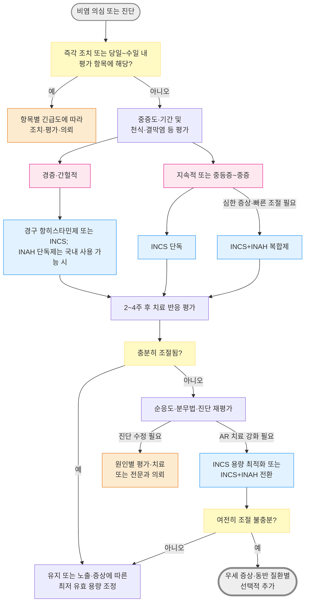
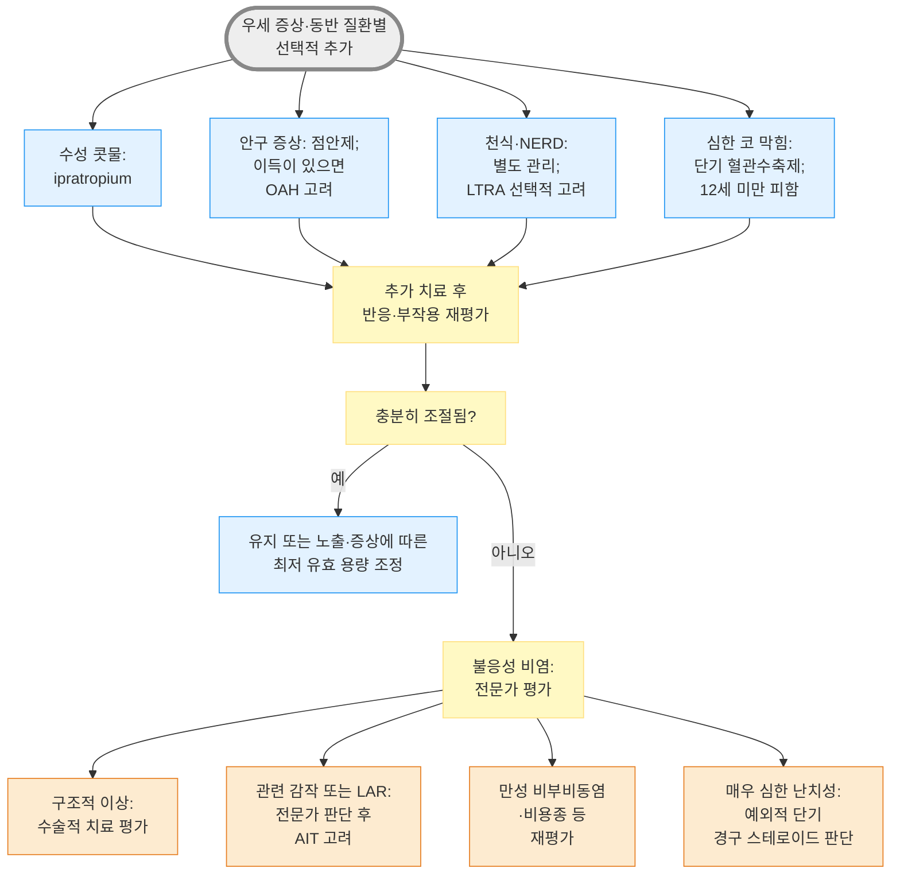
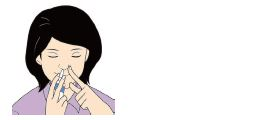

# 알레르기비염 Allergic Rhinitis

## <mark style="color:green;">일반 사항</mark>

* 특정 알레르겐에 감작된 사람의 비강 점막이 그 알레르겐에 재노출될 때 발생하는 IgE 매개 면역 반응에 따른 코의 염증 반응
* 콧물, 코막힘, 재채기, 코가려움증이 특징
* 알레르기비염은 삶의 질, 수면, 학업·직업 수행 능력에 유의미한 영향을 미치며 천식, 부비동염, 중이염 등과 밀접하게 연관됨
* 유병률 : 성인의 10\~30%, 소아의 \~40%; 국내 성인 유병률은 최근 약 20% 수준으로 추정
* 흔히 소아·청소년기에 시작하지만 어느 연령에서나 발생할 수 있으며, 영아에서도 흡입 알레르겐 감작이 가능함

### <mark style="color:orange;">분류</mark>

#### <mark style="color:$primary;">ARIA 분류 - 기간</mark>

* **간헐적** : 증상 기간 ＜4일/주 또는 연속 ＜4주; 흔히 실외 항원(꽃가루) 관련
* **지속적** : 증상 기간 ≥4일/주 및 연속 ≥4주; 흔히 실내 항원(집먼지진드기, 동물 털) 관련

#### <mark style="color:$primary;">ARIA 분류 - 중증도</mark>

* **경증** : 수면 장애나 일상생활·운동·여가 활동 장애나 직장·학교 수행 장애가 없고 증상이 괴롭지 않은 상태
* **중등증\~중증** : ① 수면 장애, ② 일상생활·운동·여가 활동 장애, ③ 직장·학교 수행 장애, ④ 괴로운 증상 중 하나 이상이 있는 상태

#### <mark style="color:$primary;">기타 분류</mark>

* **계절성 (Seasonal)** : 계절적 항원에 반응하여 매년 같은 시기에 발생
* **통년성 (Perennial)** : 1년 내내 발생; 주로 실내 항원(집먼지진드기, 동물 비듬·털) 관련
* **국소 알레르기비염 (Local allergic rhinitis, LAR)** : 비강 점막에서만 알레르겐 특이 IgE가 국소 생성되어 AR과 같은 Th2형 비강 염증을 보이는 표현형. 피부단자검사와 혈청 특이 IgE는 음성임
  * AR과는 증상·알레르겐 노출과의 관련성·치료 반응은 거의 같고, 전신 감작 검사가 음성이라는 점만 다름 - 일반 검사만으로는 비-알레르기비염(NAR)으로 분류되기 쉬움
  * 장기 추적에서 전신 감작으로 이행하는 경우는 드물어 AR의 초기 단계라기보다 독립된 표현형으로 봄
  * 비강 알레르겐 유발검사로 확진하지만, 현실적으로 일차진료에서는 의심되면 AR에 준해 치료
* **혼합형 비염(Mixed Rhinitis)** : AR과 비-알레르기비염(NAR)이 혼재된 형태
  * 만성 비염의 약 1/3을 차지하며 알레르기비염 환자 중에서는 더 높은 비율로 보고되나, 연구 정의와 대상에 따라 차이가 큼
  * 알레르겐 노출뿐 아니라 온도·습도 변화·자극 물질에도 반응
  * 치료 반응이 불완전할 때 반드시 고려

## <mark style="color:green;">원인 및 위험 인자</mark>

#### <mark style="color:$primary;">알레르겐</mark>

* **실외(계절성)**
  * 봄 : 나무 꽃가루(참나무·자작나무·오리나무 등; 제주·남해안은 삼나무)
  * 늦봄\~여름 : 잔디(목초)류
  * 가을 : 돼지풀, 쑥, 환삼덩굴; 곰팡이 포자
* **실내(통년성)** : 집먼지진드기 배설물, 반려동물 비듬·털, 바퀴벌레 단백질, 곰팡이 포자

#### <mark style="color:$primary;">위험 인자</mark>

* 아토피·습진·천식 등 다른 알레르기 질환 보유
* 알레르기 가족력 : 특히 부모 모두 해당
* 흡연 노출 : 특히 출생 후 첫 1년간 모성 흡연
* 대기오염 및 일부 실내 알레르겐 노출
  * 영유아기 항생제 사용 등은 관찰연구에서 연관성이 보고되었으나 인과관계는 확정되지 않음

#### <mark style="color:$primary;">계절성 악화 요인 (비-알레르겐)</mark>

* 봄 : 황사·미세먼지 - 점막 자극과 함께 꽃가루·곰팡이를 실어 와 알레르기 염증을 증폭. 나무 꽃가루 시기와 겹쳐 악화; 미세먼지는 늦가을\~겨울에도 고농도로 나타나기도 함
* 여름 : 오존 - 점막 자극 및 알레르겐 반응 증가, 주로 맑고 더운 날 오후에 고농도로 발생
* 장마철 : 실내 습도 상승으로 인해 집먼지진드기·곰팡이 증가
* 환절기·겨울 : 난방·환기 부족으로 실내 알레르겐 노출 증가; 기온 변화·찬 공기·건조한 공기 등 비특이적 자극(혼합형 비염·NAR에서 두드러짐)

#### <mark style="color:$primary;">병태생리</mark>

* 알레르겐 → 항원제시세포\* → Th2 세포 활성화 → IL-4·IL-13(B세포의 IgE 생성) / IL-5(호산구 동원·활성화)

> _**\***&#xD56D;원제시세포(Antigen-Presenting Cell, APC) : 체내에 침입한 세균, 바이러스 등 외래 항원을 분해한 뒤, 그 조각을 표면에 드러내어 T-림프구에게 보여주고 면역 반응을 시작하도록 돕는 면역 세포_

* IgE → mast cell·basophil 감작 → 재노출 시 탈과립 → histamine·leukotriene·PGD2 방출 → 가려움·재채기·수양성 콧물·코 막힘; 수 분\~1시간 **\[early-phase response]**
* 호산구 등 염증세포 침윤 → MBP·ECP 등 독성 단백 → 점막 부종·과민성 증가 → 코 막힘 우세; 4\~8시간 후 **\[late-phase reaction]**

#### <mark style="color:$primary;">약물 관련 비염 (Drug-induced Rhinitis)</mark>

* 고령 다약제 복용 환자에서 특히 주의; 치료 실패 또는 비전형 증상 시 복용 중인 약물 목록 전수 확인 권고

<mark style="color:cyan;">**비내 혈관수축제에 의한 Rhinitis Medicamentosa (약물성 비염)**</mark>

* 약물 관련 비염의 가장 흔한 원인
* 비내 혈관수축제(oxymetazoline, xylometazoline 등)의 반복·장기간 사용 시 반동성 비충혈 발생 가능
* 반동성 비충혈 예방을 위해 연속 3일 이내를 원칙으로 하고 길어도 5일을 넘기지 않음
* 중단이 필요하지만, 일시적 악화로 순응도가 낮음; 중단 시 INCS를 병용하면 반동성 충혈 완화에 도움

<mark style="color:cyan;">**기타 약물에 의한 비강 증상**</mark>

* 교감신경 억제(신경성) : alpha-blocker(전립선비대증 치료에 사용되는 tamsulosin 등), methyldopa, reserpine - 비강 혈관의 교감신경 긴장이 줄어 혈관 확장·코 막힘
* 혈관 확장 : phosphodiesterase-5 억제제(sildenafil 등), hydralazine
* 국소 염증성 : 아스피린·NSAIDs - 과민성 비염(NERD/AERD)
* 기타 항고혈압제 : beta-blocker(비충혈·코 막힘), ACE 억제제(콧물·비강 자극)
* 경구 피임제는 연관이 보고되었으나 인과관계는 불확실


**NERD / AERD** (NSAID or Aspirin-exacerbated respiratory disease)

* 아스피린 또는 NSAIDs 복용 후 기도 과민 반응이 유발되는 증후군으로 다음 3가지 질환이 함께 나타남(구 Samter's triad); ① 만성 비부비동염 + 비용종 (코 막힘, 후각 저하), ② 천식 (기관지 과민), ③ 아스피린/NSAID 과민반응 (복용 후 수분\~수 시간 내 코 막힘, 천명, 호흡곤란 발생)
* 기전 : COX-1 억제 → 아라키돈산이 lipoxygenase 경로로 쏠림 → cysteinyl leukotriene 과잉 생산 → 비강 점막과 기관지의 강력한 염증·수축 반응 유발; LTRA가 보조적으로 도움이 될 수 있으나, 근본 관리는 원인 약물 회피이며 전문가 판단 아래 아스피린 탈감작·생물학적 제제를 고려
* 유병률 : 성인 천식의 약 7%, 중증 천식의 약 15%, 비용종 환자의 약 10% <mark style="color:$info;">\[J Allergy Clin Immunol 2015]</mark>
* COX-1 억제제 계열 전체가 위험; 선택적 COX-2 억제제(예: celecoxib)는 대부분 내약되지만 드문 반응이 가능하므로, 특히 중증 천식·과거 중증 반응 환자에서는 전문가 감독하 투여 또는 내약성 확인을 고려
* acetaminophen은 대체로 내약되지만 용량 의존적 교차반응이 가능함. 1회 500 ㎎ 등 최소 유효 용량을 우선 고려하고 과거 내약 용량·반응 병력을 확인; 650\~1,000 ㎎에서도 반응할 수 있으며 드물게 저용량에서도 반응 가능 <mark style="color:$info;">\[J Allergy Clin Immunol 2022]</mark>
* 비용종 환자나 천식 환자 내원 시 아스피린이나 소염 진통제 복용 후 코 막힘이 심해지거나 숨이 찬 적이 있는지 확인


## <mark style="color:green;">임상 양상</mark>

* **코 증상** : 코 가려움, 재채기, 콧물(묽은 수양성\~점성), 코 막힘, 후비루
* **코 징후** : 점막 부종, 창백 또는 홍반성 점막, 비갑개 비대; 비용종이 관찰되면 동반 만성 비부비동염 등을 평가
* **코 외 증상** : 구강 호흡, 기침, 눈·인두 가려움, 눈물, 코골이, 수면 장애, 피로, 두통
* **코 외 징후** : allergic shiner(눈 밑 다크서클), Dennie-Morgan line, allergic salute·nasal crease(소아), 인두 후벽 림프여포 증식(cobblestoning)
* **동반 질환** : 비부비동염, 아토피·습진·두드러기, 천식, 알레르기성 결막염, 중이염
* **구강 알레르기 증후군(pollen-food allergy syndrome)** : 꽃가루 감작자에서 생과일·채소 섭취 후 입술·구강 가려움; 자작나무 - 사과·복숭아·체리 등, 쑥 - 셀러리·당근·향신료, 돼지풀 - 멜론·바나나 등; 전신 증상 동반 시 아나필락시스 위험 평가

### <mark style="color:$danger;">🚩 Red Flags!</mark>

<mark style="color:$danger;">**즉각 조치**</mark>

* 안구 돌출, 시력 저하, 복시·안구운동 장애, 안와 주위 부종 `안와 합병증` `급성 합병성 부비동염`
* 의식 변화, 수막자극징후, 심한 두통과 전신 독성 소견 `두개내 합병증`
* 면역저하 환자에서 발열, 심한 안면 통증, 비강 내 검은 가피·괴사 `침습성 진균성 비부비동염`
* 최근 두부 외상·비강 또는 두개저 수술 후 새로 발생한 편측의 맑은 수양성 콧물, 또는 신경학적 이상·수막염 증상을 동반한 맑은 콧물 `뇌척수액 비루`
* 음식·약물·면역요법 투여 후 입술·혀·인후 부종, 호흡곤란, 저혈압 `아나필락시스`
* 소아에서 비강 내 버튼전지 또는 비중격 양쪽에 걸린 자석 의심 `버튼전지·자석 비강 이물`
* 안정 시 호흡곤란, 심한 천명, 저산소증 또는 빠른 호흡기 증상 악화 `급성 천식 악화`

<mark style="color:$warning;">**당일\~수일 내 평가**</mark>

* 지속되는 편측 코 막힘, 혈성 분비물, 반복 코피, 편측 안면 통증·감각 저하 `비강·부비동 종양` `비중격 병변`
* 외상 없이 지속되는 편측의 맑은 수양성 콧물(고개 숙이면 증가) `자발성 뇌척수액 비루`
* 소아의 편측 악취성 화농성 분비물 `비강 이물`
* 새로 발생하거나 악화하는 천명·호흡곤란(안정 시 호흡곤란·저산소증 없음) `천식 동반`

<mark style="color:$info;">**조기 평가 및 추적**</mark>

* 적절한 용법의 INCS를 2\~4주 사용했는데도 호전 없음 `혼합형 비염` `LAR` `구조적 이상`
* 양측성 코 막힘과 후각 저하가 지속되며 항히스타민제 반응이 없음 `비용종 동반 만성 비부비동염`
* 아스피린·NSAIDs 복용 후 코 막힘·호흡곤란 악화 병력 `NERD/AERD`
* 코골이, 목격된 무호흡, 주간 졸림 `폐쇄성 수면무호흡증`
* 재발성 부비동염·중이염 `구조적 이상` `만성 비부비동염`
* 안정적인 야간 기침·운동 시 호흡기 증상 `천식 동반 가능성`

## <mark style="color:green;">진단</mark>

* 증상·병력·신체 검진 및 치료 반응으로 임상 진단
* 지속적 비염 환자는 적응되어 증상을 과소 보고하는 경향이 있음 - 능동적 문진 필요

### <mark style="color:orange;">AR vs 비-알레르기비염(NAR) 감별</mark>

<table data-search="false"><thead><tr><th width="136">임상 특징</th><th>AR</th><th>NAR</th></tr></thead><tbody><tr><td>악화 요인</td><td>관련 알레르겐 노출; 계절 영향 가능</td><td>온도·습도 변화, 냄새·매연·자극 물질, 음식, 약물 등</td></tr><tr><td>알레르기 가족력</td><td>흔함</td><td>상대적으로 적음</td></tr><tr><td>코·눈 가려움</td><td>특징적</td><td>드묾</td></tr><tr><td>재채기</td><td>흔함</td><td>가능하나 덜 특징적</td></tr><tr><td>콧물·후비루</td><td>수양성 콧물 흔함; 후비루 가능</td><td>콧물·후비루 모두 흔할 수 있음</td></tr><tr><td>검사</td><td>임상적으로 관련된 피부단자검사 또는 혈청 특이 IgE 양성</td><td>전신 감작 검사 음성; LAR는 비강 알레르겐 유발검사로 감별</td></tr><tr><td>코 점막 소견</td><td>창백·부종이 흔하나 비특이적</td><td>정상·발적·부종 등 다양하며 단독 감별 불가</td></tr></tbody></table>

<mark style="color:cyan;">**LAR 감별**</mark>

* 알레르기비염 증상이 뚜렷 : 특정 알레르겐 노출 시 재채기·수양성 콧물·가려움·결막 증상
* 전신 감작 검사 - 음성
* NAR은 온도·냄새 등 비특이적 자극에 주로 반응
* 비강 알레르겐 유발검사(NAPT, Nasal Allergen Provocation Test) 양성으로 확진
  * 비강 분비물 특이 IgE 측정은 연구 단계

### <mark style="color:orange;">AR vs 부비동염 vs 비용종 감별</mark>

<table data-search="false"><thead><tr><th width="131">핵심 포인트</th><th>알레르기비염</th><th>급성/만성 비부비동염</th><th>비용종 동반 만성 비부비동염</th></tr></thead><tbody><tr><td>대표 증상</td><td>재채기, 맑은 콧물, 코가려움, 코막힘</td><td>코막힘·분비물과 안면 통증/압박감 또는 후각 저하</td><td>지속적 코막힘, 후각 저하</td></tr><tr><td>콧물 성상</td><td>맑고 수양성</td><td>점액성·농성 가능; 색만으로 세균성 여부 판단 불가</td><td>콧물·후비루 가능</td></tr><tr><td>재채기·가려움</td><td>흔하고 특징적</td><td>비전형적</td><td>비전형적</td></tr><tr><td>눈 증상</td><td>결막 가려움·눈물·충혈 흔함</td><td>알레르기 동반 시 가능</td><td>알레르기 동반 시 가능</td></tr><tr><td>후각 저하</td><td>코막힘이 심하면 가능</td><td>가능</td><td>매우 흔함</td></tr><tr><td>안면 통증·발열</td><td>비전형적</td><td>급성 비부비동염에서 가능; 만성에서는 가변적</td><td>통증·발열은 비전형적이며 다른 원인 평가</td></tr><tr><td>증상 패턴</td><td>계절성/노출 관련, 반복적</td><td>급성은 감기 후 악화 가능; 만성은 ≥12주</td><td>서서히 진행하는 만성 경과</td></tr><tr><td>비내시경/진찰</td><td>창백·부종 점막이 흔하나 비특이적</td><td>중비도 농성 분비물·점막 부종 등</td><td>양측성의 창백하고 반투명한 종물</td></tr><tr><td>편측 증상</td><td>드묾</td><td>치성 원인·종양·이물 등 감별</td><td>편측 종물은 종양 등 감별 필요</td></tr><tr><td>주요 치료</td><td>INCS, 항히스타민제</td><td>비강 세척·INCS; 항생제는 세균성 기준 충족 시</td><td>INCS 중심; 중증·불응 시 이비인후과 평가</td></tr></tbody></table>

### <mark style="color:orange;">검사</mark>

* **일반 검사(routine lab)** : 일반적으로 정상
  * 혈청 총 IgE는 환자의 약 1/3에서만 상승(비특이적)
* **알레르겐 감작 검사 적응증** : 임상 진단이 불확실하거나 경험적 치료에 반응하지 않는 경우, 원인 알레르겐 확인 및 면역 치료를 고려하는 경우 시행
  * 병력과 일치하는 감작만 임상적으로 의미 있게 해석
* **피부단자검사(Skin-prick test)** : 민감도가 높고 다수의 흡입 알레르겐을 동시에 평가 가능
  * 항히스타민제를 적절한 기간 동안 중단한 뒤 시행(2세대 경구 항히스타민제는 대개 3\~7일 전 중단; INCS·LTRA는 중단 불필요), 중단하기 어렵거나 광범위한 피부질환·피부묘기증이 있으면 혈청 특이 IgE 검사를 고려
* **혈청 특이 IgE 검사** : 항히스타민제와 피부 상태의 영향을 받지 않음. 민감도·특이도는 알레르겐과 검사법에 따라 달라 피부단자검사보다 일률적으로 낮지 않음; 병력과 함께 해석
* **다중 알레르겐 동시검사(MAST 등)** : 간편하나 ImmunoCAP 등 단일 특이 IgE 정량검사보다 민감도가 낮을 수 있어, 음성이라도 병력상 의심이 강하면 피부단자검사 또는 정량검사로 확인
* **코 내시경·영상 검사** : 비전형 증상, 치료 무반응, 비용종·종양 의심 시


식품 알레르기 병력이 없는 환자에게 **식품 알레르겐 검사**를 routine으로 시행하지 않음



**증상이 없는 영유아·소아에서 알레르기 검사를 하지 않음**

* 부모의 알레르기 병력만으로 증상이 없는 영유아·소아에게 피부단자검사나 다중 알레르겐 동시검사(MAST 등)를 시행하지 않음
* 감작은 질환과 같지 않으며 증상 없는 감작이 흔하고, 영유아에서는 감작 양상이 연령에 따라 변함
* 결과에 따른 예방 조치의 이득이 입증되지 않았고, 임상적 의미가 불분명한 양성 결과가 불필요한 반려동물·식품 회피와 보호자 불안으로 이어질 수 있음
* 감작 검사는 증상이 있는 환자에서 원인 알레르겐을 확인하거나 면역요법을 고려할 때 시행


### <mark style="color:orange;">증상 중증도 및 추적 평가</mark>

<mark style="color:cyan;">**Total Nasal Symptom Score, TNSS**</mark>

* 코 증상의 정도와 치료 전후 변화를 평가하는 도구
* ① 재채기, ② 콧물, ③ 코막힘, ④ 코 가려움 4가지 증상에 대한 "**오늘 코 증상이 얼마나 괴로우신가요?**" 질문에 각각 0\~3점으로 표시(0=없음, 1=가벼움, 2=중간, 3=심함); 합계 (최대 12점)
* 치료 단계는 ARIA 중증도, 수면·일상 기능 및 환자의 불편감을 함께 고려하여 결정하며, TNSS 총점을 일정 구간으로 나누어 치료 단계의 표준 경계값으로 사용하지 않음

<mark style="color:cyan;">**VAS(Visual Analogue Scale)**</mark>

* 0\~10 ㎝ VAS(☞ [통증](../220_/001_-pain.md#undefined-3))를 증상 조절 평가에 활용 <mark style="color:$info;">\[ARIA 2020]</mark>
  * ＜2 조절됨, 2 이상 5 미만 부분 조절, ≥5 조절되지 않음

✽ **스마트폰 앱**(예: MASK-air) 같은 디지털 도구도 일상 자가 모니터링에 활용 가능

***

## <mark style="background-color:$warning;">Management</mark>

### <mark style="color:orange;">치료 원칙</mark>

* '알레르겐 회피 + 비강 세척 + 약물 치료'의 3요소 병행
* 지속성 또는 중등증\~중증 : 비내 스테로이드(intranasal corticosteroid, INCS)가 우선 선택제 - 모든 코 증상(재채기·콧물·코막힘·가려움)에 가장 우수한 효과
* 계절성 AR : INCS 단독 또는 INCS+비내 H1 항히스타민제(intranasal H1-antihistamine, INAH) 고정 복합제
  * INCS에 경구 항히스타민제를 추가하는 것은 코 증상의 추가 이득이 크지 않으므로, 안구 증상 등 환자별 이득이 있을 때 고려
* 통년성 AR : INCS 단독 또는 통년성 적응증이 허가된 INCS+INAH 고정 복합제
* 중등증 이상에서는 INCS+INAH 고정 복합제를 초기 치료제로 고려 - 단일 요법으로 충분한 개선이 어려울 것으로 예상되거나 빠른 효과가 필요한 경우, 또는 단일제 사용에도 조절되지 않는 경우 고려
  * 복합제
    * <mark style="color:blue;">\[딜라스틴 나잘]</mark>(fluticasone p.+azelastine) : ≥6세 중등도\~중증의 계절성 또는 통년성 AR; 임부·수유부 금기
    * <mark style="color:blue;">\[리알트리스 나잘스프레이]</mark>(mometasone+olopatadine) : ≥6세 계절성 AR; 통년성 AR은 국내 허가 적응증이 아님
    * <mark style="color:blue;">\[모테손플러스나잘스프레이]</mark>(mometasone f.+azelastine) : ≥12세 통년성 AR; 계절성 AR은 국내 허가 적응증이 아님; 임부·수유부 금기
  * ARIA-EAACI 2024\~2025에서는 INCS 단독보다 고정 복합제를 조건부 권고함(계절성 AR: 중등도 근거, 통년성 AR: 매우 낮은 근거); 성인 계절성 AR에서는 olopatadine+mometasone보다 azelastine+fluticasone을 조건부 우선하나, 소아·청소년에서는 두 복합제 중 하나를 특별히 우선할 근거가 부족함
* 꽃가루 유발 AR에서 매년 반복적으로 악화되고 예방 치료를 원하는 경우 꽃가루 비산 1\~2주 전부터 약물 치료 시작을 고려할 수 있음(조건부 권고, 매우 낮은 근거)
* 치료 반응 평가 : 치료 시작 2\~4주 후 반응 평가
  * 호전되지 않으면 순응도·분무법 및 진단을 재고하고 필요시 비강 내시경 또는 의뢰
  * 지속적 AR에서는 알레르겐 동정(피부단자검사 또는 혈청 특이 IgE)과 면역요법 고려 시점 재평가
* 안구 증상 우세 : 점안 항히스타민제 병용 고려 (☞ [결막염](038_-conjunctivitis.md))
* Step-down 전략 : 증상이 충분히 조절되면 알레르겐 노출 지속 여부·재발 양상·환자 선호를 고려하여 최저 유효 용량으로 조정
  * 복합제 → 단일제 또는 허가된 용량 범위 내 감량
  * 경증·간헐적 노출에서는 필요시 사용으로 전환 고려
  * "언제까지 써야 하나요?" 질문에 미리 기준을 제시하면 순응도 향상


<mark style="color:red;">**알레르기비염 치료 실패 원인들**</mark>

* **약물 순응도 불량** : 비내 스테로이드는 수 시간\~수일 내 효과가 시작되지만 최대 효과에는 수일\~2주 이상 필요; 조기 중단이 흔한 실패 원인
* **분무 사용법 오류** : 비중격 방향 분사, 고개를 과도하게 뒤로 젖힘, sniffing 너무 강함, 불규칙 사용
* **혼합형 비염(Mixed Rhinitis)** : AR+NAR 혼재; 단일제 효과 불충분 → INCS+INAH 복합제 고려
* **약물 유발성 비염** : 복용 중인 약물 모두 확인; beta-blocker, ACE 억제제, NSAIDs, 비내 혈관수축제 등 확인
* **해부학적 이상** : 비중격 만곡, 비용종, 하비갑개 비대 → 의뢰
* **진단 오류** : Local allergic rhinitis(LAR), 만성 부비동염, 혈관운동성 비염 재평가
* **수면무호흡증**을 코막힘으로 오인; 수면 장애·주간 졸음 동반 시 의심


### <mark style="color:orange;">중증도별 치료 방침</mark>

<table><thead><tr><th width="102">중증도</th><th>1차 선택</th><th>비고 및 추가 옵션</th></tr></thead><tbody><tr><td>경증,<br>간헐적</td><td>• 경구 항히스타민제(OAH)<br>• 비내 항히스타민제(INAH)<br>• 비내 스테로이드(INCS) 중 선택</td><td>코 막힘이 주 증상이면 INCS 우선; 안구 증상을 함께 조절하려면 OAH 고려</td></tr><tr><td>경증,<br>지속적</td><td>• INCS 우선<br>• 안구 증상 등 추가 이득이 있으면 OAH 고려<br>• 코 증상 조절 불충분 시 INCS+INAH 고정 복합제로 전환</td><td>수성 콧물 지속 시 비내 ipratropium 추가; 심한 코 막힘에는 비내 혈관수축제를 예외적으로 연속 3일 이내(길어도 5일) 사용; 12세 미만은 피함</td></tr><tr><td>중등증<br>~중증</td><td>• INCS 또는<br>• INCS+INAH 고정 복합제 <mark style="color:blue;">[딜라스틴 나잘]</mark> <mark style="color:blue;">[리알트리스 나잘스프레이]</mark> <mark style="color:blue;">[모테손플러스나잘스프레이]</mark></td><td>단일요법으로 충분한 개선이 어렵거나 빠른 조절이 필요하면 복합제 고려; 계절성 AR : 딜라스틴·리알트리스, 통년성 AR : 딜라스틴·모테손플러스(국내 허가 기준); 수성 콧물 지속 시 ipratropium 추가</td></tr><tr><td>중증,<br>지속적<br>(불응성)</td><td>• INCS+INAH 고정 복합제<br>• 순응도·분무법·진단 재평가</td><td>• 경구 스테로이드는 매우 심하거나 난치성인 경우에만 전문가 판단하에 5~7일을 예외적으로 고려<br>• 천식 동반·NERD 등 특정 상황에서 LTRA 선택적 추가*<br>• 증상 지속 : 면역 요법 평가<br>• 구조적 이상 : 이비인후과 의뢰</td></tr></tbody></table>

> \*_LTRA(montelukast 등)는 routine 중증 옵션이 아님. 다른 치료로 조절되지 않고 경구 치료를 강하게 선호하거나 천식·NERD가 동반된 경우 선택적으로 고려. OAH+LTRA의 routine 병용은 권고하지 않으며, FDA 박스형 경고(신경정신계 부작용)를 고려하여 처방 전 위험-이익을 충분히 논의_

***





<p align="center"><strong>알레르기비염 관리 알고리듬</strong></p>

<p align="center"><em><mark style="color:$info;">저자 재구성 (참고 문헌 : ARIA-EAACI 2024\~2025 Part I·II; ICAR-AR 2023)</mark></em></p>

***

## <mark style="color:green;">비-약물 치료 및 예방</mark>

### <mark style="color:orange;">알레르겐 회피</mark>

* 금연
* 병력과 감작 검사에서 임상적 관련성이 확인된 알레르겐을 중심으로 노출 감소 조치를 시행하되, 단일 환경 조치의 효과는 제한적이고 완전한 회피는 현실적으로 어려움
* 환경 조절 효과 발현까지 수 주\~수개월 소요

<table><thead><tr><th width="208">구분</th><th>내용</th></tr></thead><tbody><tr><td>집먼지진드기에 대한 조치¹⁾</td><td>• 알레르겐 불투과 천으로 매트리스, 베개, 이불을 감쌈<br>• 카펫 및 부드러운 가구에 대한 살진드기제 사용</td></tr><tr><td>꽃가루 회피 조치²⁾</td><td>• 꽃가루가 많을 때 야외 활동 제한 (이른 아침, 이른 저녁, 풀 베는 동안)<br>• 집과 차에서 창문을 닫고 지내기<br>• 꽃가루 노출 후 샤워/세척<br>• 환경 지수가 나쁠 때 야외 세탁물 건조 회피</td></tr></tbody></table>

> _¹⁾집먼지진드기 차단 커버 등 단일 조치만으로는 임상 효과가 제한적이므로 여러 환경 조치를 함께 적용_\
> _&#xB2;⁾꽃가루 회피 조치의 근거는 주로 관찰연구와 전문가의견임_

<p align="center"><em><mark style="color:$info;">Ref. BSACI guideline for the diagnosis and management of allergic and non-allergic rhinitis. 2017.</mark></em></p>

### <mark style="color:orange;">비강 세척</mark>

* 기대효과 : 비강 내 점액·알레르겐·자극 물질 제거, sinus passage 습윤화, 섬모 운동 향상
* 방법 : 고개를 앞으로 숙이고 옆으로 기울인 뒤 위쪽 코에 미지근한 등장성 생리식염수를 주입하여 아래쪽 코로 흘러나오게 함(사용하는 기구에 따라 자세를 조절)
  * 세척액 : 시판 비강세척용 분말을 제품 설명서대로 증류수·멸균수 또는 팔팔 끓는 상태로 1분 이상 유지한 뒤 식힌 물에 희석하는 방법을 우선 권고하며, 수돗물을 그대로 사용하지 않음. 직접 조제하려면 팔팔 끓는 상태로 1분 이상 유지한 뒤 식힌 물 200 ㎖에 첨가물 없는 정제 소금 약 2 g을 녹임(약 1%, 등장성에 가까움); 자극을 줄이기 위해 검증된 소금·중탄산염 혼합법을 사용할 수 있음
  * 보관 : 가능하면 사용 직전에 조제하고 남은 세척액은 버림; 불가피하게 보관할 때는 깨끗한 밀폐 용기에 냉장 보관하고 24시간 이내 사용
  * 기구 : 30 ㎖ 주사기, squeeze 병, Neti pot 등을 사용할 수 있음; 매 사용 후 제품 설명서에 따라 세척하고 완전히 건조하며, 교체 주기는 제품 설명서에 따름
  * 스프레이 또는 대용량 관류를 환자 선호와 순응도에 따라 1일 1\~2회 시행
* AR에서는 등장성 식염수 스프레이 방식과 대용량 관류(irrigation) 모두 사용 가능하며, 환자 순응도 및 선호도에 따라 선택; 만성 부비동염(CRS)에서는 대용량 관류가 선호됨
  * 스프레이나 대용량 관류의 방식 간 우열보다는 꾸준한 시행 여부가 더 중요
* 자일리톨 함유 비강 세척액(예: Xlear)과 히알루론산 첨가 세척액이 점막 수분 유지 및 항균 효과로 주목받고 있으나, 현재 AR에서의 임상적 이득은 소규모 연구 수준으로 근거가 확립되지 않음

## <mark style="color:green;">약물 치료</mark>

* 지속성 또는 중등증\~중증 AR에서는 규칙적 유지 치료가 일반적으로 효과적
* 경증·간헐적 증상에서는 환자 특성과 제제에 따라 필요시 사용을 고려
* 서로 다른 기전의 비내 제제 병용이 필요한 경우 INCS+INAH 고정 복합제 또는 우세 증상에 따른 INCS+ipratropium 등을 선택; 같은 계열 제제를 중복 사용하지 않도록 확인

#### <mark style="color:$primary;">알레르기비염 치료제 효과 비교</mark>

<table data-search="false"><thead><tr><th width="115">치료 제제</th><th width="66">방식</th><th width="105">재채기</th><th width="105">콧물</th><th width="105">코막힘</th><th width="105">코가려움</th><th width="105">안구 증상</th></tr></thead><tbody><tr><td>스테로이드</td><td>비내</td><td>+++</td><td>+++</td><td>+++</td><td>+++</td><td>++</td></tr><tr><td rowspan="3">항히스타민</td><td>비내</td><td>++</td><td>++</td><td>++*</td><td>++</td><td>+</td></tr><tr><td>경구</td><td>++</td><td>++</td><td>+</td><td>++</td><td>++</td></tr><tr><td>점안</td><td>-</td><td>-</td><td>-</td><td>-</td><td>+++</td></tr><tr><td rowspan="2">코 울혈 제거제</td><td>비내</td><td>-</td><td>-</td><td>++++</td><td>-</td><td>-</td></tr><tr><td>경구</td><td>-</td><td>-</td><td>+</td><td>-</td><td>-</td></tr><tr><td rowspan="2">Cromolyn</td><td>비내</td><td>+</td><td>+</td><td>+</td><td>+</td><td>-</td></tr><tr><td>점안</td><td>-</td><td>-</td><td>-</td><td>-</td><td>++</td></tr><tr><td>항콜린제</td><td>비내</td><td>-</td><td>++</td><td>-</td><td>-</td><td>-</td></tr><tr><td>항류코트리엔</td><td>경구</td><td>+</td><td>+</td><td>+</td><td>+</td><td>+</td></tr><tr><td colspan="2">식염수 코 세척</td><td>-</td><td>+</td><td>+</td><td>-</td><td>-</td></tr><tr><td colspan="2">면역 치료</td><td>장기적 감소</td><td>장기적 감소</td><td>장기적 감소</td><td>장기적 감소</td><td>장기적 감소</td></tr><tr><td>INCS+INAH</td><td>비내</td><td>+++</td><td>+++</td><td>+++</td><td>+++</td><td>++</td></tr></tbody></table>

> _\*비내 azelastine 등 최신 INAH는 코막힘에 대해 경구 항히스타민제보다 우월하다는 다수의 연구 결과가 있음_
>
> _효과 표시는 최신 권고와 기존 비교 자료를 종합한 상대적·개략적 비교이며 환자별 반응은 다를 수 있음._

<p align="center"><em><mark style="color:$info;">Ref. ARIA-EAACI 2024~2025 Part I·II.</mark></em></p>

### <mark style="color:orange;">스테로이드</mark>

#### <mark style="color:$primary;">비내용 제제</mark>

* 기전 : glucocorticoid 수용체를 통한 유전자 발현 조절 → 염증성 cytokine 생성 감소, 호산구·mast cell 등의 점막 침윤 감소 → early·late phase 반응 모두 억제
* 대상 : 코의 모든 증상; 가장 우수한 효과
* 효과 발현 : 분무 후 수 시간\~수일 내 효과가 시작되며, 최대 효과에 도달하기까지 수일\~2주 이상 규칙적 사용 필요
  * "효과는 첫날부터 시작될 수 있지만, 최대 효과에는 수일\~2주 이상 걸릴 수 있다"고 설명하여 초기 포기를 방지함
* 증상이 안정되면 허가된 용량 범위에서 최저 유효 용량으로 감량하거나 환자별 노출 양상에 따라 사용 빈도 조절
* 제제별 차이 : 임상적으로 큰 효과 차이는 없으나, 일부 메타분석에서 fluticasone 제제가 증상 조절 측면에서 다소 우수할 가능성이 제시됨; 전신 흡수율·국소 자극·환자 선호도는 제제마다 상이
* 국소 부작용 : 코·목 자극, 코피, 코 마름, 쓴맛, 칸디다 증식(드묾)
* 전신 부작용 : 권장 용량에서 전신 부작용 위험은 매우 낮으나 0은 아님
  * 소아에서의 성장 문제 : 낮은 전신 흡수율만으로 성장에 대한 스테로이드의 영향을 완전히 배제할 수 없으므로, 장기 사용 시 최저 유효 용량을 사용하고 정기적으로 성장을 확인. 영향은 성분·용량·연구에 따라 다르며, fluticasone furoate 비강분무제의 52주 소아 연구에서 위약 대비 약간의 성장 속도 감소가 보고됨 <mark style="color:$info;">\[J Allergy Clin Immunol Pract 2014]</mark>
* 상호작용 : fluticasone은 ritonavir·cobicistat, itraconazole 등 강한 CYP3A4 저해제와 병용 시 전신 corticosteroid 부작용 위험 증가

<table><thead><tr><th width="169">성분명 [상품명]</th><th width="82">1회 분무량</th><th width="129">성인 용량*</th><th>소아 용량*</th><th width="101">사용 연령</th><th width="95">전신 흡수율</th></tr></thead><tbody><tr><td>ciclesonide<br><mark style="color:blue;">[옴나리스 나잘]</mark></td><td>50 ㎍</td><td>2 puffs qd</td><td>계절성 6세 이상: 2 puffs qd<br>통년성 12세 이상: 성인과 동일</td><td>계절 ≥6세<br>통년 ≥12세</td><td>매우 낮음</td></tr><tr><td>mometasone f.<br><mark style="color:blue;">[나조넥스 나잘]</mark></td><td>50 ㎍</td><td>1~2 puffs qd</td><td>2~11세: 1 puff qd<br>12세 이상: 성인과 동일</td><td>≥2세</td><td>매우 낮음</td></tr><tr><td>fluticasone f.<br><mark style="color:blue;">[아바미스 나잘]</mark></td><td>27.5 ㎍</td><td>2 puffs qd<br>조절 후 1 puff qd</td><td>2~11세: 1 puff qd; 불충분 시 2 puffs qd, 조절 후 감량<br>12세 이상: 성인과 동일</td><td>≥2세</td><td>＜1%</td></tr><tr><td>budesonide<br><mark style="color:blue;">[나리타점비액]</mark></td><td>50 ㎍</td><td>초기 4 puffs qd 또는 2 puffs bid<br>호전 후 1 puff bid</td><td>6~12세: 2 puffs qd 또는 1 puff bid</td><td>≥6세</td><td>약 34%</td></tr><tr><td>triamcinolone<br><mark style="color:blue;">[나자코트 비액]</mark></td><td>55 ㎍</td><td>2 puffs qd<br>조절 후 1 puff qd</td><td>2~5세: 1 puff qd (최대)<br>6~11세: 1 puff qd; 최대 2 puffs qd<br>12세 이상: 성인과 동일</td><td>≥2세</td><td>약 46%</td></tr></tbody></table>

> _\*비공 당 분무 횟수_\
> _※ 흡수율은 제형·측정법에 따라 달라 직접적인 안전성 순위를 뜻하지 않음. budesonide는 6세 미만에서 안전성·유효성이 확립되지 않음._

* 복합제 용량(각 비공 당)
  * fluticasone p.+azelastine <mark style="color:blue;">\[딜라스틴 나잘]</mark> : 6세 이상 1 puff bid; 1 puff에 fluticasone p. 50 ㎍+azelastine hydrochloride 137 ㎍
  * mometasone f.+olopatadine <mark style="color:blue;">\[리알트리스 나잘스프레이]</mark> : 12세 이상 2 puffs bid, 6\~11세 1 puff bid; 1 puff에 mometasone f. 25 ㎍+olopatadine 600 ㎍. 계절성 AR에 허가; 6\~11세는 2주를 초과한 사용경험이 없다는 허가문구에 유의하고 지속 사용 필요 시 재평가
  * mometasone f.+azelastine <mark style="color:blue;">\[모테손플러스나잘스프레이]</mark> : 12세 이상 1 puff bid; 1 puff에 mometasone f. 50 ㎍+azelastine hydrochloride 140 ㎍. 통년성 AR에 허가
  * 졸음이 나타날 수 있으므로 운전·위험한 기계조작에 주의하고, 졸음이 있으면 피함. 알코올·중추신경억제제 병용을 피함

#### <mark style="color:$primary;">펌프식 스테로이드 코 분무제 사용법</mark>

1. 약 사용 전 코를 먼저 푼다.
2. 마개를 벗기고 용기를 흔든다. 처음 사용 시 미세 안개가 나올 때까지 허공에 수회 분무한다.
3. 고개를 약간 숙인다 - 발등을 바라보는 느낌으로 15\~30° 아래를 향하게 함. 고개를 뒤로 젖히면 약이 목으로 넘어가 쓴맛(특히 azelastine 복합제)이 심해지고 순응도가 낮아짐. 숨을 천천히 내쉰다.
4. 흡입구를 한쪽 비강에 삽입, 비중격이 아닌 비강 외측(눈 바깥쪽) 방향을 향하도록 기울인다.
   * Cross-hand technique : 오른쪽 코는 왼손으로, 왼쪽 코는 오른손으로 잡으면 자연스럽게 외측 벽을 향하게 됨
5. 코로 숨을 천천히 들이마시기 시작함과 동시에 펌프를 누른다. 반대쪽 코는 막는다.
6. 분무 후 5초간 숨을 멈추고 나서 입으로 천천히 내쉰다.
7. 흘러내리는 약물은 휴지로 닦는다.
8. 반대쪽 코에도 동일 방법으로 반복한다.
9. 분무 후 15분간 코를 풀지 않는다.

✽처음에는 찡한 느낌이 있을 수 있으나 문제없음

<figure><figcaption></figcaption></figure>


**비내 분무 오류의 주요 원인** (치료 실패의 상당수가 technique 문제임)

**1. 고개를 뒤로 젖힘** - 약이 목으로 넘어가 쓴맛이 심해지고 순응도 저하\
**2. 비중격 방향으로 분사** - 코피·점막 손상 원인\
**3. 분무 후 너무 세게 sniffing** - 약이 뒤로 흘러 흡수 감소\
**4. 유지 치료가 필요한데 불규칙하게 사용** - 지속성 또는 중등증\~중증에서는 규칙적 유지 사용이 일반적으로 효과적\
**5. 며칠 내에 포기** - 최대 효과 발현까지 수일\~2주 이상 소요; 초기 효과 미약해도 중단하지 말 것


#### <mark style="color:$primary;">경구제</mark>

* 대상 : 적절한 비내 치료 등으로도 조절되지 않는 매우 심하거나 난치성인 AR에서 전문가 판단 아래 예외적으로 단기간 고려
* 용법 : 필요한 경우 최소 유효 용량을 5\~7일의 짧은 기간 사용
  * 성인 예) prednisolone 30 ㎎/d × 5일 <mark style="color:blue;">\[소론도]</mark>
* 단기 처방에서는 일반적으로 tapering 불필요
  * 기존 장기·반복 전신 스테로이드 사용력이나 부신 억제 가능성이 있으면 개별 판단

#### <mark style="color:$primary;">주사제</mark>

* depot 주사 corticosteroid는 지속시간이 길어 부작용이 발생해도 작용이 이어지고, 조직 위축·부신 억제·고혈당 등 전신·국소 위험이 있으므로 권고하지 않음

### <mark style="color:orange;">항히스타민제</mark>

#### <mark style="color:$primary;">비내용 제제 (INAH)</mark>

* 국내 적용 : azelastine 단독제인 아젭틴비액은 허가 종료(취소일 2025-03-11) 품목임. INAH 단독요법은 국내 사용 가능한 허가 품목이 있을 때에 한해 적용하며, 국내 허가된 INCS+INAH 고정 복합제와 구분
* 경구 항히스타민제보다 코 증상 개선이 우수할 수 있으나 쓴맛·국소 자극 등으로 선호도와 순응도가 낮을 수 있음
* INCS를 INAH 단독보다 조건부 우선함. 국제 지침에서는 빠른 효과·스테로이드 기피·INCS 관련 코피 등에서 INAH 단독을 고려할 수 있으나, 현재 국내에서 사용 가능한 단독제는 확인되지 않음
  * 스테로이드 기피나 INCS 관련 코피 때문에 INAH 단독을 고려하는 상황에서는 INCS 함유 복합제가 대안이 되지 않으므로 경구 항히스타민제 등 다른 약제를 선택
* 대상 : 간헐적·계절적 AR, 혈관운동성 비염(NAR); 중증 AR에서 INCS와 병용
* 효과 발현 : 분무 15\~30분 내 시작; 지속시간은 제제에 따라 다르며 azelastine은 통상 bid 사용
* 부작용 : 쓴맛, 국소 자극, 코피, 두통, 졸음
* 졸음이 나타날 수 있어 운전·위험한 기계조작에 주의하고, 졸음이 있으면 피함. 알코올·중추신경억제제 병용을 피함

#### <mark style="color:$primary;">경구제</mark>

* 대상 : 콧물·재채기·가려움·눈물·안구 충혈 (✽코막힘에는 효과 적음)
* 알레르겐 노출 전 예방적으로 사용할 때는 제제별 약동학과 허가 용법에 따라 미리 투여
* 2세대 제제 우선 선택 - 졸음·항콜린 부작용 적거나 없음
* 1세대 제제는 진정·인지 및 항콜린 부작용 때문에 AR에서는 권고하지 않음; 난치성 NAR 후비루에 보조적으로 고려한다는 의견이 있으나 근거가 부족하고 위험-이익을 개별 평가
* 항히스타민제 증량 또는 동일 계열 병용은 효과 상승 없이 부작용 증가 → 효과부족 시 INCS 등 다른 약제 병용 권고
* cetirizine : 일부 졸음; 5\~10 ㎎ qd <mark style="color:blue;">\[지르텍]</mark>
* levocetirizine : 일부에서 졸음 가능; 5 ㎎ qd <mark style="color:blue;">\[씨잘]</mark>
  * cetirizine·levocetirizine을 장기 연속 복용하다 중단한 뒤 드물게 심한 전신 가려움이 발생할 수 있음(대개 중단 후 수일 이내); 발생 시 평가·상담. 모든 환자에게 일률적으로 감량 중단을 지시할 근거는 부족함 <mark style="color:$info;">\[FDA 2025]</mark>
* fexofenadine : 진정 가능성이 매우 낮음; 자몽·오렌지·사과 주스와 함께 복용하면 흡수가 감소하므로 물과 복용; 120 ㎎ qd <mark style="color:blue;">\[알레그라]</mark>
* loratadine : 10 ㎎ qd <mark style="color:blue;">\[클라리틴]</mark>
* desloratadine : 5 ㎎ qd <mark style="color:blue;">\[에리우스]</mark>
* olopatadine : 5 ㎎ bid <mark style="color:blue;">\[알레락]</mark>
* bepotastine : 10 ㎎ bid <mark style="color:blue;">\[타리온]</mark>
* ebastine : 10 ㎎ qd <mark style="color:blue;">\[에바스텔]</mark>

### <mark style="color:orange;">α-Adrenergic Agonist (코 울혈 제거제)</mark>

#### <mark style="color:$primary;">비내용 제제</mark>

* 기전 : 교감 신경 항진 → 코 점막 혈관 수축
* 대상 : 심한 코 막힘; 코 막힘에 가장 강력하나 부작용으로 사용 제한
* 부작용 : rebound rhinitis(반동성 비충혈), 고혈압
* 사용 제한 : 심한 코 막힘의 단기 완화가 꼭 필요한 경우 제품별 허가 횟수를 따르되 반동성 비충혈 예방을 위해 연속 3일 이내를 원칙으로 하고 길어도 5일을 넘기지 않음
  * ARIA-EAACI는 5일 이내, 가능하면 더 짧게 사용하도록 제시
  * ARIA-EAACI는 12세 미만 소아에서 사용을 피하도록 제안
  * 임신부·고령자도 피함. 제품별 허가 연령·농도·금기를 구분하며 허가 연령만으로 AR에서의 사용을 권장하지 않음
  * MAO 억제제 병용 금기 등 제품별 금기를 확인 (비급여)
* phenylephrine <mark style="color:blue;">\[시네프린]</mark>, naphazoline+chlorpheniramine <mark style="color:blue;">\[나리스타]</mark>, xylometazoline <mark style="color:blue;">\[오트리빈]</mark>, oxymetazoline <mark style="color:blue;">\[레스피비엔]</mark>

#### <mark style="color:$primary;">경구제</mark>

* 심한 코 막힘에서 금기·주의사항을 확인한 뒤 예외적으로 단기간 사용하며, 규칙적인 장기 병용은 피함
* 부작용 : 불면, 식욕 부진, 초조, 두근거림, 혈압 상승, 진전, 어지럼, 두통, 소변 저류
* pseudoephedrine 금기 : 고혈압을 포함한 심혈관질환·심한 관동맥질환, 갑상선기능항진증, 당뇨병, 수유부, 중증 신장애, 크롬친화세포종, 폐쇄각녹내장, MAO 억제제 투여 중 또는 중단 후 2주 이내, 다른 교감신경흥분제 또는 β-차단제 투여 중인 환자
* 신중 투여 : 전립선비대증·방광 기능 이상, 고령, 신장애·중증 간부전, 안압 상승, 디기탈리스 복용
* 가역적 후뇌병증 증후군(PRES)/가역적 뇌혈관수축 증후군(RCVS) 경고 : 갑작스러운 심한 두통·번개두통, 시각장애, 혼돈·발작 등이 발생하면 즉시 중단하고 응급 평가
* 발열·홍반·다수의 작은 농포(급성 전신 발진성 농포증, AGEP) 등 중증 피부반응 발생 시에도 중단·평가
* pseudoephedrine : 30\~60 ㎎ tid\~qid (최대 240 ㎎/d) <mark style="color:blue;">\[슈다페드]</mark>
* phenylephrine : 경구 10 ㎎은 비충혈 개선 효과가 입증되지 않아 routine 사용하지 않음. FDA는 유효성 부족을 근거로 OTC monograph에서 제외하는 제안 명령을 발표했으며, 최종 행정명령 여부는 추후 확인; 국내 일반의약품 복합 감기약에도 다수 함유

### <mark style="color:orange;">항콜린제, 비내</mark>

* 기전 : 부교감 신경 억제 → 코 점막 mucus production 감소
* 대상 : 콧물 증상; 혈관운동성 비염·gustatory rhinitis에 유용
  * 코 막힘·재채기에는 효과 적음
* INCS 병용 시 효과 상승
  * INCS에도 지속되는 수성 콧물에 선택적으로 추가 고려
* 부작용 : 코·입마름, 국소 자극, 코 막힘, 코피, 두통
* 금기 : 폐쇄각녹내장·전립선비대증·감염성 비염
* 눈에 분무되지 않도록 교육
* ipratropium : 성인 및 12세 이상 각 비공 1 puff(42 ㎍) bid\~tid; 7\~12세 소아는 각 비공 1 puff bid <mark style="color:blue;">\[리노벤트]</mark>

### <mark style="color:orange;">Cromolyn, 비내</mark>

* mast cell 안정화제로 효과가 항히스타민제보다 약하고 1일 3\~6회 투여가 필요해 사용이 제한적임
* 국내에는 비강용 단일제가 유통되지 않음 (점안제는 알레르기 결막염에 사용 <mark style="color:blue;">\[아이크롬점안액]</mark>)

### <mark style="color:orange;">항류코트리엔제 (Leukotriene Modifier)</mark>

* 기전 : cysteinyl leukotriene 수용체(CysLT1) 차단 → 알레르겐에 대한 초기·지연성 염증 반응 억제
* 효과 : 코 증상 개선 효과는 경구 항히스타민제와 비슷하거나 약간 낮음
* 대상 : 다른 치료로 조절되지 않고 경구 치료를 강하게 선호하거나 천식·NERD가 동반된 경우 선택적으로 고려
  * 신경정신계 이상반응 우려까지 고려하면 경구 항히스타민제를 먼저 선택
  * 치료하지 않은 AR에서 routine 1차 치료제로 권고하지 않음
  * OAH+LTRA는 OAH 단독보다 임상적으로 의미 있는 추가 이득이 없고 안전성 우려와 비용이 증가하므로 routine 병용하지 않음
* 부작용 : 간 효소 상승(montelukast에서는 드묾), 불안, 우울, 수면 장애
* montelukast : 10 ㎎ qd 저녁 <mark style="color:blue;">\[싱귤레어]</mark>
* pranlukast : 225 ㎎ bid <mark style="color:blue;">\[오논]</mark>
* [급여기준](https://www.hira.or.kr/rc/insu/insuadtcrtr/InsuAdtCrtrPopup.do?mtgHmeDd=20231001\&sno=6\&mtgMtrRegSno=0013) : montelukast·pranlukast는 허가 범위 내에서 ① 1차 항히스타민제로 개선되지 않는 비폐색, ② 비폐색이 주 증상, ③ 비충혈제거제 또는 비강분무 스테로이드를 사용하지 못하는 경우에 AR 급여 인정; 항히스타민제와 동시 투여 가능. montelukast+levocetirizine 복합제는 천식 동반 등 별도 기준을 확인


**Montelukast 신경정신계 이상반응** : 불안, 우울, 수면 장애, 공격성, 자살 충동 등 신경정신계 부작용이 보고됨. FDA는 알레르기비염에서는 다른 치료에 반응이 불충분하거나 내약성이 없는 환자에 한해 사용하도록 권고함. 소아·청소년, 불안·우울 병력 환자에서 특히 주의하되, 정신질환 병력이 없는 환자에서도 발생 가능. 처방 전 위험-이익을 환자(또는 보호자)와 충분히 논의하고, 새로운 신경정신계 증상 발생 시 복용을 중단하고 즉시 의료진에게 연락하도록 안내


### <mark style="color:orange;">Anti-IgE 항체</mark>

* 기전 : 순환 IgE와 결합 → mast cell·basophil 활성화 차단
* 알레르기비염 자체에는 국내 허가 적응증이 없음
* omalizumab <mark style="color:blue;">\[졸레어프리필드시린지주]</mark>은 동반 중증 지속성 알레르기성 천식, 비용종 동반 만성 비부비동염 또는 만성 자발성 두드러기의 각 허가 적응증에 따라 전문가가 사용
  * 알레르기성 천식과 비용종 동반 만성 비부비동염에서는 치료 전 혈청 총 IgE와 체중에 따라 75\~600 ㎎을 2주 또는 4주 간격으로 SC 투여

### <mark style="color:orange;">기타 생물학적 제제</mark>

* dupilumab 등 : 알레르기비염 자체의 치료제가 아니며, 동반된 중증 천식 또는 비용종 동반 만성 비부비동염이 각각의 국내 허가 적응증을 충족할 때 전문가가 사용

### <mark style="color:orange;">면역 요법</mark>

* 효과 : AR 증상·약물 사용을 장기적으로 감소시키고 원인 알레르겐에 대한 면역 내성을 유도하는 질환 조절 치료
  * 천식 발생 예방 근거의 범위 : 잔디 또는 자작나무 꽃가루 유발 중등증\~중증 AR 소아·청소년에서 3년간 SCIT 또는 SLIT를 시행하면 치료 종료 후 약 2년까지 천식 발생 위험을 낮출 수 있음; 이를 모든 알레르겐·모든 소아 AR에 일반화하지 않음
* 적극 고려할 상황 : ① 약물 치료와 노출 감소에도 증상이 지속되는 경우, ② 약물 부작용 또는 장기 약물 치료를 원하지 않는 경우, ③ 장기 질환 조절 효과를 원하는 경우, ④ 병력과 검사에서 HDM·꽃가루 등 임상적으로 관련된 알레르겐이 확인된 경우
* 대상 : 다른 치료에 반응하지 않거나 부작용으로 적용이 어려운 환자
  * 다중 감작 자체는 배제 기준이 아니며 임상적으로 관련된 알레르겐을 선택
  * LAR : NAPT로 원인 알레르겐이 확인되고 일반 치료가 불충분한 일부 환자에서 전문가가 고려할 수 있으나 근거는 특정 알레르겐과 소규모 연구에 제한됨 <mark style="color:$info;">\[Allergy 2018]</mark>
* 치료 기간 : 3\~5년
  * 중단 후에도 효과가 수년간 지속됨
* 투여 방법 : 피하주사(SCIT), 설하(SLIT)
* 안전 : 조절되지 않거나 중증인 천식에서는 시작하지 않음
  * SCIT : 전신 알레르기 반응·anaphylaxis 위험이 있어 매 투여 후 최소 30분간 의료기관에서 관찰
    * β-차단제 복용은 anaphylaxis 시 epinephrine 반응을 떨어뜨릴 수 있어 SCIT의 상대적 금기로 전문가가 적합성을 평가
  * SLIT : 첫 투여는 anaphylaxis에 대처할 수 있는 의료진 감독하 시행하고 최소 30분 관찰; 이후 자가 투여
    * 자가 투여 시 이상반응 대처법을 교육
    * 호산구성 식도염 병력에서는 권하지 않으며, 구강 궤양·상처 또는 발치·구강 수술 후에는 일시 중단 여부를 판단 <mark style="color:$info;">\[KAAACI 2024]</mark>


<mark style="color:blue;">\[</mark>[<mark style="color:blue;">히스토불린</mark>](https://health.kr/drug/A11AOOOOO4777)<mark style="color:blue;">]</mark>(Human Immunoglobulin G, Histamine Dihydrochloride)은 알레르겐 특이 면역요법이 아니며, AR에 대한 효과 근거가 제한적이므로 표준 면역요법을 대체하지 않음 (비급여)


### <mark style="color:orange;">기타</mark>

* probiotics, prebiotics, synbiotics, 침 : 일부 소규모 연구에서 효과; 입증 근거 부족
* petasites(버터버) 추출물 : 식물 추출물로 LTRA가 아니며, 근거 부족과 pyrrolizidine alkaloid 오염·간독성 우려로 routine 사용하지 않음

## <mark style="color:green;">시술 및 기타 처치</mark>

* 약물 치료에 반응하지 않는 하비갑개 비대 : 하비갑개 축소술(고주파·미세절삭기 등)
* 비중격 만곡 등 구조적 이상 동반 : 비중격 성형술
* 약물 치료에 반응하지 않는 만성 비염(콧물 우세) : 후비신경 냉동·고주파 절제 등을 전문가가 고려할 수 있음; 해외에서는 난치성 만성 비염의 치료 선택지로 인정되며, 국내 시행 가능 여부와 적응증은 이비인후과 평가에 따름 <mark style="color:$info;">\[AAO-HNS 2026]</mark>
* 시술 적응·시기는 이비인후과 평가에 따름

***

## <mark style="color:green;">임신·수유 중 치료</mark>

### <mark style="color:orange;">임신 중</mark>

* 비-약물 치료(비강 세척) 우선 선택
* 증상이 임상적으로 의미 있으면 임신 초기에도 위험-이익을 평가하여 비교적 안전성이 확립된 국소 치료를 사용할 수 있음 (✽ FDA의 과거 A/B/C/D/X 임신 등급은 현재 사용하지 않음)
* 필요시 경구 항히스타민제는 loratadine 또는 cetirizine을 우선 고려
  * 진정성 제제가 필요하면 chlorpheniramine을 선택할 수 있음
* INCS 단일제 : 임신 안전성 자료가 가장 풍부한 budesonide를 우선 고려
  * mometasone 또는 fluticasone 단일제 유지도 위험-이익 평가 후 고려
  * triamcinolone은 2016년 코호트에서 1삼분기 노출과 선천성 호흡기계 결함의 연관 신호가 보고되었으나 증례 수가 적고 우연 가능성을 배제할 수 없어 우선 선택하지 않음 <mark style="color:$info;">\[J Allergy Clin Immunol 2016]</mark>
* INCS+INAH 복합제 : 단일제의 임신 안전성 자료를 그대로 적용하지 않음
  * <mark style="color:blue;">\[딜라스틴]</mark>·<mark style="color:blue;">\[모테손플러스]</mark>는 국내 허가상 임부 금기, <mark style="color:blue;">\[리알트리스]</mark>는 임부·수유부 신중 투여로 개별 위험-이익 평가
* 경구·비내 코 울혈 제거제는 특히 임신 1삼분기에 피하고, 이후에도 이득이 위험보다 큰 예외적 상황에서만 단기간 고려
* montelukast : 주로 천식 연구에서 비교적 안심할 수 있는 관찰 자료가 있으나 AR만을 위해 새로 시작하기보다, 기존 치료로 조절되지 않거나 동반 천식의 적응증이 있을 때 개별 판단
* 알레르겐 면역요법은 임신 중 새로 시작하지 않음; 임신 전부터 안정적인 유지 용량으로 시행 중이면 증량하지 않고 전문가 판단 아래 지속 가능

### <mark style="color:orange;">수유 중</mark>

* 경구 항히스타민제 : cetirizine·loratadine 등 비진정성 2세대 제제를 우선 선택
  * 1세대 제제는 영아 졸음과 모유량 감소 가능성이 있어 최소 유효 용량으로 단기간 사용하고 영아를 관찰
* INCS 단일제 : 전신 흡수가 적어 일반적으로 사용을 고려할 수 있으나 제품별 허가사항과 위험-이익을 확인
  * 복합제에 동일하게 적용하지 않음
* pseudoephedrine : 모유로 이행하고 모유량을 감소시킬 수 있음; 수유부 금기
* 딜라스틴(fluticasone p.+azelastine)·모테손플러스(mometasone f.+azelastine) 복합제 : 수유부 금기

***

## <mark style="color:red;">질병코드</mark>

* J30.1 꽃가루에 의한 알레르기비염 Allergic rhinitis due to pollen
* J30.2 기타 계절성 알레르기비염 Other seasonal allergic rhinitis
* J30.3 기타 알레르기비염 Other allergic rhinitis
* J30.4 상세불명의 알레르기비염 Allergic rhinitis, unspecified

***

## <mark style="color:purple;">처방례</mark>

> **처방례 1. 경증, 간헐적 - 경구 항히스타민 단독**
>
> ```
> [알레그라] 120 ㎎/T   1T   qd 식전
> ```
>
> _✽fexofenadine은 진정 가능성이 매우 낮지만 첫 복용 후 개인 반응을 확인. 예상되는 알레르겐 노출 전에 복용하면 예방에 도움이 될 수 있음. 코 막힘이 심하면 INCS를 우선 고려하고, pseudoephedrine은 금기·주의사항을 확인한 뒤 예외적으로 단기간 사용_

> **처방례 2. 경증, 간헐적 - 심한 코 막힘의 선택적 단기 병용**
>
> ```
> [알레락] 5 ㎎/T   1회 1T   bid
> [슈다페드] 60 ㎎/T   1회 0.5T(30 ㎎)   bid   × 5일
> ```
>
> _✽olopatadine은 안구 증상에도 효과적. 슈다페드는 심한 코 막힘이 있을 때 5일 이내 단기간만 사용하고, 불면·혈압 상승에 주의; **고혈압을 포함한 심혈관질환·당뇨병·갑상선기능항진증·폐쇄각녹내장·수유 등 국내 금기에서는 사용하지 않음**; 고령·전립선 비대에서는 신중 투여_

> **처방례 3. 경증\~중등증, 지속적 - INCS 단독**
>
> ```
> [아바미스] 27.5 ㎍/puff   각 비강 2 puffs   qd   (증상 조절 후 1 puff qd로 감량)
> ```
>
> _✽첫날부터 효과가 시작되지만 최대 효과까지 수일\~2주 이상 소요될 수 있음을 환자에게 설명. 매년 반복되는 꽃가루 알레르기라면 시즌 1\~2주 전부터 시작을 고려. Cross-hand technique(오른쪽 코→왼손, 왼쪽 코→오른손) 교육 필수_

> **처방례 4. 지속적 - 안구 증상 등 추가 이득이 있는 경우 INCS + 경구 항히스타민**
>
> ```
> [아바미스] 27.5 ㎍/puff   각 비강 1 puff   qd
> [씨잘] 5 ㎎/T   1T   qd   저녁
> ```
>
> _✽levocetirizine은 일부 환자에서 졸음이 생길 수 있으므로 첫 복용 후 운전·기계조작에 주의. OAH 추가는 안구 증상 등 환자별 이득을 고려하고, 효과가 부족하면 INCS+INAH 고정 복합제로 전환 가능_

> **처방례 5. 중등증 이상, 빠른 조절이 필요한 경우 - INCS+INAH 복합제**
>
> ```
> [딜라스틴] (azelastine hydrochloride 137 ㎍ / fluticasone propionate 50 ㎍/puff)
>    각 비강 1 puff   bid
> ```
>
> _✽fluticasone propionate + azelastine 복합제. 단일요법으로 충분한 개선이 어렵거나 빠른 효과가 필요한 경우 초기부터 고려 가능. INCS 단독보다 조건부 권고이며 근거 확실성은 계절성 AR에서 중등도, 통년성 AR에서 매우 낮음. 국내 허가상 6세 이상에서 사용하며 임부·수유부 금기. 졸음이 나타날 수 있어 운전·위험한 기계조작에 주의하고, 졸음이 있으면 피함. 알코올·중추신경억제제 병용을 피함. 쓴맛을 줄이려면 고개를 약간 숙이고 약하게 들이마심_

> **처방례 6. 중등증, 지속적 - 비내 스프레이 사용 곤란 환자의 경구 치료**
>
> ```
> [클라리틴] 10 ㎎/T   1T   qd   저녁
> ```
>
> _✽경구 2세대 항히스타민제를 우선 사용. 다른 치료로 조절되지 않고 경구 치료를 강하게 선호하거나 천식·NERD가 동반된 경우 montelukast 추가를 선택적으로 고려할 수 있으나, OAH+LTRA routine 병용은 권고하지 않음. 처방 시 신경정신계 부작용 위험을 설명_

> **처방례 7. 매우 심하거나 난치성인 경우 - 단기 경구 스테로이드 + INCS**
>
> ```
> [소론도] 5 ㎎/T   1회 6T   qd 아침   × 5일
> [아바미스] 27.5 ㎍/puff   각 비강 2 puffs   qd
> [알레그라] 120 ㎎/T   1T   qd 식전
> ```
>
> _✽적절한 비내 치료에도 조절되지 않는 매우 심하거나 난치성인 경우에만 예외적으로 사용. 경구 스테로이드는 5\~7일 단기 사용하며 이 처방에서는 tapering 불필요. 증상 완화 후 INCS로 유지_

> **처방례 8. 천식 동반 알레르기비염의 비염 치료**
>
> ```
> [아바미스] 27.5 ㎍/puff   각 비강 2 puffs   qd   (증상 조절 후 1 puff qd로 감량)
> [싱귤레어] 10 ㎎/T   1T   qd   저녁
> ```
>
> _✽montelukast는 천식이 동반된 일부 환자에서 비염 증상에도 도움이 될 수 있으나 신경정신계 부작용을 고려. 이 처방은 동반 천식 자체의 치료를 대체하지 않으며, 천식은 진단·중증도에 따라 ICS를 포함한 흡입 치료로 별도 관리_

***

### <mark style="color:$success;">핵심 복약 지도</mark>

> **비내 스테로이드 스프레이를 처방받으셨습니다**
>
> * 효과는 첫날부터 시작될 수 있습니다. 하지만 **최대 효과에는 수일\~2주 이상** 걸릴 수 있습니다. 며칠 만에 포기하지 말고 꾸준히 사용하세요.
> * **오른쪽 코는 왼손으로, 왼쪽 코는 오른손으로** 뿌리세요(Cross-hand technique). 이렇게 하면 분무구가 자연스럽게 **코 가운데 칸막이(비중격)가 아닌 눈 바깥쪽**을 향하게 됩니다. 비중격 방향으로 분사하면 코피나 점막 손상이 생길 수 있습니다.
> * **고개는 발등을 보듯 15\~30도 숙이고** 뿌리세요. 고개를 뒤로 젖히면 약이 목으로 넘어가 쓴맛이 심해집니다.
> * 분무 후 15분간은 코를 풀지 마세요.
> * 꽃가루 시즌에는 유행 **1\~2주 전부터** 미리 시작하면 증상 감소에 도움이 될 수 있습니다.
> * 코·목이 찡하거나 쓴맛이 날 수 있으나 일반적으로 해롭지 않습니다.

> **항히스타민제를 처방받으셨습니다**
>
> * 알레르겐 노출이 예상되면 제품별 복용법에 따라 미리 복용하는 것이 도움이 될 수 있습니다.
> * 2세대 항히스타민제는 1세대보다 졸음이 적지만 씨잘·지르텍 등은 졸음을 유발할 수 있습니다. 처음 복용한 뒤 개인 반응을 확인하고 졸리면 운전이나 기계조작을 피하세요.
> * 지르텍·씨잘을 오래 매일 복용하다 중단한 뒤 드물게 심한 전신 가려움이 생길 수 있습니다. 이런 증상이 생기면 의료진과 상담하세요.
> * 코 막힘 증상에는 항히스타민제 단독으로는 효과가 제한적입니다. 코 막힘이 심하면 함께 처방된 다른 약을 사용하세요.
> * 효과가 부족할 때 같은 종류의 항히스타민제를 두 가지 함께 복용하면 효과는 늘지 않고 부작용만 증가하므로 임의 병용하지 마세요.

> **싱귤레어(montelukast)를 처방받으셨습니다**
>
> * 저녁에 복용하세요.
> * 드물지만 **불안, 우울감, 수면 장애, 악몽** 등의 정신 건강 부작용이 보고되어 있습니다. 새로 생기거나 악화하면 **복용을 중단하고 즉시 의료진에게 연락하세요.** 이전에 정신 건강 문제가 없었더라도 발생할 수 있습니다.
> * 소아에게 처방된 경우, 보호자께서는 **아이의 성격 변화, 공격성 증가, 악몽, 이유 없는 울음** 유무를 주의 깊게 살펴보시고 이상이 있으면 **복용을 중단하고 즉시 의료진에게 연락하세요.**
> * 천식이 함께 있는 일부 환자에서 비염 증상에도 도움이 될 수 있으나, 천식의 흡입 스테로이드 치료를 대신하지는 않습니다.

> **코 막힘 약(슈다페드 등)을 처방받으셨습니다**
>
> * 슈다페드는 두근거림·불면·혈압 상승 등의 부작용 때문에 \*\*처방된 짧은 기간(이 처방에서는 5일 이내)\*\*만 사용하세요.
> * 코에 뿌리는 혈관수축제(오트리빈 등)는 오래 쓰면 반동성 코 막힘이 생길 수 있어 **연속 3일 이내로 사용하고, 길어도 5일을 넘기지 마세요.** 어린이에게 임의로 사용하지 마세요.
> * 두근거림, 잠이 안 옴, 소변이 잘 안 나옴이 생기면 중단하고 알려주세요.
> * **고혈압·심장질환·당뇨병·갑상선기능항진증·녹내장·신장질환·수유 중인 경우** 또는 전립선 비대가 있거나 다른 약을 복용 중이면 처방 전에 알려주세요. 슈다페드는 일부 질환·수유에서 사용이 금지됩니다.
> * 갑자기 매우 심한 두통, 시야 이상, 혼돈 또는 경련이 생기면 복용을 중단하고 즉시 응급 평가를 받으세요.

> **비강 세척(코 세척)을 권장합니다**
>
> * 생리식염수로 코 안을 씻어내면 알레르겐·점액을 제거하고 점막을 촉촉하게 유지해줍니다.
> * 스프레이 또는 대용량 관류 방식 중 편한 방법을 하루 1\~2회 시행하세요.
> * 시판 비강세척용 분말을 증류수·멸균수 또는 팔팔 끓는 상태로 1분 이상 유지한 뒤 식힌 물에 제품 설명서대로 희석하세요. 수돗물을 그대로 사용하지 마세요.
> * 가능하면 사용할 때마다 새로 만들고 남은 세척액은 버리세요. 보관이 필요하면 깨끗한 밀폐 용기에 냉장하고 24시간 이내 사용하세요.
> * 세척 기구는 매번 사용한 뒤 제품 설명서에 따라 씻고 완전히 말리세요.

> **언제 다시 방문해야 하나요?**
>
> * 치료 2\~4주 후에도 증상이 전혀 개선되지 않을 때
> * 한쪽에서만 증상이 지속되거나, 코피가 반복될 때
> * 숨쉬기 힘들거나 코골이·수면 장애가 심해질 때
> * 싱귤레어 복용 후 새로운 행동 변화·악몽·불안·우울감이 생기면 복용을 중단하고 즉시 의료진에게 연락
> * 지르텍·씨잘을 장기 복용하다 중단한 뒤 심한 전신 가려움이 생길 때

***

## <mark style="color:blue;">환자 안내서</mark>


**알레르기비염이란 무엇인가요?**

알레르기비염은 꽃가루, 집먼지진드기, 동물 털 등 특정 물질(알레르겐)에 코 점막이 과민 반응하여 생기는 만성 염증 질환입니다. 재채기, 맑은 콧물, 코 막힘, 코·눈 가려움이 주 증상이며, 적절히 치료하면 일상생활에 지장 없이 관리할 수 있습니다.


#### <mark style="color:$primary;">왜 알레르기비염이 생기나요?</mark>


**흔한 원인 알레르겐**

* **집먼지진드기** : 침구·카펫·소파에 서식; 통년성 증상
* **꽃가루** : 봄(나무), 여름(풀), 가을(돼지풀·쑥); 계절성 증상
* **동물 털·비듬** : 고양이·개 등 반려동물
* **곰팡이 포자** : 욕실·지하실·장마철


#### <mark style="color:$primary;">일상에서 알레르겐을 줄이는 방법</mark>


**집먼지진드기 관리**

* 침구(매트리스·베개·이불)를 알레르겐 차단 커버로 감싸세요.
* 침구는 60℃ 이상 뜨거운 물로 주 1회 세탁하세요.
* 카펫·봉제 인형은 가급적 없애거나 줄이세요.
* 실내 습도를 50% 이하로 유지하세요 (진드기는 고습도에서 번식).



**꽃가루 시즌 관리**

* 꽃가루 지수가 높은 날 이른 아침·이른 저녁 외출을 피하세요.
* 외출 시 마스크·선글라스를 착용하고, 귀가 후 바로 샤워하세요.
* 창문을 닫고 에어컨(필터 관리)을 이용하세요.
* 야외에서 빨래를 널지 마세요.


#### <mark style="color:$primary;">알레르기비염 치료에 대해 꼭 아세요</mark>


**자주 오해하는 것들**

* **"비내 스테로이드는 습관성이 생긴다"** - 사실이 아닙니다. 권장 용량에서는 주로 코 안에서 작용하여 전신 부작용 위험이 매우 낮고 내성도 생기지 않습니다.
* **"항히스타민제만 먹으면 된다"** - 코 막힘에는 항히스타민제가 잘 듣지 않습니다. 비내 스테로이드가 코 막힘을 포함한 모든 증상에 가장 효과적입니다.
* **"약을 며칠 써도 안 들으면 다른 약으로 바꿔야 한다"** - 비내 스테로이드는 첫날부터 조금씩 효과가 시작되지만, **최대 효과에는 수일\~2주 이상** 걸릴 수 있습니다. 꾸준히 사용하는 것이 중요합니다.


#### <mark style="color:$primary;">코 스프레이 제대로 뿌리는 방법</mark>


**Cross-hand technique (교차 손 기법)**

* **오른쪽 코 → 왼손**으로, **왼쪽 코 → 오른손**으로 뿌리세요.
* 이렇게 하면 분무구가 자연스럽게 코 가운데 칸막이(비중격)를 피해 **바깥쪽 벽**을 향하게 됩니다.
* 비중격에 직접 뿌리면 코피나 점막 손상이 생길 수 있습니다.


#### <mark style="color:$primary;">꽃가루 알레르기가 있다면 이것도 알아두세요 - 구강 알레르기 증후군(OAS)</mark>


**꽃가루 알레르기가 있는 분 중 일부는 특정 과일·채소를 먹을 때 입술·혀·입 안이 가렵거나 따끔한 증상을 경험합니다.**

* 봄철 나무 꽃가루 알레르기 : 사과, 배, 복숭아, 자두, 키위, 셀러리 등
* 가을철 쑥 알레르기 : 셀러리, 당근, 향신료 등
* 가을철 돼지풀 알레르기 : 멜론, 수박, 바나나, 오이 등

이는 꽃가루 단백질과 과일·채소 단백질의 구조가 유사해서 생기는 교차 반응입니다. 가열 조리하면 증상이 없어지는 경우가 많습니다. **입술이나 목이 붓거나, 숨쉬기 힘든 증상이 동반되면** 즉시 응급실을 방문하세요.


#### <mark style="color:$primary;">이럴 때는 병원을 방문하세요</mark>

* 치료 2\~4주 후에도 증상이 전혀 개선되지 않을 때
* **한쪽 코에서만** 증상이 지속되거나 출혈이 동반될 때
* 숨 쉬기 힘들거나 **가슴이 쌕쌕거리는 소리**가 날 때 (천식 동반 의심)
* 수면 장애·집중력 저하·피로가 심하게 동반될 때

***


**🌿 알레르기비염 관리 3원칙**

**① 알레르겐을 줄이세요** - 완전 회피는 어렵지만, 자신에게 관련된 집먼지진드기·꽃가루 등의 노출을 여러 방법으로 줄이면 증상 조절에 도움이 될 수 있습니다.

**② 비내 스테로이드는 꾸준히** - 증상은 첫날부터 조금씩 좋아질 수 있지만 최대 효과에는 수일\~2주 이상 걸릴 수 있습니다. 의사가 안내한 기간과 용법에 따라 규칙적으로 사용하세요.

**③ 코 세척을 생활화하세요** - 올바른 물과 세척액을 사용한 하루 1\~2회 생리식염수 코 세척은 증상 완화에 도움이 되는 안전한 보조요법입니다.


***

## <mark style="color:green;">주요 참고문헌 및 확인 자료</mark>

### <mark style="color:orange;">임상 근거</mark>

* Sousa-Pinto B, et al. Allergic Rhinitis and Its Impact on Asthma (ARIA)-EAACI Guidelines-2024-2025 Revision: Part I-Guidelines on Intranasal Treatments. Allergy 2025. [https://doi.org/10.1111/all.70131](https://doi.org/10.1111/all.70131)
* Vieira RJ, et al. Allergic Rhinitis and Its Impact on Asthma (ARIA)-EAACI Guidelines-2024-2025 Revision: Part II-Guidelines on Oral and Ocular Treatments. Allergy 2026. [https://doi.org/10.1111/all.70305](https://doi.org/10.1111/all.70305)
* 대한천식알레르기학회. 알레르기비염 진료지침: 파트 1. 약물치료의 업데이트. Allergy Asthma Respir Dis 2023;11(3):117-125. [https://doi.org/10.4168/aard.2023.11.3.117](https://doi.org/10.4168/aard.2023.11.3.117)
* 대한천식알레르기학회. 알레르기비염 진료지침: 파트 2. 비약물치료의 업데이트. Allergy Asthma Respir Dis 2023;11(3):126-134. [https://doi.org/10.4168/aard.2023.11.3.126](https://doi.org/10.4168/aard.2023.11.3.126)
* Min JY, et al. The KAAACI Guidelines for Sublingual Immunotherapy. Allergy Asthma Immunol Res 2024;16(1):9-21. [https://doi.org/10.4168/aair.2024.16.1.9](https://doi.org/10.4168/aair.2024.16.1.9)
* Wise SK, et al. International Consensus Statement on Allergy and Rhinology: Allergic Rhinitis-2023. Int Forum Allergy Rhinol 2023;13(4):293-859.
* Bousquet J, et al. Next-generation Allergic Rhinitis and Its Impact on Asthma (ARIA) guidelines for allergic rhinitis based on Grading of Recommendations Assessment, Development and Evaluation (GRADE) and real-world evidence. J Allergy Clin Immunol 2020;145(1):70-80.e3. [https://doi.org/10.1016/j.jaci.2019.06.049](https://doi.org/10.1016/j.jaci.2019.06.049)
* Dykewicz MS, et al. Rhinitis 2020: A practice parameter update. J Allergy Clin Immunol 2020;146(4):721-767.
* Scadding GK, et al. BSACI guideline for the diagnosis and management of allergic and non-allergic rhinitis (Revised Edition 2017). Clin Exp Allergy 2017;47(7):856-889.
* Rajan JP, et al. Prevalence of aspirin-exacerbated respiratory disease among asthmatic patients: A meta-analysis. J Allergy Clin Immunol 2015;135(3):676-681.
* Rondón C, et al. Specific immunotherapy in local allergic rhinitis: A randomized, double-blind placebo-controlled trial with Phleum pratense subcutaneous allergen immunotherapy. Allergy 2018;73(4):905-915. [https://doi.org/10.1111/all.13350](https://doi.org/10.1111/all.13350)
* Lee LA, et al. Growth velocity reduced with once-daily fluticasone furoate nasal spray in prepubescent children with perennial allergic rhinitis. J Allergy Clin Immunol Pract 2014. [https://pubmed.ncbi.nlm.nih.gov/25017530/](https://pubmed.ncbi.nlm.nih.gov/25017530/)
* Bérard A, et al. Intranasal triamcinolone use during pregnancy and the risk of adverse pregnancy outcomes. J Allergy Clin Immunol 2016;138(1):97-104.e7. [https://doi.org/10.1016/j.jaci.2016.01.021](https://doi.org/10.1016/j.jaci.2016.01.021)
* American Academy of Otolaryngology-Head and Neck Surgery. Position Statement: PNN Ablation for the Treatment of Chronic Rhinitis. Approved 2023, updated 2026. [https://www.entnet.org/resource/position-statement-posterior-nasal-nerve/](https://www.entnet.org/resource/position-statement-posterior-nasal-nerve/)
* U.S. FDA. FDA requires Boxed Warning about serious mental health side effects for asthma and allergy drug montelukast (Singulair); advises restricting use for allergic rhinitis. 2020. [https://www.fda.gov/drugs/drug-safety-communications/fda-requires-boxed-warning-about-serious-mental-health-side-effects-asthma-and-allergy-drug](https://www.fda.gov/drugs/drug-safety-communications/fda-requires-boxed-warning-about-serious-mental-health-side-effects-asthma-and-allergy-drug)
* U.S. FDA. FDA requires warning about rare but severe itching after stopping long-term use of oral allergy medicines cetirizine or levocetirizine (Zyrtec, Xyzal, and other trade names). 2025. [https://www.fda.gov/drugs/drug-safety-communications/fda-requires-warning-about-rare-severe-itching-after-stopping-long-term-use-oral-allergy-medicines](https://www.fda.gov/drugs/drug-safety-communications/fda-requires-warning-about-rare-severe-itching-after-stopping-long-term-use-oral-allergy-medicines)
* Khan DA, et al. Drug allergy: A 2022 practice parameter update. J Allergy Clin Immunol 2022;150(6):1333-1393. - AERD에서의 진통제 선택 및 중증 지연형 약물 과민반응 평가. [https://www.aaaai.org/Aaaai/media/Media-Library-PDFs/Allergist%20Resources/Statements%20and%20Practice%20Parameters/Drug-Allergy-2022.pdf](https://www.aaaai.org/Aaaai/media/Media-Library-PDFs/Allergist%20Resources/Statements%20and%20Practice%20Parameters/Drug-Allergy-2022.pdf)

### <mark style="color:orange;">허가·급여 확인 자료</mark>

* [식품의약품안전처. 의약품안전나라 - 의약품 품목허가정보.](https://nedrug.mfds.go.kr/index) - 국내 제품별 적응증·용법·금기 및 허가 상태 확인
* [건강보험심사평가원. 보험인정기준 - 약제 급여기준.](https://www.hira.or.kr/rc/insu/insuadtcrtr/InsuAdtCrtrList.do?pgmid=HIRAA030069000410) - LTRA·비강분무 복합제 등의 급여 범위 확인; 리알트리스 소아 급여 확대는 보건복지부 고시 제2026-42호(2026년 3월 1일 시행)에 반영
