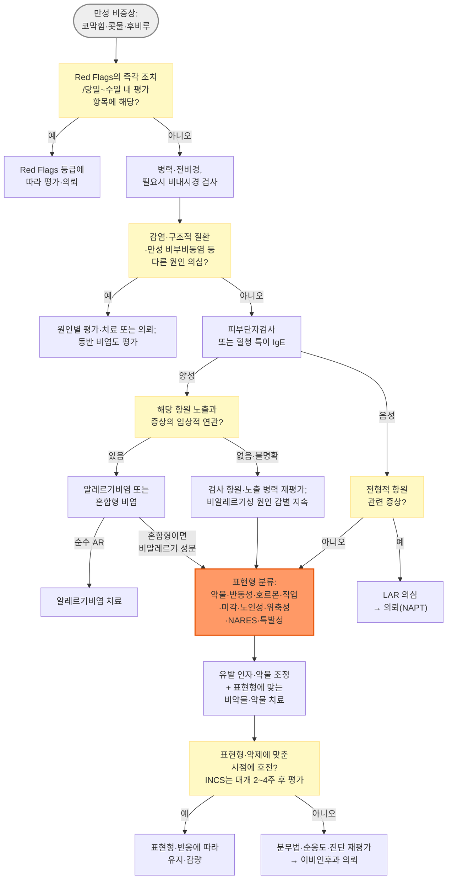

# 비-알레르기비염 Non-Allergic Rhinitis, NAR

## <mark style="color:green;">일반 사항</mark>

* IgE 매개 알레르기 반응이 주된 기전이 아닌 이질적인 비증상군
* 특발성 비염(비알레르기성 rhinopathy), NARES, 미각·호르몬·약물 유발·직업성·위축성·노인성 비염이 포함됨
* 급성 또는 만성으로 나타날 수 있음
* 증상을 설명할 수 있는 전신 알레르기 감작이 확인되지 않는 것이 특징
* 알레르기비염 배제와 함께 전신 알레르기검사가 음성인 국소 알레르기비염(LAR) 및 감염·구조적 질환을 감별해야 하며, 검사 양성이어도 해당 항원과 증상의 임상적 연관성이 없으면 비알레르기성 원인을 포함한 감별을 시행
* 유병률 : 비염의 약 20\~30%로 추정되나 연구 정의와 대상에 따라 차이가 큼; 알레르기 요인이 공존하는 혼합형 비염(Mixed Rhinitis)도 흔함
* 기전은 표현형에 따라 다름

[<mark style="color:cyan;">**알레르기비염(AR)과의 임상적 감별**</mark>](051_-allergic-rhinitis.md#undefined-9)

* 눈·코·인두 가려움 또는 발작성 재채기가 현저하지 않음
* 코막힘·후비루가 주증상일 수 있음
* 특정 계절성 항원과의 일관된 연관은 적으나, 계절에 따른 온도·습도 변화로 악화될 수 있음

<mark style="color:cyan;">**혼합형 비염(Mixed Rhinitis) 감별**</mark>

* 알레르기와 비알레르기 요인이 함께 증상을 유발하는 혼합형이 흔함
  * 만성 비염의 약 1/3을 차지하고, 알레르기비염 환자 중에서는 더 높은 비율로 보고됨
* 알레르기검사 양성은 감작을 의미하며, 해당 항원 노출과 증상의 임상적 연관성이 있고 찬 공기·자극 냄새 등 비특이적 유발 인자에도 반응할 때는 혼합형을 의심

<mark style="color:cyan;">**국소 알레르기비염(LAR, Local Allergic Rhinitis) 감별**</mark>

* 코 점막 내에서 국소적으로 알레르기 반응이 일어나지만, 전신 알레르기검사(피부단자검사·혈청 특이 IgE)는 음성인 상태
* 피부단자검사와 혈청 특이 IgE 검사가 음성이더라도 특정 항원(집먼지진드기·꽃가루 등) 노출 시 전형적인 알레르기 증상이 반복되면 LAR를 의심
  * 혈청 특이 IgE 검사 중 다중 항원 동시검사(MAST 등)는 검사법·항원에 따라 단일 항원 정량검사(ImmunoCAP 등)보다 민감도가 낮을 수 있으므로, 음성이더라도 임상적으로 의심되면 피부단자검사 또는 단일 항원 특이 IgE 검사로 재확인
  * 혈청 총 IgE는 감작 여부를 판단하는 검사가 아님
* 비강 분비물 특이 IgE는 민감도와 표준화가 제한되어 단독으로 확진·배제하는 검사가 아님
* 확진의 표준은 비강 항원 유발 검사(NAPT, Nasal Allergen Provocation Test)

<mark style="color:cyan;">**생리적 비폐색 감별**</mark>

* 비주기(nasal cycle) : 양쪽 비강 점막(주로 하비갑개)의 울혈과 비울혈이 수 시간 간격으로 교대로 나타나는 정상 생리 현상
* 생리적으로 자세에 따라 좌우의 비폐색이 바뀔 수 있으며, 누우면 비폐색이 증가하고 옆으로 누우면 아래쪽 비강의 저항이 증가할 수 있음
* 한쪽에 고정된 지속성 비폐색은 구조적 병변을 평가

### <mark style="color:$danger;">🚩 Red Flags!</mark>

<mark style="color:$danger;">**즉각 조치**</mark>

* 급성 안면·안와 부종 또는 통증과 시력저하·복시·안구운동장애  `안와 합병증`
* 심한 두통, 고열, 경부 강직 또는 의식 변화  `두개 내 합병증`
* 최근 두부 외상·비부비동 수술 후 새로 발생한 편측성 맑은 콧물, 또는 신경학적 이상·수막염 증상을 동반한 맑은 콧물  `CSF 비루`
* 비강 내 단추형 전지 의심, 또는 비중격 양쪽에서 자석끼리·자석과 금속이 서로 붙어 있는 경우
* 혈관염 의심 소견과 함께 호흡곤란·저산소증을 동반한 객혈, 급성 신기능 저하·핍뇨, 급속히 진행하는 근력저하  `GPA·EGPA의 장기 위협 침범`
* 급속히 진행하는 비강 조직 괴사·파괴, 또는 당뇨병·면역저하 환자에서 새로 발생하거나 빠르게 악화하는 안면 통증·부종·감각저하, 비강 점막 창백·감각저하 등 침습성 감염 의심 소견(흑색 괴사가 없어도 배제되지 않음)  `급성 침습성 진균 비부비동염`

<mark style="color:$warning;">**당일\~수일 내 평가**</mark>

* 고개를 숙일 때 증가하는 지속성 편측 맑은 콧물  `자발성 CSF 비루`
* 지속되는 편측 코막힘·혈성 분비물 또는 반복 비출혈  `비강 이물` `비부비동 종양`
* 편측 증상과 함께 뺨 감각저하·안면 종창·치아 동요·눈물흘림  `비부비동 악성 종양`
* 비강 딱지·혈성 분비물과 안장코 변형·비중격 천공, 또는 객혈·혈뇨 등 전신 증상  `GPA`
* 천식·말초 호산구 증가와 함께 말초신경병증·자반 등 전신 증상  `EGPA`
* 심한 통증 또는 출혈을 동반한 딱지·악취, 비강 궤양(급속한 조직 파괴 소견 없음)  `비부비동 종양` `NK/T세포 림프종` `혈관염` `만성 감염`
* 소아의 편측 악취성 농성 분비물  `비강 이물`

<mark style="color:$info;">**조기 평가 및 추적**</mark>

* 적절한 치료를 4주 이상 시행해도 호전되지 않는 코막힘  `구조적 비폐색` `혼합형 비염`
* 천식·비용종 또는 aspirin/NSAID 과민 동반  `AERD` `NARES`
* 안정적으로 지속되는 비강 딱지·악취·후각 저하  `위축성 비염`

## <mark style="color:green;">종류 및 특성</mark>

### <mark style="color:orange;">감염성 비염 (Infectious Rhinitis)</mark>

* 원인 : 바이러스(대부분), 세균
* 급성 인후통·코막힘·콧물·재채기·기침이 다양한 순서로 나타나며, 발열·근육통 등 전신 증상 동반 가능
* NAR에 포함시키기도 하지만, EAACI·ARIA는 감염성 비염을 NAR과 별도 범주로 분류
* 치료 ☞ [부비동염](053_-rhinosinusitis-sinusitis.md), [감기](../223_/060_-common-cold.md)

### <mark style="color:orange;">특발성 비염 / 비알레르기성 rhinopathy (Idiopathic Rhinitis / Nonallergic Rhinopathy)</mark>


용어 정리 : 과거에는 혈관운동성 비염(Vasomotor Rhinitis)으로 불렸으나, 혈관 기전만으로 설명되지 않아 현재는 특발성 비염 또는 비알레르기성 rhinopathy라는 용어를 선호함. 질병코드는 여전히 'J30.0 혈관운동성 비염'을 사용. 비감염성 NAR(NINAR)은 특발성 비염뿐 아니라 NARES 등 여러 표현형을 포괄하는 상위 개념임


* 증상 : 코막힘, 콧물; 간혹 재채기; 알레르기성 눈·코 가려움은 드묾
  * 온도·습도 변화에 따른 계절성 악화 가능
* 기전 : 비특이적 자극 → trigeminal 감각신경 과민(TRPV1·TRPA1 활성화) 및 부교감신경 과항진 → 점액 분비·점막 부종·재채기 증가
* 유발 인자 : 온도 변화(덥거나 찬 공기), 운동, 자극(냄새·연기·먼지), 습도, 음주, 뜨겁거나 매운 음식
  * 특정 항원 또는 감염과 무관
* 치료 : 비내 스테로이드(INCS) 또는 비내 항히스타민제(INAH)를 1차 단독요법으로 선택
  * 중등도\~중증이면서 단독요법에 반응 불충분하면 병용 고려 <mark style="color:$info;">\[JACI 2020]</mark>
  * 콧물이 주증상이면 비내 ipratropium 단독 또는 INCS와 병용 고려
  * INAH 단독 성분의 국내 유통 제품은 없으며 INCS와의 복합 제품이 있음


TRPV1(열·화학적 통증 자극 감지)과 TRPA1(다양한 화학적 자극 감지)은 코 점막의 감각신경 말단에 분포하는 수용체. 일부 특발성 비염에서는 이들 감각신경 경로의 과반응이 증상 유발에 관여하지만, 모든 비-알레르기비염에 공통된 단일 기전은 아님


### <mark style="color:orange;">NARES (Nonallergic Rhinitis with Eosinophilia Syndrome)</mark>

* 증상 : 재채기, 수양성 콧물, 코막힘, 코 가려움; 후각 저하가 흔함
  * 알레르기비염·특발성 비염보다 증상이 심한 경향
* 원인 : 불확실
* 관련 인자 : 천식·비용종·aspirin/NSAID 과민과 동반되거나 이들 질환에 선행할 수 있으므로 병력 확인
* 진단 : 전신 알레르기검사(피부단자검사·혈청 특이 IgE)에서 감작이 확인되지 않는 만성 비염 환자에서 비강 세포검사상 호산구 증가 - 고전적으로 ≥20%를 사용하지만 문헌·검사법에 따라 더 낮은 기준도 사용됨
  * 비강 호산구 증가는 NARES에 특이적이지 않으므로 LAR·만성 비부비동염·비용종·AERD 등을 감별
  * 비강 세포검사는 시행 기관이 제한적이며 모든 비염 환자에게 일상적으로 시행하는 검사는 아님
* 치료 : 비내 스테로이드(INCS) 우선
  * 반응 불충분 시 비내 항히스타민제 병용과 진단 재평가·전문의뢰 고려
  * LTRA는 비-알레르기비염에 권고하지 않으며 <mark style="color:$info;">\[JACI 2020]</mark>, 경구 스테로이드는 정규 단계 치료가 아님

### <mark style="color:orange;">미각 비염 (Gustatory Rhinitis)</mark>

* 증상 : 식사(특히 뜨겁거나 매운 음식) 직후 발생하는 수양성 전방 비루가 특징
  * 코막힘은 전형적이지 않음
* 치료 : 식사 15\~30분 전 비내 항콜린제(ipratropium) 분무

### <mark style="color:orange;">위축성 비염 (Atrophic Rhinitis)</mark>

* 증상 : 비강이 넓어졌는데도 느끼는 역설적 코막힘, 점막 건조, 딱지(crusting), 악취(ozena), 후각 저하
* 소견 : 비강 확장, 점막·점막선 위축, 편평상피화생(squamous metaplasia)
* 1차(원발성) : 원인 불명, 세균 증식(_K. ozaenae_) 관련; 국내에서는 드묾
* 2차(속발성) : 과도한 비갑개 절제 등 코·부비동 수술, 방사선 치료, 외상, 육아종성 질환(GPA·사르코이드증 등); 현재 대부분을 차지
  * 비갑개 절제 후 점막이 정상이어도 심한 코막힘을 호소하면 빈 코 증후군(empty nose syndrome) 감별
* 치료 : 매일 비강 세척, 보습 연고 도포; 감염 시 항생제 연고 또는 전신 항생제 사용

### <mark style="color:orange;">노인성 비염 (Senile Rhinitis)</mark>

* 고령에서 알레르기 감작 없이 발생하는 비-알레르기비염
* 증상 : 맑은 콧물이 주증상(특히 식사 중 미각 비염 양상); 코막힘은 상대적으로 경미; 일부에서는 점막 건조가 함께 나타날 수 있음
  * 식사 또는 신체 활동 시 악화
* 기전 : 노화에 따른 자율신경 불균형(부교감신경 우위)으로 점액 분비가 늘어나는 것으로 추정
  * 콜라겐·탄성 섬유 감소로 비첨(nasal tip)이 처지고 비전정 협착
* 위축성 비염과의 차이 : 위축성 비염은 뚜렷한 점막 위축·딱지·악취가 특징인 반면, 노인성 비염은 수양성 비루가 주증상이며 노화에 따른 건조·점막 변화가 동반될 수 있음
* 고령자에서는 복용 중인 약물(전립선비대증 α-차단제 등)에 의한 약물 유발성 비염을 함께 확인
* 치료
  * 비강 식염수 세척, 유발 상황 조절을 우선
  * 비내 항콜린제(ipratropium) : 수양성 전방 비루가 주증상이면 우선 고려. 코막힘·재채기 조절 효과는 없으며, 후비루가 주증상인 경우 효과는 확립되지 않음 <mark style="color:$info;">\[JACI 2020]</mark>
    * 전립선비대증·폐쇄각 녹내장 환자는 투여 금기. 분무액이 눈에 들어가지 않도록 교육


**CSF 비루 감별 주의** : 고령자의 맑은 콧물이라고 해서 단순 노인성 비염으로 보면 안 됨. 편측성이거나 고개를 앞으로 숙일 때 증가하면 CSF 비루를 반드시 배제해야 함. 고령자에서 외상 없이도 자발성으로 발생 가능하며, 노인성 비염과 혼동되기 쉬움; β₂-transferrin 검사 및 당일\~수일 내 이비인후과 의뢰. 외상·수술 직후이거나 신경학적 이상·수막염 증상이 있으면 즉각 응급 평가


### <mark style="color:orange;">직업성 비염 (Occupational Rhinitis)</mark>

* 증상 : 코막힘, 콧물; 알레르기 및 비-알레르기 특성이 혼재
* 작업환경의 노출로 새로 발생한 직업성 비염과, 기존 알레르기비염·비-알레르기비염이 작업환경에서 악화되는 작업 악화성 비염(work-exacerbated rhinitis)을 구분
* 근무 중 악화되고 휴일·휴가에 호전되는지 확인; 노출 후 지연 반응이 있어 퇴근 직후 반드시 호전되는 것은 아님
* 기침·천명·호흡곤란 등 하기도 증상이 있으면 폐활량검사 등 직업성 천식 평가 및 의뢰 고려
* 원인 물질 예시 : 식품 가공업(음식물 단백질), 제화업(접착제), 화학 공장(암모니아), 마트(세정제·향수·찬 공기)
* 치료 : 직업환경 평가와 원인 노출 제거·감소가 핵심
  * 증상에 따라 비내 스테로이드 또는 비내 항히스타민제 사용
  * 알레르기성 직업성 비염은 해당 항원에 맞추어 치료

### <mark style="color:orange;">호르몬성 비염 (Hormonal Rhinitis)</mark>

* 증상 : 코막힘, 콧물
* 관련 상태 : 임신, 월경 주기·폐경·사춘기, 갑상선기능저하증, 말단비대증 등
  * 경구 피임약과 비염의 인과관계는 불확실

#### <mark style="color:$primary;">임신성 비염</mark>

* 임신 중 어느 시기에나 새로 발생할 수 있으며, 다른 감염·알레르기 원인 없이 6주 이상 지속되고 출산 후 2주 이내 소실되는 코막힘 중심의 비염; 임신 여성의 약 20%에서 발생
* 비약물 요법(취침 시 머리 높임·식염수 비강 세척·비강 확장 스트립)을 우선 시도
* 순수 임신성 비염 자체에 대한 INCS의 효과는 확립되지 않음
  * Fluticasone propionate를 8주 사용한 무작위시험에서 위약보다 유의한 개선이 확인되지 않아, 비약물요법 불응 시 일률적으로 추가하지 않음 <mark style="color:$info;">\[Clin Otolaryngol 2001]</mark>
* 알레르기비염 등 INCS에 반응하는 비염이 동반된 임신부에서는 별도 적응을 평가
* 새로 INCS 치료를 시작할 때는 임신 안전성 자료가 많은 budesonide를 우선 고려하며, mometasone이나 fluticasone도 선택 가능
  * 단일성분 제제의 안전성 자료를 복합제에 그대로 적용하지 않으며 제품별로 임부·수유부 금기 확인
* 경구·비내 울혈 제거제는 가급적 피하며, 특히 경구 pseudoephedrine은 임신 1분기에 사용하지 않음. 다른 방법으로 조절되지 않는 극심한 코막힘에서만 산과적 검토 후 비내 oxymetazoline을 최소 용량·최단기간 사용 고려

### <mark style="color:orange;">약물 유발성 비염 (Drug-induced Rhinitis)</mark>

* 증상 : 코막힘, 콧물
* 원인 약물 : α-차단제(tamsulosin·doxazosin 등 전립선비대증 치료제 포함), β-차단제(점안 timolol 포함), clonidine·methyldopa·reserpine 등 교감신경억제제, 혈관확장제, PDE5 억제제, 일부 칼슘통로차단제·ACEI·향정신성 약물. Aspirin/NSAID는 단독 비증상 또는 AERD의 일부로 급성 비증상을 유발할 수 있음
* 처치 : 원인 약물 중단 후 수 주 내 회복; 심혈관·정신과·비뇨기과 약물은 임의 중단 전 처방의와 협의

### <mark style="color:orange;">약물 반동성 비염 (Rhinitis Medicamentosa)</mark>

* 증상 : 심한 코막힘(비내 울혈 제거제 사용 중단 시 악화되는 반동 현상)
* 원인 : 비내 울혈 제거제(oxymetazoline, xylometazoline 등)의 빈번하거나 장기간 연속 사용. 발생 시점은 개인과 제제에 따라 수일\~수 주로 다양하므로, 반동성 코막힘 예방을 위해 연속 3일 이내를 원칙으로 하고 길어도 5일을 넘기지 않음(제품별 허가 기간은 상이)
* 기전 : 수용체 반응 저하, 점막 허혈·부종 등 복합 기전이 제시되나 완전히 규명되지 않음
* 치료 : 원인 분무제 중단과 비내 스테로이드 사용
  * 즉시 중단이 원칙이나 견디기 어려우면 사용 빈도 감량 또는 한쪽 비강씩 중단하는 방법을 개별적으로 고려할 수 있으며, 이러한 감량법과 경구 스테로이드의 근거는 제한적
  * 일반 의약품인 비강 분무제를 장기간 자가 사용하는 환자에서 흔히 발생하므로, 처음 처방 시 연속 3일 이내를 원칙으로 하고 길어도 5일을 넘기지 않도록 교육하는 것이 중요

### <mark style="color:orange;">구조적 비폐색 - 비염의 감별</mark>

* 원인 : 비중격 만곡, 비갑개 비후, 비용종, 아데노이드 비대
* 특징 : 양측 또는 편측으로 나타날 수 있으나, 한쪽에 고정된 지속성 비폐색은 구조적 병변·종양을 우선 평가
* 치료 : 원인별 접근
  * 비중격 만곡 → 증상·정도에 따라 의뢰. 만곡 자체는 약물로 교정되지 않으며, 동반 비염·점막 부종은 별도로 치료
  * 비갑개 비후 → 비내 스테로이드 4\~6주 시도 후 반응 없으면 의뢰
  * 비용종 → 양측성이면 비내 스테로이드 ± 단기 경구 스테로이드 후 반응 불충분 시 의뢰; 편측성 용종은 내반성 유두종·악성 종양 감별을 위해 의뢰. 소아 비용종은 낭성섬유증 등 감별
  * 아데노이드 비대 → 평가 및 조치

## <mark style="color:green;">진단</mark>

### <mark style="color:orange;">진단 원칙</mark>

* 병력(유발 인자·복용 약물·직업·임신 여부)과 전비경·필요시 비내시경 검사
* 병력에 맞는 흡입항원에 대한 피부단자검사 또는 혈청 특이 IgE로 알레르기성 원인을 평가
  * 검사 결과만으로 알레르기비염 여부를 확정하지 않음. 검사 결과와 증상의 임상적 연관성을 함께 판단
* 검사 음성이지만 전형적 항원 관련 증상이 있는 경우 LAR 의심/의뢰
* 비강 세포검사(NARES 의심 시)는 시행 기관이 제한적
* 단순 비염에서는 영상검사를 일상적으로 시행하지 않음
  * 만성 비부비동염·종양·합병증·CSF 비루 등이 의심되면 의뢰하여 목적에 맞는 CT/MRI를 선택

### <mark style="color:orange;">증상에 따른 감별</mark>

<mark style="color:cyan;">**맑은 콧물 (Watery Rhinorrhea)**</mark>

* 뜨겁거나 매운 음식 후 → 미각 비염
* 고령 + 활동/식사 시 악화 → 노인성 비염
* 찬 공기 / 냄새 / 온도 변화 → 특발성 비염(과거 혈관운동성 비염)
* 앞으로 숙이면 한쪽에서 흐름 → CSF rhinorrhea

<mark style="color:cyan;">**코막힘 (Congestion dominant)**</mark>

* 비내 울혈 제거제의 빈번하거나 장기간 연속 사용 + 중단 시 악화 → Rhinitis medicamentosa
* 편측 지속 → 구조적 병변
* 오래 지속 + 치료 반응 없음 → septal deviation / polyp / tumor
* 월경, 갑상선기능저하증 → 호르몬성 비염
* 임신 중 새로 발생한 코막힘이 6주 이상 지속 → 감염·알레르기 등 다른 원인을 배제하고 임신성 비염 고려
* 혈압약(α·β-차단제 등), 전립선비대증 치료제(α-차단제), PDE5 억제제, NSAID → 약물 유발성 비염

<mark style="color:cyan;">**재채기 + eosinophilic pattern**</mark>

* 전신 알레르기검사 음성만으로 NARES를 진단하지 않으며, 비강 세포검사에서 호산구 증가 확인 필요
* 천식·비용종·NSAID 과민 동반 시 NARES 또는 AERD 등 감별

<mark style="color:cyan;">**딱지 + 악취 (Crust + Foul odor)**</mark>

* 악취 + 딱지 + 후각저하 → 위축성 비염
* 비강이 넓음 → 특징적
* 반복 수술/방사선 병력 → 흔한 원인

<mark style="color:cyan;">**기타**</mark>

* 근무일에 악화되고 휴일·휴가에 호전 → 직업성 비염 또는 작업 악화성 비염

### <mark style="color:orange;">AR vs 비-알레르기비염(non-AR) 감별</mark>

<table data-search="false"><thead><tr><th width="147">임상 특징</th><th>AR</th><th>non-AR</th></tr></thead><tbody><tr><td>발병 연령</td><td>소아·청년기(대개 20세 이전)</td><td>성인기(대개 20세 이후)</td></tr><tr><td>주요 악화 요인</td><td>임상적으로 관련된 알레르겐 노출; 계절성 또는 통년성</td><td>온도·습도 변화, 냄새·연기·매연, 음식, 약물·호르몬 등; 지속성 또는 간헐성</td></tr><tr><td>알레르기 가족력</td><td>흔함</td><td>상대적으로 적음</td></tr><tr><td>눈·코·인두 가려움</td><td>흔함</td><td>드묾</td></tr><tr><td>발작성 재채기</td><td>흔함</td><td>덜 현저하나 가능</td></tr><tr><td>콧물</td><td>흔함</td><td>흔함; 일부 표현형의 주증상</td></tr><tr><td>코막힘·후비루</td><td>가능</td><td>흔함</td></tr><tr><td>코 점막 소견</td><td>창백·부종이 가능하나 비특이적</td><td>대개 정상 또는 비특이적; 발적만으로 감별 불가</td></tr><tr><td>알레르기검사</td><td>병력과 일치하는 피부반응/혈청 특이 IgE 양성</td><td>대개 음성; 양성이어도 증상과의 임상적 연관성이 없으면 비알레르기성 원인 감별 지속. 음성이면서 전형적 항원 관련 증상이면 LAR 고려</td></tr></tbody></table>

***



<p align="center"><strong>진단 및 치료 알고리듬</strong></p>

<p align="center"><em><mark style="color:$info;">저자 재구성 (참고 문헌 : JACI 2020; Allergy 2017)</mark></em></p>

***

## <mark style="background-color:$warning;">Management</mark>

### <mark style="color:orange;">치료 방침</mark>

* 유발 인자·유발 약물 회피
* [식염수 비강 세척](051_-allergic-rhinitis.md#undefined-14)
* 약물 치료 (☞ [알레르기비염](051_-allergic-rhinitis.md#management))
  * 특발성 비염 → 비내 스테로이드(INCS) 또는 비내 항히스타민제(INAH)
  * 수양성 콧물 위주 → 비내 ipratropium 단독 또는 INCS와 병용
  * 울혈 제거 분무제 의존 → 분무제 중단 + INCS
  * 구조적 질환 → 의뢰
  * 단독요법 불충분한 중등도\~중증 비-알레르기비염 또는 혼합형 비염 → INCS + INAH 고려
* 표현형·약제에 따라 반응과 부작용을 평가하며, INCS 등 유지 치료의 효과는 대개 2\~4주 후 판단. 악화하거나 부작용이 생기면 조기 재평가
* 적절한 유지 치료에도 호전이 없으면 진단·분무법·순응도를 재평가하고 구조적 병변 확인


**비내 항히스타민/스테로이드 복합제** : 중등도\~중증 비-알레르기비염에서 INCS 또는 INAH 단독요법에 반응이 불충분하면 병용을 고려할 수 있으나 권고는 조건부이고 근거 수준이 낮음 <mark style="color:$info;">\[JACI 2020]</mark>. 국내 <mark style="color:blue;">\[딜라스틴나잘스프레이]</mark>의 허가 적응증은 중등도\~중증의 연중 또는 계절성 알레르기비염으로, 순수 비-알레르기비염 사용은 허가 외 사용. 혼합형 비염은 검사상 감작만이 아니라 해당 알레르겐 노출과 증상의 임상적 연관성을 확인하여 진단

**경구 항히스타민제** : 2세대 제제는 순수 비-알레르기비염에서 효과가 제한적. 1세대 제제는 항콜린 효과로 난치성 후비루에 도움이 될 가능성이 있으나 유효성 근거가 부족하고 진정·인지기능 저하·낙상·배뇨장애 위험이 있어 routine으로 권고하지 않음 (☞ [항히스타민제](../231_/212_-antihistamines.md))


### <mark style="color:orange;">유형별 치료제 선택 요약</mark>

<table data-search="false"><thead><tr><th width="140">유형</th><th width="190">우선 치료</th><th>반응 불충분 시</th><th>비고</th></tr></thead><tbody><tr><td>특발성</td><td>INCS 또는 INAH</td><td>INCS+INAH</td><td>콧물 위주면 ipratropium 병용; 식염수 세척 병용 가능</td></tr><tr><td>NARES</td><td>INCS</td><td>INAH 병용, 재평가·의뢰</td><td>LTRA는 권고하지 않음</td></tr><tr><td>미각성</td><td>비내 ipratropium</td><td>유발 음식 조절</td><td>수양성 비루에만 효과</td></tr><tr><td>노인성</td><td>식염수 세척·유발 상황 조절; 수양성 비루가 불편하면 비내 ipratropium</td><td>유발 약물·동반 비염·구조적 원인 재평가</td><td>국내 제품의 금기 확인</td></tr><tr><td>위축성</td><td>식염수 세척·가습</td><td>보습, 딱지 제거</td><td>감염 시 배양·항생제 및 이비인후과 의뢰</td></tr><tr><td>직업성</td><td>노출 제거·감소</td><td>INCS 또는 INAH</td><td>직업환경 평가</td></tr><tr><td>임신성</td><td>취침 시 머리 높임·식염수 세척·비강 확장 스트립</td><td>진단 재평가·산과/이비인후과 협의</td><td>순수 임신성 비염에서 INCS 효과는 확립되지 않음; 동반 비염의 적응은 별도 평가</td></tr><tr><td>약물 유발성</td><td>처방의와 상의하여 원인 약물 조정</td><td>원인별 대증 치료</td><td>임의 중단 금지</td></tr><tr><td>약물 반동성</td><td>비내 울혈 제거제 중단+INCS</td><td>감량 중단법 개별 고려</td><td>경구 스테로이드 근거 제한적</td></tr></tbody></table>

### <mark style="color:orange;">약물치료 불응성 만성 비염</mark>

* 비내 capsaicin : 특발성 비염에서 증상과 비강 과민반응을 줄일 가능성이 있으나 연구 수가 적고 투여 농도·방법이 표준화되지 않았으며 국내 표준 허가 제제가 없음. 전문기관에서 선택적으로 고려
* 후비신경(PNN, Posterior Nasal Nerve) 시술 : 충분한 약물치료에도 중등도\~중증 만성 비염이 지속되면 냉동치료·고주파 시술 평가를 위해 이비인후과 의뢰 고려
  * 비갑개 비후에 따른 코막힘 우세형과 비루 우세형을 구분하여 비갑개 축소술 또는 후비신경 시술 등 시술 방법을 선택 <mark style="color:$info;">\[Allergy 2026]</mark>

***

## <mark style="color:red;">질병코드</mark>

* J30.0 혈관운동성 비염 Vasomotor rhinitis
* J31.0 만성 비염 Chronic rhinitis

***

## <mark style="color:purple;">처방례</mark>

> **처방례 1. 특발성 비염 - 비내 스테로이드 단독**
>
> ```
> [아바미스] 27.5 ㎍/puff   각 비강 2 puffs   qd   (매일 일정한 시간)
> → 증상 조절 후 각 비강 1 puff qd로 감량
> ```
>
> _✽ 성인·12세 이상 용량. <mark style="color:blue;">\[아바미스]</mark>의 국내 허가 적응증은 알레르기비염으로, 순수 비-알레르기비염 사용은 허가 외 사용. 효과는 수일 내 시작될 수 있으나 충분한 반응은 규칙적으로 2\~4주 사용한 뒤 평가. 분무구를 눈 바깥쪽(비강 외측벽)으로 향하게 하여 비중격 직접 접촉 회피_

> **처방례 2. 혼합형 비염 - 눈 증상이 동반된 경우**
>
> ```
> [아바미스] 27.5 ㎍/puff   각 비강 2 puffs   qd
> [씨잘] 5 ㎎/T   1T   qd   저녁
> ```
>
> _✽ 병력과 알레르기검사에서 임상적으로 관련된 알레르기 성분이 확인된 혼합형 비염에 한정. INCS에 경구 2세대 항히스타민제를 더하는 병용은 추가 이득이 적어 초기 일상 병용은 권고되지 않으며 <mark style="color:$info;">\[JACI 2020]</mark>, 눈 가려움 등 알레르기 증상이 뚜렷할 때 선택적으로 사용. 코 증상이 INCS 단독으로 조절되지 않으면 처방례 5(INCS+INAH)를 우선 고려. 1세대 항히스타민제는 진정·인지기능 저하·낙상·항콜린 부작용 때문에 routine으로 사용하지 않음_

> **처방례 3. 미각 비염 - 비내 항콜린제**
>
> ```
> [리노벤트] 42 ㎍/puff   각 비강 1 puff   증상이 예상되는 식사 15~30분 전
> ```
>
> _✽ 국내 허가 용법은 성인 및 12세 이상에서 각 비공 1회씩 1일 2\~3회이며, 식사 전 필요시 사용은 미각 비염의 증상 유발 상황에 맞춘 사용법임. 콧물에는 효과적이나 코막힘·재채기에는 효과가 없음. 비강 건조감·비출혈 가능. 국내 허가사항상 폐쇄각 녹내장·전립선비대증·감염성 비염에는 투여 금기이며 눈에 분무되지 않도록 교육_

> **처방례 4. 약물 반동성 비염 - 비내 스테로이드 전환**
>
> ```
> [아바미스] 27.5 ㎍/puff   각 비강 2 puffs   qd
> (기존 울혈 제거 분무제는 중단; 즉시 중단이 어려우면 개별 감량)
> ```
>
> _✽ 중단 초기 수일\~수 주 동안 코막힘이 악화될 수 있음을 안내. 양쪽 동시 중단을 견디기 어려우면 사용 빈도 감량 또는 한쪽 비강씩 중단하는 방법을 개별적으로 고려할 수 있으나, 감량 방법과 경구 스테로이드 사용의 근거는 제한적. <mark style="color:blue;">\[아바미스]</mark>의 순수 비-알레르기비염·약물 반동성 비염 사용은 국내 허가 외 사용_

> **처방례 5. 단독요법 불충분한 중등도\~중증 비염 - 비내 항히스타민/스테로이드 복합제**
>
> ```
> [딜라스틴나잘스프레이] (azelastine hydrochloride 137 ㎍ / fluticasone propionate 50 ㎍/puff)
>    각 비강 1 puff   bid   (아침·저녁)
> ```
>
> _✽ 국내 허가 연령은 6세 이상. 국내 허가사항상 임부·수유부 금기이며, 졸음·불쾌한 맛이 나타날 수 있어 운전·음주에 주의. 비-알레르기비염에서는 INCS 또는 INAH 단독요법에 반응하지 않는 중등도\~중증 환자에게 조건부로 고려하며 근거 수준은 낮음. Azelastine 성분은 빠른 효과가 기대되지만 속효성 자료는 주로 알레르기비염 연구에서 얻어짐. <mark style="color:blue;">\[딜라스틴나잘스프레이]</mark>의 국내 허가 적응증은 중등도\~중증의 연중 또는 계절성 알레르기비염으로, 순수 비-알레르기비염 사용은 허가 외 사용. 혼합형 비염은 알레르기검사 양성만으로 진단하지 않고 해당 알레르겐 노출과 증상의 임상적 연관성을 확인하며, 실제 진단과 허가·급여기준에 따라 청구_

***

### <mark style="color:$success;">핵심 복약 지도</mark>

> **비내 스테로이드 스프레이 올바른 사용법**
>
> * 분무 전 코를 가볍게 푼 후, 분무구를 눈 바깥쪽 방향(비강 외측벽)으로 향하게 하고 분사하십시오. 코 가운데 칸막이(비중격)를 향해 분사하면 코피가 생길 수 있습니다.
> * **분무 후 코를 세게 풀지 마십시오** - 약물이 씻겨 나갑니다.
> * 효과는 수일 내 나타날 수 있지만 충분한 효과를 판단하려면 **2\~4주간 규칙적으로** 사용해야 합니다.
> * 하루 한 번 사용 제제는 **매일 같은 시간대**에 규칙적으로 사용하는 것이 효과적입니다.

> **비내 울혈 제거 분무제(**<mark style="color:blue;">**\[오트리빈]**</mark>**,&#x20;**<mark style="color:blue;">**\[화이투벤]**</mark>**&#x20;등) 주의사항**
>
> * 이 약은 **연속 3일 이내로 사용하고, 길어도 5일을 넘기지 마십시오.**
> * 짧게 쉬면서 반복적으로 사용하는 경우에도 총 사용 기간과 빈도가 늘어나 반동성 코막힘 위험이 커질 수 있습니다.
> * 이 약을 끊을 때 코막힘이 더 심해진 경험이 있다면 담당 의사와 상의하지 않고 반복 사용하지 마십시오.
> * 의사 처방 없이 장기간 또는 반복적으로 사용 중이셨다면, 반드시 담당 의사에게 알려 주십시오.

> **미각 비염 - 식사 전 분무제 사용법**
>
> * 뜨겁거나 매운 음식을 드시기 **15\~30분 전**에 각 비강에 분무하십시오.
> * 매 식사마다 사용하는 것이 아니라, 증상이 예상되는 식사 전에만 선택적으로 사용할 수 있습니다.

> **언제 다시 병원을 방문해야 하나요?**
>
> * 비내 스테로이드를 4주 이상 사용해도 증상이 전혀 개선되지 않을 때; 악화하거나 부작용이 생기면 그 전이라도 방문
> * **한쪽 코에서만 증상**이 지속될 때 - 다른 원인이 있을 수 있습니다
> * 콧물에 **피가 섞이거나** 코피가 반복될 때
> * **후각이 갑자기 저하**되었을 때

***

## <mark style="color:green;">주요 참고문헌 및 확인 자료</mark>

### <mark style="color:orange;">임상 근거</mark>

* Dykewicz MS, et al. Rhinitis 2020: A practice parameter update. J Allergy Clin Immunol 2020;146(4):721-767.
* Hellings PW, et al. Non-allergic rhinitis: Position paper of the European Academy of Allergy and Clinical Immunology. Allergy 2017;72(11):1657-1665.
* Wise SK, et al. International consensus statement on allergy and rhinology: Allergic rhinitis - 2023. Int Forum Allergy Rhinol 2023;13(4):293-859.
* Ellegård EK, Hellgren M, Karlsson NG. Fluticasone propionate aqueous nasal spray in pregnancy rhinitis. Clin Otolaryngol Allied Sci 2001;26(5):394-400. - 순수 임신성 비염에서 비내 스테로이드 효과를 평가한 무작위 위약 대조시험. [https://doi.org/10.1046/j.1365-2273.2001.00491.x](https://doi.org/10.1046/j.1365-2273.2001.00491.x)
* Lundberg M, et al. Surgical Management of Non-Allergic Rhinitis - An EAACI Task Force Position Paper. Allergy 2026. doi:10.1111/all.70424. - 비-알레르기비염의 표현형별 수술·시술 선택. [https://doi.org/10.1111/all.70424](https://doi.org/10.1111/all.70424)
* American Academy of Otolaryngology-Head and Neck Surgery. Position Statement: PNN Ablation for the Treatment of Chronic Rhinitis. Updated May 2026. - 약물치료 불응성 만성 비염의 후비신경 시술. [https://www.entnet.org/resource/position-statement-posterior-nasal-nerve/](https://www.entnet.org/resource/position-statement-posterior-nasal-nerve/)
* American College of Radiology. ACR Appropriateness Criteria®: Sinonasal Disease. - 단순 비염과 구분되는 비부비동 질환·합병증·CSF 누출 의심 시 영상검사 선택. [https://acsearch.acr.org/docs/69502/Narrative/](https://acsearch.acr.org/docs/69502/Narrative/)
* Children’s Health Queensland. Foreign body in the nose - Emergency management in children. 2025. - 비강 이물, 특히 단추형 전지의 즉시 제거 및 자석 관련 처치. [https://www.childrens.health.qld.gov.au/for-health-professionals/queensland-paediatric-emergency-care-qpec/queensland-paediatric-clinical-guidelines/foreign-body-nose](https://www.childrens.health.qld.gov.au/for-health-professionals/queensland-paediatric-emergency-care-qpec/queensland-paediatric-clinical-guidelines/foreign-body-nose)

### <mark style="color:orange;">허가·급여 확인 자료</mark>

* [식품의약품안전처. 의약품안전나라 - 의약품 품목허가정보.](https://nedrug.mfds.go.kr/index) - 국내 제품별 적응증·용법·금기 및 허가 상태 확인

***

## <mark style="color:blue;">환자 안내서</mark>


**비-알레르기비염이란 무엇인가요?**

비-알레르기비염은 알레르기(IgE) 반응이 주된 원인이 아닌 여러 코 증상군을 말합니다. 온도·습도 변화, 냄새·자극 물질, 음식, 약물, 호르몬 등 다양한 요인으로 코막힘·콧물·후비루가 나타날 수 있습니다. 알레르기검사가 음성이더라도 증상 양상에 따라 국소 알레르기비염, 감염 또는 코 안의 구조적 문제를 감별해야 합니다.


#### <mark style="color:$primary;">비-알레르기비염의 주요 유발 요인</mark>


**🔍 일상에서 흔한 유발 요인**

* **날씨·온도 변화** : 찬 공기, 건조한 환경, 급격한 온도 변화
* **자극 물질** : 담배 연기, 향수, 방향제, 매연, 화학 물질 냄새
* **음식** : 뜨겁거나 매운 음식, 알코올
* **약물** : 혈압약(베타차단제·ACEI), 전립선약(알파차단제), 발기부전 치료제, 아스피린, 소염진통제, 코막힘 분무제 장기 사용
* **호르몬 변화** : 임신, 월경 주기, 갑상선기능저하증


#### <mark style="color:$primary;">생활 속 관리 방법</mark>


**✅ 증상 완화를 위한 생활 습관**

1. **유발 요인을 파악하고 피하십시오.** 증상이 심해지는 상황(향수·담배 연기·찬 공기 등)을 메모해 두면 도움이 됩니다.
2. **식염수 비강 세척**을 하루 1\~2회 시행하면 점막을 촉촉하게 유지하고 자극 물질을 씻어낼 수 있습니다. 세척액에는 증류수·멸균수 또는 끓였다가 식힌 물을 사용하고 수돗물을 그대로 사용하지 마십시오.
3. **실내 습도를 대체로 40\~50%로 유지**하십시오. 건조한 환경은 코 점막을 자극하며, 집먼지진드기 알레르기가 함께 있으면 50% 이하로 관리하십시오.
4. **금연하시고, 간접흡연도 피하십시오.**
5. 코막힘 분무제(오트리빈 등)는 **연속 3일 이내로 사용하고, 길어도 5일을 넘기지 마십시오.** 짧게 쉬면서 자주 반복 사용하면 전체 사용 기간이 늘어나 반동성 코막힘 위험이 커질 수 있습니다.


#### <mark style="color:$primary;">이럴 때는 병원을 방문하세요</mark>

* **한쪽 코에서만 증상**이 오래 지속될 때
* 한쪽 코에서 **맑은 물 같은 콧물**이 계속 나오고 고개를 숙이면 더 흐를 때
* 콧물에 **피가 섞이거나** 코피가 자주 날 때
* **냄새를 잘 못 맡게 되었을** 때
* 4주 이상 치료해도 증상이 나아지지 않을 때
* 코와 함께 **눈·귀·얼굴 통증**이 동반될 때
* 아이가 코에 **단추형 전지나 자석**을 넣었다면 코를 풀게 하거나 직접 빼려 하지 말고 즉시 응급실을 방문하십시오.
* 눈 주위가 붓고 **시력이 떨어지거나**, **심한 두통·고열**이 동반되면 즉시 응급실을 방문하십시오.

***


**🩺 비-알레르기비염 관리 3원칙**

**① 유발 요인을 파악하세요** - 자신의 증상을 악화시키는 상황(찬 공기·향수·매운 음식 등)을 기록해 두면 회피하는 데 도움이 됩니다.

**② 처방받은 분무제를 용법에 맞게 사용하세요** - 비염의 유형과 주된 증상에 따라 사용하는 약이 다릅니다. 비내 스테로이드를 처방받았다면 규칙적으로 사용하고, 충분한 효과는 2\~4주 후 평가합니다.

**③ 코막힘 분무제(오트리빈 등)는 연속 3일 이내로 사용하고 길어도 5일을 넘기지 마세요** - 짧게 쉬면서 자주 반복 사용하면 반동성 코막힘 위험이 커질 수 있습니다.

