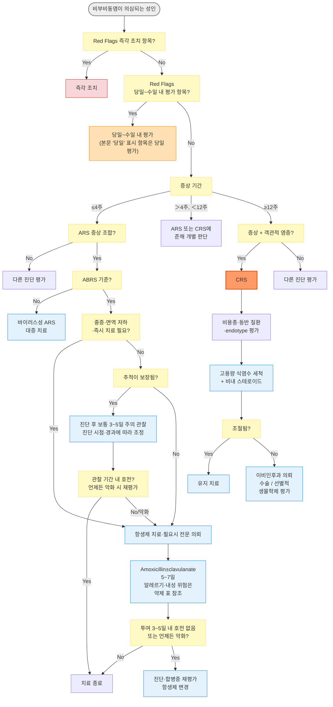

# 비부비동염 Rhinosinusitis, 부비동염 Sinusitis

## <mark style="color:green;">일반 사항</mark>

* 비부비동염(Rhinosinusitis) : 비강(nasal cavity) 및 부비강(paranasal sinus)에 염증이 동반된 상태
  * 부비동염은 거의 항상 코 점막 염증을 동반하므로 비부비동염이라는 용어를 사용
* Uncomplicated rhinosinusitis : 비부비동 범위 밖으로 염증이 확장되지 않은 비부비동염
  * 연조직·신경학적·안과적 이환 없음
* 바이러스성 비부비동염은 보통 발병 2\~3일에 가장 심하고 7\~10일 내 호전(일부 증상은 2주까지 지속)
* 콧물 색깔로 바이러스/세균을 감별할 수 없음. 초록색 농성 분비물은 호중구의 myeloperoxidase에 의한 것으로 바이러스 감염에서도 흔히 나타남; 10일 기준과 임상 중증도로 세균 감염 여부를 판단해야 함

### <mark style="color:orange;">분류</mark>

* Acute rhinosinusitis (ARS) : ≤4주
* Subacute rhinosinusitis : ＞4주, ＜12주; ARS 또는 CRS에 준해 임상적으로 개별 판단
* Chronic rhinosinusitis (CRS) : ≥12주
* Recurrent acute rhinosinusitis (RARS) : ABRS가 연 4회 이상 발생하고 각 episode 사이에는 무증상
* Acute bacterial rhinosinusitis (ABRS) : ARS(≤4주) 중 다음 bacterial criteria 하나 이상 충족
  1. ≥10일 지속 without improvement
  2. severe onset : ≥39℃ 고열 + (농성 비루 또는 안면통)이 발병 초기부터 3\~4일 연속 지속
  3. double worsening

## <mark style="color:green;">원인</mark>

#### <mark style="color:$primary;">기전</mark>

* Sinus mucosa 염증(neutrophil 유입, cytokine 방출) 및 부종 → sinus mucosa surface 손상, mucociliary clearance 장애, sinus ostia(ostiomeatal complex) 폐쇄

#### <mark style="color:$primary;">원인균</mark>

* 바이러스 (대부분) : rhinovirus, adenovirus, influenza virus, parainfluenza virus
* 세균 : _Streptococcus pneumoniae_, _Haemophilus influenzae_, _Moraxella catarrhalis_
  * _S. aureu&#x73;_&#xB294; uncomplicated community ABRS의 routine pathogen이 아님 - CRS, 수술 후 상태, 의료 관련 감염, 면역 저하 시 고려
  * 최근 _H. influenzae_ 비율 증가 추세 - β-lactamase 생성 내성주 고려 필요
  * Viral URI 중 약 0.5\~2%에서 ABRS로 진행
* 곰팡이
  * 침습성 진균성 비부비동염 : _Aspergillus_ spp., Mucorales
  * 침습성은 주로 조절되지 않는 당뇨병·호중구감소·장기 이식 등 면역 저하자에서 발생
  * 비침습성 fungal ball 및 allergic fungal rhinosinusitis는 면역정상자에서도 발생 가능

#### <mark style="color:$primary;">위험 인자</mark>

* 감기 : 비부비동염의 대부분은 감기 관련 바이러스에 의해 발생
* 기타 비염
* 구조적 이상 : 비중격 만곡, 비용종, 아데노이드 비대, choanal atresia, 비강 내 이물질, 비강/부비강 종양
* 섬모 기능 장애 : 원발성 섬모운동이상증(PCD; Kartagener 증후군 포함), 흡연, 코 울혈 제거제 남용
* 전신 질환 : 조절되지 않는 당뇨병, 백혈구 감소, 스테로이드 장기 사용, GERD, sarcoidosis, granulomatosis with polyangiitis(GPA), eosinophilic granulomatosis with polyangiitis(EGPA), cystic fibrosis
* 치과 질환 : 치성 부비동염(상악 치아의 치근단 감염이 상악동염 유발)

### <mark style="color:$danger;">🚩 Red Flags!</mark>

<mark style="color:$danger;">**즉각 조치**</mark>

* 안구 돌출·안구 운동 장애/통증·복시·시력 저하, 또는 눈 주위 부종·발적이 있으면서 안와 침범을 배제할 수 없음  `안와 연조직염` `골막하 농양`
* 새로 발생한 극심하거나 진행성인 두통, 수막 자극 증상(경부 강직 등), 의식 변화 또는 국소 신경학적 이상(고열이 없어도 해당)  `뇌수막염` `경막하/경막외 농양` `해면정맥동 혈전증`
* 이마의 말랑한 부종(전두동염 경과 중)  `Pott's puffy tumor(전두골 골수염)`
* 고열, 심한 전신 쇠약, 중독성 외모(toxic appearance) 등 패혈증 징후
* 당뇨병·면역 저하자에서 급속히 진행하는 편측 안면통·부종, 비점막 창백/괴사·검은 가피 또는 뇌신경마비(검은 가피가 없어도 해당)  `급성 침습성 진균성 비부비동염`
* Mucocele이 의심되면서 신경학적 증상 또는 안와 침범 소견이 동반  `mucopyocele` `안와/두개내 합병증`

<mark style="color:$warning;">**당일\~수일 내 평가**</mark>

* 눈꺼풀 부종·발적이 있으나 시력·안구 운동이 정상이고 안구 돌출이 없음 **(당일)**  `눈꺼풀앞 연조직염`&#x20;
* 면역 저하자에서 새로 발생한 비부비동염 증상 또는 통상적 치료에 반응하지 않는 편측 안면통 **(당일)**  `비전형적 감염` `침습성 진균성 비부비동염`&#x20;
* Mucocele이 의심되면서 새로 눈 주위 부종·통증이 발생하나 안와 침범·신경학적 소견은 없음 **(당일)**  `mucopyocele`
* 적절한 항생제 투여 중 언제든 악화하거나 3\~5일 내 호전되지 않음  `치료 실패` `합병증`&#x20;
* 편측 코막힘·출혈·악취성 분비물이 지속되거나 치료에 반응하지 않음  `종양` `이물` `치성 부비동염`

<mark style="color:$info;">**조기 평가 및 추적**</mark>

* ABRS가 연 4회 이상 반복되고 각 episode 사이에는 무증상  `RARS`
* 12주 이상 지속되는 코막힘·비루·후각 저하  `CRS`
* 큰 폐쇄성 비용종, 합병증이 없는 mucocele 또는 수술이 필요할 수 있는 구조적 병변 의심

## <mark style="color:green;">임상 양상 및 진단</mark>

#### <mark style="color:$primary;">급성 비부비동염 임상 진단</mark>

* 성인에서 다음을 모두 충족하고 증상 기간이 ≤4주이면 ARS로 임상 진단
  1. 농성 비루(전방 또는 후방)
  2. 코막힘 또는 안면 통증·압박감 중 하나 이상
* 후각 저하·발열·두통·치통·기침·피로감 등은 진단을 보조하지만 단독으로 ARS를 진단하지 않음
* 다른 코 증상 없이 안면 통증·두통만 있으면 편두통·삼차신경통·측두하악관절 장애를 우선 감별

#### <mark style="color:$primary;">세균 감염(ABRS) 임상 진단</mark>

* 다음 중 하나 이상 해당 시 ABRS로 임상 진단(배양 확인이 아닌 추정 진단)
  1. 농성 콧물·코막힘·안면 압통 등 ARS 증상이 호전 없이 ≥10일 지속
  2. 발병 초기부터 최소 3\~4일 연속 심한 증상 지속 : 발열(≥39℃) + (농성 비루 또는 안면통)
  3. 초기 증상 호전 후 다시 악화('double worsening') - 새 발열·두통 또는 비루 증가 등이 나타나는 이봉성(二峯性) 양상


<mark style="color:$info;">\[AAO-HNSF 2025]</mark>의 핵심 진단 기준은 **10일 이상 호전 없음** 또는 **초기 호전 후 재악화**임. 발병 초기 ≥39℃ 고열과 **농성 비루 또는 안면통**이 3\~4일 연속 지속되는 severe onset은 <mark style="color:$info;">\[IDSA 2012]</mark> 기준으로 함께 평가하며, 중증 감염이면 즉시 항생제 치료 고려


#### <mark style="color:$primary;">ABRS 진단 및 항생제 투여 결정 가이드</mark>

<table><thead><tr><th width="127">질문 항목</th><th>상태 확인</th><th>권고 사항</th></tr></thead><tbody><tr><td><strong>증상 기간</strong></td><td>10일 미만이며 호전 중</td><td>항생제 불필요; 대증 치료</td></tr><tr><td><strong>ABRS,</strong> <br><strong>합병증 없음</strong></td><td>10일 이상 호전 없음 또는 double worsening</td><td>추적이 보장되면 진단 후 보통 3~5일 주의 관찰; 경과에 따라 조정</td></tr><tr><td><strong>중증/고위험</strong></td><td>≥39℃ 고열 + (농성 비루 또는 안면통)이 3~4일 연속 지속, 면역 저하 등</td><td>즉시 항생제 치료를 개별적으로 고려</td></tr><tr><td><strong>관찰 중 실패</strong></td><td>보통 3~5일 관찰 후 호전 없음 또는 관찰 중 악화</td><td>항생제 시작</td></tr><tr><td><strong>Red Flags</strong></td><td>안와 부종, 안구 운동 장애, 시력 변화, 의식 변화</td><td>즉각 조치</td></tr></tbody></table>

> _합병증 없는 성인 ABRS에서 추적이 보장되면 항생제 없이 주의 관찰함._ \
> _AAO-HNSF 2025의 권고문은 관찰 기간을 고정하지 않으나, 같은 지침의 흐름도는 '진단 후 3\~5일 내 호전 없음' 또는 '언제든 악화'를 재평가 기준으로 제시하므로 보통 3\~5일 관찰하고 진단 시점과 증상 기간에 따라 조정함. 항생제 시작 후의 무반응 평가에도 별도로 3\~5일을 적용함._

#### <mark style="color:$primary;">소아 ABRS 진단 기준</mark>

* 소아는 성인보다 바이러스 상기도 감염이 빈번하며 일부가 ABRS로 진행; 진단 기준이 성인과 일부 다름
* 1\~18세 대상 ABRS 진단 기준 <mark style="color:$info;">\[AAP 2013]</mark>
  1. 중증 발병 : 고열(≥39℃)과 농성 비루가 최소 3일 연속 동반
  2. 지속형 : 비루(색·성상 무관), 주간 기침 또는 둘 다가 ＞10일간 호전 없이 지속
  3. 악화형 : 초기 호전 후 비루·주간 기침·발열이 새로 발생하거나 악화(double worsening)
* severe onset 또는 worsening course이면 항생제를 투여하고, 10일 이상 지속되지만 중증이 아닌 경우에는 추적이 가능하면 3일간 추가 관찰 가능
* 소아 항생제 투여 기간 : 지침 간 차이가 있음. AAP Red Book 2024\~2027은 5\~7일을 제시하며, IDSA 2012는 10\~14일, AAP 2013은 증상 소실 후 7일까지 개별화를 제시&#x20;
  * 합병증 없는 환자에서는 단기 요법을 고려하되 중증도·면역 상태·임상 반응에 따라 개별화
  * 소아의 직접적인 단기 대 장기 비교 근거는 제한적이며, 중증 환자에서는 더 긴 치료가 필요할 수 있음
* amoxicillin 또는 amoxicillin/clavulanate가 1차 선택; 내성 위험·중증도에 따라 clav. 포함 여부와 용량 결정
  * amoxicillin 45 ㎎/㎏/d #2(저위험) 또는 90 ㎎/㎏/d #2(＜2세, 어린이집, 최근 4주 내 항생제 사용 등에서 고용량 투여)
  * amoxicillin/clav. 고용량 : amoxicillin 90 ㎎/㎏/d + clav. 약 6.4 ㎎/㎏/d #2; 14:1 제형 사용 <mark style="color:blue;">\[아모크라네오]</mark>
    * 허가기준 : 소아 재발성 급성부비동염, 최근 3개월 이내 급성중이염/급성부비동염으로 항생제 투여 경험이 있으면서 2세 이하 또는 어린이집 재원인 경우; ≥3개월 연령에서 amoxicillin 90 ㎎/㎏/d #2로 7일 투여; ≥40 ㎏ 소아·성인에서 사용 경험 없음
  * 4:1·7:1 제형을 같은 부피로 대체하거나 amoxicillin 고용량에 맞춰 일률 증량하지 않음(clav. 과량 주의)

#### <mark style="color:$primary;">부위별 부비동염 특징</mark>

<table><thead><tr><th width="189">부위</th><th>특징적 증상</th></tr></thead><tbody><tr><td>Maxillary sinusitis</td><td>협부·치아 통증/압박감; 전두부 두통 동반 가능</td></tr><tr><td>Ethmoidal sinusitis</td><td>눈 사이 내안각 부위 통증/압박감, 안와로 방사; maxillary sinusitis에 동반 발생이 흔함</td></tr><tr><td>Frontal sinusitis</td><td>전두부 통증/압통; 눈썹 내측 끝 아래 orbital roof 촉지 시 통증 유발</td></tr><tr><td>Sphenoidal sinusitis</td><td>머리 중앙/vertex 두통; 단독 또는 pansinusitis의 일부로 발생; 진단 지연 시 두개내 합병증 위험</td></tr></tbody></table>

> _통증 위치만으로 침범 부비동을 정확히 판별할 수 없으며, 위 소견은 가능성을 시사할 뿐 진단 기준은 아님_

#### <mark style="color:$primary;">증상에 따른 감별</mark>

**코 분비물**

* 편측성 농성·악취성 비루가 지속 → 치성 부비동염·진균구·이물질·종양 감별
  * 편측성만으로 비부비동염을 배제하지 않음
* 색깔 : 맑음·노란색·초록색 모두 바이러스/세균 감염에서 나타날 수 있음&#x20;
  * 색깔만으로 원인 감별 불가
* 혈흔 동반 : 편측(종양·이물·코 후빔), 양측(육아종증·출혈 경향·코 후빔)

**코막힘**

* 편측 → 비중격 만곡, 이물, 폴립, 종양
* 양측 → 비염, 폴립, S자 비중격 만곡
* 교대 발생 → 비염

**후각 저하**

* 일시적·경증 → 알레르기비염, 바이러스 감염
* 간헐적 → 점막 질환, 폴립, 비부비동염
* 지속 → 바이러스 감염 후 후각장애(COVID-19 포함), 심한 폴립, 종양, 아연 결핍, 약물 반응
* 점차 악화 → Parkinson's disease, Alzheimer's dementia

**통증**

* 분비물·후각 저하 동반 → 비부비동염
* 다른 코 증상 없이 통증만 → 비부비동염 가능성 낮음; 편두통·삼차신경통·측두하악관절 장애 고려

#### <mark style="color:$primary;">ABRS vs 편두통 감별</mark>

* "이마·눈 주위 두통 = 부비동염"으로 착각하기 쉬움 - 외래에서 가장 흔히 오진되는 관계

<table data-search="false"><thead><tr><th width="199">소견</th><th>ABRS</th><th>편두통</th></tr></thead><tbody><tr><td>앞으로 숙일 때 통증 악화</td><td>가능</td><td>매우 흔함</td></tr><tr><td>농성 분비물</td><td>흔함</td><td>드묾</td></tr><tr><td>후각 저하</td><td>흔함</td><td>드묾</td></tr><tr><td>광과민증(photophobia)</td><td>드묾</td><td>매우 흔함</td></tr><tr><td>오심·구토</td><td>드묾</td><td>흔함</td></tr><tr><td>박동성 두통</td><td>드묾</td><td>흔함</td></tr><tr><td>증상 경과</td><td>비부비동염 증상이 ≥10일 호전 없이 지속하거나 초기 호전 후 재악화; 중증 발병도 평가</td><td>반복 발작과 두통 특성을 중심으로 평가; 두통 지속기간만으로 감별하지 않음</td></tr></tbody></table>

* 코 증상(농성 비루·후각 저하) 없이 두통·안면 통증만 있는 경우 ABRS 가능성 낮음. 이때는 편두통·삼차신경통을 우선 고려

#### <mark style="color:$primary;">비부비동염 주요 진단 오류</mark>

* 편두통을 부비동염으로 오진 : 코 증상 없는 두통 → 편두통 우선 고려
* 편측 증상에서 종양 놓침 : 편측 막힘·출혈·분비물 → 영상 검사 및 의뢰
* 치성 부비동염 간과 : 편측 상악동염 + 악취 비루 → 치과 평가 및 dental CT/CBCT 또는 부비동 CT 고려
* 초록색 콧물 = 세균 감염으로 판단 : 색깔로 감별 불가 - 10일 기준과 중증도 감안
* CRS에 반복 단기 항생제 : CRS는 감염이 아닌 염증 질환 - 비내 스테로이드 장기 유지가 핵심
* 합병증 없는 ARS에 CT 남용 : 치료 실패·합병증 의심 시에만 CT
* ABRS 기준 미충족 시 항생제 처방 : 10일 기준·severe onset·double worsening 확인 후 처방
* 알레르기비염을 반복 부비동염으로 오인 : 맑은 비루·재채기·양측 코막힘 → 알레르기 검사
* Aspirin 과민 + 비용종에서 비선택적 COX-1 억제 NSAID 처방 : AERD/NERD에서는 회피하고, 진통제 대안·aspirin 탈감작 여부는 전문적으로 평가
* 면역 저하자 ARS에서 진균 감염 간과 : 당뇨·이식·HIV → 침습성 진균성 비부비동염 배제

### <mark style="color:orange;">검사</mark>

* 합병증이 발생하지 않는 한 바이러스·세균 감별을 위한 일상적 검사는 불필요
* 배양 검사 : 항생제 치료 실패·면역 저하·비전형적 감염 시 고려
  * Blind nasal/nasopharyngeal swab은 원인균 예측에 부적절하며, 필요시 부비동 천자 또는 성인에서 내시경 유도 중비도 배양 시행
  * 소아에서 중비도 배양의 신뢰도는 확립되지 않음
* Sinus X선 : 거의 도움이 되지 않으며 합병증 없는 비부비동염에서 권고하지 않음
* CT : 합병증 의심, CRS 객관적 확진, 치료 불응 원인 평가, 수술 전 해부학적 평가 시 시행
  * 일반 CRS 평가는 비조영 CT, 안와/두개내 감염 합병증 의심 시에는 조영증강 CT 및 필요시 MRI 고려
  * 합병증 없는 ARS/ABRS에서는 시행하지 않음
* MRI : 액체·염증·종양 감별에 유리; 두개 내·안와 합병증 의심 시
* 비강 내시경 : 치료 실패 또는 CRS에서 구조적 원인 확인

***



<p align="center"><strong>비부비동염 관리 알고리듬</strong></p>

<p align="center"><em><mark style="color:$info;">저자 재구성 (참고 문헌 : AAO-HNSF 2025; EPOS 2020)</mark></em></p>

***

## <mark style="background-color:$warning;">Management - 급성 비부비동염</mark>

### <mark style="color:orange;">치료 방침</mark>

* 대부분 대증 치료로 회복 - 항생제는 선택적 적용
  * 임상적으로 진단한 uncomplicated ABRS에서도 자연 회복이 흔하며 항생제의 추가 이득은 작고 부작용은 증가
  * ABRS 기준을 충족해도 합병증이 없고 추적이 보장되면 진단 후 보통 3\~5일간 주의 관찰
    * 진단 시점과 증상 경과에 따라 조정 <mark style="color:$info;">\[AAO-HNSF 2025]</mark>
  * 관찰 기간 내 호전되지 않거나 언제든 악화하면 항생제 시작
    * 중증·면역 저하·합병증 위험군은 관찰 적합성을 별도로 판단하고 즉시 항생제 치료 개시 고려
* 대증 치료 : 진통제, 비내 스테로이드, 식염수 비강 세척
* 동반 질환 치료 : 알레르기비염, 당뇨
* 합병증 없이 치료된 비부비동염에 대한 추가 평가는 불필요

☞ 약물 및 비약물 치료제에 대하여 [알레르기비염](051_-allergic-rhinitis.md#management) 챕터 참조

### <mark style="color:orange;">비강 세척 (Nasal Saline Irrigation)</mark>

* 점막 보습·점액 배출 촉진·자극 물질 제거에 도움
  * ARS에서는 효과가 크지 않고 연구 결과가 혼재하지만 부작용이 적어 선택 가능
* 등장성 생리식염수(0.9%) : 일반적 유지 세척; 자극 없이 장기 사용 가능
* 고장성 식염수(hypertonic saline, 2\~3%) : 일부 연구에서 등장성보다 증상 개선이 컸으나 결과가 일관되지 않으며 작열감·자극감이 더 흔함; 환자 선호와 내약성에 따라 선택
* 고용량 세척에는 증류수·멸균수 또는 끓였다가 식힌 물만 사용하고, 수돗물을 그대로 사용하지 않음
* 세척 방법 (☞ [알레르기비염](051_-allergic-rhinitis.md#undefined-18))

### <mark style="color:orange;">코 울혈 제거제 (Decongestants)</mark>

* ABRS에서 경구·비내 울혈 제거제를 routine 보조요법으로 사용하지 않음; 심한 코막힘에 한해 단기간 선택적으로 고려
* 경구 : 비충혈 완화 목적
  * pseudoephedrine : 30\~60 ㎎ 1일 3\~4회; 최대 240 ㎎/d, 최소 4시간 간격 <mark style="color:blue;">\[슈다페드]</mark>
  * 국내 주요 금기 : 고혈압 포함 심혈관질환, 갑상선기능항진증, 당뇨병, 중증 신장애, 폐쇄각녹내장, 크롬친화세포종, 수유부, MAO 억제제 투여 중/중단 후 2주 이내; 다른 교감신경흥분제·β차단제 병용도 금기
    * 신중 투여 : 전립선비대증·방광 기능 이상, 고령자, 임부, 디기탈리스 투여 중, 안압 상승
* 비내 : 강력한 혈관 수축 효과; 반동성 비충혈 예방을 위해 연속 사용 3일 이내를 원칙으로 하고 길어도 5일을 넘기지 않음 (비급여)
  * phenylephrine <mark style="color:blue;">\[시네프린]</mark>, naphazoline/chlorpheniramine 복합제 <mark style="color:blue;">\[나리스타]</mark>, xylometazoline <mark style="color:blue;">\[오트리빈]</mark>, oxymetazoline <mark style="color:blue;">\[레스피비엔]</mark>

### <mark style="color:orange;">스테로이드 (Steroids)</mark>

* 비내 스테로이드 : 알레르기비염 동반 시 유효; ABRS에서도 증상 완화에 도움
  * budesonide <mark style="color:blue;">\[나리타점비액]</mark>, mometasone <mark style="color:blue;">\[나조넥스나잘]</mark>, fluticasone furoate <mark style="color:blue;">\[아바미스나잘]</mark>
  * 약 10일 이상 호전 없는 경우 ≥12세에서 고용량 비내 스테로이드 14일 고려(예 : mometasone 총 200 ㎍ bid) <mark style="color:$info;">\[NICE 2017]</mark>
  * 나조넥스 허가 : 성인 및 ≥12세의 중증 세균 감염이 없는 급성 비부비동염에 대하여 각 비공 2번씩 bid. 이 적응증·용량은 국내 허가 사항이며, 14일은 NICE에서 제시한 치료기간임
  * 아바미스 허가 : 알레르기비염 적응; 알레르기비염 없이 ARS·CRS 자체를 치료하는 사용은 허가 외임
* 경구 스테로이드 : ABRS에서 routine 사용은 권장하지 않음
  * 단독요법은 효과가 없고 항생제 병용 시 단기 증상 완화 가능성이 보고되었으나 근거의 확실성이 낮음
  * 합병증 없는 ABRS에 통상 처방하지 않음

### <mark style="color:orange;">항히스타민제</mark>

* 효과 : 비부비동염 자체에 대한 효과는 입증 안 됨; 점액 점도 증가 및 점막 건조로 악영향 가능
* 알레르기 증상이 심하게 동반된 경우에만 고려
  * cetirizine 10 ㎎ qd <mark style="color:blue;">\[지르텍]</mark>, levocetirizine 5 ㎎ qd <mark style="color:blue;">\[씨잘]</mark>, fexofenadine 120 ㎎ qd <mark style="color:blue;">\[알레그라]</mark>, loratadine 10 ㎎ qd <mark style="color:blue;">\[클라리틴]</mark>

### <mark style="color:orange;">진통제</mark>

* 통증·발열 시 필요에 따라 비마약성 진통제 선택 (☞ [통증](../220_/001_-pain.md#management))
  * ibuprofen : 200\~400 ㎎ q6\~8h prn; 위장관·신장·심혈관 위험과 항응고제 병용 여부 확인 <mark style="color:blue;">\[부루펜]</mark>
  * acetaminophen : 500\~1,000 ㎎ q6\~8h prn; 일반적으로 최대 3,000 ㎎/d, 간질환·과음 환자는 감량 <mark style="color:blue;">\[타이레놀]</mark>
* Tramadol 등 opioid는 단순 비부비동염 통증에 routine으로 사용하지 않음

### <mark style="color:orange;">점액용해제 (Mucolytics)</mark>

* Guaifenesin·ambroxol 등은 비부비동염 증상 완화 효과가 명확히 입증되지 않아 routine 사용을 권고하지 않음

### <mark style="color:orange;">항생제</mark>

* 대부분 항생제 투여 불필요 - ABRS 기준 충족 시 선택적 적용
* macrolide(azithromycin, clarithromycin), TMP/SMX는 내성 때문에 초기 경험적 치료로 권장하지 않음
* 투여 기간 : amoxicillin ± clav.는 합병증 없는 대부분의 성인에서 5\~7일 <mark style="color:$info;">\[AAO-HNSF 2025]</mark>; 중증도·치료 반응에 따라 개별화하되 호전 중인 잔여 증상만으로 자동 연장하지 않음
* 적절한 항생제 투여 후 3\~5일 내 호전되지 않거나 언제든 악화하면 진단·합병증을 재평가한 뒤 ABRS 진단이 맞으면 항생제 변경

#### <mark style="color:$primary;">내성 위험군</mark>

* ≥65세, 최근 입원, 최근 1개월 내 항생제 사용
* 중등도 이상·장기화된 증상, frontal/sphenoidal sinusitis, RARS
* 당뇨병 및 심장·간·신장질환, 면역 저하

#### <mark style="color:$primary;">항생제 선택</mark>

<table><thead><tr><th width="149">구분</th><th width="204">약물</th><th>성인 용량·기간</th></tr></thead><tbody><tr><td><strong>저위험군 1차</strong></td><td>amoxicillin <mark style="color:blue;">[파목신]</mark></td><td>500 ㎎ tid ×5~7일</td></tr><tr><td><strong>β-lactamase 생성균 등 위험 시</strong></td><td>amoxicillin/clav. <mark style="color:blue;">[오구멘틴]</mark></td><td>표준 용량 500/125 ㎎ tid ×5~7일; 폐렴구균 내성 고위험군의 고용량 요법은 아래 주석 참조</td></tr><tr><td><strong>Type I Pc 알레르기</strong></td><td>doxycycline <mark style="color:blue;">[모노신]</mark></td><td>성인 100 ㎎ bid 또는 200 ㎎ qd ×5~7일</td></tr><tr><td><strong>Non-type I Pc 알레르기</strong></td><td>cefpodoxime <mark style="color:blue;">[바난]</mark> 또는 cefixime <mark style="color:blue;">[포세프]</mark></td><td>cefpodoxime 200 ㎎(100 ㎎ 2T) bid 또는 cefixime 400 ㎎/d ×5~7일; 필요시 clindamycin 450 ㎎ tid 병용을 전문적으로 고려 <mark style="color:$info;">[AAO-HNSF 2025]</mark></td></tr><tr><td><strong>다른 대안이 없는 경우</strong></td><td>levofloxacin <mark style="color:blue;">[크라비트]</mark> 또는 moxifloxacin <mark style="color:blue;">[아벨록스]</mark></td><td>levofloxacin 500 ㎎ qd ×10~14일; moxifloxacin 400 ㎎ qd ×7일. 다른 적절한 대안이 없는 경우에만 사용; levofloxacin은 신기능에 따른 용량 조절 필요</td></tr></tbody></table>

> cefixime 용량 기준 : 국내 포세프 허가는 성인 일반 50\~100 ㎎ bid, 중증·효과 불충분 시 200 ㎎ bid이며, AAO-HNSF 2025의 ABRS 대체요법 용량은 400 ㎎ qd임. 1일 총량은 같으나 투여 간격이 다름

> _Non-type I penicillin 알레르기의 cephalosporin 대체요법은 중증 지연형 과민반응이 없는 경우에 한함. SJS/TEN·DRESS 등 중증 피부반응 또는 약물 관련 장기 손상 병력에서는 단순한 non-type I로 분류하여 β-lactam을 대체 처방하지 않고 전문 평가 <mark style="color:$info;">\[JACI 2022]</mark>_

* **폐렴구균 내성 고위험군의 고용량 요법 :** 국외 지침의 amoxicillin/clav. 고용량은 2,000/125 ㎎ bid (amoxicillin 4 g/d)임. 국내 속방형 복합제와 국외 고용량 제형은 투여간격·제형을 포함하여 구분해야 하며, 단순히 투여 약제 수를 늘리면 clav. 과량 위험이 있음. 고용량이 필요한 환자는 중증도·감수성·가용 제형을 고려하여 전문적으로 치료 요법 결정 <mark style="color:$info;">\[AAO-HNSF 2025; IDSA 2012]</mark>
* <mark style="color:$info;">**\[AAO-HNSF 2025]**</mark> : amoxicillin 단독 또는 amoxicillin/clav.를 1차로 5\~7일 사용. 건강한 경증\~중등도 저위험군에서는 amoxicillin 단독을 고려하고, β-lactamase 생성균·중증·고위험군에서는 amoxicillin/clav.를 우선 고려
* <mark style="color:$info;">**\[대한감염학회 2017]**</mark> : amoxicillin 단독도 1차 선택에 포함
* <mark style="color:$info;">**\[NICE 2017]**</mark> : ≤10일 증상에는 항생제 미사용 원칙. ＞10일 호전 없는 경우 세균 감염 가능성에 따라 처방
  * 1차 : phenoxymethylpenicillin (Pc VK) 500 ㎎ qid ×5d
  * 대체 : doxycycline 200 ㎎ 1일 후 100 ㎎ qd ×4d, clarithromycin 500 ㎎ bid ×5d
  * 임신부에서 진정한 Pc 알레르기 등으로 macrolide가 필요한 경우 : erythromycin 500\~1,000 ㎎ bid ×5d
  * 2차 또는 고위험군 : amoxicillin/clav. 500/125 ㎎ tid ×5d

#### <mark style="color:$primary;">주의 관찰 및 지연 처방</mark>

* 합병증 없는 성인 ABRS에서 추적이 보장되면 항생제 없이 대증 치료하며 진단 후 보통 3\~5일 관찰; 진단 시점과 증상 경과에 따라 조정
* 지연 처방을 할 경우 “언제든 악화하거나 정해진 관찰 기간(보통 진단 후 3\~5일) 내 호전하지 않으면 복용을 시작하고 의료진에게 알릴 것”을 안내
* 중증 감염, 면역 저하, 합병증 의심 또는 다른 세균 감염이 동반된 경우에는 관찰 대상이 아니며 즉시 치료 고려

### <mark style="color:orange;">치료 실패 시 조치</mark>

* 항생제 시작 후 3\~5일 내 호전되지 않거나 언제든 악화하면 재평가 <mark style="color:$info;">\[AAO-HNSF 2025]</mark>
* 복약 순응도와 ABRS 진단을 재확인하고 편두통·치성 감염·알레르기비염·종양 등 다른 원인 및 안와/두개내 합병증 배제
* ABRS가 재확인되면 초기 약제의 항균 범위를 고려하여 항생제 변경
  * amoxicillin 사용 중 실패한 경우에는 amoxicillin/clav. 등으로 변경 고려
* 반복 실패·면역 저하·비전형적 경과에서는 내시경 유도 배양 및 감수성 검사, CT, 이비인후과 의뢰 고려
* 증상이 서서히 호전 중이라는 이유만으로 항생제를 10\~14일 자동 연장하지 않음

***

## ■ **만성 비부비동염 (CRS)**

## <mark style="color:green;">일반 사항</mark>

* 주요 증상 ① 코막힘, ② 전방 비루/후비루, ③ 안면 통증·압박감, ④ 후각 저하 중 2가지 이상이 ≥12주 지속되고, 비강 내시경·전비경 또는 CT에서 비부비동 염증의 객관적 증거가 확인되는 질환
  * <mark style="color:$info;">\[EPOS 2020]</mark> : 코막힘 또는 비루 중 하나는 반드시 포함. 안면 통증·후각 저하만 있고 비루·코막힘이 없으면 CRS 진단 불충분
* CRS는 단순한 반복 감염이 아니라 다양한 표현형과 endotype을 가진 만성 염증 질환
* 장기 조절이 필요한 경우가 많고 일부 표현형은 재발이 흔함; 충분한 1차 치료에도 조절되지 않으면 의뢰


**안면 통증·후각 저하만 있고 코막힘·비루가 전혀 없는 경우**에는 비부비동염보다 삼차신경통·편두통·안면 통증 증후군을 먼저 감별. 비부비동염 치료(항생제·비내 스테로이드) 시도 전에 신경학적 원인을 우선 평가


#### <mark style="color:$primary;">CRS 아형 분류 (최신 지견)</mark>

* 임상 표현형 : CRS without nasal polyps (CRSsNP)와 CRS with nasal polyps (CRSwNP)
* <mark style="color:$info;">\[EPOS 2020]</mark> 분류 : primary/secondary → localized/diffuse → type 2/non-type 2 염증으로 세분
* CRSwNP에서는 type 2 염증(호산구, IL-4/IL-5/IL-13)이 흔하지만 모든 환자에게 동일하지 않고, CRSsNP도 type 2 염증을 보일 수 있으므로 비용종 유무만으로 endotype을 단정하지 않음
  * CRSwNP + 천식 + COX-1 억제제 과민반응이면 [AERD/NERD](051_-allergic-rhinitis.md#drug-induced-rhinitis) 고려; 전문 의뢰

### <mark style="color:orange;">원인 및 위험 인자</mark>

* 고령, 면역 저하, 알레르기, 환경 자극/오염 지속 노출
* 해부학적 이상, mucociliary 기능 저하(cystic fibrosis, primary ciliary dyskinesia)
* 반복적인 상기도 감염, 전신 질환(당뇨병, eosinophilic granulomatosis with polyangiitis, sarcoidosis)
* 이전 부비동 수술, 치과 감염·시술

## <mark style="color:green;">진단</mark>

* 증상 : 코막힘·비루·안면 통증/압박감·후각 저하 중 2개 이상, 12주 이상; 코막힘 또는 비루 중 하나는 필수 <mark style="color:$info;">\[EPOS 2020]</mark>
* 객관적 염증 증거 : 전비경/비강 내시경의 비용종·중비도 부종·농성 분비물 또는 CT의 부비동 점막 염증
* 비용종 유무를 확인하고 천식, cystic fibrosis, 면역 결핍, 원발성 섬모운동 이상, AERD 등 치료를 변경하는 동반 질환 평가 (AERD는 <mark style="color:$info;">\[AAO-HNSF 2025]</mark>에 새로 추가)

#### <mark style="color:$primary;">감별</mark>

* [알레르기비염](051_-allergic-rhinitis.md)
* [비알레르기비염](052_-non-allergic-rhinitis.md)
* 2차성 비염 : 임신, 갑상선저하증
* 구조적 이상 : 비용종, 이물, 비중격 만곡, 편도/아데노이드 비대
* 편두통, 안면 통증 증후군(facial pain syndrome)
* 치성 부비동염 (Odontogenic Sinusitis)

#### <mark style="color:$primary;">치성 부비동염 (Odontogenic Sinusitis)</mark>

* 상악동 바닥과 상악 후방 치아(제1·2대구치, 제2소구치)의 치근이 매우 근접하거나 상악동 내로 돌출되어, 치근단 감염·치주염·임플란트 시술 합병증 등이 상악동염으로 직접 파급될 수 있음
* 상악동염, 특히 편측성 상악동염의 중요한 원인이며 임플란트 등 상악 치과 시술 증가로 비중이 커지는 추세

<mark style="color:cyan;">**임상 단서**</mark>

* 치통이나 최근 치과 시술력이 없어도 배제할 수 없음
* 편측성 상악동염이 가장 흔하지만 양측성도 가능
* 악취를 동반한 농성 비루(foul-smelling purulent discharge) - 구강 혐기성균(_Fusobacterium_, _Prevotella_ 등) 감염의 특징
* 비강 내시경 소견 : 중비도(middle meatus)의 국소적인 농(mucopus) - 일반 바이러스성 비부비동염에 비해 편측 중비도에 국한된 농이 특징적
* 상악 치아 통증·최근 발치/임플란트 시술 병력
* 항생제로 일시 호전되더라도 치과적 원인이 해결되지 않으면 지속하거나 재발할 수 있음; 반복되면 치성 원인을 적극 의심

<mark style="color:cyan;">**진단**</mark>

* 치과용 panoramic X선은 선별에 사용할 수 있으나 치근단 병변을 놓칠 수 있음
* dental CT/CBCT 또는 부비동 CT로 치근단 병변·상악동 바닥 침범 평가

<mark style="color:cyan;">**치료**</mark>

* 원인 치아 치료(근관 치료, 발치, 임플란트 관련 처치) 없이는 항생제만으로 완치가 어려움
* 전신 증상·급성 감염 등 항생제 적응이 있으면 amoxicillin/clav. 등 구강 혐기성균을 포함하는 약제를 고려
  * metronidazole의 일률적 추가 병용은 권장하지 않고 배양·중증도·치과 처치 계획에 따라 결정
* 치과 협진. 필요시 이비인후과+구강악안면외과 협진

### <mark style="color:orange;">검사</mark>

* CT : CRS 객관적 확진이 필요하거나 치료 불응 원인·구조적 이상·수술 적응증을 평가할 때 시행; 항생제 선행치료는 필수조건이 아님
* 비강 내시경 : 비용종·배농 위치·점막 상태 직접 확인
* 전비경 : 제한적이나 비용종·농성 분비물·점막 부종 확인 가능
* 알레르기·면역 검사 : 병력상 동반 알레르기 또는 면역 결핍이 의심될 때 선택적으로 시행


**합병증 없는 ARS에는 CT 촬영 불필요**\
• uncomplicated ARS/ABRS에서는 CT 검사는 보류\
• CT 적응 : 합병증 의심(안와 침범·두개내 파급), CRS 객관적 확진·치료 불응 원인 평가, 수술 전 해부학적 평가\
• 바이러스성 상기도 감염에서도 CT상 점막 비후·분비물 저류가 나타날 수 있어 영상 소견만으로 세균성을 확정할 수 없음


***

## <mark style="color:green;">Management - 만성 비부비동염</mark>

### <mark style="color:orange;">치료 방침</mark>

* 모든 CRS의 기본 치료는 고용량 식염수 비강 세척과 비내 스테로이드
* 알레르기비염·천식·AERD 등 동반 질환을 함께 치료하고, 비용종 유무 및 type 2 염증 가능성에 따라 치료를 단계화
* 급성 악화나 치성 감염이 없는 안정된 CRS에 항생제를 routine으로 처방하거나 CT·수술 전 필수 선행치료로 요구하지 않음 <mark style="color:$info;">\[AAO-HNSF 2025]</mark>
* 일반 CRS에 국소 또는 전신 항진균제를 사용하지 않음
  * 급성 침습성 진균성 비부비동염과 allergic fungal rhinosinusitis는 별도 전문 치료 영역

☞ 약물 및 비약물 치료제에 대하여 [알레르기비염](051_-allergic-rhinitis.md#management) 챕터 참조

## <mark style="color:green;">약물 치료</mark>

### <mark style="color:orange;">항생제</mark>

* 안정된 CRS에 경험적 항생제를 routine으로 사용하지 않음 <mark style="color:$info;">\[AAO-HNSF 2025]</mark>
* 급성 세균성 악화, 치성 부비동염, 안와/두개내 합병증 등 감염이 명확한 상황에서만 임상 양상과 배양 결과에 따라 선택
* 저용량 장기 macrolide를 일률적으로 사용하지 않음
  * MACRO 무작위시험에서는 비내 치료에 추가한 3개월 clarithromycin이 위약 대비 6개월 삶의 질을 유의하게 개선하지 못했으며, 일부 non-type 2/저호산구성 CRSsNP에서의 선별적 효과는 여전히 불확실함. 내성·QT 연장 등 위해를 고려하여 전문의가 제한적으로 판단 <mark style="color:$info;">\[Lancet 2025]</mark>

### <mark style="color:orange;">스테로이드</mark>

#### <mark style="color:$primary;">비내 스테로이드</mark>

* CRS의 핵심 장기 유지 치료
* 허가 사항 : <mark style="color:blue;">\[나조넥스나잘]</mark>은 성인 비용종에 허가; CRSsNP 자체를 치료하거나 <mark style="color:blue;">\[아바미스나잘]</mark>을 알레르기비염 없이 CRS에 사용하는 경우는 허가 외 사용으로 구분
* **스테로이드 비강 세척** (Off-label, 비급여)
  * 심한 CRS, 특히 FESS 후 일반 비내 스프레이로 조절되지 않는 환자에서 부비동 내 약물 전달을 높이기 위해 전문의가 선택적으로 고려
  * 방법 예 : budesonide 흡입용 현탁액 0.5 ㎎/2 ㎖ <mark style="color:blue;">\[풀미코트 레스퓰]</mark>을 생리식염수 240 ㎖에 혼합하여 1일 1\~2회 비강 세척
  * <mark style="color:blue;">\[나리타점비액]</mark> 등 비강분무제는 위 용량의 세척용 ampule이 아니므로 혼합 세척 제품으로 표기하지 않음
  * 장기 고용량 사용 시 드물게 HPA axis·안압에 영향을 줄 수 있으므로 총 스테로이드 노출, 녹내장 위험, 반복 경구 스테로이드 사용 등을 고려하여 개별 모니터링

#### <mark style="color:$primary;">경구 스테로이드</mark>

* 주로 심한 CRSwNP에서 비용종·코막힘·후각 저하를 단기간 개선하지만 효과는 일시적이고 반복 사용의 전신 위해가 누적
* CRSsNP를 포함한 모든 CRS의 기본 치료로 사용하지 않으며, 전문의 판단하에 가능한 짧은 기간·최소 유효용량으로 제한
* 처방 전 당뇨병·골다공증·녹내장·감염·정신과적 부작용 위험과 최근 전신 스테로이드 누적 사용량 확인

### <mark style="color:orange;">생물학적 제제 (Biologics)</mark>

* CRSwNP 전문 치료
* 적절한 약물·수술 치료 후에도 조절되지 않는 양측 CRSwNP에서 다음 5개 중 3개 이상 해당 시 고려 <mark style="color:$info;">\[EPOS/EUFOREA 2023]</mark>
  1. type 2 염증 : 혈중 호산구 ≥150/㎕, 조직 호산구 ≥10/HPF 또는 총 IgE ≥100 IU/㎖
  2. 전신 스테로이드 필요(연 2회 이상 또는 ＞3개월 장기 저용량 사용) 또는 금기
  3. 현저한 삶의 질 저하(SNOT-22 ≥40)
  4. 후각검사로 확인한 무후각
  5. 규칙적인 흡입 스테로이드 치료가 필요한 동반 천식
* 수술력이 없는 환자는 수술 부적합·금기 사유, 질병 부담과 위 기준, 환자 선호를 고려하여 전문기관에서 생물학적 제제 적합성을 별도로 평가함
* dupilumab : IL-4Rα 차단 → IL-4·IL-13 동시 억제; 성인(18세 이상) CRSwNP 추가 유지 치료로 2021년 국내 허가(300 ㎎ 제품), 300 ㎎ SC q2w <mark style="color:blue;">\[듀피젠트]</mark>; CRSwNP 자체의 적응증으로 투여하면 약값 전액 본인부담이며, 동반 중증 천식 등 별도 급여 적응증을 충족하는 경우와 구분 <mark style="color:$info;">\[HIRA 고시 제2026-159호]</mark>
* 기타 : mepolizumab(IL-5 차단), omalizumab(IgE 차단), tezepelumab(TSLP 차단; 2025년 10월 FDA에서 12세 이상 CRSwNP 추가 유지 치료 허가) 등; 국외 CRSwNP 허가를 국내 허가·급여로 해석하지 않음
* CRSsNP에는 생물학적 제제를 routine으로 사용하지 않음 <mark style="color:$info;">\[AAO-HNSF 2025]</mark>
* 일차진료에서의 역할 : 생물학적 제제 처방 자체는 이비인후과·알레르기내과 전문 의뢰 영역. 일차 의원에서는 아래 기준 해당 시 적극적으로 의뢰
  1. 충분한 비내 스테로이드·비강 세척에도 큰 양측 비용종과 후각 소실이 지속
  2. 적절한 FESS 후 재발하거나 반복적인 전신 스테로이드·재수술이 필요
  3. CRSwNP와 조절되지 않는 천식 또는 AERD가 동반

### <mark style="color:orange;">치료 실패 시 조치</mark>

* aspirin-exacerbated respiratory disease, allergic fungal rhinosinusitis 고려
* 필요시 부비동 CT·비강 내시경; 종양·진균성 질환·두개내 합병증이 의심될 때 MRI 고려
* 비내 스테로이드 및 식염수 비강 세척 지속
* 급성 세균성 악화가 객관적으로 의심될 때만 내시경 유도 배양 및 항생제 고려
* 천식 등 동반 질환 치료
* 수술 치료(FESS) 고려, 이비인후과 의뢰; 수술 전 모든 환자에게 일정 항생제·스테로이드 요법이나 고정 치료기간을 일률적으로 요구하지 않음 <mark style="color:$info;">\[AAO-HNSF Surgical CRS 2025]</mark>

***

## <mark style="color:red;">질병코드</mark>

* J01 급성 부비동염 Acute sinusitis
* J32 만성 부비동염 Chronic sinusitis
* J33 코폴립 Nasal polyp

***

## <mark style="color:purple;">처방례</mark>

> **처방례 1. 바이러스성 ARS - 대증 치료**
>
> ```
> [타이레놀] 500 ㎎/T   1회 1~2T   tid prn   (통증/발열 시; 최대 6T/d)
> ```
>
> _✽ 항생제 불필요. 식염수 비강 세척 병행 가능. 비내 스테로이드는 필수 처방이 아니며 동반 알레르기비염·증상 지속 여부에 따라 선택. 10일 이상 호전되지 않거나 호전 후 다시 악화하면 재방문 안내_

> **처방례 2. ABRS - 항생제 1차 (경증\~중등도)**
>
> ```
> [파목신] 500 ㎎   1C   tid   × 5~7일
> [타이레놀] 500 ㎎/T   1회 1~2T   tid prn   (통증/발열 시; 최대 6T/d)
> [나조넥스나잘] 50 ㎍/분무   각 비공 2 puffs   bid   (증상에 따라 선택)
> ```
>
> _✽ 합병증 없는 저위험 성인 ABRS에서 보통 진단 후 3\~5일 주의 관찰에도 호전하지 않거나 악화하여 항생제를 시작하는 경우. Amoxicillin 단독은 내성 위험군이 아닌 경증\~중등도 ABRS에서 고려. 투여 3\~5일 내 호전 없거나 언제든 악화하면 재평가 후 항생제 변경_
>
> _✽ 나조넥스는 중증 세균 감염이 없는 급성 비부비동염의 증상 완화 목적으로 선택; 양측 합계 1일 400 ㎍. 약 10일 이상 호전 없는 증상에서는 14일 사용을 고려할 수 있음_

> **처방례 3. ABRS - amoxicillin/clavulanate 선택 시 (표준 용량)**
>
> ```
> [오구멘틴] 625 ㎎/T   1T   tid   × 5~7일
> [타이레놀] 500 ㎎/T   1회 1~2T   tid prn   (통증/발열 시; 최대 6T/d)
> ```
>
> _✽ 오구멘틴 625 ㎎ 1T는 amoxicillin 500 ㎎/clavulanate 125 ㎎. β-lactamase 생성균 위험·최근 항생제 사용·치료 실패 병력 등을 고려하여 선택. 이 처방은 고용량 요법이 아니며, 폐렴구균 내성 고위험·중증 감염에서는 고용량 필요성과 합병증·입원 여부를 별도로 평가(항생제 선택의 고용량 주석 참조). 중증도·반응에 따라 기간 개별화_

> **처방례 4. ABRS - Pc 알레르기 (1차 대체)**
>
> ```
> [모노신] 100 ㎎/T   1T   bid   × 5~7일
> [타이레놀] 500 ㎎/T   1회 1~2T   tid prn   (통증/발열 시; 최대 6T/d)
> ```
>
> _✽ Type I penicillin 알레르기가 확인된 성인의 대체 처방례. 식도 자극 예방을 위해 충분한 물과 함께 복용하고 30분간 눕지 않도록 교육. **칼슘·마그네슘·알루미늄 함유 제산제 및 철분제와 간격**을 두며 임부·수유부 및 12세 미만 소아의 단순 ABRS에는 사용하지 않음._
>
> _✽ 다른 적절한 대안이 없어 fluoroquinolone이 필요한 성인의 대체 처방례(국내 허가 기간) :_
>
> ```
> [크라비트] 500 ㎎/T   1T   qd   × 10~14일   (정상 신기능의 국내 허가 요법)
> ```
>
> _✽ 1차 치료 실패·중증·고위험이라는 이유만으로 자동 선택하지 않음. 크라비트의 위 기간은 국내 제품 허가 기준이며, amoxicillin ± clavulanate의 일반적인 5\~7일 권고와 구분. 신기능에 따라 용량 조절하고, tendon rupture, 말초신경병증·중추신경계 이상, QT 연장, 혈당 이상, 대동맥류/박리 위험과 C. difficile 감염 가능성을 고려. Moxifloxacin 400 ㎎ qd를 대안으로 선택하면 국내 부비동염 허가 기간은 7일임._

> **처방례 5. 알레르기비염 동반 ABRS**
>
> ```
> [오구멘틴] 625 ㎎/T   1T   tid   × 5~7일
> [아바미스나잘] 27.5 ㎍/puff   각 비공 2 puffs   qd
> [씨잘] 5 ㎎/T   1T   qd   저녁
> ```
>
> _✽ 항생제 적응증과 선택은 ABRS 경과·위험도에 따라 판단. 아바미스·씨잘은 동반 알레르기비염 증상을 치료하는 목적으로 사용하며, 알레르기 치료는 증상·노출 양상에 따라 항생제 종료 후에도 지속_

> **처방례 6. 만성 비부비동염 - 기본 유지 치료**
>
> ```
> [아바미스나잘] 27.5 ㎍/puff   각 비공 2 puffs   qd   (CRS 자체 치료는 허가 외)
> ```
>
> _✽ CRS의 기본 치료는 비내 스테로이드 장기 유지 + 고용량 식염수 비강 세척. 아바미스의 국내 허가 적응증은 알레르기비염으로, 이 처방례에서 CRS 자체를 치료하는 사용은 허가 외임. 성인 CRSwNP에서는 비용종 적응증이 있는 mometasone 제제를 선택할 수 있음._
>
> _✽ 경구 스테로이드는 모든 CRS의 기본 처방이 아니며 심한 CRSwNP에서 전문의 판단하에 제한적으로 사용. 충분한 치료에도 반응 없으면 객관적 진단을 재확인하고 부비동 CT 및 이비인후과 의뢰 고려._

***

### <mark style="color:$success;">핵심 복약 지도</mark>

> **항생제 처방 시 환자 안내**
>
> * 증상이 나아지더라도 처방된 용량과 기간을 임의로 줄이거나 늘리지 말고 **처방대로 복용**하십시오.
> * 복용 중 언제든 증상이 악화되거나 **3\~5일이 지나도 호전이 없으면** 병원에 다시 방문하십시오.
> * 오구멘틴(아목시실린/클라불란산)은 **식사 시작 때** 복용하면 위장 부작용(메스꺼움·설사)을 줄이고 클라불란산의 흡수에도 도움이 됩니다.
> * 항생제 복용 중 피부 발진, 두드러기, 호흡 곤란이 생기면 즉시 복용을 중단하고 병원을 방문하십시오.

> **비내 스테로이드 스프레이 올바른 사용법**
>
> * 분무구를 눈 바깥쪽 방향(비강 외측벽)으로 향하게 하고 분사하십시오 - 비중격을 향해 분사하면 코피가 생길 수 있습니다.
> * 일부 증상은 며칠 내 좋아질 수 있지만 충분한 효과에는 **2\~4주**가 걸릴 수 있습니다. 의사가 장기 사용을 지시한 경우 꾸준히 사용하십시오.
> * 분무 후 코를 세게 풀지 마십시오.

> **식염수 비강 세척 방법**
>
> * 세척은 하루 **1\~2회**, 약 240 ㎖(1컵)의 생리식염수를 사용합니다.
> * 세척액을 만들 때는 **증류수·멸균수 또는 끓였다가 식힌 물**만 사용하십시오. 수돗물을 그대로 사용하면 안 됩니다.
> * 고개를 **앞으로 숙이고 옆으로 기울인 뒤** 위쪽 비공에 세척액을 넣으면 아래쪽 비공으로 흘러나옵니다. 사용하는 기구에 따라 자세를 조절하십시오.
> * 세척 후 코를 세게 풀지 마시고 부드럽게 풀어 주십시오.
> * 세척 용기는 사용 후 깨끗이 씻고 완전히 건조시켜 보관하십시오 - 세균 오염 방지.

> **언제 즉시 병원을 방문해야 하나요?**
>
> * 눈 주위가 붓거나 빨개지고, 눈 움직임이 불편하거나 시력이 흐려질 때
> * 극심한 두통, 목이 뻣뻣해지거나, 빛에 눈이 심하게 부실 때
> * 고열과 함께 전신 상태가 심하게 나쁘거나, 열이 높지 않아도 의식이 흐려지거나 한쪽 팔다리에 힘이 빠지는 등 새로운 신경 증상이 있을 때
> * 항생제를 복용 중인데도 눈·신경 증상이 새로 생기거나 전신 상태가 빠르게 나빠질 때

***

## <mark style="color:blue;">환자 안내서</mark>


**부비동염(비부비동염)이란 무엇인가요?**

부비동(코 주변의 빈 공간)과 코 점막에 염증이 생긴 상태입니다. 대부분은 감기 바이러스에 의해 발생하며, 성인 감기 환자 100명 중 약 1\~2명에서 세균성 비부비동염으로 진행합니다. 세균 감염이 아닌 경우 항생제는 효과가 없으며, 대부분 7\~14일 내에 저절로 호전됩니다.


#### <mark style="color:$primary;">항생제가 꼭 필요한가요?</mark>


**💊 항생제에 대한 흔한 오해**

* **"콧물이 초록색이니까 항생제가 필요하다"** - 사실이 아닙니다. 초록색 콧물은 바이러스 감염에서도 흔하며, 색깔만으로 항생제 필요 여부를 판단할 수 없습니다.
* **"항생제를 빨리 쓸수록 빨리 낫는다"** - 연구에 따르면 세균 감염이 없는 경우 항생제는 회복 기간을 단축시키지 않으며, 오히려 부작용(위장장애·설사·내성균)이 발생할 수 있습니다.
* 의사는 **10일 기준과 증상의 중증도**를 보고 항생제 필요 여부를 판단합니다. 세균성으로 판단되어도 상태에 따라 항생제 없이 경과를 지켜보는 경우가 있습니다.


#### <mark style="color:$primary;">집에서 할 수 있는 관리법</mark>


**✅ 집에서 할 수 있는 증상 관리**

1. **식염수 비강 세척** : 하루 1\~2회 세척하면 점막 보습과 분비물 배출에 도움이 될 수 있습니다. 등장성 또는 고장성 식염수를 사용할 수 있지만 고장성은 작열감·자극감이 더 흔합니다. 세척액은 반드시 **증류수·멸균수 또는 끓였다가 식힌 물**로 만들고 수돗물을 그대로 사용하지 마십시오.
2. **수분 섭취** : 탈수되지 않도록 평소 수분 섭취를 유지하십시오. 심장·신장질환으로 수분을 제한하는 경우에는 기존 지시를 따르십시오.
3. **실내 환경** : 지나치게 건조하지 않게 하고, 가습기를 사용하면 깨끗하게 관리하십시오. 증기 흡입의 치료 효과는 입증되지 않았으며 뜨거운 물 증기는 화상 위험이 있어 피하십시오.
4. **온찜질** : 편안함을 위해 미지근한 수건을 댈 수 있으나, 비부비동염 증상을 개선한다는 근거는 부족합니다.
5. **편안한 자세** : 머리를 조금 높였을 때 코막힘이 덜하다면 그 자세로 쉬어도 됩니다.
6. **진통제** : 두통이나 안면 통증이 있을 때 처방·안내된 용량의 이부프로펜이나 타이레놀을 복용하십시오. 아스피린·소염진통제 복용 후 코막힘·천명·호흡곤란이 있었던 분은 이부프로펜을 임의로 복용하지 말고 의료진에게 알려 주십시오. 이런 분은 타이레놀을 포함한 진통제 선택도 의료진과 상의하십시오.


#### <mark style="color:$primary;">이럴 때는 즉시 병원을 방문하세요</mark>

* **눈 주위가 붓거나** 눈 움직임이 불편하거나 시력이 변할 때
* **이마가 말랑하게 부어오를 때**
* **극심한 두통**과 함께 목이 뻣뻣하거나 빛에 눈이 심하게 부실 때
* **고열과 함께 전신 상태가 심하게 나쁘거나**, 열이 높지 않아도 의식이 흐려지거나 새로운 마비·말하기 어려움이 있을 때
* 항생제 복용 중 눈·신경 증상이 새로 생기거나 **전신 상태가 빠르게 나빠질 때**
* 증상이 **10일 이상** 호전 없이 지속되면 응급상황은 아니지만 세균성 비부비동염 여부를 평가받으십시오.

***


**🩺 부비동염 관리 3원칙**

**① 대부분은 저절로 낫습니다** - 감기 후 발생한 비부비동염의 대부분은 항생제 없이도 약 2주 내에 좋아집니다. 충분히 쉬고 증상에 맞게 관리하십시오.

**② 식염수 비강 세척을 올바르게 하세요** - 점막 보습과 분비물 배출에 도움이 되는 기본적인 보조 치료입니다. 증상이 있는 동안 하루 1\~2회 시행할 수 있으며 안전한 물을 사용하십시오.

**③ 증상이 10일 이상 지속되거나 갑자기 나빠지면 병원을 방문하세요** - 세균 감염으로 진행했거나 합병증이 생겼을 수 있습니다.


***

## <mark style="color:green;">주요 참고문헌 및 확인 자료</mark>

### <mark style="color:orange;">임상 근거</mark>

* Payne SC, et al. Clinical Practice Guideline: Adult Sinusitis Update. Otolaryngol Head Neck Surg. 2025;173(Suppl 1):S1-S56. - 성인 ABRS 진단·주의 관찰·항생제 및 CRS 관리 [https://doi.org/10.1002/ohn.1344](https://doi.org/10.1002/ohn.1344)
* Shin JJ, et al. Clinical Practice Guideline: Surgical Management of Chronic Rhinosinusitis. Otolaryngol Head Neck Surg. 2025;172(Suppl 2):S1-S47. - 수술 의뢰·수술 전 치료의 개별화 [https://doi.org/10.1002/ohn.1287](https://doi.org/10.1002/ohn.1287)
* Fokkens WJ, et al. European Position Paper on Rhinosinusitis and Nasal Polyps 2020 (EPOS 2020). Rhinology. 2020;58(Suppl S29):1-464. - CRS 정의·표현형·치료 경로 [https://www.epos2020.eu/Documents/supplement\_29.pdf](https://www.epos2020.eu/Documents/supplement_29.pdf)
* Fokkens WJ, et al. EPOS/EUFOREA update on indication and evaluation of Biologics in Chronic Rhinosinusitis with Nasal Polyps 2023. Rhinology. 2023;61(3):194-202. - 생물학적 제제 선정·반응 평가 [https://doi.org/10.4193/Rhin22.489](https://doi.org/10.4193/Rhin22.489)
* Chow AW, et al. IDSA clinical practice guideline for acute bacterial rhinosinusitis in children and adults. Clin Infect Dis. 2012;54(8):e72-e112. - 중증 발병 기준·고용량 항생제·치료 실패 평가 [https://doi.org/10.1093/cid/cis370](https://doi.org/10.1093/cid/cis370)
* Wald ER, et al. Clinical practice guideline for the diagnosis and management of acute bacterial sinusitis in children aged 1 to 18 years. Pediatrics. 2013;132(1):e262-e280. - 소아 진단·관찰·항생제 치료 [https://publications.aap.org/pediatrics/article/132/1/e262/31288/](https://publications.aap.org/pediatrics/article/132/1/e262/31288/)
* NICE. Sinusitis (acute): antimicrobial prescribing (NG79). 2017. - 대증 치료·비내 스테로이드·임신 중 항생제 선택; 영국 권고와 국내 허가 구분 [https://www.nice.org.uk/guidance/ng79](https://www.nice.org.uk/guidance/ng79)
* 대한감염학회 외. 성인 급성 상기도 감염 항생제 사용 지침. 2017. - 국내 성인 급성 세균성 비부비동염 항생제 선택
* Philpott C, et al. The clinical effectiveness of clarithromycin versus endoscopic sinus surgery for adults with chronic rhinosinusitis with and without nasal polyps (MACRO): a pragmatic, multicentre, three-arm, randomised, placebo-controlled phase 4 trial. Lancet. 2025;406(10506):926-939. - 장기 clarithromycin의 일률적 사용을 지지하지 않는 무작위시험 [https://doi.org/10.1016/S0140-6736(25)01248-6](https://doi.org/10.1016/S0140-6736\(25\)01248-6)
* American Academy of Pediatrics, Committee on Infectious Diseases. Red Book: 2024-2027 Report of the Committee on Infectious Diseases. 33rd ed. Systems-Based Treatment Table: Acute sinusitis. - 소아 급성 세균성 비부비동염의 항생제 선택 및 5\~7일 치료기간. [https://publications.aap.org/redbook/book/755/chapter/14074070/Systems-Based-Treatment-Table](https://publications.aap.org/redbook/book/755/chapter/14074070/Systems-Based-Treatment-Table)
* Khan DA, et al. Drug allergy: A 2022 practice parameter update. J Allergy Clin Immunol 2022;150(6):1333-1393. - AERD에서의 진통제 선택 및 중증 지연형 약물 과민반응 평가. [https://www.aaaai.org/Aaaai/media/Media-Library-PDFs/Allergist%20Resources/Statements%20and%20Practice%20Parameters/Drug-Allergy-2022.pdf](https://www.aaaai.org/Aaaai/media/Media-Library-PDFs/Allergist%20Resources/Statements%20and%20Practice%20Parameters/Drug-Allergy-2022.pdf)

### <mark style="color:orange;">허가·급여 확인 자료</mark>

* 식품의약품안전처. 의약품안전나라 - 의약품 품목허가정보. - 국내 제품별 적응증·용법·금기 및 허가 상태 확인

  [https://nedrug.mfds.go.kr/index](https://nedrug.mfds.go.kr/index)

* [건강보험심사평가원. 고시 제2026-159호 - 약제 급여기준(dupilumab).](https://www.hira.or.kr/rc/insu/insuadtcrtr/InsuAdtCrtrPopup.do?mtgHmeDd=20260801\&sno=1\&mtgMtrRegSno=0005) - CRSwNP 및 동반 질환별 급여 범위 확인
