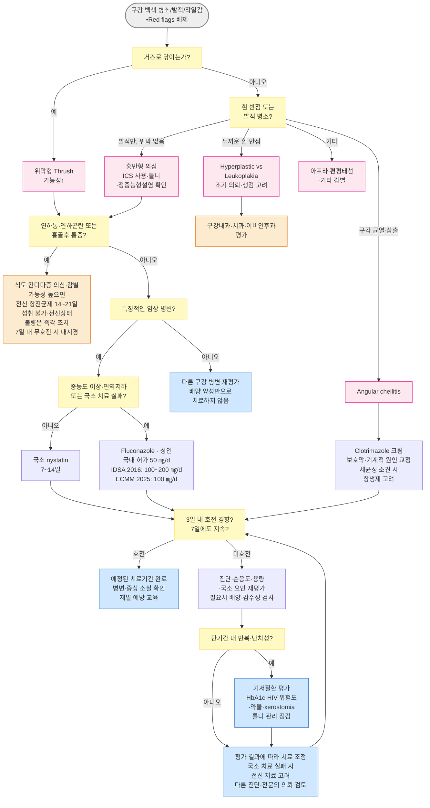

# 입안 칸디다증 Oral Candidiasis

## <mark style="color:green;">일반 사항</mark>

* 구강 점막의 표재성 진균 감염으로, 급성·만성 또는 반복적으로 발생
* 건강한 성인의 약 50%에서 _Candida_ 균이 구강 내 상재하며, 숙주 방어 기전이 손상될 때 발병
* 무증상 구강 집락은 치료하지 않지만, 특징적인 병변이 있는 임상적 구강 칸디다증은 위험 인자 교정과 함께 항진균제 치료가 일반적
* 연하통·연하곤란·흉골후 통증이 동반되면 식도 칸디다증 가능성 평가
* 재발성인 경우 기저 원인(HIV/AIDS, 당뇨병 조절 불량, 악성 종양 등) 평가 필요
* 치료 후 작열감·통증이 지속되면 burning mouth syndrome 등 다른 원인을, 병변이 지속되면 백반증·구강암 등을 감별

## <mark style="color:green;">원인 및 위험 인자</mark>

* 원인균 : _Candida albicans_ (대부분); 드물게 _C. glabrata_ (_Nakaseomyces glabratus_), _C. tropicalis_, _C. krusei_ (_Pichia kudriavzevii_) (☞ [칸디다 감염](../229_/174_-candida-infection.md))

#### <mark style="color:$primary;">구강 및 국소 인자</mark>

* 흡연, 불량한 구강 위생, 구강 건조증 (xerostomia)
* 틀니 (denture) : 세정 불량, 야간 착용 시 특히 위험 (biofilm 형성이 재발의 핵심 기전)
* 타액 분비 감소 : Sjögren syndrome, 두경부 방사선 치료, 항콜린제 복용
* 구각 입술염의 별도 소인 : 침 흘림과 구각의 지속적 습윤, 잘 맞지 않는 틀니·수직고경 저하, 철분·비타민 B2·B12·엽산 결핍 등

#### <mark style="color:$primary;">약물</mark>

* 광범위 항생제 (정상 구강 상재균 억제 → _Candida_ 과증식)
* 흡입 스테로이드(ICS) : 고용량, 부적절한 흡입법, 흡입 후 구강 세척을 하지 않는 경우 위험 증가
  * 기기 종류만으로 위험도를 일률적으로 순위화하지 않음
* 전신 스테로이드, 면역억제제, 항암제; IL-17 억제제도 구강·점막 칸디다증 위험을 높일 수 있음 <mark style="color:$info;">\[ECMM/ISHAM/ASM 2025]</mark>
  * 특히 IL-17A/F 이중 억제제 bimekizumab에서 구강 칸디다증이 흔하게 보고됨

#### <mark style="color:$primary;">전신 질환 및 면역 상태</mark>

* 당뇨병 (조절 불량 시), 심한 빈혈
* 악성 종양, 면역 저하 (HIV/AIDS, 장기이식 후)
* 영유아 (면역 체계 미성숙), 노인
  * 신생아 : 분만 시 산도 내 _Candid&#x61;_&#xC5D0; 노출되거나 수유 과정에서 모자 간 균이 공유될 가능성 고려

## <mark style="color:green;">임상 양상</mark>

* 구강의 여러 부위에 각기 다른 형태로 발생 가능

<table><thead><tr><th width="169">형태</th><th width="433">특징</th><th>주요 발생 부위</th></tr></thead><tbody><tr><td><strong>Thrush</strong><br>(위막형)</td><td>흰색 curdlike plaque; 거즈로 닦으면 제거되고 발적·점상출혈 노출</td><td>혀, 볼 점막, 구개</td></tr><tr><td><strong>Erythematous</strong><br>(홍반형)</td><td>얇고 beefy한 발적 병소; 백색 위막 없이 발적만 나타나 놓치기 쉬움; 자각 증상 뚜렷한 편<br>정중능형설염(Median Rhomboid Glossitis)은 Candida와 연관될 수 있으나 항상 감염을 의미하지는 않음; 혀 중앙 후방부의 마름모꼴 발적과 유두 소실이 지속되면 다른 병변 감별</td><td>혀 등쪽, 틀니 접촉 점막</td></tr><tr><td><p><strong>Angular cheilitis</strong></p><p>(구각 입술염)</p></td><td>구각의 균열·발적·삼출; Candida와 <em>S. aureus</em> 혼합 감염이 흔하나 침에 의한 maceration, 틀니·수직고경 문제, 접촉피부염, 영양 결핍 등 비감염성 원인도 평가</td><td>구각</td></tr><tr><td><p><strong>Hyperplastic form</strong></p><p>(증식형)</p></td><td>흰색 두꺼운 반점; 거즈로 제거 불가; leukoplakia와 외관상 구분하기 어려움. 이형성 병변 또는 기존 백반증에 Candida가 동반될 수 있고 악성 전환과의 연관성이 보고되어, 닦이지 않는 지속성 병변은 Candida가 검출되더라도 조직 생검 고려</td><td>볼 점막, 혀</td></tr></tbody></table>

<mark style="color:cyan;">**유발 인자와 임상형 관계**</mark>

* 항생제 복용 후 → Thrush (위막형) 또는 홍반형
* 흡입 스테로이드(구강 세척 불량) → 위막형 또는 홍반형
* 틀니 (야간 착용, 불량 세정) → Denture stomatitis (홍반형, 틀니 접촉 부위)
* 철분/비타민 B2·B12 결핍, drooling → Angular cheilitis
* 만성 흡연, 면역 저하 → Hyperplastic form

### <mark style="color:orange;">아구창 (Thrush)</mark>

* 증상 : 대부분 무증상; 경미한 불편감, 작열감, 쓴맛; 영아에서 보챔·수유 장애 가능
* 진단적 조작 : 거즈로 닦으면 제거되고, 노출된 점막에 발적·점상출혈·따가움 발생
  * 단, 거즈 제거 여부는 절대적 기준이 아님; 홍반형은 위막 없이 발적만, 증식형은 _Candida_ 감염이지만 제거되지 않음 → 비전형적 병소에서는 KOH 또는 조직 생검 고려
* 모유 수유 영아에서 아구창이 반복되고 수유모에게 유두 통증·발적이 있으면 모자를 함께 평가하되, 유두 통증을 칸디다증으로 단정하지 않고 수유 자세·외상·피부염·세균감염 등도 감별

### <mark style="color:$danger;">🚩 Red Flags!</mark>

<mark style="color:$danger;">**즉각 조치**</mark>

* 중심정맥관·호중구감소증·면역 저하(HIV 감염, 항암 치료 중, 장기이식 수혜자 등) 환자에서 고열·오한, 저혈압, 의식 변화 또는 호흡곤란  `칸디다혈증` `침습성 칸디다증` `패혈증`
* 연하통·연하곤란으로 수분·음식 섭취가 불가능하거나 전신상태 불량  `중증 식도 칸디다증` `탈수`

<mark style="color:$warning;">**당일\~수일 내 평가**</mark>

* 연하통·연하곤란 또는 흉골후 통증, 경구 섭취·전신상태는 안정  `식도 칸디다증` `기타 식도염`
* 뚜렷한 위험 인자 없이 발생한 구강 칸디다증 또는 체중 감소·반복 감염 등 면역 저하 단서  `HIV 감염` `혈액 악성 종양`
* 닦이지 않는 지속성 백색 병변, 경결·궤양·적백색 변화  `만성 증식성 칸디다증` `백반증` `구강암`

<mark style="color:$info;">**조기 평가 및 추적**</mark>

* 적절한 치료 7일에도 병변·증상 지속  `내성 Candida` `다른 구강 점막 질환`
* 단기간 내 재발 또는 반복·난치성 경과  `지속 위험 인자` `면역 저하`
* 모유 수유 영아의 반복 아구창과 수유모의 지속적 유두 병변·통증  `유두 칸디다증`

## <mark style="color:green;">진단</mark>

* 대부분 임상 진단; 특징적 병소와 거즈 닦기 조작으로 진단

#### <mark style="color:$primary;">검사</mark>

* KOH 현미경 검사 : 출아효모(budding yeast), 가성균사(pseudohyphae) 또는 균사 확인
  * atypical 또는 홍반형에서 유용
* 배양 및 감수성 검사 : 치료 실패, 재발성, 내성 의심 시
* Candida는 정상 상재균이므로 KOH·배양 양성만으로 감염을 확진하지 않고 임상 병변과 함께 해석
* 조직 생검 : Hyperplastic form에서 조직 내 Candida의 상피 침윤과 dysplasia 또는 leukoplakia 감별 시
  * 닦이지 않는 지속성 백색 병변, 경결·궤양·적백색 변화가 있으면 항진균제 반응만 기다리지 말고 생검 고려


**진단 실수 주의**

* **Leukoplakia를 candidiasis로 오진** : 거즈로 제거 여부를 확인하되, 닦이지 않는 병변은 조기 의뢰·생검 고려
* **홍반형 놓침** : ICS 사용 환자에서 백색 위막 없이 혀 발적만 나타날 수 있음; 정중능형설염은 Candida와 연관될 수 있으나 항상 칸디다 감염은 아님
* **Angular cheilitis를 herpes labialis로 오진** : herpes는 수포·딱지, angular cheilitis는 구각 균열·삼출
* **반복 칸디다증에서 기저 요인 미평가** : 단기간 내 재발·난치성 감염 시 당뇨병 위험, HIV 노출 위험과 다른 면역저하 단서를 바탕으로 필요한 검사를 개별화
* **Chlorhexidine + nystatin 동시 사용** : 시험관 연구에서 상호작용 가능성이 보고되어 혼합하거나 동시에 적용하는 것은 피함. 임상적 영향과 최적 투여 간격은 확립되지 않음 <mark style="color:$info;">\[Arch Oral Biol 2018; Clin Oral Investig 2022]</mark>


### <mark style="color:orange;">반복적·난치성 구강 칸디다증 평가</mark>

**Step 1. 치료 실패처럼 보이는 원인 및 투약 방법 확인**

* Nystatin 접촉 시간 부족, 조기 중단, 투여 용량·횟수 및 순응도 확인
* Chlorhexidine 병용 필요성과 적용 방법 확인
  * 동시 적용·혼합은 피하되, 이를 임상적 치료 실패의 원인으로 단정하지 않음

**Step 2. 국소 요인 교정**

* 틀니 야간 제거 + 소독 (biofilm 관리)
* 유지치료용 ICS 흡입 후 물로 입안을 헹구고 뱉는지 확인
* Xerostomia 교정

**Step 3. 전신 평가**

* 당뇨병 위험 또는 조절 불량이 의심되면 혈당·HbA1c 평가
* HIV 검사 : 노출 위험, 다른 임상 단서 및 환자 동의를 고려하여 시행
* 약물 검토 (항생제, 스테로이드)
* CBC → 호중구감소증 (악성 종양, 항암 치료)
* 드문 원인 : 만성 점막피부 칸디다증(Chronic Mucocutaneous Candidiasis, CMC) - STAT1 gain-of-function, AIRE/APECED, IL-17 경로 이상, CARD9 결함 등과 연관; 소아기부터 피부·구강·손발톱 칸디다증이 지속·반복되면 면역결핍 전문의 의뢰

**Step 4. 균종 확인** (위 단계로 해결 안 될 때)

* 배양·감수성 검사
* 균종명만으로 경험적 고용량 fluconazole을 투여하지 않으며, 감수성 결과와 병용약물·간신기능을 바탕으로 치료 선택
* fluconazole 불응 시 감염내과 협진하에 posaconazole 현탁액 <mark style="color:blue;">\[녹사필]</mark>(전액본인부담) 또는 voriconazole <mark style="color:blue;">\[브이펜드]</mark>(식도 칸디다증은 허가 적응증으로 타 항진균제 실패 시 급여 인정; 구강인두 칸디다증은 허가 외로 급여 인정 대상 아님) 등을 고려&#x20;
* 재발 억제요법 : 장기 억제요법은 통상 필요하지 않음
  * 위험 인자 교정과 적절한 치료에도 빈번하거나 중증인 재발이 지속되는 경우 감염내과 협진하에 fluconazole 100 ㎎ 주 3회 고려(허가 외); 내성·상호작용 위험을 함께 평가함
  * HIV 감염자는 ART를 통한 면역 재구성이 재발 예방의 핵심 <mark style="color:$info;">\[IDSA 2016; NIH OI 지침]</mark>

### <mark style="color:orange;">주요 구강 백색 병소 감별</mark>

<table data-search="false"><thead><tr><th width="131">항목</th><th>구강 칸디다증</th><th>백반증 (Leukoplakia)</th><th>구강 편평 태선</th></tr></thead><tbody><tr><td><strong>거즈로 닦임?</strong></td><td>✅ 닦임(thrush 한정); 증식형은 닦이지 않음</td><td>❌ 안 닦임</td><td>❌ 안 닦임</td></tr><tr><td><strong>표면 모양</strong></td><td>Curd-like, 불균일; 홍반형은 발적만</td><td>균일 또는 불균일한 흰 plaque</td><td>레이스형 Wickham 선조</td></tr><tr><td><strong>기저 점막</strong></td><td>닦으면 발적·점상출혈</td><td>병변 형태에 따라 다양</td><td>홍반·미란 동반 가능</td></tr><tr><td><strong>통증</strong></td><td>±; 홍반형은 통증↑</td><td>대개 없음</td><td>작열감·통증 흔함</td></tr><tr><td><strong>주요 위험 인자</strong></td><td>항생제, 스테로이드, DM, 면역 저하</td><td>흡연, 음주 등</td><td>자가면역, 약물</td></tr><tr><td><strong>전암 가능성</strong></td><td>위막형·홍반형은 전암병변으로 보지 않으나 만성 증식형은 이형성·악성 전환 가능성이 보고됨</td><td>⚠️ 있음</td><td>⚠️ 낮지만 있음; 위축·미란형에서 더 높음 - 정기 추적</td></tr><tr><td><strong>진단 방법</strong></td><td>임상 ± KOH; 증식형은 생검 고려</td><td>조직 생검 필요</td><td>조직 생검으로 확진</td></tr><tr><td><strong>치료 반응</strong></td><td>대개 항진균제에 반응</td><td>항진균제만으로 소실되지 않음</td><td>스테로이드 반응</td></tr></tbody></table>

***



<p align="center"><strong>구강 칸디다증 진단 및 치료 알고리듬</strong></p>

<p align="center"><em><mark style="color:$info;">저자 재구성 (참고 문헌 : IDSA 2016; ECMM/ISHAM/ASM 2025)</mark></em></p>

***

## <mark style="background-color:$warning;">Management</mark>

### <mark style="color:orange;">치료 방침</mark>

* 병변 없이 배양에서만 _Candid&#x61;_&#xAC00; 검출된 무증상 집락은 면역 상태와 관계없이 일률적으로 치료하지 않음
* 특징적인 구강 병변이 있으면 통증 유무와 관계없이 임상적 구강 칸디다증으로 보고 위험 인자 교정과 항진균제 치료 고려
* 경증, 면역 정상, 식도 증상 없음 → 국소 항진균제
* 중등도 이상, 국소 치료 실패 또는 면역 저하자 → 경구 fluconazole 우선 고려
* 연하통·연하곤란·흉골후 통증 → 식도 칸디다증을 의심하여 면역 상태·위험 인자와 다른 식도질환 가능성을 평가
  * 임상적으로 가능성이 높으면 경험적 전신 항진균 치료를 시행하고(국제 지침 14\~21일), 7일 이내 뚜렷한 호전이 없거나 비전형적이면 내시경 평가
  * 수분·음식 섭취 불가 또는 전신상태 불량은 즉각 조치 대상 <mark style="color:$info;">\[IDSA 2016]</mark>

#### <mark style="color:$primary;">국소 vs 전신 치료 선택 기준</mark>

<table><thead><tr><th width="76"></th><th>국소 항진균제</th><th>구강인두 칸디다증의 전신 치료</th><th>식도 칸디다증</th></tr></thead><tbody><tr><td><strong>대상</strong></td><td>경증, 면역 정상, 식도 증상 없음</td><td>중등도 이상, 면역 저하, 국소 치료 실패</td><td>연하통·연하곤란·흉골후 통증으로 식도 칸디다증이 의심되는 경우; 위험 인자와 감별 진단을 함께 평가</td></tr><tr><td><strong>약제</strong><br><strong>(성인)</strong></td><td>nystatin</td><td>•국내 허가: fluconazole 50 ㎎/d<br>•IDSA 2016: 중등도~중증 100~200 ㎎/d<br>•ECMM/ISHAM/ASM 2025: 100 ㎎/d</td><td>•국내 허가: fluconazole 50 ㎎/d(난치성 100 ㎎/d)<br>•IDSA 2016: 경구 200~400 ㎎/d; 경구 불가 시 정주 400 ㎎/d<br>•ECMM/ISHAM/ASM 2025: 경구 100~200 ㎎/d</td></tr><tr><td><strong>기간</strong></td><td>7~14일; 증상 소실 후에도 48시간 더 투여</td><td>7~14일</td><td>•국내 허가: 14~30일<br>•IDSA 2016 및 ECMM/ISHAM/ASM 2025: 14~21일</td></tr><tr><td><strong>추적</strong></td><td colspan="2">대개 48~72시간 내 호전 시작; 7일에도 지속되면 진단·순응도·용량·국소 요인 재확인 후 배양·감수성 검사 고려</td><td>7일 이내 뚜렷한 호전이 없으면 내시경 및 다른 식도염 감별</td></tr></tbody></table>

> 지침별 성인 권고 용량에 차이가 있으므로 출처를 구분하며, 국내 허가를 초과하는 용량은 허가·급여와 별도로 해석함 <mark style="color:$info;">\[IDSA 2016; ECMM/ISHAM/ASM 2025, 부록 pp 141\~144]</mark>

## <mark style="color:green;">비-약물 치료 및 예방</mark>

* 금연
* 구강 위생 개선 : 식사 후 칫솔질
  * chlorhexidine 가글이 별도로 필요한 경우 nystatin과 혼합하거나 동시에 적용하는 것은 피함. 임상적으로 검증된 최적 투여 간격은 확립되지 않음
* 틀니 관리
  * 취침 시 틀니 제거 - 야간 착용 금지 (biofilm 형성 및 denture stomatitis의 핵심 예방)
  * 틀니 재질과 제조사·치과 지침에 맞는 세정제를 사용
    * chlorhexidine 밤샘 침지를 모든 틀니에 일률적으로 적용하지 않음(변색·금속 부식 가능)
  * 필요시 틀니 표면에 nystatin 도포 고려
  * 잘 맞지 않는 틀니는 치과에서 재조정
* 영유아 : 젖병 꼭지·노리개젖꼭지를 매일 세척·소독
  * 수유모에게 유두 칸디다증이 임상적으로 의심되면 유두에 국소 항진균 크림을 병행하여 모자를 함께 치료
* [구강 건조증](056_-dry-mouth.md) 치료
* 흡입 스테로이드 사용자 :
  * 유지치료용 ICS 흡입 후 물로 입안을 충분히 헹구고 뱉음; 가능한 경우 가글을 함께 시행함 <mark style="color:$info;">\[GINA 2026]</mark>
  * 가압식 정량흡입기(pMDI) 사용자는 필요시 spacer를 사용하여 구강 내 침착 감소; DPI 등에는 적용하지 않음
  * 고용량 ICS가 필요한 경우 최소 유효 용량과 흡입법을 정기적으로 재평가
* 혈당 조절 : 당뇨병 환자에서 혈당 조절 개선이 재발 예방에 필수
* 영양 상태 개선 : Angular cheilitis 반복 시 철분, 비타민 B2·B12 결핍 여부 확인 및 보충
* 프로바이오틱스 : 임상적 유효성, 최적 균주·용량 및 면역저하자에서의 안전성이 확립되지 않아 구강 칸디다증의 routine 치료·예방으로 권고하지 않음

## <mark style="color:green;">약물 치료</mark>

### <mark style="color:orange;">국소 항진균제</mark>

* 국소 제제는 제형별 사용법을 따르며, 성인·협조 가능한 소아는 nystatin 현탁액을 구강 전체에 닿도록 한 뒤 가능한 한 오래 머금고 삼킴. 영아는 볼 안쪽에 소량씩 나누어 투여하며 목 뒤로 한꺼번에 넣지 않음
* 적응증 : 임상 병변이 확인된 경증; 식도 침범 증상이 없는 경우
* 치료 기간 : 통상 7\~14일이나 제제별 허가사항을 따르며, 임의로 조기 중단하지 않음


Miconazole 구강 겔과 clotrimazole 트로키는 해외 지침에 포함되지만 현재 국내 유통 제품이 확인되지 않음. 해외 제제를 사용할 때에는 miconazole의 영유아 질식 위험과 warfarin·sulfonylurea·DOAC·일부 CYP3A4 기질 약물과의 중대한 상호작용을 별도로 확인함


**Nystatin 현탁액**

* nystatin suspension 100,000 단위/㎖ <mark style="color:blue;">\[제이티니스타틴]</mark> (비급여)
  * 국내 허가사항 - 성인 및 24개월 이상 소아 : 1회 4\~6 ㎖를 1일 3\~4회; 삼키기 전에 가능한 한 오래 입안에 머물게 하고 증상 소실 후에도 48시간 더 투여
  * 국내 허가사항 - 생후 28일 이상\~24개월 미만 영아의 구강 칸디다증 : 1회 총 1\~2 ㎖를 1일 1\~4회 입에 떨어뜨림
  * 생후 28일 미만 신생아 : 위 영아 허가 용량의 대상에 포함되지 않으므로 해당 용량을 그대로 적용하지 않고 개별 평가
  * IDSA 2016 - 성인 4\~6 ㎖ qid ×7\~14d
* chlorhexidine 가글과의 상호작용은 시험관 연구 결과가 일관되지 않으며 임상적 영향이 확립되지 않음; 혼합·동시 적용은 피하되 특정 최소 간격을 확정적으로 제시하지 않음
* 당분이 함유되어 있으나 사용 직후 물로 헹구면 점막 접촉 시간이 감소하므로 즉시 헹구지 않음; 사용 후 약 30분간 음식·음료를 피하고 평소 구강 위생으로 충치 위험 관리 <mark style="color:$info;">\[NHS nystatin 복약 안내]</mark>
* 국내 공급 상황이 변동될 수 있으므로 처방 전 약국 재고 확인

**Clotrimazole 크림 - 구각 입술염**

* clotrimazole 크림 1% bid\~tid 국소 도포 <mark style="color:blue;">\[카네스텐]</mark>
* 침에 의한 maceration에는 petrolatum 또는 zinc oxide 등의 보호막제를 병행하고, 잘 맞지 않는 틀니·수직고경 등 기계적 원인을 교정
* 세균성 소견이 뚜렷하거나 항진균제 반응이 불량할 때 도말·배양을 고려하고 mupirocin 또는 fusidic acid 크림을 선택적으로 추가 또는 교체
* 재발성인 경우 병력에 따라 CBC, ferritin/iron, vitamin B12, folate 등을 선택적으로 평가

### <mark style="color:orange;">전신 항진균제</mark>

* 적응증 : 중등도 이상, 국소 치료 반응 불량, 면역 저하자 또는 식도 침범 의심

<mark style="color:cyan;">**Fluconazole**</mark>

* 1차 선택제
* 구강인두 칸디다증
  * 국내 허가사항 : fluconazole 50 ㎎ PO qd ×7\~14d <mark style="color:blue;">\[푸루나졸]</mark>
  * IDSA 2016 : 중등도\~중증에서 fluconazole 100\~200 ㎎ PO qd ×7\~14d <mark style="color:$info;">\[IDSA 2016]</mark>
  * ECMM/ISHAM/ASM 2025 : fluconazole 100 ㎎ PO qd를 강하게 권고 <mark style="color:$info;">\[ECMM/ISHAM/ASM 2025, 부록 p 142]</mark>
* 의치 관련 만성 위축성 구강칸디다증
  * 국내 허가사항 : fluconazole 50 ㎎ PO qd ×14d + 의치 소독 병행
* 식도 칸디다증
  * 국내 허가사항 : fluconazole 50 ㎎ PO 또는 IV qd ×14\~30d; 난치성 점막 칸디다증은 100 ㎎/d로 증량 가능
  * IDSA 2016 : fluconazole 200\~400 ㎎ PO qd ×14\~21d; 경구 투여가 불가능하면 400 ㎎ IV qd 또는 정주 echinocandin 고려 <mark style="color:$info;">\[IDSA 2016]</mark>
  * ECMM/ISHAM/ASM 2025 : fluconazole 100\~200 ㎎ PO qd ×14\~21d; 경구 투여가 불가능하면 정주 항진균제 사용 <mark style="color:$info;">\[ECMM/ISHAM/ASM 2025, 부록 p 144]</mark>
  * NIH OI 지침(HIV 감염자) : 첫날 200 ㎎ 후 100\~200 ㎎(최대 400 ㎎) PO 또는 IV qd ×14\~21d; echinocandin은 fluconazole보다 재발률이 높게 보고됨 <mark style="color:$info;">\[NIH OI 지침]</mark>
* 소아 (국내 허가사항, 1일 최대 400 ㎎)
  * 생후 6개월 미만 영아는 안전성·유효성이 확립되지 않았으므로, 아래 용량을 일률적으로 적용하지 않고 투여가 꼭 필요한 경우에 한해 개별 판단
  * 구강인두 칸디다증 : 첫날 6 ㎎/㎏, 이후 3 ㎎/㎏ qd; 재발 방지를 위해 최소 2주
  * 식도 칸디다증 : 첫날 6 ㎎/㎏, 이후 3 ㎎/㎏ qd, 반응에 따라 12 ㎎/㎏까지 증량; 최소 3주이면서 증상 소실 후 2주
* 반복 투여 시 신기능에 따라 용량 또는 투여 간격 조절; 간질환, QT 연장 위험 및 warfarin·sulfonylurea·phenytoin·일부 statin 등 병용약물 확인
* 국내 허가상 금기 : 임부 또는 임신하고 있을 가능성이 있는 여성 및 수유부. 가임 여성은 투여기간 및 마지막 투여 후 약 1개월간 피임(푸루나졸 국내 허가사항 기준)
* 임신 중 구강 칸디다증은 국소 치료 우선; 임신 초기 경구 fluconazole 노출과 자연유산 위험 증가의 연관성이 보고됨. 국내 금기와 국제 지침의 치료 권고를 구분함 <mark style="color:$info;">\[JAMA 2016; NIH OI 지침]</mark>
* ✽국제 지침 용량은 국내 허가 용량을 초과할 수 있어, 해당 용량의 허가·급여 적용 여부를 별도로 구분함

<mark style="color:cyan;">**Posaconazole 현탁액**</mark>

* 2차 선택; fluconazole 불응 또는 중증·면역 저하로 국소 치료 효과가 낮을 것으로 예상되는 경우
* 구강인두 칸디다증 허가사항 : 첫날 200 ㎎(5 ㎖) qd, 이후 100 ㎎(2.5 ㎖) qd ×13d <mark style="color:blue;">\[녹사필]</mark>&#x20;
  * 허가 적응증이나 [급여기준](https://www.hira.or.kr/rc/insu/insuadtcrtr/InsuAdtCrtrPopup.do?mtgHmeDd=20250701\&sno=2\&mtgMtrRegSno=0018)상 칸디다감염 치료는 인정 대상이 아니어서 약값 전액 본인부담(침습성 진균감염 예방 일부만 급여)
* 국제 지침 : fluconazole 불응 시 400 ㎎ bid ×3d 후 400 ㎎ qd, 최대 28일 (허가 외) <mark style="color:$info;">\[IDSA 2016]</mark>
* 흡수를 위해 반드시 식사 또는 경구 영양보충제와 함께 복용
* 현탁액(40 ㎎/㎖)과 장용정은 용법·흡수가 달라 동일 용량으로 임의 교체하지 않음
* 강력한 CYP3A4 억제제임. 병용약물(일부 statin, 면역억제제, 항부정맥제 등)과 QT 연장 위험을 확인하고, 반복 난치성·면역저하자는 감염내과 협진하에 사용


_Candida auri&#x73;_&#xC758; 내성·의료기관 감염관리와 무증상 집락의 원칙은 칸디다 감염 총론 참조 (☞ [칸디다 감염](../229_/174_-candida-infection.md))


***

## <mark style="color:red;">질병코드</mark>

* B37.0 칸디다구내염 Candidal stomatitis
* B37.80 칸디다식도염 Candidal esophagitis

***

## <mark style="color:purple;">처방례</mark>

> **처방례 1. 경증 아구창 - Nystatin 현탁액**
>
> ```
> 제이티니스타틴시럽 100,000 단위/㎖   1회 5 ㎖   가능한 오래 머금은 후 삼킴   qid ×14d
> ```
>
> _✽성인 처방례. 식후 사용하고 가능한 오래 머금은 뒤 삼킴. 사용 직후 물로 헹구지 않고 약 30분간 음식·음료를 피함. 증상 소실 후에도 48시간 더 투여하도록 치료 종료 시점을 확인함. Chlorhexidine 가글과 혼합·동시 적용은 피하되, 임상적으로 검증된 최적 간격은 확립되지 않음._

> **처방례 2. 구각 입술염 (Angular cheilitis)**
>
> ```
> 카네스텐크림 1%   적량   구각 bid~tid 도포 ×14d
> ```
>
> _✽침에 의한 짓무름에는 보호막제를 병행하고, 틀니 관련 시 세정·야간 제거 및 필요시 치과 조정을 시행. 세균성 소견이 뚜렷하거나 반응 불량 시 mupirocin 또는 fusidic acid 크림을 선택적으로 추가 또는 교체. 재발 반복 시 병력에 따라 CBC, ferritin/iron, vitamin B12, folate 등을 평가._

> **처방례 3. 중등도 이상 또는 국소 치료 실패 - 전신 항진균제**
>
> ```
> 푸루나졸캡슐 50 ㎎   1캡슐   qd ×7~14d
> ```
>
> _✽성인 국내 허가 용법. IDSA 2016은 중등도\~중증 구강인두 칸디다증에 100\~200 ㎎/d ×7\~14일, ECMM/ISHAM/ASM 2025는 100 ㎎ qd를 권고함. 임부 또는 임신하고 있을 가능성이 있는 여성 및 수유부는 투여 금기. 연하통·연하곤란·흉골후 통증이 있으면 식도 칸디다증으로 별도 평가. 치료 실패 시 진단·순응도·용량 재확인 후 배양·감수성 검사 및 필요시 감염내과 협진._

***

### <mark style="color:$success;">핵심 복약 지도</mark>

> **Nystatin 현탁액 사용법**
>
> 1. 사용 전 반드시 **잘 흔들어** 주세요.
> 2. 성인과 머금을 수 있는 소아는 처방된 양을 입 안 좌우로 나누어 넣고 구강 전체에 닿도록 한 뒤 **가능한 한 오래 머금은 후** 삼키세요. 영아는 볼 안쪽에 소량씩 나누어 넣고 목 뒤로 한꺼번에 넣지 마세요.
> 3. 식후에 사용하고, 사용 직후 물로 헹구지 마세요. 사용 후 약 30분간 음식·음료를 피하세요.
> 4. **Chlorhexidine 가글(헥사메딘)과 섞거나 동시에 사용하지 마세요.** 두 약을 함께 처방받았다면 사용 순서와 시간을 의료진에게 안내받으세요.
> 5. **처방된 기간을 완료**하세요. 증상이 완전히 사라진 뒤에도 48시간 더 사용할 수 있도록, 증상이 늦게 없어지면 치료 종료 시점을 의료진과 확인하세요.

> **Fluconazole (푸루나졸) 복약 안내**
>
> 1. 1일 1회, **같은 시간대**에 복용하세요.
> 2. 간 독성이 드물게 발생할 수 있습니다 - 황달, 진한 소변, 극심한 피로감 발생 시 즉시 내원하세요.
> 3. 다른 약물과의 상호작용이 많으므로, 복용 중인 **모든 약(혈압약, 혈당약 포함)을 의사에게 알려**주세요.
> 4. 임신 중이거나 임신 가능성이 있는 분, 수유 중인 분은 복용 전에 반드시 알리세요. 푸루나졸은 국내 허가상 이 경우 투여 금기입니다. 가임 여성은 복용 기간과 마지막 복용 후 약 1개월간 피임하세요.

> **흡입 스테로이드 사용자를 위한 안내**
>
> * 유지치료용 흡입 스테로이드 사용 후에는 **물로 입안을 충분히 헹구고 뱉으세요**. 가능한 경우 가글을 함께 하세요.
> * 가압식 정량흡입기(pMDI)를 사용하는 분은 필요시 spacer(흡입 보조기구)를 사용하면 입 안에 약이 덜 쌓입니다. DPI 등 다른 흡입기에는 연결하지 않습니다.

> **언제 다시 병원을 방문해야 하나요?**
>
> * 치료 3일 내 호전되는 경향이 없거나 7일 후에도 증상·병변이 지속되는 경우
> * **삼킬 때 통증이 있거나 흉골 뒤쪽이 쓰리고 아픈 경우** - 즉시 내원 (식도 칸디다증 의심)
> * 발열, 전신 쇠약감이 동반되는 경우 - 즉시 내원
> * 치료 후 단기간 내 다시 생기거나 반복적으로 재발하는 경우

***

## <mark style="color:green;">주요 참고문헌 및 확인 자료</mark>

### <mark style="color:orange;">임상 근거</mark>

* Pappas PG, et al. Clinical Practice Guideline for the Management of Candidiasis: 2016 Update by the Infectious Diseases Society of America. Clin Infect Dis. 2016;62(4):e1-e50. [원문](https://pmc.ncbi.nlm.nih.gov/articles/PMC4725385/)
* Cornely OA, et al. Global guideline for the diagnosis and management of candidiasis: an initiative of the ECMM in cooperation with ISHAM and ASM. Lancet Infect Dis. 2025;25(5):e280-e293. - 구강인두·식도 칸디다증은 부록 pp 141\~144 참조. [서지](https://pubmed.ncbi.nlm.nih.gov/39956121/)
* Scheibler E, et al. Stability and efficacy of combined nystatin and chlorhexidine against suspensions and biofilms of Candida albicans. Arch Oral Biol. 2018;89:70-76. doi:10.1016/j.archoralbio.2018.02.009. - 시험관 연구; 임상적으로 검증된 최소 투여 간격을 제시하는 근거는 아님. [서지](https://pubmed.ncbi.nlm.nih.gov/29477025/)
* Baldino MEL, et al. Nystatin effect on chlorhexidine efficacy against Streptococcus mutans as planktonic cells and mixed biofilm with Candida albicans. Clin Oral Investig. 2022;26(1):633-642. doi:10.1007/s00784-021-04041-0. - 시험관 연구; 병용 상호작용의 임상적 영향은 미확립. [서지](https://pubmed.ncbi.nlm.nih.gov/34160701/)
* National Institutes of Health. Guidelines for the Prevention and Treatment of Opportunistic Infections in Adults and Adolescents With HIV. Candidiasis (Mucocutaneous). - 빈번하거나 중증인 재발에서의 선택적 억제요법 및 임신 중 치료 원칙. [지침](https://clinicalinfo.hiv.gov/en/guidelines/hiv-clinical-guidelines-adult-and-adolescent-opportunistic-infections/candidiasis)
* Global Initiative for Asthma. Summary Guide for Asthma Management and Prevention. 2026. - 유지치료용 ICS 사용 후 구강 세척과 pMDI의 spacer 사용. [자료](https://ginasthma.org/2026-gina-summary-guide/)
* NHS. How and when to take or use nystatin. - 구강 현탁액 사용 후 약 30분간 음식·음료 회피. [복약 안내](https://www.nhs.uk/medicines/nystatin/how-and-when-to-take-or-use-nystatin/)
* Mølgaard-Nielsen D, et al. Association Between Use of Oral Fluconazole During Pregnancy and Risk of Spontaneous Abortion and Stillbirth. JAMA. 2016;315(1):58-67. [서지](https://pubmed.ncbi.nlm.nih.gov/26746458/)

### <mark style="color:orange;">허가·급여 확인 자료</mark>

* [식품의약품안전처. 의약품안전나라 - 의약품 품목허가정보.](https://nedrug.mfds.go.kr/index) - 국내 제품별 적응증·용법·금기 및 허가 상태 확인
* 건강보험심사평가원. \[일반원칙] 항진균제. - Posaconazole의 침습성 진균감염 예방 및 항진균제별 급여 인정 범위. [급여기준](https://www.hira.or.kr/rc/insu/insuadtcrtr/InsuAdtCrtrPopup.do?mtgHmeDd=20250701\&sno=2\&mtgMtrRegSno=0018)

***

## <mark style="color:blue;">환자 안내서</mark>


**입안 칸디다증은 치료 가능한 진균 감염입니다**

건강한 분도 입 안에 칸디다 균이 살고 있습니다. 면역력이 떨어지거나 항생제 복용, 구강 건조, 틀니 문제 등의 상황이 되면 이 균이 과도하게 증식해 증상을 일으킵니다. 대부분 간단한 치료와 생활 교정으로 낫습니다.


#### <mark style="color:$primary;">왜 입안 칸디다증이 생기나요?</mark>

* 항생제를 복용한 후 (정상 세균이 줄면 칸디다가 증식합니다)
* 흡입용 스테로이드 약을 쓰는 분 (흡입 후 입안을 헹구지 않으면 약이 남아 칸디다증 위험이 높아질 수 있습니다)
* 틀니를 사용하는 분 (특히 세정이 불량하거나 밤에도 끼는 경우)
* 당뇨병이 조절되지 않는 분
* 철분이나 비타민이 부족한 분 (특히 구각 병변 반복 시)
* 면역력이 저하된 분

#### <mark style="color:$primary;">일상생활에서 어떻게 관리하나요?</mark>

* **금연**하십시오.
* 식사 후 **칫솔질**을 철저히 하십시오. Nystatin과 chlorhexidine 가글을 함께 처방받았다면 섞거나 동시에 사용하지 말고 의료진이 안내한 방법을 따르십시오.
* 틀니는 **밤에 빼서** 세정하고, 물에 담가 두는지 등 보관 방법은 틀니 재질과 치과 지시에 따르십시오 - 밤새 틀니를 끼고 있으면 균이 번식하기 쉽습니다.
* 유지치료용 흡입 스테로이드 사용 후에는 **물로 입안을 충분히 헹구고 뱉으십시오**. 가능한 경우 가글을 함께 하십시오.
* 당뇨병이 있으시면 **혈당 관리**에 특히 신경 쓰십시오.
* 아기에게 생긴 경우 **젖병 꼭지와 노리개젖꼭지(쪽쪽이)를 매일 세척·소독**하십시오. 모유 수유 중 엄마의 유두가 아프거나 붉어지면 함께 진료를 받으십시오.

#### <mark style="color:$primary;">약은 어떻게 사용하나요?</mark>

* Nystatin 액체약은 성인과 머금을 수 있는 소아의 경우 입 안 전체에 닿도록 한 뒤 **가능한 한 오래 머금고** 삼키세요. 영아는 볼 안쪽에 소량씩 나누어 넣고 목 뒤로 한꺼번에 넣지 마세요.
* Nystatin 사용 직후에는 물로 헹구지 않고 약 30분간 음식·음료를 피하세요.
* 증상이 나아도 **처방받은 기간을 끝까지** 사용하세요. Nystatin은 증상이 사라진 후에도 48시간 더 사용하므로, 증상이 늦게 없어지면 치료 종료 시점을 의료진과 확인하세요.
* Chlorhexidine 가글을 함께 처방받으셨다면 nystatin과 **섞거나 동시에 사용하지 말고** 의료진이 안내한 사용 순서와 시간을 따르세요.

#### <mark style="color:$primary;">이럴 때는 즉시 병원을 방문하세요</mark>

* **음식을 삼킬 때 통증이 있거나** 가슴(흉골 뒤쪽)이 쓰리고 아픈 경우
* 발열이나 전신 쇠약감이 동반되는 경우
* 치료 3일 내 좋아지는 경향이 없거나 7일 후에도 증상·병변이 지속되는 경우
* 흰 반점이 닦아도 지워지지 않거나 점점 커지는 경우
