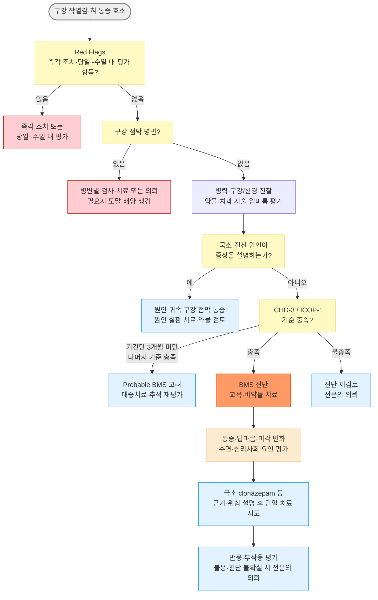

# 혀 통증·구강 작열통 Glossodynia·Burning Mouth Syndrome, BMS

## <mark style="color:green;">일반 사항</mark>

* 혀 통증·구강 작열감은 증상이며, 국소·전신 원인을 확인할 수 없고 진단 기준을 충족할 때 구강작열감증후군(Burning Mouth Syndrome, BMS)으로 진단
* BMS : 원인을 설명할 만한 구강 점막 병변이나 국소·전신 질환 없이 발생하는 만성 구강 내 작열감 또는 이상감각
* 과거 명칭 : stomatodynia, glossodynia(혀에 국한된 경우); oral dysaesthesia는 통증 이외의 이상감각까지 포함하는 더 넓은 표현
* 정의 (ICHD-3 2018 / ICOP-1 2020) : 구강 점막에서 매일 2시간 초과, 3개월 초과 지속되는 표재성 작열통; 혀뿐 아니라 입술·구개·잇몸 등 구강 점막 어디서든 발생 가능
* 증상 : 혀(특히 혀 끝·혀 앞쪽 2/3)에 가장 흔하며, 구개·잇몸·입술로 확산되기도 함; 미각 변화(쓴맛·금속 맛), 입마름 동반 多
* 유병률 : 일반 인구 약 1.7%, 진료 환경 약 7.7%(메타분석), 연구 정의에 따라 편차가 큼; 중년 이후 여성, 특히 폐경 후 여성에서 흔함(보고된 남녀비 약 1 : 3\~1 : 7)
* 경과 : 증상이 일부 호전될 수 있으나 장기 지속이 흔하고 완전한 자연 관해는 드묾(한 후향적 연구에서 5년 이내 약 3%)

## <mark style="color:green;">원인 및 분류</mark>

### <mark style="color:orange;">BMS</mark>

* 국소·전신 원인으로 설명되지 않는 특발성 만성 구강안면 통증; 신경병증성·통각변조성 기전, 내분비 및 심리사회적 요인이 복합적으로 관여하는 것으로 추정
* ICOP-1은 정량감각검사(QST) 시행 시 **체성감각 변화 있음/없음**으로 세분할 수 있음
* 아래 Type I\~III는 증상의 일중 변동을 기술한 고전적 분류로, 병태생리나 약제 선택을 확정하는 분류가 아님
* Type III처럼 증상 없는 날이 반복되는 경우에는 현행 BMS 진단기준의 매일 반복되는 증상 요건 충족 여부를 별도로 판단함

<table><thead><tr><th width="146">고전적 패턴</th><th width="250">증상 양상</th><th>해석</th></tr></thead><tbody><tr><td>Type I</td><td>기상 시 없거나 경미 → 하루 중 점진적 악화</td><td rowspan="3">증상 기술에 참고하되 원인·기전 또는 치료를 직접 결정하지 않음</td></tr><tr><td>Type II</td><td>깨어 있는 동안 거의 지속</td></tr><tr><td>Type III</td><td>간헐적, 증상 없는 날이 있음</td></tr></tbody></table>

### <mark style="color:orange;">원인이 확인된 구강 작열감</mark>

* 구강 국소·전신 질환이나 약물로 설명되는 구강 작열감은 BMS가 아니라 해당 원인에 귀속된 구강 점막 통증으로 분류
* 과거 문헌의 ‘secondary BMS’에 해당하나, ICOP-1에서는 이 용어를 사용하지 않음

**관련 인자**

* 전신 질환 : 당뇨병, 갑상선 질환, 빈혈, Sjögren 증후군 등
* 영양 결핍 : Vit B군(B1·B2·B6·B12), 엽산, 아연, 철분
* 구강 질환 : 구강 칸디다증, 입마름증, 지도상 혀, 구강 편평태선
* 역류 질환 : GERD/LPR와 연관성이 보고되지만 인과관계가 확립된 것은 아님; 전형적 증상이나 위험 인자가 있을 때 평가
* 구강 이상기능(oral parafunction) : 혀를 구개·치아에 누르거나 비비는 습관, 이 악물기·이갈이 등 반복적 기계 자극
* 신경병증 : 대상포진 후 신경통, 외상·치과 시술 후 설신경 또는 삼차신경병증
* 감염 후 이상감각 : COVID-19 감염 후를 포함한 사례가 보고되나 빈도와 인과관계는 불확실
* 접촉 자극 : 틀니·치과 재료(아말감), 치약(SLS 계면활성제), 구강 세정제(알코올), 맵고 뜨거운 음식
* 약물 : ACEI 등 일부 항고혈압제, 항히스타민제, 항콜린제, 이뇨제 등; 약물 시작·증량과 증상 발생의 시간적 관계를 확인
* 기타 : 방사선 치료 후, 접촉 알레르기, 흡연·니코틴
* 불안·우울·수면장애·건강염려는 흔한 동반 질환 또는 통증 증폭 요인이지만, 그 자체만으로 BMS를 배제하거나 원인으로 단정하지 않음

## <mark style="color:green;">임상 양상</mark>

* 구강 내 작열감, 따끔거림, 화끈거림 - 혀 끝이 가장 흔하고 입천장·입술·잇몸으로 확산
* 미각 변화 : 쓴맛, 금속 맛, 미각 감소
* 입마름 호소 - 실제 타액 분비량은 정상인 경우가 많음
* 식사 중 일시적으로 호전되는 경우가 있으나 진단 기준이나 단독 감별 소견은 아님
* 불안·우울·수면장애 동반 빈도가 높으므로 별도로 평가
* 구강 점막 : 육안 및 촉진상 정상이어야 함 - 병변이 있으면 다른 원인을 평가

### <mark style="color:$danger;">🚩 Red Flags!</mark>

<mark style="color:$danger;">**즉각 조치**</mark>

* 급속히 진행하는 혀·구강저 부종, 호흡곤란, 협착음, 침 흘림, 청색증  `기도폐쇄` `아나필락시스` `혈관부종`
* 고열·독성 외관과 함께 구강저 종창, 혀의 상방 변위, 개구장애, 연하곤란  `심부경부감염` `Ludwig angina`
* 갑자기 발생한 편측 얼굴 감각 저하, 구음장애·편측 마비·의식 변화 등 급성 신경학적 이상  `뇌졸중`
* 최근 약물 시작 후 발열·급속한 피부발진·피부박리와 구강·안구 등 다발성 점막 미란이 동반되거나 안구 통증·시력 변화가 있음  `Stevens-Johnson 증후군` `독성 표피괴사용해`
* 50세 이상에서 새로 발생한 혀 통증과 씹을 때 턱·혀 파행, 새로운 두통, 측두동맥 압통, 시력 변화  `거대세포동맥염`

<mark style="color:$warning;">**당일\~수일 내 평가**</mark>

* 지속·진행하는 연하곤란 또는 연하통, 설명되지 않는 체중 감소, 경부 종괴  `두경부암`
* 기간과 무관하게 경결·종괴·쉽게 출혈하는 병변·의심스러운 적백색 변화  `구강암` `구강 잠재적 악성 질환`
* 원인 불명 궤양 또는 백색·붉은 병변이 2주 이상 지속  `구강암` `구강 편평태선`
* 수일\~수주에 걸쳐 새로 발생·진행한 편측 혀 통증과 안면·혀 감각 저하, 뇌신경 이상  `삼차신경병증` `신경 침범 종양`
* 지속되는 구강 수포·미란, 피부·안구 병변 동반  `자가면역 수포성 질환`

<mark style="color:$info;">**조기 평가 및 추적**</mark>

* 닦이는 백태, 국소 홍반·유두 위축  `구강 칸디다증`
* 적절한 평가·치료에도 증상이 지속되거나 진단이 불확실함  `놓친 국소·전신 원인` `난치성 BMS`
* 중등도 이상의 불안·우울, 수면장애 또는 현저한 일상기능 저하  `우울장애` `불안장애` `불면증`
* 약물 시작·증량과 시간적으로 관련된 증상 발생  `약물 유발 구강 작열감`

## <mark style="color:green;">진단</mark>

### <mark style="color:orange;">진단 기준 \[ICHD-3]</mark>

* A. 구강 통증이 B와 C를 충족
* B. 매일 반복되며 하루 2시간 초과, 3개월 초과 지속
* C. 다음 2가지 모두 : ① 작열성 ② 구강 점막 표면에서 느낌
* D. 구강 점막의 외관이 정상이고 감각검사를 포함한 임상 진찰이 정상
* E. 다른 ICHD-3 진단으로 더 잘 설명되지 않음


**진단은 배제 진단(diagnosis of exclusion)** : 병력·구강 진찰과 임상적으로 필요한 검사를 통해 원인을 설명할 국소·전신 질환을 배제한 후 BMS로 진단. 원인이 확인되면 BMS가 아니라 해당 원인에 귀속된 구강 점막 통증으로 진단함.\
✽ICOP-1에서는 기간만 3개월 미만이고 다른 기준을 충족하면 probable BMS로 분류할 수 있으며, QST를 시행한 경우 체성감각 변화 유무를 세분함. ICHD-3는 임상 감각진찰이 정상일 것을 요구하지만, ICOP-1은 전문 감각검사에서 체성감각 변화가 있는 아형도 인정함. QST 이상만으로 외상성 삼차신경병증을 진단하지 않고, 외상력·치과 시술력과 신경 해부학적 분포를 함께 판단함. <mark style="color:$info;">\[ICHD-3 2018; ICOP-1 2020]</mark>



**2026년 최신 지견** : 기존 ICHD-3·ICOP-1·ICD-11·WCOM 기준을 비교 검증한 연구에서 어느 기준도 민감도와 특이도가 모두 높지 않았음. 수정 ICOP 기준(양측성, 하루 6시간 이상, 3개월 이상; 정상 점막을 필수 조건으로 두지 않으나 통증을 설명하는 국소·전신 원인 배제는 필요)이 제안됨(민감도 94%, 특이도 약 79%). BMS 34명을 포함한 소규모 연구이며, 같은 자료로 기준을 개발·평가하고 진단 정확도 계산에는 증상 기준 A\~C만 포함하여 원인 배제 등 D\~E는 포함하지 않은 한계가 있음. 공식 ICHD-3/ICOP-1 개정을 의미하지 않으며, 외부 검증 전에는 기존 공식 기준을 사용함. <mark style="color:$info;">\[El-Rubaiy 2026]</mark>


### <mark style="color:orange;">검사</mark>

**기본 평가**

* 병력 : 통증 위치·양측성·성격·강도·지속시간·일중 변동, 미각 변화·입마름, 음식과의 관계, 동반 질환, 약물 시작·증량 시점, 흡연·음주, 틀니·치과 시술·외상력
* 구강 진찰 : 충분한 조명 아래 혀의 배면·측면·복면, 구강저, 협점막, 잇몸, 구개를 시진·촉진; 경결·궤양·백반·홍반·칸디다 소견, 침 분비, 치아·보철물 및 틀니 적합도 확인
* 신경학적 진찰 : 안면·혀의 촉각·통각·온도감각, 뇌신경 이상을 좌우 비교; 이상 소견이 있으면 삼차신경병증 등 별도 진단 평가
* 통증 및 동반 증상 : NRS/VAS로 기준 통증을 기록하고, 필요시 PHQ-9/GAD-7 또는 PHQ-4로 우울·불안을 선별

**혈액 검사 (병력·진찰과 임상 상황에 따라 선택)**

* CBC, ferritin ± serum iron/TIBC 또는 transferrin saturation
* 공복혈당 또는 HbA1c
* Vit B12, 엽산; 식이·흡수장애 위험 또는 임상적으로 의심될 때 아연 등
* 갑상선 질환이 의심되면 TSH ± free T4

**확장 검사 (의심 질환에 따라)**

* ANA, anti-SSA/SSB - 객관적 입마름·안구건조, 타액선 종대 등 Sjögren 증후군 의심 시
* Sialometry - 객관적 타액 감소 확인 필요시; 비자극 전타액 ≤0.1 ㎖/min, 자극 전타액 ≤0.5\~0.7 ㎖/min이면 저하
* 구강 도말·배양 - 임상적으로 칸디다증이 의심되거나 치료 반응이 불분명할 때; Candida 검출만으로 감염을 확진하지 않음
* 알레르기 패치 검사 - 특정 치과 재료·치약·향료 노출 부위와 증상의 관련성이 의심될 때
* 내시경·역류검사 - 전형적 역류 증상, 경고 증상 또는 치료 불응 등 별도 적응증이 있을 때
* 생검 - 경결·종괴·쉽게 출혈하는 병변·의심스러운 적백색 변화는 기간과 무관하게 신속히 전문 평가; 원인 불명 궤양·백색 또는 붉은 병변이 2주 이상 지속하거나 편평태선·자가면역 수포성 질환 등이 의심되면 전문의 판단에 따라 시행


Clonazepam이나 국소마취제에 대한 반응은 BMS를 확진하거나 말초·중추 신경병증을 구분하는 진단검사가 아님. 반응 여부만으로 원인을 재분류하지 않음.


### <mark style="color:orange;">감별</mark>

**BMS, 타액분비저하, 삼차신경통 감별**

<table><thead><tr><th width="119">구분</th><th>BMS</th><th>타액분비저하</th><th>삼차신경통</th></tr></thead><tbody><tr><td>통증 성격</td><td>타는 듯 지속</td><td>건조·따끔, 구강 기능 불편</td><td>전기 쇼크형 발작</td></tr><tr><td>식사 영향</td><td>일부에서 일시 호전</td><td>마른 음식 섭취·연하 불편</td><td>씹기·말하기·세수 등으로 유발 가능</td></tr><tr><td>시간 양상</td><td>매일 장시간; 강도 변동</td><td>원인·수분 상태에 따라 변동</td><td>1초 미만\~2분의 반복 발작</td></tr><tr><td>타액 분비</td><td>정상인 경우가 많음</td><td>객관적으로 감소</td><td>정상</td></tr><tr><td>구강 소견</td><td>정상</td><td>건조·끈적한 점막, 치아우식·칸디다증 동반 가능</td><td>정상</td></tr></tbody></table>

**추가 감별**

<table><thead><tr><th width="185">질환</th><th>감별 포인트</th></tr></thead><tbody><tr><td>구강 칸디다증</td><td>닦이는 백색 위막 또는 국소 홍반·유두 위축; 흡입 스테로이드, 항생제, 틀니, 면역저하 등 위험 인자</td></tr><tr><td>구강 편평태선·태선양 병변</td><td>망상성 백색선조, 홍반·미란; 필요시 생검</td></tr><tr><td>지도상 혀·위축성 설염</td><td>경계가 분명한 이동성 탈유두 병변 또는 매끈하고 붉은 혀; 영양결핍 등 평가</td></tr><tr><td>접촉 구내염</td><td>치과 재료·치약·향료 노출 부위와 증상의 시간적·해부학적 관련성</td></tr><tr><td>Sjögren 증후군</td><td>안구건조, 객관적 타액 감소, 타액선 종대; anti-SSA/SSB 등</td></tr><tr><td>외상성 삼차·설신경병증</td><td>치과 시술·외상 후 편측 지속통과 감각 저하 또는 이질통</td></tr><tr><td>삼차신경통</td><td>삼차신경 분포의 짧은 전기 쇼크형 편측 발작과 유발점</td></tr><tr><td>설인신경통</td><td>혀 뒤쪽·편도와·인두·귀 부위의 짧고 심한 편측 발작성 통증; 삼키기·말하기·기침 등으로 유발</td></tr><tr><td>지속특발안면통</td><td>구강 점막에 국한되지 않고 신경 분포를 따르지 않는 지속성 안면통</td></tr></tbody></table>

***



<p align="center"><strong>혀 통증·BMS 진단 및 치료 알고리듬</strong></p>

<p align="center"><em><mark style="color:$info;">저자 재구성 (참고 문헌 : ICHD-3 2018; ICOP-1 2020; Currie 2021; El-Rubaiy 2026)</mark></em></p>

***

## <mark style="background-color:$warning;">Management</mark>

### <mark style="color:orange;">치료 방침</mark>

* BMS : 진단과 양성 경과를 설명하고 완치보다 통증·기능·수면·삶의 질 개선을 목표로 공동 의사결정
* 원인이 확인된 구강 작열감 : 해당 질환을 치료하고 의심 약물은 임의로 중단하지 않고 처방의와 상의하여 대체 가능성을 검토; 원인 치료 후에도 통증이 지속되면 BMS의 병존 여부를 재평가
* 특정 표현형에 따른 표준 치료는 확립되지 않았으며, 한 번에 한 가지 치료를 낮은 용량으로 시작하여 효과와 부작용을 평가
* 약제별 예상 반응 시점이 다르므로 일률적으로 8\~12주를 요구하지 않음; 효과가 없으면 진단·복약 순응도·동반 질환을 재검토하고 불필요한 다약제 병용을 피함

### <mark style="color:orange;">치료 근거 요약</mark>

<table><thead><tr><th width="170">치료</th><th width="180">근거</th><th>임상적 위치</th></tr></thead><tbody><tr><td>Clonazepam<br>(국소 또는 전신)</td><td>2023 네트워크 메타분석에서 위약 대비 통증 감소 가능성, 중등도 확실성; 국소 투여의 직접 RCT 근거가 비교적 많음</td><td>위험·허가 외 사용을 설명한 후 고려; 고령자·낙상 위험 환자 주의</td></tr><tr><td>Pregabalin·photobiomodulation</td><td>효과 신호가 있으나 낮음 또는 매우 낮은 확실성</td><td>초기 치료 불충분 시 개별적으로 고려</td></tr><tr><td>Gabapentin·CBT·capsaicin</td><td>소규모 연구의 제한적 근거</td><td>환자 특성·선호에 따라 보조적으로 고려</td></tr><tr><td>항우울제·α-lipoic acid</td><td>결과 불일치 또는 근거 불충분</td><td>공존 질환 또는 충분한 설명 후 선택적 사용</td></tr></tbody></table>

* 해당 NMA에서 위약 대비 삶의 질 개선이 사전에 정한 최소 중요 차이(minimal important difference, MID)에 도달한 치료는 없었으며, 관련 근거는 제한적임 <mark style="color:$info;">\[J Dent Res 2023]</mark>

## <mark style="color:green;">비-약물 치료 및 예방</mark>

* 충분한 수분 섭취; 얼음 조각·냉수로 일시적 증상 완화
* 자극 회피 : 알코올 함유 구강 세정제, SLS 함유 치약(SLS-free 치약으로 교체), 탄산음료·커피, 맵고 뜨겁고 신 음식
* 틀니 적합도 재평가; 치과 재료 알레르기 의심 시 패치 검사
* 음주·흡연 회피
* 구강 이상기능 교정 : 혀 밀기·혀 누르기·이 악물기·이갈이를 인식하고 이완; 임상적 관련성이 분명하면 치과 평가 후 장치·행동치료 고려
* GERD/LPR가 의심되면 별도 진단 기준에 따라 생활요법·치료를 적용
* 인지행동치료(CBT) : 통증 파국화, 불안·우울·수면장애 또는 일상기능 저하가 있을 때 고려; BMS 통증에 대한 근거는 소규모 연구 수준임을 설명 <mark style="color:$info;">\[J Dent Res 2023]</mark>

## <mark style="color:green;">약물 치료</mark>

* BMS에 충분히 입증된 단일 약제는 없음
* 아래 약제는 결핍 교정 목적의 영양 보충을 제외하면 모두 BMS에 대한 허가 적응증이 없는 허가 외 사용; 예상 이득·불확실성·부작용을 설명하고 환자별로 단계적으로 선택

#### <mark style="color:$primary;">Clonazepam</mark>

* <mark style="color:blue;">\[리보트릴]</mark>; BMS 약물 중 비교적 근거가 많지만 장기 효과·안전성 자료는 제한적
* GABA-A 수용체 조절을 통한 통증 억제 기전으로 추정
* 2026년 체계적 문헌고찰(20개 연구, 1,042명)에서도 국소 사용의 통증 개선 경향이 보고되었으나 연구 간 이질성이 커 국소·전신 투여의 우열이나 표현형별 반응 예측은 확정할 수 없음 <mark style="color:$info;">\[J Oral Pathol Med 2026]</mark>

**국소 적용 (swish-and-spit)**

* 대표 RCT 용법 : 1 ㎎ 정제 1정을 입 안에서 천천히 녹여 침을 통증 부위에 3분간 머금은 뒤 뱉음 × tid, 14일 <mark style="color:$info;">\[Pain 2004]</mark>
* 국내 0.5 ㎎ 정제 2정은 총량 1 ㎎을 맞춘 적용 예이며, 원시험의 1 ㎎ 정제 1정과는 구분함
* 정제를 물에 녹여 가글하는 방법은 용량·희석량·농도에 따라 노출이 달라질 수 있으며, 위 정제 용해 RCT와 동일하게 검증된 용법으로 간주하지 않음
* 뱉어도 구강 점막을 통해 전신 흡수될 수 있으므로 졸림·어지럼·운전·낙상·의존 위험을 안내
* 1\~2주 후 통증 변화를 평가할 수 있으나, 반응 여부는 진단이나 신경병증 기전을 확정하지 않음

**전신 투여**

* 0.25\~0.5 ㎎ hs 등 최소 용량·단기간 사용을 원칙으로 개별화; 전신 투여가 국소 투여보다 효과적이라는 근거는 없음
* 졸림·인지 저하·균형 장애·호흡억제·의존성, 고령자 낙상 위험; opioid·알코올 등 중추신경 억제제 병용 주의
* 장기 사용은 가급적 피하고, 반복 투여 후 중단할 때는 점진적으로 감량

**국소·전신 투여 공통 안전성**

* 국내 금기 : 급성 협우각형 녹내장, 중증 근무력증, 중증 간장애·호흡부전, 약물의존성·알코올 또는 약물남용 등; 국소 사용도 전신 흡수되므로 해당 위험을 함께 검토
* 수면무호흡증 : 국내 허가사항은 공황장애 치료가 필요한 수면무호흡증 환자를 금기로 명시하며, 수면무호흡증을 신중 투여 대상으로도 기재함. BMS에서는 호흡억제 위험을 고려해 대체 치료를 우선 검토
* Opioid와의 병용은 대체 치료가 없는 경우에 한해 최소 용량·최단 기간으로 제한하고 진정·호흡억제를 관찰; 알코올과의 병용 회피

#### <mark style="color:$primary;">SNRI</mark>

* BMS 자체에 대한 근거는 제한적; 주요우울장애·범불안장애·당뇨병성 말초신경병증성 통증 등 별도로 진단한 허가 적응증이 동반될 때 고려. 다른 신경병증성 통증에 대한 사용은 별도의 허가 외 사용임을 구분 (☞ [항우울제](../231_/213_-antidepressants-and-anxiolytics.md#serotonin-norepinephrine-reuptake-inhibitor-snri))
* duloxetine 30 ㎎ qd 시작 → 내약성과 적응증에 따라 60 ㎎ qd <mark style="color:blue;">\[마이셀타]</mark>; 오심·입마름·불면 또는 졸림, 혈압 상승 등에 주의하고 중단 시 tapering
* 국내 금기 : 간질환, CrCl ＜30 ㎖/min인 중증 신장애·투석이 필요한 말기 신질환, 조절되지 않는 고혈압, 조절되지 않는 협우각 녹내장, MAO 억제제 병용 등
* MAO 억제제 중단 후 14일 이내 duloxetine 투여 및 duloxetine 중단 후 5일 이내 MAO 억제제 투여 금기; linezolid 또는 정맥주사용 methylene blue 투여 중 시작하지 않음

#### <mark style="color:$primary;">TCA</mark>

* BMS 자체에 대한 근거는 불충분하며 통증·수면장애를 고려해 선택적으로 사용
* amitriptyline 10\~25 ㎎ hs <mark style="color:blue;">\[에트라빌]</mark> 또는 nortriptyline 10\~25 ㎎ hs <mark style="color:blue;">\[센시발]</mark> (☞ [통증](../220_/001_-pain.md#tca))
* 항콜린성 입마름·변비·요폐·인지저하와 기립저혈압이 기존 증상 및 낙상 위험을 악화시킬 수 있어 고령자에서 특히 주의

#### <mark style="color:$primary;">Gabapentinoid</mark>

* 제한적 근거 하에 clonazepam 불내성·불충분 반응 등에서 고려
* gabapentin 100\~300 ㎎ hs 시작, 서서히 증량 <mark style="color:blue;">\[뉴론틴]</mark> (☞ [통증](../220_/001_-pain.md#gabapentinoid-a2d-ligands))
* pregabalin 25\~75 ㎎ hs 또는 bid로 시작하여 개별 증량 <mark style="color:blue;">\[리리카]</mark>
* 어지럼·졸림·말초부종·낙상에 주의하고 신기능에 따라 감량
* clonazepam·opioid 등 중추신경 억제제와 병용 시 호흡억제 위험, 고령자·호흡기 질환자에서 특히 주의

#### <mark style="color:$primary;">α-Lipoic acid</mark>

* 항산화·신경염증 억제 기전
* 600 ㎎/day가 주로 연구되었으나 RCT와 메타분석 결과가 불일치하고 근거의 질이 낮음 <mark style="color:blue;">\[치옥타시드 600HR]</mark>
* 충분한 설명 후 선택적으로 단독 시도할 수 있으나 clonazepam과의 일률적 초기 병합은 권하지 않음; 위장관 증상·두통에 주의
* 국내 제품 용법 : 성인 600 ㎎ qd, 충분한 물과 함께 아침식사 약 30분 전 복용
* 철분·마그네슘 제제 및 우유 등 금속 함유 제품과 동시 복용하지 않음; 아침에 복용했다면 철분·마그네슘 제제는 점심이나 저녁에 복용
* 인슐린·경구 혈당강하제 병용 시 혈당 감소 작용이 증가할 수 있음. 별도로, 당뇨병이 없는 사람에서도 드물게 인슐린 자가면역 증후군에 의한 저혈당(동아시아인에서 보고 多)이 생길 수 있어 의심 증상 발생 시 중단·평가 <mark style="color:$info;">\[EFSA 2021; Health Canada 2016]</mark>

#### <mark style="color:$primary;">Topical lidocaine</mark>

* 2% lidocaine gel을 소량 국소 도포하여 일시적 완화를 시도할 수 있으나 지속 효과 근거는 부족하고 일상적 장기 치료로 권하지 않음
* 반응 여부로 말초 신경병증을 진단하지 않으며, 광범위 사용 시 구강·인두 감각 저하에 따른 교상·흡인 위험에 주의
* 적용 후 구강·인두 감각이 회복될 때까지 음식 섭취·껌 씹기·뜨거운 음료를 피함

#### <mark style="color:$primary;">Capsaicin</mark>

* TRPV1 탈감작 기전; 소규모 연구에서 효과 신호가 있으나 초기 작열감·위장관 부작용으로 순응도가 낮음. 2026년 체계적 문헌고찰에서도 근거 확실성은 낮음\~매우 낮음으로 평가됨 <mark style="color:$info;">\[J Oral Rehabil 2026]</mark>
* 표준화된 구강용 농도·증량법이 확립되지 않았으므로 임의 희석 프로토콜을 일반 처방으로 제시하지 않음
* 국내 구강용 제제 미허가; 전문의 감독하의 시험적 사용에 해당

#### <mark style="color:$primary;">영양 보충</mark>

* 실험실 검사로 해당 성분의 결핍 확인 후 적용
* Vit B12·엽산·철분·아연 등은 결핍 원인과 중증도에 따라 보충; 결핍이 없으면 BMS 치료 목적으로 일률적으로 투여하지 않음
* 철결핍은 ferritin 단일 수치가 아니라 빈혈 여부, transferrin saturation 및 염증 상태를 종합하여 판단하며 BMS만을 위한 ferritin 50 ng/㎖ 치료 역치는 없음
* 원소 아연 20\~40 ㎎/day를 장기간 투여하면 구리결핍이 발생할 수 있어 투여기간과 추적검사를 개별화

### <mark style="color:orange;">난치성 BMS (전문의 의뢰 후 고려)</mark>

* 진단 재검토 : 놓친 점막 질환·타액분비저하·영양결핍·약물·외상성 신경병증, 동반 우울·불안·수면장애 확인
* 구강내과·구강악안면외과 또는 구강안면통증 전문 진료 의뢰; QST 등 전문 검사를 선택적으로 고려
* Photobiomodulation(저출력 레이저) : 효과 신호가 있으나 프로토콜이 표준화되지 않았고 근거 확실성이 낮아 숙련된 기관에서 고려
  * 2025년 평가자 눈가림 RCT(128명)에서 구강 냉각요법 병합의 통증 개선 신호가 보고됨. 약물 대조군은 mecobalamin+중탄산나트륨 가글이었으며 clonazepam 대비 우월성을 입증한 연구는 아님; 표준 1차 치료로 일반화하지 않음 <mark style="color:$info;">\[BMC Med 2025]</mark>
* Clonazepam 조제 용액·gel : 일부 연구가 있으나 표준화된 국내 시판 구강용 제제는 없음
* Gabapentinoid와 항우울제 병용은 각각의 독립 적응증, 단독 치료 반응과 상호 부작용을 검토한 뒤 제한적으로 고려
* Low-dose naltrexone과 호르몬 치료는 BMS 치료 근거가 불충분하여 일상적으로 권하지 않음; 폐경호르몬요법은 BMS가 아닌 독립적인 폐경 치료 적응증에 따라 결정


**BMS 진단·치료 실수 TOP 7**

1. 구강 점막 병변 놓침 → 구강암 진단 지연
2. 혀 통증·구강 작열감을 모두 BMS로 진단 → 국소·전신 원인 평가 누락
3. 주관적 입마름을 객관적 타액분비저하로 간주하거나, 반대로 홍반성 칸디다증·타액분비저하를 놓침
4. 의심 약물·치과 시술과 증상 발생의 시간적 관계를 확인하지 않음
5. 불안·우울을 원인으로 단정하거나 선별을 생략함 → 공존 질환과 치료 필요성 평가 누락
6. 약제마다 다른 반응 시점과 근거 수준을 고려하지 않고 조기에 중단하거나 효과 없는 다약제를 장기간 병용
7. 국소 clonazepam은 뱉으면 전신 흡수가 없다고 설명 → 졸림·운전·낙상·의존 위험 안내 누락


***

## <mark style="color:red;">질병코드</mark>

* K14.6 설통 Glossodynia

***

## <mark style="color:purple;">처방례</mark>

> **처방례 1.** BMS - 국소 clonazepam 단기 시험(허가 외 사용)
>
> ```
> 리보트릴 0.5 ㎎/T  2T  tid  × 14일 (구강 국소 적용 후 뱉음)
> ```
>
> _✽원시험은 1 ㎎ 정제 1정을 사용했으며, 위 처방은 국내 0.5 ㎎ 정제 2정으로 총량을 맞춘 적용 예임. 입 안에서 천천히 녹여 침을 통증 부위에 3분간 머금은 뒤 반드시 뱉음. 물 5\~10 ㎖에 희석하는 방법과 동일한 근거가 아님. 국소·전신 투여 공통 금기와 호흡억제 위험을 검토하고 1\~2주 후 통증·부작용을 평가; 뱉어도 전신 흡수·졸림·의존 가능성이 있음을 설명_

> **처방례 2.** 국소 clonazepam 사용이 어렵고 단기간 전신 투여를 선택한 경우(허가 외 사용)
>
> ```
> 리보트릴 0.5 ㎎/T  0.5~1T  hs
> ```
>
> _✽국소 투여보다 효과적이라는 근거는 없음. 중증 간장애·호흡부전 등 국내 금기를 확인하고, 수면무호흡증에서는 대체 치료를 우선 검토. 고령자·낙상 위험 환자는 특히 주의하며 최소 용량·단기간 사용. Opioid와 병용은 대체 치료가 없는 경우에 한해 제한하고 알코올 병용 회피_

> **처방례 3.** 주요우울장애·범불안장애·당뇨병성 말초신경병증성 통증 등 독립 적응증 동반
>
> ```
> 마이셀타 30 ㎎/캡슐  1캡슐  qd (초기 1~2주) → 필요시 60 ㎎으로 증량
> ```
>
> _✽BMS만을 위한 표준 1차 처방이 아님. 독립 적응증·내약성에 따라 용량과 증량 시점을 결정. 간질환, CrCl ＜30 ㎖/min·투석, 조절되지 않는 고혈압, 조절되지 않는 협우각 녹내장, MAO 억제제 관련 금기를 확인. 오심·입마름·혈압·중단 증후군 등을 관찰_

> **처방례 4.** Gabapentinoid 선택 시(허가 외 사용)
>
> ```
> 뉴론틴 100 ㎎/캡슐  1캡슐  hs
> ```
>
> _✽반응과 내약성에 따라 서서히 증량. 신기능에 따라 감량하고 졸림·어지럼·낙상에 주의_

***

### <mark style="color:$success;">핵심 복약 지도</mark>

> **리보트릴(clonazepam) 국소 사용법**
>
> * 처방받은 총 1 ㎎을 입 안에서 천천히 녹이고, 침을 아픈 부위에 **3분간 머금은 뒤 반드시 뱉어 내십시오**
> * 처방된 기간과 횟수를 지키고 임의로 삼키거나 추가 복용하지 마십시오
> * 뱉더라도 일부가 흡수되어 졸림·어지럼이 생길 수 있습니다. 처음 사용할 때는 운전·기계 조작을 피하고 넘어짐에 주의하십시오
> * 반복 사용하면 의존성이 생길 수 있으므로 임의로 장기간 사용하거나 갑자기 중단하지 마십시오
> * 수면무호흡·호흡기질환·간질환이 있거나 다른 진정제·마약성 진통제를 사용 중이면 처방 전에 알려주십시오. 음주는 피하십시오

> **치옥타시드(α-lipoic acid)를 선택적으로 사용하는 경우**
>
> * 처방받은 **600 ㎎ 1정을 아침식사 약 30분 전**, 충분한 물과 함께 복용하십시오
> * 철분·마그네슘 제제나 우유와 동시에 드시지 마십시오. 철분·마그네슘 제제는 점심이나 저녁에 복용하십시오
> * BMS에 대한 효과는 연구마다 다르며 모든 환자에게 권하는 치료는 아닙니다
> * 위장 불편·두통이 생길 수 있고, 당뇨병 약과 함께 사용하면 혈당이 더 낮아질 수 있습니다
> * **당뇨병이 없어도 드물게 저혈당이 생길 수 있습니다.** 식은땀·떨림·어지럼·혼동 등이 생기면 복용을 중단하고 신속히 진료받으십시오. 의식이 떨어지거나 경련하면 즉시 119에 도움을 요청하십시오

> **마이셀타(duloxetine) 복용 안내**
>
> * 의사가 별도로 진단한 우울장애·범불안장애·당뇨병성 신경통 등을 함께 치료하기 위해 선택할 수 있습니다
> * 간질환·심한 신장질환·투석 여부와 복용 중인 약을 처방 전에 알려주십시오
> * 초기에는 30 ㎎으로 시작하고, 증상과 부작용을 확인한 뒤 필요시 60 ㎎으로 늘립니다
> * 오심·입마름·불면 또는 졸림이 생길 수 있습니다. 임의로 갑자기 중단하지 마십시오

> **전신 clonazepam 복용 시 주의사항**
>
> * 처방에 따라 취침 전에 복용하십시오. 다음 날에도 졸림·집중력 저하가 남을 수 있습니다
> * 약의 영향을 확인하기 전에는 운전·위험한 기계 조작을 피하십시오. 이후에도 졸림·어지럼이 있으면 운전하지 마십시오
> * 임의로 갑자기 중단하지 마십시오 - 반드시 의사와 상의하여 서서히 줄여야 합니다
> * 음주는 진정 효과를 크게 강화시키므로 피해 주십시오

> **언제 다시 병원을 방문해야 하나요?**
>
> * 의사가 정한 평가 시점까지 치료해도 증상이 호전되지 않는 경우
> * 혀나 입안이 빠르게 붓고 숨쉬기 어렵거나 침도 삼키기 힘든 경우 - 즉시 119 호출
> * 새 약을 시작한 뒤 발열·번지는 피부발진·물집·피부 벗겨짐과 입안 또는 눈의 통증·헐음이 함께 생긴 경우 - 즉시 응급 진료
> * **단단한 부위·덩이·쉽게 출혈하는 병변·의심스러운 흰색 또는 붉은 변화**가 새로 생긴 경우 - 2주를 기다리지 말고 신속히 진료
> * 원인을 알 수 없는 궤양·하얀 반점·붉은 병변이 2주 이상 지속되는 경우 - 수일 이내 진료
> * 지속·진행하는 연하곤란, 연하통, 경부 종괴 또는 설명되지 않는 체중 감소가 동반되는 경우 - 조기 진료
> * **한쪽 얼굴이나 혀의 감각 변화가 새로 생긴 경우** - 신속히 진료; **갑자기 발생했거나 말이 어눌해짐·팔다리 힘 빠짐·시력 이상 등이 동반되면 즉시 119 호출**
> * 졸림·균형 장애 등 약물 부작용이 일상생활에 지장을 주는 경우

***

## <mark style="color:blue;">환자 안내서</mark>


**혀 통증(구강 작열통, BMS) - 구강에 이상이 없는데 왜 아픈 걸까요?**

혀나 입 안이 타는 듯이 아픈 증상에는 여러 원인이 있습니다. 충분한 진찰과 필요한 검사에서 원인을 찾을 수 없고, 타는 듯한 통증이 매일 하루 2시간을 넘겨 3개월 넘게 반복되는 등 진단기준을 충족하면 구강작열감증후군(BMS)으로 진단할 수 있습니다. **눈에 보이는 병변이 없더라도 증상은 실제로 존재하며, 구강 감각을 처리하는 신경계의 변화 등이 복합적으로 관여하는 것으로 생각됩니다.**


#### <mark style="color:$primary;">왜 이런 증상이 생기나요?</mark>

* BMS의 정확한 원인은 알려져 있지 않으며 구강 감각 신경과 통증 조절 체계의 변화가 관여하는 것으로 추정됩니다
* 중년 이후 여성, 특히 폐경 후 여성에서 흔하지만 단순한 여성호르몬 부족으로 단정하지는 않습니다
* 당뇨병, 갑상선 질환, 빈혈·비타민·철분 부족, 입마름, 칸디다증, 일부 약물 등 원인이 확인되면 그 원인을 먼저 치료합니다
* 이 악물기나 혀를 치아·입천장에 반복해서 누르는 습관도 증상과 관련될 수 있습니다
* 음식을 먹는 동안 일시적으로 나아지는 경우가 있지만 이것만으로 BMS를 진단하지는 않습니다

#### <mark style="color:$primary;">일상생활에서 어떻게 관리하나요?</mark>

* 🥤 **수분을 충분히 드십시오** - 물을 자주 마시거나 얼음 조각을 물고 있으면 일시적으로 도움이 됩니다
* 🦷 **치약을 교체하십시오** - 거품이 많이 나는 치약(SLS 함유)이 증상을 악화시킬 수 있습니다. 무SLS 치약을 사용해 보세요
* 🚫 **알코올 함유 구강 세정제, 탄산음료, 커피, 맵고 신 음식을 줄이십시오**
* 🚬 **흡연은 구강 점막을 자극할 수 있습니다** - 금연을 권합니다
* 혀를 입천장에 비비거나 누르는 습관, 이 악물기·이갈이가 있다면 교정하십시오
* 틀니를 사용하신다면 치과에서 적합도를 확인받으십시오

#### <mark style="color:$primary;">약은 어떻게 써야 하나요?</mark>

* BMS는 장기간 지속될 수 있지만 교육·생활조절·인지행동치료 또는 약물로 통증과 생활 불편을 줄일 수 있습니다
* 모든 환자에게 확실한 단일 치료는 없으며, 한 번에 한 가지 치료를 시도하고 정해진 시점에 효과와 부작용을 평가합니다
* 클로나제팜을 입 안에서 녹여 머금었다가 뱉는 치료를 선택할 수 있습니다. **반드시 뱉어야 하지만 일부가 흡수될 수 있으므로 졸림·어지럼·운전·낙상·의존 위험에 주의하십시오**

#### <mark style="color:$primary;">이럴 때는 신속히 진료를 받으세요</mark>

* 혀나 입안이 빠르게 붓고 숨쉬기 어렵거나 침도 삼키기 힘들 때에는 즉시 119에 도움을 요청하십시오
* 새 약을 시작한 뒤 열이 나고 피부에 발진·물집이 빠르게 번지거나 벗겨지면서 입안·눈이 함께 헐고 아프면 즉시 응급 진료를 받으십시오
* 입 안에 **단단한 부위·덩이·쉽게 출혈하는 병변·의심스러운 흰색 또는 붉은 변화**가 생기면 2주를 기다리지 말고 신속히 진료를 받으십시오
* 원인을 알 수 없는 궤양·하얀 반점·붉은 병변이 2주 이상 지속될 때에는 수일 이내 진료를 받으십시오
* 삼키기 어렵거나 아프고, 목에 덩이가 만져지거나 체중이 이유 없이 줄 때에는 조기에 진료를 받으십시오
* **한쪽 얼굴이나 혀의 감각 변화가 새로 생기면** 신속히 진료받으십시오. **갑자기 발생했거나 말이 어눌해짐·팔다리 힘 빠짐·시력 이상 등이 동반되면 즉시 119에 도움을 요청하십시오**

> 💡 **기억하세요:** 스트레스나 불안이 증상을 악화시킬 수 있습니다. 심리적으로 힘든 부분이 있다면 함께 상담해 주세요. 인지행동치료(CBT)는 통증에 대처하고 동반 불안·수면 문제를 관리하는 데 도움이 될 수 있습니다.

***

## <mark style="color:green;">주요 참고문헌 및 확인 자료</mark>

### <mark style="color:orange;">임상 근거</mark>

* Headache Classification Committee of the International Headache Society. The International Classification of Headache Disorders, 3rd edition (ICHD-3). Cephalalgia. 2018;38(1):1-211. - 13.11 Burning mouth syndrome 및 13.2.1 Glossopharyngeal neuralgia. [BMS 진단 기준](https://ichd-3.org/13-painful-cranial-neuropathies-and-other-facial-pains/13-11-burning-mouth-syndrome-bms/); [설인신경통 진단 기준](https://ichd-3.org/13-painful-cranial-neuropathies-and-other-facial-pains/13-2-glossopharyngeal-neuralgia/13-2-1-glossopharyngeal-neuralgia/)
* International Classification of Orofacial Pain, 1st edition (ICOP). Cephalalgia. 2020;40(2):129-221. [원문](https://doi.org/10.1177/0333102419893823)
* Currie CC, et al. Developing a research diagnostic criteria for burning mouth syndrome: Results from an international Delphi process. J Oral Rehabil. 2021;48(3):308-331. [원문](https://doi.org/10.1111/joor.13123)
* El-Rubaiy M, et al. Optimized and validated clinical diagnostic criteria for burning mouth syndrome. Cephalalgia. 2026;46(6):03331024261455835. - 수정 기준 제안 연구이며 공식 ICHD-3/ICOP-1 개정을 의미하지 않음. [원문](https://doi.org/10.1177/03331024261455835)
* Wu S, et al. Worldwide prevalence estimates of burning mouth syndrome: A systematic review and meta-analysis. Oral Dis. 2022;28(6):1431-1440. [원문](https://doi.org/10.1111/odi.13868)
* Alvarenga-Brant R, et al. Treatments for Burning Mouth Syndrome: A Network Meta-analysis. J Dent Res. 2023;102(2):135-145. [원문](https://doi.org/10.1177/00220345221130025)
* Gremeau-Richard C, et al. Topical clonazepam in stomatodynia: a randomised placebo-controlled study. Pain. 2004;108(1-2):51-57. [서지](https://pubmed.ncbi.nlm.nih.gov/15109507/)
* Aravena-Ávila CL, Santander-Sandoval JF, Rivera C. Clinical–Psychological Characteristics and Clonazepam Outcomes in Burning Mouth Syndrome: A Systematic Review Based on the SWiM Approach. J Oral Pathol Med. 2026;55(9):994-1007. [원문](https://doi.org/10.1111/jop.70164)
* Lu C, Zhou X, Yang C, et al. Efficacy and safety of photobiomodulation combined with oral cryotherapy on oral mucosa pain in patients with burning mouth syndrome: a multi-institutional, randomized, controlled trial. BMC Med. 2025;23:196. [원문](https://doi.org/10.1186/s12916-025-04015-z)
* de Andrade Silva AP, et al. Is Capsaicin Effective in Relieving the Symptoms of Burning Mouth Syndrome? A Systematic Review. J Oral Rehabil. 2026;53(10):1985-1996. [원문](https://doi.org/10.1111/joor.70275)
* EFSA Panel on Nutrition, Novel Foods and Food Allergens (NDA). Scientific opinion on the relationship between intake of alpha-lipoic acid (thioctic acid) and the risk of insulin autoimmune syndrome. EFSA J. 2021;19(6):6577. [원문](https://doi.org/10.2903/j.efsa.2021.6577)
* Health Canada. Summary Safety Review - Alpha Lipoic Acid - Assessing the Potential Risk of Low Blood Sugar (Hypoglycemic Episodes). 2016. [안전성 검토](https://www.canada.ca/en/health-canada/services/drugs-health-products/medeffect-canada/safety-reviews/summary-safety-review-alpha-lipoic-acid-assessing-potential-risk-low-blood-sugar-hypoglycemic.html)

### <mark style="color:orange;">허가·급여 확인 자료</mark>

* [식품의약품안전처. 의약품안전나라 - 의약품 품목허가정보.](https://nedrug.mfds.go.kr/index) - 국내 제품별 적응증·용법·금기 및 허가 상태 확인
