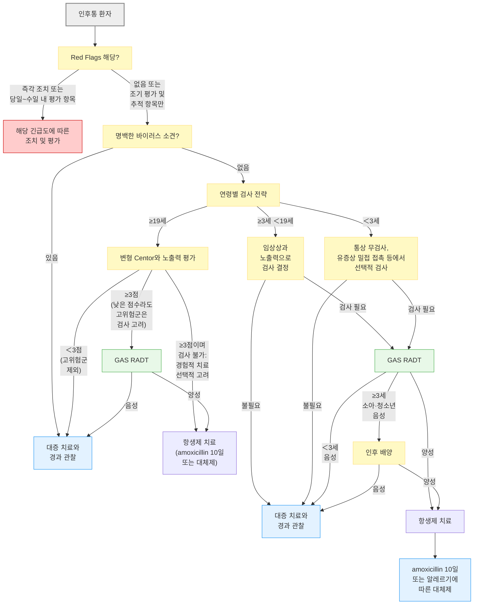

# 급성 인두염 Acute Pharyngitis

## <mark style="color:green;">일반 사항</mark>

* 인두의 급성 염증
* 상기도 감염 중 가장 흔한 외래 방문 원인의 하나
* 대부분 바이러스 감염
  * 세균 감염(주로 GAS)과의 감별이 치료 결정의 핵심
* 재발 또는 만성 감염의 경우 해부학적 이상·면역 저하 등에 대한 평가·치료를 위하여 의뢰
* 전파 경로 : 바이러스 - 코 분비물 접촉; GAS - 비말 감염
* GAS 경과 : 대개 2\~5일 잠복 후 발병 → 발병 2\~3일째 발열 최고조 → 합병증 없으면 5\~7일째 자연 호전
  * 항생제로 증상 기간 약 16\~24시간 단축
* 항생제의 합병증 예방 효과 : 류마티스열 예방 가능(발병 9일 이내 투여 시), 편도주위농양 등 화농성 합병증 발생 빈도 감소
  * PSGN(사구체신염) 예방 효과는 입증되지 않음
* 생활 복귀 : 적절한 항생제 시작 후 최소 12\~24시간이 경과하고 해열제를 사용하지 않아도 발열이 없으며 전신 상태가 양호하면 직장·학교 복귀 가능
  * 성홍열은 국내 관리 기준에 따라 항생제 시작 후 24시간까지 격리
  * 의료인·집단 유행 상황에서도 24시간 기준 적용

## <mark style="color:green;">원인</mark>

* 바이러스 (감염의 대부분) : rhinovirus, adenovirus, EBV, CMV, influenza, parainfluenza, SARS-CoV-2 등
* 세균 : 주로 group A Streptococcus (GAS, GABHS = _S. pyogenes_) - 성인 인두염의 약 5\~15%, 소아 인두염의 약 20\~30% 차지
  * 그 외 group C/G Streptococcus, 청소년·젊은 성인의 _Fusobacterium necrophorum_, 성접촉 관련 _Neisseria gonorrhoeae_, 예방접종 미비자·해외 노출자의 _Corynebacterium diphtheriae_ 등
* 비감염성 : 물리적·화학적 손상, 위산 역류, 건조한 공기

### <mark style="color:orange;">위험 인자</mark>

* 늦가을\~초봄의 감기·독감 유행 시기
* 연령 : 소아·청소년 (GAS 호발; 주로 5\~15세 학령기 소아)
* 급성 류마티스열의 과거력, 확진 GAS 환자와의 가정 내 밀접 접촉
* 보육 시설, 학교 등 집단 생활
* 당뇨, 면역 저하자
* 직·간접 흡연
* 위산 역류
* 편도·아데노이드의 세균 군체 형성

## <mark style="color:green;">임상 양상</mark>

* 주요 증상 : 인후통, 삼킴곤란, 발열
* 인두·구강 궤양 : 바이러스 감염을 시사
  * 성 위험 노출 후 발열·발진·전신 림프절병증·점막 궤양이 동반되면 급성 HIV 감염 고려
* 연구개 점상 출혈 : GAS 또는 EBV 감염에서 관찰 가능
* adenovirus 감염 시 인두결막열 (발열 최대 7일, 결막염 최대 14일 지속)

<table><thead><tr><th width="114">구분</th><th>바이러스 의심 소견</th><th>세균(GAS) 의심 소견</th></tr></thead><tbody><tr><td><strong>동반 증상</strong></td><td>기침, 콧물, 코막힘, 쉰 소리¹⁾</td><td>기침·콧물·쉰 소리 없음</td></tr><tr><td><strong>발열</strong></td><td>다양함; adenovirus·인플루엔자·EBV 등에서는 고열 가능</td><td>갑작스러운 인후통 + 고열</td></tr><tr><td><strong>전신 증상</strong></td><td>일반적 감기 양상</td><td>두통, 구역·구토, 복통</td></tr><tr><td><strong>구강 내 소견</strong></td><td>구강 궤양·수포 가능(viral enanthem, 예: herpangina)</td><td>편도인두 염증·삼출물, 구개 점상 출혈</td></tr><tr><td><strong>림프절</strong></td><td>경미한 전경부 림프절염</td><td>앞쪽 목 림프절 비대·압통</td></tr><tr><td><strong>기타</strong></td><td>결막염 (adenovirus)</td><td>성홍열 모양 발진 가능; 5~15세 학령기 소아에서 흔함</td></tr></tbody></table>

> ¹⁾_기침·콧물·쉰 소리·구강 궤양·결막염 등 명백한 바이러스 소견이 있으면 GAS 검사와 항생제 치료가 일반적으로 불필요_

### <mark style="color:orange;">GAS 관련 합병증 및 연관 질환</mark>

#### <mark style="color:$primary;">성홍열 Scarlet Fever</mark>

* GAS 인두염 증상 + 피부 발진; 딸기혀(strawberry tongue)가 동반될 수 있음
* 국내 제2급 법정감염병 : 환자·의사환자는 24시간 이내 신고하며, 항생제 치료 시작 후 24시간까지 격리 <mark style="color:$info;">\[질병관리청 성홍열 관리 기준]</mark>

**피부 증상**

* 선홍색 작은 구진; 피부는 건조·거친 사포 질감 또는 goose pimple appearance
* 홍반은 누르면 일시적으로 소실; 굴곡부에 Pastia's line 형성 가능
* 얼굴 : 이마·뺨 홍조 + 입 주위 창백 (circumoral pallor); 얼굴에는 발진 드묾
* 발진 출현 : 발열 후 12\~48시간; 귀·목·가슴·겨드랑이 → 몸통·사지 → 전신 순으로 24시간에 걸쳐 진행
* 발진 소실 : 3\~5일 후 시작; 이후 7\~10일부터 얼굴 → 몸통 → 손발 순으로 표피 탈락 (1개월 이상 지속되기도 함)

#### <mark style="color:$primary;">연쇄구균 감염 후 사구체신염 PSGN</mark>

* GAS 인두염 발병 1\~3주 후 고혈압, 부종, 혈뇨 발생
* 항생제의 PSGN 예방 효과는 입증되지 않음 <mark style="color:$info;">\[CDC PSGN]</mark>
* GAS 피부 감염(농가진 등) 후에도 발생할 수 있음
  * 급성 류마티스열 역시 피부 감염 후 발생 가능하므로 두 합병증을 선행 감염 부위만으로 구분하지 않음

#### <mark style="color:$primary;">류마티스열 Rheumatic Fever</mark>

* GAS 인두염 후 주로 발생하나 피부 감염 후에도 발생할 수 있음. 국내에서는 드묾
  * 대개 선행 GAS 감염 후 1\~5주에 발생
* GAS 인두염 발병 9일 이내 항생제 투여 시 예방 가능

### <mark style="color:$danger;">🚩 Red Flags!</mark>

<mark style="color:$danger;">**즉각 조치**</mark>

* 기도 폐쇄 소견 : stridor, 청색증·저산소증, 심한 호흡곤란·흉부 함몰, 침을 삼키지 못하고 흘림, sniffing/tripod position  `급성 후두개염` `심경부 감염`
* "hot potato" voice 또는 심한 개구 장애(trismus) + 기도 폐쇄 소견  `편도주위농양` `심경부 감염`
* 감염 의심 상황에서 의식 변화, 저혈압·말초 관류 저하, 빈호흡·호흡곤란(고열이 없거나 저체온이어도 배제하지 않음)  `패혈증`
* 인두염이 잠시 호전된 뒤 오한·고열 재발 + 편측 경부 통증·부종 또는 호흡곤란·흉막성 흉통  `Lemierre 증후군`
* 연하 불능 + 침 흘림 또는 중증 탈수  `심경부 감염` `중증 탈수`
* 인두·편도에 단단히 부착된 회백색 위막(특히 예방접종 미비·해외 노출력 또는 경부 부종 동반)  `디프테리아`
* GAS 감염 후 심한 호흡곤란·저산소증·급성 폐부종 또는 저혈압·말초 관류 저하  `급성 류마티스열 심장염` `급성 심부전`
* 혈뇨·부종 + 호흡곤란·핍뇨 또는 중증 고혈압  `PSGN`


**후두개염 의심 시 주의** : 환자를 눕히거나 불필요하게 자극하지 않고 즉각 이송. 특히 소아에서 설압자를 이용한 무리한 인두 시진은 급성 기도 폐쇄를 촉발할 수 있음. 영상 검사는 안정된 환자에서만 보조적으로 고려하며 기도 확보를 지연해서는 안 됨


<mark style="color:$warning;">**당일\~수일 내 평가**</mark>

* 심한 편측 인후 통증 + 구개수 편위, "hot potato" voice 또는 trismus(기도 폐쇄 소견 없음) **(당일)**  `편도주위농양`
* 경부 부종·압통 + 발열(기도 폐쇄·패혈증 소견 없음) **(당일)**  `심경부 감염`
* 연하 장애로 수분·음식 섭취 불가능 **(당일)**  `탈수`
* GAS 인두염 1\~5주 후 새로운 심잡음 또는 경미한 흉통·호흡곤란(즉각 조치 소견 없음) **(당일)**  `급성 류마티스열 심장염`
* GAS 감염 1\~3주 후 혈뇨(콜라색 소변)·부종·고혈압(즉각 조치 소견 없음) **(당일)**  `PSGN`
* GAS 인두염 1\~5주 후 새로 발생한 이동성 관절통·관절 부종 **(당일)**  `급성 류마티스열`
* 항생제 치료 48\~72시간 후에도 증상 악화 또는 무반응  `화농성 합병증` `비-GAS 원인`
* 성 위험 노출 후 발열·발진·전신 림프절병증·점막 궤양  `급성 HIV 감염`

<mark style="color:$info;">**조기 평가 및 추적**</mark>

* 일상생활에 지장을 주는 GAS 인두편도염의 반복  `재발성 편도염`
* 심한 편도 비대·삼출, 후경부 림프절 비대, 심한 피로(기도 폐쇄·섭취 불능 소견 없음)  `EBV 단핵구증`
* 항생제 치료 완료 후에도 지속되는 인후통(보균자에 동반된 바이러스 감염 등)  `비-GAS 원인` `GAS 보균자`

## <mark style="color:green;">진단</mark>

### <mark style="color:orange;">검사</mark>

* 임상 양상만으로 바이러스성 인두염과 GAS 인두염을 완전히 구분할 수 없으므로, 명백한 바이러스 소견이 없는 환자에서는 연령·임상 점수·노출력·지역 역학을 함께 고려하여 GAS 검사 필요성을 판단
* 기침·콧물 등 바이러스 의심 증상이 뚜렷한 경우에는 RADT를 시행하지 않음
  * 보균 상태에서도 양성이 나올 수 있어 과잉 치료로 이어질 수 있음
* Rapid GAS 항원 검사(RADT, 인후 면봉) : 특이도 높음(≥95%), 민감도는 검사법에 따라 차이
  * 양성이면 GAS 감염으로 판단
  * 3세 이상 소아·청소년에서는 음성 RADT를 인후 배양으로 확인하고, 성인에서는 음성 후 배양 검사를 통상 시행하지 않음
* 신속 분자 검사(NAAT) : RADT보다 민감도가 높음
  * 음성 후 확인 배양 필요 여부는 검사 제품의 검증 성능·사용설명서와 기관 기준에 따름
  * 보균자 검출도 늘어나므로 검사 대상 선별 원칙은 동일
* 3세 미만 : GAS 인두염과 류마티스열이 드물어 routine 검사하지 않음
  * 다만 유증상이며 확진 GAS 환자와 밀접 접촉했거나 집단 유행 상황이면 선택적으로 고려
* 항연쇄구균 항체 (ASO, anti-DNase B) : 과거 감염 반영
  * 급성기 진단에 부적합
* 배양 검사 : 표준 검사이나 결과까지 24\~48시간 소요
  * 보균 상태에서도 양성으로 나옴에 유의


**GAS 보균자(carrier)** : 편도에 GAS가 존재하지만 실제 감염이 아닌 상태. 통상 항생제 치료가 필요하지 않으며 전파·합병증 위험도 낮음. 반복 GAS 양성 환자에서는 보균자에 동반된 바이러스 감염을 감별해야 함. 다만 본인·가족의 류마티스열 과거력, 지역사회 ARF·PSGN·침습성 GAS 유행, 폐쇄 집단 내 GAS 인두염 유행 등 특수 상황에서는 보균 제거 치료를 고려 <mark style="color:$info;">\[IDSA 2012]</mark>


### <mark style="color:orange;">감별</mark>


**점수 체계 사용 전 전제** : FeverPAIN과 Centor Score는 GAS 감염 가능성을 평가하기 위한 도구로서 바이러스성 인두염을 진단하거나 GAS 감염을 확진하는 검사가 아님. 기침·콧물 등 바이러스 의심 증상이 뚜렷한 환자에게는 점수 산정 없이 대증 치료로 진행


#### <mark style="color:$primary;">FeverPAIN scoring</mark>

<table><thead><tr><th width="357">기준 항목</th><th width="108">해당 시</th></tr></thead><tbody><tr><td><strong>F</strong>ever - 최근 24시간 이내 발열</td><td>1점</td></tr><tr><td><strong>P</strong>urulence - 편도 삼출물</td><td>1점</td></tr><tr><td><strong>A</strong>ttend rapidly - 증상 발생 후 3일 이내 내원</td><td>1점</td></tr><tr><td>severely <strong>I</strong>nflamed tonsils - 심한 편도 염증</td><td>1점</td></tr><tr><td><strong>N</strong>o cough or coryza - 기침·콧물 없음</td><td>1점</td></tr></tbody></table>

* NICE의 검사 비의존적 대안 전략
  * 0\~1점 → 항생제 투여하지 않음
  * 2\~3점 → 원칙적으로 항생제를 투여하지 않거나 임상 경과에 따라 지연 처방 고려
  * 4\~5점 → 즉시 또는 지연 항생제 처방 고려
* 지연 처방 : 3\~5일 내 호전이 시작되지 않거나 빠르게 또는 뚜렷하게 악화되면 사전에 안내한 지연 처방을 시작함. 급격한 악화·전신 상태 불량·Red Flags 발생 시에는 재평가받도록 교육
* 국내 성인 진료에서는 아래 변형 Centor–RADT 전략을 우선 적용
  * 소아·청소년은 성인 검사 절단점을 그대로 적용하지 않음

#### <mark style="color:$primary;">Centor Score (Modified McIsaac)</mark>

<table data-search="false"><thead><tr><th width="198">기준 항목</th><th>점수</th></tr></thead><tbody><tr><td>발열 (＞38℃)</td><td>+1점</td></tr><tr><td>기침 없음</td><td>+1점</td></tr><tr><td>전경부 림프절 비대·압통</td><td>+1점</td></tr><tr><td>편도 부종 또는 삼출물</td><td>+1점</td></tr><tr><td>연령 : 3~14세</td><td>+1점</td></tr><tr><td>　　15~44세</td><td>0점</td></tr><tr><td>　　≥45세</td><td>-1점 (연령 증가에 따른 GAS 가능성 감소를 반영)</td></tr></tbody></table>

* 성인(19세 이상) : 국내 「2026 급성 상기도 감염 항생제 적정사용을 위한 실무지침」에 따른 전략
  * ＜3점 → 해당 성인 전략에서는 일반적으로 검사·항생제를 시행하지 않고 대증 치료. 단, 2점은 국제 점수 분류상 중간위험이므로 노출력·지역 역학·임상 경과를 함께 판단
  * ≥3점 → RADT 시행; 양성이면 항생제 치료
  * ≥3점이지만 RADT를 시행할 수 없는 경우 → 경험적 항생제 치료 고려
* 소아·청소년(3세 이상\~19세 미만) : 명백한 바이러스 소견이 없으면 임상상·노출력·지역 역학 및 점수를 보조적으로 고려하여 GAS 검사 결정
  * 성인의 ＜3점 무검사 전략이나 검사 불가 시 경험적 치료 전략을 그대로 적용하지 않음
  * 검사 대상에서 RADT 음성이면 인후 배양으로 확인
* 임상 점수의 역할 : IDSA 2025 지침은 검사 대상 선별에 점수 사용을 제안함(조건부 권고, 근거 확실성 매우 낮음). 특정 점수 체계의 우월성은 입증되지 않음
  * McIsaac 0\~1점은 저위험, 2\~3점은 중간위험, 4\~5점은 고위험으로 분류 <mark style="color:$info;">\[IDSA 2025]</mark>
* 급성 류마티스열 과거력, 확진 GAS 환자와의 가정 내 접촉, 성홍열·국소 합병증 의심 등 고위험 상황에서는 점수가 낮아도 검사를 적극 고려
* 3세 미만에는 점수 체계를 적용하지 않음

#### <mark style="color:$primary;">증상·병력에 따른 감별</mark>

<table data-search="false"><thead><tr><th width="141">원인·상태</th><th>특징적 소견</th><th>감별점 및 처치</th></tr></thead><tbody><tr><td><strong>바이러스성</strong><br><strong>인두염</strong></td><td>기침·콧물·쉰 소리 동반; 발열의 정도는 다양</td><td>가장 흔함; 항생제 불필요; 대증 치료</td></tr><tr><td><strong>GAS 인두염</strong></td><td>삼출성 편도, 전경부 림프절 비대·압통, 고열; 기침 없음</td><td>연령별 전략으로 검사 대상 선별; RADT 또는 배양 양성이면 amoxicillin 10일</td></tr><tr><td><strong>EBV 단핵구증</strong></td><td>심한 편도 비대·삼출, 후경부 림프절, 비장비대, 극심한 피로; 주로 청소년·청년</td><td>heterophile Ab 검사(위양성·위음성 가능, 특히 소아에서 음성이어도 배제 불가); 필요시 EBV VCA IgM/IgG·EBNA로 판정. 전염단핵구증 의심 시 amoxicillin/ampicillin을 피함. 전염단핵구증 환자는 amoxicillin 국내 허가사항상 금기임. 투여 후 발진이 곧 영구적 페니실린 알레르기를 뜻하지는 않으나 진성 지연성 과민반응도 가능하므로 추후 알레르기 평가 고려</td></tr><tr><td><strong>급성 HIV 감염</strong></td><td>성 위험 노출 후 발열, 인후통, 발진, 전신 림프절병증, 점막 궤양 등 단핵구증 유사 증상</td><td>HIV Ag/Ab 검사; 초기 감염이 강하게 의심되나 음성이면 HIV RNA 검사 고려</td></tr><tr><td><strong>편도주위농양</strong></td><td>편측 편도 돌출, 구개수 편위, trismus, "hot potato" voice</td><td>즉각 이비인후과 의뢰; 흡인 또는 배농 여부 평가</td></tr><tr><td><strong>급성 후두개염</strong></td><td>연하 장애·침 흘림, 경부 과신전 체위, stridor; 성인에서도 발생</td><td>즉각 이송 및 기도 평가; 안정된 경우에만 영상 검사를 보조적으로 고려</td></tr><tr><td><strong>COVID-19·</strong><br><strong>인플루엔자</strong></td><td>인후통, 발열, 기침, 근육통 등; 증상만으로 감별 어려움</td><td>유행 상황, 고위험군 여부 및 항바이러스제 치료 가능 기간을 고려하여 검사</td></tr><tr><td><strong>디프테리아</strong></td><td>회백색 위막(편도·인두), bull neck, 저음 쉰 소리</td><td>예방접종 미비·해외 노출 시 고려; 위막을 억지로 떼지 않고 비말격리, 즉시 이송·신고(제1급 감염병). 가능하면 투약 전 검체 채취하되 결과를 기다리지 않고 항독소·항생제 치료</td></tr><tr><td><strong>임균성 인두염</strong></td><td>구강성교 병력; 무증상이기도 함</td><td>인두 NAAT/배양 및 동반 STI 검사; 국내 STI 지침에 따라 ceftriaxone 치료 후 완치판정 검사</td></tr><tr><td><em><strong>F. necrophorum</strong></em></td><td>주로 청소년·젊은 성인; 심한 인두염 후 일시 호전 뒤 고열·오한, 편측 경부 통증</td><td>Lemierre 증후군 의심 시 즉각 이송, 혈액배양 및 경부 영상 평가</td></tr><tr><td><em><strong>A. haemolyticum</strong></em></td><td>10~20대 청소년·청년; GAS 유사 인후통 + 성홍열 모양 발진; GAS RADT 음성</td><td>배양 등으로 확인; 감수성 및 임상 상황에 따라 항생제 선택</td></tr></tbody></table>

***



<p align="center"><strong>급성 인두염 진단 및 치료 알고리듬</strong></p>

<p align="center"><em><mark style="color:$info;">저자 재구성 (참고 문헌 : 질병관리청 2026; IDSA 2025; CDC)</mark></em></p>

> _고위험군 : 급성 류마티스열 과거력, 확진 GAS 환자와의 가정 내 접촉, 성홍열·국소 합병증 의심_\
> _조기 평가 및 추적 항목만 해당하는 경우에는 일반 진료 흐름과 함께 원인 평가·추적 계획을 수립함._\
> _3세 미만은 음성 RADT 후 확인 배양을 통상 시행하지 않으며, 임상상·노출력에 따라 추가 검사 여부를 개별 판단함_

***

## <mark style="background-color:$warning;">Management</mark>

### <mark style="color:orange;">치료 방침</mark>

* 바이러스성 : 항생제 불필요; 대증 치료
* 세균성(GAS) : 연령별 검사 전략에 따라 RADT 또는 배양 양성이면 항생제 치료
  * 19세 이상 성인은 국내 지침에 따라 변형 Centor ≥3점이며 RADT가 불가능한 경우 경험적 치료를 선택적으로 고려
* 치료 완료 후 완치 판정 검사 불필요
  * 급성 류마티스열 고위험군 또는 전형적 증상 재발 등 특수 상황에서만 고려
* 항생제 투여 후 48\~72시간 내 반응이 없으면 진단·복약 순응도·화농성 합병증·다른 원인 및 보균 상태를 먼저 재평가한 뒤 항생제 변경 여부 결정

## <mark style="color:green;">비-약물 치료 및 예방</mark>

### <mark style="color:orange;">비-약물 치료</mark>

* 안정 휴식
* 충분한 수분 섭취 (따뜻한 음료 권장)
* 사탕 또는 throat lozenge 물고 있기 (질식 위험이 있어 어린 소아에게는 권하지 않음)
  * 박하·멘톨 등의 제품이 도움이 될 수 있으나 일부에서는 증상을 악화시킬 수 있음
* 소금물 가글 : 물 1컵(250 ㎖) + 소금 ½ 작은술(약 3 g); 일부에서 증상 완화(삼키지 말고 뱉음)
* 흡연·간접 흡연 회피
* 건조한 환경에서 공기 가습

### <mark style="color:orange;">예방</mark>

* 손씻기 등 일반적 호흡기 감염 예방법과 동일
* 적절한 항생제 시작 후 12\~24시간부터 전염성이 크게 감소
* 해열제 없이 발열이 없고 전신 상태가 양호해야 복귀 가능
  * 성홍열은 국내 기준에 따라 항생제 시작 후 24시간까지 격리
* 무증상 보호자·가족의 출근·등교는 제한하지 않음; 인후통·발열 등 증상이 생기면 평가받음
* 예방적 항생제 : 급성 류마티스열 병력 환자는 재발 방지를 위한 장기 이차 예방요법이 필요하며, 전문과에서 연령·심장 침범·이전 발병 시점 등을 고려하여 기간·방법 결정
  * 일반 접촉자에게는 권하지 않음
* 무증상 가족·밀접 접촉자의 routine 배양 검사나 경험적 치료는 권하지 않음. 집단 유행, 류마티스열 고위험 상황 또는 반복적인 가족 내 전파가 강하게 의심되는 특수 상황은 별도 평가

## <mark style="color:green;">약물 치료</mark>

### <mark style="color:orange;">항생제</mark>

* 투여 기간 : 약제에 따라 5\~10일; 증상 완화 후에도 처방된 과정을 끝까지 완료
* 지속·재발 감염 시 복약 순응도, 재감염, GAS 보균 상태, EBV·_F. necrophorum_ 등 다른 원인 및 화농성 합병증을 재평가하고 필요시 배양 검사 후 치료
* 무증상 가족·밀접 접촉자의 routine 검사·치료는 시행하지 않음

**GAS 급성 인두편도염 권고 항생제** <mark style="color:$info;">\[질병관리청 2026]</mark>


**Antimicrobial stewardship 원칙** : GAS 인두염에는 amoxicillin을 1차로 사용. 비중증 페니실린 알레르기에서는 1세대 세팔로스포린을 고려할 수 있음. amoxicillin/clavulanate 및 광범위 세팔로스포린은 단순 GAS 인두염의 routine 1차 약제로 사용하지 않음


<table><thead><tr><th width="172">상황</th><th width="247">약제</th><th>성인 용량 및 기간</th></tr></thead><tbody><tr><td><strong>1차 선택</strong></td><td>amoxicillin <mark style="color:blue;">[파목신]</mark>¹⁾</td><td>1,000 ㎎ qd 또는 500 ㎎ bid; 10일</td></tr><tr><td rowspan="2"><strong>비중증 지연성</strong> <br><strong>페니실린 알레르기</strong>²⁾</td><td>cephalexin <mark style="color:blue;">[팔렉신]</mark></td><td>500 ㎎ bid; 10일</td></tr><tr><td>cefadroxil <mark style="color:blue;">[듀리세프]</mark></td><td>1,000 ㎎ qd; 10일</td></tr><tr><td rowspan="2"><strong>즉시형 또는 중증</strong> <br><strong>페니실린 알레르기</strong>³⁾</td><td>azithromycin <mark style="color:blue;">[지스로맥스]</mark>⁴⁾</td><td>500 ㎎ 1일 후 250 ㎎ qd 4일(총 1.5 g)</td></tr><tr><td>clindamycin <mark style="color:blue;">[훌그램]</mark>⁴⁾</td><td>300 ㎎ tid; 10일</td></tr></tbody></table>

> ¹⁾_소아 : 50 ㎎/㎏ qd(최대 1,000 ㎎) 또는 25 ㎎/㎏/회 bid(1회 최대 500 ㎎); 10일. GAS 인두염의 지침 권고 요법(성인: 질병관리청 2026·CDC; 소아: CDC)임. 파목신 허가사항의 일반 용법은 성인·체중 20 ㎏ 이상 소아에서 250\~500 ㎎/회 tid, 체중 20 ㎏ 미만에서는 20\~40 ㎎/㎏/일을 3회 분할하므로 지침 요법과 투여 횟수 등이 다름. 허가사항에는 연령·증상에 따른 증감 문구가 있으며, 급여 인정 여부는 별도로 확인함_
>
> ²⁾_단순한 비중증 지연성 발진에 한함. 즉시형 반응 또는 중증 지연성 과민반응 병력에서는 사용하지 않음_
>
> ³⁾_두드러기·혈관부종·기관지경련·아나필락시스 등 즉시형 반응에서는 cephalexin·cefadroxil 회피. SJS/TEN, DRESS, AGEP 또는 장기 침범 등 중증 지연성 반응은 관련 β-lactam을 피하고 전문 평가_
>
> ⁴⁾_macrolide 내성률은 지역·시기에 따라 크게 다름. 국내 과거 일부 연구에서는 약 45%였으나, 2017년 창원 소아 인두염 분리주에서는 erythromycin 3.2%, clindamycin 2.6%였음. 이는 현재 전국 내성률을 의미하지 않음 <mark style="color:$info;">\[J Med Microbiol 2019]</mark>. macrolide 내성균에서는 clindamycin 교차내성이 동반될 수 있으므로 치료 반응을 주의 깊게 관찰하고, 이전 감수성 결과가 있으면 참고; clindamycin은 C. difficile 감염 위험 고려. azithromycin은 허가 용법(총 1.5 g)이자 CDC 요법을 수록함. 국내 2026 실무지침은 500 ㎎ qd ×5일(총 2.5 g)을 제시하나 허가 용량을 초과함_


**페니실린 치료 무반응·재발 시** : GAS는 임상 분리주에서 penicillin·cephalosporin 내성이 보고된 적이 없으므로 약제를 바로 변경하기보다 복약 순응도, 재감염, GAS 보균자에서의 바이러스 동시감염, EBV·_F. necrophorum_ 등 다른 원인과 편도주위농양 등 화농성 합병증을 먼저 평가. 진성 치료 실패로 판단되면 배양·임상 상황에 따라 amoxicillin/clavulanate <mark style="color:blue;">\[오구멘틴]</mark> 500/125 ㎎ tid ×10일, 1세대 세팔로스포린 또는 clindamycin <mark style="color:blue;">\[훌그램]</mark> 등을 고려. 단순 GAS 인두염 1차 치료에는 광범위 항생제를 사용하지 않음.



**NICE 지침** <mark style="color:$info;">\[NICE 2018]</mark> : FeverPAIN 0\~1점은 항생제를 처방하지 않고, 2\~3점은 무항생제 또는 지연 처방, 4\~5점은 즉시 또는 지연 처방을 고려. 항생제가 필요하면 phenoxymethylpenicillin 5\~10일을 1차 선택(국내 처방 접근성 낮음). 페니실린 알레르기 시 clarithromycin 250\~500 ㎎ bid ×5일; 임신부에서 macrolide가 꼭 필요하면 erythromycin 고려. 지연 처방의 복용 시작 조건은 위 FeverPAIN 항목 참조


### <mark style="color:orange;">통증 및 대증 치료</mark>

* NSAID (ibuprofen, naproxen) : acetaminophen보다 인후통 완화에 다소 우수한 보고 있음
  * 국내 처방 대안으로 dexibuprofen을 사용할 수 있으며, 처방례에는 속방형 제제를 수록함
* acetaminophen : NICE 지침은 acetaminophen 또는 ibuprofen을 권고
  * 위장관 출혈·궤양 병력, 중증 콩팥질환, 탈수, NSAID 과민성 천식, 임신 20주 이후 등 NSAID 사용이 부적절할 때 우선 사용
  * NSAID의 금기는 제품별로 확인함. 국내 ibuprofen·dexibuprofen 제품 중에는 기관지 천식 또는 그 병력 자체를 금기로 정한 제품이 있으므로, NSAID 과민성 천식에만 한정하여 판단하지 않음
* 단회 dexamethasone 10 ㎎(PO 또는 IM) : 일부 연구에서 24\~48시간 이내 통증 완전 소실 가능성을 높였으나 routine 사용은 권하지 않음
  * 기도 폐쇄·심경부 감염을 배제한 성인의 매우 심한 인후통에서 대안의 효과·위험을 설명한 뒤 선택적으로 단회 고려
  * 당뇨·면역저하 환자에서는 특히 신중하고 반복 투여는 권하지 않음
* 국소 진통제 : 효과는 작음 <mark style="color:$info;">\[NICE 2018]</mark>
  * 약용 lozenge(flurbiprofen 등) : 위약 대비 통증을 소폭 줄이나 flurbiprofen lozenge는 국소 이상반응이 흔함
    * flurbiprofen <mark style="color:blue;">\[스트렙실]</mark>도 NSAID이므로 ibuprofen·dexibuprofen 등 다른 NSAID와 중복 사용하지 않음; 12세 이상에서 최대 3일간 사용
  * diclofenac 가글 <mark style="color:blue;">\[아프니벤큐]</mark> : 허가 효능은 인두염 등 구강인두 염증의 완화. 오래된 위약 대조 시험 보고는 있으나 근거의 한계를 고려하여 일상적 사용은 권하지 않음(비급여)
  * 구강점막용 마취 겔을 인두에 직접 도포하지 않음

***

## <mark style="color:red;">질병코드</mark>

* J02.0 연쇄알균인두염 Streptococcal pharyngitis
* J02.8 기타 명시된 병원체에 의한 급성 인두염 Acute pharyngitis due to other specified organisms
* J02.9 상세불명의 급성 인두염 Acute pharyngitis, unspecified
* A38 성홍열 Scarlet fever

***

## <mark style="color:purple;">처방례</mark>

> **처방례 1. 성인의 바이러스성 인두염 (세균 감염 가능성 낮음)**
>
> ```
> 부루펜 200 ㎎/T        1회 1T, 1일 3회, 식후 필요시 × 3～5일
> ```
>
> _✽ 진통·해열 목적으로 ibuprofen을 필요시 사용. 일상을 방해하는 기침이 있을 때만 코데닝 1회 2T, 1일 3회 식후 × 3\~5일을 선택적으로 추가; 콧물만으로 추가하지 않음. 졸림·호흡억제·구강 및 인후 건조에 주의하며 12세 미만에는 사용하지 않음. 항생제 불필요._

> **처방례 2. 성인의 RADT 양성 등으로 확인된 GAS 인두염**
>
> ```
> 파목신 500 ㎎/C        1회 1C, 1일 2회 × 10일
> 맥시쿨펜 300 ㎎/C     1회 1C, 1일 2～3회, 식후 필요시 × 3～5일
> ```
>
> _✽ 19세 이상 성인에서 RADT를 시행할 수 없는 경우에는 변형 Centor ≥3점에서 경험적 항생제를 고려할 수 있음. amoxicillin은 음식과 관계없이 복용 가능하나 위장 불편 시 식후 복용. bid는 GAS 인두염 지침 요법으로 제품 허가사항의 일반 투여 횟수(tid)와 다름(항생제 표 각주 1 참조). 맥시쿨펜은 dexibuprofen 속방형 300 ㎎ 제제로, 허가 용법은 1회 1C, 1일 2\~4회이며 최대 4C(1,200 ㎎)/일을 초과하지 않음. 다른 NSAID와 중복 복용하지 않음. 증상 호전 후에도 10일 완료 필수. 48\~72시간 내 반응 없으면 재평가. Probiotics는 균주·용량별 근거가 달라 일률적으로 병용하지 않으며 선택적으로 고려._

> **처방례 3. 성인의 GAS 인두염 + 페니실린 즉시형 알레르기(아나필락시스 병력)**
>
> ```
> 지스로맥스 250 ㎎/T    첫날 1회 2T, 2～5일째 1회 1T, 1일 1회 × 5일
> 맥시쿨펜 300 ㎎/C     1회 1C, 1일 2～3회, 식후 필요시 × 3～5일
> ```
>
> _✽ 국내 허가 용법(총 1.5 g)이자 CDC 요법. 질병관리청 2026 실무지침은 500 ㎎ qd ×5일을 제시하나 허가 용량을 초과함. **국내 과거 일부 연구에서 macrolide 내성률이 약 45%로 보고되었으나 현재 전국 내성률을 뜻하지 않음.** 지역·시기별 변동을 고려하여 치료 반응을 주의 깊게 관찰(항생제 표 각주 4 참조). 맥시쿨펜은 dexibuprofen 속방형 제제로 최대 4C(1,200 ㎎)/일을 초과하지 않으며 다른 NSAID와 중복 복용하지 않음. clindamycin도 내성 및 C. difficile 감염 위험이 있어 일률적인 우선 대체제로 사용하지 않음._

***

### <mark style="color:$success;">핵심 복약 지도</mark>

* **항생제 완료** : 증상이 나아져도 약제에 따라 처방된 5\~10일 과정을 끝까지 복용
* **생활 복귀** : 적절한 항생제 시작 후 최소 12\~24시간 경과 + 해열제 없이 발열 없음 + 전신 상태 양호; 성홍열·의료인·집단 유행 상황은 24시간 기준 적용
* **진통제 선택** : NSAID는 식사 후 복용; 위장관 출혈·궤양 병력, 콩팥 기능 저하, 탈수, NSAID 과민성 천식 또는 임신부는 acetaminophen 우선. 기관지 천식·병력에 대한 제품별 금기도 확인함. 고령자는 위장관·콩팥 위험을 고려하여 최소 용량·단기간 사용. ibuprofen·dexibuprofen 등 NSAID를 중복 복용하지 않음
* **재방문 시점** : 항생제 복용 2\~3일 후에도 증상이 나빠지거나 호전 없으면 재내원
* **복합 진해거담제 사용 시** : 일상을 방해하는 기침에만 선택적으로 사용; 졸림·구강 및 인후 건조에 주의하고 음주·운전 및 다른 진정성 약물과의 중복을 피함
* **알레르기 고지** : 과거 페니실린 알레르기 반응이 있었던 경우 처방 전 반드시 고지
* **dexamethasone 처방 시** : 단회 투여이므로 추가 복용 불필요; 당뇨 환자는 당일 혈당 상승 가능성 안내

***

## <mark style="color:green;">주요 참고문헌 및 확인 자료</mark>

### <mark style="color:orange;">임상 근거</mark>

* 질병관리청·대한항균요법학회. 2026 급성 상기도 감염 항생제 적정사용을 위한 실무지침. 2026. - 19세 이상 성인의 GAS 검사 전략·항생제 선택·용량·치료 실패 평가.

https://www.kdca.go.kr/bbs/kdca/263/307007/download.do

* IDSA. Clinical Practice Guideline Update on GAS Pharyngitis: Risk Assessment Using Clinical Scoring Systems. 2025. - 소아·성인의 임상 점수 활용과 고위험군 검사; 항생제 치료 전체를 개정한 지침은 아님.

https://www.idsociety.org/practice-guideline/streptococcal-pharyngitis2/

* Shulman ST, et al. Clinical Practice Guideline for the Diagnosis and Management of Group A Streptococcal Pharyngitis: 2012 Update by IDSA. Clin Infect Dis. 2012;55(10):e86–e102. - 보균자의 통상 무치료 원칙 및 보균 제거 치료를 고려하는 예외.

https://www.idsociety.org/practice-guideline/streptococcal-pharyngitis/

* CDC. Clinical Guidance for Group A Streptococcal Pharyngitis. - 연령별 검사·소아 음성 RADT 후 배양·치료·생활 복귀.

https://www.cdc.gov/group-a-strep/hcp/clinical-guidance/strep-throat.html

* CDC. Clinical Guidance for Acute Rheumatic Fever; Clinical Guidelines for Post-Streptococcal Glomerulonephritis. - 선행 피부 감염과 류마티스열, 이차 예방 및 PSGN 예방 근거.

https://www.cdc.gov/group-a-strep/hcp/clinical-guidance/acute-rheumatic-fever.html

https://www.cdc.gov/group-a-strep/hcp/clinical-guidance/post-streptococcal-glomerulonephritis.html

* CDC. Diagnosing Acute Rheumatic Fever. - ARF 의심·확진 환자의 심초음파/Doppler 평가.

https://www.cdc.gov/group-a-strep/hcp/clinical-guidance/diagnosing-acute-rheumatic-fever.html

* CDC. Laboratory Testing for Epstein-Barr Virus (EBV). 2024. - heterophile Ab 검사의 한계 및 EBV 특이 항체 해석.

https://www.cdc.gov/epstein-barr/php/laboratories/index.html

* Kim S, et al. Predominance of emm4 and antibiotic resistance of Streptococcus pyogenes in acute pharyngitis in a southern region of Korea. J Med Microbiol. 2019;68(7):1053–1058. doi:10.1099/jmm.0.001005. - 2017년 창원 소아 인두염 분리주 내성률; 현재 전국 자료로 일반화하지 않음.

https://pubmed.ncbi.nlm.nih.gov/31169483/

* 질병관리청. 성홍열. - 국내 신고 대상·24시간 이내 신고·항생제 시작 후 24시간 격리.

https://www.kdca.go.kr/kdca/3497/subview.do

* NICE. Sore throat (acute): antimicrobial prescribing. NG84. 2018. - FeverPAIN·Centor를 이용한 즉시·지연 처방 전략.

https://www.nice.org.uk/guidance/ng84

### <mark style="color:orange;">허가·급여 확인 자료</mark>

* [식품의약품안전처. 의약품안전나라 - 의약품 품목허가정보.](https://nedrug.mfds.go.kr/index) - 국내 제품별 적응증·용법·금기 및 허가 상태 확인

***

## <mark style="color:blue;">환자 안내서</mark>

#### <mark style="color:$primary;">급성 인두염(인후염)이란?</mark>

목구멍(인두)에 생긴 염증으로, 대부분 바이러스 감염이며 1주일 이내에 자연 회복됩니다. 연쇄구균(GAS) 세균 감염인 경우 항생제가 필요하며, 적절히 치료받으면 합병증(류마티스열 등)을 예방할 수 있습니다.

#### <mark style="color:$primary;">일상 관리</mark>

* 충분히 쉬고 따뜻한 물·차를 자주 마십시오.
* 소금물 가글(물 1컵\[250 ㎖] + 소금 ½ 작은술\[약 3 g])을 하루 수 회 하면 불편감이 줄어들 수 있습니다(삼키지 말고 뱉음).
* 흡연, 연기, 자극적인 음식을 피하십시오.

#### <mark style="color:$primary;">항생제를 처방받으셨다면</mark>

* 증상이 나아져도 처방받은 날수(약에 따라 5\~10일)를 끝까지 복용하십시오. 적절한 치료는 전파와 고름집 같은 합병증을 줄이고 류마티스열을 예방하는 데 도움이 됩니다. 다만 항생제가 연쇄구균 감염 후 콩팥염(사구체신염)을 예방한다는 근거는 충분하지 않습니다.
* 적절한 항생제를 시작한 지 최소 12\~24시간이 지나고, 해열제를 복용하지 않아도 열이 없으며 몸 상태가 좋아졌을 때 학교나 직장에 복귀하십시오. 성홍열이거나 의료인·집단 유행 상황에서는 항생제 시작 후 24시간을 기준으로 합니다.
* 증상이 없는 보호자나 가족은 출근·등교를 쉬지 않아도 됩니다. 다만 목 통증이나 열이 나면 진료를 받으십시오.

#### <mark style="color:$primary;">항생제를 처방받지 않으셨더라도</mark>

* 1주일이 지나도록 나아지지 않거나 점점 심해지면 다시 진료를 받으십시오.

#### <mark style="color:$primary;">즉시 병원에 오셔야 할 때</mark>

* 숨쉬기가 힘들거나, 침을 삼키기 어려울 정도로 목이 심하게 아플 때
* 한쪽 목이 유독 심하게 붓거나, 입을 제대로 벌리기 어려울 때
* 목 주위 피부가 붓거나 발갛게 변하고 열이 날 때
* 항생제를 2\~3일 복용했는데도 증상이 나빠질 때
* 항생제 복용 후 두드러기, 입술·혀 부종, 숨참이 생길 때(즉시 응급진료)
* 그 밖의 새로운 발진이 생기면 처방받은 의료기관에 알려 주십시오.
