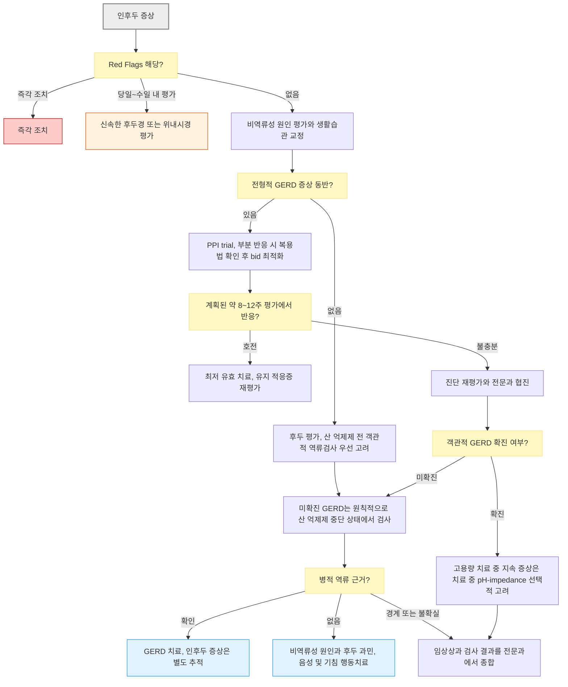

# 인후두역류 Laryngopharyngeal Reflux, LPR

## <mark style="color:green;">일반 사항</mark>

* LPR은 위 내용물이 상부 식도 괄약근 위쪽까지 역류하여 인두·후두에 직접 자극을 주거나, 식도-후두 반사 등을 통해 증상에 기여할 수 있는 현상을 말함. 다만 증상만으로 병적 역류에 의한 질환을 확정하지 않음
* 그러나 쉰 목소리, 목 청소, 만성 기침, 인두 이물감 등은 비특이적이므로, 증상만 있는 단계에서는 이를 곧바로 LPR로 확진하지 않고 여러 기전이 관여하는 만성 인후두 증상군으로 접근
* LPR의 진단 기준·검사 해석에는 학회 간 차이가 있고 단일 확진검사가 없어 실제 유병률은 불확실
* 용어 구분 : 인후두 증상(LPS)은 역류 외 여러 원인으로 발생할 수 있는 증상군이며 LPRD와 동의어가 아님. LPRD는 문제가 되는 LPS에 역류가 관여한다는 객관적 근거가 동반된 경우로 정의함. GERD 자체가 확인되어도 인후두 증상과의 인과관계가 자동 입증되지는 않음. San Diego 합의문은 만성·빈번한 LPS를 8주 이상, 주 2회 이상으로 정의하지만, 쉰 목소리가 4주 이내 호전되지 않으면 별도로 후두경 평가 <mark style="color:$info;">\[Am J Gastroenterol 2026]</mark>
* 전형적인 가슴쓰림·산 역류 없이 인후두 증상만 나타날 수 있으나, 활동 시·야간 또는 직립·앙와위 역류가 모두 가능하므로 LPR과 GERD를 체위만으로 구분할 수 없음


개별 환자의 후두 증상이 역류 때문인지 증상만으로 확정하기 어려움. 특히 객관적 역류 근거 없이 지속성 인후 증상만으로 선정한 환자군에서는 PPI가 위약보다 우월하지 않았으며, 이 결과를 객관적으로 확인된 모든 GERD/LPRD 환자에게 동일하게 적용하지 않음


## <mark style="color:green;">원인 및 기전</mark>

### <mark style="color:orange;">병태생리 가설</mark>

* 하부·상부 식도 괄약근의 장벽 기능 저하, 활동 시 복압 증가(예 : bending over, Valsalva, exercise)에 의한 역류 → refluxate의 후두 점막에 대한 직접 자극 또는 식도 자극을 통한 미주신경 관련 후두 반사 발생 → 기침, 기관지 수축
* laryngeal epithelium은 산과 pepsin의 화학적 손상에 취약
* pepsin의 세포 내 내재화(internalization)와 재활성화가 점막 손상에 관여할 수 있다는 전임상적 가설이 있으나, 이를 개별 환자의 PPI 무반응 또는 non-acid reflux를 설명하는 확립된 임상 기전으로 단정할 수 없음
* 인후두는 refluxate 제거 능력이 낮아 산과 pepsin이 오래 머무르며 점막을 자극
* 일부에서는 acid reflux가 초기 trigger로 작용한 후 laryngeal sensory neuropathy / central sensitization으로 이행하여 역류가 없어도 증상이 지속될 수 있음

### <mark style="color:orange;">위험 인자 및 악화 요인</mark>

* 비만, 열공탈장, 과식·야식, 흡연·음주 등은 주로 GERD 또는 역류 노출과 관련된 인자이며 LPRD에 특이적인 원인으로 확립된 것은 아님
* 칼슘통로차단제·질산염·항콜린제·삼환계 항우울제·theophylline 등은 일부 환자에서 역류 증상을 악화시킬 수 있으므로 약력과 시간적 연관성을 확인하며 임의 중단하지 않음

### <mark style="color:orange;">GERD와의 차이점</mark>

* GERD와 달리 가슴쓰림·산 역류 없이 인후두 증상만 나타날 수 있으나, 두 질환 모두 주간·야간 및 직립·앙와위 역류가 가능
* 상부위장관내시경이 정상이어도 병적 역류를 배제할 수 없고, 반대로 식도염이 있다고 해서 인후두 증상과의 인과관계가 입증되는 것은 아님
* 전형적 GERD 증상이 없는 단독 인후두 증상은 역류 이외의 원인이 흔하므로 감별 진단과 필요시 객관적 역류검사가 중요

## <mark style="color:green;">임상 양상</mark>

* 쉰 목소리 또는 발성 장애
* 가래가 없는 만성 기침 또는 목 청소 (throat clearing)
* 가슴쓰림·산 역류가 동반될 수 있으나 없을 수도 있음
* 인두 이물감 (globus sensation), 인후통, 목의 점액감
* 삼킴곤란이 동반될 수 있으나, 진행성 연하 곤란·연하 통증은 경고 증상으로 평가


**RSI (Reflux Symptom Index)** : 9개 증상(쉰 소리, 목 청소, 가래, 삼킴곤란, 식후 기침, 호흡 장애, 성가신 기침, 인두 이물감, 가슴쓰림/역류/소화불량)을 각 0점(문제없음)\~5점(극심함)으로 합산. 통상 ＞13을 비정상으로 보았으나 특이도가 낮으므로, LPR 진단이나 역류검사 필요 여부를 결정하는 절단점으로 사용하지 않고 증상 부담과 치료 전후 변화를 추적하는 데 참고


### <mark style="color:$danger;">🚩 Red Flags!</mark>

<mark style="color:$danger;">**즉각 조치**</mark>

* 협착음(stridor), 진행성 호흡곤란 또는 기도 폐쇄 의심  `상기도 폐쇄` `후두 부종`
* 대량 객혈 또는 저산소증·혈역학적 불안정을 동반한 객혈  `기도 출혈` `악성 종양`
* 음식물·침도 삼키기 어려운 급성 중증 삼킴곤란 및 호흡기 흡인 위험  `식도 음식물 매복` `심부 경부 감염`
* 토혈·흑색변과 함께 지속 출혈·실신·저혈압 발생  `중증 상부위장관 출혈`

<mark style="color:$warning;">**당일\~수일 내 평가**</mark>

* 4주 이상 호전되지 않는 쉰 목소리, 또는 흡연력·경부 종괴·두경부암 병력·최근 삽관/경부 수술 등 고위험 소견을 동반한 발성장애  `후두암` `성대마비`
* 소리 지르기·노래·심한 기침 직후 갑작스러운 심한 음성 변화·실성  `성대 출혈`
* 진행성 삼킴곤란 또는 연하통(odynophagia)  `식도암` `식도 협착` `호산구 식도염`
* 원인 불명의 체중 감소·빈혈, 혈역학적으로 안정된 토혈·흑색변(출혈은 당일)  `식도암` `상부위장관 출혈`
* 귀 진찰이 정상인 원인 불명의 일측성 이통, 지속성·일측성 인후통, 경부 종괴  `두경부 악성 종양`
* 소량이라도 원인 불명의 객혈이 반복·지속하는 경우  `기도 병변` `악성 종양`
* 반복성 흡인성 폐렴 또는 현저한 흡인 의심  `연하장애` `Zenker 게실`

<mark style="color:$info;">**조기 평가 및 추적**</mark>

* 비역류성 원인을 평가·관리했는데도 인후두 증상이 지속·재발하는 경우  `후두 과민` `근긴장성 발성장애`
* 객관적 GERD 근거 없이 PPI에 장기 의존하거나 한 차례 적절한 치료에도 반응하지 않는 경우  `비역류성 인후두 증상`

## <mark style="color:green;">진단</mark>

* 특이적인 단일 확진검사는 없으며 증상이나 후두경 소견만으로 LPRD를 진단할 수 없음. 역류검사에서 GERD가 확인되어도 인후두 증상의 원인임을 자동으로 확정하지 않음. 전형적 GERD 증상 유무, 비-reflux 원인 평가, 후두경·상부위장관내시경 및 보행성 역류검사 결과를 종합하여 역류의 기여 가능성을 판단
* 전형적 GERD 증상 없이 인후두 증상만 있는 경우에는 경험적 PPI보다 비-reflux 원인 평가 및 가능하면 산 억제제 투여 전 보행성 역류검사를 우선 고려
* 가슴쓰림·산 역류 등 전형적 GERD 증상이 동반된 경우에는 표준 용량 PPI trial을 고려할 수 있음. 전형적 GERD 증상과 LPS가 함께 호전되면 LPRD 가능성을 뒷받침하지만, 치료 반응만으로 역류와 개별 인후두 증상의 인과관계가 확정되는 것은 아니며, 단독 LPS에서 경험적 PPI trial을 반복하는 근거로 삼지 않음

### <mark style="color:orange;">검사</mark>

* 후두경 검사 : LPS 환자에서 비역류성 후두 질환과 악성 병변을 평가하기 위해 고려하며, 지속성 쉰 목소리(4주 이상) 또는 고위험 소견이 있으면 시행함. 직업적 음성 사용자에서는 4주를 기다리지 않고 조기 후두 평가를 고려. 일반 후두경으로 발성장애의 원인이 확인되지 않으면 videostroboscopy를 고려함. 단독 발성장애에 후두 관찰 없이 역류를 추정하여 항역류제를 처방하지 않음. 후두 부종, 피열연골 부위 발적·육아종 등이 관찰될 수 있으나 비특이적이고 관찰자 간 일치도도 낮음. RFS는 소견의 중증도 추적에 참고할 수 있지만 단독 진단 근거로 사용하지 않음 <mark style="color:$info;">\[Otolaryngol Head Neck Surg 2018; Am J Gastroenterol 2026]</mark>
* 상부위장관내시경 : 삼킴곤란, 체중 감소, 토혈·흑색변, 빈혈 등 경고 증상이 있으면 우선 시행. 정상 내시경은 GERD를 배제하지 못하고, 식도염만으로 인후두 증상과의 인과관계를 확정하지 못함
* 보행성 역류검사 : 객관적 GERD가 확인되지 않은 단독 인후두 증상에서는 원칙적으로 산 억제제를 중단한 상태에서 시행. 24시간 pH-impedance는 단독 LPS 및 약산성·비산성 역류 평가에, 96시간 무선 pH 검사는 전형적 식도 역류 증상 동반 또는 치료 단계 확대 전 GERD 평가에 유용하며 상호 배타적이지 않음. 원위 식도 산 노출 시간(AET) ＞6%는 GERD를 뒷받침하고, 96시간 검사 4일 모두 AET ＜4%이면 산 억제 치료 반응 가능성이 낮음. 이 수치는 GERD 평가 지표이지 LPRD 특이 확진 기준이 아님. 역류 사건과 인후두 증상 사이에 양성 증상-역류 연관성이 확인되면 LPRD 진단의 신뢰도를 높일 수 있으나, 기침·목 청소 등 증상 기록의 정확성과 검사 중 증상 빈도에 따라 해석에 한계가 있음 <mark style="color:$info;">\[Am J Gastroenterol 2026]</mark>
* 24시간 pH-impedance : 산성·약산성·비산성 역류 및 액체·가스 역류를 평가할 수 있음. 이미 객관적 GERD가 확인되었으나 고용량 산 억제 중에도 증상이 지속될 때에는 치료 중 검사를 선택적으로 고려
* HEMII-pH(하인두·식도 다채널 임피던스-pH) : 하인두로 도달하는 역류를 평가할 수 있으나 정상 참고치·판독 일치도·임상적 절단점에는 논란이 있음. 유럽 합의문은 gold standard로 제시하지만 San Diego 합의문은 검사별 장단점과 역류 횟수 절단점의 불확실성을 강조하므로, 보편적으로 확립된 단일 gold standard로 단정하지 않음 <mark style="color:$info;">\[Eur Arch Otorhinolaryngol 2026; Am J Gastroenterol 2026]</mark>
* pH 센서만 사용하는 dual-sensor pH 검사는 임피던스를 포함한 HEMII-pH와 동일하지 않으며, 약산성·비산성 역류의 평가 능력도 구분해야 함
* 타액 pepsin 검사와 oropharyngeal pH 검사는 현재 routine 진단검사로 권고하지 않음
* 경험적 치료 반응은 진단을 확정하지 못하며, 무반응이면 약제 증량보다 진단 재평가를 우선

### <mark style="color:orange;">감별</mark>

* 후비루 (부비동염, 알레르기비염, 비-알레르기비염) - Upper Airway Cough Syndrome (UACS)
* 만성 기침 증후군 (UACS·GERD·천식·비천식성 호산구성 기관지염 중복 가능) - ACEi 복용 여부 확인
* 흡입 스테로이드 관련 후두염·후두 칸디다증 - 천식·COPD 환자에서 감별
* 성대 결절·폴립·Reinke 부종·성대마비 - 지속성 발성장애에서 후두경 평가
* 근긴장성 발성 장애 (muscle tension dysphonia) - 음성 과사용, 직업적 음성 사용자에서 흔함
* 후두 감각 신경병증 (laryngeal sensory neuropathy) - 특정 자극(냄새, 찬 공기)에 대한 과민 반응
* 유발성 후두폐쇄(inducible laryngeal obstruction, ILO) - 운동·냄새 등 자극 관련 흡기곤란, 필요시 유발 후두경 평가
* 기능성 인두 이물감(functional globus) - 연하장애·연하통 없이 비연하 시 이물감, 구조적·운동성 질환 평가 후 고려
* Zenker 게실 - 소화되지 않은 음식의 역류·구취·흡인
* 갑상선 종대 - 압박감·인두 이물감
* 호산구 식도염 (eosinophilic esophagitis, EoE) - 삼킴곤란이 주 증상이고 알레르기 소인이 있는 환자에서 감별 필요; 식도 생검으로 확진
* 상부 호흡기 감염
* 목구멍 청소 습관, 과도한 음성 사용
* 온도 또는 기후 변화에 의한 자극
* 흡연, 음주, 환경 자극
* 악성 병변 (인두암, 후두암, 식도암) - Red Flags 동반 시 배제 우선

***



<p align="center"><strong>인후두역류 진단 및 치료 알고리듬</strong></p>

<p align="center"><em><mark style="color:$info;">저자 재구성 (참고 문헌 : Am J Gastroenterol 2026; Clin Gastroenterol Hepatol 2023)</mark></em></p>

***

## <mark style="background-color:$warning;">Management</mark>

### <mark style="color:orange;">치료 방침</mark>

* 생활습관 교정과 식이 조정을 우선 시행하되, 근거가 제한적임을 설명하고 환자별 증상 유발 요인에 맞춰 적용
* 단독 인후두 증상에는 산 억제제를 routine으로 시작하지 않고 비-reflux 원인 평가 및 가능하면 객관적 역류검사를 우선 고려
* 전형적 GERD 증상이 동반되면 표준 용량 PPI 1일 1회로 시작할 수 있으며, 초기 경과에서 부분 반응이면 복용법·순응도 확인 후 필요시 1일 2회로 최적화. 계획된 약 8\~12주 평가 기간 내 반응을 판정하고, 1일 1회 8\~12주 후 다시 1일 2회 장기 trial을 자동으로 반복하지 않음
* 한 차례 적절한 PPI trial에도 반응이 없으면 다른 PPI·P-CAB로 반복 교체하거나 고용량을 지속하기보다 진단 재평가 및 객관적 검사를 우선. 별도의 GERD 유지치료 적응증이 없으면 감량·중단을 고려하며, 확진된 식도 질환의 치료는 인후두 증상 반응과 구분하여 판단

### <mark style="color:orange;">후두 과민 및 행동치료</mark>

* 비역류성 원인을 평가한 뒤에도 후두 과민·만성 기침·목 청소가 지속되면 언어재활사 또는 음성치료 전문가의 기침 억제 훈련, 목 청소 행동 교정, 호흡 재훈련, 후두 재훈련(laryngeal recalibration)을 고려
* 후두 과민을 정신질환으로 단정하지 않으며, 필요시 증상 관련 과도한 경계(hypervigilance)를 줄이는 인지행동적 접근을 병행

### <mark style="color:orange;">치료 불응 시 고려할 기전 및 감별진단</mark>

* 아래 구분은 확립된 LPR phenotype 분류가 아니라, 치료 불응 환자에서 진단과 치료 방향을 재검토하기 위한 임상적 사고 틀임

<table><thead><tr><th width="157">기전·감별진단</th><th width="220">임상 단서</th><th>평가 및 치료 방향</th></tr></thead><tbody><tr><td><strong>GERD overlap</strong></td><td>heartburn/regurgitation 동반; 식후·야간 악화; 비만·열공탈장 등 GERD 위험인자</td><td>GERD 기준에 따른 lifestyle + PPI; 필요시 alginate</td></tr><tr><td><strong>Non-acid reflux 의심</strong></td><td>산 억제 중에도 식후 역류감·기침 지속</td><td>증상만으로 진단하지 않고 pH-impedance 고려; alginate를 선택적으로 사용</td></tr><tr><td><strong>Laryngeal hypersensitivity</strong></td><td>목 청소·마른기침 반복; 냄새·찬 공기 등 자극 과민; 적절한 검사에서 원인 불명</td><td>Speech-language/cough-control therapy 우선 또는 병행; 선택적 neuromodulator</td></tr><tr><td><strong>Functional globus</strong></td><td>연하 시보다 공복·비연하 시 이물감; 식사 시 호전; 구조적 이상 없음</td><td>Reassurance; 필요시 CBT 또는 speech therapy; 선택적 neuromodulator</td></tr><tr><td><strong>Muscle tension dysphonia</strong></td><td>음성 피로; 직업적 음성 사용자; 말 많이 하면 악화; 후두경상 긴장 패턴</td><td>Speech/voice therapy 및 후두 긴장 완화 훈련</td></tr><tr><td><strong>Inducible laryngeal obstruction</strong></td><td>냄새·운동·자극으로 유발되는 흡기 곤란·목 조임; 천식 치료에 반응 없음</td><td>유발 후두경 평가; 호흡 재훈련·speech therapy</td></tr></tbody></table>


**PPI를 고려할 임상 상황**

PPI trial 고려 : heartburn/regurgitation 등 전형적 GERD 증상 동반 또는 객관적 GERD 확인\
PPI routine 사용을 피할 상황 : isolated throat symptom만 있는 경우 / 객관적 검사 정상 / 한 차례 적절한 PPI trial에 완전 무반응


#### <mark style="color:$primary;">진단·치료 시 흔한 오류</mark>

* 인후두 증상이 있으면 무조건 PPI 시작 → 비-reflux 원인을 먼저 배제할 것
* PPI 실패 시 증량만 반복 → 진단 재평가 및 객관적 검사; 별도의 GERD 유지치료 적응증이 없으면 감량·중단 고려
* RSI 점수만으로 LPR 진단 → RSI는 증상 부담·치료 전후 변화 평가 도구이며, 진단·역류검사 필요 여부를 결정하는 도구가 아님
* 후두경 소견(RFS)을 과신 → 특이도 낮음; 단독 진단 근거 불가
* Muscle tension dysphonia, laryngeal hypersensitivity 등 비-reflux 원인을 간과
* PPI 반응을 LPR 확진으로 해석 → 자연 경과·위약 효과·다른 기전에 의한 호전 가능

## <mark style="color:green;">비-약물 치료 및 예방</mark>

### <mark style="color:orange;">생활습관 교정</mark>

* 금연, 음주 제한
* 과식 회피; 규칙적인 소량의 식사
* 식후 바로 눕거나 개인적으로 역류를 유발하는 격렬한 운동 회피
* 취침 전 3시간 내 식사 회피
* 야간·앙와위 역류가 있으면 취침 시 침대 머리 부분 높이기 (15\~20 ㎝)
* 비만인 경우 체중 감량

#### <mark style="color:$primary;">식이 조정</mark>

**식이 원칙**

* 모든 환자에게 특정 음식을 일률적으로 금지하지 않고, 증상 일지를 통해 개인적으로 증상을 유발하는 음식·음료를 확인하여 제한
* 흔한 유발 요인인 과식, 고지방식, 술, 카페인 음료, 초콜릿, 페퍼민트, 탄산음료, 산성·매운 음식은 증상과의 연관성이 확인될 때 줄임

**Low-acid diet** (pH ＞5 식품 중심; 소규모 연구에서 사용된 기준이며 확립된 치료 절단값은 아님)&#x20;

* 채소, 생선, 통곡물 등 위주의 식사가 증상 개선에 도움될 수 있음 (소규모 연구 근거; Mediterranean diet 패턴 참고 가능)

## <mark style="color:green;">약물 치료</mark>

* 산 분비 억제 : PPI, H2-차단제 (☞ [소화기계 약제](../224_/073_.md#h2-h2-receptor-antagonist)); 전형적 GERD 증상이 없는 단독 인후두 증상에서의 효과는 제한적이며 논란이 있음

### <mark style="color:orange;">Alginate</mark>

* 알긴산나트륨 <mark style="color:blue;">\[라미나지]</mark> : 산성 환경에서 점성 겔을 형성하여 식도·위 점막을 피복·보호; 일부 환자에서 인후두 증상 완화 가능
* 용법 : 1회 20\~60 ㎖(알긴산나트륨 1\~3 g), 1일 3\~4회 공복(식전 1시간 또는 식후 3시간) 경구
* 국내 허가 효능은 위·십이지장궤양, 미란성위염의 지혈 및 자각증상 개선, 역류성식도염의 자각증상 개선이며, 객관적 GERD 근거가 없는 단독 인후두 증상에 대한 사용은 허가 범위 밖이고 효과 근거도 제한적임
* LPR 임상시험은 주로 중탄산염·탄산칼슘을 함유한 raft 형성 제제를 사용하였고 규모가 작으며 진단 기준도 다양함. 단독 또는 GERD 치료의 보조로 선택적 사용
* 위산결핍증이 있으면 겔화가 이루어지지 않아 효과가 떨어짐. 다른 경구약과는 동시 복용을 피하고 병용 약제의 허가사항에 따라 투여 간격을 조정

### <mark style="color:orange;">PPI</mark>

* 전형적 GERD 증상 또는 객관적 GERD가 있는 환자에서 GERD 치료 기준에 따라 사용; isolated throat symptom만 있는 경우 routine 경험 치료를 피함
* omeprazole 20 ㎎ qd 또는 동등 표준 용량을 식전 30\~60분에 시작할 수 있음. 부분 반응 시 복용법·순응도 확인 후 필요시 omeprazole 20 ㎎ bid 또는 동등 용량으로 최적화하고, 계획된 약 8\~12주 평가에서 효과 판정
* San Diego 합의문은 선택된 LPS 환자의 항역류 trial에서 PPI bid 약 3개월을 반응 평가에 충분한 요법으로 제시. AGA는 전형적 GERD 증상 동반 시 qd 시작 후 필요시 bid 증량을 허용하며, 모든 단독 인후두 증상 환자에게 고용량 PPI를 일률적으로 투여한다는 의미는 아님 <mark style="color:$info;">\[Am J Gastroenterol 2026; Clin Gastroenterol Hepatol 2023]</mark>
* 한 차례 적절한 trial에 무반응이면 다른 PPI·P-CAB로 반복 교체하거나 고용량을 지속하기보다 진단 재평가 및 객관적 검사. 감량·중단 여부는 별도의 GERD 유지치료 적응증과 구분하여 결정
* 유지 적응증이 없으면 최저 유효 용량으로 줄이거나 중단. 장기·고용량 복용자는 반동성 위산 과다 가능성을 설명하고 단계적 감량 또는 즉시 중단 중 환자 상황에 맞는 방법을 선택


지속성 인후 증상 환자에게 lansoprazole 30 ㎎ bid를 16주 투여한 TOPPITS RCT에서 위약보다 유의한 효과가 없었음 <mark style="color:$info;">\[BMJ 2021]</mark>. PPI 무반응은 고용량 치료를 반복하기보다 LPR 진단 자체와 non-acid reflux, laryngeal hypersensitivity 등 다른 기전을 재평가할 신호


### <mark style="color:orange;">H2-차단제</mark>

* LPR의 1차 치료로 권고하지 않으며, 객관적 GERD 환자의 간헐적 야간 돌파 증상 또는 PPI 중단 후 일시적 반동 증상에 선택적으로 고려
* famotidine <mark style="color:blue;">\[가스터]</mark> 또는 nizatidine <mark style="color:blue;">\[액시드]</mark> 등을 사용할 수 있으나, 지속 투여 시 tachyphylaxis가 발생할 수 있어 routine 장기 병용은 피함

### <mark style="color:orange;">P-CAB (Potassium-Competitive Acid Blocker)</mark>

* 국내 임상에서 사용 비중이 증가한 PPI 대안이나 LPR 치료는 허가 외 사용이며, 객관적 GERD 근거 없는 단독 인후두 증상에 routine으로 권고할 근거는 부족
* 장점 : 식사 여부와 상관없이 복용 가능 (PPI의 식전 30분 제약 없음); 야간 산 돌파(nocturnal acid breakthrough) 억제에 효과적; 초회 복용부터 빠른 산 억제 효과
* tegoprazan <mark style="color:blue;">\[케이캡]</mark> 50 ㎎ qd : 소규모 위약대조 RCT에서 증상·소견은 개선되었으나 위약보다 우월하지 않았음 <mark style="color:$info;">\[J Clin Med 2023]</mark>
* fexuprazan <mark style="color:blue;">\[펙수클루]</mark> 40 ㎎ qd : 8주 RCT에서 esomeprazole 40 ㎎ qd와 전체 효과에 유의한 차이가 없었으나 동등성이 입증된 것은 아니며, 중증 RSI 하위군에서 초기 호전이 빨랐음. RSI/RFS만으로 환자를 선정하고 위약군이 없었다는 한계 <mark style="color:$info;">\[Eur Arch Otorhinolaryngol 2024]</mark>
* PPI 무반응만을 근거로 P-CAB로 교체하지 않으며, 장기 복용 후 중단 방법은 환자의 GERD 적응증·용량·복용 기간과 중단 증상에 따라 개별화

### <mark style="color:orange;">Neuromodulator (난치성 만성 기침·후두 과민)</mark>

* PPI 불응만으로 후두 과민을 진단하지 않음. 비-reflux 원인과 객관적 GERD를 적절히 평가한 뒤 원인불명 또는 난치성 만성 기침·후두 과민이 확인된 환자에서 speech-language/cough-control therapy를 우선 또는 병행
* gabapentin <mark style="color:blue;">\[뉴론틴]</mark> 또는 pregabalin <mark style="color:blue;">\[리리카]</mark> : 전문적 평가와 위험-편익 상의 후 저용량부터 선택적으로 사용; 졸림·어지럼·인지 저하·낙상 및 다른 중추신경 억제제 병용 시 호흡억제 위험에 주의
* nortriptyline <mark style="color:blue;">\[센시발]</mark> : 근거가 주로 소규모 후향 연구에 국한되므로 routine 1차 선택으로 권고하지 않음. 선택 시 저용량부터 시작하고 항콜린성 부작용, 기립저혈압, 심전도 위험 등을 고려
* 위 약제는 LPR 또는 만성 기침 치료 목적으로 허가 외 사용이므로, 필요시 이비인후과·호흡기·음성치료 전문가와 협진

## <mark style="color:green;">시술 및 기타 처치</mark>

* 항역류 수술은 단독 인후두 증상 또는 PPI 무반응만으로 결정하지 않으며, 객관적 GERD가 확인되고 식도 기능 및 수술 적합성 평가가 이루어진 경우 전문기관에서 선별적으로 고려. 수술 후 인후두 증상 호전은 보장되지 않음

***

## <mark style="color:red;">질병코드</mark>

* J37.0 만성 후두염 Chronic laryngitis
* R49.0 발성장애 Dysphonia
* R05 기침 Cough
* K21.0 식도염을 동반한 위-식도역류병 Gastro-oesophageal reflux disease with oesophagitis
* K21.9 식도염을 동반하지 않은 위-식도역류병 Gastro-oesophageal reflux disease without oesophagitis

✽ K21 코드는 실제 GERD가 진단된 경우에만 고려하고 인후두 증상만으로 사용하지 않음. J37.0 또한 만성 후두염 진단이 확인된 경우에 사용하며, 그 외에는 증상 코드(R49.0, R05)를 진료 기록에 따라 선택

***

## <mark style="color:purple;">처방례</mark>

> **처방례 1. 단독 인후두 증상에서 alginate를 선택적으로 사용하는 경우**
>
> ```
> 라미나지액 20 ㎖/포  1회 1포, 1일 3~4회 (식간 및 취침 전 공복)
> ```
>
> _✽ 생활습관 교정과 비-reflux 원인 평가를 병행. 객관적 GERD 근거 없는 단독 인후두 증상에는 PPI를 routine으로 추가하지 않음. 국내 허가 용법은 1회 20\~60 ㎖, 1일 3\~4회 공복 투여이며, 단독 인후두 증상에는 허가 외 사용임._

> **처방례 2. 전형적 GERD 증상이 동반된 경우의 초기 trial**
>
> ```
> 오메프라졸 20 ㎎/C    1회 1C, 1일 1회 (아침 식전 30~60분)
> 라미나지액 20 ㎖/포   1회 1포, 1일 3~4회 (식간 및 취침 전 공복, 필요시)
> ```
>
> _✽ heartburn/regurgitation 등 전형적 GERD 증상이 동반된 경우에 사용. 초기 경과에서 부분 반응이면 복용법·순응도를 먼저 확인하고 필요시 오메프라졸 20 ㎎ bid 또는 동등 용량으로 최적화. 계획된 약 8\~12주 평가에서 효과를 판정하며 무반응이면 고용량 trial을 반복하지 않고 진단 재평가 및 객관적 역류검사 고려. 약제 감량·중단은 별도의 GERD 유지치료 적응증과 구분하여 결정._

***

### <mark style="color:$success;">핵심 복약 지도</mark>

* **PPI 복용 시각** : 1일 1회는 아침 식전 30\~60분, 1일 2회는 아침·저녁 식전 30\~60분 복용
* **P-CAB 복용 시각** : tegoprazan, fexuprazan은 식사 여부와 무관하게 복용 가능 - 복용 편의성이 필요한 환자에 유리
* **alginate(라미나지) 복용 시각** : 공복(식전 1시간 또는 식후 3시간) 및 취침 전 복용; 다른 경구약과는 동시에 복용하지 않도록 시간 간격을 두어 안내
* **치료 기간** : 전형적 GERD가 동반되어 PPI trial을 시행할 때 약 8\~12주의 계획된 평가 기간 내 효과를 판정; 무반응이면 장기 증량·교체를 반복하지 않고 진단 재평가. 식도 질환의 유지치료 필요성은 별도 판단
* **PPI 중단 시** : 장기·고용량 복용 후에는 일시적 반동 증상이 생길 수 있음. 단계적 감량 또는 즉시 중단 중 환자 상황에 맞는 방법을 의사와 상의
* **생활습관 중요성** : 약물 단독으로는 한계 있음 - 금연, 식이 조절, 취침 전 공복이 치료의 핵심
* **gabapentin·pregabalin 처방 시** : 허가 외 사용임을 설명하고 졸림·어지럼, 운전 주의, 음주·진정제 병용 금지, 임의 중단 금지 안내
* **nortriptyline 처방 시** : 허가 외 사용임을 설명하고 졸음·구강 건조·변비·배뇨장애·기립저혈압 등 부작용 안내

***

## <mark style="color:green;">주요 참고문헌 및 확인 자료</mark>

### <mark style="color:orange;">임상 근거</mark>

* \[Otolaryngol Head Neck Surg 2018] [Stachler RJ, et al. Clinical Practice Guideline: Hoarseness (Dysphonia) (Update). Otolaryngol Head Neck Surg. 2018;158(1_suppl):S1-S42.](https://doi.org/10.1177/0194599817751030) - 지속성 발성장애 4주 후두경 평가와 후두 관찰 전 단독 발성장애의 항역류제 처방 제한
* \[Am J Gastroenterol 2026] [Yadlapati R, et al. The San Diego Consensus for Laryngopharyngeal Symptoms and Laryngopharyngeal Reflux Disease. Am J Gastroenterol. 2026;121:322-336.](https://doi.org/10.14309/ajg.0000000000003482) - LPS와 LPRD 구분·검사 경로·PPI trial·다학제 접근
* \[Clin Gastroenterol Hepatol 2023] [Chen JW, et al. AGA Clinical Practice Update on the Diagnosis and Management of Extraesophageal Gastroesophageal Reflux Disease: Expert Review. Clin Gastroenterol Hepatol. 2023;21:1414-1421.e3.](https://doi.org/10.1016/j.cgh.2023.01.040) - 단독 인후두 증상의 검사 우선 전략과 치료 무반응 평가
* \[Eur Arch Otorhinolaryngol 2026] [Lechien JR, et al. European clinical practice guideline: managing and treating laryngopharyngeal reflux disease. Eur Arch Otorhinolaryngol. 2026;283:629-641.](https://doi.org/10.1007/s00405-024-09181-z) - 온라인 출판 2024; HEMII-pH·식이·alginate에 관한 유럽 합의, 검사 지위는 다른 합의문과 차이가 있음; 정정 공지 Eur Arch Otorhinolaryngol. 2026;283:643-644. https://doi.org/10.1007/s00405-025-09307-x
* \[BMJ 2021] [O'Hara J, et al. Use of proton pump inhibitors to treat persistent throat symptoms: multicentre, double blind, randomised, placebo controlled trial. BMJ. 2021;372:m4903.](https://doi.org/10.1136/bmj.m4903) - TOPPITS: 지속성 인후 증상에서 lansoprazole과 위약 비교
* \[J Clin Med 2023] [Efficacy of Tegoprazan in Patients with Laryngopharyngeal Reflux Disease: A Preliminary Feasibility Study. J Clin Med. 2023.](https://pubmed.ncbi.nlm.nih.gov/37834761/) - 소규모 위약대조 무작위시험(NCT05871398); 위약 대비 우월성 미확인
* \[Eur Arch Otorhinolaryngol 2024] [Kim SI, et al. Efficacy and safety of fexuprazan in patients with symptoms and signs of laryngopharyngeal reflux disease: a randomized clinical trial. Eur Arch Otorhinolaryngol. 2024.](https://pubmed.ncbi.nlm.nih.gov/39115573/) - fexuprazan과 esomeprazole 비교; 위약군 부재 및 증상·후두 소견 기반 환자 선정의 한계

### <mark style="color:orange;">허가·급여 확인 자료</mark>

* [식품의약품안전처. 의약품안전나라 - 의약품 품목허가정보.](https://nedrug.mfds.go.kr/index) - 국내 제품별 적응증·용법·금기 및 허가 상태 확인

***

## <mark style="color:blue;">환자 안내서</mark>

#### <mark style="color:$primary;">인후두역류란?</mark>

위 내용물이 목구멍(인후두)까지 역류하여 목소리 변화, 목의 이물감, 목 청소 또는 만성 기침 등에 영향을 주는 상태를 말합니다. 그러나 이러한 증상은 비염·천식·약물·흡연·음성 과사용이나 후두 과민 등 다른 원인으로도 흔히 생기므로, 증상만으로 인후두역류를 확진할 수 없습니다.

#### <mark style="color:$primary;">일상 관리 (가장 중요!)</mark>

* 담배는 끊으세요. 흡연은 역류와 후두 자극을 악화시킬 수 있습니다.
* 식사 후 최소 2\~3시간은 눕거나 격렬한 운동을 피하세요.
* 자기 전 3시간 이내에는 식사하지 마세요.
* 모든 음식을 일률적으로 금지할 필요는 없습니다. 커피·탄산음료·술·고지방식·산성 또는 매운 음식 가운데 본인의 증상을 유발하는 음식을 확인하여 줄이세요.
* 채소, 생선, 통곡물 위주의 담백한 식사가 도움이 될 수 있으나, 특정 식단이 모든 환자에게 효과적인 것은 아닙니다.
* 체중이 많이 나가신다면 감량이 증상 개선에 도움이 됩니다.

#### <mark style="color:$primary;">약을 처방받으셨다면</mark>

* 위산 억제제(PPI)는 1일 1회이면 **아침 식사 30\~60분 전**, 1일 2회이면 **아침·저녁 식사 30\~60분 전**에 드세요.
* 케이캡, 펙수클루 등 새로운 위산 억제제(P-CAB)는 식사와 무관하게 복용할 수 있습니다.
* 알긴산 제제(라미나지 등)는 **식사와 식사 사이(공복)와 취침 전**에 드세요. 다른 약과의 복용 간격은 의사·약사에게 확인하세요.
* 모든 인후두 증상에 위산 억제제가 필요한 것은 아닙니다. 정해진 평가 기간 후 효과가 없으면 임의로 증량·연장하지 말고 진단을 다시 확인하세요. 다만 식도 질환 때문에 약을 유지해야 하는 경우가 있으므로 중단 여부는 담당 의사와 상의하세요.
* 장기간 위산 억제제를 복용했다면 중단 방법을 담당 의사와 상의하세요.

#### <mark style="color:$primary;">즉시 응급진료가 필요한 경우</mark>

* 숨쉬기 어렵거나 숨을 들이쉴 때 거친 소리가 날 때
* 많은 피를 기침으로 토하거나 어지럼·호흡곤란이 동반될 때
* 음식물이나 침도 삼키기 어렵고 숨이 막히거나 탈수가 우려될 때
* 피를 토하거나 검은 변을 보면서 어지럽거나 실신하는 경우

#### <mark style="color:$primary;">빠른 시일 내 진료가 필요한 경우</mark>

* 소량이라도 피가 섞인 가래가 반복될 때
* 피를 토하거나 검은 변이 나올 때 (어지럼이 없더라도)
* 삼킬 때 통증이 생기거나 점차 음식을 삼키기 어려워질 때
* 한쪽 귀가 원인 불명으로 아플 때
* 쉰 소리가 4주 이내에 호전되지 않을 때; 흡연력이 있거나 목의 덩이·삼킴곤란 등이 동반되면 4주를 기다리지 말고 진료받으세요.
* 이유 없이 체중이 줄 때
* 음식물이 자주 기도로 넘어가거나 흡인성 폐렴이 반복될 때
