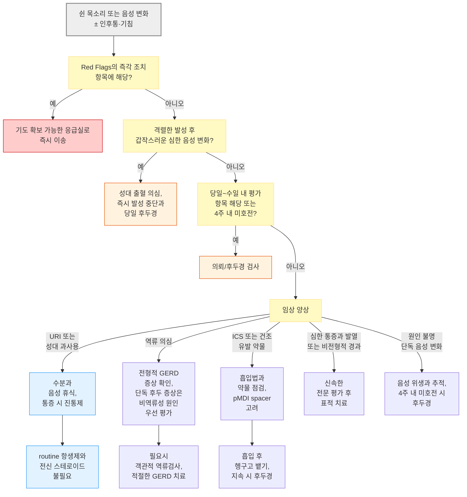

# 후두염 Laryngitis

## <mark style="color:green;">일반 사항</mark>

* 후두 또는 성대 점막의 염증으로, 쉰 목소리(dysphonia)를 주증상으로 하는 임상 증후군
* 급성 후두염 : ＜3주 지속; 대부분 바이러스 원인
  * 원인 및 악화 요인을 피하고 적절히 관리하면 대개 1\~2주 내 호전되며 보통 3주 이내 회복
* 만성 후두염 : ≥3주 지속; 반복적 자극 또는 기저 질환에 의함
  * 다만 3주 이상 지속되는 쉰 목소리에는 성대 결절·종양·성대 마비 등 다른 원인도 포함되므로, 지속 시 후두경으로 원인을 감별

## <mark style="color:green;">원인 및 위험 인자</mark>

* 감염 : 바이러스(대부분; URI 관련), 세균(드묾), 진균(면역 저하자·흡입 스테로이드 사용자)
* 비감염성 원인·악화 요인 : 공기 건조, 오염된 공기·연기 흡입, 흡연, 위식도역류질환(GERD)/인후두역류(LPR), 알레르겐, 후비루, 성대 과사용, 기도 삽관 등의 외상, 흡입 스테로이드(ICS)

<table><thead><tr><th width="186">구분</th><th>주요 원인·위험 인자</th></tr></thead><tbody><tr><td>급성</td><td>상기도 감염(바이러스), 외상(기도 삽관), 성대 과사용(말하기·노래·소리 지르기), 심한 기침, 면역 저하</td></tr><tr><td>만성</td><td>알레르기·만성 비부비동염, 지속적인 성대 과사용(교사·상담원·가수 등), GERD/LPR, 흡연, 과도한 음주, ICS 사용, 환경오염</td></tr><tr><td>후두염 없이 dysphonia를 유발·악화할 수 있는 상태</td><td>뇌졸중·파킨슨병 등 신경계 질환, 반회후두신경 마비, 노인성 성대 위축, 류마티스관절염의 윤상피열관절 침범, sarcoidosis 등 침윤성 질환, 갑상선기능저하증, 점막을 건조하게 하는 약물(항콜린제·항히스타민제), ACEI 유발 기침</td></tr></tbody></table>


**ICS(흡입 스테로이드)와 dysphonia** : ICS는 국소 점막 자극, 성대 기능 변화·근병증 또는 칸디다증 등을 통해 dysphonia를 유발할 수 있음. 흡입기 사용법을 점검하고 흡입 후 물로 입안을 헹구며, 정량식흡입기(pMDI)는 spacer 사용을 고려. 증상이 지속되면 처방의와 상의하여 최소 유효 용량·제형 조절 및 후두경 검사를 검토하며, 환자가 임의로 ICS를 중단하지 않도록 교육. ICS 사용력만으로 진균성 후두염을 진단하거나 항진균제를 경험적으로 투여하지 않음



**ACEI(ACE 억제제)와 dysphonia** : ACEI 유발 기침은 후두 자극과 쉰 목소리를 유발하여 만성 후두염으로 오인될 수 있음. 만성 기침·쉰 목소리 환자에서 ACEI 복용력을 확인하고, 임상적으로 의심되면 ARB 등으로 대체한 후 호전 여부를 추적(대개 1\~4주, 일부는 더 오래 지속)


## <mark style="color:green;">임상 양상</mark>

* 쉰 목소리, 인후통, 마른기침
* URI에 의한 경우 : 인후통, 기침, 콧물, 발열, 피로감, 경부 림프절 종대 동반 가능

### <mark style="color:$danger;">🚩 Red Flags!</mark>

<mark style="color:$danger;">**즉각 조치**</mark>

* 흡기성 협착음(stridor), 급격하거나 진행하는 호흡곤란·청색증 `급성 상기도 폐쇄` `후두개염/성문상염`
* 인두 소견에 비해 심한 인후통·연하통 + 고열·먹먹한 목소리(hot-potato voice)·독성 병색 `후두개염/성문상염` `심경부 감염`
* 침도 삼키지 못하고 흘림(drooling), tripod 자세 `후두개염/성문상염`
* 입술·혀·인두의 급속한 부종, 또는 두드러기·저혈압을 동반한 쉰 목소리 `혈관부종(ACEI 등)` `아나필락시스`
* 화재 연기·뜨거운 증기 흡입, 부식제 섭취 또는 경부 외상 후 발생한 쉰 목소리 `흡입 손상` `후두 외상`

<mark style="color:$warning;">**당일\~수일 내 평가**</mark>

* 설명되지 않는 경부 종괴, 진행성 연하곤란·연하통, 의도하지 않은 체중 감소 동반 `후두암` `두경부암`
* 쉰 목소리와 동반된 객혈(hemoptysis) `후두암` `하기도 병변`
* 흡연력이 있거나 45세 이상에서 지속적이고 설명되지 않는 쉰 목소리 `후두암`
* 최근 두경부·갑상선·흉부 수술 또는 기관삽관 후 발생한 dysphonia, 특히 흡인·약한 기침 동반 `반회후두신경 마비` `삽관 손상`
* 갑자기 발생한 기식성·약한 목소리 또는 흡인 증상 `성대 마비`
* 면역 저하자에서 비전형적이거나 치료에 반응하지 않는 후두염 `진균성 후두염` `결핵성 후두염`
* 소리 지르기·노래·심한 기침 직후 갑작스러운 심한 음성 변화·실성 `성대 출혈`

<mark style="color:$info;">**조기 평가 및 추적**</mark>

* 명확한 양성 원인이 있더라도 4주 이내에 호전되지 않는 dysphonia `기질적 후두 병변`
* 반복되는 dysphonia 또는 점차 악화되는 음성 변화 `성대 결절/폴립` `후두 전암 병변`
* 3주 이상 지속되는 인후 이물감·기침 등에서 초기 관리 후 호전이 없거나 진단이 불확실한 경우 `만성 후두염` `LPR`

## <mark style="color:green;">진단</mark>

* 임상 진단 : 급성 URI 또는 성대 과사용 후 발생한 전형적인 쉰 목소리·인후통·마른기침은 병력과 진찰로 진단하며 routine 검사는 필요하지 않음
* 원인별 검사 : GAS 인두염, 인플루엔자·COVID-19 등의 검사는 해당 감염이 의심되고 결과가 치료·격리 결정에 영향을 줄 때 선택적으로 시행
  * 쉰 목소리·기침·콧물은 바이러스성 감염을 시사하여 GAS 사전확률이 낮으므로, 후두염 증상이 뚜렷하면 GAS 검사는 대개 필요하지 않음
* 후두경 검사 : dysphonia가 4주 이내에 호전되지 않거나 Red Flag·심각한 원인 의심 시 기간과 관계없이 시행/의뢰 <mark style="color:$info;">\[Otolaryngol Head Neck Surg 2018]</mark>
  * 흡연력, 45세 이상의 지속적이고 설명되지 않는 쉰 목소리(후두암 의심 의뢰 기준) <mark style="color:$info;">\[NICE NG12]</mark>, 경부 종괴, 최근 두경부·흉부 수술/기관삽관, professional voice user에서는 4주를 기다리지 않고 조기 평가 고려
* 영상 검사 : 주증상이 dysphonia인 환자에서는 특별한 예외가 없는 한 CT/MRI보다 후두 시각화를 먼저 시행

### <mark style="color:orange;">감별</mark>

<table data-search="false"><thead><tr><th width="161">질환</th><th>감별 포인트</th></tr></thead><tbody><tr><td>후두개염/성문상염</td><td>인두 소견에 비해 심한 인후통·연하통, 고열, 침 흘림, 먹먹한 목소리, 독성 병색, 진행 시 stridor; 특히 소아 또는 기도폐쇄가 의심되는 환자에서는 설압자를 이용한 강제 인두 진찰 등 불필요한 자극을 피하고 편한 자세를 유지하며 응급 기도 평가 <mark style="color:$info;">[RCH]</mark></td></tr><tr><td>크루프(croup)</td><td>주로 소아; 개 짖는 기침(barking cough), 흡기성 협착음(stridor)</td></tr><tr><td>성대 출혈</td><td>격렬한 발성·심한 기침 직후 갑작스러운 심한 음성 변화·실성; 통증이 없을 수도 있음. 즉시 발성 중단, 당일 후두경 평가</td></tr><tr><td>성대 결절/폴립</td><td>음성 직업군; 서서히 진행하거나 반복되는 dysphonia; 후두경으로 확인</td></tr><tr><td>후두암·전암 병변<br>(백반증·이형성)</td><td>흡연력·고령, 경부 종괴·연하곤란·객혈·체중 감소; 지속되거나 점차 악화되는 dysphonia; 백색 판·궤양; 후두경 ± 생검</td></tr><tr><td>Reinke 부종</td><td>장기 흡연; 낮고 거친 목소리; 후두경으로 확인, 금연이 기본</td></tr><tr><td>재발성 호흡기 유두종증 (RRP)</td><td>HPV 관련, 소아·성인 모두; 진행성 dysphonia, 진행 시 기도 협착; 후두경으로 확인</td></tr><tr><td>근긴장성 발성장애</td><td>음성 피로, 목의 긴장감, 힘주어 말하는 양상; 후두 병변 배제 후 진단</td></tr><tr><td>연축성 발성장애<br>(후두 근긴장이상)</td><td>끊기거나 쥐어짜는 목소리, 말할 때만 나타나는 과제 특이적 양상; 이비인후과 의뢰</td></tr><tr><td>인후두역류(LPR)</td><td>인후 이물감, 만성 기침·목청소; 증상이나 후두경 소견만으로 진단하지 않으며 과잉 진단 주의</td></tr><tr><td>ICS 유발 dysphonia</td><td>ICS 사용력; 흡입기 사용법·용량·제형 확인. 비감염성 원인이 흔하며 지속 시 후두경 고려</td></tr><tr><td>반회후두신경 마비<br>(RLN palsy)</td><td>최근 갑상선·두경부·흉부 수술, 기관삽관, 흉부 종양·대동맥류 병력; 기식성·약한 목소리, 약한 기침·흡인; ENT 의뢰</td></tr><tr><td>노인성 성대 위축<br>(Presbylaryngis)</td><td>고령; 염증 없는 성대 위축·성문 폐쇄부전; 기식성·약한 목소리; 후두경 확인 후 음성치료 고려</td></tr><tr><td>진균성·결핵성 후두염</td><td>면역 저하, 고용량 ICS, 결핵 노출·전신 증상; 백색 병변·궤양은 악성 종양과 유사할 수 있어 후두경 ± 조직검사·배양 필요</td></tr></tbody></table>

***



<p align="center"><strong>후두염 및 음성 변화 - Symptom Phenotype 기반 진단·치료 알고리듬</strong></p>

<p align="center"><em><mark style="color:$info;">저자 재구성 (참고 문헌 : Stachler RJ 2018 Otolaryngol Head Neck Surg)</mark></em></p>

***

## <mark style="background-color:$warning;">Management</mark>

### <mark style="color:orange;">치료 방침</mark>

* 보통 항생제는 필요 없음 - 대부분 바이러스성 후두염이며 세균성은 드묾
  * 동반된 GAS 인두염이 GAS RADT 또는 배양검사로 확인된 경우에만 해당 인두염을 치료
* 항생제 : 후두경 시행 여부와 관계없이 dysphonia에 routine으로 처방하지 않음 <mark style="color:$info;">\[Otolaryngol Head Neck Surg 2018]</mark>
* 전신 스테로이드 : 후두를 시각화하기 전에는 dysphonia에 routine으로 처방하지 않음
* 항역류제 : 단독 dysphonia를 증상만으로 GERD/LPR에 귀속하여 후두 시각화 없이 처방하지 않음
  * 전형적 GERD 증상이 있으면 GERD 치료는 별개로 시행
* 원인 및 악화 요인 제거가 가장 중요한 치료

## <mark style="color:green;">비-약물 치료 및 예방</mark>

* 음성 보존(relative voice rest) : 큰 소리·노래·장시간 통화·무리한 발성을 피하고, 필요한 말만 힘주지 않은 평소의 편안한 음정과 크기로 짧게 함 (☞ [목쉼](../222_/058_-hoarseness.md#undefined-11))
  * 속삭이기도 일부 환자에서는 후두 긴장을 높일 수 있으므로 피함
  * 장기간의 절대적 음성 휴식보다 증상에 맞춘 상대적 휴식을 권함
* 안전한 실내 가습 : 주관적 증상 완화에 도움이 될 수 있으나 근거는 제한적
  * 뜨거운 물그릇을 이용한 증기 흡입은 화상 위험 때문에 권하지 않음 <mark style="color:$info;">\[NHS]</mark>
* 성대 출혈이 의심되는 경우는 예외 : 관찰 없이 즉시 발성을 중단한 뒤 당일 후두경 평가 <mark style="color:$info;">\[AAO-HNSF]</mark>, 이후 음성 휴식 범위·기간은 전문의 판단
* 충분한 수분 섭취 : 수분 제한이 필요한 심부전·신부전·간경변 등이 없다면 탈수가 되지 않도록 적절히 섭취
* 음성치료(언어재활사) : 만성 dysphonia, 근긴장성 발성장애, 성대 결절 등에서 후두경 평가 후 1차 치료로 권고 <mark style="color:$info;">\[Otolaryngol Head Neck Surg 2018]</mark>
* 금연 : 흡연은 성대 점막을 직접 손상시킴. 만성 후두염의 주요 원인
* 알레르겐 회피, 실내 습도 유지(40\~60%), 마스크 착용
* [GERD](../224_/081_-gerd.md)/[LPR](062_-laryngopharyngeal-reflux.md) 관리 : 가슴쓰림·산 역류 등 전형적인 역류 증상이 있으면 식후 3시간 내 눕지 않고 개인별 유발 음식·음료를 피함
  * LPR(인후두역류) 과잉 진단 주의 : 전형적 GERD 증상 없이 단독 dysphonia·이물감·만성 기침만 있는 경우 증상만으로 LPR을 진단하거나 경험적 PPI를 routine으로 처방하지 않음. 지속 시 후두 평가를 시행함. 후두경의 발적·부종 등은 비특이적이므로 후두경 소견만으로 LPR을 확진하지 않음. 단독 후두 증상이 지속되어 역류 질환으로 진단·치료하려는 경우 보행성 역류 감시 등 객관적 평가를 고려하며, 상부위장관 내시경은 식도 병변·합병증 및 다른 원인 평가에 활용함 <mark style="color:$info;">\[Am J Gastroenterol 2026, 2022]</mark>
* ICS 관련 dysphonia 예방 : 흡입 후 물로 입안을 헹구고 뱉기
  * 흡입기 사용법을 재교육하며 pMDI는 spacer 사용 고려
  * 증상 지속 시 처방의와 상의하여 최소 유효 용량·제형 조절 및 후두경 검사 검토
* 개인위생 : 손 씻기, 호흡기 질환 예방

## <mark style="color:green;">약물 치료</mark>

* 통증·기침·콧물 : 대증 치료 (☞ [인후통](061_-acute-pharyngitis.md#undefined-14), [기침](../220_/006_-cough.md#management), [감기](060_-common-cold.md#management))
* 항생제 : 후두염 단독으로는 원칙적으로 불필요
  * 명확한 바이러스성 소견이 없는 동반 인두염에서 GAS 검사가 필요한지는 [Centor/McIsaac](061_-acute-pharyngitis.md#centor-score-modified-mcisaac) 또는 FeverPAIN 등 임상 점수 체계(FeverPAIN은 일부 지침에서 사용하나, IDSA 2025에서는 임상 판단 단독과 비교한 연구가 없어 해당 비교 분석에 포함되지 않음) <mark style="color:$info;">\[Clin Infect Dis 2025]</mark>, 연령별 검사 전략과 임상 양상에 따라 결정
  * 적절히 시행한 GAS RADT 또는 배양검사가 양성이면 amoxicillin 500 ㎎ bid × 10일 <mark style="color:blue;">\[파목신]</mark>; 성인의 GAS RADT 음성에서는 routine 배양검사나 경험적 항생제 처방을 권하지 않음 <mark style="color:$info;">\[CDC]</mark>
* 복합 진해거담제 : 기침이 수면·일상을 방해할 때만 단기간 선택적으로 사용하며, 급성 상기도 감염 기침에서 codeine 계열의 효과 근거는 제한적. <mark style="color:blue;">코데닝</mark>·<mark style="color:blue;">코푸시럽</mark> 등에 함유된 chlorpheniramine은 구강·인후 건조로 음성 불편을 악화시킬 수 있고 dihydrocodeine은 졸림·호흡억제 위험이 있으므로 필요성을 재평가
  * 12세 미만·수유부, 녹내장, 전립선비대 등 하부요로폐색 환자, MAO억제제 복용 중이거나 중단 후 2주 이내에는 사용하지 않고, 18세 미만의 비만·폐쇄성 수면무호흡·중증 폐질환에서는 피하며, 임부에게는 유익성이 위험성을 상회할 때만 신중히 투여
* 항진균제 : ICS 사용자·면역 저하자에서 지속성 dysphonia, 백색 병변·궤양 등으로 진균성 후두염이 의심되면 후두경 검사 ± 조직검사·배양 의뢰
  * ICS 사용력만으로 fluconazole을 경험적으로 투여하지 않으며, Candida 등 원인 진균이 확인되면 균종·침범 범위·면역 상태와 국내 허가사항에 따라 치료
* 스테로이드 : 후두를 시각화하기 전에는 일반 환자뿐 아니라 professional voice user에서도 routine으로 처방하지 않음
  * professional voice user에서 중요한 일정이 임박했거나 dysphonia가 심하면 조기 후두경 검사 의뢰
  * 후두경으로 급성 염증성 성대 부종이 확인되고 성대 출혈·진균 감염 등 금기가 배제된 선택적 환자에서만, 기대 이득과 고혈당·불면·감염 악화 등의 위험을 설명한 후 전문가 판단하에 단기 전신 스테로이드를 고려

***

## <mark style="color:red;">질병코드</mark>

* J04.0 급성 후두염 Acute laryngitis
* J37.0 만성 후두염 Chronic laryngitis

***

## <mark style="color:purple;">처방례</mark>

> **처방례 1. 성인의 바이러스성 급성 후두염 (대부분의 경우)**
>
> ```
> 부루펜 200 ㎎/T  1회 1～2T, 1일 3회, 식후 필요시 × 3～5일
> ```
>
> _✽기침이 수면·일상을 방해할 때 코데닝 1회 2T, 1일 3회 식후 × 3\~5일을 선택적으로 추가; 졸림·인후 건조에 주의하고 항생제는 처방하지 않음_

> **처방례 2. 성인의 GAS 인두염이 동반된 급성 후두염 - GAS RADT 또는 배양검사 양성**
>
> ```
> 파목신 500 ㎎/C        1회 1C, 1일 2회 × 10일
> 부루펜 200 ㎎/T        1회 1～2T, 1일 3회, 식후 필요시 × 3～5일
> ```
>
> _✽amoxicillin 500 ㎎ bid × 10일은 GAS 인두염의 지침 권장 요법임. 파목신의 국내 허가상 성인 표준 용법은 1회 250\~500 ㎎, 1일 3회이며 연령·증상에 따라 증감하도록 기재되어 있어 차이가 있음_\
> _✽기침이 수면·일상을 방해할 때 코푸 시럽 20 ㎖/P 1회 1포, 필요시(1일 최대 4회, 식후 및 취침 시) × 3\~5일을 선택적으로 추가; 졸림·인후 건조에 주의_\
> _✽쉰 목소리·기침·콧물 등 바이러스성 임상 양상이 뚜렷하면 GAS 검사는 대개 시행하지 않음; 그 밖의 인두염은 임상 점수·연령으로 검사 여부를 정하되, 가족 내 GAS 노출, 류마티스열 병력, 성홍열·국소 합병증 의심 시에는 점수와 관계없이 검사를 고려_\
> _✽후두염 단독(인두염 미동반)에는 이 처방례를 사용하지 않음_

***

### <mark style="color:$success;">핵심 복약 지도</mark>

* **항생제 불필요 원칙** - 후두염의 대부분은 항생제가 필요하지 않으며, 목을 쉬게 하는 것이 가장 중요한 치료임을 설명
* **amoxicillin** - GAS 인두염이 확인되어 처방된 경우 증상이 호전되어도 10일 요법을 완료; 남은 약을 보관하거나 다른 사람과 나누지 않음
* **ibuprofen** - 공복 복용을 삼가고 다른 NSAID와 중복 복용하지 않음. 위장관 궤양·출혈 또는 그 병력, 기관지천식 또는 그 병력, 아스피린·NSAID 과민반응 병력, 심한 신장장애·간장애·심장기능부전·고혈압에서는 사용하지 않음; 심혈관질환 병력자·고령자는 주의하고, 임신 20주 이후에는 피하며 임신 말기 3개월에는 금기
* **dihydrocodeine 복합 진해거담제** - 기침이 일상을 방해할 때만 사용하며 구강·인후 건조로 목소리 불편이 악화될 수 있음. 졸릴 수 있으므로 운전·위험한 기계 조작 및 음주를 피함. 다른 진해거담제·감기약·항히스타민제·진정제와 함께 복용하지 않음. 12세 미만·수유부, 녹내장·전립선비대 등 하부요로폐색 환자는 복용하지 않음; 임신 중이거나 호흡기질환·수면무호흡이 있으면 처방의에게 알림
* **ICS 사용 중인 경우** - 흡입 후 물로 입안을 헹구고 뱉으며, 임의로 중단하지 않음. 증상 지속 시 흡입기 사용법, pMDI의 spacer 사용, 용량·제형 조절을 처방의와 의논

***

## <mark style="color:blue;">환자 안내서</mark>

**후두염이란?**\
목소리를 만드는 성대(후두)에 염증이 생긴 상태입니다. **대부분 감기 바이러스가 원인이며, 항생제는 필요하지 않습니다.** 충분한 휴식과 관리로 대개 1\~2주 안에 좋아지지만, 일부는 더 오래 지속될 수 있습니다. 호전되지 않거나 나빠지면 진료를 받으세요.

**가장 중요한 치료는 목을 쉬게 하는 것입니다**

* 큰 소리나 무리한 발성을 피하고, 꼭 말해야 할 때는 힘주지 않은 평소의 편안한 목소리로 짧게 하세요.
* 속삭이는 것도 성대에 부담이 될 수 있으니 주의하세요.
* 소리를 지르거나 노래한 직후 갑자기 목소리가 심하게 변하거나 나오지 않으면 성대 출혈 가능성이 있으므로, 말을 멈추고 당일 이비인후과 진료를 받으세요.

**집에서 할 수 있는 관리법**

* 심장·콩팥·간질환 등으로 수분 섭취를 제한하라는 지시를 받은 경우가 아니라면 탈수가 되지 않도록 물을 충분히 드세요.
* 따뜻한 소금물(물 1컵\[약 250 ㎖]에 소금 ½ 작은술\[약 3 g])로 가글하면 동반된 목 통증을 일시적으로 완화할 수 있으나, 후두 또는 성대 염증을 직접 치료하는 것은 아닙니다.
* 실내 습도를 40\~60%로 유지하고 가습기는 깨끗하게 관리하세요. 뜨거운 물그릇에 얼굴을 대고 증기를 들이마시는 방법은 화상 위험 때문에 피하세요.
* 담배와 연기·분진을 피하고, 역류 증상이 있다면 식후 3시간 안에 눕지 말고 본인에게 증상을 유발하는 음식·음료를 줄이세요.

**이런 증상이 생기면 즉시 응급실로**

* 숨을 들이쉴 때 목에서 날카롭고 거친 소리가 나거나 숨쉬기가 힘든 경우
* 음식이나 침을 삼키기 매우 힘들고 침이 저절로 흐르거나, 심한 목 통증과 고열·먹먹한 목소리가 함께 있는 경우
* 입술·혀·목이 갑자기 붓거나, 연기·뜨거운 김을 들이마시거나 목을 다친 뒤 목소리가 변한 경우

**다음 증상은 신속히 진료받으세요**

* 쉰 목소리와 함께 피가 섞인 가래, 목의 덩이, 삼킴곤란 또는 의도하지 않은 체중 감소가 있는 경우
* 최근 목·갑상선·가슴 수술 또는 기관삽관 후 쉰 목소리, 약한 기침이나 사레가 발생한 경우
* 흡연력이 있으면서 원인을 알 수 없는 쉰 목소리가 지속되거나 점차 심해지는 경우
* **4주 이내에 쉰 목소리가 호전되지 않는 경우** - 후두경 검사가 필요합니다.

**약 복용 안내**

* 항생제를 처방받으셨다면 처방된 날짜까지 모두 복용하세요.
* 진해거담제는 기침 때문에 필요한 경우에만 복용하세요. 졸리거나 입과 목이 마를 수 있으므로 운전·음주를 피하고, 목소리 불편이 심해지면 의료진과 상의하세요.
* 흡입 스테로이드(ICS)를 쓰신다면 흡입 후 물로 입안을 헹구고 뱉으세요. 쉰 목소리가 지속되어도 임의로 중단하지 말고 처방한 의료진과 상의하세요.

***

## <mark style="color:green;">주요 참고문헌 및 확인 자료</mark>

### <mark style="color:orange;">임상 근거</mark>

* \[Otolaryngol Head Neck Surg 2018] [Stachler RJ, et al. Clinical Practice Guideline: Hoarseness (Dysphonia) (Update). Otolaryngol Head Neck Surg. 2018;158(1\_suppl):S1-S42.](https://doi.org/10.1177/0194599817751030) - 4주 이내 미호전 시 후두경, 조기 평가 인자, 음성치료, 항생제·스테로이드·항역류제의 제한적 사용
* \[Clin Infect Dis 2025] [Linder JA, et al. 2025 Clinical Practice Guideline Update by the Infectious Diseases Society of America on Group A Streptococcal Pharyngitis: Risk Assessment Using Clinical Scoring Systems in Children and Adults. Clin Infect Dis. 2026;82(Suppl 3):i97-i104.](https://doi.org/10.1093/cid/ciaf668) - 임상 점수 체계에 의한 GAS 검사 선별
* \[NICE NG12] [NICE. Suspected cancer: recognition and referral (NG12).](https://www.nice.org.uk/guidance/ng12) - 45세 이상 지속성 쉰 목소리의 후두암 의뢰 기준
* \[AAO-HNSF] [AAO-HNSF. ENT Health: Hoarseness.](https://www.enthealth.org/conditions/hoarseness/) - 성대 출혈의 발성 중단·신속한 전문 평가와 음성 위생
* \[NHS] [NHS. Respiratory tract infections (RTIs).](https://www.nhs.uk/conditions/respiratory-tract-infection/) - 호흡기 감염의 자가 관리와 뜨거운 물그릇 증기 흡입의 화상 위험
* \[CDC] [CDC. Clinical Guidance for Group A Streptococcal Pharyngitis.](https://www.cdc.gov/group-a-strep/hcp/clinical-guidance/strep-throat.html) - 동반 GAS 인두염의 검사 적응증·확진 후 치료; 단독 후두염과 구분
* \[Am J Gastroenterol 2026] [Yadlapati R, et al. The San Diego Consensus for Laryngopharyngeal Symptoms and Laryngopharyngeal Reflux Disease. Am J Gastroenterol. 2026;121(2):322-336.](https://doi.org/10.14309/ajg.0000000000003482) - 후두경 소견만으로 LPR 진단 불가, 객관적 역류 평가의 적응증
* \[Am J Gastroenterol 2022] [Katz PO, et al. ACG Clinical Guideline for the Diagnosis and Management of Gastroesophageal Reflux Disease. Am J Gastroenterol. 2022;117(1):27-56.](https://doi.org/10.14309/ajg.0000000000001538) - 식도 외 증상의 평가, 상부위장관 내시경과 보행성 역류 감시의 역할
* \[RCH] [Royal Children's Hospital Melbourne. Clinical Practice Guidelines: Acute upper airway obstruction.](https://www.rch.org.au/clinicalguide/guideline_index/Acute_upper_airway_obstruction/) - 소아 상기도폐쇄에서 불필요한 자극 회피, 편한 자세 유지와 기도 평가

### <mark style="color:orange;">허가·급여 확인 자료</mark>

* [식품의약품안전처. 의약품안전나라 - 의약품 품목허가정보.](https://nedrug.mfds.go.kr/index) - 국내 제품별 적응증·용법·금기 및 허가 상태 확인
