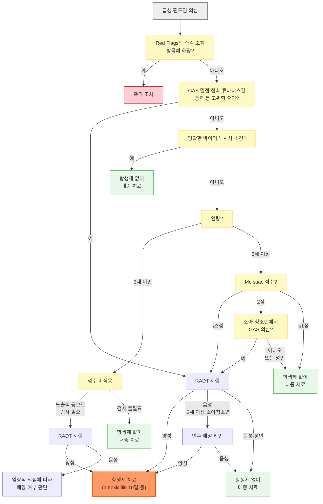

# 편도염 Tonsillitis

## <mark style="color:green;">일반 사항</mark>

* 편도(tonsil)의 감염 또는 염증 상태
* 편도는 통상 구개 편도(palatine tonsil)를 지칭
* 편도 및 아데노이드&#x20;
  * 기능 : 림프 조직의 일부로서 호흡기 점막의 1차 방어 역할
  * 4\~10세에 가장 활성; 사춘기 이후 활동 및 크기 감소
  * Adenotonsillar hypertrophy : 3\~6세에 최대, 8세 이후 자연 감소
  * 비대에 따른 증상 : 구강 호흡, 입마름, 인두 이물감, 코골이, 수면 장애, 이관 폐쇄, 중이염

#### <mark style="color:$primary;">분류</mark>

* 급성 : 수일 내 발생하는 감염·염증
* 재발성(recurrent) : 급성 에피소드의 반복
  * 편도 절제 적응증 평가 대상
* 만성(chronic) : 지속적인 인두 불편감·구취·tonsillar crypt(편도와)의 찌꺼기 또는 편도결석 등이 반복되는 상태의 임상적 지칭; 보편적으로 합의된 기간·진단 기준은 없음

## <mark style="color:green;">원인</mark>

#### <mark style="color:$primary;">급성 편도염</mark>

* 바이러스 : 대부분 차지; adenovirus, rhinovirus, coronavirus(SARS-CoV-2 포함), influenza virus, enterovirus(coxsackievirus), HSV, EBV, CMV, HIV 등
* 세균 : GABHS(GAS, Group A β-hemolytic Streptococcus 또는 _S. pyogenes_)가 가장 중요
  * 전체 급성 인두염의 약 20\~30%(소아) / 5\~15%(성인) 차지
* 기타 세균 : group C/G streptococcus, _Fusobacterium necrophorum_, _N. gonorrhoeae_, _C. diphtheriae_, _M. pneumoniae_ 등

#### <mark style="color:$primary;">만성 편도염</mark>

* 재발성 급성 편도염에서는 GAS 재감염, 치료 순응도, 보균 상태에서의 바이러스 감염, tonsillar crypt 내 biofilm 등을 고려
* 만성 인두 증상은 GERD/인후두역류, 후비루·알레르기, 흡연·건조 등 비감염성 원인이 편도염 양상처럼 나타날 수 있으므로 감별 필요

## <mark style="color:green;">임상 양상</mark>

#### <mark style="color:$primary;">급성 편도염</mark>

* 구강 증상 : 편도 비대, 삼출물(tonsillar exudate), 구개 점상 출혈, 삼킴 통증, 입마름
* 전신 증상 : 발열(＞38℃), 오한, 무기력, 두통, 근육통
* 기타 : 귀 통증(방사통), 압통을 동반한 전경부 림프절병증
* 경과 : 일부는 3\~4일 내 뚜렷하게 호전하며 대부분 1주 이내 자연 호전
  * 원인과 무관하게 자연 호전할 수 있으므로 임상 경과만으로 세균성 여부를 판단하지 않음

#### <mark style="color:$primary;">만성/재발성 편도염</mark>

* 구강 증상 : 구취, 만성 인두염, 이물감, cryptic plug
  * cryptic plug : tonsillar crypt에 상피 세포·림프구·세균·음식물 찌꺼기가 축적된 악취 덩어리
  * 편도결석(tonsillolith) : cryptic plug의 석회화로 형성
* 편도 크기 : 만성에서 오히려 위축될 수 있음; 크기만으로 감염 여부 판단 불가

### <mark style="color:$danger;">🚩 Red Flags!</mark>

<mark style="color:$danger;">**즉각 조치**</mark>

* 개구 장애(trismus)  `편도주위농양`
* 목소리 변화(hot potato voice) + uvula의 반대측 편위  `편도주위농양`
* 호흡 곤란 또는 흡기성 협착음(stridor)  `후두 부종` `심부경부감염`
* 과도한 침 흘림(drooling) + 삼킴 불능  `후두개염` `심부경부감염`
* 경부 강직 + 발열  `수막염` `심부경부감염`
* 의식 변화, 저혈압 또는 쇼크 징후  `패혈증` `연쇄알균 독성 쇼크 증후군`
* 초기 인후통 후 일시적 호전 → 수일 뒤 고열 재발 + 경부 통증·종창  `Lemierre 증후군`
* 편도절제술 후 구강·인두 출혈(특히 술후 5\~10일)

<mark style="color:$warning;">**당일\~수일 내 평가**</mark>

* 빠르게 진행하는 일측성 편도 비대, 궤양·출혈, 경부 종괴, 체중 감소 또는 지속적 편측 귀 방사통  `림프종` `편도 악성 종양`
* 항생제 치료에도 48\~72시간 내 호전 없는 심한 세균성 편도염
* 전신 증상 악화(경구 섭취 불량, 고열 지속)
* GAS 감염 후 수 주 이내 이동성 다발관절염, 흉통·호흡곤란·두근거림, 무도병 또는 특징적 발진  `급성 류마티스열`
* GAS 감염 1\~3주 후 콜라색 소변, 눈꺼풀·하지 부종 또는 혈압 상승  `연쇄알균 감염 후 사구체신염`

<mark style="color:$info;">**조기 평가 및 추적**</mark>

* 항생제 치료 완료 후에도 재발하는 반복성 편도염
* 반복되는 증상성 편도결석으로 생활에 불편이 있는 경우
* 소아에서 편도·아데노이드 비대, 코골이, 구강 호흡, 수면 무호흡 또는 성장·학업·행동 문제가 동반된 경우

## <mark style="color:green;">진단</mark>

#### <mark style="color:$primary;">1단계 : 바이러스 시사 소견 확인</mark>

<table><thead><tr><th width="163.5294189453125">바이러스 시사 소견</th><th width="409.1763916015625">임상 의의</th></tr></thead><tbody><tr><td>기침</td><td>GABHS 가능성 ↓</td></tr><tr><td>콧물·비루</td><td>바이러스성 상기도 감염 시사</td></tr><tr><td>결막염</td><td>adenovirus 등 바이러스 패턴</td></tr><tr><td>쉰 목소리(애성)</td><td>후두 침범 → 세균성 편도염과 구분</td></tr><tr><td>구내 궤양·수포</td><td>herpes, herpangina 등 바이러스 감별</td></tr></tbody></table>

> 위와 같은 명확한 바이러스 시사 소견이 있으면 GABHS 가능성이 낮음 → 특별한 고위험 요인이 없으면 GAS 검사를 시행하지 않고 항생제 없이 대증 치료

#### <mark style="color:$primary;">2단계 : McIsaac 점수 (GABHS 예측)</mark>

* 명확한 바이러스 시사 소견이 없는 3세 이상에서 적용
* 낮은 점수는 GAS 가능성이 낮다는 뜻이며 바이러스성 확진 기준은 아님
* 3세 미만에는 점수를 적용하지 않으며 GAS 검사를 routine으로 시행하지 않음
* 증상이 있고 GAS 확진 가족과의 밀접 접촉 등 위험 요인이 있으면 선택적으로 검사 고려

<table data-search="false"><thead><tr><th width="290">항목</th><th width="80">점수</th></tr></thead><tbody><tr><td>편도 삼출물 또는 부종</td><td>+1</td></tr><tr><td>압통을 동반한 전경부 림프절 종대</td><td>+1</td></tr><tr><td>발열 (＞38℃)</td><td>+1</td></tr><tr><td>기침 <strong>없음</strong></td><td>+1</td></tr><tr><td>나이 3~14세</td><td>+1</td></tr><tr><td>나이 15~44세</td><td>0</td></tr><tr><td>나이 ≥45세</td><td>-1</td></tr></tbody></table>

<table><thead><tr><th width="59">점수</th><th width="65">GAS 위험도</th><th>성인 권장 처치</th><th>소아·청소년 권장 처치 (3세 이상)</th></tr></thead><tbody><tr><td>≤1</td><td>낮음</td><td colspan="2">고위험 요인이 없으면 통상 검사·항생제 없이 대증 치료</td></tr><tr><td>2</td><td>중간</td><td>통상 검사·항생제 없이 대증 치료[국내 지침]; 유행·밀접 접촉·류마티스열 병력 등이 있으면 검사 고려</td><td>점수만으로 검사를 생략하지 않으며, 학령기·노출력·임상 양상을 종합하여 GAS가 의심되면 RADT 고려</td></tr><tr><td>3</td><td>중간</td><td>RADT 시행; 양성 시 항생제. 검사가 불가능할 때만 경험적 항생제 제한적 고려</td><td>RADT 시행; 음성이면 인후 배양으로 확인</td></tr><tr><td>4~5</td><td>높음</td><td>RADT 시행; 점수만으로 확진하지 않음. 검사가 불가능할 때만 경험적 항생제 제한적 고려</td><td>RADT 시행; 음성이면 인후 배양으로 확인</td></tr></tbody></table>

> 검사 전략의 적용 범위 : 국내 성인 항생제 지침은 19세 이상을 대상으로 하므로 소아에 그대로 적용하지 않음. 점수별 예측 확률은 대상 집단과 유병률에 따라 달라 고정 수치로 해석하지 않음
>
> 고위험군 주의 : McIsaac 점수는 검사를 생략할 수 있는 저위험군 선별에 유용하지만 절대 기준은 아님. GAS 밀접 접촉, 류마티스열 병력, 면역 저하 또는 국소·전신 합병증 의심 시 점수와 무관하게 검사·추가 평가 고려; 합병증이 의심되면 GAS 검사 때문에 의뢰를 지연하지 않음

<p align="center"><em><mark style="color:$info;">Ref. 질병관리청·대한항균요법학회. 2026 급성 상기도 감염 항생제 적정사용을 위한 실무지침, 2026년 4월 발행; IDSA GAS Pharyngitis Guideline Update 2025</mark></em></p>

### <mark style="color:orange;">검사</mark>

* 신속 항원 검사(RADT) : 민감도는 검사법에 따라 약 70\~90%, 특이도 95% 이상
  * 3세 이상 소아·청소년에서 음성이면 인후 배양 검사로 확인
  * 성인에서 음성이면 인후 배양을 routine으로 시행하지 않음
* 신속 분자검사(PCR 등) : 검증된 고감도 NAAT가 음성이면 확인 배양을 생략할 수 있음
  * 보균자까지 검출되므로 McIsaac 점수 등으로 검사 대상을 선별하는 것이 더 중요함
* 인후 배양 검사 : GABHS 진단 표준; 결과 24\~48시간 소요
* CBC : EBV가 의심되거나 중증도 평가가 필요할 때 선택적으로 시행; 이형림프구(atypical lymphocyte) ＞10%는 EBV를 시사하지만 단독 확진 소견은 아님
* EBV 검사 : 필요시 EBV VCA IgM·VCA IgG·EBNA 항체 조합을 임상 시점에 맞춰 판정
  * Heterophile antibody(Monospot)는 위양성·위음성이 있고 특히 발병 초기·어린 소아에서 민감도가 낮아 일반적인 EBV 확진검사로 사용하지 않음

### <mark style="color:orange;">감별</mark>

#### <mark style="color:$primary;">림프종(Lymphoma)</mark>

* 임상 양상 : 일측성 편도의 빠르게 진행하는 비대; 궤양·출혈 동반 가능
* 동반 증상 : 야간 발한, 발열, 체중 감소, 전신 림프절병증

#### <mark style="color:$primary;">EBV 전염성 단핵구증</mark>

* 특징적 임상 양상 : 삼출성 편도염 + 다른 인후 증상에 비해 두드러지는 심한 피로 + 후경부(posterior cervical) 림프절병증 + 비장비대
* 검사 소견 : 이형림프구 증가, 간효소(AST/ALT) 이상 등이 진단을 지지; 단독 확진 소견은 아님
  * 필요시 EBV 특이항체(VCA IgM·VCA IgG·EBNA)로 확인하며, Monospot 결과만으로 확진·배제하지 않음
* 감별 포인트 : amoxicillin/ampicillin 투여 후 반구진 발진이 나타날 수 있으나 발생률은 과거 알려진 80\~100%보다 낮고 연구마다 차이가 큼; 발진만으로 EBV를 확진하거나 영구적인 penicillin 알레르기로 단정하지 않음
* 처치 : 해열진통제와 수분 공급 중심
  * uncomplicated EBV 감염에는 스테로이드를 사용하지 않으며 기도 폐쇄 위험 등 중증 합병증에서만 고려
  * 전염단핵구증은 amoxicillin·ampicillin의 국내 허가상 투여 금기이므로, EBV가 확인되거나 강하게 의심되면 이들 약제를 쓰지 않음
  * GAS 동시 감염 등 항생제 적응증이 확인되면 알레르기 병력 등을 고려하여 1세대 세팔로스포린 등 대체 약제를 선택
* 운동 : 비장비대 촉진 여부와 관계없이 증상 시작 후 최소 3주간 운동을 피함. 이후 임상적으로 회복되고 발열이 없으면 가벼운 비접촉 운동부터 단계적으로 재개하며, 접촉 스포츠는 비장 파열 위험을 설명하고 개별 결정

#### <mark style="color:$primary;">편도주위농양(Peritonsillar Abscess)</mark>

* 임상 양상 : 편측 인후통 심화, trismus, hot potato voice, uvula의 반대측 편위
* 처치 : 기도 평가, 배농(바늘 흡인 또는 절개 배농) 및 항생제 → 이비인후과 즉시 의뢰

#### <mark style="color:$primary;">기타 중요 감별</mark>

* 디프테리아 : 예방접종 미완료·유행 지역 여행력, 제거하면 출혈하는 회백색 위막&#x20;
  * 즉시 격리·신고 및 항독소/항생제 치료 평가
* 성홍열 : GAS 인두편도염 + 사포 같은 발진, 딸기혀
* 급성 HIV 감염·임균성 인두염 : 성 노출력과 전신 발진·점막 병변 등을 확인하여 위험에 따라 검사
* 후두개염·후인두농양 : 침 흘림, 삼킴 불능, 경부 강직·신전 제한, 독성 병색 또는 호흡곤란
* _Fusobacterium necrophorum_ 감염 : 청소년·젊은 성인에서 악화하거나 재발하는 인후통, 고열, 편측 경부 통증·종창 시 Lemierre 증후군 고려

***



> 3세 미만에서 선택적으로 시행한 RADT가 음성이면 확인 배양을 일률적으로 시행하지 않고 임상적 의심에 따라 판단함(고위험 요인 경로 포함).\
> 검사를 시행할 수 없는 경우 McIsaac ≥3점인 성인에 한해 경험적 항생제를 제한적으로 고려하며, 소아·청소년은 검사 가능 기관과 추적 계획을 정함.\
> 대증 치료 또는 항생제 치료 후 호전이 없으면 재평가하고(항생제 사용 시 48\~72시간 기준), 악화·합병증 징후가 있으면 예정일 전에 즉시 재평가함.

<p align="center"><strong>급성 편도염 진단 및 치료 알고리듬</strong></p>

<p align="center"><em><mark style="color:$info;">저자 재구성 (참고 문헌 : 질병관리청·대한항균요법학회 2026; IDSA 2025)</mark></em></p>

***

## <mark style="background-color:$warning;">Management</mark>

### <mark style="color:orange;">치료 원칙</mark>

* 명확한 바이러스 시사 소견이 있으면 특별한 고위험 요인이 없는 한 검사·항생제 없이 대증 치료
* GABHS가 확인되면 항생제 종류별 권장 기간을 완료 (penicillin/amoxicillin은 10일)
* 증상이 호전된 환자에서 치료 후 추적검사(test of cure)를 routine으로 시행하지 않으며, 무증상 가족 접촉자도 routine으로 검사·치료하지 않음. GAS 보균자는 원칙적으로 치료 대상이 아님

<mark style="color:cyan;">**치료 실패 평가 (48\~72시간 재평가)**</mark>

* 항생제 시작 48\~72시간 후에도 호전 없을 경우 다음을 순서대로 확인

1. 복약 순응도 : 처방 지시대로 복용 중인지 확인
2. EBV 가능성 : 단핵구증 임상 양상 재검토; 필요시 EBV 특이항체 검사 시행
3. 편도주위농양 발생 : 편측 편도 비대·uvula의 반대측 편위·trismus 발생 여부 확인
4. 다른 병원체·재감염·GAS 보균 가능성 : 배양 결과와 임상 양상 확인
   * 임상적으로 의미 있는 GAS의 penicillin 내성은 보고되지 않았으나 β-lactam 감수성이 감소한 분리주가 드물게 보고됨; 치료 실패를 단순히 내성으로 단정하지 않음
   * 필요시 2차 항생제 또는 이비인후과 의뢰
5. Lemierre 증후군 : 일시적 호전 후 고열 재발 + 경부 통증·종창 → 조영 증강 CT 긴급 시행 또는 즉시 전원

## <mark style="color:green;">비-약물 치료 및 예방</mark>

* 충분한 수분 섭취 : 연하 통증이 있으면 차가운 음료·아이스크림 등으로 수분 유지
* 충분한 휴식 : 특히 발열 기간 중 안정
* 소금물 가글 : 인후통을 일시적으로 완화할 수 있음
  * 따뜻한 생리식염수 또는 소금물(물 1컵\[약 250 ㎖]에 소금 ½ 작은술\[약 3 g])로 가글 → 삼키지 않고 뱉음
* 부드러운 음식 : 연하 통증이 있는 동안 죽·두부·요거트 등 자극이 적은 음식
* 금연 : 흡연은 편도 점막 손상 및 면역 기능 저하
* 격리 : GABHS 확인 시 적절한 항생제 시작 후 최소 12\~24시간이 지나고 발열이 없어질 때까지 등교·출근 자제

## <mark style="color:green;">약물 치료</mark>

### <mark style="color:orange;">대증 치료</mark>

#### <mark style="color:$primary;">해열진통제</mark>

<mark style="color:cyan;">**NSAID**</mark>

* 통증·발열 완화에 효과적
* 최소 유효용량을 최단기간 사용하고 위장 불편이 있으면 음식과 함께 복용
* 금기(ibuprofen 국내 허가사항) : 위장관 궤양·출혈 또는 그 병력, 기관지천식 또는 그 병력, 아스피린·다른 NSAID 과민반응 또는 그 병력, 심한 혈액이상·간장애·신장장애·심장기능부전·고혈압, CABG 전후 통증, 임신 말기 3개월, 고용량 methotrexate 투여 중
* 주의 : 탈수·섭취 불량, 항응고제 복용, 경증\~중등도 신기능 저하·고령에서는 사용을 피하거나 신중히 판단
* 임신 20주 이후에는 태아 신기능 장애·양수과소증 위험이 있어 원칙적으로 사용을 피함
* ibuprofen <mark style="color:blue;">\[부루펜]</mark>
  * 성인 : 200\~400 ㎎ q6\~8hr 필요시 복용 <mark style="color:blue;">\[부루펜]</mark>
  * 소아 : 5\~10 ㎎/㎏ q6\~8hr, 최대 40 ㎎/㎏/d; 일반적인 임상 사용은 생후 6개월 이상에서 고려, 허가사항에 명시된 금기 연령은 없음
    * <mark style="color:blue;">\[어린이부루펜시럽]</mark> 20 ㎎/㎖. 1회 0.25\~0.5 ㎖/㎏ q6\~8hr; 국내 허가사항에는 만 1세 이상에서 용법 제시
* naproxen sodium : 초회 550 ㎎ 후 275 ㎎ q6\~8hr (최대 1,375 ㎎/d) <mark style="color:blue;">\[아나프록스]</mark>; 인후통·편도염은 제품 허가 적응증에 직접 열거되어 있지 않음

<mark style="color:cyan;">**Acetaminophen**</mark>

* 항염 효과 없으나 위장 장애·CKD·고령·임산부에서 NSAID 대체 선택
* 성인 : 650\~1,000 ㎎ q4\~6hr; 최대 4 g/d이나 일반적으로 3 g/d 이하 권장. 만성 간질환, 과량 음주, 영양불량·저체중에서는 2 g/d 이하 등 개별 조정 <mark style="color:blue;">\[타이레놀]</mark>
  * 서방형 : 650 ㎎ × (1\~)2정 q8hr; 최대 6정/d(3,900 ㎎) <mark style="color:blue;">\[타이레놀 8시간 이알]</mark>; 씹거나 쪼개지 말고 그대로 삼킬 것
* 소아 : 10\~15 ㎎/㎏ q4\~6hr, 최대 5회/d 및 75 ㎎/㎏/d(성인 최대량을 넘기지 않음); 허가사항에 명시된 금기 연령은 없음
  * <mark style="color:blue;">\[세토펜현탁액]</mark>(32 ㎎/㎖. 1회 약 0.31\~0.47 ㎖/㎏ q4\~6hr; 최대 5회/d 및 75 ㎎/㎏/d); 국내 허가사항에는 생후 4개월 이상에서 용법 제시

#### <mark style="color:$primary;">스테로이드 (routine 사용하지 않음)</mark>

<mark style="color:cyan;">**Dexamethasone**</mark>

* 표준 해열진통제에 비해 추가 이득은 제한적이며 지침별 권고가 일치하지 않음; routine으로 처방하지 않음
* 진통제로 조절되지 않는 매우 심한 인후통에서 심부경부감염·농양·기도 위험을 배제한 후 제한적인 이득과 위험을 설명하고 단회 투여를 선택적으로 고려
* 성인 : 10 ㎎ 단회 IM <mark style="color:blue;">\[덱사메타손주]</mark>
* 소아 : 0.6 ㎎/㎏ 단회 (최대 10 ㎎); 5세 미만은 근거가 제한적이므로 일반적인 선택적 인후통 치료로 권고하지 않음
* 반복 사용하지 않음; BMJ 권고는 재발성 인후통의 반복 에피소드에 적용되지 않으며 누적 투여의 위험은 평가되지 않았음. 당뇨병, 면역 저하, 활동성 소화성 궤양 등에서는 위험·이득을 신중히 평가
* EBV 단핵구증에서는 uncomplicated disease에 사용하지 않으며, 심한 편도 비대로 기도 압박이 우려되는 경우에만 고려

### <mark style="color:orange;">항생제</mark>

> _<mark style="color:$info;">Ref. 질병관리청·대한항균요법학회. 2026 급성 상기도 감염 항생제 적정사용을 위한 실무지침, 2026년 4월 발행(성인 대상); 소아 용량은 IDSA 2012</mark>_

* GABHS에 amoxicillin이 1차 선택제인 이유 : GABHS는 β-lactamase를 생성하지 않으므로 amoxicillin 단독으로 완전 치료 가능; 좁은 스펙트럼으로 장내 세균총 영향 최소화
  * 단순 급성 GABHS 편도염에서 amoxicillin/clavulanate는 불필요하게 광범위하므로 사용을 제한
* EBV(전염성 단핵구증) 의심 시 amoxicillin·ampicillin을 투여하지 않음(전염단핵구증은 국내 허가상 금기)
  * 반구진 발진이 나타날 수 있으나 발생률은 과거 알려진 80\~100%보다 낮고 연구마다 차이가 큼
  * 발진은 EBV 확진 소견이나 영구적인 penicillin 알레르기의 증거가 아님
* '검사 기반 처방' 원칙 : 성인에서 McIsaac ≥3점은 RADT를 시행하여 양성이면 처방
  * 경험적 항생제는 McIsaac ≥3점이면서 RADT를 시행할 수 없는 경우에 제한적으로 고려

#### <mark style="color:$primary;">GABHS 급성 편도염</mark>

**1차 선택**

* amoxicillin :&#x20;
  * 성인 : amoxicillin 500 ㎎ bid 또는 1,000 ㎎ qd × 10일 <mark style="color:blue;">\[파목신]</mark>
  * 소아 : 50 ㎎/㎏ qd 또는 25 ㎎/㎏/회 bid (최대 1 g/day) × 10일 <mark style="color:blue;">\[파목신시럽]</mark>(조제 후 amoxicillin 25 ㎎/㎖)
  * 위 용법은 GAS 치료 지침 권장 요법이며, 국내 허가 용법(성인·20 ㎏ 이상 250\~500 ㎎ tid, 20 ㎏ 미만 20\~40 ㎎/㎏/day를 3회 분할)과 차이가 있음
  * 액상 제형을 구하기 어렵거나 사용할 수 없으면 cefadroxil 건조시럽(☞ 아래 1세대 세팔로스포린) 등을 대안으로 고려

#### <mark style="color:$primary;">페니실린에 대한 경증 비즉시형 반응 (단순 반구진 발진 등)</mark>

**1세대 세팔로스포린** (1차)

* SJS/TEN·DRESS 등 중증 피부반응 또는 약물 유발 장기 손상 병력은 제외. 이러한 중증 지연형 반응에서는 관련 β-lactam을 임의로 대체하지 말고 약물 알레르기 전문 평가
* cephalexin 500 ㎎ bid × 10일 <mark style="color:blue;">\[팔렉신]</mark>
  * 소아 : 20 ㎎/㎏/회 bid (최대 500 ㎎/회) × 10일; 국내에는 시럽 제형이 없음
* cefadroxil 1,000 ㎎ qd × 10일 <mark style="color:blue;">\[듀리세프]</mark>
  * 소아 : 30 ㎎/㎏ qd (최대 1 g) × 10일 <mark style="color:blue;">\[듀리세프건조시럽]</mark>(250 ㎎/5 ㎖)

#### <mark style="color:$primary;">페니실린 즉시형 알레르기 (아나필락시스, Type I)</mark>

* clindamycin : 300 ㎎ tid × 10일 <mark style="color:blue;">\[훌그램]</mark>
  * 소아 : 7 ㎎/㎏/회 tid (최대 300 ㎎/회) × 10일
* azithromycin : 500 ㎎ qd × 5일 <mark style="color:blue;">\[지스로맥스]</mark> <mark style="color:$info;">\[질병청 성인 인두편도염 지침 2026]</mark>
  * 소아 : 12 ㎎/㎏ qd (최대 500 ㎎) × 5일 <mark style="color:$info;">\[Clin Infect Dis 2012]</mark>
  * 위 용법은 국내 허가 용법(성인 500 ㎎ qd × 3일 또는 1일차 500 ㎎ 후 250 ㎎ qd × 4일, 소아 10 ㎎/㎏ qd × 3일 또는 1일차 10 ㎎/㎏ 후 5 ㎎/㎏ qd × 4일)과 차이가 있음
* clarithromycin 250 ㎎ bid × 10일 <mark style="color:blue;">\[클래리시드]</mark>
  * 소아 : 7.5 ㎎/㎏/회 bid (최대 250 ㎎/회) × 10일


**macrolide 사용 주의** : 국내 GAS의 erythromycin 내성률은 2002년 소아 인두염 분리주에서 약 45%까지 보고되었으나, 이후 일부 연구에서는 낮게 보고됨(2017년 창원 지역 소아 인두염 분리주 3.2%, 2012\~2019년 국내 소아 GAS 분리주 1.2%). 다만 지역·시기·유행 emm 유형에 따라 달라질 수 있고 중국에서는 90%를 넘는 보고가 있음. azithromycin·clarithromycin은 페니실린 즉시형 알레르기 등 β-lactam을 사용할 수 없는 환자에게 제한하고, 48\~72시간 내 치료 반응을 반드시 재평가. Clindamycin도 내성이 발생할 수 있으므로 감수성과 임상 반응을 고려\
_<mark style="color:$info;">(Ref. Korean J Lab Med 2010; J Med Microbiol 2019; J Microbiol Immunol Infect 2022; Pediatr Pulmonol 2009. 연구별 지역·대상·조사 시기가 달라 현재 전국 외래 편도염의 내성률로 일반화하지 않음)</mark>_

**GAS 편도염에 사용하지 않는 항생제** : tetracyclines, fluoroquinolones, sulfonamide


#### <mark style="color:$primary;">치료 실패·재발성 세균성 편도염</mark>

* 만성 인두 불편감·편도결석만으로 항생제를 처방하지 않음
* 재발한 각 급성 에피소드에서 바이러스 감염, GAS 재감염·보균 및 다른 병원체 여부를 재평가
* 적절한 1차 치료와 순응도에도 48\~72시간 내 호전이 없고 농양 등 합병증을 배제한 경우 배양 결과·최근 항생제 사용을 고려하여 다음 2차 약제를 선택
  * amoxicillin/clavulanate : 625 ㎎ tid × 10일 <mark style="color:blue;">\[오구멘틴]</mark>
  * 1세대 세팔로스포린 : cephalexin 또는 cefadroxil; 경증 비즉시형 penicillin 알레르기에서는 사용 가능; 중증 지연형 반응은 제외
  * 3세대 세팔로스포린 : cefpodoxime <mark style="color:blue;">\[바난]</mark> 또는 cefdinir <mark style="color:blue;">\[애니세프]</mark>; 불필요한 광범위 사용을 피하고 배양 결과·임상 반응에 따라 선택
  * clindamycin : 300 ㎎ tid × 10일 <mark style="color:blue;">\[훌그램]</mark> - 감수성·_C. difficile_ 감염 위험 고려

## <mark style="color:green;">시술 및 기타 처치</mark>

### <mark style="color:orange;">편도결석 관리</mark>

* 편도결석은 대부분 경과 관찰
* 구강 위생, 충분한 수분 섭취, 소금물(물 1컵\[약 250 ㎖]에 소금 ½ 작은술\[약 3 g]) 가글로 관리(삼키지 않고 뱉음)
* 면봉·날카로운 기구 또는 강한 water jet을 이용한 공격적인 자가 제거는 출혈·점막 손상·흡인 위험이 있어 피함
* 크거나 깊이 박혀 있거나 통증·연하곤란·구취가 지속되는 경우 이비인후과에서 제거 또는 cryptolysis/편도절제술을 개별 검토; 질산은 소작을 routine으로 권고할 근거는 부족

### <mark style="color:orange;">편도 절제</mark>

#### <mark style="color:$primary;">효과 및 한계</mark>

* 소아 재발성 급성 편도염에서는 성장과 함께 감염 에피소드가 자연 감소할 수 있으므로 수술의 절대적 이득이 제한될 수 있음
  * 감염 빈도 기준 미달 시 watchful waiting 권고; 폐쇄성 수면 호흡 장애 등 다른 수술 적응증은 별도로 판단
* 수면 장애 동반 adenotonsillar hypertrophy 소아에서 절제 후 유의한 성장 증가 보고
* 경증 수면 호흡 장애 소아(PATS 시험)에서 조기 편도·아데노이드절제술은 증상·삶의 질을 개선했으나, 12개월 실행기능·주의력에서는 유의한 차이가 없었음 <mark style="color:$info;">\[JAMA 2023]</mark>
* 대부분의 연구에서 편도·아데노이드 절제 후 임상적으로 유의한 지속적 면역기능 저하를 뒷받침하는 근거는 부족함 <mark style="color:$info;">\[Int J Pediatr Otorhinolaryngol 2015]</mark>
* 적응증을 충족한 성인 재발성 급성 편도염에서는 NATTINA 연구에서 편도절제술이 보존 치료보다 24개월 동안 인후통 부담을 줄이고 비용 효과적인 것으로 보고됨. 다만 성인은 고정된 횟수만으로 판단하지 않고 증상의 중증도·일상생활 장애·합병증을 함께 고려
* 감염 빈도 외에 삶의 질, 등교·직장 결근, 수술 후 약 2주간의 심한 통증과 출혈·재입원 위험을 함께 고려하여 공동 의사결정

> _<mark style="color:$info;">Ref. Wilson JA et al. Lancet. 2023;401:2051-2059. NATTINA trial; Evidence-Based Interventions. Tonsillectomy for recurrent tonsillitis. Reviewed 2024</mark>_

#### <mark style="color:$primary;">편도절제술 적응증</mark>

* 아래 빈도·에피소드 기록 기준은 AAO-HNS 소아 지침의 기준임; 성인의 빈도 기준과 공동 의사결정은 EBI 권고를 함께 참고
* 의무기록으로 확인된 임상적으로 유의하고 적절히 치료된 급성 편도염이 일상생활·등교·근무를 방해하면서 다음 빈도로 발생한 경우 : ① 최근 1년 동안 ≥7회, 또는 ② 최근 2년 동안 매년 ≥5회, 또는 ③ 최근 3년 동안 매년 ≥3회
  * 각 에피소드 기록 기준 : 인후통 및 다음 중 하나 이상; ① 경부 림프절병증, ② 편도 삼출물, ③ GABHS 검사 양성, ④ 체온 ＞38.3℃
* 위 적응증에 해당하지 않더라도 다음 경우에는 절제술 검토
  * 다수 항생제에 대한 알레르기/불내성
  * PFAPA (periodic fever, aphthous stomatitis, pharyngitis, & adenitis)
  * ≥2회 편도주위농양 병력 (성인의 경우 1회 후에도 개별 검토 가능)
  * 편도비대와 폐쇄성 수면 호흡 장애가 있는 소아에서 성장 장애, 저조한 학업 성취도, 야뇨, 천식, 행동 장애 등이 동반된 경우
    * 2세 미만 또는 비만, Down 증후군, 두개안면 이상, 신경근질환, 겸상적혈구병, 점액다당류증 등 고위험군이거나 진찰 소견과 보고된 중증도가 불일치하면 수술 전 수면다원검사 권고
    * 수면다원검사로 확인된 폐쇄성 수면무호흡에서는 편도절제술 권고; 수술 후에도 수면 호흡 장애가 지속·재발할 수 있음을 설명
    * 수술 후 야간 입원 관찰 : 3세 미만 또는 중증 OSA(AHI ≥10회/hr 또는 최저 산소포화도 ＜80%)인 소아; 수술 전 PSG의 2세 미만 기준과 구분

> _<mark style="color:$info;">Ref. Mitchell RB et al. Otolaryngol Head Neck Surg. 2019;160(1\_suppl):S1-S42. AAO-HNS Clinical Practice Guideline: Tonsillectomy in Children - Update 2019</mark>_

#### <mark style="color:$primary;">수술 후 관리</mark>

* (소아 지침 기준) 수술 전후 항생제를 routine으로 사용하지 않음
* 수술 후 진통은 ibuprofen·acetaminophen; 편도·아데노이드절제술 후 18세 미만에는 codeine 함유 제제를 사용하지 않음(수술 후 안전 원칙)
  * 국내 codeine 단일제(예: <mark style="color:blue;">\[인산코데인]</mark>)의 허가상 금기 : 12세 이하의 소아; 폐쇄성 수면무호흡증 치료를 위해 편도절제술 또는 아데노이드절제술을 받은 18세 이하의 환자. 수술 후 일반적 사용 제한과 국내 제품별 금기 문구를 구분
* 수술 후 출혈은 대개 술후 5\~10일(가피 탈락 시기)에 발생하며, 소량이라도 즉시 내원하도록 안내

***

## <mark style="color:red;">질병코드</mark>

* J03.00 재발성으로 명시되어 있지 않은 연쇄알균성 편도염 Streptococcal tonsillitis, not specified as recurrent
* J03.01 재발성 연쇄알균성 편도염 Streptococcal tonsillitis, recurrent
* J03.80 재발성으로 명시되어 있지 않은 기타 명시된 병원체에 의한 급성 편도염 Acute tonsillitis due to other specified organisms, not specified as recurrent
* J03.81 재발성 기타 명시된 병원체에 의한 급성 편도염 Acute tonsillitis due to other specified organisms, recurrent
* J03.90 재발성으로 명시되어 있지 않은 상세불명의 급성 편도염 Acute tonsillitis, unspecified, not specified as recurrent
* J03.91 재발성 상세불명의 급성 편도염 Acute tonsillitis, unspecified, recurrent
* J35.0 만성 편도염 Chronic tonsillitis
* J36 편도주위농양 Peritonsillar abscess

***

## <mark style="color:purple;">처방례</mark>

> **처방례 1. 성인 급성 편도염 - 항생제 없이 대증 치료 (명확한 바이러스 시사 소견 또는 GAS 저위험)**
>
> ```
> 부루펜정 200 ㎎/T   2T   tid 필요시
> 코푸시럽 20 ㎖/P　　1P   tid 필요시   (기침 동반 시)
> ```
>
> _✽ 낮은 McIsaac 점수만으로 바이러스성으로 확진하지 않는다. 성인에서 McIsaac ≤2라도 밀접 접촉·류마티스열 병력 등 고위험 요인이 있으면 검사 여부를 재평가. 충분한 수분 섭취·휴식 지도. 기침이 있을 때만 진해제를 선택적으로 사용한다. 코푸시럽은 dihydrocodeine 함유 제제로 12세 미만에는 금기이고(12\~15세 미만은 1회 13 ㎖), 18세 미만의 비만·폐쇄성 수면무호흡 환자에게는 투여를 피한다._

> **처방례 2. GABHS 확인(RADT 또는 배양 양성) - 성인, 페니실린 알레르기 없음**
>
> ```
> 파목신캡슐 500 ㎎/C　　1C   bid   × 10일
> 부루펜정 200 ㎎/T   2T   tid 필요시
> ```
>
> _✽ Amoxicillin은 증상 호전 후에도 10일 전 과정 완료. 이 처방은 GAS 치료 지침 권장 용법으로 국내 제품의 기본 허가 용법(250\~500 ㎎ tid)과 차이가 있음. 복용 시작 48\~72시간 내 호전 없으면 재진. 인후통·삼킴 장애가 매우 심하면 먼저 심부경부감염·농양·기도 위험을 배제하고, 표준 진통제로 조절되지 않을 때에 한해 이득과 위험을 설명한 후 dexamethasone 10 ㎎ IM 단회를 선택적으로 고려할 수 있으나 routine 또는 반복 투여하지 않는다._

> **처방례 3. GABHS 확인 - 소아 (체중 20 ㎏ 예시)**
>
> ```
> 파목신시럽 25 ㎎/㎖(조제 후)　20 ㎖   bid   × 10일
> 어린이부루펜시럽 20 ㎎/㎖　　　7 ㎖   tid 필요시
> ```
>
> _✽ Amoxicillin 50 ㎎/㎏/day(최대 1 g/day) × 10일 전 과정 완료. 체중 20 ㎏에서 1회 500 ㎎ bid는 조제 후 파목신시럽(25 ㎎/㎖) 20 ㎖ bid에 해당하며, GAS 치료 지침 권장 용법으로 국내 제품의 기본 허가 용법과 차이가 있음. 액상 제형을 구하기 어렵거나 사용할 수 없으면 cefadroxil 30 ㎎/㎏ qd(최대 1 g) × 10일(듀리세프건조시럽 250 ㎎/5 ㎖, 20 ㎏ 기준 12 ㎖ qd)로 대체할 수 있다. 페니실린 알레르기 병력이 있으면 amoxicillin을 사용하지 않는다. 경증 비즉시형 반응이면 cefadroxil로 대체할 수 있으나, 즉시형 알레르기나 중증 지연형 반응 병력에는 cefadroxil도 적용하지 않는다(☞ 페니실린 알레르기 유형별 항목; 중증 지연형 반응은 약물 알레르기 전문 평가). 해열진통제는 체중별 최대량과 제품의 연령별 최대량을 넘기지 않는다._

> **처방례 4. GABHS - 페니실린에 대한 경증 비즉시형 발진 병력 환자**
>
> ```
> 팔렉신캡슐 500 ㎎/C　　　1C   bid   × 10일
> 부루펜정 200 ㎎/T   2T   tid 필요시
> ```
>
> _✽ cefadroxil 1 g qd × 10일로 대체 가능. 즉시형 과민반응 또는 SJS/TEN·DRESS·약물 유발 장기 손상 등 중증 지연형 반응 병력에는 이 처방례를 적용하지 않는다._

> **처방례 5. 적절한 1차 치료 후에도 호전되지 않는 재발성 세균성 편도염**
>
> ```
> 오구멘틴 625 ㎎/T   1T   tid (식후)   × 10일
> 부루펜정 200 ㎎/T   2T   tid 필요시
> ```
>
> _✽ 단순 만성 인두 불편감·편도결석에는 사용하지 않는다. 순응도, GAS 재감염·보균, EBV·다른 병원체 및 편도주위농양을 재평가하고 필요시 배양 후 선택한다. 반복 재발 시 편도 절제 적응증 평가._

***

### <mark style="color:$success;">핵심 복약 지도</mark>

> **항생제 - 왜 처방된 기간을 모두 복용해야 하나요?**
>
> 1. 증상이 2\~3일 만에 나아져도 **처방된 기간을 완료**하십시오. Penicillin·amoxicillin은 10일 요법이 표준입니다.
> 2. 중간에 끊으면 세균이 완전히 제거되지 않아 재발하거나, 드물게 류마티스열(심장 판막 손상)이 발생할 수 있습니다.
> 3. 두드러기·입술/혀 부종·호흡 곤란이 생기면 복용을 중단하고 즉시 진료받으십시오. 단순 반구진 발진도 처방 의료진에게 연락하여 평가받되, 임의로 영구적인 penicillin 알레르기로 판단하지 마십시오.
>
> ※ 세팔로스포린 일부와 azithromycin은 5일 요법이 가능하나, **류마티스열 예방 목적으로는 penicillin·amoxicillin의 10일 요법이 가장 확립된 근거**를 가집니다. 이 장의 cephalexin·cefadroxil은 10일 요법을 따릅니다.

> **해열진통제 복용법**
>
> 1. 이부프로펜·나프록센은 최소 유효용량을 필요한 기간만 복용하고, 위장 불편이 있으면 음식과 함께 복용하십시오.
> 2. 이부프로펜·나프록센 중 처방받은 한 가지만 6\~8시간 간격으로 복용하십시오. 두 약을 함께 먹거나 다른 진통소염제(일반의약품 포함)와 겹쳐 복용하지 마십시오.
> 3. 탈수·섭취 불량, 위궤양·출혈, 신장 기능 저하, 항응고제 복용 또는 임신 중이면 처방 전 반드시 알려주십시오. 상황에 따라 아세트아미노펜(타이레놀)으로 대체할 수 있습니다.

> **GABHS 감염자의 격리**
>
> 1. 적절한 항생제를 시작하면 전파력이 빠르게 감소합니다.
> 2. 항생제 시작 후 최소 **12\~24시간이 지나고 발열이 없어질 때까지** 학교·직장 출석을 삼가십시오.
> 3. 손 씻기·기침 예절을 철저히 지키십시오.

> **언제 다시 병원을 방문해야 하나요?**
>
> * 항생제 시작 48\~72시간 후에도 발열·인후통이 호전되지 않는 경우
> * **입을 벌리기 어렵거나** 목소리가 이상해진 경우 → 즉시 내원
> * **호흡이 힘들거나** 숨소리가 이상한 경우 → 즉시 내원
> * 항생제 복용 후 두드러기·입술/혀 부종·호흡 곤란이 생긴 경우 → 복용을 중단하고 즉시 내원; 단순 반구진 발진은 처방 의료진에게 연락하여 평가
> * 목이 아프다가 나아졌다 싶었는데 **며칠 뒤 고열과 목 통증이 다시 심해진** 경우 → 즉시 내원

***

## <mark style="color:green;">주요 참고문헌 및 확인 자료</mark>

### <mark style="color:orange;">임상 근거</mark>

*   질병관리청·대한항균요법학회. 2026 급성 상기도 감염 항생제 적정사용을 위한 실무지침. 2026년 4월 발행(표지 연도 2025). - 19세 이상 성인의 검사 전략, 항생제 선택·용량 및 치료 실패 평가.

    [https://www.kdca.go.kr/bbs/kdca/55/306853/download.do](https://www.kdca.go.kr/bbs/kdca/55/306853/download.do)
*   IDSA. Clinical Practice Guideline Update on Group A Streptococcal (GAS) Pharyngitis. 2025. - Part 1(임상점수에 따른 검사 대상 결정): 임상점수의 역할, 고위험군과 3세 미만의 예외.

    [https://www.idsociety.org/practice-guideline/streptococcal-pharyngitis2/](https://www.idsociety.org/practice-guideline/streptococcal-pharyngitis2/)
*   Shulman ST et al. Clinical practice guideline for the diagnosis and management of group A streptococcal pharyngitis: 2012 update by the Infectious Diseases Society of America. Clin Infect Dis. 2012;55:e86-e102. - 항생제 종류·용량·기간, 보균자 관리.

    [https://pubmed.ncbi.nlm.nih.gov/22965026/](https://pubmed.ncbi.nlm.nih.gov/22965026/)
*   CDC. Clinical Guidance for Group A Streptococcal Pharyngitis. 2025. - GAS 원인 비율, 소아 RADT 음성 후 배양, 표준 치료와 복귀 기준.

    [https://www.cdc.gov/group-a-strep/hcp/clinical-guidance/strep-throat.html](https://www.cdc.gov/group-a-strep/hcp/clinical-guidance/strep-throat.html)
*   CDC. Laboratory Testing for Epstein-Barr Virus (EBV). - EBV 특이항체 판정과 Monospot의 한계.

    [https://www.cdc.gov/epstein-barr/php/laboratories/](https://www.cdc.gov/epstein-barr/php/laboratories/)
*   CDC. Clinical Features of Penicillin Allergy. - 페니실린 알레르기 위험 분류 및 중증 지연형 반응의 전문 평가.

    [https://www.cdc.gov/antibiotic-use/hcp/clinical-signs/index.html](https://www.cdc.gov/antibiotic-use/hcp/clinical-signs/index.html)
*   Corticosteroids for sore throat: a clinical practice guideline. BMJ. 2017;358:j4090. - 단회 스테로이드의 약한 권고와 적용 범위; routine·반복 처방의 근거는 아님.

    [https://www.bmj.com/content/358/bmj.j4090](https://www.bmj.com/content/358/bmj.j4090)
*   Mitchell RB et al. Clinical Practice Guideline: Tonsillectomy in Children (Update). Otolaryngol Head Neck Surg. 2019;160(1\_suppl):S1-S42. - 소아 수술 적응증, PSG 및 수술 후 입원 관찰.

    [https://pubmed.ncbi.nlm.nih.gov/30798778/](https://pubmed.ncbi.nlm.nih.gov/30798778/)
*   Wilson JA et al. Conservative management versus tonsillectomy in adults with recurrent acute tonsillitis in the UK (NATTINA): a multicentre, open-label, randomised controlled trial. Lancet. 2023;401:2051-2059. - 적응증을 충족한 성인 재발성 편도염에서 수술의 효과와 위험.

    [https://pubmed.ncbi.nlm.nih.gov/37209706/](https://pubmed.ncbi.nlm.nih.gov/37209706/)
*   Evidence-Based Interventions. Tonsillectomy for recurrent tonsillitis. Reviewed 2024. - 재발 빈도, 일상생활 장애 및 공동 의사결정.

    [https://ebi.aomrc.org.uk/interventions/tonsillectomy-for-recurrent-tonsillitis/](https://ebi.aomrc.org.uk/interventions/tonsillectomy-for-recurrent-tonsillitis/)
*   Bitar MA et al. The effect of tonsillectomy on the immune system: a systematic review and meta-analysis. Int J Pediatr Otorhinolaryngol. 2015;79:1184-1191. - 편도절제술 후 면역기능 변화에 대한 체계적 검토.

    [https://pubmed.ncbi.nlm.nih.gov/26055199/](https://pubmed.ncbi.nlm.nih.gov/26055199/)
*   Redline S et al. Adenotonsillectomy for Snoring and Mild Sleep Apnea in Children: A Randomized Clinical Trial. JAMA. 2023;330(21):2084-2095. - PATS 시험: 경증 소아 수면 호흡 장애의 증상·삶의 질 개선과 실행기능·주의력 결과.

    [https://jamanetwork.com/journals/jama/fullarticle/2812479](https://jamanetwork.com/journals/jama/fullarticle/2812479)
*   Koh E, Kim S. Decline in erythromycin resistance in group A streptococci from acute pharyngitis due to changes in the emm genotypes rather than restriction of antibiotic use. Korean J Lab Med. 2010;30(5):485-490. - 2002년과 2009년 국내 소아 인두염 분리주의 내성률 변화.

    [https://doi.org/10.3343/kjlm.2010.30.5.485](https://doi.org/10.3343/kjlm.2010.30.5.485)
*   Kim S et al. Predominance of emm4 and antibiotic resistance of Streptococcus pyogenes in acute pharyngitis in a southern region of Korea. J Med Microbiol. 2019;68(7):1053-1058. - 2017년 창원 지역 소아 인두염 분리주의 erythromycin 내성률 3.2%.

    [https://doi.org/10.1099/jmm.0.001005](https://doi.org/10.1099/jmm.0.001005)
*   Cho YN et al. Distribution of emm genotypes in group A streptococcus isolates of Korean children from 2012 to 2019. J Microbiol Immunol Infect. 2022;55(4):671-677. - 국내 소아 GAS 분리주 169개 중 erythromycin 내성 2개(1.2%); 성홍열·침습성 감염 등을 포함한 자료로 단순 외래 인두염 자료와 구분.

    [https://doi.org/10.1016/j.jmii.2022.05.001](https://doi.org/10.1016/j.jmii.2022.05.001)
*   Liu X et al. High macrolide resistance in Streptococcus pyogenes strains isolated from children with pharyngitis in China. Pediatr Pulmonol. 2009;44(5):436-441. - 중국 소아 인두염 분리주의 높은 macrolide 내성률 보고.

    [https://doi.org/10.1002/ppul.20976](https://doi.org/10.1002/ppul.20976)
*   ASCP. Routine Reflex Throat Cultures Should Be Avoided Following a Negative Group A Streptococcus (GAS) Molecular NAAT Result in Patients Without Additional Clinical Indications. - 검증된 고감도 NAAT 음성 후 통상 확인 배양 생략; 지속되는 임상적 의심 등 예외 고려.

    [https://www.ascp.org/news/effective-test-utilization/effective-test-utilization-recommendations/effective-test-utilization-recommendation-details/ba3cbaf3-0d8f-49b0-ad8c-04ca297816c4](https://www.ascp.org/news/effective-test-utilization/effective-test-utilization-recommendations/effective-test-utilization-recommendation-details/ba3cbaf3-0d8f-49b0-ad8c-04ca297816c4)

### <mark style="color:orange;">허가·급여 확인 자료</mark>

* [식품의약품안전처. 의약품안전나라 - 의약품 품목허가정보.](https://nedrug.mfds.go.kr/index) - 국내 제품별 적응증·용법·금기 및 허가 상태 확인

***

## <mark style="color:blue;">환자 안내서</mark>


**편도염, 대부분은 항생제 없이도 낫습니다**

편도염은 대부분 바이러스 감염으로, 충분한 수분 섭취와 휴식만으로 1주일 내에 대부분 회복됩니다. 세균(A군 사슬알균, GAS) 감염이 검사로 확인된 경우 항생제가 필요하며, 검사를 시행할 수 없고 세균 감염 가능성이 높은 성인 환자에서는 의사의 판단으로 경험적 치료를 고려할 수 있습니다.


#### <mark style="color:$primary;">편도염이란 무엇인가요?</mark>

편도는 목 안쪽 양측에 위치한 림프 조직으로, 외부 세균과 바이러스를 막는 1차 방어 역할을 합니다. 편도염은 이 편도에 감염·염증이 발생한 상태입니다. 목이 아프고, 열이 나며, 편도가 붓거나 흰 삼출물이 맺힐 수 있습니다.

#### <mark style="color:$primary;">어떻게 관리하나요?</mark>

* **충분한 수분 섭취**가 가장 중요합니다. 차가운 음료나 아이스크림도 도움이 됩니다.
* **충분히 쉬십시오.** 특히 열이 있는 동안에는 안정이 중요합니다.
* 따뜻한 소금물(물 1컵\[약 250 ㎖]에 소금 ½ 작은술\[약 3 g])로 자주 **가글**하면 일시적으로 증상이 완화됩니다(삼키지 않고 뱉습니다).
* 삼키기 어려울 경우 죽·두부·요거트 등 **부드러운 음식**을 드십시오.
* **담배를 피우지 마십시오.** 흡연은 회복을 늦추고 재발 위험을 높입니다.

#### <mark style="color:$primary;">항생제가 꼭 필요한가요?</mark>

대부분의 편도염은 바이러스성이므로 항생제가 효과 없습니다. **세균(A군 사슬알균) 감염이 검사로 확인된 경우** 항생제를 사용합니다. 검사를 시행할 수 없고 감염 가능성이 높은 일부 성인에서는 의사의 판단으로 치료할 수 있습니다. 항생제가 처방된 경우 증상이 나아져도 **처방된 기간을 완료**하십시오. Penicillin·amoxicillin은 류마티스열 예방을 위해 10일간 복용하는 것이 표준입니다.

#### <mark style="color:$primary;">이럴 때는 즉시 병원을 방문하세요</mark>

* **입이 잘 벌어지지 않거나** 목소리가 이상해진 경우
* **숨쉬기가 힘들거나** 숨소리가 이상한 경우
* 침을 삼키지 못하고 흘릴 정도로 심한 경우
* 항생제 복용 후 **두드러기·입술/혀 부종·호흡 곤란**이 생긴 경우; 단순한 붉은 반점 형태의 발진은 처방 의료진에게 연락하여 평가받으십시오.
* 목의 한쪽이 **갑자기 심하게 부어오른** 경우
* **목이 아프다가 나아진 후 며칠 뒤 고열과 목 통증이 다시 심해진** 경우
