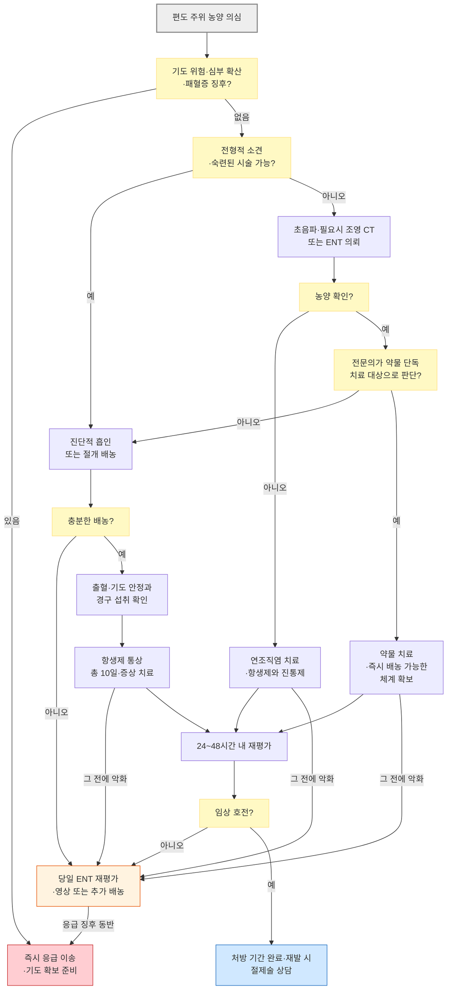

# 편도 주위 농양 Peritonsillar Abscess

## <mark style="color:green;">일반 사항</mark>

* 편도 주위 농양 (Peritonsillar Abscess, PTA) : 구개 편도의 capsule과 인두 수축근 사이의 편도 주위 공간에 고름이 축적된 상태
  * 편도 주위 연조직염 (Peritonsillar Cellulitis) : 같은 부위에 감염·염증은 있으나 고름이 고이지 않은 단계 - 조기 발견 시 항생제 단독으로 치료 가능
* 성인의 두경부 심부 감염 중 가장 흔한 형태
* 주로 청소년·젊은 성인(20\~40세)에 호발
* 합병증 : 기도 폐쇄, 부인두(인두옆) 공간 농양, 후인두 농양, 하행 괴사성 종격동염, 경정맥 패혈성 혈전정맥염 (Lemierre syndrome), 경동맥 침식·가성동맥류에 의한 출혈, 흡인성 폐렴, 패혈증

## <mark style="color:green;">원인</mark>

* 유발 기전(가설) : Weber 점액선(편도 상극 부위 소타액선) 감염 → 편도 주위 연조직염 → 농양 형성으로 진행
* 위험 인자 : 흡연, 반복성 편도염
* 대부분 호기성·혐기성 균주의 복합 감염
* 호기성 균주 : Group A Streptococcus (GAS, _S. pyogenes_), _Streptococcus anginosus_ group, _S. aureus_, _H. influenzae_
* 혐기성 균주 : _Fusobacterium necrophorum_, _Peptostreptococcus_ spp., _Prevotella_ spp.
  * _F. necrophoru&#x6D;_&#xC740; 청소년·젊은 성인에서 상대적으로 많으며, _S. anginosus_ group 검출 환자는 이들보다 평균 연령이 높았음 <mark style="color:$info;">\[Sci Rep 2026]</mark>
  * _F. necrophorum_ 감염은 Lemierre syndrome(경정맥 패혈성 혈전정맥염 + 혐기성 패혈 전이)의 주요 원인균임을 유념

## <mark style="color:green;">임상 양상</mark>

* 발열, 오한, 전신 권태감
  * 항생제를 먼저 투여받았거나 국소 감염에 머문 경우 발열이 없을 수 있음
* 점진적으로 악화되는 심한 편측 인후통, 동측 이통(referred otalgia)
* 개구 장애(trismus) : 내측 익상근 자극·연축으로 발생; 단순 편도염과 구분되는 핵심 소견
* 연하 통증, 연하 곤란, 침 흘림
* 먹먹하고 우물거리는 음성(muffled “hot potato” voice) : 공명 공간 변형에 의한 특징적 음성 변화
* 구강 악취
* 이학적 소견 : 환측 편도·편도 전주(anterior pillar) 및 연구개의 홍반성 부종, 반대측으로의 목젖 변위, 경부 림프절병증

### <mark style="color:$danger;">🚩 Red Flags!</mark>

<mark style="color:$danger;">**즉각 조치**</mark>

* 분비물을 삼키지 못하는 심한 침흘림, 빠르게 진행하는 구강저·경부 부종  `기도 폐쇄`
* 협착음(stridor), 호흡 곤란, 저산소증·청색증, tripod position  `기도 폐쇄` `급성 후두개염`
* 의식 저하 또는 호흡 피로 징후  `호흡부전`
* 악하 공간 부종·경결, 혀 거상  `Ludwig's angina`
* 경부 강직·운동 제한, 하악각 아래 경부 종창  `후인두 농양` `부인두 농양`
* 영상에서 부인두·후인두 등 심부 경부 공간으로의 확산  `심부 경부 감염`
* 인후통 수일 후 고열 지속 + 흉쇄유돌근 전연 압통 + 흉통·기침·혈담  `Lemierre syndrome`
* 구강 내 출혈·객혈 또는 편도 부위 박동성 종괴  `경동맥 침식` `가성동맥류`
* 흉골 뒤 통증, 경부 하부·흉벽 부종  `하행 괴사성 종격동염`
* 저혈압, 빈맥, 의식 변화  `패혈증`

<mark style="color:$warning;">**당일 평가**</mark>

* 소아 또는 면역 저하 환자(면역억제제, 조절되지 않는 당뇨병, HIV 등)의 PTA 의심
* 심한 개구 장애로 구강 내 관찰·시술이 불가능  `하극·심부 농양`
* 경구 수분·약물 섭취 불가  `탈수`
* 양측성 편도 주위 팽윤  `양측성 PTA`
* 배농 후 24\~48시간에도 개구 장애·발열·인후통 미호전 또는 그 전 악화  `배농 불충분` `다방성 농양`
* 항생제 치료 중 편측 팽윤·연하통 진행  `연조직염의 농양 진행`

<mark style="color:$info;">**조기 평가 및 추적**</mark>

* PTA 회복 후 반복성 편도염 병력 또는 PTA 2회 이상  `재발성 PTA`
* 항생제에 반응하지 않는 편측 편도 비대·무통성 궤양  `편도 종양`
* 양측 편도 비대 + 후경부 림프절병증·비장비대 또는 amoxicillin 투여 후 발진  `전염성 단핵구증`

## <mark style="color:green;">진단</mark>

### <mark style="color:orange;">임상 진단</mark>

* 편측 심한 인후통, trismus, 연구개 팽윤 및 목젖의 반대측 편위는 PTA를 강하게 시사하지만, 이 소견들만으로 농양과 연조직염을 확실히 구분할 수는 없음
* 전형적인 소견이 있고 숙련된 시술자가 즉시 배농할 수 있는 경우에는 영상 없이 진단적 needle aspiration을 시행할 수 있음
* 진단이 불확실하거나 비전형적 소견, 심한 trismus, 초기 흡인 실패가 있으면 초음파 또는 조영 증강 CT로 재평가
* 편도 부위에 박동성 종괴가 만져지거나 보이면 경동맥 가성동맥류·이상 주행 가능성이 있으므로 천자하지 않고 영상(조영 CT·CTA) 또는 이비인후과 평가를 우선

### <mark style="color:orange;">영상 검사</mark>

* 기도 불안정 환자에서 영상검사를 위해 기도 처치를 지연하지 않음

#### <mark style="color:$primary;">초음파 및 진단적 흡인</mark>

<mark style="color:cyan;">**초음파검사**</mark>&#x20;

* 농양 cavity 확인 및 needle aspiration 유도에 유용
* 구강 내 초음파 (Intraoral ultrasound) : 농양 vs 연조직염 감별 시 우선 고려할 수 있는 영상
  * 시술자 숙련도와 장비 접근성을 고려
  * 민감도 91%, 특이도 75%로 배제에 비교적 유용하나 확진 특이도는 중등도 <mark style="color:$info;">\[Acad Emerg Med 2023]</mark>
* 경부 초음파 : 민감도 80%, 특이도 81%로 심한 trismus 등 구강 내 접근이 어려울 때 대안

<mark style="color:cyan;">**고름 흡인**</mark>

* 진단 겸 치료법
* 고름이 흡인되지 않아도 연조직염으로 단정하지 말고, 부정확한 위치·작은 또는 다방성 농양·하극/후방 농양을 고려하여 초음파·CT 또는 이비인후과 평가

#### <mark style="color:$primary;">CT (조영 증강)</mark>

* 적응증 : 진단이 불확실하거나 심한 trismus로 구강 내 평가가 어렵고 초음파를 시행할 수 없는 경우, 초기 흡인 실패, 하극/후방 농양 또는 부인두·후인두 농양·Ludwig's angina 등 심부 확산 의심

### <mark style="color:orange;">감별</mark>

#### <mark style="color:$primary;">PTA vs 중증 편도염 vs 급성 후두개염 감별</mark>

<table data-search="false"><thead><tr><th width="105">항목</th><th>편도 주위 농양 (PTA)</th><th>중증 편도염</th><th>급성 후두개염</th></tr></thead><tbody><tr><td><strong>발병 양상</strong></td><td>점진적 (수일)</td><td>급성</td><td>급격할 수 있음</td></tr><tr><td><strong>통증 부위</strong></td><td>편측, 매우 심함</td><td>대개 양측</td><td>구강 소견에 비해 연하통이 매우 심함</td></tr><tr><td><strong>Trismus</strong></td><td>흔함</td><td>드묾</td><td>대개 없음</td></tr><tr><td><strong>음성 변화</strong></td><td>Muffled “hot potato” voice</td><td>경미할 수 있음</td><td>먹먹하거나 쉰 음성</td></tr><tr><td><strong>침흘림</strong></td><td>가능</td><td>드묾</td><td>분비물 처리 곤란 시 발생</td></tr><tr><td><strong>호흡 곤란</strong></td><td>드묾 (진행 시 발생)</td><td>대개 없음</td><td>기도 폐쇄 위험</td></tr><tr><td><strong>Stridor</strong></td><td>비전형적</td><td>비전형적</td><td>나타나면 중증 기도 폐쇄 시사</td></tr><tr><td><strong>자세</strong></td><td>특별한 자세 없음</td><td>정상</td><td>Tripod position 가능</td></tr><tr><td><strong>구강 시진</strong></td><td>연구개 부종 + anterior pillar bulging + 목젖 반대측 편위</td><td>양측 편도 비대 ±<br>삼출물</td><td>구강 소견이 정상 또는 경미할 수 있음</td></tr><tr><td><strong>기도 위험도</strong></td><td>진행 정도에 따라 다름</td><td>대개 낮음</td><td>매우 높음 - 즉시 대응</td></tr><tr><td><strong>진단 확인</strong></td><td>Aspiration / 초음파; 필요시 조영 증강 CT</td><td>임상 진단</td><td>기도가 안정적이면 ENT의 flexible nasolaryngoscopy; X-ray/CT는 보조 검사</td></tr></tbody></table>


**급성 후두개염(epiglottitis)은 성인에서도 발생하며, 구강 소견이 정상에 가까워 PTA로 오인될 수 있음.** 구강 소견에 비해 심한 연하통, 분비물 처리 곤란, 호흡 곤란 또는 협착음이 있으면 즉시 기도 평가와 이비인후과 협진이 필요함. 기도 불안정 시 영상이나 무리한 인두 검사를 위해 기도 확보를 지연하지 않음


#### <mark style="color:$primary;">기타 감별 질환</mark>

<table data-search="false"><thead><tr><th width="139.58819580078125">질환</th><th width="318.11767578125">감별 포인트</th><th>비고</th></tr></thead><tbody><tr><td><strong>편도 주위</strong><br><strong>연조직염</strong></td><td>PTA와 소견이 중복될 수 있음; 초음파에서 명확한 농양 cavity 없음</td><td>항생제 치료 후 24~48시간 재평가</td></tr><tr><td><strong>편도 내 농양</strong><br><strong>(intratonsillar abscess)</strong></td><td>편도 실질 내 농양; 연구개 팽윤과 목젖 편위가 적음</td><td>초음파·CT로 감별</td></tr><tr><td><strong>전염성 단핵구증</strong><br><strong>(EBV)</strong></td><td>양측성 심한 편도 비대, 후경부 림프절병증, 비장비대; CBC 및 필요시 EBV 특이 항체</td><td>amoxicillin 함유 제제 투여 금기(발진 위험); PTA와 공존 가능</td></tr><tr><td><strong>부인두 농양</strong></td><td>하악각 아래 경부 종창, 사경, 편도의 내측 전위</td><td>조영 증강 CT; 즉시 이비인후과 의뢰</td></tr><tr><td><strong>후인두 농양</strong></td><td>경부 강직, 경부 굴곡 제한, 인두후벽 팽윤</td><td>기도가 안정적이면 조영 증강 CT; 즉시 이비인후과 의뢰</td></tr><tr><td><strong>Ludwig's</strong><br><strong>angina</strong></td><td>악하 공간 부종·경결, 혀 거상, 기도 폐쇄 위험; 주로 치성 감염에서 기원</td><td>응급 기도 평가·확보</td></tr><tr><td><strong>치성 감염</strong></td><td>하악 대구치 우식·치주 농양 동반</td><td>치과·구강외과 협진</td></tr><tr><td><strong>편도 종양</strong></td><td>무통성; 항생제 무반응; 편측 편도 비대 지속</td><td>악성 종양 배제 위해 이비인후과 평가·조직검사</td></tr></tbody></table>


외래에서 절대 놓치면 안 되는 3가지 :\
**기도 폐쇄** (Airway compromise) : 협착음, 호흡 곤란, 저산소증 또는 분비물을 전혀 처리하지 못하는 심한 침흘림이 있으면 즉시 응급 이송\
**심부 경부 감염** (Deep neck infection) : 부인두·후인두 농양, Ludwig's angina 배제\
**Lemierre syndrome** : 특히 젊은 성인에서 고열 지속 + 경정맥 압통 + 폐 증상 동반 시 의심


***



<p align="center"><strong>편도 주위 농양 진단 및 치료 알고리듬</strong></p>

<p align="center"><em><mark style="color:$info;">Ref. 저자 재구성 (참고 문헌 : Long B 2023 Ann Emerg Med; Forner D 2020 Otolaryngol Head Neck Surg; Kim DJ 2023 Acad Emerg Med; Voruz F 2025 Diagnostics)</mark></em></p>

***

## <mark style="background-color:$warning;">Management</mark>

### <mark style="color:orange;">치료 원칙</mark>

* 치료 원칙 : 기도 평가 + 배농(needle aspiration 또는 I\&D)을 통한 감염원 조절 + 항생제 + 수분·통증 조절
  * 임상적으로 의미 있는 농양에는 배농과 항생제 병행이 전통적인 표준 치료
  * 단, 기도 위험·심부 확산·패혈증·현저한 trismus가 없는 선택된 비복잡성 PTA에서는 전문의 판단과 치료 실패 시 즉시 배농할 수 있는 체계 및 24\~48시간 내 추적을 전제로 약물 단독 치료를 고려할 수 있음
* PTA가 의심되면 당일 평가하여 배농 여부와 치료 계획을 결정하고, 배농이 필요하지만 직접 시행하기 어려우면 당일 의뢰

<mark style="color:cyan;">**입원 기준**</mark>

* 기도 폐쇄 위험 또는 심부 경부 감염 확산 의심
* 심한 탈수 또는 경구 섭취 불가
* 패혈증 또는 전신 독성 징후
* 조절되지 않는 당뇨병 등 면역 저하 환자
* 24\~48시간 내 안전한 추적이 어려운 경우
* 외래 치료 24\~48시간 후에도 호전이 없거나 악화

## <mark style="color:green;">배농 (Drainage)</mark>

* Needle aspiration과 I\&D는 모두 1차 배농법으로 인정됨
  * 메타분석(11개 RCT, 674명)에서 needle aspiration의 재발이 더 많았으나(10개 연구, 612명 통합분석; RR 3.74), 근거 확실성은 매우 낮음
  * Needle aspiration은 시술 통증이 적은 장점이 있음 <mark style="color:$info;">\[Cochrane 2016]</mark>

### <mark style="color:orange;">Needle aspiration</mark>

<mark style="color:cyan;">**Drain vs No Drain 결정 원칙**</mark>

* 배농 우선 대상 : 영상 또는 진단적 흡인으로 확인된 임상적으로 의미 있는 농양, 현저한 trismus·침흘림·muffled voice, 항생제 치료 실패
* 배농 보류 가능 대상 : 영상에서 명확한 농양 cavity가 없고 연조직염이 의심되는 경우, 또는 기도·심부 확산 위험이 없고 증상이 경미한 선택된 비복잡성 병변으로, 신뢰할 수 있는 24\~48시간 추적이 가능한 경우
* 농양 크기만으로 배농 여부를 결정하지 않으며 증상, 위치, 기도 위험, 면역 상태와 추적 가능성을 함께 판단

<mark style="color:cyan;">**Needle aspiration safety checklist**</mark>

* 시술 전 항응고제·항혈소판제 복용, 출혈 병력·응고장애, 환자 협조 가능 여부를 확인
  * 협조가 어렵거나 응고장애가 있으면 전문과 의뢰
* 흡인기(suction) 및 후두경·airway backup 확보
* 충분한 술기 경험과 기도·출혈 합병증에 즉시 대처할 수 있는 진료 환경에서 시행
* 조명 및 시야 충분히 확보 (환자·시술자 마주 앉기)
* 국소 마취 후 파동(fluctuance)이 가장 뚜렷한 부위 확인
* 가장 흔한 위치(Superior pole-편도 상극, 전주 상외측)에서 시작
* 맹검 흡인 시 삽입 깊이는 최대 약 10 ㎜ 이내로 제한. 이 깊이에서 고름이 나오지 않으면 더 깊게 진행하지 않음
  * Tip : 바늘이 약 10 ㎜만 노출되도록 캡을 잘라 가드(guard)로 사용하고, 탈락·흡인을 방지하도록 주사기에 단단히 고정
* 바늘 방향 절대 외측(lateral) 금지 - 경동맥 손상 방지

<mark style="color:cyan;">**시술 순서**</mark>

1. 시술 전 기도 합병증 대처 준비 - 흡인기·후두경 확보
2. 시술자와 환자가 마주 앉고 적절한 조명으로 시야 확보
3. 연구개를 촉진하여 파동(fluctuance)이 가장 뚜렷한 부위 확인 - 보통 편도 상극
4. 마취제 스프레이 도포 → 수 분 후 1\~2% lidocaine ± epinephrine으로 점막 국소 마취(25-G)
5. 설압자로 혀를 누르고 18-G 바늘 부착 10 ㎖ 주사기를 superior pole(상극 전주 상외측)에 삽입·흡인
   * 고름이 나오지 않고 위치가 불확실하면 반복적인 맹검 천자보다 초음파 유도, CT 또는 의뢰를 우선
     * 해부학적 위치와 시야가 명확하고 술기 경험이 있는 경우에만 제한적으로 방향 조정
   * 더 이상 흡인되지 않을 때까지 계속


내경동맥(internal carotid artery)은 일반적으로 천자 목표점의 약 2\~2.5 ㎝ 후외측(posterolateral)에 있으나 변이로 더 가까울 수 있음. 10 ㎜가 안전을 보장하는 깊이는 아니며 바늘을 외측으로 향하지 않음. 위치가 불확실하면 초음파·CT 또는 전문과 평가를 우선 <mark style="color:$info;">\[MSD Manual 2025]</mark>


### <mark style="color:orange;">Incision & Drainage (I\&D)</mark>

* 전문의 판단에 따라 일차 배농법으로 선택할 수 있음
* Needle aspiration으로 충분히 배농되지 않거나 다방성 농양·재축적 또는 적절한 항생제 치료에도 반응이 없는 경우 특히 고려
* 전문과에서 시행

### <mark style="color:orange;">배농 후 관찰 및 귀가</mark>

* 배농 후 약 1시간 이상 출혈·흡인·기도 안정성과 경구 수분 섭취를 관찰하고, 상태에 따라 관찰을 연장
* 호흡이 안정되고 패혈증이 없으며 활동성 출혈 없이 경구 수분과 약물을 섭취할 수 있을 때 외래 치료 고려
* 귀가 환자는 24\~48시간 내 재평가하되, 배농이 불확실하거나 위험 요인이 남아 있으면 24시간 내 재평가
  * 그 전에 호흡 곤란·출혈·경부 부종·통증 악화가 있으면 즉시 내원하도록 교육

### <mark style="color:orange;">편도 절제술 상담</mark>

* Interval tonsillectomy : 재발성 PTA(특히 2회 이상), 반복성 편도염 병력, 편도 비대로 인한 기도 문제 또는 종양 의심 시 전문과 상담
* 수술 시점은 급성 염증이 가라앉은 뒤 환자 상태와 전문과 판단에 따라 결정
* 급성기 편도 절제술(quinsy tonsillectomy)은 선택된 환자에서 시행할 수 있으나 routine 치료는 아님


2025년 성인 41명(CT로 확인된 1 ㎝ 이상 농양)의 단일기관 무작위시험에서 즉시 편도 절제술군의 48시간 치료 성공률이 국소마취 I\&D군보다 높았음(100% vs 75%; I\&D 실패 5명 중 4명은 농양 위치 확인 실패). 다만 수술 후 출혈은 절제술군 7/21명(33%), 배농군 0/20명이었고 절제술군 5/21명은 지혈을 위한 재수술이 필요했음. 효능과 출혈 위험을 함께 해석해야 하며 이 출혈률을 일반적인 수술 위험으로 확대하거나 모든 PTA의 routine 치료를 변경하는 근거로 일반화하지 않음 <mark style="color:$info;">\[Am J Otolaryngol 2025]</mark>\
2026년 단일기관 후향적 코호트(321명)에서도 I\&D 후 동측 재발(8.6% vs 0%)은 많았으나 수술 합병증은 편도 절제술군이 많았음(13.6% vs 1.7%) <mark style="color:$info;">\[Sci Rep 2026]</mark>


## <mark style="color:green;">항생제</mark>

* 아래 용량은 신기능이 정상인 성인 기준. 신기능 저하 시 약제별 용량·간격을 조정(예: amoxicillin/clavulanate는 CrCl ＜30 ㎖/분에서 투여 간격 연장)
* 목표 균주 : GAS 및 _Streptococcus anginosus_ group, _Fusobacterium necrophorum_ 등 구강 혐기성균
* 국내에서는 다균성 감염을 고려하여 amoxicillin/clav.가 기본 경구제로 흔히 사용됨
  * 북유럽에서는 충분히 배농된 면역 정상 환자에서 penicillin V 단독요법이 표준으로 쓰이며, 이 자료는 혐기성균 약제를 일률적으로 병용할 필요가 없다는 근거로 해석
* metronidazole 또는 clindamycin을 모든 환자에게 일률적으로 추가하지 않음
  * 2026년 스웨덴 889명 후향적 관찰연구에서 30일 이내 인두편도염·PTA 재발이 β-lactam 단독군(96% penicillin)에서 clindamycin 또는 metronidazole 병용군보다 증가하지 않았음. 약제 간 동등성, 배농 생략 또는 중증 감염에서의 협범위 요법 안전성을 입증한 결과는 아님 <mark style="color:$info;">\[Clin Microbiol Infect 2026]</mark>
* 투여 기간 : 통상 총 10일을 기준으로 하며 중증도·배농 적절성·임상 반응에 따라 조정
  * 중증 또는 반응이 느린 경우 10\~14일 고려. 최적 기간은 확립되지 않음
* MRSA는 routine coverage 불필요. 배양 결과, 기존 MRSA 감염·보균, 피부 반복 감염·교정시설 등 위험 인자 또는 중증 치료 실패가 있을 때만 추가 고려
  * 중증 입원 환자 : 기본 구강인두 감염 요법에 vancomycin 추가 고려
  * TMP/SMX 단독은 GAS 및 혐기성균 커버가 불충분하므로 PTA 단독 요법으로 사용하지 않음


**전염성 단핵구증(EBV) 동반 가능성을 항상 고려할 것**

양측성 편도 부종, 후경부 림프절병증, 비장비대 동반 시 EBV를 고려. 필요하면 CBC와 EBV 특이 항체(VCA IgM/IgG, EBNA)를 임상 시점에 맞춰 시행하며, Monospot은 위양성·위음성 때문에 EBV 확진검사로 일률적으로 사용하지 않음. 전염성 단핵구증이 확인되거나 강하게 의심되면 오구멘틴·박타목신 등 amoxicillin 함유 제제와 ampicillin/sulbactam은 국내 허가상 투여하지 않음(발진 위험). 세균성 PTA가 동반되면 배농과 함께 알레르기 병력·중증도·배양 결과를 고려하여 다른 적절한 항생제(예: 외래 clindamycin, 입원 ceftriaxone + metronidazole)를 선택함. Azithromycin은 _Fusobacterium_ 및 구강 혐기성균 치료 신뢰도가 낮아 PTA의 일반적인 대체제로 권고하지 않음


<mark style="color:cyan;">**배양 검사 (Culture & Sensitivity)**</mark>

* 경험적 항생제가 원칙이며 routine 배양의 임상적 이득은 제한적임
* 재발성 PTA, 면역 저하, 중증 감염 또는 초기 적절한 치료에도 반응이 없을 때는 흡인액의 그람 염색·호기성/혐기성 배양 및 감수성 검사를 고려
* 2026년 단일기관 코호트에서 _F. necrophorum_ 감수성 검사가 시행된 28명 중 27명(96.4%)이 penicillin과 ampicillin/sulbactam에, 전원이 clindamycin에 감수성이었음. 감수성 결과 또는 임상 경과에 따라 항생제를 변경·강화한 경우는 3.1%였음. 국내 감수성률로 일반화하기는 어려움 <mark style="color:$info;">\[Sci Rep 2026]</mark>

### <mark style="color:orange;">경구 (외래)</mark>

* 1차 : amoxicillin/clav. 625 ㎎ tid <mark style="color:blue;">\[오구멘틴 625 ㎎]</mark>
* 대안 : amoxicillin/sulbactam 1,000 ㎎(2정) tid <mark style="color:blue;">\[박타목신 500 ㎎]</mark>
* 중증 즉시형 페니실린 알레르기 : clindamycin 300\~450 ㎎ q6\~8h <mark style="color:blue;">\[훌그램 150 ㎎]</mark>; 지역 내성률과 _C. difficile_ 감염 위험 고려
* 경증 비즉시형 페니실린 반응은 병력을 재평가하고 필요시 cefuroxime axetil 500 ㎎ bid + metronidazole 500 ㎎ tid 등 cephalosporin + metronidazole 요법 고려
* SJS/TEN·DRESS·약물 유발 장기 손상 등 중증 지연형 반응에서는 관련 β-lactam을 임의로 대체하지 않고 전문과 평가

### <mark style="color:orange;">정맥 주사 (입원)</mark>

* 1차 : ampicillin/sulbactam 3 g q6h IV <mark style="color:blue;">\[유박신주]</mark>
* 대안 : ceftriaxone 1\~2 g qd IV <mark style="color:blue;">\[트리악손]</mark> + metronidazole 500 ㎎ q8h IV <mark style="color:blue;">\[메트리날주]</mark>
* 중증 즉시형 β-lactam 알레르기 : clindamycin 600\~900 ㎎ q8h IV <mark style="color:blue;">\[훌그램주]</mark>; 중증 감염이나 치료 실패 시 감염내과·이비인후과 자문 및 배양 결과에 따라 조정
* 임상적으로 호전되고 경구 섭취가 가능해지면 적절한 경구 항생제(amoxicillin/clav. 또는 amoxicillin/sulbactam; β-lactam 알레르기는 clindamycin)로 전환하여 정맥·경구 기간을 합하여 통상 총 10일 완료; 중증도·반응에 따라 조정

## <mark style="color:green;">지지 치료</mark>

### <mark style="color:orange;">진통제</mark>

* naproxen sodium : 275 ㎎ tid 또는 550 ㎎ bid <mark style="color:blue;">\[아나프록스]</mark> (보험주의)
* ibuprofen : 400 ㎎ tid\~qid <mark style="color:blue;">\[부루펜]</mark>
* acetaminophen : 500\~1,000 ㎎ q6\~8h; 최대 4 g/d이나 일반적으로 3 g/d 이하 권장
  * acetaminophen ER 650 ㎎ <mark style="color:blue;">\[타이레놀 ER]</mark> : 8시간 간격 투여, 1회 최대 2정·1일 최대 6정. 간질환, 과음, 고령·저체중 환자는 최대량을 낮춤
  * acetaminophen 함유 제제 복용 시 일일 총량을 합산하여 1일 용량을 제한
* 중증 통증 : tramadol 또는 경구 opioid 단기 병용 고려
* NSAIDs는 제품별 금기를 먼저 확인
  * 부루펜 주요 금기 : 위장관 궤양·출혈 또는 그 병력, 기관지천식 또는 그 병력, 아스피린·NSAID 과민반응 병력, 심한 간·신장·심장기능장애, 심한 고혈압, 임신 말기 3개월
  * 아나프록스 : 소화성궤양, 아스피린·NSAID로 유발된 천식·과민반응 병력, 심한 간·신장·심장기능장애, 심한 고혈압에는 금기이고, 소화성궤양 병력과 기관지천식에는 신중 투여
  * PPI 병용은 NSAID를 쓸 수 있는 환자 가운데 고령, 항응고제·항혈소판제 또는 전신 스테로이드 병용 등 위장관 위험이 높은 경우의 위험 감소책이며 금기를 해소하지 않음
    * NSAID를 단기간 사용하는 저위험 성인에게는 PPI를 일률적으로 병용하지 않음
  * PTA에서는 연하곤란으로 탈수가 흔하므로, 탈수·급성 콩팥손상 위험이 있으면 NSAID를 피하거나 수분 상태와 신기능을 평가한 뒤 결정

### <mark style="color:orange;">스테로이드</mark>

* 메타분석(3개 RCT, 153명)에서 항생제와 병용 시 첫 24시간의 개구 장애·연하통과 발열을 개선했으나 정상 식사·활동 복귀에는 차이가 없었고, 포함 연구의 질이 낮음 <mark style="color:$info;">\[Clin Exp Otorhinolaryngol 2016]</mark>
* 재발·합병증 감소 효과는 불확실함; 모든 환자에 routine 투여하지 않음
* 단회, 선택적 사용
* 적응증 : 중등도 이상의 통증 + 삼킴 곤란 + trismus 동반 시 선택적으로 사용
* 조절되지 않는 당뇨병·면역 저하 환자에서는 투여를 신중히 결정
* dexamethasone : 임상 근거에 따른 보조요법으로 8\~10 ㎎ IV 1회 <mark style="color:blue;">\[덱사메타손주]</mark>
  * 국내 허가 용법은 정맥·근육주사 1회 2\~8 ㎎(점적주사 1회 2\~10 ㎎)이며, PTA의 통증 완화는 허가 적응증에 따로 열거되어 있지 않음. 투여 근거는 의무기록에 기재하고, 급여 여부는 별도로 확인

***

## <mark style="color:red;">질병코드</mark>

* J36 편도주위농양 Peritonsillar abscess (편도 주위 연조직염 포함)
* J39.0 인두뒤 및 인두옆 농양 Retropharyngeal and parapharyngeal abscess - 해당 심부 경부 농양이 실제로 진단된 경우에만 사용

***

## <mark style="color:purple;">처방례</mark>

> **처방례 1. 성인, 외래 치료 - 배농 성공 후 경구 항생제 (중등도)**
>
> ```
> 오구멘틴 625 ㎎/T   3T   #3   (tid × 10일)
> 타이레놀 ER 650 ㎎/T   3T   #3   (q8h)
> 부루펜 400 ㎎/T   3T   #3   (tid pc)
> 덱사메타손주 5 ㎎/㎖ (1 ㎖/A)   8 ㎎ (1.6 ㎖)   IV 1회   (중등도 이상 trismus·삼킴 곤란 시 선택적)
> ```
>
> _✽배농 후 출혈·기도 안정과 경구 수분 섭취 가능 여부를 확인한 뒤 처방. 부루펜은 위장관 궤양·출혈 병력, 기관지천식, 심한 간·신장·심장기능장애 등 금기를 먼저 확인. PPI는 금기가 없는 환자 중 고령, 항응고제·항혈소판제 복용 등 위장관 고위험군에서만 선택적으로 병용. 스테로이드는 중등도 이상 통증·trismus·삼킴 곤란 동반 시 단회 선택적으로 투여하고 투여 근거를 진료기록부에 기재할 것._

> **처방례 2. 중증 즉시형 페니실린/아목시실린 알레르기 환자**
>
> ```
> 훌그램 150 ㎎/C   8C   #4   (1회 2C = 300 ㎎, qid × 10일)
> 아나프록스 275 ㎎/T   3T   #3   (tid pc)
> 덱사메타손주 5 ㎎/㎖ (1 ㎖/A)   8 ㎎ (1.6 ㎖)   IV 1회   (중등도 이상 증상 시 선택적)
> ```
>
> _✽Clindamycin은 중증 즉시형 β-lactam 알레르기의 대체제로 사용할 수 있으나 지역 내성률을 고려. 위장 장애(구역·설사)가 흔하며 C. difficile 장염 가능성을 안내. 경증 비즉시형 반응은 병력을 재평가하여 cephalosporin 사용 가능 여부를 판단하며, 중증 지연형 반응은 제외. 아나프록스는 배농 후 통증 등 허가 적응증 범위와 급여 적용을 확인._

> **처방례 3. 연조직염(배농 불필요) 단계 - 초기 경구 치료, 24\~48시간 내 재평가 예정**
>
> ```
> 오구멘틴 625 ㎎/T   3T   #3   (tid, 초기 5일분 처방; 24~48시간 재평가 후 총기간 결정)
> 부루펜 400 ㎎/T   3T   #3   (tid pc)
> ```
>
> _✽통증이 심할 경우 타이레놀 ER 추가 가능(NSAIDs 2종 중복 투여는 피할 것). 24\~48시간 내 농양 진행 여부를 반드시 재평가하며, 5일이 일률적인 총 치료 기간을 뜻하지는 않음. PTA로 진행하면 배농 필요성을 평가하고 항생제 총기간도 다시 결정. EBV가 의심되면 임상 시점에 맞춰 EBV 특이 항체검사를 고려하며 Monospot 결과만으로 확진·배제하지 않음. 전염성 단핵구증이 확인되거나 강하게 의심되면 오구멘틴을 피하고 세균성 동반 감염 여부를 재평가. 세균성 연조직염·PTA가 동반되어 항생제가 필요한 경우에만 다른 적절한 항생제로 변경._

***

### <mark style="color:$success;">핵심 복약 지도</mark>

> **항생제는 처방된 기간과 용법에 맞추어 복용하십시오**
>
> * 증상이 나아져도 임의로 중단하거나 기간을 늘리지 말고 처방된 기간과 용법을 지켜 주십시오.
> * 복용 중 부작용이 생기거나 24\~48시간 내 호전되지 않으면 임의로 약을 바꾸지 말고 처방기관에 연락하십시오.
> * 오구멘틴은 위장 장애를 줄이기 위해 식사 시작 시 복용하고, 훌그램은 식사와 관계없이 복용할 수 있습니다.

> **오구멘틴(amoxicillin/clav.) 주의 사항**
>
> * 가장 흔한 부작용은 구역·구토·설사입니다. 심한 설사나 복통이 지속되면 즉시 내원하십시오.
> * 페니실린 계열 알레르기가 있으신 분은 반드시 처방 전에 말씀해 주십시오.
> * 식사 시작 시 복용하면 위장 장애를 줄이는 데 도움이 됩니다.

> **훌그램(clindamycin) 주의 사항**
>
> * 복용 중 묽은 설사가 잦거나 혈변이 나타나면 즉시 복용을 중단하고 내원하십시오 (항생제 관련 C. difficile 장염 가능성).
> * 반드시 충분한 물(200 ㎖ 이상)과 함께 복용하고, 복용 후 30분간 눕지 마십시오 (식도 자극 방지).

> **진통제 복용 방법**
>
> * 소염진통제(부루펜, 아나프록스)는 식후 복용을 권장합니다.
> * 타이레놀과 소염진통제를 함께 복용할 수 있으나, 소염진통제를 2종류 동시에 복용하는 것은 피하십시오.
> * 위궤양·위장 출혈을 앓은 적이 있거나 천식이 있으면 처방 전에 반드시 말씀해 주십시오.
> * 위장 통증이 생기거나 대변이 검게 나오면 즉시 내원하십시오.

> **이럴 때는 즉시 내원하거나 응급실을 방문하십시오**
>
> * 숨쉬기가 힘들거나 목이 막히는 느낌이 드는 경우 - **즉시 응급실**
> * 배농 후 24\~48시간 내 발열·통증·입 벌리기 어려움이 나아지지 않거나 그 전에 악화하는 경우
> * 약 복용 후 호흡 곤란, 쉰목소리, 얼굴·입술·혀 부종, 어지럼 또는 실신이 나타나는 경우 - **즉시 응급실**
> * 전신 상태가 안정적이고 발진만 나타난 경우에는 약을 임의로 계속 복용하지 말고 당일 처방기관에 연락·진료
> * 목이나 턱 주위가 갑자기 딱딱하게 붓거나 숨이 차는 경우 - **즉시 응급실**

***

## <mark style="color:green;">주요 참고문헌 및 확인 자료</mark>

### <mark style="color:orange;">임상 근거</mark>

*   Long B, Gottlieb M. Managing Peritonsillar Abscess. Ann Emerg Med. 2023;82:101-107. - 진단, 기도 평가, 배농 및 외래·입원 치료.

    [https://pubmed.ncbi.nlm.nih.gov/36669912/](https://pubmed.ncbi.nlm.nih.gov/36669912/)
*   Forner D et al. Medical Intervention Alone vs Surgical Drainage for Treatment of Peritonsillar Abscess: A Systematic Review and Meta-analysis. Otolaryngol Head Neck Surg. 2020;163:915-922. - 선택된 환자의 약물 단독 치료 근거와 한계.

    [https://pubmed.ncbi.nlm.nih.gov/32482146/](https://pubmed.ncbi.nlm.nih.gov/32482146/)
*   Kim DJ et al. Test characteristics of ultrasound for the diagnosis of peritonsillar abscess: A systematic review and meta-analysis. Acad Emerg Med. 2023;30:859-869. - 초음파 진단 정확도(구강 내·경부).

    [https://doi.org/10.1111/acem.14660](https://doi.org/10.1111/acem.14660)
*   Voruz F et al. Diagnosis of Peritonsillar Abscess - A Prospective Study Comparing Clinical with CT Findings in 133 Consecutive Patients. Diagnostics. 2025;15:228. - 임상 소견과 조영 CT의 진단 성능.

    [https://doi.org/10.3390/diagnostics15020228](https://doi.org/10.3390/diagnostics15020228)
*   Chang BA et al. Needle aspiration versus incision and drainage for the treatment of peritonsillar abscess. Cochrane Database Syst Rev. 2016;12:CD006287. - 두 배농법의 재발 비교와 근거 확실성.

    [https://doi.org/10.1002/14651858.CD006287.pub4](https://doi.org/10.1002/14651858.CD006287.pub4)
*   MSD Manual Professional Edition. How To Drain a Peritonsillar Abscess. Updated 2025. - 천자 방향·깊이 제한, 바늘 가드 고정과 배농 후 관찰.

    [https://www.msdmanuals.com/professional/ear-nose-and-throat-disorders/how-to-do-throat-procedures/how-to-drain-a-peritonsillar-abscess](https://www.msdmanuals.com/professional/ear-nose-and-throat-disorders/how-to-do-throat-procedures/how-to-drain-a-peritonsillar-abscess)
*   University of Iowa. Peritonsillar Abscess (PTA) Management. Updated 2023. - 항생제 용량·치료 기간 및 배농·퇴원 기준.

    [https://iowaprotocols.medicine.uiowa.edu/protocols/peritonsillar-abscess-pta-management](https://iowaprotocols.medicine.uiowa.edu/protocols/peritonsillar-abscess-pta-management)
*   Moen CM et al. A systematic review of the role of penicillin versus penicillin plus metronidazole in the management of peritonsillar abscess. J Laryngol Otol. 2023;137:992-996. - Metronidazole의 일률적인 추가 투여에 대한 근거 검토.

    [https://pubmed.ncbi.nlm.nih.gov/37194922/](https://pubmed.ncbi.nlm.nih.gov/37194922/)
*   Loggarfve M et al. Efficacy of beta-lactam monotherapy versus clindamycin or addition of metronidazole in peritonsillar abscess - an observational cohort study with a focus on Fusobacterium necrophorum. Clin Microbiol Infect. 2026. doi:10.1016/j.cmi.2026.07.044. - 889명 후향적 연구의 30일 재발 비교; 약제 동등성 또는 배농 생략을 입증한 연구는 아님.

    [https://pubmed.ncbi.nlm.nih.gov/42546922/](https://pubmed.ncbi.nlm.nih.gov/42546922/)
*   van de Loo J et al. The microbiological spectrum and clinical course of adolescents and adults with peritonsillar abscesses. Sci Rep. 2026;16:23994. - 321명 후향적 코호트의 원인균 분포·연령 특성·감수성, I\&D와 편도 절제술의 재발·합병증.

    [https://pmc.ncbi.nlm.nih.gov/articles/PMC13434115/](https://pmc.ncbi.nlm.nih.gov/articles/PMC13434115/)
*   Voruz F et al. A randomized clinical trial of peritonsillar abscess treatment comparing drainage and tonsillectomy. Am J Otolaryngol. 2025;46(6):104745. - 성인 41명의 단일기관 시험; 48시간 성공률과 수술 후 출혈을 함께 해석.

    [https://pubmed.ncbi.nlm.nih.gov/41192203/](https://pubmed.ncbi.nlm.nih.gov/41192203/)
*   Lee YJ et al. The Efficacy of Corticosteroids in the Treatment of Peritonsillar Abscess: A Meta-Analysis. Clin Exp Otorhinolaryngol. 2016;9(2):89-97. - 스테로이드 병용의 단기 증상 개선과 근거의 한계.

    [https://synapse.koreamed.org/articles/1157561](https://synapse.koreamed.org/articles/1157561)
*   CDC. Laboratory Testing for Epstein-Barr Virus (EBV). - EBV 동반 감별과 Monospot의 한계.

    [https://www.cdc.gov/epstein-barr/php/laboratories/](https://www.cdc.gov/epstein-barr/php/laboratories/)
*   CDC. Clinical Features of Penicillin Allergy. - 중증 지연형 약물반응의 분류와 전문 평가.

    [https://www.cdc.gov/antibiotic-use/hcp/clinical-signs/index.html](https://www.cdc.gov/antibiotic-use/hcp/clinical-signs/index.html)

### <mark style="color:orange;">허가·급여 확인 자료</mark>

* [식품의약품안전처. 의약품안전나라 - 의약품 품목허가정보.](https://nedrug.mfds.go.kr/index) - 국내 제품별 적응증·용법·금기 및 허가 상태 확인
*   건강보험심사평가원. 약제급여기준 및 약제급여목록 - 국내 약제 급여기준 및 급여 상태 확인.

    [https://www.hira.or.kr](https://www.hira.or.kr)

***

## <mark style="color:blue;">환자 안내서</mark>


**편도 주위 농양 - 편도 주위에 고름이 찬 상태입니다**

편도 주위 농양은 목 안쪽 편도 옆의 공간에 세균이 감염되어 고름(농양)이 형성된 질환입니다. 성인에서 흔한 목 감염의 한 종류로, 적절한 배농과 항생제 치료로 대부분 회복됩니다.


#### <mark style="color:$primary;">왜 생기나요?</mark>

* 세균이 편도 주변 조직에 침투하면 염증이 생기고, 일부에서는 고름이 고이는 농양으로 발전합니다.
* 편도염이나 인두염이 반복되는 분, 흡연자에서 조금 더 잘 생깁니다.
* 재발하거나 편도염이 자주 반복되면 이비인후과에서 편도 절제술이 필요한지 상담을 받으시는 것이 좋습니다.

#### <mark style="color:$primary;">치료는 어떻게 하나요?</mark>

* **배농(고름 제거)** : 대부분은 주사기로 고름을 뽑거나 작게 절개하여 배출합니다. 배농 후 통증이 빠르게 줄어드는 경우가 많습니다. 일부 가벼운 경우에는 전문의 판단에 따라 약물 치료와 면밀한 추적을 시행할 수 있습니다.
* **항생제** : 처방된 기간과 용법에 맞추어 복용합니다. 증상이 좋아져도 임의로 중단하거나 기간을 늘리지 마십시오.
* **스테로이드 주사 1회** : 통증과 삼킴 곤란을 빠르게 줄이기 위해 선택적으로 주사 1회를 맞을 수 있습니다. 모든 환자에게 필요한 치료는 아닙니다.

#### <mark style="color:$primary;">집에서 어떻게 관리하나요?</mark>

* 충분한 수분 섭취 : 물, 보리차, 이온 음료 등을 자주 마셔 탈수를 예방하십시오.
* 배농 부위에서 피가 나지 않고 의료진이 허용한 경우, **따뜻한 소금물**(물 1컵\[약 250 ㎖]에 소금 ½ 작은술\[약 3 g])**로 가볍게 가글**하면 인후 불편감 완화에 도움이 될 수 있습니다.
* 부드럽고 삼키기 쉬운 음식 위주로 드십시오 (죽, 요구르트, 부드러운 면류 등).
* **충분한 휴식**을 취하십시오. 고열이 있는 동안은 무리한 활동을 삼가십시오.
* 흡연은 편도 주위 농양 발생과 연관되어 있으므로 금연하십시오.
* 배농 또는 첫 진료 후 **24\~48시간 내 예정된 재평가**를 받으십시오. 그 전에 증상이 악화하면 예정일을 기다리지 말고 즉시 내원하십시오.

#### <mark style="color:$primary;">이럴 때는 즉시 병원에 연락하거나 응급실을 방문하세요</mark>

* 숨쉬기가 어렵거나 목이 막히는 느낌이 드는 경우
* 침을 삼키지 못하고 자꾸 흘리는 경우
* 목이나 턱 아래가 갑자기 딱딱하게 부어오르는 경우
* 입안에서 피가 나거나 피를 뱉는 경우
* 배농 후 24\~48시간 내 발열·통증·입 벌리기 어려움이 호전되지 않거나 그 전에 악화하는 경우
* 약 복용 후 호흡 곤란, 쉰목소리, 얼굴·입술·혀 부종, 어지럼 또는 실신이 생기는 경우
* 전신 상태가 안정적이고 발진만 생긴 경우에는 당일 처방기관에 연락하여 진료받으십시오.
