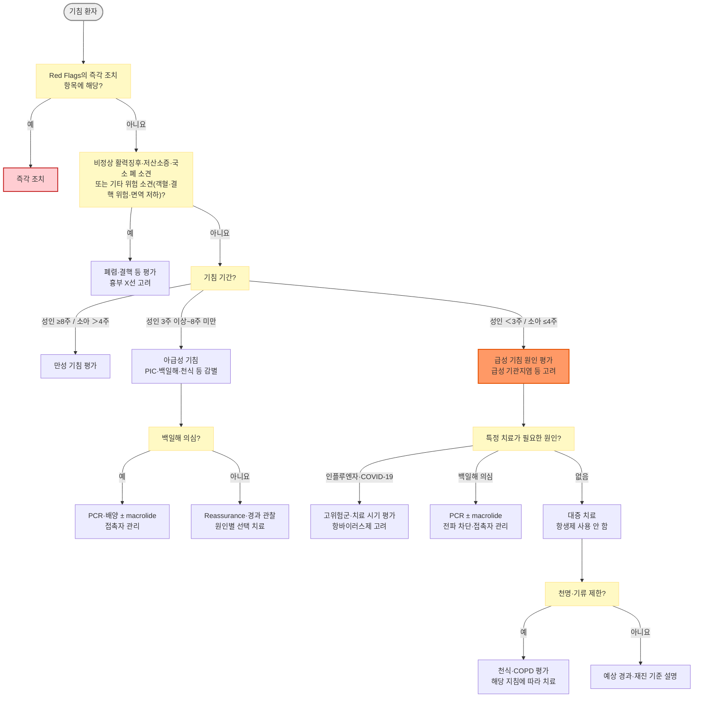

# 급성 기관지염 Acute Bronchitis

## <mark style="color:green;">일반 사항</mark>

* 성인 중심의 진단·치료 접근이며, 소아는 연령별 활력징후·약물 용량·기침 기간 기준을 별도로 적용
* 기침이 주요 증상인 하기도 염증; 폐렴의 영상학적·임상적 증거가 없는 것으로 정의
* 급성 기관지염의 기침은 평균 약 3주 지속하며 일부에서는 3\~4주 이상 이어질 수 있음; 환자들은 보통 1주일 내에 낫기를 기대하므로 사전 교육이 중요 (☞ [기침](../220_/006_-cough.md))

### <mark style="color:orange;">기침 기간에 따른 분류 - 성인</mark>

<table><thead><tr><th width="105.26312255859375">기간</th><th width="216.84210205078125">분류</th><th>핵심 의미</th></tr></thead><tbody><tr><td>＜3주</td><td>급성 기침</td><td>급성 기관지염이 흔하지만 감기·폐렴·인플루엔자·COVID-19·천식 악화 등 감별</td></tr><tr><td>3주 이상~8주 미만</td><td>아급성 기침</td><td>감염 후 기침(PIC)이 흔하나 백일해·천식·UACS·GERD 등 감별</td></tr><tr><td>≥8주</td><td>만성 기침</td><td>천식·UACS·GERD·결핵 등 체계적 평가 필요</td></tr></tbody></table>


**PIC (Post-Infectious Cough)** : 성인에서 호흡기 감염 후 기침이 3\~8주 지속되는 상태. 다른 원인을 배제한 뒤 진단하며 대부분 자연 호전함. 단순 PIC에는 항생제가 필요하지 않고, reassurance와 경과 관찰·safety-netting이 치료의 핵심임. 천식 등 기저 기도질환이 없는 환자에서 ICS·기관지확장제의 효과를 뒷받침하는 근거는 충분하지 않음. 소아는 4주를 넘는 기침을 만성 기침으로 평가하며 성인의 8주 기준을 그대로 적용하지 않음. <mark style="color:$info;">\[CMAJ 2024; Eur Respir J 2020]</mark>


## <mark style="color:green;">원인</mark>

* 감염(대부분 바이러스성)
  * 바이러스: rhinovirus, influenza virus, SARS-CoV-2, adenovirus, respiratory syncytial virus(RSV), parainfluenza virus, human metapneumovirus 등
  * 드문 세균성 원인 또는 유사 증후군: _Bordetella pertussis_, _Mycoplasma pneumoniae_, _Chlamydia pneumoniae_
  * _H. influenzae_, _M. catarrhalis_, _S. pneumoniae_ 등은 합병증 없는 급성 기관지염보다 폐렴·COPD 악화 등 별도 진단에서 중요
* 비감염: 화학적·물리적 기도 자극 (오염 물질, 흡연, 유해가스)

### <mark style="color:orange;">위험 인자</mark>

* 겨울·초봄의 호흡기 바이러스 유행, 환자와의 밀접 접촉
* 흡연(능동·수동), 대기 오염·분진·유해가스 노출
* 고령, 면역 저하, 만성 심폐질환은 급성 기관지염 자체보다 폐렴·중증 호흡기감염 위험을 높이므로 낮은 역치로 평가

## <mark style="color:green;">임상 양상</mark>

* 대부분 상기도 전구 증상(코막힘, 인두통, 콧물)으로 시작한 뒤 마른기침 발생
* 마른기침 또는 가래를 동반한 기침; 경과 중 객담이 생기거나 색이 변해도 세균 감염을 의미하지 않음
* 일시적 기관지 과민 반응 양상: 운동·찬 공기 흡입 시 악화; 쉰 목소리 동반 가능
* 기침으로 인한 흉부 불편감; 후비루; 인두 발적
* 청진: 기침으로 맑아지는 rhonchi; 간혹 wheezing
* 전신 증상: malaise, 발열(대부분 미열; 환자의 약 ⅓에서 관찰)
* 정상 활력징후와 국소 경화 소견의 부재는 건강한 성인에서 폐렴 가능성을 낮추지만, 고령자·면역 저하자에서는 비전형적일 수 있음

### <mark style="color:$danger;">🚩 Red Flags!</mark>

<mark style="color:$danger;">**즉각 조치**</mark>

* 심한 호흡 곤란, 호흡 보조근 사용·흉벽 함몰, 청색증, 의식 변화, 혈역학적 불안정  `중증 폐렴` `호흡부전` `패혈증`
* 빠르게 악화하거나 지속되는 심한 저산소증  `호흡부전` `중증 폐렴` `폐색전증`
* 기도 유지 또는 가스교환을 위협하는 대량 객혈  `대량 객혈`

<mark style="color:$warning;">**당일\~수일 내 평가**</mark>

* 반복 측정에서도 새로 확인되는 SpO₂ ＜94%(COPD 등 기저 저산소증 환자는 평소 기저치 대비 의미 있는 감소), 즉각적 호흡부전 소견은 없음  `폐렴` `COPD 악화` `폐색전증`
* 성인에서 빈맥(≥100회/분)·빈호흡(≥24회/분)·체온 ≥38℃ 중 하나 이상, 또는 국소 crackle·기관지 호흡음·egophony  `폐렴`
* 고령·면역 저하·만성 심폐질환 환자의 전신 상태 또는 호흡기 증상 악화  `폐렴` `COPD 악화` `심부전 악화`
* 발작성 기침, 흡기성 whoop, 기침 후 구토 또는 백일해 환자 접촉력(기침 2주 미만 포함)  `백일해`
* 반복·지속되는 혈담, 흡연·고령 등 위험 요인이 있는 환자의 혈담, 또는 체중 감소·야간 발한 동반  `결핵` `폐암`

<mark style="color:$info;">**조기 평가 및 추적**</mark>

* 성인에서 3주 이상 지속되는 기침(8주 이상은 만성 기침)  `감염 후 기침` `백일해` `천식` `UACS` `GERD`
* 소아에서 4주를 넘는 기침  `소아 만성 기침`
* 뚜렷한 원인 없이 2주 이상 지속되거나 호전이 없는 기침  `결핵`
* 반복적 기관지염 또는 적절한 치료에도 호전 없음  `천식` `COPD` `GERD` `UACS`
* ACEI 복용 중 발생한 기침  `ACEI 유발 기침`

## <mark style="color:green;">진단</mark>

* 임상 진단: 급성 기침(대개 3주 이내)이 주 증상이고 폐렴·천식 악화·COPD 악화 등 다른 원인이 확인되지 않는 경우
* 최소 기침 기간 기준은 없으며, 임상 양상·활력징후·신체검사로 대부분 진단

### <mark style="color:orange;">검사</mark>

* 건강한 성인에서 활력징후가 정상이고 국소 폐 소견·저산소증·위험 소견이 없으면 흉부 X선을 통상 시행하지 않음; 고령자·면역 저하자는 별도 판단
* 실험실 검사: 통상 불필요. 폐렴 등 감별이 불확실할 때 CBC·CRP를 선택적으로 시행; 결핵 의심 시 객담 항산균 도말·배양 및 핵산증폭검사
* 흉부 X선: 비정상 활력징후, 저산소증, 국소 폐 소견, 객혈, 호흡 곤란, 전신 상태 악화 또는 결핵·종양 위험이 있을 때 시행
  * 기침이 3주 이상이라는 이유만으로 일률적으로 촬영하지 않으며, 예상 경과를 벗어나 지속·악화되면 임상 위험에 따라 시행
  * 고령자·면역 저하자는 정상 체온 또는 비전형적 증상으로 폐렴이 나타날 수 있어 낮은 역치로 고려
* 백일해 의심 시: 비인두 검체 PCR(대체로 기침 시작 후 3\~4주 이내; 3주 이후 민감도 감소) 또는 배양(첫 2주가 가장 적합); 가능하면 항생제 시작 전 채취하며 항생제 투여 5일 이후 PCR은 통상 권장하지 않음(검사 때문에 치료를 지연하지 않음)


**급성 호흡기감염에서 CRP point-of-care 해석**

16세 이상에서 임상 평가 후 하기도감염의 항생제 필요성이 불확실할 때 보조적으로 활용함. 합병증 없는 급성 기관지염의 routine 검사나 소아용 기준은 아니며, 확진된 COVID-19에는 적용하지 않음. 초기 폐렴·고령자·면역 저하자에서는 낮은 CRP만으로 폐렴을 배제하지 않음.

* CRP ＜20 ㎎/L → 항생제를 통상 처방하지 않음
* CRP 20\~100 ㎎/L → 임상 소견·위험 인자와 종합하여 back-up 항생제 여부 판단
* CRP ＞100 ㎎/L → 즉시 항생제 처방 권고; 폐렴·중증 세균 감염 가능성과 추가 검사·의뢰 필요성 평가

　_(단위 주의 : 위 기준은 ㎎/L 단위)_

_<mark style="color:$info;">Ref. NICE NG237, 2023</mark>_


### <mark style="color:orange;">감별</mark>

<table><thead><tr><th width="137.894775390625">질환</th><th width="331.5789794921875">시사하는 소견</th><th>비고</th></tr></thead><tbody><tr><td>폐렴</td><td>빈맥(≥100/분), 빈호흡(≥24/분), 체온 ≥38℃ 중 하나 또는 국소 폐음 이상</td><td>흉부 X선 고려</td></tr><tr><td>COVID-19·인플루엔자</td><td>급성 발열·근육통·인후통, 유행 또는 노출력</td><td>결과가 치료·감염 관리에 영향을 주면 항원검사 또는 PCR</td></tr><tr><td>백일해</td><td>발작성 기침, 흡기성 whoop, 기침 후 구토, 환자 접촉력</td><td>기침 2주 미만도 가능; 시기별 PCR·배양</td></tr><tr><td>천식</td><td>반복 기침·wheezing, 운동/알레르겐 유발, 기관지확장제 반응</td><td>안정 후 폐기능 검사 등으로 확인</td></tr><tr><td>감기(URTI)</td><td>콧물·코막힘·재채기 등 코 증상 우세, 기침 경미</td><td>상기도 증상 우세</td></tr><tr><td>COPD 악화</td><td>기저 COPD, 호흡 곤란·기침·객담이 평소보다 악화</td><td>폐렴·심부전·폐색전증 등 감별</td></tr><tr><td>GERD</td><td>식후·야간 기침, 속쓰림, 목이물감</td><td>동반 증상과 전체 임상상에 따라 평가</td></tr><tr><td>약제 유발 기침</td><td>ACEI 복용력, 복용 후 수 주 내 기침 시작</td><td>대체 약제 검토; 중단 후 경과 관찰</td></tr><tr><td>결핵</td><td>원인 불명 또는 호전 없는 2주 이상 기침, 접촉력·발한·체중 감소·혈담; 고위험군은 기간과 무관하게 평가</td><td>객담 항산균 도말·배양·핵산증폭검사</td></tr></tbody></table>


녹색 또는 노란 가래 색만으로 바이러스와 세균 감염을 감별할 수 없음 - 화농성 가래가 항생제 처방의 단독 근거가 되어서는 안 됨


#### <mark style="color:$primary;">Bedside 감별표</mark>

<table><thead><tr><th width="105">소견</th><th>급성 기관지염</th><th>폐렴</th><th>천식 악화</th></tr></thead><tbody><tr><td>병태 핵심</td><td>대개 바이러스성 기도 염증</td><td>폐 실질 감염</td><td>가변적 기류 제한</td></tr><tr><td>발병</td><td>URTI 후 점진적</td><td>급성·아급성; 전신 상태 악화 가능</td><td>반복적 / trigger 기반</td></tr><tr><td>기침</td><td>건성 또는 습성</td><td>건성 또는 습성</td><td>건성 ± 야간·운동 유발 기침</td></tr><tr><td>가래 양상</td><td>점액성·화농성 혼재; 색으로 세균 감별 불가</td><td>화농성·혈성 객담 가능; 색만으로 병원체 판별 불가</td><td>점액성·희고 끈적함; 소량 가능</td></tr><tr><td>발열</td><td>없음 또는 미열</td><td>흔하지만 고령자·면역 저하자에서는 없을 수 있음</td><td>드묾</td></tr><tr><td>호흡 곤란</td><td>없거나 경미</td><td>가능</td><td>발작적</td></tr><tr><td>청진</td><td>diffuse rhonchi / wheeze(기침 후 변할 수 있음)</td><td>focal crackle·기관지 호흡음·egophony 등</td><td>diffuse wheeze; 심한 경우 호흡음 감소</td></tr><tr><td>Vital sign</td><td>대개 정상</td><td>빈호흡·빈맥·발열 가능</td><td>중증도에 따라 빈호흡·빈맥</td></tr><tr><td>SpO₂</td><td>대개 정상</td><td>감소 가능</td><td>중증 시 감소</td></tr><tr><td>흉부 X선</td><td>침윤 없음</td><td>새로운 침윤</td><td>대개 정상</td></tr><tr><td>치료 방향</td><td>설명·대증 치료</td><td>중증도 평가 및 원인에 따른 치료</td><td>기관지확장제 등 천식 지침에 따른 치료</td></tr></tbody></table>

***



<p align="center"><strong>급성 기관지염 진단 및 치료 알고리듬</strong></p>

<p align="center"><em><mark style="color:$info;">저자 재구성 (참고 문헌 : NICE NG120, 2019; NICE NG237, 2023; CDC Pertussis; Eur Respir J 2020)</mark></em></p>

***

## <mark style="background-color:$warning;">Management</mark>

### <mark style="color:orange;">치료 원칙</mark>

* 바이러스 감염이 대부분이므로 항생제는 통상 불필요. 지지 치료와 대증 치료를 중심으로 치료
* 천식·COPD 악화 등 별도 적응증이 없는 급성 기관지염에는 경구·흡입 스테로이드를 routine으로 사용하지 않음 <mark style="color:$info;">\[NICE 2019]</mark>

#### <mark style="color:$primary;">항생제 스튜어드십</mark>

* 합병증 없는 급성 기관지염에서 항생제는 기침 기간을 평균 약 0.5일 단축시킬 뿐이며, 내성균 유발·부작용 위험 때문에 급성 기관지염 자체는 항생제 적응증이 아님
* 면역정상 성인의 합병증 없는 급성 기관지염은 대부분 바이러스성이며 세균성 원인은 드묾; 화농성 가래만으로 세균성 원인을 추정하거나 항생제를 처방하지 않음
* 백일해 확진 또는 강력 의심 시에는 시기·전파 위험을 고려하여 macrolide 사용; 초기 치료는 증상 중증도를 줄일 수 있고 발작성 기침이 확립된 후에는 주로 전파 차단 목적(아래 참조)
* 고령·면역 저하·기저 심폐질환 등 합병증 고위험군에서 전신 상태가 좋지 않거나 경과가 악화되면 폐렴·COPD 악화·기관지확장증 악화 등 구체적 진단을 재평가
  * 폐렴 여부 또는 항생제 필요성이 불확실하면 흉부 X선과 필요시 CRP를 활용하고, 임상 판단에 따라 즉시 또는 back-up 항생제 고려
  * COPD 급성 악화는 급성 기관지염의 항생제 예외가 아닌 별도 진단이며, 항생제 적응증과 약제는 COPD 지침에 따름


**항생제를 처방하지 않을 때의 설명과 safety-netting**\
"현재는 바이러스성 기관지염으로 판단되므로 항생제가 필요하지 않습니다. 기침은 평균 약 3주 지속되며 일부에서는 더 오래 이어질 수 있습니다. 숨이 차거나 전신 상태가 나빠지면 기다리지 말고 바로 진료받으십시오. 발열이 지속·재발하거나 기침이 예상 경과를 벗어나면 다시 내원하십시오." - safety-net instruction을 함께 제공하는 것이 환자 만족도를 유지하면서 항생제 처방을 줄이는 데 효과적임


## <mark style="color:green;">비-약물 치료 및 예방</mark>

* 금연 및 호흡기 자극 회피(간접흡연, 유해가스, 분진); 대기 오염 시 외출 자제
* 탈수를 피할 정도의 적절한 수분 섭취; 과도한 수분 섭취가 기침 기간을 줄인다는 근거는 없음
* 가습: 건조한 환경에서 불편감 완화에 도움이 될 수 있으나 근거는 제한적. 가습기 사용 시 매일 물 교체·청결 관리, 과습·곰팡이·세균 번식 주의; 뜨거운 증기 흡입은 화상 위험 때문에 피함
* 꿀(honey): 1세 이상에서 급성 기침의 단기 증상 완화에 제한적인 근거가 있어 선택적으로 시도 가능. 당뇨병·벌꿀 알레르기·열량에 주의하며, 영아 보툴리누스증 위험으로 12개월 미만에서는 금기
* 기저 질환 관리 : 천식, 부비동염, 위식도역류(GERD)
* 예방접종: 연령·위험도에 따라 인플루엔자·COVID-19·폐렴구균·RSV 백신과 Tdap(영아 돌봄자·의료인 우선, 임신부는 매 임신 27\~36주) 권고를 확인. 이는 특정 급성 기관지염 치료가 아니라 중증 호흡기감염 예방 목적

## <mark style="color:green;">약물 치료</mark>

### <mark style="color:orange;">해열·진통제</mark>

* ibuprofen: 200\~400 ㎎ q6\~8h prn; 가능한 최저 유효 용량·최단 기간 사용 <mark style="color:blue;">\[부루펜]</mark>
  * 주요 금기 : 위장관 궤양·출혈 또는 그 병력, 기관지천식 또는 그 병력, aspirin·NSAID 과민반응 병력, 심한 간·신장장애·심장기능부전·고혈압, 임신 말기 3개월
  * 신중 투여 : 고령자·신기능 저하·심혈관질환; 임신 20주 이후 태아 신장기능장애·양수과소증 및 동맥관 수축에 주의 (☞ [통증](../220_/001_-pain.md))
* acetaminophen: 500\~1,000 ㎎ q6\~8h prn; 일반 성인 일일 최대 4,000 ㎎. 간질환·고위험 음주자·쇠약한 고령자는 더 낮은 상한 적용; 타 감기약·복합 진통제와 중복 주의
  * acetaminophen ER 650 ㎎: 1회 2정 q8h, 24시간 최대 6정(3,900 ㎎) <mark style="color:blue;">\[타이레놀 이알]</mark>

### <mark style="color:orange;">진해제</mark>

* 근거 제한 : 진해제의 효과 근거는 제한적임. dextromethorphan은 성인 급성 기침에서 연구 결과가 일관되지 않고 근거의 질이 낮으며, codeine의 뚜렷한 효과는 확인되지 않음. 사용하더라도 수면·일상생활을 방해하는 심한 기침에 단기간 제한 <mark style="color:$info;">\[NICE 2019]</mark>
* dextromethorphan 15\~30 ㎎ q6\~8h prn; 일일 최대 120 ㎎(단기 사용). 과량·남용, 졸림 주의
  * MAO 억제제 복용 중·중단 후 2주 이내에는 사용하지 않음. 다른 세로토닌성 약물 병용 시 serotonin syndrome 위험에 주의
  * 국내에서는 주로 acetaminophen·pseudoephedrine·guaifenesin 등이 포함된 복합제로 유통되므로 성분과 총용량을 확인
* levodropropizine 60 ㎎ tid(적어도 6시간 간격; 어지럼·졸림 가능) <mark style="color:blue;">\[드로피진]</mark>
  * 주요 금기 : 임부·임신 가능성이 있는 여성·수유부, 기관지 점액 분비 증가·점액섬모기능이상, 중증 간장애. 중증 심부전·신장부전 및 고령자는 신중 투여
* codeine·dihydrocodeine 함유 진해제: 급성 기관지염에서 routine 사용을 권고하지 않음 - 효과 근거가 약하고 호흡 억제(특히 고령자)·변비·남용 우려. 심한 기침으로 수면이 어려울 때 성인에서 단기간 제한적으로 사용
  * 국내 허가사항에 따라 12세 미만은 금기이며, 호흡기능이 손상된 12\~18세에서는 사용하지 않음. 제품별 연령 제한 확인
* 생약 제제: Pelargonium sidoides <mark style="color:blue;">\[움카민]</mark>은 성인 급성 기관지염 증상 완화에 저품질 근거가 있음; ivy leaf 제제는 근거 불충분. 사용하더라도 항생제 대체가 아닌 대증 치료로 설명

### <mark style="color:orange;">점액 용해제</mark>

* 합병증 없는 급성 기관지염에서 routine use를 권고하지 않음. 임상시험 근거가 제한적이며 기본 처방례에서 제외
* 국내 허가 용량 예: ambroxol 30 ㎎ tid <mark style="color:blue;">\[뮤코펙트]</mark>, acetylcysteine 200 ㎎ bid\~tid <mark style="color:blue;">\[뮤테란]</mark>, erdosteine 300 ㎎ bid <mark style="color:blue;">\[엘도스]</mark>

### <mark style="color:orange;">코 울혈 제거제</mark>

* 부비동 증상 동반 시 제한적 사용 (☞ [감기](060_-common-cold.md#decongestant))
* 비내 울혈제거제 : phenylephrine <mark style="color:blue;">\[시네프린]</mark>, xylometazoline <mark style="color:blue;">\[오트리빈]</mark> (연속 3일 이내 원칙, 길어도 5일을 넘기지 않음)
* pseudoephedrine : 60 ㎎/T ½\~1T tid\~qid <mark style="color:blue;">\[슈다페드]</mark>
  * 성인 최대 240 ㎎/d; 복합 감기약과 pseudoephedrine 단일제 중복 복용 시 과량 투여 주의
  * 국내 금기 : 고혈압 포함 심혈관질환, 갑상선기능항진증·당뇨병·중증 신장애·폐쇄각녹내장·크롬친화세포종·수유부; MAO 억제제 복용 중·중단 후 2주 이내 및 다른 교감신경흥분제·β차단제 병용. 전립선비대·방광 기능 이상 등은 신중 투여(상세 내용은 감기 챕터 참조)

### <mark style="color:orange;">β2-agonist (기관지확장제)</mark>

* 단순 급성 기침에서 routine use 비권장. 천명·가변적 기류 제한이 있으면 천식·COPD 등 기저 기도질환을 평가하고 해당 지침에 따라 사용
* 흡입제(경구제보다 우선): salbutamol(albuterol) 100 ㎍/puff, 1\~2 puff q4\~6h prn <mark style="color:blue;">\[벤토린 에보할러]</mark>; 국내 허가사항상 외래 자가 사용은 24시간 최대 8회 분무
  * 더 자주 필요하거나 기존 용량의 효과가 짧으면 임의 증량하지 말고 즉시 재평가; 의료진 감시하 급성 악화 반복 투여는 별도 프로토콜에 따름
* 진전·심계항진·빈맥·저칼륨혈증 등에 주의. 반복적으로 필요하거나 반응이 불충분하면 진단 재평가

### <mark style="color:orange;">항생제</mark>

* (☞ [호흡기 감염 항생제 선택](093_-antibiotics-respiratory.md))
* 백일해 확진·강력 의심:
  * 첫 1\~2주, 특히 발작성 기침 전 치료가 증상 중증도를 줄이는 데 가장 유리; 감염력이 소실된 늦은 시기에 남은 기침만을 이유로 항생제를 반복하지 않음
  * 통상 1세 이상은 기침 시작 3주 이내, 1세 미만 영아와 임신부(특히 분만 임박)는 6주 이내 치료 고려
  * 강하게 의심되거나 중증화 고위험 환자·고위험 접촉자가 있으면 검사 결과를 기다리느라 치료를 지연하지 않음 <mark style="color:$info;">\[CDC]</mark>
* 성인 백일해 항생제 용법:
  * azithromycin 500 ㎎ 1일차, 이후 250 ㎎ qd × 4일 (총 5일) <mark style="color:blue;">\[지스로맥스]</mark>
  * clarithromycin 500 ㎎ bid × 7일 <mark style="color:blue;">\[클래리시드]</mark>
  * macrolide 금기, 또는 내성이 의심되거나 확인된 경우(최근 21일 이내 내성 유행 지역 여행력, 치료 중 임상 악화, 내성검사 결과 등을 종합해 판단) : TMP-SMX 160/800 ㎎ bid × 14일 <mark style="color:blue;">\[셉트린]</mark>(80/400 ㎎ 2T bid). 임신부·수유부와 생후 2개월 미만에는 금기
  * clarithromycin은 CYP3A4 억제로 statin(simvastatin·lovastatin)·일부 칼슘통로차단제 등과 상호작용; azithromycin·clarithromycin 모두 QT 연장 위험 환자 주의
* 유효 항생제 치료 시작 후 5일까지 비말 격리. 치료하지 않으면 기침 시작 후 21일까지 전파 가능
* 노출 후 예방요법(치료와 같은 약제·용법) <mark style="color:$info;">\[CDC]</mark>
  * 무증상 동거 접촉자 : 지표 환자의 기침 시작 후 21일 이내
  * 중증화 고위험군(1세 미만 영아, 면역 저하, 약물 치료 중인 중등도 이상 천식 등)과 이들과 접촉하는 사람(임신 제3삼분기 여성, 신생아중환자실·어린이집·분만실 등 고위험 환경의 접촉자) : 감염성 환자에게 노출된 후 21일 이내
  * 국내에서는 질병관리청 접촉자 관리 기준을 우선 적용
* 제2급 감염병으로 24시간 이내 신고


**국내 백일해 현황**

2024년 국내 백일해 환자는 48,048명으로 역대 최대 유행이었고, 대부분이 학령기 청소년이었음. 중국 등에서는 macrolide 내성 백일해균이 확산되어 있어 국내 내성 현황은 최신 감시 자료 확인이 필요함. 적절한 치료 후에도 발작성 기침은 수 주간 지속될 수 있으므로 잔여 기침만으로 내성이나 치료 실패를 판단하지 않음. 내성 유행 지역 노출력, 복약 순응도, 임상 악화와 검사 결과를 종합해 판단하며, 내성이 의심되면 가능하면 항생제 투여·변경 전 검체를 채취하여 배양·내성검사를 의뢰함(검사 때문에 필요한 치료를 지연하지 않음). <mark style="color:$info;">\[PHWR 2026; CDC]</mark>



_Mycoplasma pneumoniae_의 국내 macrolide 내성은 주로 소아 폐렴 자료에서 보고된 것으로, 단순 급성 기관지염에 경험적 macrolide 또는 fluoroquinolone을 처방하는 근거가 아님. 폐렴이 의심되면 폐렴 지침에 따라 진단·치료함.


### <mark style="color:orange;">항바이러스제</mark>

* 인플루엔자 의심 시 유행 상황·중증도·합병증 위험과 발병 시점을 평가 (☞ [인플루엔자](069_-influenza.md))
  * 고위험군·진행성 또는 중증 환자·입원 환자: 48시간이 지났더라도 가능한 한 빨리 치료하며, 검사 결과를 기다리느라 지연하지 않음 <mark style="color:$info;">\[CDC]</mark>
  * 합병증 위험이 낮은 경증 외래 환자: 증상 발생 48시간 이내이면 임상 판단으로 고려
* oseltamivir (성인) : 75 ㎎ bid × 5일 <mark style="color:blue;">\[타미플루]</mark>
  * 신기능 저하 시 치료 용량: CrCl ＞30\~60 ㎖/min → 30 ㎎ bid, CrCl ＞10\~30 ㎖/min → 30 ㎎ qd; CrCl ≤10 ㎖/min은 투석 여부·방법에 따라 별도 조절하며 비투석 말기 신부전에서는 권고하지 않음 <mark style="color:$info;">\[CDC]</mark>
* 음식과 관계없이 복용 가능하나, 음식과 함께 복용하면 구역·구토를 줄일 수 있음
* 인플루엔자 신속항원검사(RAT) 또는 임상 진단 기반으로 처방; 음성이더라도 유행기·고위험군에서 임상적 판단으로 처방 가능
* SARS-CoV-2 감염 가능성이 있고 고위험군이면 치료 가능 기간 내 검사와 항바이러스제 적합성·약물상호작용 평가 (☞ [코로나19](070_1_-covid-19.md))

### <mark style="color:orange;">감염 후 기침과 흡입 치료</mark>&#x20;

* 단순 PIC는 대부분 자연 호전하며, 천식 등 기저 기도질환이 없는 환자에서 ICS·기관지확장제의 routine 사용을 뒷받침하는 근거는 불충분
* 우선 reassurance, 유발 자극 회피, 경과 관찰 및 재진 기준을 설명
* 천명, 반복되는 야간·운동 유발 기침, 가역적 기류 제한 또는 호산구성 염증 등 천식성 기도질환을 시사하는 소견이 있으면 폐기능검사 등을 시행하고 해당 질환 지침에 따라 흡입 치료 고려
* 성인 기침이 8주 이상이면 만성 기침으로 재평가; 소아는 4주를 넘으면 평가하며 새 red flag는 기간과 무관하게 재평가

***

## <mark style="color:red;">질병코드</mark>

* J20 급성 기관지염 Acute bronchitis
* J20.0 _Mycoplasma pneumoniae_에 의한 급성 기관지염 Acute bronchitis due to Mycoplasma pneumoniae
* J20.9 상세불명의 급성 기관지염 Acute bronchitis, unspecified
* J68.0 화학물질, 가스, 훈증기 및 물김에 의한 기관지염 및 폐렴 Bronchitis and pneumonitis due to chemicals, gases, fumes and vapours
* A37.0 백일해균에 의한 백일해 Whooping cough due to Bordetella pertussis
* A37.9 상세불명의 백일해 Whooping cough, unspecified

***

## <mark style="color:purple;">처방례</mark>

> **처방례 1. 바이러스성 기관지염 - 기침·발열 동반, 경증**
>
> ```
> 드로피진 60 ㎎/T  3T  #3  (tid, 적어도 6시간 간격)
> 타이레놀 500 ㎎/T  필요시 1~2T  (q6~8h prn)
> ```
>
> _✽ 바이러스성 기관지염 1차: 항생제 없이 필요한 경우에만 단기 대증 치료. 기침이 평균 3주 지속될 수 있음을 사전 설명. 점액 용해제는 routine으로 추가하지 않음. 진해제는 기침으로 수면·일상에 지장이 있을 때에만 3일 이내로 단기 처방함._

> **처방례 2. 기관지 경련·wheezing 동반 (objective bronchospasm 확인 시)**
>
> ```
> 벤토린 에보할러 100 ㎍/puff  필요시 1~2 puff  (q4~6h prn, 24시간 최대 8 puff)
> 드로피진 60 ㎎/T  3T  #3  (tid, 적어도 6시간 간격)
> ```
>
> _✽ 단순 기침에는 SABA를 routine으로 사용하지 않음. 반복 천명 또는 가변적 기류 제한이 있으면 천식·COPD를 평가하고 해당 지침에 따라 치료. 진해제는 기침으로 수면·일상에 지장이 있을 때에만 3일 이내로 단기 처방함._

> **처방례 3. 백일해 확진 또는 강력 의심 - 성인**
>
> ```
> 지스로맥스 250 ㎎/T  2T  qd  (1일차)
> 지스로맥스 250 ㎎/T  1T  qd  (2~5일차)
> ```
>
> _✽ 통상 성인은 기침 시작 3주 이내 치료를 고려하며, 첫 1\~2주 치료는 증상 중증도를 줄일 수 있음. 유효 항생제 치료 시작 후 5일까지 비말 격리하고 밀접 접촉자 중 예방요법 대상을 평가. 제2급 감염병으로 신고._

> **처방례 4. 인플루엔자 의심 - 고위험 성인**
>
> ```
> 타미플루 75 ㎎/cap  2cap  #2  (bid, 5일)
> 드로피진 60 ㎎/T  3T  #3  (tid, 적어도 6시간 간격)    ← 필요시
> 타이레놀 500 ㎎/T  필요시 1~2T  (q6~8h prn)
> ```
>
> _✽ 고위험군·진행성 또는 중증 환자는 발병 48시간이 지났더라도 가능한 한 빨리 투여하고 검사 결과를 기다리느라 치료를 지연하지 않음. 신기능에 따라 감량하며, 음식과 관계없이 복용 가능하나 오심이 있으면 음식과 함께 복용. 임부·임신 가능성이 있는 여성·수유부에는 드로피진을 쓰지 않음._

***

### <mark style="color:$success;">핵심 복약 지도</mark>

> **항생제를 처방하지 않은 경우**
>
> 현재는 바이러스성 기관지염으로 판단되며, 항생제는 바이러스에 효과가 없습니다. 기침은 평균 약 3주 지속되며 일부에서는 더 오래 이어질 수 있습니다. 처방약은 기침과 불편 증상을 완화하기 위한 것입니다. 숨이 차거나 전신 상태가 나빠지면 기다리지 말고 바로 진료받고, 발열이 지속·재발하거나 기침이 3주 이상 이어지면 재평가받으십시오.

> **진해제 (드로피진 등)**
>
> 1. 기침이 심해 수면이나 일상생활에 지장이 있을 때 처방된 방법으로 단기간 복용합니다.
> 2. 드로피진(레보드로프로피진)은 적어도 6시간 간격을 두고 복용하며, 어지럼·졸림이 생길 수 있습니다. 임신 중이거나 임신 가능성이 있거나 수유 중이면 반드시 알리십시오.
> 3. 처방받은 단기 복용 기간이 지나도 기침이 심하면 재진하십시오. 임의로 복용 기간을 늘리지 마십시오.

> **β2-agonist 흡입제 (벤토린 에보할러)**
>
> 1. 의사가 천명·기도 폐쇄를 확인하고 처방한 경우에만 사용합니다(단순 기침에는 사용하지 않음).
> 2. 사용 전 잘 흔들고, 숨을 최대한 내쉰 뒤 흡입기를 입에 물고 천천히 깊게 들이마십니다.
> 3. 흡입 후 10초간 숨을 멈추었다가 내쉽니다.
> 4. **고령자·흡입기 사용이 서투른 환자**: 스페이서(spacer)를 함께 사용하면 폐 도달률이 크게 향상됩니다 - 처방 시 스페이서 제공 또는 사용법 교육 권장.
> 5. 벤토린은 처방된 횟수를 지키고 24시간에 총 8번을 초과해 임의로 분사하지 마십시오. 더 자주 필요하거나 효과가 짧아지면 바로 재진하십시오.
> 6. 드물게 손 떨림·심계항진이 나타날 수 있습니다.

> **항생제를 처방한 경우**
>
> 1. 처방된 기간을 반드시 완료하십시오. 증상이 좋아져도 임의 중단하지 마십시오.
> 2. 복용법은 처방 지시를 따르십시오. 위장 불편이 있으면 음식과 함께 복용할 수 있습니다.
> 3. 심한 설사, 두드러기, 호흡 곤란 또는 빠르게 진행하는 발진이 생기면 복용을 중단하고 진료받으십시오.
> 4. **신장이 좋지 않은 경우**: 용량 조절이 필요할 수 있으므로 의사에게 반드시 알리십시오.

> **항바이러스제 (타미플루) 복약 지도**
>
> 1. 증상 발생 후 가능한 한 빨리 시작할수록 효과가 큽니다. 고위험군·중증 환자는 48시간이 지났더라도 치료할 수 있습니다.
> 2. 5일 처방 기간을 반드시 완료하십시오.
> 3. 음식과 관계없이 복용할 수 있으나, 구역·구토가 있으면 음식과 함께 복용하십시오.
> 4. 드물게 신경정신과적 부작용(청소년에서 이상행동 등)이 보고된 바 있어 보호자의 관찰이 필요합니다.

> **언제 다시 병원을 방문해야 하나요?**
>
> * **즉시 응급실 또는 119**: 심한 호흡 곤란, 청색증, 의식 변화, 심한 흉통, 많은 객혈 또는 빠르게 악화하는 저산소증
> * **당일 평가**: 새로 확인된 산소포화도 저하, 발열 지속·재발 또는 전신 상태 악화
> * **수일 내 진료**: 혈담이 반복되거나 며칠 이상 계속될 때, 또는 흡연자·고령자의 혈담
> * **조기 재진**: 원인 불명·호전 없는 2주 이상 기침(결핵 접촉력·체중 감소·야간 발한이 있으면 더 서둘러 평가)
> * **외래 재평가**: 성인 기침이 3주 이상 지속되면 원인 재평가; 소아는 4주를 넘으면 만성 기침 평가

***

## <mark style="color:green;">주요 참고문헌 및 확인 자료</mark>

### <mark style="color:orange;">임상 근거</mark>

* [NICE. Cough (acute): antimicrobial prescribing. NG120. 2019.](https://www.nice.org.uk/guidance/ng120) - 급성 기침·기관지염의 자연 경과, 항생제·기관지확장제·스테로이드 사용 제한
* [NICE. Suspected acute respiratory infection in over 16s: assessment at first presentation and initial management. NG237. 2023.](https://www.nice.org.uk/guidance/ng237) - 16세 이상 초기 평가 및 항생제 필요성이 불확실할 때 CRP point-of-care 활용
* [CDC. Treatment of Pertussis.](https://www.cdc.gov/pertussis/hcp/clinical-care/index.html) - 백일해 치료 시작 시점, 항생제 선택, 노출 후 예방요법
* [CDC. Postexposure Antimicrobial Prophylaxis.](https://www.cdc.gov/pertussis/php/postexposure-prophylaxis/index.html) - 노출 후 예방요법 대상과 21일 기산점
* [CDC. Antibiotic-resistant Bordetella pertussis. 2026.](https://www.cdc.gov/pertussis/hcp/antibiotic-resistance/index.html) - macrolide 내성 의심 시 평가, 배양·내성검사 및 TMP-SMX 대안
* [질병관리청. 2026년도 예방접종 대상 감염병 관리 지침. 제4장 백일해.](https://www.kdca.go.kr/bbs/kdca/55/311032/artclView.do?layout=unknown) - 국내 백일해 환자·접촉자 관리 및 노출 후 예방요법
* [송영준 등. 2024년 충청권 백일해의 역학적 특성: 성별 및 유행사례 중심으로. 주간 건강과 질병. 2026;19(5):233-252.](https://doi.org/10.56786/PHWR.2026.19.5.1) - 2024년 국내 백일해 발생 규모와 충청권 역학 자료
* [CDC. Best Practices for Use of Polymerase Chain Reaction for Diagnosing Pertussis.](https://www.cdc.gov/pertussis/php/pcr-bestpractices/index.html) - 백일해 PCR의 적절한 검체와 검사 시기
* [CDC. Influenza Antiviral Medications: Summary for Clinicians.](https://www.cdc.gov/flu/hcp/antivirals/summary-clinicians.html) - 고위험군 조기 치료와 성인 oseltamivir 신기능별 용량 조절
* [Postinfectious cough in adults. CMAJ. 2024;196:E157.](https://doi.org/10.1503/cmaj.231523) - 성인 감염 후 기침의 자연 경과와 약물 근거의 한계
* [ERS guidelines on the diagnosis and treatment of chronic cough in adults and children. Eur Respir J. 2020.](https://pmc.ncbi.nlm.nih.gov/articles/PMC6942543/) - 성인·소아 만성 기침의 기간 기준과 초기 평가
* [질병관리청. 국가결핵관리지침. 2026.](https://www.kdca.go.kr/bbs/kdca/55/304426/download.do) - 2주 이상 기침 등 결핵 의심 증상·위험 인자에 따른 평가
* [BTS. Guideline for oxygen use in adults in healthcare and emergency settings. 2017.](https://doi.org/10.1136/thoraxjnl-2016-209729) - 산소포화도의 임상적 해석과 산소화·혈액가스 평가

### <mark style="color:orange;">허가·급여 확인 자료</mark>

* [식품의약품안전처. 의약품안전나라 - 의약품 품목허가정보.](https://nedrug.mfds.go.kr/index) - 국내 제품별 적응증·용법·금기 및 허가 상태 확인

***

## <mark style="color:blue;">환자 안내서</mark>


**급성 기관지염 - 기침은 길어질 수 있지만, 대부분 저절로 낫습니다**

급성 기관지염은 기관지(폐로 이어지는 공기 통로)에 생긴 염증으로, 대부분 바이러스가 원인입니다. 항생제는 바이러스에 효과가 없으며, 기침은 평균 약 3주 지속되며 일부에서는 3\~4주 이상 이어질 수 있습니다. 처방약은 기침과 불편함을 줄이기 위한 것입니다.


#### <mark style="color:$primary;">왜 기침이 이렇게 오래 지속되나요?</mark>

* 바이러스가 기관지 점막과 기침 반사를 자극하면 다른 증상이 좋아진 뒤에도 기침이 남을 수 있습니다.
* 기침은 보통 2\~3주에 걸쳐 서서히 좋아집니다.
* 3주 이내에 점차 호전되고 새로운 위험 증상이 없다면 흔히 볼 수 있는 경과입니다.

#### <mark style="color:$primary;">집에서 어떻게 관리하나요?</mark>

* **적절히 수분을 섭취하십시오**: 탈수되지 않도록 물·따뜻한 차를 드십시오. 억지로 과도하게 마실 필요는 없습니다.
* **금연**: 흡연은 기관지 염증을 악화시키고 회복을 늦춥니다. 주변 흡연도 피하십시오.
* **실내 환경**: 건조하다면 적절한 습도를 유지할 수 있습니다. 가습기를 사용할 경우 매일 물을 교체하고 청결히 관리하며, 뜨거운 증기 흡입은 화상 위험 때문에 피하십시오.
* **대기 오염·찬 공기**: 미세먼지가 심한 날에는 외출을 자제하고, 마스크를 착용하십시오.
* **꿀**: 따뜻한 물에 소량 타서 마시면 기침 완화에 도움이 될 수 있습니다. 당뇨병이나 벌꿀 알레르기가 있으면 주의하고, **12개월 미만 영아에게는 절대 주지 마십시오**(영아 보툴리누스증 위험).
* **충분한 휴식**: 무리한 활동은 회복을 늦춥니다.

#### <mark style="color:$primary;">처방약은 어떻게 복용하나요?</mark>

* **진해제**: 기침이 심해 잠을 자기 어렵거나 일상생활이 불편할 때 복용합니다. 항생제가 아닙니다.
* **항생제를 처방받지 않은 경우**: 이 기침은 바이러스가 원인이므로 항생제가 필요하지 않습니다. 항생제를 임의로 구입해 드시지 마십시오.
* **항생제를 처방받은 경우**: 증상이 좋아져도 처방 기간을 끝까지 복용하십시오.

#### <mark style="color:$primary;">이럴 때는 즉시 응급실 또는 119를 이용하세요</mark>

* 숨이 매우 차거나 입술이 파래지거나 의식이 흐려질 때
* 산소포화도가 빠르게 떨어지면서 숨이 차거나 상태가 급격히 나빠질 때
* 심한 가슴 통증 또는 많은 양의 피를 기침으로 뱉을 때

#### <mark style="color:$primary;">이럴 때는 당일 진료를 받으세요</mark>

* 반복 측정해도 산소포화도가 새로 낮게 나오거나 평소보다 뚜렷하게 떨어질 때
* 38℃ 이상의 열이 지속되거나 다시 날 때, 또는 전신 상태가 나빠질 때

#### <mark style="color:$primary;">다시 외래 진료를 받아야 하는 경우</mark>

* 가래에 피가 반복해서 섞이거나 며칠 이상 계속될 때, 또는 흡연자·고령자의 혈담(피의 양이 많거나 숨이 차면 즉시 응급실)
* 성인 기침이 3주 이상 지속되거나 점점 심해질 때; 아이는 기침이 4주를 넘으면 원인 평가가 필요합니다.
* 뚜렷한 원인 없이 기침이 2주 이상 지속되거나 호전이 없을 때(결핵환자 접촉력·체중 감소·야간 발한이 있으면 더 서둘러 진료)
* 진해제·기관지확장제가 계속 필요하거나 쌕쌕거림이 반복될 때
