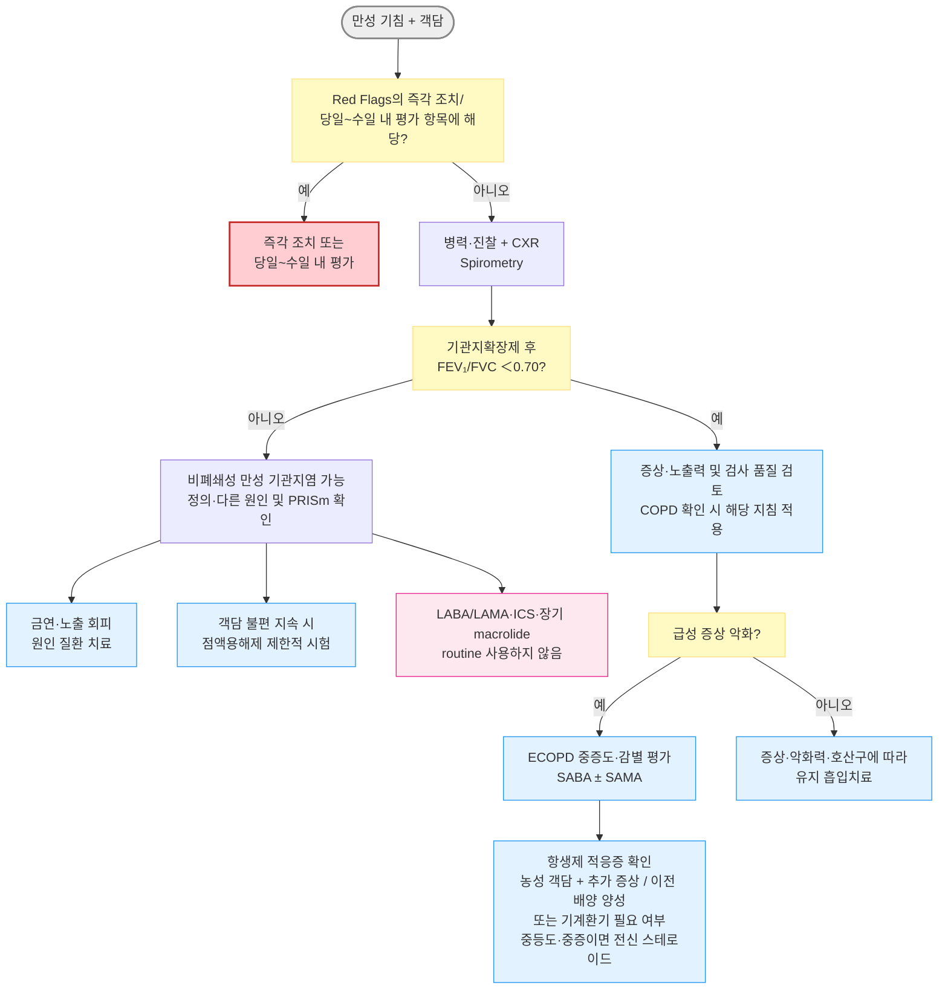

# 만성 기관지염 Chronic Bronchitis

## <mark style="color:green;">일반 사항</mark>

* 임상적 정의 : 다른 원인으로 설명되지 않는 만성 기침과 객담이 2년 연속으로 각각 연간 ≥3개월 동안 지속되는 상태
* 만성 기관지염은 기류 제한으로 정의되는 COPD와 달리 증상으로 정의되는 임상 표현형으로, 폐활량검사가 정상인 환자에서도 발생할 수 있음
* 기관지확장제 사용 후에도 FEV₁/FVC ＜0.70의 지속성 기류 제한이 있되면 COPD의 만성 기관지염 표현형으로 분류
* 기류 제한이 없는 만성 기관지염도 향후 폐 기능 저하·COPD 발생 및 호흡기 사건 위험 증가와 연관되므로 추적 관찰이필요
* pre-COPD : 기관지확장제 후 기류 폐쇄가 없으면서 호흡기 증상 및/또는 구조적·기능적 이상이 있는 상태
* PRISm(preserved ratio impaired spirometry) : 기관지확장제 후 FEV₁/FVC ≥0.70이지만 FEV₁ ＜80% 예측치인 상태. 비율이 보존되어도 정상이 아니며, 필요시 폐용적 검사로 제한성 장애 등을 감별함
* pre-COPD와 PRISm은 추적 대상이지만 모두 COPD로 진행하지는 않으며, 폐활량검사가 정상화되거나 기류 폐쇄 없이 같은 상태가 유지될 수도 있음 <mark style="color:$info;">\[GOLD 2026]</mark>
* 유병률은 정의, 연령, 흡연 및 환경 노출에 따라 크게 다름. 흡연자에서 흔하지만 비흡연자에서도 발생 가능
* 만성 객담 과분비는 폐 기능 저하, 호흡기 감염·악화 및 삶의 질 저하와 연관되지만, 폐기종·폐암·폐성심 등을 만성 기관지염 자체의 직접 합병증으로 단정하지 않음

* 임상적 정의 : 다른 원인으로 설명되지 않는 만성 기침과 객담이 2년 연속으로 각각 연간 ≥3개월 동안 지속되는 상태
* 만성 기관지염은 기류 제한으로 정의되는 COPD와 달리 증상으로 정의되는 임상 표현형으로, 폐활량검사가 정상인 환자에서도 발생할 수 있음
* 기관지확장제 후 FEV₁/FVC ＜0.70의 지속성 기류 제한이 동반되면 COPD의 만성 기관지염 표현형으로 분류
* 기류 제한이 없는 만성 기관지염도 향후 폐 기능 저하·COPD 발생 및 호흡기 사건 위험 증가와 연관되므로 추적 필요
* pre-COPD : 기관지확장제 후 기류 폐쇄가 없으면서 호흡기 증상 및/또는 구조적·기능적 이상이 있는 상태
* PRISm(preserved ratio impaired spirometry) : 기관지확장제 후 FEV₁/FVC ≥0.70이면서 FEV₁ ＜80% 예측치인 상태. 정상 폐활량검사와 구분하며, 필요시 폐용적 검사 등으로 원인을 평가함
* pre-COPD·PRISm은 추적 대상이지만 모두 COPD로 진행하는 것은 아니며, 정상 검사로 회복되거나 비폐쇄성 상태가 지속될 수도 있음 <mark style="color:$info;">\[GOLD 2026]</mark>
* 유병률은 정의, 연령, 흡연 및 환경 노출에 따라 크게 다름. 흡연자에서 흔하지만 비흡연자에서도 발생 가능
* 만성 객담 과분비는 폐 기능 저하, 호흡기 감염·악화 및 삶의 질 저하와 연관되지만, 폐기종·폐암·폐성심 등을 만성 기관지염 자체의 직접 합병증으로 단정하지 않음

## <mark style="color:green;">원인 및 위험 인자</mark>

* 흡연 : 가장 중요한 교정 가능 위험 인자. 궐련 외 전자담배·가열담배 등 흡입 노출도 확인
* 대기 오염 : 실내 조리·난방 연기, 실외 미세먼지·대기오염
* 직업성 분진·흄·화학물질 : 광업, 용접, 목공, 섬유·건설업 등
* 소아기 중증 호흡기 감염 및 폐 성장 저하 병력
* 폐결핵 병력(결핵 후 폐손상) : 기류 제한·기관지확장증의 위험 인자이며 국내에서 특히 중요함
* 천식, 기관지확장증, 위식도 역류 등은 만성 기침·객담의 감별 질환 또는 동반 악화 인자임
* α₁-antitrypsin 결핍은 폐기종·COPD의 위험 인자; 국내에서는 드물지만, COPD가 확인되면 연령·흡연력과 무관하게 일회 선별검사가 권고되며, 젊은 발병·비흡연·기저부 우세 폐기종·가족력이 있으면 특히 적극 평가. 순수 비폐쇄성 만성 기관지염 모두에 일률 적용하는 검사는 아님 <mark style="color:$info;">\[Alpha-1 Foundation 2016]</mark>

## <mark style="color:green;">임상 양상</mark>

* 주 증상 : 만성 기침, 점액성 또는 점액농성 객담
* 호흡 곤란·천명·운동능력 저하는 COPD, 천식, 기관지확장증 또는 심폐질환 동반 가능성을 시사
* 청진은 정상일 수 있으며 호기 연장, 천명음, 거친 호흡음 또는 수포음이 들릴 수 있음

### <mark style="color:orange;">증상의 급성 악화</mark>

* **COPD가 확인된 환자** : COPD 급성 악화(exacerbation of COPD, ECOPD)는 수일에 걸쳐(통상 ≤14일) 호흡 곤란 및/또는 기침·객담이 평소보다 악화되는 사건으로, 빈호흡·빈맥이 동반될 수 있음
* **기류 제한이 확인되지 않은 환자** : 증상이 급격히 악화되어도 곧바로 ECOPD로 진단하지 않고 급성 기관지염, 폐렴, 천식, 기관지확장증 악화, 폐색전증, 심부전, 기흉 등을 평가
* 고전적 Anthonisen 3대 증상은 호흡 곤란 증가, 객담량 증가, 객담 농성 증가이며, 급성 악화의 확진기준이라기보다 항생제 필요성 판단에 참고
* ECOPD 중증도는 투여한 약제나 입원 여부만으로 분류하지 않고 호흡 곤란 정도, 호흡수, 심박수, SaO₂, 의식상태와 필요시 CRP·동맥혈 가스 분석을 종합하여 평가

### <mark style="color:$danger;">🚩 Red Flags!</mark>

<mark style="color:$danger;">**즉각 조치**</mark>

* 새로 발생한 안정 시 심한 호흡 곤란, 문장 단위 대화 불가, 청색증 `중증 ECOPD` `급성 호흡부전`
* SpO₂의 급격한 저하 또는 안정 시 ＜88%(평소 수치와 산소치료 여부를 함께 고려) `급성 호흡부전`
* 의식 변화, 심한 혼동, 졸림 `고탄산혈증`
* 호흡 보조근 사용, 역설적 흉복벽 운동, 호흡 피로 `환기부전`
* 혈역학적 불안정, 새로 발생한 중증 부정맥, 지속되는 압박성 흉통 또는 갑작스러운 흉통과 심한 호흡 곤란 `폐색전증` `급성 관상동맥증후군` `기흉`
* 다량 객혈 또는 객혈과 호흡 곤란·저산소증·혈역학적 이상 동반 `대량 객혈`
* 동맥혈 가스 분석상 급성 호흡성 산증 `급성 고탄산성 호흡부전`

<mark style="color:$warning;">**당일\~수일 내 평가**</mark>

* **(당일)** 새로 발생하거나 평소보다 악화된 안정 시 호흡 곤란, 호흡수·심박수의 뚜렷한 증가, 지속되는 고열 `ECOPD` `폐렴`
* **(당일)** 평소보다 새로 감소한 SpO₂(88% 이상 포함)와 호흡 곤란 악화 `ECOPD` `폐렴`
* **(당일)** 위 즉각 조치 항목에 해당하지 않는 새 흉통 또는 편측 호흡음 감소 `폐렴` `기흉` `폐색전증` `급성 심장질환`
* **(당일)** 새로 발생한 소량 객혈 `폐암` `폐결핵` `기관지확장증`
* 원인 불명의 체중 감소·야간 발한 `폐암` `폐결핵`
* **(당일)** 중증 COPD 또는 재택 산소치료 환자의 평소보다 뚜렷한 증상 악화 `중등도~중증 ECOPD`
* 초기 치료 48\~72시간 후에도 호전이 없거나 악화 `치료 실패` `폐렴` `내성균`

<mark style="color:$info;">**조기 평가 및 추적**</mark>

* COPD 환자에서 최근 1년 내 중등도 이상 악화 ≥1회 `악화 재발 위험`
* COPD가 확인되지 않은 상태에서 반복되는 호흡기 증상 악화 `천식` `기관지확장증`
* 진행하는 운동 시 호흡 곤란, 활동 시 산소포화도 저하 `COPD` `간질성 폐질환`
* 금연 실패 또는 직업·환경 노출 지속 `COPD 진행 위험` `폐암 위험`
* 만성 다량 농성 객담 또는 반복 폐렴 `기관지확장증` `비결핵항산균 폐질환`

## <mark style="color:green;">진단</mark>

* 임상 진단 : 다른 원인을 배제한 후 2년 연속으로 각각 연간 ≥3개월 동안 지속되는 기침·객담
  * 위 정의는 만성 기관지염의 고전적 분류 기준임. 성인에서 기침이 ≥8주 지속되면 만성 기침 평가를 시작하며, 진단·치료를 위해 2년을 기다리지 않음 (☞ [기침](../220_/006_-cough.md))
* 병력 : 흡연력(pack-year), 전자담배·가열담배, 직업·환경 노출, 복용약(ACE 억제제 등), 천식·알레르기, 역류, 반복 감염·결핵 병력 확인
* 폐기능 검사(spirometry) : COPD·천식 등 기류 제한 유무를 확인하기 위해 시행
  * COPD는 임상적으로 의심되는 환자에서 **기관지확장제 후 FEV₁/FVC ＜0.70**으로 확인
  * 고정비율은 고령에서 과진단, 젊은 환자에서 과소진단 가능성이 있으므로 검사 품질, 증상·노출 및 정상하한치(LLN)를 함께 고려함
  * 기관지확장제 후 FEV₁/FVC가 0.60\~0.80이면 다른 날 재검하여 기류 폐쇄의 지속 여부를 확인함. 비율이 보존되어도 FEV₁이 낮으면 PRISm 등으로 따로 평가함 <mark style="color:$info;">\[GOLD 2026]</mark>
* 흉부 X선 : 만성 기침의 기본 평가로 폐렴, 종괴, 결핵, 심부전 및 기타 구조적 질환 감별
* 흉부 CT 고려 : 혈담, 비대칭적 국소 천명음, 체중 감소·야간 발한, 반복 폐렴, 다량 농성 객담, 기관지확장증 의심, 흉부 X선 이상 또는 치료에 반응하지 않는 증상
* 객담 검사 : 모든 환자에게 routine으로 시행하지 않음
  * 반복되는 농성 객담, 기관지확장증, 중증 기류 제한, 잦은 악화, 최근 항생제 사용, 과거 Pseudomonas 검출 또는 초기 치료 실패 시 일반 세균 배양
  * 결핵·비결핵항산균 의심 시 항산균 도말·배양 및 분자검사
* 혈액 검사 : 임상 상황에 따라 CBC, CRP. 혈중 호산구는 COPD의 ICS 반응 가능성 평가에 활용할 수 있으나 만성 기관지염이나 천식을 단독 진단하지 못함
* 증상 평가 : COPD가 확인된 환자에서 CAAT(Chronic Airways Assessment Test; 기존 CAT와 문항·점수 호환) ≥10 또는 mMRC ≥2를 높은 증상 부하의 기준으로 사용하여 유지치료 선택과 추적에 활용
* 악화 위험 평가 : COPD가 확인된 환자에서 최근 1년 내 중등도 또는 중증 악화가 ≥1회 있으면 초기 ABE 분류상 E군에 해당함. 이미 유지치료 중인 환자는 ABE 재분류가 아닌 추적 치료 알고리듬에 따라 치료 조정을 검토함 <mark style="color:$info;">\[GOLD 2026]</mark>


**폐암 검진(LDCT) 대상 여부 확인** : 국가폐암검진은 54\~74세 중 ≥30갑년 흡연력이 국가건강검진 문진표 등으로 확인되는 현재 흡연 고위험군을 대상으로 2년마다 시행함. 기존 국가폐암검진 수검자 중 검진 후 금연 15년 이내인 사람은 74세까지 대상에 포함될 수 있으므로 국민건강보험공단에서 대상 여부를 확인함. 혈담·체중 감소 등 증상이 있으면 검진 대상 여부와 관계없이 진단적 평가를 시행함.


### <mark style="color:orange;">감별</mark>

<table><thead><tr><th width="155">질환</th><th width="235">주요 감별점</th><th>확인 방법</th></tr></thead><tbody><tr><td>급성 기관지염</td><td>급성 경과, 상기도 감염 후 발생, 대부분 자연 호전</td><td>임상 경과, 필요시 폐렴 배제</td></tr><tr><td>COPD</td><td>노출력, 지속 호흡 곤란·기침·객담, 지속성 기류 제한</td><td>기관지확장제 후 spirometry</td></tr><tr><td>천식</td><td>증상과 기류 제한의 변동성, 야간·새벽 악화, 유발인자</td><td>Spirometry 가역성, PEF 변동성 등</td></tr><tr><td>천식과 COPD 동반</td><td>천식의 임상적 특징과 COPD의 지속성 기류 제한이 함께 존재</td><td>각 질환의 진단기준으로 평가; 호산구만으로 진단하지 않음</td></tr><tr><td>비천식성 호산구성 기관지염</td><td>기류 폐쇄·기도과민성 없이 지속되는 기침과 기도 호산구성 염증</td><td>필요시 유도객담 호산구, 기도과민성 검사; 혈중 호산구만으로 확진하지 않음</td></tr><tr><td>상기도 기침 증후군(UACS)</td><td>비강 증상, 후비루감, 목 이물감·헛기침</td><td>비강·인후두 평가, 원인별 치료 반응</td></tr><tr><td>위식도 역류 질환(GERD)</td><td>속쓰림·산 역류, 식후 또는 누울 때 악화</td><td>전형적 역류증상 평가; 필요시 추가검사</td></tr><tr><td>기관지확장증</td><td>만성 다량 농성 객담, 반복 폐렴, 객혈</td><td>흉부 HRCT, 객담 배양</td></tr><tr><td>폐결핵·비결핵항산균증</td><td>체중 감소, 야간 발한, 혈담, 노출력 또는 구조적 폐질환</td><td>흉부 영상, 객담 도말·배양·분자검사</td></tr><tr><td>폐암</td><td>새로운 기침 변화, 혈담, 체중 감소, 쉰 목소리, 흡연력</td><td>흉부 CT, 필요시 기관지경·조직검사</td></tr><tr><td>심부전</td><td>기좌호흡, 야간 호흡 곤란, 부종, 수포음</td><td>BNP/NT-proBNP, 심전도, 심초음파 등</td></tr></tbody></table>

***



<p align="center"><strong>만성 기관지염 진단·치료 알고리듬</strong></p>

<p align="center"><em><mark style="color:$info;">저자 재구성 (참고 문헌 : GOLD 2026; NICE NG114·NG115)</mark></em></p>

***

## <mark style="background-color:$warning;">Management</mark>

### <mark style="color:orange;">치료 방침</mark>

* 치료 목표 : 기침·객담과 삶의 질 개선, 원인 노출 제거, COPD 및 구조적 폐질환 확인, COPD 동반 시 악화 예방
* 금연 및 유해 흡입 노출 회피가 가장 중요한 개입 (☞ [금연](../230_/190_-smoking.md))
* 증상·노출력과 기관지확장제 후 폐기능검사를 종합하여 COPD가 확인되면 COPD 지침에 따라 관리 (☞ [COPD](072_-copd.md))
* COPD 급성 악화 후 추적 : 초기 치료 48\~72시간 후의 반응 확인과 별도로, 회복 후 흡입기 사용법·유지치료·동반 질환과 호흡 재활 필요성을 재평가함. 입원한 악화는 퇴원 후 1~4주 이내 초기 추적하고, 12~16주에 회복 상태·폐기능·산소치료 필요성을 재평가함. 중등도 악화 1회부터 유지치료 강화를 검토함 <mark style="color:$info;">\[GOLD 2026]</mark>
* 기류 제한이 없으면 COPD 흡입제·전신 스테로이드·항생제를 경험적으로 장기 투여하지 않고 다른 원인과 동반 질환을 치료
* 예방접종 : 연령·기저질환·국내 권고에 따라 인플루엔자, 코로나19, 폐렴구균, RSV 등 접종 여부 확인 (☞ [예방접종](../231_/210_-vaccination.md))

## <mark style="color:green;">비-약물 치료 및 예방</mark>

* 금연 치료 : 행동 상담과 함께 니코틴 대체요법, varenicline 또는 bupropion 중 환자에게 적절한 약제를 선택; 필요한 경우 근거가 있는 병합요법 고려
* 직업·환경 노출 감소 : 작업장 환기·보호구, 간접흡연 회피, 미세먼지 고농도 노출 최소화
* 수분 섭취 : 탈수를 피하도록 하되 일률적으로 1.5\~2 L 이상을 강제하지 않음. 심부전·신장질환 등 수분 제한이 필요한 환자는 기저질환 지침을 우선
* 객담 배출 교육 : 효과적인 기침법. 매일 다량 객담이 있으면 기관지확장증 등 원인을 평가하고, 선택적으로 oscillating PEP 등 기도청결요법 고려
* 흡입기 교육 : COPD·천식으로 흡입제를 사용하는 경우 기기별 사용법과 순응도를 반복 확인. pMDI 사용이 어려우면 스페이서 등 적절한 전달기구를 선택하며 네뷸라이저가 일률적으로 우월하지는 않음
* 호흡 재활 : 기능 제한이 있는 COPD, 특히 입원을 요한 악화 후 조기에 고려; 정상 spirometry인 단순 만성 기관지염에 일률 적용하지 않음

## <mark style="color:green;">약물 치료</mark>

### <mark style="color:orange;">거담제 및 점액용해제</mark>

* 비폐쇄성 만성 기관지염 : 금연·노출 회피와 원인 평가 후에도 불편한 객담이 지속될 때 제한적 증상 시험으로만 사용
* COPD : NAC·carbocisteine은 주로 ICS를 사용하지 않는 환자에서 악화 감소 가능성이 제시됨. Erdosteine 600 ㎎/일은 ICS 병용 여부와 관계없이 주로 경증 악화 감소 근거가 있으므로, 모든 점액용해제에 동일한 ICS 제한을 적용하지 않음 <mark style="color:$info;">\[GOLD 2026; Eur Respir J 2017]</mark>
* 점액용해제는 만성 기관지염 또는 COPD에서 악화를 소폭 줄일 수 있으나 연구 간 이질성이 크며, 삶의 질 개선은 작고 임상적으로 의미 있는 차이에 미치지 못할 수 있음 <mark style="color:$info;">\[Cochrane 2019]</mark>
* 급성 악화 중 보조요법으로 추가하면 치료 성공·증상 개선이 일부 결과에서 중등도 확실성으로 보고되었으나, 연구 간 약제·용량 차이가 커서 효과 크기와 장기 경과 개선은 제한적으로 해석함 <mark style="color:$info;">\[Eur Respir Rev 2023]</mark>
* erdosteine : 점액용해·항산화 작용. 300 ㎎ bid\~tid <mark style="color:blue;">\[에르도스, 뮤코원]</mark>
  * 금기 : 중증 신장애(CrCl ＜25 ㎖/min), 중증 간장애·간경변, 소화성궤양, 시스타티오닌 합성효소 결핍 등
  * 경증·중등도 간장애에서는 1일 300 ㎎을 초과하지 않음
  * 급성 호흡기질환에는 연속 10일 이상 투여하지 않음; 만성 질환에서는 임상적 이득과 이상반응을 재평가하며 기간을 개별화
* acetylcysteine(NAC) : 점액용해·항산화 작용. 경구 200 ㎎ 캡슐 <mark style="color:blue;">\[뮤테란캡슐200㎎]</mark>의 성인 허가 용량은 급성질환 200 ㎎ tid, 만성질환 200 ㎎ bid이며 제형·제품별 용법을 확인함
  * COPD 악화 예방 연구의 고용량 600 ㎎ bid는 위 캡슐제의 만성질환 허가 용량을 초과하는 허가 외 용량임 <mark style="color:$info;">\[Lancet Respir Med 2014]</mark>
  * 고용량 NAC의 효과는 연구 간 일관되지 않음. 경증\~중등도 COPD 968명을 2년 추적한 2024년 무작위시험에서는 전체 악화율·폐기능의 유의한 개선이 없었으므로 일률적 장기 투여를 권하지 않음 <mark style="color:$info;">\[Nat Commun 2024]</mark>
  * 금기 : 과민반응, 위·십이지장궤양, 해당 제형의 유당 관련 유전 질환 등. 천식 환자의 기관지연축과 객담 배출 능력을 확인함. 아목시실린·독시사이클린 등 경구 항생제와는 허가사항에 따라 ≥2시간 간격을 둠
* 일정 기간 사용 후 객담·기침·삶의 질의 임상적 이득이 없으면 중단함. 객담이 많은 환자에서는 진해제 병용으로 배출이 저하될 수 있어 일률적으로 병용하지 않음


비폐쇄성 만성 기관지염의 장기 질병 경과를 일관되게 개선하는 표준 약물치료는 확립되지 않음. COPD가 동반되면 해당 지침에 따른 치료로 증상·악화 위험을 줄임. 장기 추적에서 증상 변화와 폐기능을 재평가함.


### <mark style="color:orange;">기관지확장제</mark>

* 기류 제한이 없는 만성 기관지염에서 LABA 또는 LAMA를 증상 치료 목적으로 routine 시험 투여하지 않음 <mark style="color:$info;">\[N Engl J Med 2022]</mark>
* COPD가 확인되면 증상과 악화력에 따라 LABA/LAMA 등 유지 흡입치료를 선택 (☞ [COPD](072_-copd.md))
* 천식이 동반되면 천식 지침에 따라 ICS 포함 치료. 호산구 증가만으로 천식-COPD 동반을 진단하지 않으며, COPD의 ICS 추가는 악화력·호산구 수치·폐렴 위험을 함께 고려함
* theophylline 등 methylxanthine은 치료역이 좁고 약물상호작용이 많아 COPD 유지치료에 일상적으로 권하지 않음


**COPD 만성 기관지염 표현형의 추가 치료** : 적절한 유지 흡입치료에도 악화가 반복되는 COPD에서 고려하며 호흡기내과와 협의함 (☞ [COPD](072_-copd.md))

* roflumilast : 500 ㎍ qd <mark style="color:blue;">\[닥사스]</mark> - GOLD 2026 추적 치료에서는 LABA/LAMA 또는 ICS/LABA/LAMA 유지치료에도 악화가 지속되는 COPD 중 만성 기관지염 증상, FEV₁ ＜50% 예측치 및 이전 입원을 요한 급성 악화 병력이 있는 환자에서 추가를 고려함 <mark style="color:$info;">\[GOLD 2026]</mark>
  * 국내 허가 : 증상 악화 병력이 있고 만성 기관지염을 수반한 중증 COPD에서 기관지확장제의 부가 유지요법
  * 국내 급여 : 위 허가 범위에서 ① FEV₁ ＜50% 예측치 또는 ② β₂ 작용제·항콜린제 등의 지속 투여에도 연 ≥2회 악화 시 투여소견서로 인정하며, LABA 또는 LAMA 1종과 병용하는 기준임. 임상 지침의 선택 기준과 급여 조건을 구분함 <mark style="color:$info;">\[심평원 고시 제2021-270호]</mark>
  * 체중 감소·설사·불면·우울 증상을 관찰함. 성분 과민증, Child-Pugh B·C, 자살 관념·행동 관련 우울증 병력, 중증 면역학적 질환·급성 감염, 암(기저세포암종 제외), 면역억제제 투여(단기 전신 스테로이드 제외), 잠복 감염, NYHA III·IV 심부전 등은 국내 허가상 금기임
* dupilumab : 300 ㎎ 2주 간격 피하주사 <mark style="color:blue;">\[듀피젠트]</mark> - 국내 허가는 ICS/LABA/LAMA 삼제요법(ICS가 적절하지 않으면 LABA/LAMA)으로 조절되지 않는 혈중 호산구 증가 COPD의 추가 유지치료. 만성 기관지염 증상이 있고 호산구 ≥300/μL인 COPD에서 악화 감소와 폐기능·삶의 질 개선이 확인됨 <mark style="color:$info;">\[N Engl J Med 2023, 2024]</mark>
* mepolizumab : 100 ㎎ 4주 간격 피하주사(오토인젝터) <mark style="color:blue;">\[누칼라오토인젝터주]</mark> - 2026-10-22 변경된 국내 허가에 성인에서 ICS/LABA/LAMA로 적절히 조절되지 않는 혈중 호산구 증가 COPD의 추가 유지요법이 포함됨. GOLD 2026은 삼제요법 중 악화가 지속되고 호산구 ≥300/μL인 환자에서 만성 기관지염 유무와 관계없이 고려함 <mark style="color:$info;">\[N Engl J Med 2025; GOLD 2026]</mark>
* 주요 생물학제제 임상시험은 최적 삼제요법에도 지난 1년 **중등도 악화 ≥2회 또는 중증 악화 ≥1회**가 있었고 혈중 호산구 ≥300/μL인 환자를 주로 대상으로 함. 이는 근거가 확보된 시험 대상의 조건이며, 국내 허가 문구나 Group E 분류 기준과 동일한 뜻은 아님 <mark style="color:$info;">\[GOLD 2026, Fig 3.11]</mark>
* 두 생물학제제 모두 비폐쇄성 만성 기관지염이나 급성 악화의 구제치료에는 사용하지 않음. 국내 허가 문구와 임상시험의 호산구 수치·악화력 기준을 구분하고, 확인한 mepolizumab 급여 고시(제2026-133호)는 중증 호산구성 천식 대상이며 COPD 급여를 명시하지 않음. COPD 허가가 곧 급여 적용을 뜻하지 않으므로 처방 시점의 최신 고시를 확인함


### <mark style="color:orange;">COPD 급성 악화 시 기관지확장제</mark>

* SABA를 초기 기관지확장제로 사용하고 임상 상황에 따라 SAMA 병용
* salbutamol : 100 ㎍/puff, 1\~2 puffs prn <mark style="color:blue;">\[벤토린 에보할러]</mark>; 국내 허가사항상 외래 자가 사용은 24시간 최대 총 8번 분사(8 puffs). 더 자주 필요하거나 효과가 짧으면 즉시 재평가하며, 의료진 감시하 급성 악화 반복 투여는 별도 프로토콜에 따름
  * 금기 : 성분·교감신경흥분성 아민류 과민증, 비후성 심근병증. 반복 투여 시 빈맥·부정맥·저칼륨혈증에 유의함
* ipratropium : 네뷸라이저용 500 ㎍/2 ㎖, 성인 1회 100\~500 ㎍ qid 흡입 <mark style="color:blue;">\[아트로벤트흡입액유디비]</mark> - 아래 처방례는 네뷸라이저용 제형 기준임
  * 금기 : 폐쇄각 녹내장, 전립선비대증, 아트로핀 계열 약물 과민증
  * 마스크 사용 시 약물이 눈에 들어가면 급성 폐쇄각 녹내장이 유발·악화될 수 있으므로 가능하면 마우스피스 사용
  * LAMA 유지치료 중인 환자는 항콜린 효과 중복을 고려
* 중증 악화 또는 pMDI 사용이 어려운 상황에서는 네뷸라이저 제형을 고려


**COPD 급성 악화의 산소요법** : 저산소증이 있으면 혈액가스 확인 전 SpO₂ 88\~92%를 목표로 조절 산소 투여하고 혈액가스·임상 반응에 따라 조정. 저산소증 환자에게 산소를 보류하지 않으며, 호흡성 산증·의식 변화·호흡 피로에서는 비침습환기 등 환기 보조 필요성을 평가함(긴급도는 Red Flags 참조). <mark style="color:$info;">\[BTS 2017]</mark>


### <mark style="color:orange;">항생제 - COPD 급성 악화에서 선택적 사용</mark>

* 비폐쇄성 만성 기관지염의 단순 증상 악화나 객담 색 변화만으로 항생제를 routine 처방하지 않음
* COPD 급성 악화에서 다음 중 하나에 해당하면 항생제 투여 <mark style="color:$info;">\[GOLD 2026]</mark>:
  * **객담 농성 증가**와 함께 호흡 곤란 증가·발열·객담량 증가 중 ≥1개가 동반됨
  * 이전 급성 악화 시 객담배양 양성 병력이 있음 : GOLD 2026의 항생제 고려 조건이지만, 과거 균종·감수성, 집락화 가능성 및 현재 감염 소견을 종합하여 처방 여부와 항생제를 결정함
  * 비침습 또는 침습 기계환기가 필요함
* CRP, 최근 항생제 사용, 과거 배양 결과와 악화의 중증도는 항생제 필요성 판단과 약제 선택에 함께 참고함. Procalcitonin 단독 기준으로 항생제 투여·보류를 결정하지 않음 <mark style="color:$info;">\[GOLD 2026; NICE NG114]</mark>
* 항생제는 지역 내성률, 최근 항생제 사용, 과거 배양 결과, 알레르기와 동반 질환을 고려하여 선택
* 외래 치료 기간은 통상 5일 이내이며 약제별 검증된 요법을 따름(아래 azithromycin 예시는 3일). 48\~72시간 후 반응을 확인함
* 객담배양은 잦은 악화, 중증 기류 제한, 기계환기, 기관지확장증, 과거 Pseudomonas 검출 또는 치료 실패에서 시행

#### <mark style="color:$primary;">외래 항생제 예시</mark>

* 아래는 성인 경구 요법의 예시이며, 모두를 동등한 경험적 1차 선택으로 사용하지 않음. 국내 감수성·최근 항생제 사용·개별 금기를 우선 확인함. amoxicillin 단독은 일부 지침의 선택지이나 지역 감수성과 β-lactamase 생성균(H. influenzae·M. catarrhalis) 위험을 고려하여 선택함
* amoxicillin/clavulanate : 500/125 ㎎(총 625 ㎎) tid × 5일 <mark style="color:blue;">\[오구멘틴]</mark> - 페니실린 과민증·중증 β-lactam 과민반응 병력 및 이 약 관련 황달·간장애 병력 금기. 신기능 저하 시 용량·간격 조정
* doxycycline : 첫날 100 ㎎ bid, 이후 100 ㎎ qd × 4일(총 5일) <mark style="color:blue;">\[모노신]</mark> <mark style="color:$info;">\[NICE NG114]</mark> - 국내 허가의 초회·유지 용량에 해당함. 중증 감염에서는 100 ㎎ bid 유지가 가능하나 외래 단순 악화에 일률 적용하지 않음. 임부·수유부·12세 미만 소아 등 국내 금기를 확인함
* azithromycin : 500 ㎎(250 ㎎ 2정) qd × 3일 <mark style="color:blue;">\[지스로맥스]</mark> - QT 연장·저칼륨혈증·약물상호작용과 국내 내성률을 고려하여 선택적으로 사용함. 예방 목적으로 macrolide를 복용 중이면 다른 계열을 선택함
* fluoroquinolone은 중대한 이상반응·내성 선택 및 결핵 진단 지연 위험을 고려하여 다른 적절한 대안이 없을 때만 선택함. Pseudomonas 위험이 높으면 위 표준 경구 요법을 그대로 적용하지 않고 배양 결과와 중증도에 맞춰 결정함

### <mark style="color:orange;">전신 스테로이드 - COPD 급성 악화</mark>

* 비폐쇄성 만성 기관지염의 악화에 routine으로 사용하지 않음
* COPD의 중등도·중증 급성 악화에서 회복 기간과 치료 실패를 줄이기 위해 사용
* prednisolone : 40 ㎎ **1일 1회** × 5일 <mark style="color:blue;">\[소론도]</mark>; NICE는 30 ㎎ 1일 1회 × 5일 권고 <mark style="color:$info;">\[GOLD 2026; NICE NG115]</mark>
* 혈중 호산구 ≥300/μL를 급성기 전신 스테로이드의 확정적 투여 기준으로 사용하지 않음
* 5일 단기요법은 일반적으로 감량 없이 종료할 수 있으나, 최근 반복 투여·장기 스테로이드 복용·부신기능저하 위험은 별도 평가

### <mark style="color:orange;">Macrolide 장기 예방 요법</mark>

* 기류 제한이 없는 순수 만성 기관지염에는 표준치료로 권고하지 않음
* 금연과 적절한 COPD 유지 흡입치료에도 악화가 지속되는 일부 COPD 환자, 특히 현재 비흡연자에서 호흡기내과 협진하에 고려(허가 외 사용)
* 시작 전 심전도(QTc), 간기능, 청각 증상·위험, 약물상호작용 및 객담 항산균 검사를 포함한 결핵·비결핵항산균증 가능성 평가
* 사용 중 임상적 이득, QTc, 간기능, 청각 이상, 내성균 및 비결핵항산균을 모니터링
* azithromycin 250 ㎎ qd 또는 500 ㎎ 주 3회가 최대 1년간 연구되었으며, 1년을 넘는 효과·안전성 근거는 없음

## <mark style="color:green;">시술 및 기타 처치</mark>

* 기관지 내 cryospray, rheoplasty, targeted lung denervation 등은 표준치료로 확립되지 않은 연구적 접근임. 비폐쇄성 만성 기관지염의 일상 진료에 적용하지 않음

***

## <mark style="color:red;">질병코드</mark>

* J41 단순성 및 점액화농성 만성 기관지염 Simple and mucopurulent chronic bronchitis
* J41.0 단순 만성 기관지염 Simple chronic bronchitis
* J41.1 점액화농성 만성 기관지염 Mucopurulent chronic bronchitis
* J41.8 단순 및 점액화농성 혼합형 만성 기관지염 Mixed simple and mucopurulent chronic bronchitis
* J42 상세불명의 만성 기관지염 Unspecified chronic bronchitis


J44.1은 급성 악화를 동반한 COPD 코드임. 폐활량검사와 임상 소견으로 COPD가 확인되지 않은 순수 만성 기관지염 환자에게 보험 적용을 목적으로 추가하지 않음. COPD가 확인된 만성 기관지염 표현형은 J44.- 코드를 사용함.


***

## <mark style="color:purple;">처방례</mark>

> **처방례 1. 비폐쇄성 만성 기관지염 - 불편한 객담에 대한 단기 시험**
>
> ```
> 에르도스캡슐 300 ㎎/C   2C  #2  × 14일
> ```
>
> _✽ 금연·노출 회피와 다른 원인 평가가 우선임. 중증 신·간장애 등 금기와 간장애 시 감량 기준을 확인하고, 임상적 이득이 없으면 관성적으로 장기 처방하지 않음._

> **처방례 2. COPD 급성 악화 - 기관지 경련, 항생제 적응증 없음**
>
> ```
> 벤토린 에보할러                       1~2 puffs  prn
> 아트로벤트흡입액유디비 500 ㎍/2 ㎖   1A  qid  (네뷸라이저)
> ```
>
> _✽ 객담 농성 증가가 없고 기계환기가 필요하지 않으며, 이전 악화 때의 객담배양 양성 병력 등 다른 항생제 적응증도 없는 경증 악화의 예임. 아트로벤트흡입액유디비는 가정용 네뷸라이저가 있는 환자에게 처방하며 전립선비대증·폐쇄각 녹내장을 확인함. 흡입 횟수가 빠르게 증가하거나 효과가 짧으면 즉시 재평가하며 임의 증량하지 않음._

> **처방례 3. COPD 급성 악화 - 항생제 적응증 충족**
>
> ```
> 오구멘틴 625 ㎎/T    3T  #3  × 5일
> 벤토린 에보할러      1~2 puffs  prn
> ```
>
> _✽ 객담 농성 증가와 함께 호흡 곤란·발열·객담량 증가 중 하나 이상이 있을 때의 예임. 페니실린 과민증·이 약 관련 간장애 병력과 신기능을 확인하고, 중등도 이상 악화에서는 전신 스테로이드 필요성을 별도로 판단함. 최근 항생제, 과거 배양 결과와 지역 내성률을 고려함. 48\~72시간 후 호전이 없으면 폐렴·내성균·기관지확장증 등 다른 원인을 재평가함._

> **처방례 4. COPD 중등도 급성 악화 - 전신 스테로이드 추가**
>
> ```
> 소론도 5 ㎎/T         8T  #1  qAM  × 5일
> 벤토린 에보할러       1~2 puffs  prn
> ```
>
> _✽ Prednisolone은 40 ㎎을 아침에 1회 복용함. 항생제는 별도의 적응증이 있을 때만 추가함. 당뇨병, 최근 반복 스테로이드 투여 및 부작용 위험을 확인함._

***

### <mark style="color:$success;">핵심 복약 지도</mark>

> **항생제(오구멘틴, 모노신, 지스로맥스)에 대하여**
>
> 1. 처방된 용량과 기간을 지켜 복용하고 남은 약을 보관하거나 다른 사람과 나누어 복용하지 마십시오.
> 2. 오구멘틴은 식사 시작 시 복용하면 위장 불편을 줄일 수 있습니다.
> 3. 심한 설사, 전신 발진·호흡 곤란 등 이상반응이 나타나면 복용을 중단하고 즉시 진료받으십시오.
> 4. 모노신(독시사이클린)은 충분한 물과 함께 복용하고 복용 직후 눕지 마십시오. 햇빛에 피부가 민감해질 수 있으며, 철분제·칼슘제·제산제와는 시간 간격을 두고 복용하십시오.
> 5. 지스로맥스 복용 중 두근거림, 어지럼, 실신이 나타나면 즉시 진료받으십시오.
> 6. 48\~72시간 후에도 호전되지 않거나 악화되면 다시 내원하십시오.

> **스테로이드(소론도)에 대하여**
>
> 1. 아침 식후에 처방된 1일 용량을 한 번에 복용합니다.
> 2. 급성 악화 회복을 위해 단기간(통상 5일)만 사용하며 임의로 기간을 연장하지 마십시오.
> 3. 당뇨병이 있으면 복용 중 혈당이 일시적으로 높아질 수 있으므로 혈당을 더 자주 확인하십시오.

> **벤토린 에보할러와 아트로벤트 네뷸라이저의 사용법**
>
> 1. **벤토린 에보할러**는 흡입기를 흔들고 숨을 충분히 내쉰 뒤, 천천히 깊게 들이마시기 시작하면서 한 번 분사하십시오.
> 2. 벤토린을 분사한 후 가능한 약 10초간 숨을 참은 뒤 천천히 내쉬십시오. 추가 흡입이 필요하면 제품 지침에 따른 간격을 두십시오.
> 3. 벤토린은 24시간에 총 8번 분사(8 puffs)를 초과하여 임의로 사용하지 마십시오. 더 자주 필요하거나 효과가 오래 지속되지 않으면 즉시 진료받으십시오.
> 4. **아트로벤트흡입액유디비**는 네뷸라이저 약물통에 넣어 앉은 자세로 마우스피스를 통해 편안히 호흡하며 흡입합니다. 위 벤토린의 흔들기·분사 동작을 적용하지 않습니다. 일회용 용기의 남은 약액은 버리고, 기구는 제조사 지침에 따라 세척·건조하십시오. 약이 눈에 들어가지 않도록 하십시오. 눈 통증, 시야 흐림, 불빛 주위 무지개가 보이거나 소변보기가 어려워지면 사용을 중단하고 진료받으십시오.

> **점액용해제(에르도스테인 등)에 대하여**
>
> 1. 객담을 묽게 하여 배출을 돕는 약입니다.
> 2. 탈수되지 않도록 적절히 수분을 섭취하되, 심장·신장질환으로 수분 제한 중이면 담당 의사의 지시를 따르십시오.
> 3. 일정 기간 사용해도 객담이나 기침이 개선되지 않으면 계속 복용하지 말고 진료 시 상의하십시오.

> **언제 다시 병원을 방문해야 하나요?**
>
> * 안정 시에도 숨이 차거나 입술·손발이 파래지는 경우 - **즉시 응급실**
> * 의식이 흐려지거나 문장 단위로 말하기 어려운 경우 - **즉시 응급실**
> * 많은 양의 피를 기침으로 뱉거나 혈담과 호흡 곤란·어지럼이 동반되는 경우 - **즉시 응급실**
> * 소량이라도 새로 혈담이 생기거나 산소포화도가 평소보다 낮아지고 숨참이 악화된 경우 - **당일 평가**
> * 치료 48\~72시간 후에도 호전되지 않는 경우 - **재평가**
> * 고열 또는 새로운 흉통이 발생하는 경우 - **당일 평가**(심한 흉통이나 심한 호흡 곤란 등 위험 소견은 즉시 응급실)

***

## <mark style="color:green;">주요 참고문헌 및 확인 자료</mark>

### <mark style="color:orange;">임상 근거</mark>

* [GOLD. Global Strategy for Prevention, Diagnosis and Management of COPD. 2026.](https://goldcopd.org/2026-gold-report-and-pocket-guide/) - COPD 진단, pre-COPD·PRISm, 악화 평가, 항생제·스테로이드, 점액용해제·roflumilast·생물학제제 및 유지치료 재평가 기준
* [GOLD. Report 2026 Key Changes Summary.](https://goldcopd.org/wp-content/uploads/2025/11/KEY-CHANGES-GOLD-2026-10Nov2025.pdf) - 중등도 악화 1회부터 치료 강화를 검토하는 2026 변경 사항, mepolizumab 추가
* [NICE. Chronic obstructive pulmonary disease in over 16s: diagnosis and management. NG115.](https://www.nice.org.uk/guidance/ng115) - COPD 관리 및 prednisolone 30 ㎎/일 5일 요법
* [NICE. Chronic obstructive pulmonary disease (acute exacerbation): antimicrobial prescribing. NG114.](https://www.nice.org.uk/guidance/ng114) - COPD 악화의 선택적 항생제 사용, 약제 선택 시 고려 요소와 치료 기간
* [Bronchodilators in Tobacco-Exposed Persons with Symptoms and Preserved Lung Function. N Engl J Med. 2022.](https://doi.org/10.1056/NEJMoa2204752) - RETHINC 무작위시험; 폐기능이 보존된 유증상 흡연 노출군에서 이중 기관지확장제의 증상 개선 효과가 입증되지 않음
* [Cochrane. Mucolytic agents versus placebo for chronic bronchitis or chronic obstructive pulmonary disease. 2019. CD001287.](https://doi.org/10.1002/14651858.CD001287.pub6) - 점액용해제의 악화 예방 효과와 연구 간 이질성
* [Dal Negro RW, et al. Erdosteine reduces the exacerbation rate and duration in COPD (RESTORE). Eur Respir J. 2017.](https://doi.org/10.1183/13993003.00711-2017) - erdosteine 600 ㎎/일의 COPD 악화 감소
* [Zheng JP, et al. Twice daily N-acetylcysteine 600 mg for exacerbations of COPD (PANTHEON). Lancet Respir Med. 2014.](https://doi.org/10.1016/S2213-2600\(14\)70019-0) - 고용량 NAC의 COPD 악화 감소
* [Papadopoulou E, et al. Mucolytics for acute exacerbations of chronic obstructive pulmonary disease: a meta-analysis. Eur Respir Rev. 2023.](https://doi.org/10.1183/16000617.0141-2022) - 급성 악화 중 점액용해제 보조요법의 치료 성공·증상 개선과 한계
* [Sciurba FC, et al. Mepolizumab to Prevent Exacerbations of COPD with an Eosinophilic Phenotype (MATINEE). N Engl J Med. 2025.](https://doi.org/10.1056/NEJMoa2413181) - 삼제요법 중 악화가 지속되는 호산구성 COPD의 추가 유지치료
* [Zhou Y, et al. Effect of high-dose N-acetylcysteine on exacerbations and lung function in patients with mild-to-moderate COPD. Nat Commun. 2024.](https://doi.org/10.1038/s41467-024-51079-1) - 경증\~중등도 COPD 968명에서 NAC 600 ㎎ bid 2년 투여의 전체 악화율·폐기능 개선 미입증
* [Bhatt SP, et al. Dupilumab for COPD with type 2 inflammation indicated by eosinophil counts (BOREAS). N Engl J Med. 2023.](https://doi.org/10.1056/NEJMoa2303951) - 만성 기관지염 증상·호산구 증가 COPD에서 dupilumab의 악화 감소
* [Bhatt SP, et al. Dupilumab for COPD with blood eosinophil evidence of type 2 inflammation (NOTUS). N Engl J Med. 2024.](https://doi.org/10.1056/NEJMoa2401304) - BOREAS 결과의 재현
* [Alpha-1 Foundation. The Diagnosis and Management of Alpha-1 Antitrypsin Deficiency in the Adult. 2016.](https://journal.copdfoundation.org/jcopdf/id/1115/The-Diagnosis-and-Management-of-Alpha-1-Antitrypsin-Deficiency-in-the-Adult) - 연령·인종과 관계없이 COPD 환자의 α₁-antitrypsin 결핍 검사 권고
* [BTS. Guideline for oxygen use in adults in healthcare and emergency settings. 2017.](https://doi.org/10.1136/thoraxjnl-2016-209729) - 고탄산혈증 위험 환자의 조절 산소 투여와 혈액가스 평가
* [국립암센터. 국가암검진사업.](https://www1.ncc.re.kr/main.ncc?uri=manage01_4) - 국가폐암검진의 연령·흡연력·검진 주기 및 기존 수검자의 금연 후 조건

### <mark style="color:orange;">허가·급여 확인 자료</mark>

* [식품의약품안전처. 의약품안전나라 - 의약품 품목허가정보.](https://nedrug.mfds.go.kr/index) - 국내 제품별 적응증·용법·금기 및 허가 상태 확인
* [건강보험심사평가원. Roflumilast 경구제 급여기준, 고시 제2021-270호(2021.11.1. 시행).](https://www.hira.or.kr/rc/insu/insuadtcrtr/InsuAdtCrtrPopup.do?mtgHmeDd=20211101\&mtgMtrRegSno=0002\&sno=4) - FEV₁·악화력 및 LABA/LAMA 병용 조건
* [건강보험심사평가원. Mepolizumab 주사제 급여기준, 고시 제2026-133호(2026.7.1. 시행).](https://www.hira.or.kr/rc/insu/insuadtcrtr/InsuAdtCrtrPopup.do?mtgHmeDd=20260701\&mtgMtrRegSno=0004\&sno=1) - 중증 호산구성 천식의 급여기준이며, 해당 고시에는 COPD 급여가 명시되지 않음
* 허가·급여 확인일 : 2026-10-25. 누칼라오토인젝터주 2026-10-22 변경 허가의 성인 COPD 적응증과 100 ㎎ 매 4주 용량을 확인함. 생물학제제의 COPD 급여 신설 여부는 처방 시점의 최신 고시를 다시 확인함

***

## <mark style="color:blue;">환자 안내서</mark>


**만성 기관지염은 원인 확인과 금연이 핵심입니다**

만성 기관지염은 다른 원인 없이 기침과 가래가 2년 연속으로 해마다 3개월 이상 지속되는 상태입니다. 폐 기능이 정상일 수도 있지만 일부에서는 COPD와 함께 나타나므로 폐활량검사로 확인하는 것이 중요합니다.


#### <mark style="color:$primary;">왜 만성 기관지염이 생기나요?</mark>

* 가장 중요한 원인은 흡연입니다. 전자담배·가열담배와 간접흡연도 기관지를 자극할 수 있습니다.
* 미세먼지, 조리·난방 연기, 직업성 분진·화학물질도 영향을 줄 수 있습니다.
* 천식, 기관지확장증, 역류질환, 결핵 등 다른 질환이 비슷한 증상을 일으킬 수 있으므로 원인 평가가 필요합니다.

#### <mark style="color:$primary;">증상이 갑자기 나빠지면 어떻게 하나요?</mark>

* 평소보다 숨이 차거나 기침·가래가 갑자기 늘고 가래가 누렇거나 초록색으로 진해지면 진료받으십시오.
* 증상 악화는 바이러스·세균 감염, 대기오염 또는 다른 심폐질환으로 생길 수 있습니다.
* 누런 가래가 있다고 모두 항생제가 필요한 것은 아닙니다. 진찰 후 폐렴 여부와 항생제 필요성을 판단합니다.


**자가 행동 계획(Action Plan)**


<table><thead><tr><th width="90">상태</th><th width="220">신호</th><th>대처</th></tr></thead><tbody><tr><td>평소</td><td>평소 수준의 기침·가래·호흡</td><td>금연, 노출 회피, 처방된 유지치료와 예방접종</td></tr><tr><td>경고</td><td>가래 양 증가·누렇게 진해짐, 숨참·기침 악화, 발열</td><td>의료진에게 연락하거나 조기에 내원하여 원인과 치료 필요성 평가</td></tr><tr><td>위험</td><td>안정 시 심한 숨참, 청색증, 의식 변화, 다량 객혈</td><td>즉시 119 또는 응급실</td></tr></tbody></table>

#### <mark style="color:$primary;">일상생활에서 어떻게 관리하나요?</mark>

* **금연이 가장 중요합니다.** 혼자 어렵다면 금연 상담과 금연치료 약물을 이용하십시오.
* 간접흡연과 직업성 분진·연기 노출을 줄이고, 미세먼지 고농도 시에는 노출을 최소화하십시오.
* 탈수를 피할 정도로 수분을 섭취하십시오. 심부전·신장질환으로 수분 제한 중이면 담당 의사의 지시를 우선합니다.
* 연령과 기저질환에 따라 독감, 코로나19, 폐렴구균, RSV 등 필요한 예방접종을 확인하십시오.
* 처방받지 않은 항생제·스테로이드·흡입제를 임의로 사용하지 마십시오.

#### <mark style="color:$primary;">이럴 때는 즉시 병원을 방문하세요</mark>

* 안정 상태에서도 숨이 차거나 입술·손발이 파래지는 경우
* 의식이 흐려지거나 말하기 어려울 정도로 숨이 찬 경우
* 많은 양의 피를 기침으로 뱉거나 혈담과 호흡 곤란·어지럼이 함께 나타나는 경우
* 흉통, 한쪽 가슴의 갑작스러운 통증 또는 호흡 곤란이 새로 생기는 경우
