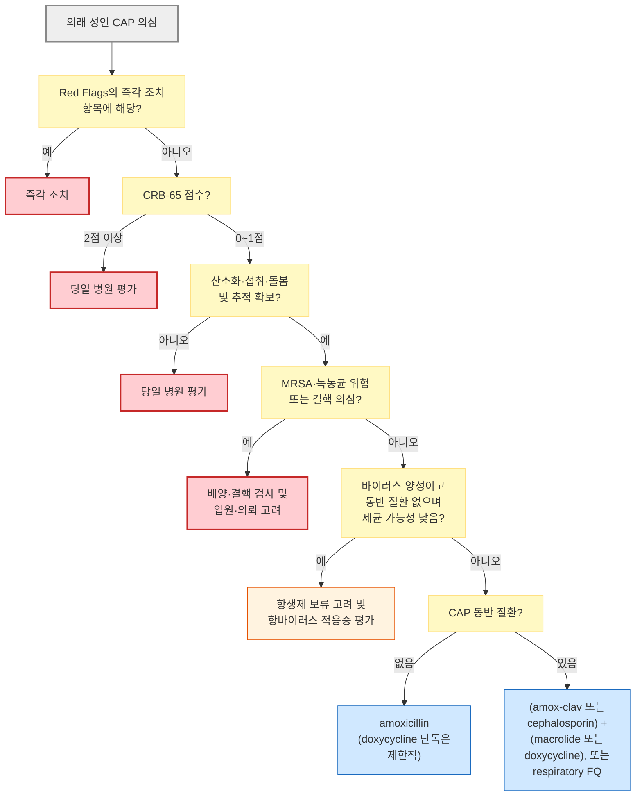
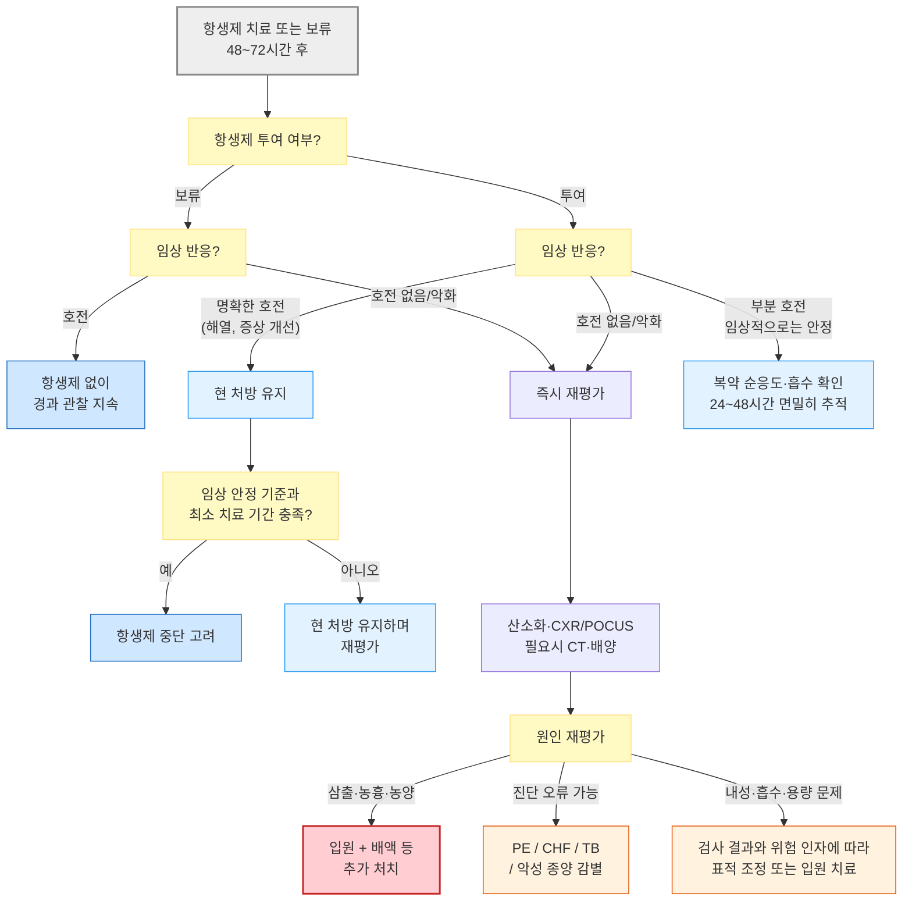

# 폐렴 Pneumonia

## <mark style="color:green;">일반 사항</mark>

* 이하 항생제·중증도·치료 기간 권고는 주로 정상 면역 성인의 지역사회획득폐렴(CAP)에 적용
  * 소아, 중증 면역저하자 및 병원획득폐렴은 별도 지침에 따라 평가·치료
* 폐렴 : 감염에 의해 terminal bronchiole 이하 폐 실질에 염증과 새로운 침윤이 발생하는 질환
  * 약물·방사선·과민반응 등에 의한 비감염성 폐장염(pneumonitis)과 구분
* 경과 : 적절히 치료해도 증상별 회복 속도가 다름. 발열은 대개 1주 이내 호전하지만 기침·호흡 곤란은 수 주, 피로는 수개월 지속될 수 있으며, 영상학적 음영 소실은 임상 증상보다 늦음
* 재발성 폐렴 : 각 발병 사이 임상적·영상학적 호전이 확인된 별개 폐렴의 반복
  * 동일 부위 반복 시 기관지 폐쇄·이물·종양, 서로 다른 부위 반복 시 흡인·면역 저하·기관지확장증 등을 평가


성인 CAP에서는 바이러스의 역할이 커졌지만 세균성 폐렴, 특히 _S. pneumonia&#x65;_&#xB294; 여전히 중요한 원인임. 바이러스 검사 양성만으로 세균 동시 감염을 배제할 수 없으며, 항생제 필요성은 치료 장소·중증도·동반 질환과 세균 감염 가능성을 함께 판단함. 일시적으로 호전된 뒤 발열·호흡기 증상이 다시 악화되면 2차 세균성 폐렴을 고려


## <mark style="color:green;">원인</mark>

* 바이러스 감염 : rhinovirus, influenza, RSV, 사람메타뉴모바이러스(hMPV), parainfluenza, adenovirus, coronavirus (SARS-CoV-2 포함)
  * 성인 CAP에서 바이러스가 검출되는 환자 비율은 검사법(특히 다중 PCR 사용 여부)에 따라, 바이러스 종류별 비중은 유행 시기에 따라 크게 달라짐
* 세균 감염
  * 전형적 세균 : _S. pneumoniae_, _H. influenzae_, _S. aureus_, GAS, _M. catarrhalis_
  * 비전형적 세균 : _Legionella_ sp., _M. pneumoniae_, _C. pneumoniae_
* 흡인 : 감염성 흡인성 폐렴과 화학적 흡인성 폐장염(chemical pneumonitis)을 구분

### <mark style="color:orange;">상황별 주요 원인 세균</mark>

<table><thead><tr><th width="211">상황</th><th>주요 원인균·해석</th></tr></thead><tbody><tr><td>COPD, 흡연</td><td><em>S. pneumoniae</em>, <em>H. influenzae</em>, <em>M. catarrhalis</em>. COPD·흡연만으로 녹농균 위험군으로 분류하지 않음</td></tr><tr><td>기관지확장증, 과거 녹농균 호흡기 분리력</td><td><em>P. aeruginosa</em> 가능성 증가</td></tr><tr><td>인플루엔자 후 악화</td><td><em>S. pneumoniae</em>, <em>S. aureus</em> 등 2차 세균성 폐렴</td></tr><tr><td>오염된 급수·배관·냉각탑 에어로졸 노출, 여행</td><td><em>Legionella</em></td></tr><tr><td>흡인 위험·불량한 치아 위생</td><td>일반 CAP 원인균과 구강 내 혼합 세균. 폐농양·농흉 시 혐기성균 고려</td></tr><tr><td>보호시설 거주</td><td>보호시설 거주만으로 MRSA·녹농균 광범위 치료를 결정하지 않고 과거 분리력·최근 입원 및 비경구 항생제 투여력을 확인</td></tr></tbody></table>


**흡인 후 항생제 선택** : 위 내용물의 급성 흡인에 의한 화학적 흡인성 폐장염은 24\~48시간 내 지지 치료만으로 호전할 수 있어 일률적인 항생제가 필요하지 않음. 감염성 흡인성 폐렴에는 표준 CAP 항생제를 사용하고, 폐농양·농흉이 의심되는 경우에만 추가 혐기성균 치료를 고려


### <mark style="color:orange;">위험 인자</mark>

* 흡연
* 영양 결핍, 면역 저하
* 집단생활
* 고령(특히 ≥65세)
* 최근 항생제 치료
* 기저 질환 : 만성 폐질환(천식, COPD, 기관지확장증), 흡인성 질환(GERD), PPI 장기 복용, 만성 심/신/간 질환, 당뇨병, 신경계 질환, 알코올 남용, 무비증, 악성 종양

## <mark style="color:green;">임상 양상</mark>

* 호흡기 : 기침, 가래, 호흡 곤란, (심호흡 시) 흉부 불편감 또는 통증; crackle, rhonchi, 비대칭 호흡음, egophony, 타진상 둔탁음
* 소화기 : 구역, 구토, 설사, 복통
* 전신 : 빈맥, 발열, 피로, 두통, 근육통
  * 고령에서는 발열 등의 임상 증상이 뚜렷하지 않을 수 있음

#### <mark style="color:$primary;">임상 양상에 따른 원인 추정의 한계</mark>

* 급격한 고열·화농성 가래·국소 crackle은 세균성 폐렴을 시사
* 마른기침·두통·근육통과 함께 초기에 청진 이상이 없거나 경미한 경우(영상 소견에 비해 청진 소견이 적음)는 바이러스 또는 비전형적 세균을 시사
* 임상 양상만으로 전형적 세균·비전형적 세균·바이러스를 신뢰성 있게 구별할 수 없으며, 이를 단독으로 항생제 계열 선택의 기준으로 사용하지 않음
* 경험적 항생제는 치료 장소와 중증도, 동반 질환, 최근 항생제 사용, 지역 내성, MRSA·녹농균 위험 인자, 바이러스 검사 결과와 약물 금기를 종합하여 선택

#### <mark style="color:$primary;">마이코플라스마 폐렴</mark>

* 마른기침, 가벼운 인두염, 미열, 오한, 설사 등 가벼운 증상으로 시작
* 호흡 곤란은 드묾, 초기에 청진 소견이 뚜렷하지 않음


**국내&#x20;**_**M. pneumoniae**_**&#x20;macrolide 내성 주의** : 국내 소아에서 높은 내성률이 보고되지만 이를 성인 내성률에 그대로 적용할 수는 없음. 성인에서는 지역 역학과 임상 반응을 함께 판단하고, macrolide 치료 후 48\~72시간에도 호전이 없으면 진단·중증도·합병증을 재평가한 뒤 doxycycline 또는 respiratory fluoroquinolone 전환을 고려


### <mark style="color:$danger;">🚩 Red Flags!</mark>

<mark style="color:$danger;">**즉각 조치**</mark>

* 호흡수 ≥30/분, 늑간 함몰, 청색증  `중증 폐렴` `호흡 부전`
* SpO₂ ＜90% (＜92%도 주의)  `저산소혈증`
* 수축기혈압 ＜90 ㎜Hg 또는 심박수 ≥125/분  `패혈증` `패혈성 쇼크`
* 의식 저하 또는 혼란  `중증 폐렴` `패혈증`
* 치료 중 호흡 곤란·산소화·의식·혈압이 악화됨  `치료 실패` `중증 폐렴`

<mark style="color:$warning;">**당일\~수일 내 평가**</mark>

* **(당일)** CRB-65 ≥2점 또는 PSI ≥91점  `입원 평가 필요`
* **(당일)** 치료 48\~72시간 후에도 뚜렷한 호전이 없음  `치료 실패` `농흉` `진단 오류`
* CRB-65 1점 또는 PSI 71\~90점이면서 산소화·경구 섭취·돌봄 여건이 불확실함  `중등증 폐렴`
* 흉부 X선상 다엽 침범 또는 흉막 삼출  `중증 폐렴` `농흉`
* 심한 구토, 경구 섭취 곤란, 탈수  `경구 치료 실패`
* 고령(≥65세) 또는 면역 저하 환자의 중등증 이상 증상  `중증 폐렴`
* 2주 이상 기침, 체중 감소, 야간 발한, 상엽 공동  `폐결핵`
* **(당일)** 흉막성 흉통과 빈맥이 있으나 CXR 소견이 경미함  `폐색전증`

<mark style="color:$info;">**조기 평가 및 추적**</mark>

* 임상·영상학적 호전 후 같은 부위 또는 다른 부위에 폐렴이 반복됨  `기관지 폐쇄` `흡인` `면역 저하`

## <mark style="color:green;">진단</mark>

* 임상 소견 또는 영상 검사만으로 폐렴의 바이러스와 세균 원인을 구별하는 것은 어려움
* 경험적 항생제 치료가 효과적이기 때문에 외래에서의 CAP 원인균 감별을 위한 일률적인 실험실 검사는 권고하지 않음

#### <mark style="color:$primary;">Diehr Rule - 성인 폐렴의 임상 진단 Tool</mark>

* 배점 : 콧물 −2점, 인후통 −1점, 근육통 +1점, 야간 발한 +1점, 가래(하루 종일) +1점, 호흡수 ＞25/분 +2점, 체온 ＞37.8℃ +2점
* 판정 : 점수가 높을수록 폐렴 가능성 증가 (1점≒8.8%, 2점≒10.3%, ≥4점≒29.4%; 원 연구 집단의 관찰값)
* 단독 사용보다 임상 판단의 보조 도구로 활용 <mark style="color:$info;">\[J Chronic Dis 1984]</mark>

#### <mark style="color:$primary;">중증 CAP 진단 기준 (ATS/IDSA)</mark>

* 주 기준 ≥1개 또는 부 기준 ≥3개 충족 시 중증 CAP

| <p></p><p><strong>주 기준 (Major criteria)</strong></p><ul><li>Vasopressor가 필요한 septic shock</li><li>침습적 mechanical ventilation이 필요한 호흡 부전</li></ul><p></p> | <p></p><p><strong>부 기준 (Minor criteria)</strong></p><ul><li>호흡수 ≥30/분</li><li>PaO₂/FiO₂ ratio ≤250</li><li>Multilobar infiltrates</li><li>Confusion/disorientation</li><li>요독증 (BUN ≥20 ㎎/㎗)</li><li>Leukopenia (WBC ＜4,000/㎕, 항암 치료 등이 아닌 감염으로 인한 경우)</li><li>Thrombocytopenia (PLT ＜100,000/㎕)</li><li>Hypothermia (중심 체온 ＜36℃)</li><li>적극적인 수분 공급이 필요한 저혈압</li></ul> |
| -------------------------------------------------------------------------------------------------------------------------------------------------------- | ----------------------------------------------------------------------------------------------------------------------------------------------------------------------------------------------------------------------------------------------------------------------------------------------------------------------------------------------------------------------- |

### <mark style="color:orange;">영상 검사</mark>

* 흉부 X선 : 병력·진찰 소견만으로 폐렴을 확진하거나 배제하기 어려우므로 폐렴이 의심되면 가능한 경우 흉부 X선 촬영을 권장; 특히 진단이 불확실하거나, vital sign 이상이 있거나, 고령 환자에서는 초기 CXR이 진단 정확도를 높임
  * consolidation, air bronchogram, pleural effusion과 폐쇄성 병변 여부를 확인
* 폐 초음파 (POCUS) : 숙련된 검사자가 표준화된 방법으로 시행할 수 있다면 CXR의 대안 또는 보조 검사로 활용 가능 <mark style="color:$info;">\[ATS 2025 조건부 권고, 낮은 근거]</mark>
  * consolidation(tissue sign), dynamic air bronchogram, pleural effusion 등을 확인할 수 있으나 B-line은 폐렴·폐부종·간질성 폐질환 등에서 나타나는 비특이적 소견이며, 심부 병변이나 폐쇄성 병변·종양·폐색전증 같은 대체 진단 평가에는 한계가 있음
* 재평가 : 치료 중 악화하거나 48\~72시간에 호전이 없으면 즉시 영상 재평가(CXR 또는 POCUS, 필요시 CT)
* 추적 영상 : 5\~7일 내 회복되어 치료에 반응하는 환자에서는 일률적인 추적 흉부 영상 검사를 권고하지 않음
  * F/U X선 검사 대상 : 증상 지속·악화, 동일 부위 반복, 설명되지 않는 체중 감소, 흡연·50세 초과 등 폐암 위험이 있거나 초기 영상에서 폐쇄성 병변이 의심되는 경우 약 6주 후 고려
  * 영상에서 병변 소실은 수 주가 걸리며, 고령·다엽 침범·흡연자에서는 12주까지 늦어질 수 있음

### <mark style="color:orange;">실험실 검사</mark>

* 대상 : 중등증 이상의 증상 또는 예상과 다른 진행 시 고려
* WBC : 백혈구 증가·호중구 우세는 세균 감염을 지지할 수 있으나 바이러스와 세균을 확정적으로 구별하지 못함
  * 감염으로 인한 WBC ＜4,000/㎕는 중증 CAP 부 기준
* CRP
  * 진찰 후에도 하기도감염에서 항생제 필요성이 불확실할 때에 한해 ＜20 ㎎/L이면 항생제를 일률적으로 처방하지 않고, 20\~100 ㎎/L이면 지연(back-up) 처방을 고려하며, ＞100 ㎎/L이면 즉시 항생제를 처방 <mark style="color:$info;">\[NICE 2023]</mark>. 이미 세균성 CAP가 의심되는 환자에서 낮은 CRP만으로 항생제를 보류하는 기준으로 쓰지 않음
  * 중증도·영상 소견과 함께 해석
* Procalcitonin (PCT)
  * 세균 감염에서 상승하는 바이오마커로, 진단보다는 항생제 중단 판단과 치료 반응 평가에 보조적으로 사용
  * 항생제 시작 결정에는 권장되지 않음; PCT가 낮아도 세균성 폐렴을 배제할 수 없으므로 항생제 보류 판단에 단독으로 사용하지 않음
  * PCT 감소 추세는 항생제 중단 판단에 보조적으로 활용 가능
  * 입원 환자에서 치료 실패가 우려되면 치료 3\~4일째 CRP 또는 PCT를 측정하여 높거나 충분히 감소하지 않으면 재평가 <mark style="color:$info;">\[NICE 2025]</mark>
* 가래 그람염색·배양 및 혈액배양 : 외래와 비중증 입원 CAP에서 일률적으로 시행하지 않음
  * 중증 CAP, MRSA·녹농균 경험적 치료, 과거 호흡기 분리력 또는 최근 90일 내 입원하면서 비경구 항생제를 투여받은 경우에는 항생제 투여 전에 시행
  * 공동(cavity)이 있으면 결핵균 핵산증폭검사·AFB 도말/배양을 우선 고려하고, 숙주·노출·영상에 따라 진균 검사를 선택
* _S. pneumoniae_ 소변 항원 : routine 검사하지 않으며 중증 CAP에서 고려
* _Legionella_ 소변 항원 : 중증 CAP 또는 여행·유행 등 역학적 위험이 있을 때 고려
  * 중증이면 하기도 검체 배양 또는 핵산증폭검사 병행 고려
* influenza 검사 : 지역사회 유행 시 신속 분자검사를 권장하며 신속 항원검사보다 선호
  * SARS-CoV-2·RSV 등 검사는 유행 상황과 치료·격리 결정에 따라 시행
* 중증, 치료 실패 시 기관지경 검사, 유의미한 흉막 삼출액이 있는 경우 thoracentesis 고려

### <mark style="color:orange;">감별</mark>

* 항생제 치료에 반응하지 않을 때 반드시 고려

<table><thead><tr><th width="121">감별 질환</th><th width="331">Key Clue</th><th>감별 검사</th></tr></thead><tbody><tr><td><strong>폐색전증 (PE)</strong></td><td>흉막성 통증 + 정상 또는 비특이적 CXR, 빈맥, 위험 인자</td><td>임상확률 평가, D-dimer, CT-PA</td></tr><tr><td><strong>울혈성 심부전</strong></td><td>양측성 침윤 + 발목 부종, 기좌호흡, BNP 상승</td><td>BNP/NT-proBNP, 심초음파</td></tr><tr><td><strong>결핵</strong></td><td>아급성 경과, 체중 감소, 야간 발한, 상엽 병변, 공동</td><td>CXR/CT, 객담 결핵균 핵산증폭검사·AFB 도말/배양. IGRA만으로 활동성 결핵을 진단·배제하지 않음</td></tr><tr><td><strong>악성 종양</strong></td><td>비해소성 폐렴, 흡연 병력, 체중 감소</td><td>흉부 CT, 기관지경</td></tr><tr><td><strong>호산구성 폐렴</strong></td><td>항생제 반응 없음, 혈액 호산구↑, 약물·기생충 노출</td><td>CBC differential, BAL</td></tr><tr><td><strong>과민성 폐렴</strong></td><td>항원(조류·곰팡이 등) 노출 병력, 재발성 경과</td><td>항원 회피 시 호전 여부, HRCT</td></tr></tbody></table>

***



> 항생제 보류 또는 투여 후 48\~72시간에 임상 경과를 확인하고, 이후 조치는 「48\~72시간 재평가 및 단계적 치료 조정」 알고리듬을 따름

<p align="center"><strong>CAP 외래 항생제 선택 알고리듬</strong></p>

<p align="center"><em><mark style="color:$info;">저자 재구성 (참고 문헌 : ATS/IDSA 2019; ATS 2025; NICE NG250 2025)</mark></em></p>

***

## <mark style="background-color:$warning;">Management</mark>

### <mark style="color:orange;">치료 방침</mark>

* 입원 치료 여부 결정 : 임상적 판단 및 예후에 대한 clinical prediction rule 적용 (ATS/IDSA에서는 CURB-65보다 PSI 선호)
* 충분한 휴식, 영양/수분 섭취
* 항생제 투여

### <mark style="color:orange;">입원 치료 결정을 위한 Clinical Rules</mark>

#### <mark style="color:$primary;">CURB-65 / CRB-65</mark>

1. Confusion : 사람, 장소, 시간에 대한 착란
2. Uremia : BUN ＞19 ㎎/㎗
3. Respiratory rate ≥30회/분
4. BP : SBP ＜90 또는 DBP ≤60 ㎜Hg
5. ≥65세

* 외래에서는 BUN을 제외한 CRB-65를 활용할 수 있고, 검사 가능한 경우 CURB-65 또는 PSI를 적용
* 점수는 임상 판단·산소화·경구 섭취 가능성·돌봄 여건을 대체하지 않음
* 배점 : 각 항목에 1점씩 부여
* CRB-65 판정 및 조치
  * 0점 = 대체로 외래 치료
  * 1점 = 산소화·경구 섭취·동반 질환·돌봄 여건을 평가하여 외래 치료(악화 시 재방문 기준 안내) 또는 당일 병원 평가 결정; 연령만으로 1점인 안정된 환자를 일률적으로 의뢰하지 않음
  * 2점 = 당일 병원 평가·의뢰
  * 3\~4점 = 긴급 입원 평가
* CURB-65 판정 및 조치
  * 0\~1점 = 대체로 외래 치료
  * 2점 = 입원 평가
  * ≥3점 = 입원 및 필요시 중환자 치료 평가

#### <mark style="color:$primary;">PSI (Pneumonia Severity Index)</mark>

<table data-search="false"><thead><tr><th width="222">위험 인자</th><th width="130">배점</th><th width="222">위험 인자</th><th width="130">배점</th></tr></thead><tbody><tr><td colspan="2"><em><strong>상황 요인</strong></em></td><td colspan="2"><em><strong>진찰 소견</strong></em></td></tr><tr><td>연령 (남성)</td><td>나이(yr)</td><td>Altered mental status</td><td>+20</td></tr><tr><td>연령 (여성)</td><td>나이(yr)−10</td><td>호흡수 ≥30/분</td><td>+20</td></tr><tr><td>Nursing home 거주</td><td>+10</td><td>SBP ＜90 ㎜Hg</td><td>+20</td></tr><tr><td colspan="2"><em><strong>동반 질환</strong></em></td><td>체온 ≥40℃ 또는 ＜35℃</td><td>+15</td></tr><tr><td>암</td><td>+30</td><td>맥박 ≥125/분</td><td>+10</td></tr><tr><td>만성 간질환</td><td>+20</td><td colspan="2"><em><strong>검사 소견</strong></em></td></tr><tr><td>CHF</td><td>+10</td><td>동맥혈 pH ＜7.35</td><td>+30</td></tr><tr><td>만성 신장 질환</td><td>+10</td><td>BUN ≥30 ㎎/㎗</td><td>+20</td></tr><tr><td>뇌혈관 질환</td><td>+10</td><td>Na ＜130 m㏖/L</td><td>+20</td></tr><tr><td></td><td></td><td>Glucose ≥250 ㎎/㎗</td><td>+10</td></tr><tr><td></td><td></td><td>Hematocrit ＜30%</td><td>+10</td></tr><tr><td></td><td></td><td>PaO₂ ＜60 ㎜Hg 또는 SpO₂ ＜90%</td><td>+10</td></tr><tr><td></td><td></td><td>흉부 X선상 pleural effusion</td><td>+10</td></tr></tbody></table>

* PSI는 먼저 50세 이하이면서 주요 동반 질환과 이상 활력징후·의식 변화가 없는 환자를 Class I(최저위험)로 분류하고, 나머지 환자에게 점수를 적용
* 판정 및 조치
  * Class I(1단계 임상 선별에 해당) = 대체로 외래 치료 가능
  * ≤70점(Class II) = 대체로 외래 치료 가능
  * 71\~90점(Class III) = 관찰·단기 입원 또는 선별적 외래 치료 고려
  * ≥91점(Class IV\~V) = 입원 권장
* PSI는 CURB-65와 사망 예측력은 비슷하지만 외래 치료가 가능한 저위험군을 더 많이 선별하고 검증 자료가 많아 ATS/IDSA에서 우선 권고됨. 다만 계산이 복잡하므로 외래에서는 CRB-65로 초기 선별 후 필요시 PSI를 적용하는 단계적 접근이 실용적

_<mark style="color:$info;">Ref. PSI/PORT Score : https://www.mdcalc.com/psi-port-score-pneumonia-severity-index-cap</mark>_

## <mark style="color:green;">약물 치료</mark>

### <mark style="color:orange;">항생제</mark>

* 임상적으로 세균성 CAP 또는 세균 동시감염이 의심되면 경험적 항생제를 조기 투여
* 호흡기 바이러스 양성인 동반 질환 없는 안정된 외래 환자에서 세균 감염 가능성이 낮다면 항생제 보류를 고려할 수 있음 <mark style="color:$info;">\[ATS 2025 조건부 권고, 근거 수준 매우 낮음]</mark>
* 선택 : 환자 위치(외래, 입원 또는 ICU), 위험 요인, 지역의 항생제 내성 패턴에 따른 경험적 선택
* 이하 성인 항생제 용량과 처방례는 정상 신기능 기준임. 신기능 저하 시 아래 약제별 감량·투여 간격 조정을 적용하며, 투석 환자는 별도 용법을 따름. 국내 허가상 신부전 금기인 제품은 감량하여 사용하는 약제와 구분함


2025 focused update는 ATS 단독 지침이며 2019 ATS/IDSA 공동 지침을 네 가지 쟁점에서 보완함. 특히 바이러스 양성 CAP의 항생제 권고는 근거 수준이 매우 낮으므로 세균 동시감염 가능성과 항생제 위해를 개별적으로 판단


**투여 기간 및 중단 기준**

* 매일 임상 안정성을 평가하며 다음 기준을 모두 충족하면 중단 시점을 결정
  * 체온 ≤37.8℃, 심박수 ＜100/분, 호흡수 ＜24/분, SBP ≥90 ㎜Hg, SpO₂ ≥90% (room air 또는 환자의 평상시 산소 요구량)
  * 정상 의식, 경구 섭취 및 약물 흡수 가능
* 임상적으로 안정된 외래 및 입원 비중증 CAP에서는 최소 3일을 전제로 ＜5일 치료를 고려할 수 있음 <mark style="color:$info;">\[ATS 2025 조건부 권고, 낮은 근거]</mark>
  * 외래에서는 5일 요법도 여전히 합리적
  * 단, 제품별 허가 투여 기간(예: 아벨록스 10일, 팩티브 7일)은 지침 기반 단기 치료와 다를 수 있음
* 중증 CAP는 ≥5일 치료
  * MRSA·녹농균·_Legionella_ 등 특정 병원체, 균혈증, 폐농양·농흉 또는 폐외 감염은 병원체와 합병증에 따라 연장
* 재평가 : 치료 시작 48\~72시간 내 호전이 없거나 언제든 악화하면 즉시 재평가
  * 호전 중인 모든 환자에게 종료 3일 후 방문을 일률적으로 요구하지 않음


**한국 임상 환경 특이사항 (Korea-Specific)**

* **Macrolide 단독 치료 비권장** : 국내 _S. pneumonia&#x65;_&#xC758; 높은 macrolide 내성을 고려하면 경험적 단독 요법으로 일반적으로 권장하지 않음. _M. pneumonia&#x65;_&#xC758; 소아 내성률을 성인에 그대로 적용하지 않음
* **Fluoroquinolone(FQ) 사용 전 결핵 가능성 평가** : FQ는 결핵 증상을 일시 억제하여 진단을 지연시킬 수 있음. 아급성 경과, 체중 감소, 야간 발한, 상엽 병변 등이 있으면 객담 결핵균 검사를 시행하고 가능하면 평가가 끝날 때까지 FQ를 보류
* **흡인성 폐렴** : 표준 CAP 치료에 별도의 혐기성균 약제를 routine으로 추가하지 않으며 폐농양·농흉 동반 시 고려. 급성 화학적 흡인성 폐장염은 항생제 없이 지지 치료 가능
* **MRSA /&#x20;**_**P. aeruginosa**_**&#x20;위험 인자** : 과거 호흡기 검체 분리력이 가장 중요한 위험 인자; 최근 입원(90일 내) AND 비경구 항생제 투여력이 그 다음


#### <mark style="color:$primary;">동반 질환 없음 (MRSA /</mark> <mark style="color:$primary;"></mark>_<mark style="color:$primary;">P. aeruginosa</mark>_ <mark style="color:$primary;"></mark><mark style="color:$primary;">위험 인자 없음)</mark>

* amoxicillin : 1 g tid <mark style="color:blue;">\[파목신]</mark> <mark style="color:$info;">\[ATS/IDSA]</mark>
  * 국내 허가 기본 용법은 250\~500 ㎎ tid이며 연령·증상에 따라 증감
  * 신기능 조정 : CrCl ＜30 ㎖/min이면 감량 또는 투여 간격 연장(임상 기준). 국내 파목신 허가사항은 중증 신장애에서 투여 간격 연장을 명시하며, 구체적인 CrCl 절단점은 제시하지 않음
* doxycycline : 100 ㎎ bid <mark style="color:blue;">\[모노신]</mark> <mark style="color:$info;">\[ATS/IDSA]</mark>
  * 국내 지침은 폐렴구균의 높은 tetracycline 내성을 이유로 단독 요법을 권하지 않음. β-lactam과 respiratory FQ가 모두 부적합한 경우 등에 제한적으로 고려
  * 신기능 관련 : 모노신은 국내 허가상 신부전 금기이므로, 일반적인 doxycycline의 신기능 조정 불필요 원칙을 그대로 적용하지 않음
* penicillin 알레르기 : 알레르기 유형에 따라 cephalosporin(cefpodoxime, cefuroxime) 또는 respiratory FQ(결핵 가능성 평가 후)를 고려
  * 단, SJS/TEN·DRESS 등 중증 지연형 반응 병력이 있으면 β-lactam으로 경험적으로 대체하지 않고 전문 평가
* Macrolide (azithromycin, clarithromycin)는 국내 내성률을 고려하여 경험적 단독 1차 선택에서 제외. 지역 폐렴구균 macrolide 내성률이 ＜25%임이 확인된 경우에만 단독요법 고려&#x20;
  * doxycycline 금기만으로 macrolide 단독요법을 선택하지 않고, penicillin 알레르기·동반 질환·약물 금기를 종합하여 대체 요법 결정

#### <mark style="color:$primary;">동반 질환 있음</mark>

* 동반 질환 : 만성 심장·폐·간·신질환, 당뇨병, 알코올 남용, 악성 종양, 무비증

**β-lactam (택 1) + 병용 약제 (택 1)**

* β-lactam
  * amoxicillin/clavulanate : 500/125 ㎎ tid <mark style="color:blue;">\[오구멘틴]</mark>
    * ATS/IDSA에는 875/125 ㎎ bid와 서방형 2,000/125 ㎎ bid도 제시되어 있으나 875/125 ㎎ 제형은 국내 미유통이며, 서방형 용법은 일반 제형 정수를 늘려 대체할 수 없음
    * 신기능 조정 : CrCl ＜30 ㎖/min이면 투여 간격을 연장하며, 국내 일반정제의 신기능별 허가표를 적용. 서방형 등 다른 제형의 기준과 구분
  * cefpodoxime : 200 ㎎ bid (100 ㎎ 2정) <mark style="color:blue;">\[바난]</mark>
    * 신기능 조정 : CrCl ＜30 ㎖/min인 비투석 환자는 동일 1회 용량을 q24h로 투여(해외 허가·임상 기준). 국내 바난 허가사항은 중증 신장애에서 신중 투여를 명시하며, 구체적인 CrCl 절단점은 제시하지 않음
  * cefuroxime : 500 ㎎ bid (250 ㎎ 2정) <mark style="color:blue;">\[진네트]</mark>
    * 신기능 조정 : 국내 허가표의 CrCl 10\~29에서는 표준 1회 용량을 q24h, ＜10에서는 q48h로 투여; ≥30에서는 조정 불필요. 허가표의 신기능 단위는 ㎖/min/1.73㎡이며, 각 혈액투석 종료 시 표준 1회 용량을 추가 투여
* 병용 약제
  * macrolide : azithromycin 500 ㎎ 1일 후 250 ㎎ qd ×4일 <mark style="color:blue;">\[지스로맥스]</mark> 또는 clarithromycin 500 ㎎ bid (250 ㎎ 2정) <mark style="color:blue;">\[클래리시드]</mark>
    * 국내 폐렴구균의 높은 macrolide 내성은 단독 요법을 피하는 근거이며, β-lactam 병용 시 macrolide는 비전형균 치료를 위해 사용
    * azithromycin 신기능 조정 : 통상 용량 조정 불필요. 단, 국내 허가상 GFR ＜10 ㎖/min에서는 신중 투여
    * clarithromycin 신기능 조정 : 일반정은 국내 허가상 CrCl ≤30 ㎖/min에서 1일 용량을 절반으로 감량(본문의 500 ㎎ bid 요법은 250 ㎎ bid로 감량). 서방정과 구분
  * doxycycline : 100 ㎎ bid <mark style="color:blue;">\[모노신]</mark>
    * 금기 : 신부전, 중증 간기능장애, 임부·수유부, 레티노이드 병용 등

**또는 단독 요법 : Respiratory FQ**

* FQ는 힘줄·신경·대동맥·QT 관련 중대한 이상반응 때문에 β-lactam 병용 요법을 쓸 수 없을 때 선택하며, 전신 스테로이드 병용 시 힘줄 손상 위험이 커짐
* 결핵 가능성 배제 후 선택
* 공통 금기 : 퀴놀론계 과민반응 병력, 퀴놀론계로 인한 건염·건파열 병력, 소아·성장기 청소년, 임부·수유부
* moxifloxacin 400 ㎎ qd <mark style="color:blue;">\[아벨록스]</mark> (허가 CAP 권장 기간 10일)
  * 신기능 조정 : 국내 허가상 신장애에서 용량 조정 불필요
  * 추가 금기 : QT 연장 질환, 전해질 이상(특히 교정되지 않은 저칼륨혈증), 서맥·부정맥 병력, 좌심실 박출률이 감소한 심부전, QT 연장 약물(IA·III군 항부정맥제, 항정신병약, 삼환계 항우울제 등) 병용, 중증 간장애 또는 아미노전달효소 정상의 5배 이상
* gemifloxacin 320 ㎎ qd <mark style="color:blue;">\[팩티브]</mark> (허가 CAP 권장 기간 7일, 중증은 최대 14일)
  * CrCl ＜40 ㎖/min 또는 혈액·복막투석 환자는 160 ㎎ qd로 감량; CrCl ≥40 ㎖/min에서는 용량 조정 불필요
  * QT 연장 병력·전해질 이상·IA/III군 항부정맥제 병용 시 신중 투여; 발진이 나타나면 투여 중단

#### <mark style="color:$primary;">확인된 Mycoplasma pneumoniae / Chlamydia pneumoniae</mark>

* _M. pneumoniae_ : 성인에서 doxycycline 100 ㎎ bid를 고려할 수 있음
  * Macrolide 사용 여부는 감수성·지역 역학 및 임상 반응으로 결정하며, 소아 내성률을 성인에 그대로 적용하지 않음
  * 반응이 없거나 대체 약제가 필요하면 respiratory FQ 고려(결핵 가능성 평가 후)
* _C. pneumoniae_ : macrolide(azithromycin 등) 또는 doxycycline을 선택할 수 있음; 대체제 - respiratory FQ
  * _M. pneumonia&#x65;_&#xC758; macrolide 내성 문제를 동일하게 적용하지 않음

### <mark style="color:orange;">NICE 지침 (NG250, 2025)</mark>

* 중증도 : 임상 판단과 CRB-65(일차진료)·CURB-65(병원) 점수를 함께 사용하여 저위험·중등도·고위험으로 판단
  * CRB-65 점수와 사망 위험 : 0점 = 낮음(＜1%), 1\~2점 = 중간(1\~10%), 3\~4점 = 높음(＞10%)
  * CURB-65 점수와 사망 위험 : 0\~1점 = 낮음(＜3%), 2점 = 중간(3\~15%), 3\~5점 = 높음(＞15%)
* 치료 장소 : 사망 위험 구간과 별도로 판단
  * 일차진료 : CRB-65 0점이면 일차진료에서 치료, 1점이면 일차진료 치료 또는 의뢰를 임상적으로 판단, ≥2점이면 병원 의뢰
  * 병원 : CURB-65 0\~1점이면 귀가 후 일차진료 추적, 2점이면 단기 입원·당일 응급진료·재택 입원 또는 입원 고려, ≥3점이면 입원 또는 중환자 치료 고려
  * 어느 경우든 악화 시 재방문 기준을 안내함(safety-netting)
* 아래는 영국 NICE의 성인 요법으로, 국내 경험적 항생제 선택에는 앞서 제시한 국내 내성·금기 사항을 함께 적용

<table><thead><tr><th width="96">항목</th><th>1차 선택</th><th>대체</th></tr></thead><tbody><tr><td><strong>저위험</strong></td><td>amoxicillin 500 ㎎ tid ×5d</td><td>(penicillin 알레르기, 비전형 병원체 의심) doxycycline 200 ㎎ 1일 → 100 ㎎ qd ×4d, 또는 clarithromycin 500 ㎎ bid ×5d</td></tr><tr><td><strong>중등도</strong></td><td>amoxicillin 500 ㎎ tid ×5d, 비전형 병원체 의심 시 clarithromycin 500 ㎎ bid ×5d 추가</td><td>(penicillin 알레르기) doxycycline 또는 clarithromycin</td></tr><tr><td><strong>고위험</strong></td><td>amoxicillin/clavulanate 500/125 ㎎ tid(경구) 또는 1.2 g tid(정맥)* + clarithromycin 500 ㎎ bid</td><td>(penicillin 알레르기) levofloxacin 500 ㎎ bid</td></tr></tbody></table>

> \*정맥 항생제는 48시간 이내 재평가하여 가능하면 경구로 전환; 48시간 정맥 투여를 반드시 완료해야 한다는 의미는 아님

**투여 기간 및 중단**

* 성인은 5일 후 항생제 중단을 원칙으로 하되, 미생물학적 결과상 연장이 필요하거나 임상적으로 불안정하면 예외
* 불안정 : 최근 48시간 내 발열, 또는 다음 소견 중 2개 이상 - SBP ＜90 ㎜Hg, 심박수 ＞100/분, 호흡수 ＞24/분, room air SpO₂ ＜90%
* NICE의 항목 수 기준과 별개로 저산소혈증·저혈압 등 중대한 이상은 하나만 있어도 안전성을 재평가하고 입원 필요성을 판단

***



<p align="center"><strong>48~72시간 재평가 및 항생제 조정 알고리듬</strong></p>

***

### <mark style="color:orange;">항바이러스제</mark>

* influenza 관련 폐렴·진행성 질환 또는 입원 환자는 발병 48시간 초과 시에도 oseltamivir를 신속히 시작
* 경구·경관 투여나 흡수가 불가능한 경우 대안을 개별 평가 (☞ [인플루엔자](069_-influenza.md))
* SARS-CoV-2 : 중증 진행 고위험군에서는 증상 발생 후 허용된 기간 내 항바이러스 치료 고려 (☞ [코로나19](070_1_-covid-19.md))
* acyclovir 정맥 투여 : 면역 저하 환자의 HSV 폐렴에서 전문의 판단하에 고려. CMV 폐렴의 표준 치료제가 아니며 CMV 폐렴은 ganciclovir 기반 전문 치료가 필요
* ribavirin : 중증 면역 저하자의 RSV 하기도감염 등 제한된 상황에서 전문의 판단하에 고려

### <mark style="color:orange;">전신 스테로이드</mark>

* 비중증 CAP에서는 routine 사용하지 않음 <mark style="color:$info;">\[ATS 2025 강한 권고]</mark>
* 입원한 중증 CAP에서는 조기 전신 스테로이드를 조건부로 고려할 수 있음 <mark style="color:$info;">\[ATS 2025 조건부 권고, 낮은 근거]</mark>
  * 사용 고려 조건 : 중증 기준 충족 24시간 이내 시작, CRP 상승, ICU 입원, PaO₂/FiO₂ ＜300
* REMAP-CAP(ICU 중증 CAP, hydrocortisone 7일 고정 요법)에서는 사망률 감소가 확인되지 않고 <mark style="color:$info;">\[Intensive Care Med 2025]</mark> 연구별 결과가 일치하지 않음
* 모든 중증 CAP에 일률적으로 적용하지 않고 조기 투여 가능성·호흡부전·염증 정도와 고혈당 등 위해를 고려하여 개별 결정
* 입원한 고위험 CAP(쇼크, 심한 저산소증, 기계환기 필요 등)에서 항생제와 함께 정맥 hydrocortisone을 우선 고려하고, 부적합하면 dexamethasone 등 대체. 기간은 4\~7일 또는 퇴원 시까지 <mark style="color:$info;">\[NICE 2025]</mark>
* 인플루엔자 관련 폐렴에는 위 중증 CAP 권고를 적용하지 않음. 불응성 패혈성 쇼크는 패혈증 지침에 따라 별도로 판단

### <mark style="color:orange;">해열·진통제</mark>

* acetaminophen : 500\~1,000 ㎎ q6\~8h prn <mark style="color:blue;">\[타이레놀]</mark> (서방형은 650 ㎎ 2정 q8h, 1일 최대 6정(3.9 g); 일반 제형 1일 최대 4 g; 고령·간질환·음주자는 감량)
* ibuprofen : 200\~400 ㎎ tid\~qid prn <mark style="color:blue;">\[부루펜]</mark>&#x20;
  * 금기 : 소화성 궤양·위장관 출혈 또는 그 병력, 기관지천식 또는 그 병력, 아스피린·다른 NSAID에 대한 천식·두드러기 등 과민반응 병력, 심한 고혈압, 중증 신장·심장·간기능장애, 임신 말기 3개월
  * 고령, 경증 신기능 저하에서는 신중 투여
* dexibuprofen : 300 ㎎ tid prn <mark style="color:blue;">\[애니펜]</mark> (1일 최대 1,200 ㎎)
  * 주요 공통 금기는 위와 같으나, 임신 관련 금기는 임신 6개월 이상임. 크론병·궤양성대장염 등 염증성장질환, 위장관 외 부위의 출혈, 이전 NSAID 치료로 인한 위장관 출혈·천공 병력도 금기

## <mark style="color:green;">치료에 반응하지 않는 폐렴의 원인</mark>

**1. 진단 오류 (Diagnostic Error)**

* 폐렴으로 오인하기 쉬운 질환들; 항생제 반응이 없으면 반드시 재고
  * 울혈성 심부전, 폐색전증, 심근경색
  * 악성 종양, 사르코이드증, 혈관염 (예: 육아종증 다발혈관염, GPA)
  * 약제 유발성 폐질환, 호산구성 폐렴, 과민성 폐렴
  * 폐출혈, 폐쇄성 폐렴, 신부전

**2. 숙주 요인 (Host Problem)**

* 치료가 적절하더라도 반응이 부족할 수 있는 상황
  * 국소 부위 폐쇄 (이물질, 종양에 의한 폐쇄)
  * 면역 저하 (HIV, 고용량 스테로이드, 항암 치료)
  * 폐렴 합병증 : 농흉, 폐렴 주위 삼출액, 폐농양

**3. 병원체·약제 요인 (Pathogen / Drug Issue)**

* 항생제 선택이나 병원체에 문제가 있는 경우
  * 약제 요인 : 약제 선택/용량/용법 잘못, 약물열, 약물 상호 작용
  * 병원체 요인 : 내성균, 병원 내 중복 감염, 흔치 않은 원인균 (_Mycobacterium_, _Nocardia_, 진균, 바이러스, 혐기균)
  * 전이성 감염 : 심내막염, 수막염, 관절염, 심낭염, 복막염


**항생제 실패 패턴별 감별 단서**

* 48시간 이후 발열 지속만으로 치료 실패로 단정하지 않음. 임상적 안정 여부와 증상 추세를 함께 평가하며, 전혀 호전이 없거나 악화하면 내성균·미커버 병원체·복약/흡수 문제·합병증·진단 오류를 재평가
* 저산소증 진행·악화 → 농흉/삼출액 등 합병증, 또는 진단 오류
* CXR 소견 지속되나 증상 호전 → 정상 회복 경과 (영상 소실은 수 주가 걸리며 고령·다엽 침범·흡연자에서는 12주까지 늦어질 수 있음); 반드시 치료 실패로 해석하지 않음


## <mark style="color:green;">예방</mark>

* 예방접종 : [폐렴구균](../231_/210_-vaccination.md#pneumococcal-pneumonia) 및 [인플루엔자](../231_/210_-vaccination.md#influenza)
* 금연
* 손 씻기, 건강한 생활 습관 (충분한 영양 섭취, 규칙적 운동)

***

## <mark style="color:red;">질병코드</mark>

* J12 달리 분류되지 않은 바이러스폐렴 Viral pneumonia, NEC
* J13 폐렴연쇄알균에 의한 폐렴 Pneumonia due to Streptococcus pneumoniae
* J14 인플루엔자균에 의한 폐렴 Pneumonia due to Haemophilus influenzae
* J15 달리 분류되지 않은 세균성 폐렴 Bacterial pneumonia, NEC
* J15.7 폐렴마이코플라스마에 의한 폐렴 Pneumonia due to Mycoplasma pneumoniae
* J16 달리 분류되지 않은 기타 감염성 병원체에 의한 폐렴 Pneumonia due to other infectious organisms, NEC
* J16.0 클라미디아폐렴 Chlamydial pneumonia
* J18 상세불명 병원체의 폐렴 Pneumonia, organism unspecified
* J18.9 상세불명의 폐렴 Pneumonia, unspecified
* J69 고체 및 액체에 의한 폐렴 Pneumonitis due to solids and liquids
* J69.0 음식 또는 구토물에 의한 폐렴 Pneumonitis due to food and vomit

***

## <mark style="color:purple;">처방례</mark>

> 진해제는 심한 기침으로 수면이 어려운 안정된 성인에서 필요시 단기간 고려하며, 저산소증·호흡억제 위험·객담 배출 장애가 있으면 피함

> **처방례 1. 경증 CAP - 동반 질환 없음 (amoxicillin 선택)**
>
> ```
> 파목신 500 ㎎/C   6C #3   ×5d   (= amoxicillin 1 g tid)
> 부루펜 400 ㎎/T   3T #3   prn
> 코푸 시럽 20 ㎖/P 4P #4   필요시
> ```
>
> _✽동반 질환 없는 경증 CAP의 1차 선택 중 하나. 파목신 500 ㎎ 2캡슐=amoxicillin 1 g. 치료 기간은 임상 안정성을 확인하여 결정하며 국내 외래에서는 5일 요법이 실용적._

> **처방례 2. 경증 CAP - 동반 질환 없음, β-lactam·FQ 사용이 어려운 경우 (doxycycline 선택)**
>
> ```
> 모노신 100 ㎎/T    1T bid   ×5d
> 타이레놀 500 ㎎/T  3T #3   prn
> 코데닝 6T #3   필요시
> ```
>
> _✽국내 지침은 폐렴구균 내성 때문에 doxycycline 단독 요법을 권하지 않으므로, β-lactam과 FQ가 모두 부적합할 때 제한적으로 선택. penicillin 알레르기 병력만으로 자동 선택하지 않음. 식도 자극 예방을 위해 충분한 물(200 ㎖ 이상)과 함께 복용하고 복용 후 30분간 눕지 않도록 안내._

> **처방례 3. 외래 CAP - 동반 질환 있음 (병용 요법)**
>
> ```
> 오구멘틴 625 ㎎/T    3T #3   ×5d
> 모노신 100 ㎎/T      1T bid  ×5d
> 애니펜 300 ㎎/T      3T #3   prn
> 코푸 시럽 20 ㎖/P    4P #4   필요시
> ```
>
> _✽외래 치료가 가능한 안정된 환자 중 동반 질환이 있는 CAP. amox/clav+doxycycline 병용의 5일 예시이며 doxycycline 대신 macrolide를 병용할 수 있음. 모노신은 신부전·중증 간기능장애 등이 허가상 금기이므로 만성 신질환 동반 시 확인. 임상 안정성과 원인균·합병증에 따라 기간 조정. 중등증·불안정 소견이 있으면 입원 평가를 우선._

> **처방례 4. 외래 CAP - 동반 질환 있음 (Respiratory FQ 단독 요법)**
>
> ```
> 아벨록스 400 ㎎/T   1T qd   ×5d
> 타이레놀 500 ㎎/T   3T #3   prn
> 코푸 시럽 20 ㎖/P   4P #4   필요시
> ```
>
> _✽임상 안정성에 따라 결정한 지침 기반 단기 치료 예시이며, 국내 아벨록스 허가사항의 CAP 권장 기간은 10일임. β-lactam+doxycycline 병용이 어렵거나 단독 요법이 적절한 경우. QT 연장·저칼륨혈증·박출률 감소 심부전 등 금기, 대동맥류·박리 위험, 힘줄·신경계 이상, 약물 상호 작용을 확인. **결핵 가능성이 있으면 객담 검사를 시행하고 가능하면 평가가 끝날 때까지 FQ를 보류.**_

***

### <mark style="color:$success;">핵심 복약 지도</mark>

* **항생제는 처방받은 용량과 기간대로 복용하고 임의로 중단하거나 연장하지 마세요.** 치료 기간 변경이 필요하면 의사와 상의하세요.
* **amoxicillin / amox-clav는 식후 복용**하면 위장 자극을 줄일 수 있습니다. 설사가 심하면 즉시 알려 주세요.
* **doxycycline은 반드시 물 200 ㎖ 이상과 함께** 복용하고, 복용 후 30분은 눕지 마세요(식도 자극 방지). 햇빛 과민 반응이 생길 수 있으니 외출 시 자외선 차단을 권장합니다.
* **Fluoroquinolone(아벨록스, 팩티브)은 제산제와 철분·아연·마그네슘·칼슘 함유 보충제에 의해 흡수가 감소할 수 있으므로 제품별 권장 간격을 확인하세요.** 힘줄 통증, 말초 감각 이상, 심한 신경계 증상이 생기면 복용을 중단하고 즉시 상담하세요.
* 48\~72시간 후에도 뚜렷한 호전이 없거나 발열이 지속되면 재평가를 받으세요. 호흡 곤란·청색증·의식 변화가 발생하거나 악화하면 즉시 응급실을 방문하세요.
* 심부전·신질환 등 수분 제한 사유가 없다면 탈수되지 않도록 수분을 섭취하고 충분히 쉬세요.

***

## <mark style="color:green;">주요 참고문헌 및 확인 자료</mark>

### <mark style="color:orange;">임상 근거</mark>

*   Metlay JP et al. ATS/IDSA 성인 지역사회획득폐렴 지침. Am J Respir Crit Care Med. 2019;200(7):e45-e67 - 중증도 평가, 경험적 항생제, 미생물 검사 및 흡인성 폐렴 치료.

    https://www.idsociety.org/practice-guideline/community-acquired-pneumonia-cap-in-adults
*   Jones BE et al. Diagnosis and Management of Community-acquired Pneumonia: An Official ATS Clinical Practice Guideline. Am J Respir Crit Care Med. 2026;212(1):24-44 (온라인 2025.7.18) - 폐초음파, 바이러스 양성 CAP의 항생제, 단기 요법 및 corticosteroid.

    https://doi.org/10.1164/rccm.202507-1692ST
*   NICE. NG250: Pneumonia: diagnosis and management. 2025 - CRB-65에 따른 치료 장소, 성인 항생제 및 중단 기준, 정맥→경구 전환, 고위험 CAP의 corticosteroid.

    https://www.nice.org.uk/guidance/ng250
*   NICE. NG237: Suspected acute respiratory infection in over 16s: assessment at first presentation and initial management. 2023(2025 갱신) - 일차진료 CRP 절단점.

    https://www.nice.org.uk/guidance/ng237
* REMAP-CAP Investigators. Effect of hydrocortisone on mortality in patients with severe community-acquired pneumonia. Intensive Care Med. 2025;51(4):665-680 - 중증 CAP의 hydrocortisone 고정 요법.

    https://doi.org/10.1007/s00134-025-07861-w
*   Lee MS et al. Guideline for Antibiotic Use in Adults with Community-acquired Pneumonia. Infect Chemother. 2018;50(2):160-198 - 국내 폐렴구균 내성을 고려한 외래 경험적 항생제 선택(macrolide·tetracycline 단독 요법 비권장).

    https://doi.org/10.3947/ic.2018.50.2.160
*   Diehr P et al. Prediction of pneumonia in outpatients with acute cough - a statistical approach. J Chronic Dis. 1984;37(3):215-225 - 외래 폐렴 예측 규칙.

    https://pubmed.ncbi.nlm.nih.gov/6699126/
*   CDC. Clinical Care of Mycoplasma pneumoniae Infection - 항생제 선택과 macrolide 치료 무반응 시 대안.

    https://www.cdc.gov/mycoplasma/hcp/clinical-care/index.html
*   CDC. Clinical Overview of Chlamydia pneumoniae Infection - 병원체별 치료 선택.

    https://www.cdc.gov/cpneumoniae/hcp/clinical-overview/index.html
*   미국 국립의학도서관. DailyMed. Amoxicillin 및 Cefpodoxime proxetil 정제 허가자료 - 국내 품목 허가사항에 구체적인 신기능 절단점이 제시되지 않은 경우 참고하는 해외 신기능별 용량 자료. 국내 허가사항과 구분하여 적용.

    https://dailymed.nlm.nih.gov/dailymed/drugInfo.cfm?setid=61a9829b-4792-4caa-b75a-b84812f28d4a

    https://dailymed.nlm.nih.gov/dailymed/drugInfo.cfm?setid=5b42e396-942d-2637-e063-6294a90aca98

### <mark style="color:orange;">허가·급여 확인 자료</mark>

* [식품의약품안전처. 의약품안전나라 - 의약품 품목허가정보.](https://nedrug.mfds.go.kr/index) - 국내 제품별 적응증·용법·금기 및 허가 상태 확인
*   건강보험심사평가원. 약제 급여기준 및 보험인정기준 - 국내 약제의 급여 범위와 투여 조건 확인.

    https://www.hira.or.kr/
*   질병관리청. 감염병 지침·공지 및 예방접종도우미 - 국내 감염관리와 국가예방접종 기준 확인.

    https://www.kdca.go.kr/

***

## <mark style="color:blue;">환자 안내서</mark>

#### <mark style="color:$primary;">폐렴이란?</mark>

폐렴은 폐 안에 세균, 바이러스 등이 침입하여 생기는 염증입니다. 기침, 가래, 발열, 호흡 곤란이 주요 증상입니다.

#### <mark style="color:$primary;">치료 기간은?</mark>

항생제가 필요한 경우 대개 단기간 복용하지만 중증도·원인균·회복 속도에 따라 달라집니다. 처방받은 용량과 기간을 지키고 임의로 중단하거나 연장하지 마세요. 발열은 대개 1주 이내 호전하지만 기침·숨참은 수 주, 피로는 더 오래 지속될 수 있으며 흉부 X선은 증상보다 늦게 정상화됩니다.

#### <mark style="color:$primary;">이럴 때는 바로 병원 / 응급실로 오세요</mark>

* 숨이 더 가빠지거나 입술·손발이 파래짐
* 48\~72시간이 지나도 열이 떨어지지 않음
* 가슴 통증이 심해지거나 의식이 흐릿해짐
* 물을 마시기 어려울 정도로 구역·구토가 심함

#### <mark style="color:$primary;">회복 중 주의사항</mark>

* 충분한 휴식이 가장 중요합니다. 무리하지 마세요.
* 물을 자주 마시고, 영양가 있는 음식을 드세요.
* 금연하세요. 흡연은 폐렴 회복을 크게 늦춥니다.
* 손을 자주 씻고, 기침 예절을 지켜 주변 사람에게 전파되지 않도록 하세요.
* 가정용 산소포화도계를 사용한다면 수치만 보지 말고 숨참·청색증·의식 변화 등 증상을 함께 살피세요. 지속적으로 낮거나 평소보다 뚜렷하게 감소하면 즉시 의료진에게 알리세요.

#### <mark style="color:$primary;">예방하려면?</mark>

폐렴구균 백신과 인플루엔자 백신을 접종받으세요. 폐렴구균 백신의 종류와 간격은 연령·기저 질환·과거 접종력에 따라 달라지므로 의사와 상담하세요. 인플루엔자 백신은 매년 접종이 필요합니다.
