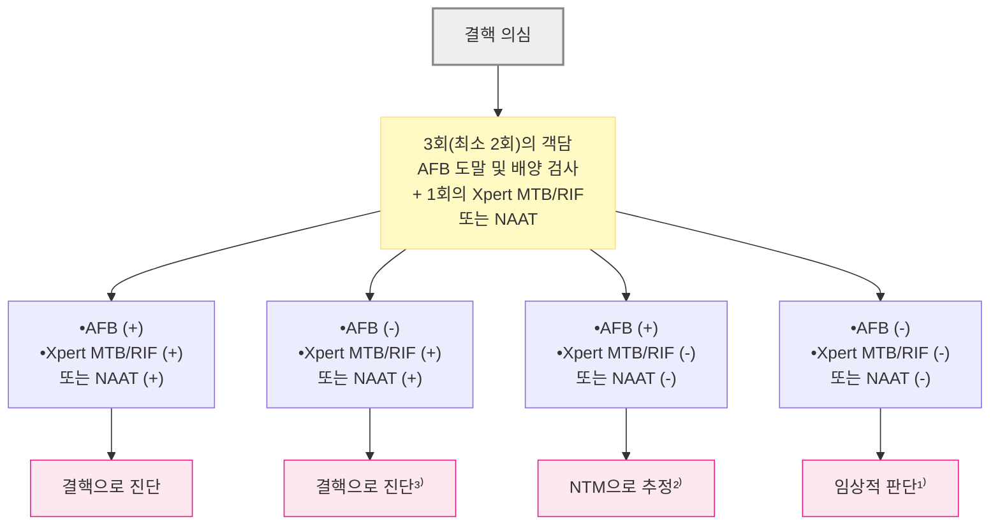
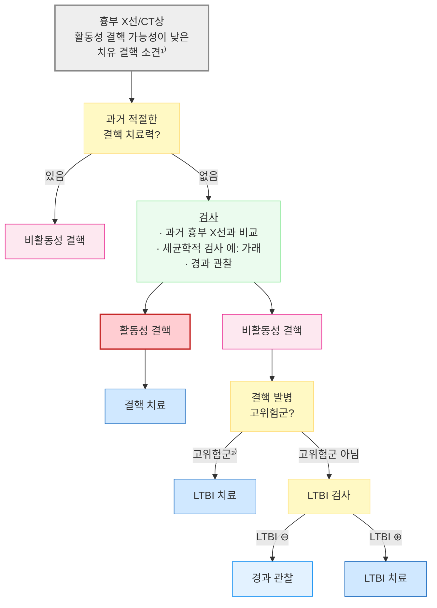
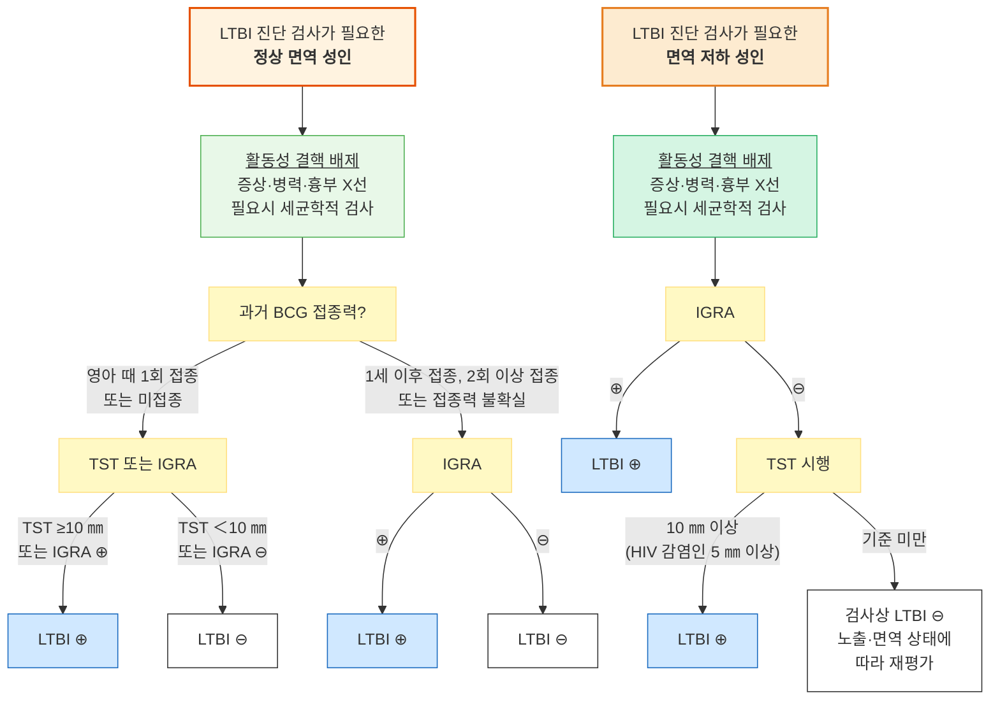
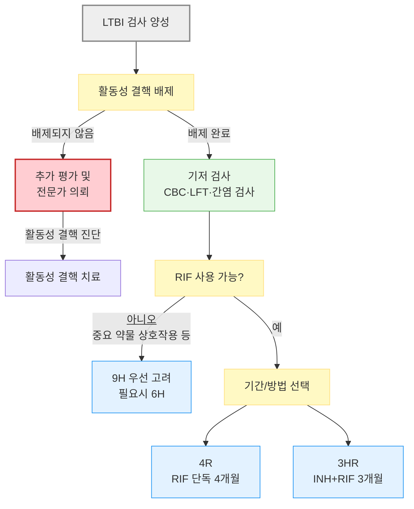

# 결핵 Tuberculosis

## <mark style="color:green;">일반 사항</mark>

* 원인균 : Mycobacterium tuberculosis complex(M. tuberculosis, M. bovis, M. africanum 등)
* 전염 : 활동성 결핵 환자의 호흡기 분비물의 공기 매개 감염; 기침·재채기·말하기·웃기 등을 할 때 배출되어 수 시간 동안 공기 중에 떠다니며 감염을 일으킴
* 경과 : 결핵균 노출 후 감염 여부는 전염원의 균량·기침, 접촉 시간, 환기 및 숙주의 면역 상태 등에 따라 달라짐
  * 감염된 사람의 일부는 감염 후 비교적 이른 시기에 결핵으로 진행하고, 대부분은 잠복결핵감염 상태로 지내며 일부에서 향후 결핵이 발병함
* 결핵 환자 또는 결핵 의사환자를 진단·치료한 경우 24시간 이내 관할 보건소에 신고


전염력은 객담 도말 양성, 공동성 병변, 기침 강도, 균량과 밀접하게 연관됨. PCR(Xpert/NAAT)(+) 단독이면서 도말(-)인 환자는 전염력이 상대적으로 낮을 수 있으나, 최종 판단은 임상 소견을 종합하여 결정함


### <mark style="color:orange;">용어 정의</mark>

* **초감염 결핵 (Primary tuberculosis)** : 결핵균 초감염 후 비교적 이른 시기에 발병하는 결핵
* **활동성 결핵** : 결핵 병변에서 결핵균이 증식하면서 병을 일으키고 있는 상태. 초감염 또는 LTBI의 재활성화에 의함. 다음의 두 부류로 분류
  1. 도말·배양·PCR 검사 등 세균학적으로 진단된 결핵
  2. 세균학적으로 진단되지는 않았지만 증상, 영상/조직 검사 등으로 진단된 결핵
* **전염성 결핵** : 다음 중 하나 이상에 해당
  1. 호흡기 검체의 도말·배양·PCR 검사에서 양성
  2. 흉부 X선상 공동 관찰
  3. 주치의가 전염성이 있다고 판단하는 경우 (검사 결과 무관)
* **잠복결핵감염 (Latent TB infection, LTBI)** : 체내에 소수의 살아 있는 결핵균이 존재하지만 임상 증상이 없고 균이 외부로 배출되지 않아 타인에게 전파되지 않는 상태
  * TST 또는 IGRA로 결핵균 감염을 확인하고, 병력·증상·흉부 X선 및 필요시 세균학적 검사로 활동성 결핵을 배제한 후 진단함
  * 흉부 X선에 과거 치유 병변이 남아 있을 수 있으며 무증상인 모든 사람에게 객담 검사가 필요한 것은 아님
* **재활성화 결핵 (Reactivation TB)** : LTBI 상태에서 면역 기전이 약해지면서 결핵균이 활성화되어 결핵이 발병한 상태
  * 일생 동안 LTBI의 5\~10%에서 결핵이 발병하며, 발병 사례의 ½이 감염 후 첫 2년 내 발생
  * 발병 위험은 HIV 감염·TNF 길항제 사용·투석 등에서 크게 높고, 당뇨병에서는 약 3배 높음
* **자연 치유된 결핵 병변 (Spontaneously healed TB lesion)** : 흉부 X선에서 유소견이면서 활동성 결핵이 배제되고 결핵이나 LTBI 치료 경력이 없는 경우
  * 결핵 발병 위험이 높으므로 활동성 결핵을 배제한 뒤 HIV 감염, 장기이식 관련 면역억제제 또는 TNF 길항제 사용 등 고위험군에서는 LTBI 검사 없이 치료할 수 있고, 그 외에는 LTBI 검사 결과와 치료의 위험·편익을 고려하여 결정

### <mark style="color:orange;">고위험군</mark>

* 건강 검진 결과 폐결핵 관련 유소견자
* ≥65세, 청소년, 마른 체형(이상 체중의 ＜90%)
* 면역 저하자 및 만성질환자 : 신부전, 당뇨병, 규폐증, HIV 감염, 위절제술 또는 공회장우회술 시행 or 예정, 면역억제제·TNF 길항제 또는 장기간 스테로이드(prednisone ≥15 ㎎/d × ≥1달) 사용 or 예정
* 취약 계층 : 광부, 알코올/마약 중독자, 노숙인, 북한이탈주민
* 결핵 발생률이 높은 국가에서 입국한 외국인 (예: 러시아, 중국, 몽골, 인도, 인도네시아, 말레이시아, 베트남, 태국, 필리핀, 우즈베키스탄)

## <mark style="color:green;">임상 양상</mark>

* 결핵 초기에는 무증상이 많음
* 폐 증상 : 지속되는 기침, 수포음(rale), 호흡 곤란(진행 시·흉수 발생 시), 객혈(공동 형성 시)
* 전신 증상 : 발열, 야간 발한, 체중 감소, 무력감, 식욕 부진, 무통성 림프절 부종

### <mark style="color:$danger;">🚩 Red Flags!</mark>

<mark style="color:$danger;">**즉각 조치**</mark>

* 대량 객혈 또는 급격히 진행하는 호흡 부전  `공동성 폐결핵` `결핵 후 기관지 확장증`
* 극심한 두통, 의식 변화, 경부 강직, 광선 공포증  `결핵성 수막염`
* 고열·전신 소모와 흉부 X선의 미만성 좁쌀 음영  `속립성 결핵`
* 심낭 삼출과 저혈압·경정맥 팽대 등 쇼크 전구 증상  `결핵성 심낭염` `심장눌림증`
* 척추 통증과 함께 새로 생긴 하지 위약·감각 저하·배뇨 장애  `척추 결핵` `척수 압박`
* 점막 침범·수포·피부 박리 또는 발열·장기 침범을 동반한 전신 발진  `SJS/TEN` `DRESS`

<mark style="color:$warning;">**당일\~수일 내 평가**</mark>

* **(당일)** 간염 증상을 동반한 ALT ≥3×ULN 또는 증상 없는 ALT ≥5×ULN, 황달  `약물 유발 간손상`
* **(당일)** 시력 저하·색각 변화·중심 암점  `ethambutol 시신경병증`
* 치료 4개월 이후 배양 양성, 이전 치료 실패력 또는 RIF 내성 검출  `치료 실패` `MDR/RR-TB`
* 중증 면역 저하자에서 뇌·척추·복막·신장 침범을 시사하는 증상  `폐외 결핵`
* HIV 감염인 또는 면역억제제 투여 중 발생한 결핵  `면역저하 동반 결핵`

<mark style="color:$info;">**조기 평가 및 추적**</mark>

* 2주 이상 지속되는 원인 불명의 기침  `폐결핵`
* 치료 2개월 시점의 객담 배양 양성 지속  `치료 반응 지연` `약제 내성`
* 간염 증상 없는 ALT ＜5×ULN의 경도 상승 또는 경미한 위장 증상  `항결핵제 간독성`
* 치료 종결 후 지속되는 호흡 곤란·객담·반복 감염  `결핵 후 폐 질환`

## <mark style="color:green;">진단</mark>


**결핵 진단을 놓치기 쉬운 상황**

* "반복되는 폐렴" - 동일 부위 재발 또는 항생제 치료 후 일시 호전·재악화
* 퀴놀론계 항생제 사용 후 일시적으로 호전되는 경우 (퀴놀론이 항결핵 효과를 가짐)
* COPD 악화처럼 보이는 경우
* 고령자의 무열성·무기침 결핵
* 당뇨병 환자의 비전형 흉부 X선 소견
* 체중 감소 없는 초기 결핵
* COVID-19 이후 지속되는 기침·체중 감소·비전형 폐침윤
* 스테로이드 또는 면역억제제 투여 중 또는 투여 후 악화


### <mark style="color:orange;">검사 대상</mark>

* 환자 접촉자 (☞ [접촉자 관리](070_-tuberculosis.md#접촉자-관리))
* 뚜렷한 원인 없이 2주 이상 기침과 가래가 있는 경우 결핵 가능성을 고려하여 검사
* 국가·지자체 또는 집단시설의 결핵검진 대상자는 해당 사업·시설의 기준에 따라 정기 흉부 X선 검진을 시행
  * ≥65세라는 이유만으로 모든 개인에게 일률적으로 연 1회 검진을 적용하지는 않음
* 고령자·당뇨병·면역 저하자에서는 기침이 경미하거나 없더라도 설명되지 않는 흉부 X선 이상이 있으면 결핵 평가를 시행함

### <mark style="color:orange;">진단 및 조치</mark>

* 폐결핵 의심 시 흉부 X선, 가래 항산균 도말 및 배양 검사, Tb-PCR 검사를 시행하고 결과에 따라 조치
* 결핵 환자 또는 결핵 의사환자를 진단·치료한 경우 24시간 이내 관할 보건소에 신고

***



> _NAAT = nucleic acid amplification test; NTM = nontuberculous mycobacteria (비결핵 항산균)_
>
> ¹⁾_도말(-) 폐결핵 : 임상 또는 영상 소견에서 폐결핵이 의심되지만 도말과 NAAT가 음성이고, 퀴놀론·아미노글리코시드 등 항결핵 효과가 있는 약제를 제외한 광범위 항생제 치료에 반응이 없거나 CT·유도객담·기관지내시경·조직검사 등에서 활동성 결핵을 시사하여 진료의사가 전기간 치료를 결정한 경우 임상적으로 진단할 수 있음. 배양 결과와 치료 반응을 추후 확인함_
>
> ²⁾_NTM으로 추정되더라도 다른 검체로 NAAT를 재검하고 PCR 억제 여부를 확인하며, 배양·균 동정 결과로 최종 판단함_
>
> ³⁾_과거 결핵 치료력이 있거나 사전 확률이 낮은 경우, Xpert Ultra trace 결과는 사균 DNA 검출 가능성을 고려하여 배양과 임상 소견으로 해석함_

<p align="center"><strong>폐결핵 진단 알고리듬</strong><br><em><mark style="color:$info;">Ref. 결핵 진료지침 2024</mark></em></p>

### <mark style="color:orange;">결핵(TB) vs 비결핵 항산균(NTM) 감별</mark>

<table data-search="false"><thead><tr><th width="150">특징</th><th>결핵 (TB)</th><th>비결핵 항산균 (NTM)</th></tr></thead><tbody><tr><td>전염성</td><td>있음</td><td>거의 없음 (사람 간 전파 드묾)</td></tr><tr><td>접촉자 조사</td><td>필요</td><td>불필요</td></tr><tr><td>법정 신고</td><td>필수</td><td>불필요</td></tr><tr><td>상엽 공동</td><td>흔함</td><td>가능 (M. kansasii 등)</td></tr><tr><td>면역 저하 시 위험</td><td>위험 ↑↑</td><td>위험 ↑</td></tr><tr><td>PCR (MTB)</td><td>양성이면 진단에 도움; 음성으로 배제 불가</td><td>음성</td></tr><tr><td>치료</td><td>표준 4제 요법 (지침 기반)</td><td>균종별 상이 (MAC, M. kansasii 등)</td></tr><tr><td>격리</td><td>초기 격리 필요</td><td>불필요</td></tr></tbody></table>

* 객담에서 NTM이 검출되어도 곧 NTM 폐질환은 아니며, 임상·영상·미생물 기준을 함께 충족해야 진단함

***

### <mark style="color:orange;">영상 검사</mark>

* 흉부 X선 : 정상 면역 시 주로 상엽, 면역 저하 시 하엽 침범; 고령자에서는 하엽 또는 비전형적 폐렴 양상으로 나타날 수 있음
  * 환자의 \~⅓에서 비전형적 소견을 보임; 흉부 X선 단독으로 결핵 유무를 판단하지 않음
  * X선상 폐결핵 의심 시 과거 사진과 비교하고 가래 결핵균 검사 시행
  * 폐렴 치료에 반응하지 않으면 폐결핵 의심
* 흉부 CT : 다음의 경우 고려
  * 도말 음성 폐결핵에서 흉부 X선으로 활동성 여부를 판단하기 어려운 경우
  * 결핵과 다른 유사 질환의 감별이 어려운 경우
  * 활동성 폐결핵의 전형적 CT 소견 : centrilobular nodule, tree-in-bud appearance, 공동(cavity); 이 소견들이 상엽 첨·후분절과 하엽 상분절에 분포하면 결핵을 강하게 시사함
* 치료 중에도 영상 소견은 악화될 수 있으며, 회복 후에도 영상 소견의 호전에는 수개월 이상 소요될 수 있음

### <mark style="color:orange;">검체 검사</mark>

#### <mark style="color:$primary;">가래 항산균 도말 및 배양 검사</mark>

* 3회(최소 2회) 시행; 1회차는 즉시, 2·3회차는 아침 기상 직후 채담하여 시행

**채담 방법**

1. 음식물과 세균을 제거하기 위해 물로 입안을 헹구어 냄
2. 두 번 깊게 숨을 들이쉰 후 서서히 내쉼 → 깊게 숨을 들이쉰 후 세게 숨을 내쉼 → 다시 깊게 숨을 들이쉰 후 기침을 하면서 가래통에 충분한 양(≥3 ㎖)의 가래를 모음
3. 보관 : 냉장 보관, 가래통이 햇빛에 노출되지 않도록 함(종이로 감싸거나 봉투에 담음)

* 전염 위험을 감안하여 외부와 환기가 잘 되는 곳에서 시행
* 유도객담 채취 : 가래가 잘 나오지 않는 경우 고려; 네뷸라이저로 고장성(3\~4.5%) 식염수를 15\~30분간 흡입 후 기침을 자극하여 가래를 얻음

#### <mark style="color:$primary;">가래 결핵균 핵산증폭검사 (NAAT; Tb-PCR)</mark>

* 결핵이 의심되는 모든 환자에서 시행; 항산균 증식이 확인되면 결핵균과 NTM 감별 검사를 시행
* 위양성을 감안하여 결핵이 의심되지 않는 경우에는 시행하지 않음
* 폐외 결핵 검체(흉수, 뇌척수액, 소변 등)에 대해서는 민감도가 낮음

#### <mark style="color:$primary;">Xpert® MTB/RIF / Xpert MTB/RIF Ultra</mark>

* 가래 검체에 대한 자동화된 real-time PCR 검사 시스템
* MTB DNA 및 RIF 내성 변이를 2시간 내에 진단
* Xpert Ultra : 기존 Xpert 대비 민감도 향상 (특히 도말 음성·소아·저균량 결핵); 국내에서도 사용 증가 추세. trace 결과는 임상 맥락과 함께 해석 필요
* 결핵이 의심되는 환자의 초기 검체에서 시행하며, 특히 재치료·중증 결핵·HIV 감염 등 신속한 진단과 RIF 내성 확인이 필요한 경우 유용함
* RIF 내성 가능성이 낮은 상황에서 내성으로 나오면 다른 검사로 확인 필요

### <mark style="color:orange;">면역학적 진단 (결핵균 감염 검사)</mark>

* 위양성이 가능하며 활동성 결핵과 LTBI의 구별 안 됨
* 결핵이 의심되지만 결핵균 검사가 음성이고 진단이 어려운 경우 보조적으로 사용할 수 있으나, 양성이 활동성 결핵의 확진은 아니며 음성으로 활동성 결핵을 배제할 수도 없음

#### <mark style="color:$primary;">투베르쿨린 검사 (Tuberculin Skin Test, TST)</mark>

* 장점 : 저렴하고 검사 경험이 풍부하며, 최근 감염 및 발병 위험 평가에 활용 가능
* 단점 : BCG·일부 NTM에 의한 위양성, 면역저하·중증 질환 등에 의한 위음성, 활동성 결핵과 LTBI 구별 불가, 2회 방문 및 시술·판독자 간 변이
* 적용 제외 대상 : 과거 활동성 결핵 또는 LTBI 치료력이 있거나 이전 TST/IGRA 양성이 확인된 경우처럼 재검이 임상 결정에 도움이 되지 않는 경우, 과거 TST 후 수포·괴사·아나필락시스 등 중증 반응이 있었던 경우, 광범위한 피부 병변이 있는 경우
  * 정확한 시행·판독이 어려우면 IGRA를 고려함
* BCG를 1세 이후 접종했거나 2회 이상 접종한 경우에는 TST를 금기시하기보다 위양성 가능성을 고려하여 IGRA를 우선함

**검사 방법 (Mendel-Mantoux Test)**

* 검사 항원 : 2TU PPD RT 23
* 부위 : 정맥에서 멀리 떨어지고 피부 병변이 없는 팔꿈치 관절 5\~10 ㎝ 아래 전박 안쪽 피부
* 주입 방법 : 0.1 ㎖ [피내 주사](../231_/210_-vaccination.md#administration), 6\~10 ㎜의 팽진을 만듦; PPD가 많이 흘러나왔거나 팽진이 생기지 않은 경우 반대쪽 전박 또는 같은 쪽 이전 주사 부위에서 5 ㎝ 떨어진 곳에 재시행
* 생백신과 동시 접종 가능; 따로 시행하는 경우 생백신 접종 4주 이후에 TST 시행

**판독 방법**

* 접종 후 48\~72시간 사이에 판독 (☞ 2026 질병청 [결핵상담사례집, ](https://www.kdca.go.kr/kdca/2857/subview.do?enc=Zm5jdDF8QEB8JTJGYmJzJTJGa2RjYSUyRjQ5JTJGMzEyODgzJTJGYXJ0Y2xWaWV3LmRvJTNG)Q85\~90)
* 팔꿈치를 약간 구부린 상태에서 팔의 길이 방향과 직각으로(가로 직경) 경결 부위의 가장 긴 지름을 ㎜ 단위로 측정(발적 부위는 측정하지 않음); 여러 차례 측정한 경우 최대값으로 판정
* 수포(bulla, vesicle)나 괴사(necrosis) 반응이 있으면 크기와 모습을 병기 (예: 18B, 20V, 25N)
* 판정에 1세 이전에 접종한 BCG 접종력은 고려하지 않음

**TST 양성 기준**

<table><thead><tr><th width="117">대상</th><th>양성 기준</th></tr></thead><tbody><tr><td><strong>일반</strong></td><td>경결 ≥10 ㎜</td></tr><tr><td><strong>HIV 감염인</strong></td><td>경결 ≥5 ㎜</td></tr><tr><td><strong>강양성</strong></td><td>경결 ≥15 ㎜, 또는 경결 크기에 상관없이 수포(B)·소수포(V)·괴사(N) 동반</td></tr></tbody></table>

* 영유아 접촉자는 연령, BCG 접종력과 접촉 위험도에 따른 별도의 소아 접촉자 알고리듬을 적용하고, 소아청소년과 또는 결핵 전문가와 상의
* 지연(72시간 이후) 판독한 경우에도 양성에 해당되는 값을 보이면 양성으로 판정

**투베르쿨린 연속검사 (serial TST)**

* 균 침범 후 8주 이내 검사 시 위음성 가능 → 접촉자에서 최초 음성이면 마지막 접촉 시점으로부터 8\~10주 후 재검
* 양전(positive conversion) : 처음 검사 음성 → 재검에서 양성; 최근 감염을 의미
* 양전 판정 : 1차 음성 접촉자가 마지막 접촉 시점(또는 지표환자의 전염성 소실 시점) 기준 8주 이상 지나 시행한 2차 TST로 판정
  1. 5세 미만 또는 면역저하자 : 1차 결과보다 ≥6 ㎜ 증가 (예: 3 ㎜ → 9 ㎜)
  2. 5세 이상 정상면역자 : ≥10 ㎜이면서 1차 결과보다 ≥6 ㎜ 증가 (예: 6 ㎜ → 12 ㎜)
  * BCG 미접종자는 1차 결과와 관계없이 ≥5 ㎜이면 양전

#### <mark style="color:$primary;">인터페론감마 분비검사 (Interferon-gamma Release Assay, IGRA)</mark>

* 원리 : 결핵균에 감작된 T 림프구를 결핵균 항원으로 자극하여 분비되는 인터페론 감마를 측정
* 장점 : BCG 접종의 영향을 받지 않고 특이도가 높으며 1회 방문으로 완료
* 단점 : 활동성 결핵과 LTBI 구별 불가, 까다로운 검체 관리(튜브 온도 관리, 채취 후 배양까지 시간 제한), 소아에서의 임상 자료 부족, 고비용
* 5\~18세에서는 TST 또는 IGRA를 사용할 수 있음. 만 5세 미만에서는 TST를 원칙으로 하되, BCG를 1세 이후에 접종했거나 2회 이상 접종한 경우에는 만 5세 미만을 포함한 전 연령에서 IGRA로 결핵감염 여부를 확인함
* 제품 및 검사방법 : [<mark style="color:blue;">QuantiFERON</mark>](https://www.qiagen.com/us/tb-testing/what-is-quantiferon/how-does-qft-work), [<mark style="color:blue;">T-SPOT</mark>](https://www.revvity.com/category/automate-t-spottb-workflow)
  * QuantiFERON-TB Gold Plus® 검사 시 주의 : QFT-Plus는 Nil, TB1, TB2, Mitogen의 4개 튜브를 사용함. 채혈량, 혼합, 보관 온도 및 배양 시작 시간은 검사실과 해당 키트의 최신 제조사 지침을 따름

### <mark style="color:orange;">약제 감수성 검사</mark>

* 모든 결핵 환자의 첫 배양 분리 균주에 대하여 최소한 INH 및 RIF에 대해 시행
* INH 또는 RIF 내성이 확인되면 fluoroquinolone과 내성결핵 치료에 사용할 핵심 약제에 대해 가능한 신속 분자감수성검사와 통상감수성검사를 확대 시행
* 치료 3개월 이후에도 배양 양성이거나 치료 실패가 의심되면 최근 배양 균주에 대해 약제감수성검사를 반복
* 신속감수성검사 : 치료 시작 시 INH/RIF에 대해 시행하고, 재치료·치료 실패·내성결핵 접촉력 등에서는 추가 내성 여부를 조기에 확인

### <mark style="color:orange;">조직 검사</mark>

* 대상 : 폐외 결핵 진단 또는 치료 반응 평가가 필요한 경우
* 조직 검체에 대해 항산균 배양 검사와 Tb-PCR 검사를 함께 시행
* 배양용 조직은 포르말린에 넣지 않고 멸균 용기에 별도로 제출함

***

## <mark style="background-color:$warning;">Management</mark>


* 국내 성인 약제감수성 결핵의 표준치료는 원칙적으로 6개월 이상의 복합요법임
  * WHO의 일부 선택 환자 대상 4개월 rifapentine-moxifloxacin 요법은 국내 표준 처방으로 사용하지 않음
* 생후 3개월 이상 16세 미만의 비중증 약제감수성 결핵(말초 림프절 결핵, 기도 폐쇄가 없는 흉곽 내 림프절 결핵, 단순 흉막염, 속립성 음영이 없고 한 엽 이내에 국한된 비공동성 병변)에는 WHO가 4개월 2HRZ(E)/2HR 요법을 권고하므로 소아청소년과 또는 결핵 전문가에게 의뢰
* 다제 내성 결핵, 치료 실패, 중증 폐외 결핵, 중증 간질환자는 전문 의료기관에 의뢰
* 금연·금주 (특히 항결핵제의 간독성을 고려하여 치료 기간 중 금주)

## <mark style="color:green;">항결핵제 개요</mark>

* 아래 표의 용량과 최대 용량은 국내 2024 지침의 성인 약제감수성 결핵 치료 기준임. 신기능 저하·투석 등에서는 용량 또는 투여 간격을 조정하며, 소아는 연령·체중에 따른 별도 용량을 적용함 <mark style="color:$info;">\[결핵 진료지침 2024]</mark>

<table><thead><tr><th width="164">성분명 (약어)</th><th>용량 및 투약 방법</th><th>주요 부작용</th></tr></thead><tbody><tr><td><strong>Isoniazid</strong> (INH, H)</td><td>5 ㎎/㎏ [300 ㎎] qd, 공복</td><td>간독성, 말초신경염, 피부 과민 반응</td></tr><tr><td><strong>Rifampicin</strong> <br>(RIF, R)</td><td>10 ㎎/㎏ qd, 최대 600 ㎎/d [＜50 ㎏ 450 ㎎, ≥50 ㎏ 600 ㎎], 공복</td><td>간독성, 위장장애, 독감 유사 증상, 혈소판 감소증, 체액 색소 변화</td></tr><tr><td><strong>Ethambutol</strong> <br>(EMB, E)</td><td>15~20 ㎎/㎏ qd, 최대 1,600 ㎎/d; 공복 또는 식후, 실제 체중에 따라 용량 계산</td><td>시신경병증(시력 저하, 색각 변화)</td></tr><tr><td><strong>Pyrazinamide</strong> <br>(PZA, Z)</td><td>20~30 ㎎/㎏ qd, 최대 2,000 ㎎/d; 공복 또는 식후<br>체중별 예: ＜50 ㎏ 1,000 ㎎, 50~＜70 ㎏ 1,500 ㎎, ≥70 ㎏ 2,000 ㎎. 실제 체중당 용량 범위와 최대 용량을 확인하여 조정</td><td>간독성, 관절통, 위장 장애</td></tr><tr><td><strong>Rifabutin</strong> (RFB)</td><td>5 ㎎/㎏ [300 ㎎] qd, 공복 또는 식후</td><td>간독성, 호중구 감소증</td></tr></tbody></table>

* Ethambutol 사용 시 치료 전 및 치료 중 정기적 시력·색각 검사가 필요하며, 신기능 저하 또는 고용량 투여 시 독성 위험이 증가
* EMB·PZA는 실제 체중당 용량 범위와 위 표의 최대 용량을 확인하며, 저체중·비만에서는 체중 구간의 예시만으로 용량을 결정하지 않음. EMB는 치료 기간·신기능·시각독성 위험도 고려함. 치료 중 체중을 매달 확인하여 항결핵제 용량을 재평가함


**내성결핵 약제**: MDR/RR-TB는 단기 전경구요법의 적응증과 약제감수성을 평가하여 전문기관에서 치료함. Bedaquiline·linezolid·fluoroquinolone 등은 현재 치료의 핵심 구성 약제이며, 종래 Group I\~V 분류를 처방 우선순위로 사용하지 않음. 주사제는 표준 대체약으로 임의 선택하지 않음


#### <mark style="color:$primary;">Isoniazid (INH)</mark>

* 100 ㎎/T <mark style="color:blue;">\[유한짓]</mark>
* 부작용 : 말초신경염: Vit B6 결핍과 관련. 통상 용량(≤300 ㎎/d)에서는 흔하지 않으나 임신, 영양실조, 알코올 남용, 고령, 뇌전증 병력, 만성콩팥병, 당뇨병에서 더 흔함
  * 예방 : 위 위험군에서 Pyridoxine 25\~50 ㎎/d 병용 (50 ㎎/T <mark style="color:blue;">\[피리독신]</mark>)

#### <mark style="color:$primary;">Rifampicin (RIF)</mark>

* 300·450·600 ㎎/T <mark style="color:blue;">\[리포덱스]</mark>
* 부작용 : 혈소판 감소: 투여 중단 후 주기적 혈소판 검사; 정상 회복 후에도 RIF는 재투여하지 않음
* 주의 : 소변·눈물·땀이 오렌지색으로 변색; 소프트 콘택트렌즈 착색 주의
* 약물 상호 작용 : 강력한 효소·수송체 유도제로서 경구 피임약, 항응고제, 면역억제제, 일부 항바이러스제·항진균제·항경련제·혈당강하제·심혈관계 약제의 효과를 감소시킬 수 있음. 병용 전 성분별 상호작용을 확인

**Rifampicin의 주요 약물 상호작용**

<table data-search="false"><thead><tr><th width="259">약제</th><th width="161">상호작용 결과</th><th>임상적 주의사항</th></tr></thead><tbody><tr><td><strong>DOAC</strong> (rivaroxaban, apixaban)</td><td>노출량 현저히 감소</td><td>병용을 피하고 대체 항응고 전략을 검토</td></tr><tr><td><strong>Tacrolimus / Cyclosporine</strong></td><td>농도 현저히 감소</td><td>이식 거부 위험; 전문가 협진과 치료약물농도 모니터링 필요</td></tr><tr><td><strong>Azole 항진균제</strong></td><td>성분별 노출량 감소</td><td>병용 가능 여부와 대체제를 성분별로 확인</td></tr><tr><td><strong>HIV 항레트로바이러스제</strong></td><td>요법별로 상호작용 상이</td><td>항레트로바이러스 요법과 rifamycin 선택·용량을 감염 전문가와 조정</td></tr><tr><td><strong>호르몬 피임제</strong></td><td>피임 효과 감소</td><td>비호르몬성 또는 추가 피임법 사용</td></tr><tr><td><strong>Warfarin</strong></td><td>항응고 효과 감소</td><td>INR을 면밀히 추적하고 용량 조정</td></tr><tr><td><strong>일부 혈당강하제·CCB·항경련제</strong></td><td>약효 감소 가능</td><td>약제별 상호작용 확인 및 임상 지표 모니터링</td></tr></tbody></table>

#### <mark style="color:$primary;">Ethambutol (EMB)</mark>

* 400 ㎎/T <mark style="color:blue;">\[마이암부톨 제피]</mark>
* 허가사항의 고용량 재치료(25 ㎎/㎏/d)에서는 60일 후 15 ㎎/㎏/d로 감량함. 이는 표준 용량으로 초치료하는 모든 환자에게 적용하는 일률적 감량 규칙은 아니며, 현재 치료 요법과 약제감수성에 따라 전문가가 판단함
* 시신경병증 부작용 : 시력 저하, 적록 색각 이상, 중심 암점, 주변 시야 장애
  * 용량·투여 기간과 관련. 신기능 저하 또는 ≥25 ㎎/㎏/d 투여 시 위험 증가
  * 당뇨병 환자는 미세혈관 합병증으로 인해 기저적 시신경 취약성이 높으므로 정기 시력·색각 검사를 강화
  * 시력 모니터링 : 치료 전 기저 시력·색각 검사, 매 방문 시 시각 증상 확인; 고용량(≥25 ㎎/㎏/d), 2개월 초과 투여, 신기능 저하 시 매달 검사 (이상 발생 즉시 EMB 중단)
  * 소아 : 어린 소아에서는 시신경병증 모니터링이 어려울 수 있으므로 주의함; WHO 소아 권장 용량은 20 ㎎/㎏/d(범위 15\~25 ㎎/㎏/d)이며 권장 용량에서 독성 위험은 낮음. 치료 기간·신기능·검사 협조도를 고려하여 관찰

#### <mark style="color:$primary;">Pyrazinamide (PZA)</mark>

* 250 ㎎/T, 500 ㎎/T <mark style="color:blue;">\[피라진아미드]</mark>
* 부작용
  * 관절통 : ⅓에서 주로 치료 2개월 이내에 발생 → 통풍이 아닌 관절통은 NSAID로 관리
  * 고요산혈증·통풍 : PZA로 인한 고요산혈증은 매우 흔하나, 증상이 없는 무증상 고요산혈증만으로는 약제를 중단하지 않고 관찰; 실제 통풍 발작은 드묾. 통풍 환자 또는 2개월 이상 사용 시 요산 모니터링 시행
  * 급성 통풍성 관절염이 발생하면 PZA 중단과 대체 요법을 전문가와 평가함

#### <mark style="color:$primary;">주사 항결핵제</mark>

* 내성결핵에서는 전경구요법을 우선하며, amikacin 등 주사제는 감수성·대안·독성 위험을 평가하여 결핵 전문가가 제한적으로 선택
* 이명·청력 저하·어지럼 또는 신기능 악화가 발생하면 즉시 투여 지속 여부를 재평가하고 청력·전정기능·신기능 검사. 증상이 심해질 때까지 단순 감량만 하며 관찰하지 않음

## <mark style="color:green;">활동성 결핵 치료</mark>

### <mark style="color:orange;">치료 전 조치</mark>

* 병력 청취 : 항결핵제 부작용 발생 위험 평가, 임신 가능성
* 기저 검사 : 시력, CBC, LFT(AST, ALT, ALP, 빌리루빈), RFT(Cr)
* 약제 감수성 검사 : 치료 시작 시 얻은 배양 양성 결핵균에 대해 시행

### <mark style="color:orange;">초치료 (New patient)</mark>

#### <mark style="color:$primary;">치료 원칙</mark>

1. 초치료 대상 : 이전에 결핵 치료를 받은 적이 없거나, 1개월 미만의 결핵 치료를 받은 환자
2. 초치료는 원칙적으로 H·R·Z·E 4제 병합으로 시작하며, 이후 약제감수성과 치료 반응에 따라 유효 약제 조합을 조정
3. 최고 혈중 농도가 중요하므로 정확한 용량을 1일 1회 복용
4. 간헐적으로 증식하는 균까지 멸균하기 위해 규칙적으로 6개월 이상 장기 치료

#### <mark style="color:$primary;">표준 6개월 요법 - 2HREZ/4HR(E)</mark>

* 초기 집중 치료기 (2개월) : H·R·Z·E 4제 병합
* 유지 치료기 (4개월) : H·R·E 3제; 약제 감수성 검사에서 INH·RIF에 감수성이 확인되면 그 시점에 EMB를 중단할 수 있음. 감수성 결과가 확인되지 않았거나 균음성 결핵이면 치료 종료 시까지 EMB를 유지함

#### <mark style="color:$primary;">9개월 요법 - 9HR(E)</mark>

* 초치료 시 PZA를 사용하지 못하는 경우 H·R·E로 시작하여 총 9개월 치료함. INH·RIF 감수성이 확인되면 그 시점에 EMB를 중단할 수 있음. 감수성 결과가 확인되지 않았거나 균음성 결핵이면 치료 종료 시까지 EMB를 유지함
* 고정용량복합제는 복약 순응도를 높일 수 있으나 제품마다 성분·함량이 다르므로 최신 허가사항과 유통 여부를 확인하여 체중별 목표 용량에 맞게 처방

#### <mark style="color:$primary;">치료 기간 연장</mark>

* 치료 전 흉부 X선상 공동이 있고 집중 치료기 2개월 완료 시점의 객담 배양이 양성이면 유지기를 3개월 연장하여 총 9개월 치료함

#### <mark style="color:$primary;">기저 및 치료 중 추구 검사</mark>

<table data-search="false"><thead><tr><th width="221.7894287109375">검사법</th><th width="55.368499755859375">기저</th><th width="43.789398193359375">1¹⁾</th><th width="44.842132568359375">2</th><th width="44.8421630859375">3</th><th width="44.84210205078125">4</th><th width="44.84210205078125">5</th><th width="44.84210205078125">6</th><th width="44.84210205078125">7</th><th width="44.8421630859375">8</th><th width="49.05267333984375">9²⁾</th></tr></thead><tbody><tr><td>미생물검사</td><td></td><td></td><td></td><td></td><td></td><td></td><td></td><td></td><td></td><td></td></tr><tr><td>객담항산균 도말&#x26;배양검사</td><td>●</td><td>●</td><td>●</td><td>○</td><td>○</td><td></td><td></td><td></td><td></td><td>○</td></tr><tr><td>Xpert MTB/RIF 검사</td><td>●</td><td></td><td></td><td></td><td></td><td></td><td></td><td></td><td></td><td></td></tr><tr><td>신속감수성검사</td><td>●</td><td></td><td></td><td></td><td></td><td></td><td></td><td></td><td></td><td></td></tr><tr><td>통상감수성검사</td><td></td><td></td><td>●</td><td></td><td></td><td></td><td></td><td></td><td></td><td></td></tr><tr><td>흉부 X선/기타영상검사</td><td>●</td><td>○</td><td>●</td><td>○</td><td>○</td><td>○</td><td>○</td><td>○</td><td>○</td><td>●</td></tr><tr><td>임상적 평가</td><td></td><td></td><td></td><td></td><td></td><td></td><td></td><td></td><td></td><td></td></tr><tr><td>체중</td><td>●</td><td>●</td><td>●</td><td>●</td><td>●</td><td>●</td><td>●</td><td>●</td><td>●</td><td></td></tr><tr><td>증상&#x26;약물순응도 평가</td><td>●</td><td>●</td><td>●</td><td>●</td><td>●</td><td>●</td><td>●</td><td>●</td><td>●</td><td></td></tr><tr><td>시력평가</td><td>●</td><td>●</td><td>○</td><td>○</td><td>○</td><td>○</td><td>○</td><td>○</td><td>○</td><td></td></tr><tr><td>검사실 검사</td><td></td><td></td><td></td><td></td><td></td><td></td><td></td><td></td><td></td><td></td></tr><tr><td>CBC</td><td>●</td><td>○</td><td>○</td><td>○</td><td>○</td><td>○</td><td>○</td><td>○</td><td>○</td><td></td></tr><tr><td>간기능</td><td>●</td><td>○</td><td>○</td><td>○</td><td>○</td><td>○</td><td>○</td><td>○</td><td>○</td><td></td></tr><tr><td>신기능</td><td>●</td><td>○</td><td>○</td><td>○</td><td>○</td><td>○</td><td>○</td><td>○</td><td>○</td><td></td></tr><tr><td>HIV</td><td>○</td><td></td><td></td><td></td><td></td><td></td><td></td><td></td><td></td><td></td></tr><tr><td>B/C형 간염</td><td>○</td><td></td><td></td><td></td><td></td><td></td><td></td><td></td><td></td><td></td></tr><tr><td>당뇨</td><td>○</td><td></td><td></td><td></td><td></td><td></td><td></td><td></td><td></td><td></td></tr><tr><td>폐기능 검사</td><td></td><td></td><td></td><td></td><td></td><td></td><td></td><td></td><td></td><td>○</td></tr></tbody></table>

> _● 반드시 시행, ○ 필요시 시행_\
> _¹⁾치료 중 (단위: 개월), ²⁾치료 종결 (6개월 혹은 9개월 치료 종결 시점에 해당)_

<p align="center">　<em><mark style="color:$info;">Ref. 결핵 진료지침 2024, 표 II-5</mark></em></p>

#### <mark style="color:$primary;">치료 효과 평가</mark>

* 가래 도말 또는 배양 양성 환자 : 치료 시작 후 2회 연속 음성이 나올 때까지 매달 도말·배양 검사 시행, 치료 종결 시점에 마지막 가래 검사 시행
* 흉부 X선 단독으로 치료 반응을 평가하지 않음
* 임상적으로 치료 실패가 의심되는 경우 : 추가 가래 도말·배양 및 신속감수성검사 → 배양 양성 시 이 결핵균에 대해 약제 감수성 검사 추가 시행
* 역설적 반응 : 치료 도중(흔히 치료 시작 후 수주\~3개월 사이) 치료 실패 없이 면역 반응 증가로 임상 증상 및 영상 소견이 일시적으로 악화되는 현상(고열, 림프절염 발생/악화, CNS 병변 악화, 폐결핵 병변 악화, 흉수 증가)
  * 항결핵제를 적절히 복용 중이며 객담 검사 음성이고 다른 질환의 가능성이 거의 없으면 기존 치료를 유지
* 치료 종결 시점에 결핵 후 폐 질환에 대하여 평가
  * 호흡 곤란이 있거나 영상 검사에서 유의미한 후유증이 관찰되면 치료 종결 시점 혹은 종결 후 6개월 이내에 폐기능 검사 권고

#### <mark style="color:$primary;">초치료 결과 분류</mark>

* 완료 : 권고 치료를 완료했으나 완치 또는 실패의 정의에 해당하지 않는 경우
* 완치 : 치료 시작 시 세균학적으로 확진된 폐결핵 환자가 치료를 완료하고, 세균학적 음전 이후 양전이나 치료 실패의 증거가 없는 경우
* 치료 성공 : 완치 또는 완료된 경우
* 세균학적 음전 : 최소 7일 간격으로 시행한 연속 2회 검사 음성(감수성결핵은 도말 또는 배양, 내성결핵은 배양 기준). 치료 4개월 이후 배양 양성은 실패 정의 자체가 아니라 치료 실패를 의심하여 재평가할 신호임
* 실패 : 임상적·세균학적 무반응, 부작용, 추가 약제 내성 등으로 치료가 영구 중단되거나 새로운 치료 요법·전략으로 변경된 경우
* 사망 : 치료 시작 전 또는 치료 중 원인과 무관하게 사망한 경우
* 추적 방문 중단 : 치료를 시작하지 않았거나 연속 2개월 이상 치료가 중단된 경우
* 평가 미정 : 위 치료 결과에 해당하지 않는 경우(다른 기관으로 전출되어 치료 결과를 알 수 없는 경우 포함; 추적 방문 중단은 제외)

#### <mark style="color:$primary;">결핵 후 폐 질환 (Post-TB Lung Disease, PTLD)</mark>

* 치료 종결 ≠ 폐 기능 회복 : 세균학적 치료 성공 후에도 상당수 환자에서 만성 폐 기능 손상이 남음
* 주요 후유증 : 기관지 확장증, 만성 기류 제한(COPD 유사 패턴), 파괴폐(destroyed lung), 반복 세균 감염, 객혈, 제한성 환기 장애, 만성 저산소혈증
* 위험 인자 : 치료 지연, 중증 병변, 공동 형성, 반복 결핵, 흡연, 당뇨병
* 치료 종결 후에도 호흡기 증상·흉부 영상 이상·폐기능 저하가 지속되면 전문과 의뢰 및 장기 추적 관리

### <mark style="color:orange;">부작용 대처</mark>

#### <mark style="color:$primary;">간독성</mark>

* 증상 : 간 효소 수치 상승, 전신 쇠약감, 구역, 구토, 우상복부 불쾌감, 가려움, 황달
  * 고령, 간질환 기왕력, 알코올 남용자에서 정기적 간 효소 검사
* 조치 : ALT ≥3×ULN + 간염 증상, 또는 ALT ≥5×ULN 시 INH·RIF·PZA 투여 중단
* 재투여 : 간염 증상이 호전되고 ALT ＜2×ULN으로 감소한 뒤 전문가 감독하에 시행. 기존 간질환으로 치료 전 ALT가 높았다면 정상화를 일률적으로 요구하지 않고 치료 전 기저 수준에 가까워졌는지 평가
  * RIF를 먼저 재투여하고 약 1주 후 간기능이 안정적이면 INH를 추가하는 방식 등을 사용
  * PZA 재투여는 간염 중증도·원인 가능성·치료 이득에 따라 결정하며, 중증 간염이었거나 PZA가 원인으로 의심되면 재투여를 피하고 치료기간 연장 등을 검토
* 중증 결핵으로 간기능 회복 중에도 치료가 필요하면 약제감수성과 장기 기능을 고려해 간독성이 적은 유효 약제 조합을 전문가가 구성. 단일 약제로 대체하거나 임의로 주사제를 추가하지 않음 <mark style="color:$info;">\[Clin Infect Dis 2016]</mark>

#### <mark style="color:$primary;">위장 장애</mark>

* 구역·구토·식욕 저하가 심하거나 ＞1주 지속 시 먼저 간 검사로 간독성 여부 확인
* 간독성과 무관한 경우 : 복용 시간을 식후 또는 취침 전으로 변경하거나 증상 치료를 고려하되, 1일 용량을 임의로 나누어 복용하지 않음

#### <mark style="color:$primary;">피부 발진</mark>

* 가려움을 동반한 국소 발진 : 항히스타민제로 완화 시도
* RIF 복용 중 출혈성 발진 : 투여 중단 후 주기적 혈소판 수치 검사
  * 정상 회복 후에도 RIF는 재투여하지 않음
* 점막 침범·수포·피부 박리 또는 발열·장기 침범을 동반한 전신 발진 : 모든 의심 약제를 즉시 중단하고 응급 평가. SJS/TEN 또는 DRESS가 의심되면 원인 약제 재투여는 금기이며, 치료 재구성과 단계적 재투여는 결핵 전문가·알레르기 전문가와 상의

#### <mark style="color:$primary;">Drug Fever</mark>

* 결핵 자체에 의한 발열과 약제에 의한 발열의 감별 필요
* 약제열은 원인 약제 중단 후 대개 수일 이내 호전되지만 시점만으로 확진할 수 없으며, 결핵 자체·동반 감염·다른 약제에 의한 발열을 배제
* 원인 약제 확인을 위한 단계적 재투여는 중증 과민반응이 아니었음을 확인한 뒤 전문가 감독하에 시행
* 재투여 순서 : RIF → INH → PZA → EMB 순으로 하나씩 저용량부터 시작하며, 각 약제 투여 후 최소 24\~48시간 동안 발열·발진·전신 증상 관찰


재투여 후 발열이 재현되면 해당 약제가 원인일 가능성이 높지만 단독으로 확진하지 않음. 중증 과민반응 병력이 있으면 재투여하지 말고 즉시 전문가에게 의뢰함


### <mark style="color:orange;">특별한 경우의 치료</mark>

#### <mark style="color:$primary;">실패 후 재치료</mark>

* 치료 실패 결핵의 재치료는 전문가에게 의뢰
* 치료 실패의 원인을 찾기 위한 병력 청취
* 1·2차 항결핵제에 대한 약제 감수성 검사 및 INH/RIF에 대한 신속감수성검사 시행
* 실패한 처방에 새로운 항결핵제를 한 가지만 추가하지 않음

#### <mark style="color:$primary;">치료 중단 후 재치료</mark>

* 결핵 치료 초기(결핵균의 양이 많은 시기)에 중단되거나 치료 중단을 자주 할수록 약제 내성균이 증가하고 치료 실패 위험이 증가
* 2개월 이상 항결핵제 투여 중단 시 신고
* 병력 청취 등으로 중단 원인을 파악하고 재치료 시 교육·상담·사회적 지지 제공
* 치료 중단 후 재치료 시작 시 반드시 가래 배양 검사와 약제 감수성 검사를 시행
* 재치료 처방은 중단 시점·누적 복용량·균량·약제감수성 결과를 종합하여 결정함
  * 과거 부작용이 있었다는 이유만으로 약제를 일률적으로 제외하지 말고 원인과 중증도를 재평가
  * 중증 부작용이면 전문가에게 의뢰하여 유효 약제로 처방을 재구성

* 아래 중단 후 대처 기준은 약제감수성 결핵의 6개월 표준요법에 적용하며, 단기요법·내성결핵·특수 상황에서는 해당 요법의 기준에 따라 전문가가 판단함

**초기 집중 치료기 중단 시 대처**

* 치료 중단 기간 ＜14일 : 치료를 유지하면서 초기 집중 치료기 동안 복용해야 하는 약제들을 모두 복용한 후 유지기로 이행
* 치료 중단 기간 ≥14일 : 처음부터 치료를 다시 시작

**유지 치료기 중단 시 대처**

* 예정된 유지기 총 투여 횟수의 ＜80% 복용 후 중단 : 중단 기간 ＜2개월이면 남은 양을 모두 복용, ≥2개월이면 처음부터 다시 치료 시작
* 예정된 유지기 총 투여 횟수의 ≥80% 복용 : 치료 시작 시 도말 음성이었으면 치료 종결, 도말 양성이었으면 유지기 남은 기간을 모두 복용하고 종결
  * 예외 : 치료 시작 시 공동(cavity)이 있었거나 집중기 2개월 완료 시점에 배양 양성이었던 고위험군에서는 80% 달성 여부와 무관하게 전문가 판단에 따라 추가 복용을 고려함

#### <mark style="color:$primary;">재발 결핵</mark>

* 과거 약제감수성 결핵의 적절한 치료 성공 후 재발한 경우 : 과거 약제감수성과 현재 신속·통상감수성검사를 확인하며 감수성결핵 표준요법으로 재치료
* 과거 약제감수성 결핵의 치료 성공 후 2년 이내에 재발한 경우 : 재치료 기간을 3개월 연장하여 총 9개월 요법을 권고
* 모든 재치료 환자에서 신속감수성검사와 배양·통상감수성검사를 시행하고 결과에 따라 처방을 조정함. 과거 내성결핵 환자의 재발에는 위 감수성결핵 원칙을 일률적으로 적용하지 않고 전문 의료기관에 의뢰

#### <mark style="color:$primary;">내성 결핵</mark>

**INH 단독 내성 결핵**

* INH 내성이 확인된 시점부터 INH를 중단하고 RIF·EMB·PZA·levofloxacin으로 6개월 치료
* 공동이 없고 배균량이 적은 경우 PZA를 3개월 이내로 단축할 수 있으나 RIF·EMB·levofloxacin은 6개월 유지
* 전체 치료 기간은 levofloxacin 투여 6개월을 기준으로 함; 공동·양측성 침범 등 병변이 광범위하면 6개월 초과 치료를 고려할 수 있음
* PZA 또는 fluoroquinolone 동반 내성과 추가 RIF 내성 여부를 신속히 확인하고 전문가와 처방을 조정

**RIF 단독 내성 결핵**

* Xpert 등에서 RIF 내성이 확인되면 우선 RR-TB로 진단하고, 신속 및 통상 약제감수성검사로 RIF 단독내성과 MDR-TB를 감별
* RIF 단독내성도 MDR/RR-TB 치료 범주에 따라 단기 전경구요법 또는 개별화 장기요법을 선택하므로 전문 의료기관에 의뢰

**다제 내성 (MDR) 결핵 및 광범위 약제 내성 (XDR) 결핵**

* 정의 : RR-TB는 RIF 내성, MDR-TB는 최소 INH와 RIF에 동시 내성, pre-XDR-TB는 MDR/RR-TB + fluoroquinolone 내성, XDR-TB는 pre-XDR-TB + bedaquiline 또는 linezolid 내성
* 전문 의료기관에 의뢰
* 치료 시작 전 최소한 INH·RIF 및 fluoroquinolone에 대한 신속감수성검사를 시행하고, 가능한 모든 구성 약제에 대한 감수성 결과를 확보
* 국내 2024 지침에서는 fluoroquinolone 감수성 MDR/RR-TB에 6개월 BPaLM 또는 9개월 MDR-END 요법을 장기요법보다 우선 고려함
  * BPaLM : bedaquiline + pretomanid + linezolid + moxifloxacin, 총 26주
  * MDR-END : levofloxacin + delamanid + linezolid + pyrazinamide, 9개월(배양 음전 지연 시 12개월까지 연장)
* 국내 2024 지침에서는 fluoroquinolone 내성 MDR-TB(pre-XDR-TB)에 적응증을 충족하면 6개월 BPaL 요법을 우선 고려함. WHO 2026의 중증도별 요법은 아래 참고
* 18\~20개월 개별화 장기요법은 단기요법의 적응증을 충족하지 않거나 내성·부작용·치료 반응으로 단기요법을 유지할 수 없는 경우에 사용


**내성결핵 단기요법의 적용**

* BPaL/BPaLM/BPaLC는 검증된 요법과 약제감수성에 따른 조정 기준에 따라 운용하며, 개별 약제를 임의로 추가·제외하지 않음. 연령, 임신·수유, 폐외 결핵 부위, 이전 약제 노출, 약제감수성, QT 간격, 골수억제 및 말초·시신경병증 위험을 평가하고, 국가 사전심사·급여기준을 포함하여 반드시 결핵 전문가가 처방함
* **WHO 2026 제2판** : 14세 이상 폐 pre-XDR-TB에서 **비중증은 6개월 BPaL**, **중증은 clofazimine을 추가한 6개월 BPaLC**를 각각 상대 요법보다 제안함(조건부 권고, 근거 확실성 매우 낮음). 중증은 흉부 X선상 공동과 도말 1+ 이상이 함께 있거나, 공동이 없어도 도말 2+ 이상 또는 이에 상응하는 WHO 권고 분자검사 결과가 있는 경우로 정의함. Pretomanid의 안전성 근거가 제한되어 BPaL/BPaLM/BPaLC는 임신·수유 중 적용하지 않음
* **BDLLfxC**(bedaquiline·delamanid·linezolid·levofloxacin·clofazimine) : WHO 2025에 추가된 6개월 선택지이며, FQ 감수성이면 clofazimine을 제외한 BDLLfx, 비중증 폐 pre-XDR-TB이면 levofloxacin을 제외한 BDLC로 조정함. **WHO 2026은 중증 폐 pre-XDR-TB에서 6개월 BDLC 사용에 반대하는 조건부 권고**를 추가함(근거 확실성 매우 낮음)
* FQ 감수성 MDR/RR-TB의 수정 9개월 요법(BLMZ, BLLfxCZ, BDLLfxZ)도 WHO 2025의 선택지임. 국내 적용은 결핵 전문가가 국내 지침·허가·급여·공급을 고려하여 결정함


### <mark style="color:orange;">특수 상황</mark>

#### <mark style="color:$primary;">임신</mark>

* 초치료 : 6개월 표준 치료 \[2HREZ/4HR(E)] 또는 9개월 치료 \[9HRE]
* 모유 수유 : 1차 항결핵제 치료 시 모유 수유 가능; INH 투여 시 피리독신 병용

#### <mark style="color:$primary;">간질환자</mark>

* 간 손상이 심하지 않은 만성 간질환자 : 9HRE 및 정기적 간 효소 검사
* 중증·불안정한 간 기능 변화를 보이는 만성 간질환자 : 의뢰

#### <mark style="color:$primary;">신질환자</mark>

* 신기능 저하자 : INH·RIF·moxifloxacin은 일반적으로 용량·간격 조절이 필요하지 않음. CrCl ＜30 ㎖/min 또는 혈액투석에서는 EMB·PZA를 감량하기보다 PZA 25\~35 ㎎/㎏, EMB 20\~25 ㎎/㎏를 주 3회 투여하며, 기타 약제는 신기능과 투석 여부에 따라 조정
* 투석 환자 : 투석 직후 항결핵제 투여

#### <mark style="color:$primary;">폐외 결핵</mark>

<table data-search="false"><thead><tr><th width="165">부위</th><th width="154">치료 요법</th><th>비고</th></tr></thead><tbody><tr><td><strong>결핵성 수막염</strong></td><td>2HREZ/7<br>~10HR(E)</td><td>사망·신경학적 후유증 위험 높음; dexamethasone 또는 prednisolone 보조요법을 6~8주에 걸쳐 감량</td></tr><tr><td><strong>결핵성 심낭염</strong></td><td>2HREZ/4HR(E)</td><td>보조 스테로이드는 수축성 심낭염 위험과 HIV 상태 등을 고려하여 선택적으로 사용</td></tr><tr><td><strong>결핵성 복막염, 장 결핵, 속립성 결핵, 비뇨생식기 결핵</strong></td><td>2HREZ/4HR(E)</td><td>복막결핵은 복수·조직의 미생물학적 및 조직학적 검사를 함께 고려</td></tr><tr><td><strong>결핵성 흉막염</strong></td><td>2HREZ/4HR(E)</td><td>흉수 ADA는 보조검사이며 단독 확진 기준이 아님; 대량 흉수로 호흡곤란이 있거나 복잡 흉수·농흉이면 배액 고려</td></tr><tr><td><strong>기관지 결핵</strong></td><td>폐결핵과 동일</td><td>기관지 협착을 추적하며, 스테로이드는 routine으로 사용하지 않고 선택적으로 고려</td></tr><tr><td><strong>림프절 결핵</strong></td><td>2HREZ/4HR(E)</td><td>조직검사·배양 권고. 치료 중 일시적 확대는 역설적 반응일 수 있어 내성·순응도·다른 질환을 재평가하며, 일률적 절제는 권하지 않음</td></tr><tr><td><strong>골·관절 결핵</strong></td><td>6~9개월</td><td>약제 무반응·감염 진행·불안정성·신경 손상 시 수술 고려</td></tr></tbody></table>

## <mark style="color:green;">예방</mark>

### <mark style="color:orange;">환자 격리 및 해제</mark>

**격리**

* 격리 개시 : 전염력 의심 때부터
* 외출이 불가피한 경우 환자는 수술용 마스크를 착용하고, 전염성 결핵 환자를 진료·시술하는 의료진은 적합성 검사를 거친 N95급 호흡보호구를 착용

**입원 명령 대상**

1. 전염성 MDR/RR 결핵 환자 중 재택치료 전환 기준을 따르지 않을 위험이 있거나 가족·동거인·제3자에게 전파 위험이 큰 경우
2. 비순응 환자 관리 후에도 치료를 거부하는 경우 (무단이탈 등은 바로 입원명령을 실시할 수 있음)
3. 시·도지사 또는 시장·군수·구청장이 필요하다고 판단한 경우. 치료기관 의사가 필요하다고 판단한 경우에는 해당 자치단체장의 승인 후 실시 가능

* 의학적 입원·공기주의 격리 필요성과 행정적 입원명령은 구분하여 판단함. Xpert에서 RIF 내성이 확인되면 우선 RR-TB로 판단하고 추가 감수성검사로 RIF 단독내성과 MDR-TB를 감별함

**격리 해제 기준** (의료기관 내 공기주의 격리; 다음을 모두 충족하며, 3번은 초기 도말 양성 환자에 적용)

1. 최소 2주간 효과적인 항결핵제로 치료 시행 - 약제 내성 또는 낮은 복약 순응도에서는 전염 기간이 더 길 수 있음
2. 임상적 호전
3. 초기 도말 양성 환자 : 추적 객담 도말검사 연속 ≥3회 음성(8\~24시간 간격으로 채취하며, 최소 1회는 아침 객담) 또는 배양검사 음성 확인
4. 담당 의사가 약제감수성·복약 상태·증상과 객담검사 결과를 종합하여 전파 우려가 충분히 감소했다고 판단

* 초기 도말 음성(배양 또는 PCR 양성) 환자는 일률적으로 도말 3회 음전을 요구하지 않고, 위의 효과적인 치료·임상적 호전 및 전염성 평가에 따라 격리 해제를 결정함
* 퇴원 후 재택 격리, 의료기관 내 격리 해제, 등교·출근 허용은 구분하며, 등교·출근은 국가결핵관리지침의 기준에 따름


**가래 도말검사 양성**인 경우에도 임상 소견이 호전되어 퇴원이 가능할 경우에는 퇴원하여 균 음전 시까지 집에서 격리 치료할 수 있음. 재택 격리는 결핵관리 전담간호사 등과 연계하여 적절한 외래 치료가 가능하고, 환기가 잘 되는 독립된 공간이 있으며, 환자의 집에 6세 미만 소아나 면역저하자가 없는 경우에 고려함. 낮은 약제 순응도·통원 치료 불가능·지속적 균 배출(내성 결핵)의 경우 보다 장기간의 주의를 요함.\
**PCR 양성 지속**은 격리 해제의 배제 기준이 아님 : PCR은 사균(dead bacilli)의 DNA를 수개월간 검출할 수 있으므로, 격리 해제 여부는 도말검사 음전 및 임상 소견을 기준으로 판단


### <mark style="color:orange;">BCG 접종</mark>

* 생후 4주 이내의 모든 신생아에게 시행 (☞ [예방접종](../231_/210_-vaccination.md#bcg))

## <mark style="color:green;">접촉자 관리</mark>

* 호흡기 결핵 환자의 가족·동거인과 전염성 결핵 환자의 밀접 접촉자에 대하여 조사 시행. 가족접촉자 조사와 집단시설 역학조사의 대상·기간 기준을 구분함
* 성인은 폐결핵·후두·기관지 결핵 등 호흡기 결핵이 주 대상임. 림프절 결핵 등 폐외결핵 단독은 일반적으로 제외하지만, **결핵성 흉막염(KCD상 호흡기결핵으로 분류)은 폐실질 병변 동반 가능성을 고려하여 접촉자 조사 시행**
* **만 8세 이하 소아 폐외결핵 환자**에서도 가족 중 전염원 확인을 위해 가족접촉자 조사 시행 (2026 국가결핵관리지침, 51쪽)
* 대형 강의실·복도 등 넓은 공간에서의 전염 가능성은 낮음
* 전염성 결핵 환자 접촉자의 1%가 결핵 진단, 접촉자의 20\~30%는 LTBI로 진단
* LTBI가 진단되면 최근 감염 여부, 연령, 면역 상태, 동반질환, 간독성 및 약물 상호작용 위험을 평가하고 환자와 위험·편익을 논의하여 치료를 결정

#### <mark style="color:$primary;">접촉자 분류</mark>

* 가족 접촉자 : 호흡기 결핵 환자의 전염성 여부와 관계없이 **진단일 3개월 전부터 치료 시작 후 2주까지** 같은 공간에서 생활하거나 주기적으로 접촉한 가족·동거인. 군 내무반·요양시설·기숙사 같은 방의 접촉자는 국가관리사업상 집단시설의 밀접접촉자로 조사함
* 밀접 접촉자 : 가족접촉자 이외에서 지표환자와 같은 실내 공간을 사용하며 장시간 접촉한 사람. 연속 하루 8시간 이상 또는 전염성 추정기간 중 누적 40시간 이상을 우선 포함하되, 전염력·환기·접촉자 위험도에 따라 기준시간 미만도 포함할 수 있음
* 일상 접촉자 : 가족·밀접 접촉자 이외. 면역저하 등 의학적 고위험군이거나 밀접접촉자 조사에서 추가 환자·높은 감염률이 확인되면 역학조사반 판단에 따라 조사에 포함함

#### <mark style="color:$primary;">집단시설 지표환자의 전염성 추정 기간</mark>

<table><thead><tr><th width="220">지표환자 상태</th><th>전염성 추정 기간의 시작 (소급 기준)</th></tr></thead><tbody><tr><td>결핵 증상 있음<br>(도말·공동 유무 무관)</td><td>증상 시작 3개월 전과 최초 관련 검사일 3개월 전 중 더 이른 시점</td></tr><tr><td>무증상이나 도말 양성 또는 흉부 X선상 공동 있음</td><td>최초 관련 검사일 3개월 전</td></tr><tr><td>무증상·도말 음성·공동 없음</td><td>최초 관련 검사일 4주(28일) 전</td></tr></tbody></table>

* 최초 관련 검사일은 객담 도말 및 흉부영상 검사일 중 가장 앞선 날짜임. PCR 결과만으로 소급 기간을 단축하지 않으며, 조사 종료 시점은 치료·전염성 소실과 해당 시설의 마지막 출근·등교·거주일 등을 반영하여 역학조사반이 정함 (2026 국가결핵관리지침, 73~74쪽)
* 위 표는 집단시설 역학조사를 위한 기준이며, 가족접촉자 사업의 조사 기간은 위 가족접촉자 정의를 따름

* 결핵 지표환자 : 특정 집단 내에서 가장 먼저 발견되어 역학조사나 추가 확산의 단서를 제공한 최초의 결핵 환자

#### <mark style="color:$primary;">접촉자 검진 절차</mark>

* 기침·가래 등 결핵 증상 확인 및 흉부 X선 검사 → 결핵 의심 시 객담 등 추가 검사와 임상 평가 → 활동성 결핵으로 진단되면 결핵 치료, 활동성 결핵이 배제되면 LTBI 검사(TST &/or IGRA) → LTBI 양성이면 치료 적응 평가, 최초 음성이면 마지막 접촉 후 8\~10주 재검 여부 결정


**소아·면역저하 접촉자** : 어린 소아(특히 만 5세 미만)와 중증 면역저하자는 최초 LTBI 검사가 음성이어도 활동성 결핵을 배제한 뒤 잠복기 예방치료(window prophylaxis)가 필요할 수 있음. 국내 연령별 소아 접촉자 알고리듬과 지표환자의 약제감수성에 따라 전문가가 약제·재검 시점·치료 지속 여부를 결정함


#### <mark style="color:$primary;">의료기관 종사자 관리</mark>

* 결핵예방법에 따라 의료기관 종사자는 매년 결핵검진(흉부 X선)을 받음. 신규 채용자는 채용일부터 1개월 이내, 휴직·파견 등으로 6개월 이상 업무에 종사하지 않다가 복귀한 사람은 복귀일부터 1개월 이내에 결핵검진을 시행함
* LTBI 법정 검진 : 의무기관에 소속된 기간(다른 의무기관으로 이직하여 근무한 기간 포함) 중 1회가 원칙임. 최초 검진을 받지 않은 신규 채용자는 채용일부터 1개월 이내 시행함. 결핵 환자를 검진·치료하는 의료인, 결핵 환자를 진단하는 의료기사, 결핵 환자의 간호·진료를 보조하는 간호조무사는 매년 LTBI 검진 대상임
* 신규 고용 시 기저 평가 : 과거 LTBI 검진 결과와 결핵·LTBI 치료력을 확인하고, 법정 검진 이행 여부와 업무상 노출 위험에 따라 검사 필요성을 판단함. 과거 활동성 결핵이나 LTBI 치료력 또는 LTBI 검사 양성이 확인된 경우에는 면역학적 재검 대신 문진·진찰로 평가함
* 최초 기저검사 : 향후 TST를 반복할 예정이면 증폭효과를 최근 감염에 의한 양전으로 오인하지 않도록 2단계 TST(two-step TST)를 고려함(첫 검사 음성 시 1\~4주 후 두 번째 검사). IGRA도 기저검사로 사용할 수 있음
* 이후 주기적 LTBI 검사 : 가능한 기저검사와 같은 방법을 사용. 2단계 TST를 매번 반복하는 것은 아니며, 접촉 후 잠복기를 고려한 8\~10주 재검(serial testing)과 구분
* LTBI 치료 대상 : LTBI 양성인 1·2·3군 종사자, 2년 이내 양전, 흉부 X선 상 과거 치료력 없이 자연 치유된 병변 + LTBI 양성
* 법정 매년 대상 외 1·2·3군 종사자의 추가 주기적 LTBI 검진은 위험도에 따라 각 기관에서 결정함

<table><thead><tr><th width="71.25">군</th><th>해당 부서</th></tr></thead><tbody><tr><td><strong>1군</strong></td><td><strong>호흡기 결핵 환자와 접촉 가능성이 높은 곳</strong> - 호흡기/감염 내과 외래·병동, 기관지 내시경실, 결핵균 검사실, 폐기능 검사실, 흉부 영상 촬영실, 내과 중환자실, 응급실, 소아호흡기알레르기 클리닉</td></tr><tr><td><strong>2군</strong></td><td><strong>면역 약한 환자 접촉</strong> - 신생아실, 분만의료기관, 조산원, 산후조리원, 장기 이식 병동, 혈액암 병동, 투석실, HIV 관련 부서</td></tr><tr><td><strong>3군</strong></td><td><strong>호흡기 감염 우려 부서</strong> - 치과, 흉부외과, 마취과, 부검/해부 병리 업무</td></tr></tbody></table>

## <mark style="color:green;">잠복결핵감염 (LTBI)</mark>


**LTBI 표준치료** : 국내에서는 rifamycin 기반 단기요법인 4R 또는 3HR을 우선 권고하고, 약물 상호작용·부작용 등을 고려하여 9H를 선택적으로 사용함. 6H는 9H 완료가 어렵거나 특별한 경우 고려할 수 있음. 3HP와 1HP는 국제 지침의 선택지임. 국내 2024 진료지침에서는 rifapentine 미도입 및 국내 안전성 근거의 한계를 설명하며, 이 장에서는 국내 표준 처방으로 제시하지 않음. 실제 적용 전 현행 허가·공급 상태를 확인함


* LTBI 양성 환자는 평생에 걸쳐 5\~10%에서 활동성 결핵이 발생 (이들 중 ½은 감염 후 2년 이내에 발생)

#### <mark style="color:$primary;">선별 검사 대상</mark>

<table><thead><tr><th width="80.57894897460938">권고 강도</th><th>대상</th></tr></thead><tbody><tr><td><strong>시행</strong></td><td>전염성 결핵 환자 접촉, HIV 감염, 면역억제제/TNF 길항제/생물학적 제제/소분자 억제제 투여(예정), 흉부 X선 상 과거 치료력 없는 자연 치유 결핵 병변, 규폐증</td></tr><tr><td><strong>권고</strong></td><td>스테로이드 장기 투여, 투석, 혈액암, 의료기관 종사자</td></tr><tr><td><strong>고려</strong></td><td>당뇨병, 고형암, 위절제술(예정)</td></tr><tr><td><strong>제외</strong></td><td>과거 활동성 결핵 또는 LTBI로 치료한 환자, LTBI 검사 양성으로 확인된 자 (이 경우 검사가 유용하지 않음)</td></tr></tbody></table>

***



> _¹⁾칼슘이 침착된 단순 결절 및 폐첨부와 기저부의 흉막 비후는 제외._\
> _&#xB2;⁾고위험군: HIV 감염, 장기 이식으로 면역억제제 복용자, TNF 길항제 사용자_
>
> _과거 적절한 치료력이 있더라도 새로운 증상이나 흉부영상 변화가 있으면 활동성 결핵을 재평가함._

<p align="center"><strong>자연 치유된 결핵 병변이 있는 경우의 검사 과정</strong><br><em><mark style="color:$info;">Ref. 결핵 진료지침 2024, Ⅷ장 잠복결핵감염</mark></em></p>

***

#### <mark style="color:$primary;">LTBI 검사 방법 및 양성 기준</mark>

<table><thead><tr><th width="75">검사</th><th width="131">제품</th><th width="309">양성 기준</th><th>비고</th></tr></thead><tbody><tr><td colspan="2">TST</td><td>경결 ≥10 ㎜ (일반),<br>경결 ≥5 ㎜ (HIV 감염인)</td><td>BCG 접종력의 영향을 받을 수 있음</td></tr><tr><td rowspan="2">IGRA </td><td>QuantiFERON</td><td>Nil ≤8.0 IU/㎖이면서 TB1−Nil 또는 TB2−Nil ≥0.35 IU/㎖이고 해당 Nil 값의 ≥25%; Nil ＞8.0 IU/㎖이면 미결정</td><td>BCG 접종에 영향 받지 않음</td></tr><tr><td>T-SPOT</td><td>음성 대조 보정과 대조군 적합성을 포함한 검사실·제조사 기준으로 판정</td><td>BCG 접종에 영향 받지 않음</td></tr></tbody></table>

* HIV 감염인을 제외한 면역저하 성인의 TST 양성 기준도 원칙적으로 ≥10 ㎜임
* 음성 결과만으로 LTBI를 배제하지 않으며, IGRA가 음성이면 TST 추가 등으로 보완함
* IGRA의 미결정 결과는 음성으로 해석하지 않고 검체·면역 상태를 확인하여 재검 또는 다른 검사를 고려함
* T-SPOT은 음성 대조 보정과 대조군 적합성을 포함한 검사실 판정(양성·음성·경계·무효)에 따름
* 연령별 검사 선택은 위 IGRA 항목을 따름
* 검사 결과가 임상 위험도와 불일치하면 접촉 강도·면역 상태·검사 시점을 함께 검토함

***



<p align="center"><strong>잠복결핵감염 진단 알고리듬</strong><br><em><mark style="color:$info;">Ref. 결핵 진료지침 2024, Ⅷ장 잠복결핵감염</mark></em></p>

***

#### <mark style="color:$primary;">치료 결정 및 기저 검사</mark>

* 치료 결정 전 반드시 활동성 결핵의 가능성을 배제해야 함
* 기저 검사 : CBC, AST/ALT, 빌리루빈, B형/C형 간염 검사; 필요시 HIV, 임신 검사
* 간독성 위험군(만성 간질환, 알코올 남용, 고령)에서는 치료 중 매달 간기능 검사 시행
* 모든 치료자는 매달 증상·복약 순응도·부작용·새로 시작한 병용약을 확인함

***



<p align="center"><strong>LTBI 치료 약제 선택 알고리듬</strong><br><em><mark style="color:$info;">Ref. 결핵 진료지침 2024</mark></em></p>

***

#### <mark style="color:$primary;">LTBI 치료 약제 및 용법</mark>

* 전염원의 약제 감수성 결과가 있는 경우 이를 참고하여 요법 선택 (INH 단독내성 환자의 접촉자는 4R, 통상감수성검사로 확인된 RIF 단독내성 환자의 접촉자는 9H)
* 치료 완료 기준
  * 9H : 12개월 내에 처방 약제의 80% 이상 복용
  * 4R : 6개월 내에 처방 약제의 80% 이상 복용
  * 3HR : 4개월 내에 처방 약제의 80% 이상 복용
  * 처방례의 120·90·270회는 목표 투여 횟수이며, 80%는 복약이 불완전했을 때 완료로 인정하는 판정 기준임. 환자에게는 처방된 전량 복용을 안내함

<table><thead><tr><th width="73">요법</th><th width="117">처방</th><th width="91">기간</th><th width="108">국내 권고</th><th>비고</th></tr></thead><tbody><tr><td><strong>4R</strong></td><td>Rifampicin 단독</td><td>4개월<br>(120회)</td><td>우선 권고</td><td>10 ㎎/㎏/d; ＜50 ㎏ 450 ㎎, ≥50 ㎏ 600 ㎎, 최대 600 ㎎. 약물 상호작용 확인</td></tr><tr><td><strong>3HR</strong></td><td>INH + Rifampicin</td><td>3개월<br>(90회)</td><td>우선 권고</td><td>INH 5 ㎎/㎏/d(최대 300 ㎎) + RIF 10 ㎎/㎏/d(최대 600 ㎎)</td></tr><tr><td><strong>9H</strong></td><td>INH 단독</td><td>9개월<br>(270회)</td><td>선택적 고려</td><td>5 ㎎/㎏/d, 최대 300 ㎎. 치료기간이 길고 간독성·완료율을 고려</td></tr><tr><td><strong>6H</strong></td><td>INH 단독</td><td>6개월<br>(180회)</td><td>제한적 대안</td><td>9H 완료가 어렵거나 특별한 경우 고려하되 예방효과가 낮을 수 있음</td></tr></tbody></table>

* 재치료 : 결핵 발병 위험군이 전염성 결핵 환자와 최근 접촉한 경우, 과거에 적절한 LTBI 치료를 완료하였더라도 재치료 고려
* LTBI 치료 중 활동성 결핵이 발생한 경우 : LTBI 치료에 사용 중이었던 약제를 포함한 초치료 표준 처방으로 새로이 치료 시작


**국외 rifapentine 요법** : WHO 등은 3HP(INH+rifapentine 주 1회×12회)와 1HP(INH+rifapentine 매일×28회)를 선택지로 제시함. 국내에서는 rifapentine의 도입·공급 및 최신 허가 상태를 확인하고, 전신 약물반응과 상호작용을 고려하여 결핵 전문가가 판단함



**MDR/RR-TB 환자의 접촉자** : 활동성 결핵을 배제하고 지표환자의 약제감수성검사를 확인하여 결핵 전문가에게 의뢰함 (2026 국가결핵관리지침, 108·110쪽)

* 지표환자의 INH 감수성이 확인된 RIF 단독내성 : 9H
* MDR 또는 INH 내성 여부가 확인되지 않은 RR : 치료의 이득과 위험을 평가하고 결핵 전문가와 상의하여 levofloxacin 6개월(6Lfx) 치료를 권고함. 지표환자의 levofloxacin 내성이 확인되면 6Lfx 대상에서 제외함. 국내에서는 2026년 1월부터 MDR/RR-TB 접촉자의 6Lfx 치료에 요양급여 및 본인일부부담금 산정특례가 적용됨
* 소아·청소년 MDR-TB 접촉자 : 치료 여부와 관계없이 최소 2년간 정기적으로 발병 여부를 관찰함
* MDR/RR-TB 접촉자 중 잠복결핵감염 치료를 시행하지 않거나 중단한 경우 : 미치료 결정 또는 치료 중단 시점부터 3·6·9·12·18·24개월에 흉부 X선 추적검사를 시행함. 결핵 의심 증상이 있으면 즉시 활동성 결핵 검사를 시행함


***

## <mark style="color:red;">질병코드</mark>

* A15 세균학적 및 조직학적으로 확인된 호흡기결핵 Respiratory tuberculosis, bacteriologically and histologically confirmed
* A16 세균학적으로나 조직학적으로 확인되지 않은 호흡기결핵 Respiratory tuberculosis, not confirmed bacteriologically or histologically
* A17 신경계통의 결핵 Tuberculosis of nervous system
* A18 기타 기관의 결핵 Tuberculosis of other organs
* A19 좁쌀결핵 Miliary tuberculosis
* Z22.7 잠복결핵 Latent tuberculosis

***

## <mark style="color:purple;">처방례</mark>

> **처방례 1. 활동성 폐결핵 초치료 - 집중 치료기 (체중 60 ㎏ 성인의 예)**
>
> ```
> 유한짓 100 ㎎/T              3T qd 공복
> 리포덱스 600 ㎎/T            1T qd 공복
> 피라진아미드 500 ㎎/T        3T qd 공복 또는 식후
> 마이암부톨 제피 400 ㎎/T     3T qd 공복 또는 식후
> 피리독신 50 ㎎/T             1T qd
> ```
>
> _✽ 2개월 집중 치료기(4제 요법). 체중 60 ㎏ 기준(EMB 20 ㎎/㎏, PZA 25 ㎎/㎏). 진단·치료 시 24시간 이내 관할 보건소에 신고하며, 신고를 기다리느라 치료를 지연하지 않음. 약제 감수성 검사 결과에 따라 처방 조정. PZA·EMB는 공복이 어려우면 식후로 변경 가능. Pyridoxine은 임신·영양실조·알코올 남용·고령·당뇨병·만성콩팥병 등 말초신경염 위험군에서 병용._

> **처방례 2. 활동성 폐결핵 초치료 - 유지 치료기 (약제 감수성 확인 후)**
>
> ```
> 유한짓 100 ㎎/T              3T qd 공복
> 리포덱스 600 ㎎/T            1T qd 공복
> 피리독신 50 ㎎/T             1T qd
> ```
>
> _✽ 체중 ≥50 ㎏ 성인의 예시. INH·RIF 감수성이 확인되어 EMB를 제외한 4개월 HR 유지기 처방임. 감수성이 아직 확인되지 않았다면 EMB를 유지하며, 고정용량복합제는 체중별 목표 용량에 맞추어 선택함. Pyridoxine은 말초신경염 위험군에서 병용._

> **처방례 3. 잠복결핵감염 (LTBI) 치료 - 4R 요법 (표준)**
>
> ```
> (체중 ≥50 ㎏) 리포덱스 600 ㎎/T     1T qd 공복
> (체중 ＜50 ㎏) 리포덱스 450 ㎎/T     1T qd 공복
> ```
>
> _✽ 총 4개월(120회)을 6개월 이내 완료. 기저 간기능 검사 후 시작하며 활동성 결핵 배제가 필수. 소변·땀의 오렌지색 변색을 미리 설명하고 경구 피임약 등 약물 상호작용을 확인._

> **처방례 4. 잠복결핵감염 (LTBI) 치료 - 3HR 요법 (표준)**
>
> ```
> 유한짓 100 ㎎/T              3T qd 공복
> 리포덱스 600 ㎎/T            1T qd 공복   (체중 ≥50 ㎏)
> ```
>
> _✽ 총 3개월(90회)을 4개월 이내 완료. 활동성 결핵 배제와 기저 간기능 검사 후 시작. 체중 ＜50 ㎏이면 리포덱스 450 ㎎ 1T qd로 조정하고, RIF 약물 상호작용을 확인._

> **처방례 5. 잠복결핵감염 (LTBI) 치료 - 9H 요법 (RIF 사용 불가 시)**
>
> ```
> 유한짓 100 ㎎/T              3T qd 공복
> 피리독신 50 ㎎/T             1T qd
> ```
>
> _✽ 총 9개월 투여 (12개월 내 완료). RIF와 상호작용이 중요한 약제(일부 항레트로바이러스제, DOAC, 이식 면역억제제 등)를 복용하여 rifamycin 단기요법을 쓰기 어려운 환자에서 선택. 간독성 위험군(만성 간질환, 알코올 남용, 고령)에서는 매달 간기능 검사 시행. Pyridoxine은 말초신경염 위험군에서 병용._

***

### <mark style="color:$success;">핵심 복약 지도</mark>

* **규칙적 복용이 치료 성패의 핵심** : 매일 같은 시간에 빠짐없이 복용; 증상이 호전되어도 임의로 중단하면 내성균이 생겨 치료가 매우 어려워짐을 반드시 설명
* **공복 복용** : INH·RIF는 흡수를 높이기 위해 식사 1시간 전 또는 식후 2시간에 공복 복용; 위장 장애가 심하면 식후 복용 가능. RIF는 처방된 1일 총용량을 1일 1회 한꺼번에 복용하며, 임의로 나누어 복용하지 않음
* **체액 색깔 변화** : RIF 복용 중 소변·눈물·땀이 오렌지색으로 변하는 것은 정상; 소프트 콘택트렌즈는 착색되므로 렌즈 착용을 피하도록 안내
* **금주 권고** : 알코올은 간독성 위험을 높이므로 치료 기간 중 금주
* **Pyridoxine 병용** : 당뇨병, 임신, 영양실조, 알코올 남용, 고령, 만성콩팥병 등 위험군에서 INH 복용 시 말초신경염 예방을 위해 Pyridoxine 25\~50 ㎎/d 병용
* **부작용 즉시 보고** : 황달·짙은 소변·극심한 피로(간독성), 시력 저하·색각 변화(EMB 시신경병증), 전신 발진·점막 침범(중증 피부 반응)이 발생하면 즉시 내원하도록 설명. 기준에 해당하는 간손상은 간독성 약제를 즉시 보류하고, EMB 독성이 의심되는 시력 변화는 EMB를 즉시 중단하고 당일 안과 평가
* **복약 지원 제도 안내** : 보건소에서 DOT(직접 복약 확인 치료) 및 치료 관련 지원을 받을 수 있음을 안내

***

## <mark style="color:green;">주요 참고문헌 및 확인 자료</mark>

### <mark style="color:orange;">임상 근거</mark>

* [질병관리청·대한결핵 및 호흡기학회. 결핵 진료지침. 제5판. 2024.](https://www.kdca.go.kr/bbs/kdca/55/228178/artclView.do) - 국내 진단, 약제감수성·내성결핵 및 잠복결핵감염 치료
* [질병관리청. 2026 국가결핵관리지침.](https://www.kdca.go.kr/bbs/kdca/55/309608/artclView.do) - 신고, 접촉자 조사, 의료기관 종사자 관리, 내성결핵 접촉자 예방치료 및 산정특례
* [WHO. Consolidated guidelines on tuberculosis: Module 4 - Treatment and care. 2025.](https://www.who.int/publications/i/item/9789240107243) - 약제감수성·약제내성 결핵의 치료, 6개월·9개월 단기 전경구요법
* [WHO. Consolidated guidelines on tuberculosis: Module 4 - Treatment and care. 2nd ed. 2026.](https://www.who.int/publications/i/item/9789240125124) - 폐 pre-XDR 결핵의 BPaL/BPaLC 선택 및 중증에서 BDLC 제한(본문 55~56, 92~93쪽), MDR/RR 결핵 완화의료
* [Saukkonen JJ, et al. Updates on the Treatment of Drug-Susceptible and Drug-Resistant Tuberculosis: An Official ATS/CDC/ERS/IDSA Clinical Practice Guideline. Am J Respir Crit Care Med. 2025;211(1):15-33.](https://doi.org/10.1164/rccm.202410-2096ST) - 4개월 rifapentine-moxifloxacin 요법과 MDR/RR 결핵 단기요법
* [Nahid P, et al. ATS/CDC/IDSA Clinical Practice Guidelines: Treatment of Drug-Susceptible Tuberculosis. Clin Infect Dis. 2016;63:e147-e195.](https://www.idsociety.org/practice-guideline/treatment-of-drug-susceptible-tb/) - 간독성 후 단계적 약제 재투여 및 특수 상황의 치료
* [CDC. Tuberculosis Clinical Care for Children.](https://www.cdc.gov/tb/hcp/clinical-care/children.html) - 소아 접촉자의 잠복기 예방치료와 추적 평가
* [QIAGEN. QuantiFERON-TB Gold Plus Test Result Interpretation.](https://www.qiagen.com/us/tb-testing/what-is-quantiferon/how-does-qft-work/quantiferon-tb-test-result-interpretation) - 대조군 적합성, 양성·음성·미결정 판정

### <mark style="color:orange;">허가·급여 확인 자료</mark>

* [식품의약품안전처. 의약품안전나라 - 의약품 품목허가정보.](https://nedrug.mfds.go.kr/index) - 국내 제품별 적응증·용법·금기 및 허가 상태 확인

***

## <mark style="color:blue;">환자 안내서</mark>

#### <mark style="color:$primary;">결핵이란?</mark>

결핵은 결핵균이 주로 폐에 감염되는 법정 감염병입니다. 전염성 폐결핵은 기침·말하기 등을 통해 공기로 전파됩니다. 효과적인 치료를 시작하면 전염력은 빠르게 감소하지만, 격리 해제와 일상생활 복귀 시점은 약제감수성, 복약 상태, 증상 호전과 객담검사 결과를 종합하여 담당 의료진이 결정합니다.

#### <mark style="color:$primary;">약을 규칙적으로 끝까지 복용하세요</mark>

* 약제감수성 폐결핵은 보통 **6개월** 동안 여러 약을 함께 복용하며, 병변 부위·치료 반응·약제내성에 따라 더 길어질 수 있습니다
* 증상이 좋아져도 임의로 약을 끊으면 안 됩니다. 치료 중 멈추면 내성 결핵이 생겨 치료가 훨씬 어려워집니다
* 매일 같은 시간에 복용하는 습관을 들이세요

#### <mark style="color:$primary;">전파 예방 수칙</mark>

* 담당 의료진이 격리 해제를 안내할 때까지 타인과의 접촉을 최소화하고, 불가피하게 외출할 때는 수술용 마스크를 착용하세요
* 기침·재채기 시 입과 코를 막고, 환기를 자주 하세요
* 가래는 휴지에 받아 봉투에 밀봉하여 버리세요

#### <mark style="color:$primary;">약 복용 시 주의할 점</mark>

* 이소니아지드와 리팜피신은 식사 1시간 전 또는 식후 2시간에 공복 복용이 원칙입니다. 위장 불편이 심하면 임의로 바꾸지 말고 의료진과 복용 시간을 상의하세요
* 리팜피신 때문에 소변·눈물·땀이 주황색·붉은색으로 변하는 것은 정상입니다. 그러나 짙은 갈색(콜라색) 소변이나 눈 흰자위가 노래지는 것은 간 손상 신호일 수 있습니다
* 황달·짙은 갈색 소변, 시력 저하·색 구별 이상, 전신 발진이 생기면 다음 약을 먹기 전에 바로 병원에 연락해 지시를 받으세요. 다음 예약일까지 기다리지 마세요
* 치료 중 금주를 꼭 지켜주세요

#### <mark style="color:$primary;">가족과 주변 분들께</mark>

* 가족 등 접촉자는 담당 의사나 보건소에 알려 결핵 및 잠복결핵 검사를 받아야 합니다
* 잠복결핵으로 진단되면 예방 치료를 통해 결핵 발병 위험을 크게 줄일 수 있습니다

#### <mark style="color:$primary;">잠복결핵감염(LTBI)이란?</mark>

몸 안에 결핵균이 잠자고 있는 상태로, 증상이 없고 전파도 되지 않습니다. 하지만 면역이 떨어지면 활동성 결핵으로 발병할 수 있습니다. 의료진이 발병 위험과 약 부작용을 함께 평가하여 예방 치료 여부를 결정하며, 처방대로 잠복결핵 치료약을 복용하면 결핵 발병 위험을 60\~90% 줄일 수 있습니다.
