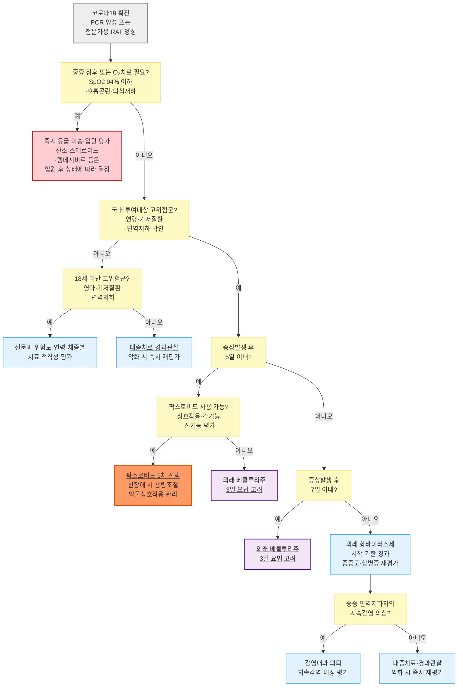

# 코로나19 Coronavirus Disease 2019, COVID-19


**2026년 주요 변경 사항**

* **팍스로비드** : 2026.1.14. 품목허가 변경으로 eGFR ＜30 ㎖/min의 중증 신장애 및 혈액투석 환자도 용량조절 투여 가능 - 1일차와 2\~5일차 용량이 다르므로 처방·조제·복약지도 시 표준 용량과 혼동하지 않도록 주의
* **라게브리오(몰누피라비르)** : 국내 품목허가·시중유통 없이 긴급사용승인 정부물량으로만 사용되었으며, 정부 재고 유효기간 종료에 따라 2026.3.17.부터 국내 공급·사용 중단 - 현재 국내 활성 치료제로 처방하지 않음
* **예방접종** : 2026\~2027절기부터 코로나19 예방접종이 임시예방접종에서 필수예방접종으로 전환


_✽ 국내 허가·급여 및 주요 근거 확인 기준일 : 2026.10.28._

## <mark style="color:green;">일반 사항</mark>

* SARS-CoV-2(Severe Acute Respiratory Syndrome Coronavirus 2) 감염에 의한 급성 호흡기 질환
* 다른 이름 : 코로나바이러스감염증-19, Coronavirus Disease 2019 (COVID-19)
* 전염 경로 : 감염자가 호흡·말하기·기침·재채기할 때 배출하는 감염성 호흡기 입자와 비말의 흡입 또는 점막 침착이 주된 경로. 환기가 불충분한 실내에서는 미세 호흡기 입자가 축적되어 전파 위험이 증가하며, 오염된 표면을 통한 전파는 가능하지만 주된 경로는 아님
* 잠복기 : 변이주에 따라 다르며 오미크론 계열에서는 대체로 수일; 전체적으로 1\~14일 범위가 보고됨
* 전염 기간 : 증상 발생 1\~2일 전부터 발생 후 5\~10일까지 감염력 지속; 면역 저하자·중증 환자에서는 연장 가능
* 국내 법정감염병 분류 : 제4급 감염병(표본감시 대상, 2023.8.31.자 하향 조정)
* 임상 스펙트럼 : 무증상 감염부터 상기도 증상, 폐렴, 급성호흡곤란증후군(ARDS), 다발성 장기부전까지 광범위

### <mark style="color:orange;">합병증</mark>

* 호흡기계 : 바이러스성 폐렴, 급성호흡곤란증후군(ARDS), 세균성 중복 감염(2차 세균성 폐렴)
* 혈관·응고계 : 정맥혈전색전증(폐색전증·심부정맥혈전증), 미세혈관 혈전증
* 심장 : 심근염, 부정맥, 기존 심혈관 질환의 급성 악화(급성 심근경색·심부전 트리거)
* 신경계 : 뇌병증, 뇌졸중, 길랭-바레증후군, 후각·미각 소실(지속형)
* 소아 : 다기관염증증후군(MIS-C, Multisystem Inflammatory Syndrome in Children) - 감염 수 주 후 발생 가능
* 지연 합병증 : Long COVID(감염 후 지속 증상) - 감염 후 보통 3개월 이내 발생하거나 지속되고 최소 2개월 이상 이어지며, 다른 진단으로 설명되지 않고 일상 기능에 영향을 주는 피로, 운동 후 불쾌감(PEM), 인지장애("brain fog"), 호흡곤란 등

## <mark style="color:green;">원인 및 위험 인자</mark>

* 원인 : SARS-CoV-2(베타코로나바이러스); 변이주(오미크론 계열 등)에 따라 전파력·중증도·백신 및 자연면역 회피능이 달라짐

### <mark style="color:orange;">중증 진행 고위험군</mark>

✽ IDSA 성인 경·중등증 항바이러스 치료 개정(2025, Clin Infect Dis 2026) 및 국내 약제별 급여·정부공급 기준(2025\~2026) 참조; 임상 위험도와 국내 투여 적격성은 구분

* **고위험(IDSA가 효과 추정에 사용한 예시적 입원위험 약 6% 이상)** : 75세 이상, HIV 감염(CD4 ＜200/㎕), 고형장기이식, 조혈모세포이식 후 2년 미만 또는 이식편대숙주병, 치료 중인 혈액암, 최근 12개월 이내 B세포 고갈 치료(rituximab 등) 또는 CAR-T 치료, 고용량 스테로이드(prednisone 상당량 ≥20 ㎎/일, 4주 이상), 또는 위험 증가 인자가 여럿인 경우
* **위험 증가(IDSA가 효과 추정에 사용한 예시적 입원위험 0.5% 초과\~6% 미만)** : 65\~74세, 당뇨, 비만(BMI ≥30 ㎏/㎡), 만성 폐질환, 심부전, 흡연력, HIV 감염(CD4 ≥200/㎕), 임신(현재 또는 분만 후 6주 이내), 항IL-6·항IL-12/23 치료, prednisone 10\~20 ㎎(4주 이상)
* **국내 팍스로비드 급여기준(60세 이상 또는 18세 이상 기저질환자·면역저하자)은 위 IDSA 분류와 세부 항목이 다르며, 베클루리주 정부공급 기준도 별도로 적용함** (☞ 아래 「국내 치료제 투여대상 기준」 표)
* 그 외 위험 인자 : 만성 신장애, 만성 간장애, 겸상적혈구질환, 신경발달장애·정신질환, 최근 1년 이내 심혈관 사건 병력. 백신 미접종 또는 최신 권고 접종을 받지 않은 경우, 마지막 백신 접종·감염 후 오랜 기간이 지난 경우도 중증 진행 위험과 항바이러스제의 절대 이득을 판단할 때 고려

<table><thead><tr><th width="125">구분</th><th width="275">IDSA 2025</th><th>국내 팍스로비드 급여기준</th></tr></thead><tbody><tr><td><strong>연령</strong></td><td>75세 이상은 고위험, 65\~74세는 위험 증가군으로 분류</td><td>60세 이상</td></tr><tr><td><strong>기저질환·면역저하</strong></td><td>예상 입원위험을 바탕으로 연령, HIV의 CD4 수치, 장기·조혈모세포이식, 혈액암 치료, B세포 고갈 치료·스테로이드 등 면역억제 치료 및 만성질환 등을 계층화</td><td>18세 이상 면역저하자 또는 당뇨·고혈압·심혈관질환·만성 신장질환·만성 폐질환·BMI ≥30·신경발달장애/정신질환 등 기저질환자</td></tr><tr><td><strong>주된 목적</strong></td><td>항바이러스제의 임상적 절대 이득과 근거 수준 판단</td><td>팍스로비드 건강보험 급여 적격성 판단; 베클루리주 기준과 구분</td></tr></tbody></table>

_✽ 두 기준은 목적과 세부 항목이 다름. 국내 적격 여부와 별개로 환자의 연령, 면역상태, 백신·감염력, 동반질환, 증상 정도 및 치료 접근성을 종합하여 임상적 이득을 판단함. 0.5%와 6%는 IDSA 패널이 절대 치료효과를 제시하기 위해 사용한 예시적 기저위험으로, 개별 환자의 입원확률을 직접 예측하는 절단값이 아님_

### <mark style="color:orange;">COVID-19 rebound와 재감염의 구분</mark>

* COVID-19 rebound는 초기 호전 또는 음전 후 대개 3\~7일경 증상이나 양성 반응이 다시 나타나는 현상으로, 항바이러스제 치료 여부와 관계없이 발생할 수 있음 <mark style="color:$info;">\[CDC 외래치료 안내]</mark>
* 대개 초기 감염보다 경미하며 입원으로 이어지는 경우는 드물지만, 재발 기간에도 전파 가능성이 있음. 증상이 다시 나타나면 아래 지역사회 격리 권고에 따라 외출·접촉 자제를 다시 적용하고, 마스크 착용·환기 및 고위험자와의 접촉 최소화를 병행
* 재감염은 이전 감염에서 회복한 뒤 새로 SARS-CoV-2에 감염된 경우이며, 새로운 노출력·증상·역학 상황과 검사 경과를 종합하여 판단. 90일 이상 경과하면 재감염 가능성이 커지지만 더 짧은 간격의 재감염도 가능하므로 시간 간격만으로 rebound와 재감염을 확정하지 않음
* Ct값은 검체 채취 상태와 검사 장비·시약의 영향을 받아 검사 간 직접 비교가 어려우므로 단독 구분 기준으로 사용하지 않음. 서로 다른 바이러스 계통이 확인되면 재감염의 강한 근거가 되지만 유전체 분석은 일상 진료에서 제한적
* 재치료(retreatment)의 명확한 임상적 이득은 확립되지 않았음. Rebound 환자 436명의 무작위시험에서 두 번째 5일 팍스로비드 요법은 바이러스 RNA를 더 빨리 감소시켰으나 경미하고 일시적인 rebound에 대한 뚜렷한 임상적 이득은 확인하지 못함 <mark style="color:$info;">\[Clin Infect Dis 2026]</mark>. 일반적인 rebound에 일률적으로 재처방하지 않으며, 증상이 악화되거나 고위험 환자이면 중증 진행·세균성 중복감염·새로운 재감염 여부를 재평가하고, 재감염으로 판단되면 새로운 감염으로 간주하여 치료 적격성을 다시 평가

## <mark style="color:green;">임상 양상</mark>

* **상기도 증상** : 발열, 인후통, 기침, 코막힘/콧물, 근육통, 두통, 피로감
* **후각·미각 소실** : 초기 변이주에서 특징적이었으나 최근 변이주에서는 빈도 감소
* **위장관 증상** : 오심, 구토, 설사(소아에서 상대적으로 흔함)
* **하기도/중증 진행 징후** : 호흡곤란, 흉부 압박감, 저산소혈증(SpO₂ ≤94%, room air 또는 기저치보다 의미 있는 저하), 폐렴
* 고령자에서는 발열 없이 기력 저하·식욕 부진·섬망만으로 내원하는 경우가 있어 유행 시기에는 적극적으로 의심할 것

✽ 인플루엔자·세균성 폐렴과의 임상 양상 비교는 인플루엔자 챕터의 "독감 vs 세균성 폐렴 vs COVID-19" 표 참조 (☞ [인플루엔자](069_-influenza.md))

### <mark style="color:$danger;">🚩 Red Flags!</mark>

<mark style="color:$danger;">**즉각 조치**</mark>

* 실내공기(room air)에서 SpO₂ ≤94% 또는 기저치보다 의미 있는 산소포화도 저하  `저산소혈증` `COVID-19 폐렴`
* 심한 호흡곤란, 빈호흡, 말할 때 숨참  `중증 COVID-19` `ARDS`
* 지속적 흉통 또는 흉부 압박감  `심근염` `급성 관상동맥증후군` `폐색전증`
* 의식 저하, 혼돈, 각성 유지 곤란  `저산소혈증` `뇌병증`
* 입술·안면의 청색증  `저산소혈증`
* 소아 : 최근 2\~6주 이내 COVID-19 감염·노출력 + 지속 발열 + 발진·결막충혈·심한 복통/구토·의식 변화·저혈압 중 하나 이상(쇼크·심장 침범 징후는 발열 기간과 무관)  `MIS-C`
* 소아 : 심한 처짐, 수유·경구 섭취 불가, 중등도 이상 탈수 징후  `중증 탈수`
* 임신부 : 평소보다 뚜렷한 태동 감소·소실  `태아 곤란`

<mark style="color:$warning;">**당일\~수일 내 평가**</mark>

* **(당일)** 고위험군(60세 이상, 면역저하, 만성 심폐질환 등)에서 3일 이상 지속되거나 재상승하는 발열  `중증 진행` `세균성 중복감염`
* SpO₂ 95% 경계치, 특히 기저치보다 지속적으로 낮거나 운동 시 뚜렷하게 저하(만성 폐질환자는 평소 기저치와 비교; 말초관류 저하·매니큐어·인조손톱·기기 오차로 측정값이 부정확할 수 있음)  `잠재 저산소혈증`
* **(당일)** 경구 섭취가 계속 감소하거나 소변량 감소 등 탈수 징후가 나타나는 고령·소아 환자  `탈수`
* **(당일)** 임신부의 호흡기 증상 악화(응급 징후가 있으면 즉각 조치에 해당)  `중증 진행`
* **(당일)** 초기 호전 후 재악화 + 발열 지속 (☞ [폐렴](068_-pneumonia.md))  `세균성 중복감염` `폐렴`

<mark style="color:$info;">**조기 평가 및 추적**</mark>

* 감염 후 피로·인지장애·호흡곤란이 4주 이상 지속되거나 일상 기능을 방해함  `Long COVID` `감염 후 지속 증상`
* 초기 호전 또는 음전 후 발생한 경미한 증상 재발  `COVID-19 rebound` `재감염`

## <mark style="color:green;">진단</mark>

* **진단 기준**(질병관리청) : ① 검체에서 SARS-CoV-2 특이 유전자 검출(PCR 양성) 또는 ② 신속항원검사(전문가용 RAT) 결과 양성
* 자가검사(가정용 신속항원검사) 양성은 임상적 진단의 참고 자료로 활용하되, 치료제 처방 등 공식 확진 절차에는 전문가용 검사 기준 적용
* 증상이 있어도 초기 RAT 음성만으로 감염을 배제하지 않음. 의심이 지속되면 48시간 후 반복검사 또는 NAAT/PCR로 확인. 고위험군에서 치료 개시 기한이 임박하면 신속한 분자검사를 우선 고려하여 반복검사 때문에 치료 기회를 놓치지 않도록 함 <mark style="color:$info;">\[CDC]</mark>
* 최근 90일 이내 감염력이 있으면 잔존 바이러스 RNA 때문에 PCR 양성이 지속될 수 있으므로, 새로운 증상·노출력과 항원검사 결과를 함께 판단. 이 기간의 PCR 양성만으로 재감염이나 감염력 지속을 확정하지 않음 <mark style="color:$info;">\[CDC]</mark>
* 항체검사는 급성 감염 진단이나 백신 추가접종 필요성 판단에 통상 사용하지 않음
* 중증도 판정 : 산소치료 필요 여부(SpO₂ ≤94%, room air 또는 기저치보다 의미 있는 저하)를 중요한 기준으로 하되, 호흡수·호흡곤란·영상상 폐렴·기저질환을 함께 평가하여 치료제 선택과 의뢰 여부를 결정
* 코로나19·인플루엔자 동시 유행기에는 임상 양상과 지역 유행 상황에 따라 콤보 신속항원검사(COVID-19 + 인플루엔자 A/B)를 고려; 필요한 경우 RSV 포함 multiplex PCR 활용
* 한쪽 검사 양성만으로 다른 감염을 배제하지 않음. 각각 치료 적응증을 충족하면 두 감염에 대한 항바이러스 치료를 함께 고려하되 국내 확진·허가·급여 조건과 약물상호작용을 확인 <mark style="color:$info;">\[CDC]</mark>

### <mark style="color:orange;">검사</mark>

* 고위험군의 중등도 이상 증상, 폐렴·저산소혈증 의심 시 : 흉부 X-ray, CBC, 전해질, 신기능, CRP 등을 임상소견에 따라 선택. CT·동맥혈가스분석은 추가 평가가 필요한 경우 시행하며, 모든 경증 환자에게 영상·혈액검사를 일괄 시행하지 않음
* MIS-C 의심 소아 : 검사를 마친 뒤 의뢰하지 말고 즉시 소아과/응급실로 의뢰; 의뢰·입원기관에서 CBC, CRP/ESR, ferritin, BNP, troponin, 심초음파 등 시행
* 회복기 흉통·심계항진·운동 시 호흡곤란 발생 시 : ECG(심전도) + troponin으로 심근염 등 심장 질환 평가; 초기 검사만으로 배제하지 않고 임상적으로 의심되면 전문 평가

### <mark style="color:orange;">감별 진단</mark>

<table><thead><tr><th width="130">질환</th><th width="260">COVID-19와의 주요 차이</th><th>감별 포인트</th></tr></thead><tbody><tr><td><strong>인플루엔자</strong></td><td>임상적으로 구별 어려움; 항바이러스제 계열이 다름</td><td>동시 유행기에는 신속항원/PCR 동시검사 권장 (☞ <a href="069_-influenza.md">인플루엔자</a>)</td></tr><tr><td><strong>감기(비-COVID 상기도감염)</strong></td><td>중증 진행 위험이 낮음</td><td>일반적으로 대증치료하며, COVID-19·인플루엔자 감별 필요성과 동시 유행 상황·고위험자 접촉·직업 및 감염관리 필요에 따라 검사 고려 (☞ <a href="060_-common-cold.md">감기</a>)</td></tr><tr><td><strong>세균성 폐렴</strong></td><td>COVID-19 회복기 중복감염으로도 발생 가능</td><td>발열 재상승, 국소 흉부 소견, 백혈구 증가·CRP 상승 등을 종합하여 판단하며 어느 한 소견도 단독 감별 기준은 아님 (☞ <a href="068_-pneumonia.md">폐렴</a>)</td></tr><tr><td><strong>급성 기관지염</strong></td><td>중증 진행 위험 매우 낮음</td><td>고위험 인자 없는 경증 기침 우세 시 (☞ <a href="066_-acute-bronchitis.md">급성 기관지염</a>)</td></tr></tbody></table>

### <mark style="color:orange;">Long COVID 평가 및 관리</mark>

* **정의** : WHO 설명상 SARS-CoV-2 감염 후 보통 3개월 이내 새로 발생하거나 지속되고 최소 2개월 이상 이어지며, 다른 진단으로 설명되지 않고 일상 기능에 영향을 주는 증상. 국내 만성 코로나19증후군(PASC) 지침은 코로나19 진단 후 3개월 이상 지속되고 다른 대체진단으로 설명되지 않는 증상·징후로 정의 <mark style="color:$info;">\[WHO; Infect Chemother 2025]</mark>
* **주요 증상** : 피로, 운동 후 불쾌감(PEM/PESE), 호흡곤란·흉통·심계항진, 집중력·기억력 저하, 수면장애, 두통, 불안·우울, 지속되는 후각·미각 변화 등
* **진단 접근** : 단일 확진검사는 없으며 병력·진찰을 바탕으로 빈혈, 갑상선질환, 심폐질환, 수면장애, 약물 부작용 및 정신건강 문제 등 다른 원인을 감별. CBC, 신기능·간기능·갑상선기능, 심전도, 흉부영상, 폐기능검사 등은 모든 환자에게 일괄 시행하지 않고 증상과 임상소견에 따라 선택
* **기립 시 두근거림·어지럼** : 기립성 불내성 또는 체위기립성빈맥증후군(POTS)을 고려하여 자세 변화에 따른 맥박·혈압을 평가하고, 필요시 NASA Lean Test 또는 전문기관의 기립경사검사 고려 <mark style="color:$info;">\[Infect Chemother 2025]</mark>
* **지속되는 후각저하** : 비부비동질환 등 다른 원인을 평가하고 후각훈련 고려 <mark style="color:$info;">\[Infect Chemother 2025]</mark>
* **관리** : 증상과 기능장애에 맞춘 다학제적·개별화 관리가 원칙. PEM/PESE가 있으면 고정된 단계적 운동 증량을 피하고 pacing과 에너지 보존을 우선하며, PEM/PESE가 없는 경우에만 증상 허용 범위에서 신중하게 재활 강도를 조절
* 이미 발생한 Long COVID를 치료하기 위한 항바이러스제의 통상적 추가 투여는 권고하지 않음. RECOVER-VITAL 무작위시험(964명 무작위배정, 959명 수정 intention-to-treat 분석)에서 니르마트렐비르-리토나비르 15일 또는 25일 요법은 인지·자율신경·운동 관련 증상군의 주요 평가변수에서 유의한 이득을 보이지 않음. 중증 면역저하자의 바이러스 증식이 지속되는 감염과 구분 <mark style="color:$info;">\[Infect Chemother 2025; Lancet Infect Dis 2026]</mark>
* 증상이 4주 이상 지속되거나 일상 기능을 방해하면 정의상의 기간을 채울 때까지 기다리지 않고 평가 <mark style="color:$info;">\[NICE NG188]</mark>
* 새로운 저산소혈증, 진행하는 흉통·실신, 신경학적 결손 또는 다른 Red Flag가 있으면 Long COVID로 단정하지 말고 급성 심폐·신경계 질환을 우선 평가

***



<p align="center"><strong>코로나19 항바이러스제 선택 알고리듬</strong></p>

<p align="center"><em><mark style="color:$info;">저자 재구성 (참고 문헌 : 질병관리청 코로나19 치료제 사용 안내 제13-2판, 2025 및 관리지침·치료제 처방 안내, 2026; 건강보험심사평가원 약제 급여기준; IDSA 2025, 2026)</mark></em></p>

***

## <mark style="background-color:$warning;">Management</mark>


**항바이러스제 치료 원칙**

팍스로비드는 증상발생 후 5일 이내, 외래 렘데시비르는 7일 이내 시작해야 하며 이득은 고위험군에서 가장 큼. 위험 인자가 없는 환자는 항바이러스제로 인한 입원 감소 효과가 미미하여 통상 사용하지 않음 <mark style="color:$info;">\[IDSA 2025]</mark>. 고위험군은 증상이 경미해도 발생 초기에 진료받도록 하며, 발열이 3일 지속될 때까지 기다리지 않음. 아직 치료받지 못한 적격 환자는 치료 개시 기한 안에 처방 또는 투여기관 연계가 이루어지도록 함


**항바이러스제 투여 단계 (IDSA 2025 위험군 기준)**

1. **고위험(IDSA의 예시적 입원위험 약 6% 이상)** - 니르마트렐비르-리토나비르 또는 정맥 렘데시비르 권고(SR, moderate COE). 몰누피라비르는 다른 선택지가 없을 때만 제안(CR, low COE)하나 국내에서는 2026.3.17.부터 사용 중단
2. **위험 증가(IDSA의 예시적 입원위험 0.5% 초과\~6% 미만)** - 니르마트렐비르-리토나비르(CR, moderate COE) 또는 렘데시비르(CR, low COE) 제안. 환자 선호·상호작용·정맥주사 접근성·절대 이득을 함께 고려하며, 몰누피라비르는 일상적 사용 반대(CR, low COE)
3. **위험 인자 없음** - 니르마트렐비르-리토나비르·렘데시비르 일상적 사용 반대(CR, moderate COE), 몰누피라비르 사용 반대(SR, moderate COE)

### <mark style="color:orange;">백신접종자의 항바이러스 치료 이득 해석</mark>

* 2026년 발표된 PANORAMIC·CanTreatCOVID 공개 무작위시험에서 주로 백신접종을 받은 위험 증가 외래 성인의 입원·사망은 드물었으며, 팍스로비드군의 유의한 감소는 확인되지 않음(PANORAMIC 0.8% vs 0.7%; CanTreatCOVID 0.6% vs 1.2%). 환자보고 회복기간은 짧아지는 양상이 있었으나 공개시험의 주관적 결과라는 한계를 함께 고려 <mark style="color:$info;">\[N Engl J Med 2026]</mark>
* IDSA 2025 권고와 이후 발표된 이 시험 결과를 구분하여 해석함. 이 결과만으로 고령·중증 면역저하 등 최고위험군의 치료 권고를 폐기하지 않으며, 백신접종 여부만으로 치료를 배제하지 않음. 급여 적격성이 곧 큰 절대 이득을 의미하는 것은 아니므로 연령, 면역저하 정도, 백신·감염력, 동반질환 및 환자 선호를 종합하여 결정

### <mark style="color:orange;">고위험 소아·청소년 및 중증 면역저하자</mark>

* 고위험 소아·청소년을 아래 국내 약제별 공급·급여 표의 성인 기준만으로 항바이러스 치료 불필요군으로 분류하지 않음. 연령·체중·면역상태·기저질환·증상발생 시점에 따라 소아 전문기관과 치료 적격성 및 접근성 평가
* 국내 베클루리주 경·중등증 정부공급 대상에는 체중 ≥40 ㎏이면서 해당 기저질환·면역억제 상태가 있는 소아도 포함됨. 국내 팍스로비드 성인 급여기준과 구분하며, 체중 ＜40 ㎏ 영아·소아의 외래 사용은 국내 허가·공급 범위를 전문기관에서 별도로 확인 <mark style="color:$info;">\[질병관리청 2026]</mark>
* IDSA 2026.9.23. 개정은 고위험 청소년의 nirmatrelvir/ritonavir(만 12세 이상, 체중 ≥40 ㎏; 발병 5일 이내)와 고위험 영아·소아·청소년의 remdesivir(발병 7일 이내)를 권고하며, 영아는 위험 증가 인자가 하나만 있어도 remdesivir를 제안함. 미국에서도 청소년의 nirmatrelvir/ritonavir는 정식 허가가 아닌 긴급사용승인(EUA) 사용이므로, 이 권고를 국내 허가·급여 대상으로 그대로 적용하지 않음 <mark style="color:$info;">\[IDSA 2026]</mark>
* 일부 전문가는 면역저하 환자에서 증상 발생 7일 이후에도 remdesivir 시작을 고려함 <mark style="color:$info;">\[IDSA 2026]</mark>
* EPIC-IC 무작위시험에서 면역저하자의 팍스로비드 5·10·15일 요법은 주요 평가변수에서 차이를 보이지 않음. 연장군에서 rebound 감소 양상이 있었으나 면역저하라는 이유만으로 일률적으로 10\~15일 투여하지 않으며, 국내 표준 허가 용법은 5일임 <mark style="color:$info;">\[Lancet Infect Dis 2025]</mark>
* 중증 면역저하자에서 항바이러스 치료 후에도 증상과 바이러스 증식이 지속되면 감염내과와 지속감염·합병증·내성 등을 평가하고 remdesivir 연장·추가 치료를 개별 고려. 일반적인 경미한 rebound에 대한 일률적 재치료와 구분 <mark style="color:$info;">\[CDC]</mark>

### <mark style="color:orange;">국내 치료제 투여대상 기준(질병관리청, 2025\~2026)</mark>

✽ 임상적 중증 진행 위험을 먼저 평가한 뒤 약제별 허가·급여·정부공급 기준을 확인함. 팍스로비드 급여와 베클루리주 정부공급의 연령·체중·기저질환 범위는 서로 다르며, 입원 베클루리주의 급여에는 영상상 폐렴도 포함됨. 산소치료 여부만으로 모든 국내 투여 기준을 구분하지 않음

<table><thead><tr><th width="110">치료제</th><th width="230">투여대상</th><th>용법·용량</th></tr></thead><tbody><tr><td><strong>팍스로비드</strong></td><td>60세 이상 또는 18세 이상 면역저하자·기저질환자(당뇨·고혈압·심혈관질환·만성 신장질환·만성 폐질환·BMI ≥30·신경발달장애/정신질환) + 증상발생 5일 이내 + COVID-19로 인한 산소치료 불필요</td><td>니르마트렐비르 300 ㎎+리토나비르 100 ㎎ bid 5일간(신장애 시 용량조절, 처방례 참조)</td></tr><tr><td><strong>베클루리주</strong><br>(경·중등증)</td><td>60세 이상 또는 해당 기저질환·면역억제 상태가 있는 성인 및 소아(체중 ≥40 ㎏) + 증상발생 7일 이내 + 산소치료 불필요 + 팍스로비드 사용 불가. 기저질환: 만성 폐질환·고혈압·심혈관계/뇌혈관질환·당뇨·BMI ≥30·면역억제 상태·만성 신장애(경증/중등증; 정부공급 기준 원문 표기)*·만성 간장애·활동성 암·겸상적혈구질환. 정부공급 세부 조건과 최신 허가사항 확인</td><td>성인 및 체중 ≥40 ㎏: 1일차 200 ㎎, 2\~3일차 100 ㎎ qd, IV infusion 30\~120분, 총 3일. 체중 ＜40 ㎏ 소아에게 이 고정용량을 적용하지 않음</td></tr><tr><td><strong>베클루리주</strong><br>(입원 중증)</td><td>입원 중인 성인·소아(생후 28일 이상, 체중 3 ㎏ 이상)로서 폐렴, SpO₂ ≤94%(room air), 보조산소·기계환기·ECMO 필요 중 하나 이상에 해당</td><td>성인 및 체중 ≥40 ㎏: 1일차 200 ㎎, 이후 100 ㎎ qd. 체중 3\~＜40 ㎏ 소아: 성인 고정용량 대신 체중별 허가 용량 적용. IV infusion 30\~120분, 기본 총 5일; 호전되지 않으면 최대 10일까지 연장 고려</td></tr></tbody></table>

_\* 허가상 중증 신장애·투석 환자도 렘데시비르 용량조절 없이 투여 가능하나, 정부공급 적격성은 별도로 확인_

_<mark style="color:$info;">품목허가상 적응증과 정부공급·건강보험 급여 대상은 다름. 팍스로비드는 건강보험 급여 품목으로 시중 유통되며(급여 대상 외 처방은 전액 본인부담), 외래 베클루리주 3일 요법은 정부물량 공급 경로를 따름. 특히 베클루리주 경·중등증 3일 요법의 정부공급 경로와 중증 환자의 보험급여 경로를 혼동하지 않음. 소아는 연령·체중별 국내 적격성을 별도로 평가.</mark>_

* **기존 산소 사용 환자** : 평소 산소 사용만으로 팍스로비드 급여 부적격으로 판단하지 않음. COVID-19로 인한 새로운 산소치료 필요 또는 평소보다 산소 요구량이 증가했는지 평가하며, 새로 발생한 저산소혈증·요구량 증가는 입원 평가 대상
* **팍스로비드 국내 세부 급여조건** : 면역저하자·신경발달장애·정신질환의 범위를 IDSA 위험인자 목록과 동일하게 적용하지 않음. 아래는 차이를 보여주는 예시이며 전체 적격성 목록은 아님

<table><thead><tr><th width="130">항목</th><th width="240">IDSA 위험도 분류의 예시</th><th>팍스로비드 국내 급여의 해당 항목</th></tr></thead><tbody><tr><td>HIV 감염</td><td>CD4 ＜200/㎕는 고위험</td><td>면역저하자 목록에 CD4 ＜50/㎕ 명시; 다른 급여조건 충족 여부도 별도 평가</td></tr><tr><td>고용량 스테로이드</td><td>prednisone 상당량 ≥20 ㎎/일, ≥4주</td><td>고용량 스테로이드 20 ㎎ 이상, ≥2주 처방</td></tr><tr><td>조혈모세포이식</td><td>이식 후 ＜2년 또는 이식편대숙주병 등</td><td>이식 후 2년 이내, 또는 이후에도 만성이식편대숙주병·면역억제 치료 중인 경우 등</td></tr><tr><td>정신질환</td><td>정신건강 질환을 위험 증가 인자로 고려</td><td>조현병 스펙트럼·분열형 및 망상장애·조증에피소드·정신병적 증상이 있는 정신질환 등 세부 범위 적용; 우울·불안 진단만으로 자동 충족하지 않음</td></tr></tbody></table>

_✽ 국내 전체 면역저하자·신경발달장애·퇴행성 신경질환·정신질환 범위는 [건강보험심사평가원 팍스로비드 급여기준](https://www.hira.or.kr/rc/insu/insuadtcrtr/InsuAdtCrtrPopup.do?mtgHmeDd=20241025&mtgMtrRegSno=0002&sno=2)의 붙임 참조_

### <mark style="color:orange;">입원 환자의 중증도별 치료 원칙</mark>

* 산소치료가 필요하지 않은 입원환자에게 COVID-19 치료 목적으로 전신 스테로이드를 시작하지 않음
* 보조산소가 필요한 환자에서는 dexamethasone을 기본으로 고려하고, 발병 시점·산소 요구량·금기 및 장기기능을 바탕으로 remdesivir 병용 여부를 판단
* 산소 요구량이 빠르게 증가하고 전신 염증이 뚜렷한 중증·위중 환자에서는 baricitinib 또는 tocilizumab 등 면역조절제 추가를 입원기관에서 판단
* 입원환자는 정맥혈전색전증 예방요법을 평가하되, 출혈 위험과 다른 적응증을 함께 고려. 외래에서는 COVID-19만을 이유로 항응고제·항혈소판제를 새로 시작하지 않음

### <mark style="color:orange;">팍스로비드 처방 전 필수 확인 사항</mark>


**⚠️ 팍스로비드 약물상호작용 - 약제별 관리 방법이 다름**

처방 전 반드시 환자의 처방약·일반의약품·건강기능식품을 확인하고 **DUR** 및 최신 상호작용 자료로 검토함. 질병관리청 2026년 안내의 DUR 고시 기준 병용금기 40종(중단해도 투여 불가 8종)과 품목허가상 금기 목록을 구분하며, 2026.1.14. 품목허가 변경으로 마바캄텐이 추가됨. 고정된 성분 수에 의존하지 말고 최신 허가사항·DUR·상호작용 자료를 함께 확인하며, 청구상 사유 기재가 임상적으로 안전한 병용을 의미하지 않음. 다만 대부분의 상호작용은 일시 중단·감량·대체로 관리 가능하므로, 상호작용 가능성만으로 적격 환자의 치료를 일률적으로 배제하지 않음 <mark style="color:$info;">\[IDSA 2025]</mark>

* **중단해도 치료 창 내 팍스로비드 사용이 어려운 강력한 CYP3A 유도제** : 세인트존스워트, 카르바마제핀, 페노바르비탈, 페니토인, 프리미돈, 리팜피신, 아팔루타마이드, 엔잘루타마이드 등. 효소 유도효과가 수일 이상 지속될 수 있으므로 임의 중단 후 팍스로비드를 투여하지 말고 렘데시비르 등 대체 치료 고려
* **마바캄텐** : 팍스로비드와 병용금기. 임의로 중단하여 팍스로비드를 투여하지 말고 담당 전문의와 대체 항바이러스제 등 치료 방안을 결정 <mark style="color:$info;">\[질병관리청 2026]</mark>
* **정해진 기간 중단 가능한 약물** : 심바스타틴·로바스타틴은 팍스로비드 시작 최소 12시간 전부터 중단하고, 투여 중 및 종료 후 5일까지 중단. 다른 약물은 성분별 중단·재개 시점 확인
* **전문가 관리·혈중농도 감시가 필요한 약물** : 사이클로스포린·타크로리무스. 단순 중단·재개하지 말고, 투여 중·종료 후의 용량과 농도 감시 계획을 전문의와 수립. 면밀한 농도 감시가 불가능하면 병용을 피함
* **병용 회피 대상 면역억제제** : 에베로리무스·시롤리무스. 국내 허가사항상 병용을 피하도록 안내되어 있으므로, 전문가와 치료 대안을 결정
* **중단 위험이 커 대체 항바이러스제를 우선 고려할 약물** : 최근 관상동맥 중재술 후 clopidogrel·ticagrelor, 일부 항부정맥제·항응고제 등. 예를 들어 amiodarone은 혈중농도 상승에 따른 중대한 부정맥 위험과 긴 반감기 때문에 단기간 중단만으로 상호작용을 해소하기 어려우며, rivaroxaban은 노출 증가에 따른 출혈 위험으로 병용을 피함. 다른 DOAC·warfarin도 동일하게 처리하지 말고 적응증·신기능·혈전 및 출혈 위험에 따라 최신 자료와 전문가 자문으로 개별 판단
* PDE-5 억제제, 진정수면제, 항정신병약, 항경련제 등은 성분·적응증·용량에 따라 금기 또는 조정 방법이 다르므로 약물군 전체를 동일하게 처리하지 않음
* ethinyl estradiol 함유 복합 호르몬 피임제는 효과 감소 가능성이 있어 치료 중 및 종료 후 한 월경주기까지 추가 비호르몬 피임 고려 <mark style="color:$info;">\[국내 허가사항]</mark>
* 최신 목록·병용주의/용량조절 정보는 [covid-ddi.or.kr](https://covid-ddi.or.kr/)(대한항균요법학회)에서 성분명/제품명으로 조회


* 병용금기 약물을 중단·대체하고 처방하는 경우 요양급여 청구 시 특정내역(의료기관 JT011, 약국 JT006)에 사유를 기재. 이는 병용 안전성을 보증하거나 실제 금기 병용을 허용하는 절차가 아님
* 약물 중단·대체로 기저질환 악화가 우려되거나 안전한 모니터링이 불가능하면 팍스로비드 대신 렘데시비르 등 대체 치료 고려
* 신장애 : eGFR 30 이상\~60 미만 ㎖/min에서 용량조절, eGFR ＜30 ㎖/min(혈액투석 포함)은 2026.1.14. 품목허가 변경으로 용량조절 투여 가능(기존 투여금지에서 개선) - 용량은 처방례 참조
* 간장애 : 중증 간장애(Child-Pugh C)에서는 투여가 권장되지 않음
* 임부 : 임신은 중증 진행 위험 인자이며 임신만을 이유로 적격 환자의 팍스로비드 치료를 일률적으로 보류하지 않음. 임신 주수, 동반질환, 신·간기능 및 약물상호작용을 확인하여 유익성이 위해성을 상회한다고 판단될 때 사용
* 수유부 : 국내 허가사항에 따라 투약 기간 및 마지막 복용 후 48시간까지 수유를 중단하도록 안내 <mark style="color:$info;">\[국내 허가사항]</mark>

## <mark style="color:green;">비-약물 치료</mark>

* 안정·충분한 휴식, 충분한 수분 섭취
* 발열 시 가볍고 편한 옷을 입고 과도한 보온을 피함; 오한을 유발하는 찬물 마사지나 과도한 미온수 찜질은 불필요
* 실내 습도 유지, 자주 환기
* 천식·COPD 환자 : 조절을 위한 기존 흡입제는 임의로 중단·증량하지 않음. 다만 팍스로비드 처방 시 살메테롤 함유 여부 등 상호작용을 확인하여 의료진이 대체·조정함. 살메테롤은 병용을 피하며, 흡입 스테로이드도 성분별 상호작용을 검토 <mark style="color:$info;">\[국내 허가사항]</mark>

## <mark style="color:green;">약물 치료</mark>

### <mark style="color:orange;">대증 치료</mark>

<table><thead><tr><th width="140">증상</th><th width="230">약제 선택</th><th>주의사항</th></tr></thead><tbody><tr><td>발열·근육통·두통</td><td>아세트아미노펜(1차); 필요시 NSAID</td><td>18세 미만 : 아스피린 금기(Reye 증후군); 고령·신기능 저하·탈수 시 NSAID 주의</td></tr><tr><td>기침</td><td>수면·일상생활을 방해할 때 덱스트로메토르판, 레보드로프로피진 등 고려</td><td>진해제는 증상 완화 목적이며 COVID-19 경과를 바꾸지 않음; 호흡곤란·저산소증·폐렴 징후를 먼저 평가</td></tr><tr><td>인후통</td><td>[경증] 트로키·생리식염수 가글; [중등증] 아세트아미노펜/NSAID</td><td>-</td></tr><tr><td>구역·구토</td><td>원인·중증도와 병용약을 확인하여 적절한 항구토제 고려</td><td>지속 시 탈수·전해질 이상 평가</td></tr></tbody></table>

* **항생제** : 초기 호전 후 발열 재상승, 국소 흉부 소견, 화농성 객담과 영상·검사 소견 등으로 세균성 중복 감염이 의심되는 경우에 한해 사용(☞ [폐렴](068_-pneumonia.md)); 폐렴·호흡부전·저혈압만으로 세균감염을 단정하지 않으며 코로나19 단독 감염에 예방적 항생제는 사용하지 않음. Procalcitonin(PCT)은 세균성 감염 여부를 단독으로 확정하거나 항생제 사용을 결정하는 검사가 아니며, 일상적 시행 근거가 충분하지 않음


**⚠️ 외래 경증·중등증 COVID-19에서 피해야 할 치료**

* 산소치료가 필요하지 않은 환자에게 COVID-19 치료 목적으로 전신 스테로이드를 사용하지 않음
* 세균성 감염의 근거 없이 항생제를 사용하지 않음
* COVID-19만을 이유로 외래에서 항응고제·항혈소판제를 새로 시작하지 않음
* COVID-19 치료 목적으로 흡입 스테로이드를 새로 시작하지 않음. 천식·COPD 등 기존 적응증으로 사용하는 흡입제는 임의 중단하지 않되, 팍스로비드 처방 시 살메테롤 등 성분별 상호작용을 확인하여 대체·조정


### <mark style="color:orange;">니르마트렐비르-리토나비르</mark>

* 기전 : 니르마트렐비르는 SARS-CoV-2 3CL protease 억제제; 리토나비르는 CYP3A 억제를 통해 니르마트렐비르 혈중농도를 높이는 pharmacokinetic booster
* <mark style="color:blue;">\[팍스로비드]</mark> 표준 1회 복용량: 니르마트렐비르 150 ㎎×2정+리토나비르 100 ㎎×1정(총 3정); 표준 5일 포장 총 30정. 신장애 환자의 실제 조제·복용량은 별도 확인
* 표준 용법 (eGFR ≥60 ㎖/min) : 니르마트렐비르 300 ㎎(150 ㎎×2정)+리토나비르 100 ㎎ bid, 식사와 무관, 12시간마다, 5일간. eGFR ＜60에서는 감량하며, ＜30(혈액투석 포함)은 1일 1회 용법 적용(처방례 참조)
* 복용 방법 : 정제를 씹거나 깨뜨리거나 부수지 않고 통째로 삼킴
* 복용을 잊은 경우 : 예정 시각으로부터 8시간 미만이면 즉시 복용하고 원래 일정을 재개, 8시간 이상이면 놓친 용량은 건너뛰고 다음 예정 시간에 정량 복용(두 배 복용 금지)
* 부작용 : 미각 이상(쓴맛, dysgeusia)이 흔함 - 이 증상만으로 임의 중단하지 않도록 지도. 아나필락시스·중대한 피부/점막 반응이 의심되면 즉시 중단하고 응급 평가
* COVID-19 rebound : 초기 호전 후 증상·양성 반응이 다시 나타날 수 있으나 치료 여부와 관계없이 발생 가능하며 대개 경미함; 재치료의 임상적 이득은 확립되지 않음

### <mark style="color:orange;">렘데시비르</mark>

* 기전 : RNA-dependent RNA polymerase 억제
* <mark style="color:blue;">\[베클루리주]</mark> 100 ㎎/바이알, 정맥주사용 동결건조분말
* 정맥 투여 전용(IV infusion, 30\~120분); 신장애(투석 포함)·간장애(Child-Pugh A/B/C) 모두 용량조절 불필요(2024.12.3. 품목허가 변경)
* 투여 전 간기능검사와 prothrombin time을 확인하고 치료 중에는 임상적으로 필요한 경우 추적하며, 주입 중·후 과민반응과 주입 관련 반응을 관찰
* **간독성 중단 기준** : ALT가 정상 상한의 10배 이상으로 상승하면 중단을 고려하며, ALT 상승에 간 염증을 시사하는 증상·징후가 동반되면 중단. 간장애에서 감량이 불필요하더라도 간독성 감시는 필요 <mark style="color:$info;">\[국내 허가사항]</mark>
* 경·중등증 (성인 및 체중 ≥40 ㎏) : 1일차 200 ㎎, 2\~3일차 100 ㎎ qd, 총 3일
* 입원 중증 (성인 및 체중 ≥40 ㎏) : 1일차 200 ㎎, 이후 100 ㎎ qd, 기본 총 5일; 5일 후 임상적으로 호전되지 않으면 최대 10일까지 연장 가능. 산소치료·전신 스테로이드·면역조절제 등은 환자 상태에 따라 결정
* 체중 ＜40 ㎏ 소아에게 위 성인 고정용량을 적용하지 않고 소아 체중별 용량과 희석 농도로 전문기관에서 투여
* 다른 경로로 투여하지 않음

### <mark style="color:orange;">몰누피라비르</mark>


**2026.3.17.부로 국내 사용 중단** - 국내 품목허가·시중유통 없이 긴급사용승인 정부물량으로만 사용되었으므로 현재 국내 활성 치료제로 처방하지 않음


* <mark style="color:blue;">\[라게브리오]</mark> 200 ㎎/캡슐 - 과거 국내 긴급사용 용법은 800 ㎎ bid 5일. 임부와 18세 미만에는 투여하지 않음

## <mark style="color:green;">예방</mark>

### <mark style="color:orange;">격리 기간</mark>

✽ 국내 코로나19는 제4급 감염병으로 하향 조정되어(2023.8.31.) 법적 강제 격리 의무는 없지만, 전파 예방을 위한 자율격리 권고는 유지됨

* 지역사회 확진자 : 해열제 없이 발열이 없고 발열·기침 등 주요 증상이 호전된 뒤 최소 24시간이 지날 때까지 외출 자제를 권고. 부득이하게 외출할 때는 KF94 또는 동급 마스크를 착용하고 고위험자와의 접촉을 피함
* 감염취약시설 입소자·의료기관 입원환자 : 일반 지역사회 기준이 아니라 해당 기관의 최신 감염관리 지침을 적용하며, 환자의 중증도와 면역저하 정도에 따라 격리기간 연장 고려
* 중증 면역저하자 등 : 바이러스 배출 기간이 길어질 수 있으므로 의료기관 감염관리 지침과 임상 판단에 따라 격리 해제 시점 결정
* 활동 재개 후에도 증상이 남아 있거나 고위험자와 접촉해야 하면 마스크 착용·환기·접촉 최소화를 지속하고, 발열이 다시 발생하거나 증상이 악화되면 재평가
* 의료기관 종사자 : 각 기관의 감염관리 지침과 업무복귀 기준 적용

### <mark style="color:orange;">노출 후 예방</mark>

* nirmatrelvir/ritonavir는 노출 후 예방 효과가 입증되지 않아 노출 후 예방 목적으로 사용하지 않음
* ensitrelvir는 미국에서 12세 이상 감염자 접촉자의 노출 후 예방 목적으로 FDA 허가(2026)를 받음 - 접촉 후 72시간 이내 시작하는 1일 1회, 5일 요법이며, 미국 허가 범위는 가정 내 접촉에만 한정되지 않음(근거 시험은 가정 내 접촉자 대상). 국내 허가·급여·공급과 구분하고 국내 통상 처방 선택지로 제시하지 않음 <mark style="color:$info;">\[FDA 2026]</mark>

### <mark style="color:orange;">예방접종</mark>

☞ [코로나19 예방접종](../231_/210_-vaccination.md#covid-19)

* 2026\~2027절기부터 코로나19 예방접종은 임시예방접종에서 필수예방접종으로 전환됨. 대상은 65세 이상, 면역저하자, 감염취약시설 입원·입소자이며 XFG 균주 백신 사용. 일반 대상자 연 1회, 12세 이상 면역저하자 2회. 12세 미만 면역저하자·감염취약시설 입원·입소자는 백신 도입 후 접종 일정이 별도로 안내될 예정
* 70세 이상과 12세 이상 면역저하자·감염취약시설 입원·입소자는 2026.10.12., 65\~69세는 10.15.부터 2027.6.30.까지 시행. 65세 이상은 인플루엔자 백신과 동시 접종 가능
* 조혈모세포이식 환자는 별도 재접종 일정 적용: 이식 3\~6개월 후부터 최장 3년까지 기초 3회(1·2차 4\~8주, 2·3차 8\~12주 간격) 및 추가접종(6개월 간격 연 2회)을 지원하며 면역 회복·이식 경과에 따라 개별 결정. 상세 일정은 예방접종 챕터 참조

_<mark style="color:$info;">Ref. 질병관리청 2026-2027절기 코로나19 국가예방접종 시행계획, 2026.9.17.</mark>_

***

## <mark style="color:red;">질병코드</mark>

* U07.1 바이러스가 확인된 코로나19 COVID-19, virus identified
* U07.2 바이러스가 확인되지 않은 코로나19 COVID-19, virus not identified
  * 임상적·역학적으로 진단되었으나 검사실 검사가 불확정적이거나 불가능한 경우 등에 적용; 단순 검사 음성만으로 부여하지 않음
* U09.9 상세불명의 코로나19 이후 병태 Post COVID-19 condition, unspecified
* U10.9 상세불명의 코로나19와 관련된 다발계통염증성증후군 Multisystem inflammatory syndrome associated with COVID-19, unspecified

_✽ U09.9는 급성 COVID-19가 지난 뒤 임상적으로 확인된 후유 상태를 기록하는 코드이며, 코드 기재 자체가 특정 검사·치료의 급여를 보장하지 않음. 실제 증상·후유증을 진료기록에 남김_

***

## <mark style="color:purple;">처방례</mark>

> **처방례 1. 표준 용법 - 60세 이상, 신기능 정상**
>
> ```
> 팍스로비드 니르마트렐비르 150 ㎎ 2정 + 리토나비르 100 ㎎ 1정   1회분(총 3정)  bid  × 5일
> ```
>
> _✽ 증상발생 5일 이내, COVID-19로 인한 산소치료가 불필요한 60세 이상 환자. 식사와 무관하게 12시간 간격 복용; 5일 전체 과정 완료가 중요함을 복약지도. DUR로 병용금기 약물 사전 확인 필수_

> **처방례 2. 중등도 신장애 (eGFR 30 이상\~60 미만 ㎖/min)**
>
> ```
> 팍스로비드 니르마트렐비르 150 ㎎ 1정 + 리토나비르 100 ㎎ 1정   1회분(총 2정)  bid  × 5일
> ```
>
> _✽ 니르마트렐비르만 1회 150 ㎎으로 감량하며 리토나비르는 100 ㎎ bid 유지. 신기능별 처방에 맞게 조제하고, 환자가 표준 용량과 혼동하지 않도록 1회 정제 수와 복용 횟수를 확인_

> **처방례 3. 중증 신장애/혈액투석 환자 (eGFR ＜30 ㎖/min)**
>
> ```
> 1일차 : 팍스로비드 니르마트렐비르 150 ㎎ 2정 + 리토나비르 100 ㎎ 1정   1회분(총 3정)  qd
> 2~5일차 : 팍스로비드 니르마트렐비르 150 ㎎ 1정 + 리토나비르 100 ㎎ 1정   1회분(총 2정)  qd × 4일
> ```
>
> _✽ 2026.1.14. 품목허가 변경으로 중증 신장애·투석 환자도 용량조절 후 투여 가능(기존 투여금지에서 개선); 총 11정. 혈액투석을 진행하는 날에는 투석 종료 후 투여. 중증 신장애용 포장 또는 허가된 조제 지시에 따라 조제하고, 표준 용량과 혼동하지 않도록 1일 1회 복용 및 날짜별 정제 수를 반복 확인. 환자가 임의로 정제를 제거하거나 용량을 변경하지 않도록 안내_

> **처방례 4. 병용금기 약물(스타틴) 복용자 - 일시중단 후 팍스로비드**
>
> ```
> (심바스타틴: 팍스로비드 시작 최소 12시간 전부터 중단, 투여 중 및 종료 후 5일까지 중단)
> 팍스로비드 니르마트렐비르 150 ㎎ 2정 + 리토나비르 100 ㎎ 1정   1회분(총 3정)  bid  × 5일
> ```
>
> _✽ 심바스타틴·로바스타틴은 시작 최소 12시간 전부터 중단하고 팍스로비드 종료 후 5일이 지난 뒤 재개. 청구 시 특정내역(JT011/JT006)에 사유를 기재하되 이것이 임상적으로 안전한 병용을 의미하지 않으며, 약물을 안전하게 조정할 수 없으면 베클루리주 고려_

> **처방례 5. 팍스로비드 사용 불가(중증 간장애 등) - 베클루리주**
>
> ```
> 1일차 : 베클루리주(렘데시비르) 200 ㎎   IV infusion (30~120분)
> 2~3일차 : 베클루리주(렘데시비르) 100 ㎎   IV infusion qd
> ```
>
> _✽ 증상발생 7일 이내이며 Child-Pugh C 중증 간장애, 병용금기 약물 조정 불가 등으로 팍스로비드를 사용할 수 없는 경증·중등증 고위험 환자에 사용. 간장애에서 감량은 불필요하나 투여 전·중 간기능 및 PT 확인과 간독성 중단 기준을 적용. 2026.2.26. 안내 기준으로 정부물량 사용 시 담당기관 지정 여부를 확인하고, 관련 행위료 등 요양급여 청구 시 특정내역 MX999에 "주사치료제"를 기재_

***

### <mark style="color:$success;">핵심 복약 지도</mark>

> **팍스로비드 - 병용금기 및 복용법**
>
> * **처방된 신기능별 용량과 횟수에 따라 5일간 복용하십시오.** 신기능이 정상이거나 경도·중등도 신장애인 경우에는 12시간 간격으로 1일 2회 복용합니다.
> * **중증 신장애(eGFR ＜30, 혈액투석 포함)는 1일 1회입니다.** 첫날은 니르마트렐비르 2정+리토나비르 1정, 2\~5일차는 니르마트렐비르 1정+리토나비르 1정을 복용합니다. 투석하는 날에는 투석을 마친 뒤 복용하십시오. 날짜별 정제 수를 확인하고 임의로 용량을 바꾸지 마십시오.
> * 정제를 씹거나 깨뜨리거나 부수지 말고 통째로 삼키십시오.
> * 증상이 호전되어도 처방된 5일 과정을 완료하십시오. 다만 심한 알레르기 반응이나 심한 피부·점막 반응이 의심되면 복용을 중단하고 즉시 진료받으십시오.
> * 복용 전 현재 복용 중인 모든 약(처방약·일반의약품·건강기능식품 포함, 특히 세인트존스워트)을 반드시 알려주십시오 - 심각한 약물상호작용이 발생할 수 있습니다.
> * 에티닐에스트라디올 함유 복합 호르몬 피임제를 사용 중이면 치료 기간과 종료 후 한 월경주기 동안 콘돔 등 보조 비호르몬 피임을 사용하도록 상담받으십시오.
> * 모유 수유 중이면 투약 기간과 마지막 복용 후 48시간까지 수유를 중단하십시오(국내 허가사항).
> * 복용을 잊은 경우, 예정 시각으로부터 8시간 미만이면 즉시 복용하고 원래 복용 일정을 따르십시오. 8시간 이상이면 놓친 용량은 건너뛰고 다음 예정 시간에 정량만 복용하십시오(두 배 복용 금지).
> * 입에서 쓴맛(미각 이상)이 흔히 발생할 수 있으나 이 때문에 임의로 중단하지 마십시오.
> * 처음 호전된 뒤 대개 3\~7일경 증상이나 검사 양성 반응이 다시 나타나는 COVID-19 rebound가 있을 수 있습니다. 치료 여부와 관계없이 발생할 수 있고 대개 경미하지만, 증상이 재발하면 외출·접촉 자제를 다시 적용하고 마스크 착용·환기를 지속하십시오. 고위험자와의 접촉을 피하고, 증상이 심해지면 다시 내원하십시오.
> * 병용금기·상호작용에 대한 최신 정보는 [covid-ddi.or.kr](https://covid-ddi.or.kr/)에서 확인할 수 있습니다.

> **언제 다시 병원을 방문해야 하나요?**
>
> * 산소포화도가 94% 이하로 떨어지거나 평소보다 뚜렷하게 낮아지는 경우, 또는 호흡곤란이 심해지는 경우 - 즉시 응급실
> * 3일 이상 지속되거나 다시 오르는 고열 - 특히 고령자·면역저하자·기저질환자는 당일 진료
> * 의식이 흐려지거나 평소와 다르게 심하게 처지는 경우 - 즉시 응급실
> * 항바이러스제 복용 중 입술·혀의 부종, 호흡곤란 또는 심한 피부·점막 반응이 발생하는 경우 - 복용을 중단하고 즉시 응급 진료

***

## <mark style="color:green;">주요 참고문헌 및 확인 자료</mark>

### <mark style="color:orange;">임상 근거</mark>

* [IDSA. 2025 Clinical Practice Guideline Update on the Treatment and Management of COVID-19: Antiviral Treatment for Mild to Moderate COVID-19 in Adults. Clin Infect Dis 2026;82(Suppl 3):i1-i17.](https://doi.org/10.1093/cid/ciaf680) - 위험도별 성인 경·중등증 항바이러스 치료 권고와 근거 등급
* [IDSA. Guidelines on the Treatment and Management of Patients with COVID-19.](https://www.idsociety.org/practice-guideline/covid-19-guideline-treatment-and-management/) - 영아·소아·청소년 항바이러스 치료 개정(2026.9.23.); 국내 허가와 구분
* [Butler CC, et al. Oral Nirmatrelvir–Ritonavir for Covid-19 in Higher-Risk Outpatients. N Engl J Med. 2026;394:1583-1594.](https://doi.org/10.1056/NEJMoa2502457) - PANORAMIC·CanTreatCOVID; 주로 백신접종을 받은 외래 위험 증가군의 입원·사망 및 회복 결과
* [Zhang W, et al. Retreatment With Nirmatrelvir/Ritonavir Following Return of COVID-19 Symptoms and SARS-CoV-2 Positivity. Clin Infect Dis. 2026;82(1):e33-e40.](https://doi.org/10.1093/cid/ciaf548) - Rebound 환자의 두 번째 5일 요법 무작위시험; 온라인 발표 2025.9.30.
* [Weinstein E, et al. Extended nirmatrelvir–ritonavir treatment durations for immunocompromised patients with COVID-19 (EPIC-IC). Lancet Infect Dis. 2025;25(11):1243-1253.](https://doi.org/10.1016/S1473-3099(25)00221-X) - 면역저하자 5·10·15일 요법 비교
* [Baden LR, et al. Nirmatrelvir–ritonavir targeting viral persistence in post-COVID-19 condition (long COVID) in the USA (RECOVER-VITAL). Lancet Infect Dis. Online 2026.8.31.](https://doi.org/10.1016/S1473-3099(26)00406-8) - 이미 발생한 Long COVID에서 15·25일 요법의 주요 평가변수 이득 없음
* [CDC. COVID-19 Treatment Clinical Care for Outpatients.](https://www.cdc.gov/covid/hcp/clinical-care/outpatient-treatment.html) - 조기 항바이러스 치료, rebound 및 면역저하자의 지속감염 치료 고려
* [CDC. Overview of Testing for SARS-CoV-2.](https://www.cdc.gov/covid/hcp/clinical-care/overview-testing-sars-cov-2.html) - 음성 항원검사의 반복검사·분자검사 확인
* [WHO. A clinical case definition of post COVID-19 condition by a Delphi consensus. 2021.](https://www.who.int/publications/i/item/WHO-2019-nCoV-Post_COVID-19_condition-Clinical_case_definition-2021.1) - Long COVID 정의
* [WHO. Post COVID-19 condition (long COVID). 2025.2.26.](https://www.who.int/news-room/fact-sheets/detail/post-covid-19-condition-(long-covid)) - 증상 발생 시점·지속기간 및 일상 기능 영향
* [Seo JW, et al. Clinical Practice Guideline Recommendations for Post-Acute Sequelae of COVID-19. Infect Chemother. 2025;57(4):478-521.](https://doi.org/10.3947/ic.2025.0151) - 국내 정의·증상별 평가, PEM/PESE의 pacing 및 항바이러스제 치료 권고
* [WHO. Clinical management of COVID-19: living guideline, June 2025.](https://www.who.int/publications/i/item/B09467) - 급성기 관리 및 세균 동시감염 의심이 낮은 환자의 항생제 사용 제한
* [NICE. COVID-19 rapid guideline: managing the long-term effects of COVID-19 (NG188).](https://www.nice.org.uk/guidance/ng188) - 4주 이상 지속되거나 새로 발생한 증상의 평가
* [CDC. Clinical Guidance for Outpatients With Acute Respiratory Illness at Higher Risk of Severe COVID-19 and/or Influenza.](https://www.cdc.gov/flu/hcp/clinical-guidance/testing-guidance-for-outpatient.html) - 동시감염의 검사·치료
* [RCOG. Your baby’s movements in pregnancy.](https://www.rcog.org.uk/for-the-public/browse-our-patient-information/your-babys-movements-in-pregnancy/) - 태동 감소 시 즉시 산과 평가
* [NICE. COVID-19 rapid guideline: managing COVID-19 (NG191).](https://www.nice.org.uk/guidance/ng191) - 세균 동시감염 평가 및 항생제 적정 사용

### <mark style="color:orange;">허가·급여 확인 자료</mark>

* [식품의약품안전처. 의약품안전나라 - 의약품 품목허가정보.](https://nedrug.mfds.go.kr/index) - 국내 제품별 적응증·용법·금기 및 허가 상태 확인
* [건강보험심사평가원. Nirmatrelvir+Ritonavir 경구제(팍스로비드정) 급여기준. 고시 제2024-211호.](https://www.hira.or.kr/rc/insu/insuadtcrtr/InsuAdtCrtrPopup.do?mtgHmeDd=20241025&mtgMtrRegSno=0002&sno=2) - 성인 투여대상, 면역저하자·신경발달장애·정신질환의 구체적 범위
* [건강보험심사평가원. Remdesivir 주사제 급여기준. 고시 제2024-211호.](https://www.hira.or.kr/rc/insu/insuadtcrtr/InsuAdtCrtrPopup.do?mtgHmeDd=20241025&mtgMtrRegSno=0003&sno=2) - 입원환자의 폐렴·저산소혈증 등 투여조건 및 기간; 외래 정부공급과 구분
* [질병관리청. 코로나바이러스감염증-19 치료제 사용 안내 제13-2판. 2025.2.17.](https://www.kdca.go.kr/bbs/kdca/245/224391/download.do) - 정부공급·투여대상 및 국내 허가사항; 2026년 변경 안내와 함께 확인
* [질병관리청. 2026년 코로나바이러스감염증-19 관리지침. 2026.8.27.](https://www.kdca.go.kr/bbs/kdca/55/312381/artclView.do?layout=unknown) - 국내 감시·환자관리·감염관리 지침
* [질병관리청. 코로나19 먹는 치료제 팍스로비드로 한정. 2026.2.26.](https://www.kdca.go.kr/bbs/kdca/42/305591/download.do) - 중증 신장애 허가 확대와 라게브리오 2026.3.17. 사용 중단
* [질병관리청. 의료진을 위한 코로나19 치료제 처방안내 Q&A. 2026.2.26.](https://www.kdca.go.kr/bbs/kdca/46/310256/artclView.do?layout=unknown) - 병용약물 관리, JT011/JT006·MX999 및 정부물량 공급 경로
* [FDA. XOCOVA (ensitrelvir) prescribing information. 2026.](https://www.accessdata.fda.gov/drugsatfda_docs/label/2026/220442Orig1s000lbl.pdf) - 미국 노출 후 예방 적응증; 국내 적용과 구분
* [질병관리청. 코로나바이러스감염증-19 의료기관 감염예방관리 제3-1판.](https://www.kdca.go.kr/kdca/2862/subview.do) - 의료기관 격리·감염관리 기준
* [질병관리청. 2026-2027절기 코로나19 국가예방접종 시행계획. 2026.9.17.](https://www.kdca.go.kr/bbs/kdca/42/309792/download.do) - 필수예방접종 전환, XFG 백신, 대상별 시작 일정, 면역저하자 2회 및 조혈모세포이식 후 재접종
* [질병관리청. 예방접종도우미.](https://nip.kdca.go.kr/) - 국가예방접종 일정·접종기관
* [통계청. 한국표준질병·사인분류 제9차 개정(KCD-9).](https://kssc.kostat.go.kr/) - 급성 COVID-19, 코로나19 이후 병태 및 다기관염증증후군 질병코드

***

## <mark style="color:blue;">환자 안내서</mark>


**코로나19, 대부분은 집에서 회복되지만 고위험군은 빠른 진단·치료가 중요합니다**

건강한 성인 대부분은 감기와 비슷하게 앓고 지나가지만, 고령자나 면역저하자 등 중증 위험이 큰 분은 증상 초기에 항바이러스제 치료를 검토해야 합니다. 치료 이득의 크기는 연령·면역상태·백신 및 감염력·기저질환에 따라 달라집니다. 고위험군은 증상이 가벼워도 바로 진료받고, 열이 3일 지속될 때까지 기다리지 마십시오.


#### <mark style="color:$primary;">코로나19란 무엇인가요?</mark>

* 신종 코로나바이러스(SARS-CoV-2) 감염으로 생기는 호흡기 질환입니다
* 발열, 인후통, 기침, 콧물, 몸살, 두통 등 감기와 비슷한 증상이 흔합니다
* 대부분 1\~2주 내 자연 호전되지만, 일부에서는 폐렴 등 중증으로 진행할 수 있습니다

#### <mark style="color:$primary;">항바이러스제는 누가, 언제 복용해야 하나요?</mark>

* **60세 이상**이거나, **18세 이상이면서** 당뇨·고혈압·심장병·폐질환·만성 콩팥병·비만·면역저하 등이 있는 분은 팍스로비드 치료 적격성을 조기에 평가받으십시오. 약제별 허가·급여 조건과 실제 치료 이득을 의료진이 함께 판단합니다
* 소아·청소년도 고위험군이면 조기에 진료받으십시오. 체중 **40 ㎏ 이상**이면서 해당 기저질환·면역저하 상태가 있는 소아는 국내 주사 치료제(베클루리주) 대상에 포함될 수 있습니다. 나이·체중에 따라 사용 가능한 약과 공급 조건이 다릅니다
* 먹는 치료제 팍스로비드는 증상이 시작된 지 **5일 이내**에 복용을 시작해야 효과가 있으므로, 확진되면 바로 진료를 받으십시오
* 증상 시작 후 5일이 지났더라도 7일 이내라면, 팍스로비드를 사용할 수 없는 고위험 환자에서 3일간 주사 치료제(베클루리주)를 고려할 수 있습니다
* 코로나19로 새로 산소치료가 필요하거나 평소보다 산소 요구량이 늘고 호흡곤란·저산소혈증이 나타나면 즉시 응급실에서 입원 평가를 받으십시오

#### <mark style="color:$primary;">집에서 어떻게 관리하나요?</mark>

* **충분히 쉬고 물을 자주 마십시오.** 발열이 심하면 아세트아미노펜 등 해열제를 사용할 수 있습니다.
* 법적 격리 의무는 없지만 **해열제 없이 열이 없고 발열·기침 등 주요 증상이 좋아진 뒤 최소 24시간이 지날 때까지는 가능한 한 집에서 쉬고 외출을 자제하십시오.** 특히 고령자·기저질환자·영유아와의 접촉을 피하십시오.
* 부득이하게 외출하거나 다른 사람과 함께 있어야 할 때는 KF94 또는 동급 마스크를 착용하십시오.
* **환기를 자주 하십시오.**
* 활동을 다시 시작한 뒤에도 증상이 남아 있거나 고위험자와 함께 있어야 하면 마스크 착용과 환기를 계속하십시오. 열이 다시 나거나 증상이 악화되면 다시 외출·접촉을 자제하고 진료를 받으십시오.

#### <mark style="color:$primary;">예방접종이 중요합니다</mark>

* 고위험군(고령자, 임신부, 만성질환자, 면역저하자)은 변이주에 맞춰 갱신되는 백신 접종으로 중증화를 예방할 수 있습니다
* 2026\~2027절기부터 코로나19 예방접종은 필수예방접종이 되었습니다. 대상은 65세 이상, 면역저하자 및 감염취약시설 입원·입소자입니다. 일반 대상자는 연 1회, 12세 이상 면역저하자는 2회 접종합니다. 12세 미만 대상자의 접종 일정은 별도로 안내될 예정입니다. 접종 전 의료기관에서 백신 보유·접종 가능 여부를 확인하십시오. 65세 이상은 독감 백신과 같은 날 접종할 수 있습니다. 이식 후에는 별도 재접종 일정이 필요할 수 있으므로 의료진과 상담하십시오

#### <mark style="color:$primary;">이럴 때는 즉시 응급실로 가세요</mark>

* 숨쉬기가 힘들거나 가슴이 답답한 느낌이 지속되는 경우
* 입술이나 얼굴이 파랗게 변하는 경우
* 평소와 다르게 혼란스러워하거나 깨우기 힘든 경우
* (소아) 최근 2\~6주 이내 코로나19를 앓았거나 노출된 뒤 지속 발열과 발진, 눈 충혈, 심한 복통·구토, 처짐이 함께 나타나는 경우 - 즉시 소아과/응급실. 저혈압·의식 변화가 있으면 발열기간과 관계없이 응급실
* (소아) 처지고 잘 먹지 못하며 소변량이 눈에 띄게 줄어드는 경우

임신 중 평소보다 태동이 뚜렷하게 줄거나 느껴지지 않으면 즉시 산과에 연락하여 평가받으십시오.

#### <mark style="color:$primary;">회복 후에도 증상이 계속되면?</mark>

* 감염 후 피로감, 집중력 저하, 숨참 등이 4주 이상 계속되거나 일상생활을 방해하면 진료를 받으십시오. 롱코비드 진단에 필요한 기간을 채울 때까지 기다릴 필요는 없습니다
* 흉통·실신·심한 호흡곤란 등 새로운 경고 증상이 나타나면 회복기 증상으로 단정하지 말고 즉시 진료받으십시오
