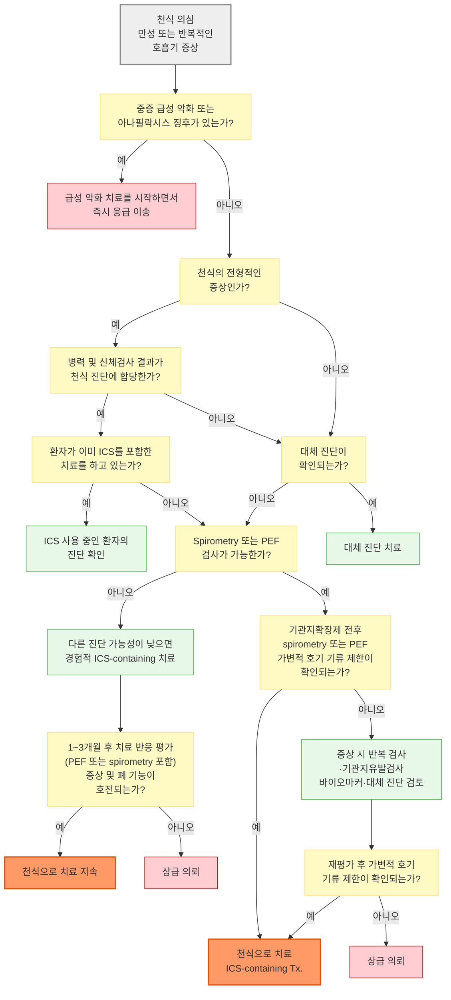
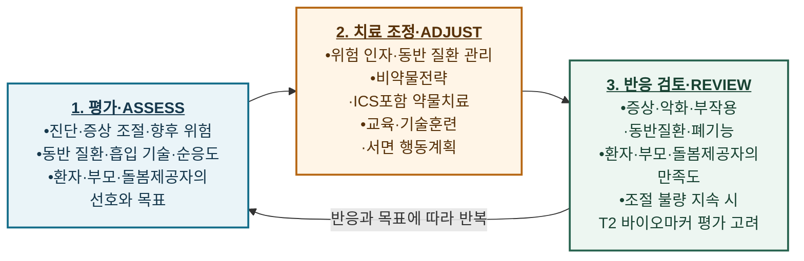
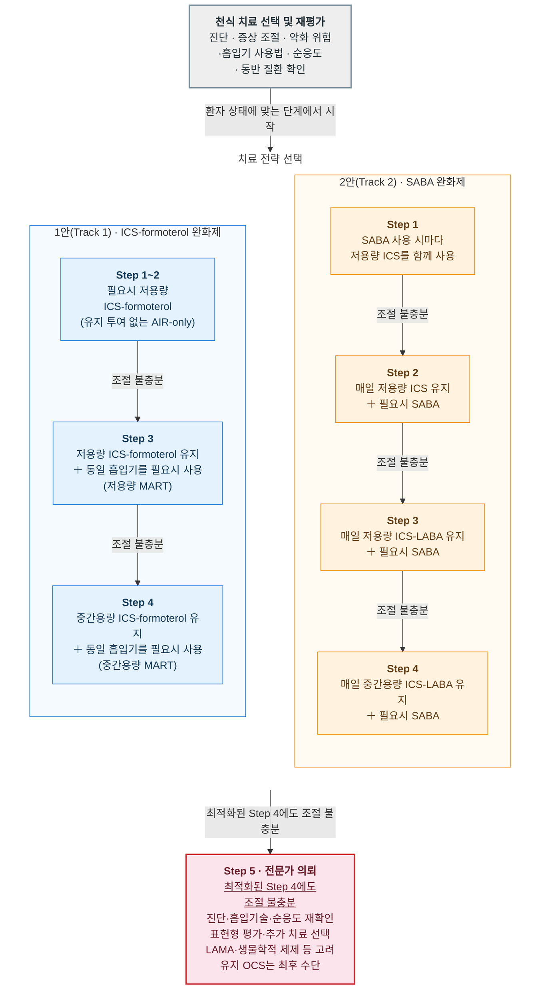
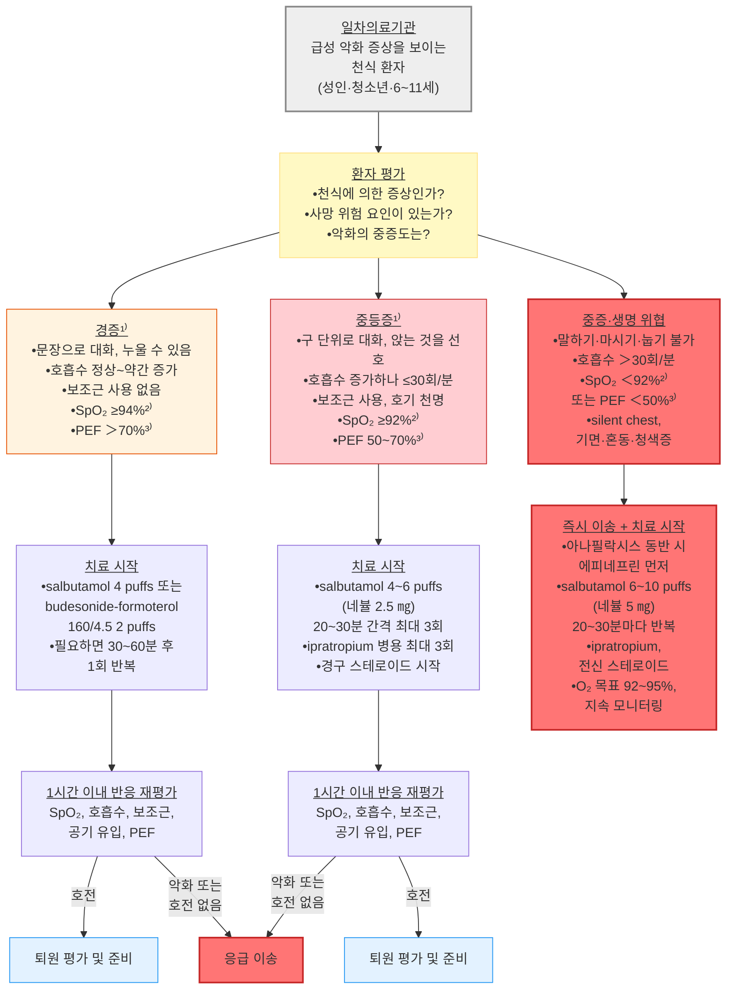

# 천식 Asthma

## <mark style="color:green;">일반 사항</mark>

* 기도의 만성 염증을 특징으로 임상적·병태생리학적으로 다양한 표현형을 보이고, 가변적인 호기 기류 제한과 함께 변동성이 있는 쌕쌕거림(wheezing), 호흡 곤란(shortness of breath), 가슴 답답함(chest tightness), 기침(cough) 증상이 나타나는 질환
* 천식은 어느 연령에서나 시작할 수 있으며, 천식 환자의 최대 절반 정도에서 소아기에 증상이 시작됨
* 밤이나 이른 아침에 주로 악화
* 폐 기능 검사는 정상일 수도 있으며, 진단에는 증상과 호기 기류의 가변성을 객관적으로 입증하는 것이 중요
* 조절되지 않으면 유발 인자에 더욱 쉽게 영향을 받지만, 적절한 관리를 통하여 일상적인 생활은 물론 극심한 강도의 운동도 가능

### <mark style="color:orange;">병태 생리</mark>

* 기도 염증, 기도 과민성과 가변적 기도 폐쇄의 상호 작용으로 증상이 발생
* 일부 환자에서는 기도개형 등으로 지속적 기류 제한이 발생할 수 있음

<mark style="color:cyan;">**기도 염증**</mark>

* 비만 세포 활성화, 활성 호산구 수↑, T세포(NK T-cell, TH2-cell)↑ → 염증 매개체↑

<mark style="color:cyan;">**기도 과민**</mark>

* 정상인에게는 반응이 발생하지 않는 적은 자극에도 기도 수축이 발생
* 알레르겐 등 유발 인자에 의해 쉽게 증상 발생
* 영향 : 기도 비후, 기도 상피 세포 손상, 기도 내 신경 계통 이상, 기도 근육 이상

<mark style="color:cyan;">**기도 폐쇄**</mark>

* 병인 : 기도 수축, 기도 과민에 의한 기도 비후, 점액 분비 증가
* 기도 수축 : 알레르기 관련 세포들에서 분비되는 화학 매개체에 의해 기관지 평활근 수축
* 기도 비후 : 기도 주변 미세 혈관 투과성 증가 → 혈관 내 액체가 기도 점막 조직으로 유입 → 기도 안쪽 지름 감소
* mucus plug 형성 : 기도 내 goblet cell, submucosal gland에서 점액 분비물 분비; 천식 발작 시 심해짐
* airway remodeling(기도개형) : 천식 발작이 반복되면서 기도의 탄력성 및 주변 폐 조직의 변성, 기도 벽 비후로 점차 비가역적 상태가 됨; 경증 천식 환자 및 짧은 병력에서도 발생될 수 있음

### <mark style="color:orange;">천식 표현형 (Asthma Phenotypes)</mark>

* 천식은 단일 질환이 아니라 다양한 임상적·염증성 표현형(phenotype)의 집합
* 표현형에 따라 증상 양상, 악화 위험, ICS 반응성, 생물학적 제제 반응, 동반 질환이 달라짐
* 특히 중증 또는 조절되지 않는 천식에서 표현형 평가가 필수
* 표현형은 시간에 따라 변할 수 있으며 반복 평가가 필요

#### <mark style="color:$primary;">주요 임상 표현형</mark>

<table><thead><tr><th width="155">표현형</th><th width="341">특징</th><th>치료 반응 및 특징</th></tr></thead><tbody><tr><td><strong>알레르기성 천식</strong><br>(allergic asthma)</td><td>• 가장 흔한 표현형<br>• 소아~청소년기 시작 흔함<br>• 아토피/알레르기비염/아토피 피부염 동반<br>• 특이 IgE(+), 피부 단자 검사(+)</td><td>• ICS 반응 우수<br>• 알레르겐 회피 및 면역 치료 고려<br>• 중증 시 anti-IgE (omalizumab) 고려</td></tr><tr><td><strong>호산구성 천식</strong><br>(eosinophilic asthma)</td><td>• 성인 발병 흔함<br>• 혈중 eosinophil↑, FeNO↑<br>• 반복 악화 및 스테로이드 의존 경향<br>• 비용종 동반 흔함</td><td>• ICS 반응 양호<br>• biologic 반응 우수<br>• anti-IL-5/IL-5R, anti-IL-4Rα 고려</td></tr><tr><td><strong>비만 관련 천식</strong><br>(obesity-related asthma)</td><td>• 여성 및 성인 발병 흔함<br>• dyspnea가 두드러짐<br>• eosinophilic inflammation 적은 경우 많음<br>• OSA, GERD 동반 흔함</td><td>• ICS 반응 상대적으로 낮음<br>• 체중 감량 중요<br>• 동반 질환 교정 필수</td></tr><tr><td><strong>비-T2 천식</strong><br>(non-type 2 asthma)</td><td>• neutrophilic 또는 paucigranulocytic 패턴<br>• 흡연, 오염, 직업 노출 관련 가능<br>• 스테로이드 저항성 경향</td><td>• ICS 반응 제한적<br>• biologic 효과 제한적<br>• 흡연 중단 및 노출 회피 중요</td></tr><tr><td><strong>AERD/NERD</strong><br>(Aspirin/NSAID 악화 호흡기 질환)</td><td>• aspirin/NSAID 복용 후 비염·기관지 수축<br>• 비용종 및 만성 비부비동염 흔함<br>• 중등~중증 천식 경향</td><td>• NSAID 회피<br>• LTRA 도움 가능<br>• 중증 시 biologic 고려</td></tr></tbody></table>

#### <mark style="color:$primary;">T2 염증 표현형과 바이오마커</mark>

* 제2형 면역(type 2 immunity) 반응에 의한 염증 : Th2 세포와 ILC2(제2형 선천림프구)가 분비하는 IL-4·IL-5·IL-13이 주도
* 많은 천식 환자에서 핵심 병태생리이며, T2 염증 유무에 따라 T2 천식과 비-T2 천식으로 구분
* 주요 결과 : 호산구 증가(IL-5), IgE 생성(IL-4·IL-13), FeNO 증가·점액 과분비·기도 과민성(IL-13)
* 고용량 ICS-LABA에도 조절되지 않는 중증 천식에서 T2 염증 여부는 생물학적 제제 선택의 기준이 됨
  * 비-T2 중증 천식은 생물학적 제제 선택지가 제한적이므로 기본 요인(흡입 기술·순응도·동반 질환·노출) 재점검과 다른 추가 치료를 우선 검토

<table><thead><tr><th width="184">T2 염증 시사 지표·임상 단서</th><th>의미</th></tr></thead><tbody><tr><td><strong>혈중 eosinophil 증가</strong></td><td>호산구성 염증 시사; 절단값은 검사 시점, OCS 사용 및 생물학적 제제·급여기준에 따라 다름</td></tr><tr><td><strong>FeNO 증가</strong></td><td>T2 기도 염증 및 ICS 반응 가능성을 지지하나 단독 진단·치료 기준은 아님</td></tr><tr><td><strong>알레르겐 특이 IgE 또는 피부단자검사 양성</strong></td><td>임상적으로 관련된 알레르겐 노출 병력이 동반되면 알레르기성 표현형 지지</td></tr><tr><td><strong>비용종/아토피 동반</strong></td><td>T2 표현형 지지</td></tr><tr><td><strong>ICS 반응 우수</strong></td><td>T2 염증 가능성 지지</td></tr></tbody></table>

## <mark style="color:green;">원인</mark>

### <mark style="color:orange;">숙주 인자</mark>

* 유전(아토피/기도 과민/기도 염증 관련 유전자), 비만, 연령/성별, 미숙아/저체중 출생아
  * 14세 이전에는 남자가 2배 더 많고, 성인기에는 여자가 더 많음

### <mark style="color:orange;">유발 또는 악화 인자</mark>

#### <mark style="color:$primary;">유발 인자</mark>

* 알레르겐 : 집먼지진드기, 털 있는 동물(개, 고양이), 바퀴벌레, 곰팡이, 꽃가루
* 직업적 감작 및 알레르겐 : 밀가루, 페인트, 실험 쥐
* 호흡기 감염 : 주로 바이러스
* 대기 오염 : 오염 물질(흡연, 먼지, 황사, 매연, 연기, 오존), 요리, 찬 공기, 안개, 저기압, 건조 또는 높은 습도, 자극적 냄새, 화학 물질
* 음식, 첨가제(아황산염) : 흔하지 않음
* 운동, 과호흡, 크게 웃음, 울음
* 감정적 스트레스, 월경
* 약물 : aspirin, NSAID, β-차단제
* 동반 질환 : 비염, 비부비동염, 아토피, GERD, 폐쇄수면무호흡증

#### <mark style="color:$primary;">악화 위험 인자</mark>

* 조절되지 않는 천식 증상
* 약물 : ICS 미처방, 불순응, 부적절한 흡입 기술, 과도한 SABA 사용
  * SABA 사용량에 따른 위험 평가
    * 연간 ≥3통(통상 200회/통) : 중증 악화 위험 증가와 관련 - 치료 재평가 필요
    * 연간 ≥12통 : 천식 관련 사망 위험 증가와 관련 - 긴급한 치료 재평가 필요
* 동반 질환 : 비만, 만성 비부비동염, GERD, 확인된 음식 알레르기, 불안, 우울, 임신
* 흡연, 감작된 알레르겐, 대기 오염 노출
* 사회 경제적 문제
* 천식으로 ICU 입원 또는 기도 삽관 병력
* 최근 12개월에 ≥1회 중증 악화
* 낮은 FEV₁(특히 ＜60%), 가래/혈액의 호산구증가증, FeNO↑

**지속적 기류 제한 발생 위험 인자**

* 조산·저체중 출생, 영아기 과체중, 긴 유병 기간, 고령, 남성, ICS 미사용, 흡연·유해 화학물질·직업적 노출, 초기의 낮은 FEV₁, 만성 점액 과다 분비, 가래/혈액 호산구 증가, 높은 FeNO

### <mark style="color:orange;">보호 인자</mark>

* 미생물 노출·환경과 면역 발달의 연관성(위생 가설)이 제시되지만, 감염 노출 자체를 천식 예방 방법으로 권고하지 않음
* 모유 수유 : 영아기 쌕쌕거림을 줄일 수 있으나 천식 발생 자체를 예방하는지는 불확실; 일반 건강상 이점으로 권장

## <mark style="color:green;">임상 양상</mark>

<mark style="color:cyan;">**특징적 임상 증상**</mark>

* 때에 따라 달라지는 쌕쌕거림, 호흡 곤란, 가슴 답답함, 기침
* 일반적으로 ≥2개의 호흡기 증상 출현 (성인에서 기침만 있는 경우는 드묾)
* 때에 따라 다양한 증상 발생, 중증도 변화
* 종종 밤 또는 기상 시 증상 악화
* 종종 운동, 웃음, 알레르겐, 찬 공기에 의해 증상 유발
* 종종 바이러스 감염 시 증상이 발생하거나 더 악화됨

<mark style="color:cyan;">**진찰 소견**</mark>

* 종종 정상
* 호기 시 쌕쌕거림(천명음, wheezing) : 질환 발생 중에도 나타나지 않을 수 있음
  * 수포음(crackles)은 간질성 폐질환·심부전에서 들리는 소리로 천식의 전형적 소견이 아님
* 알레르기비염, 비용종 소견

<mark style="color:cyan;">**천식 가능성이 높은 특징**</mark>

* 쌕쌕거림, 호흡 곤란, 가슴 답답함, 기침 중 하나 이상 존재
* 증상이 이른 아침 또는 밤에 악화; 시간에 따라 변화
* 환경에 따라 변화 : 감기, 운동, 항원 노출, 날씨 변화, 강한 냄새, 담배 연기 노출 후 발생
* 기관지확장제 치료에 반응
* 병력 : 소아기 호흡기 증상 시작, 알레르기비염/아토피 병력
* 가족력 : 천식 또는 알레르기 질환

<mark style="color:cyan;">**천식 가능성이 낮은 특징**</mark>

* 다른 호흡기 증상이 없는 기침 / 만성적인 가래 배출
* 어지럼 또는 이상 감각을 동반한 호흡 곤란 / 흉통
* 흡기 시 거친 호흡음(stridor)을 동반한 운동 유발 호흡 곤란

### <mark style="color:$danger;">🚩 Red Flags!</mark>

<mark style="color:$danger;">**즉각 조치**</mark>

* 청진상 호흡음 소실(silent chest)  `임박한 호흡 부전`
* 의식 혼탁, 반응 저하  `생명을 위협하는 천식 악화`
* 청색증 또는 SpO₂ ＜92%(실내 공기)  `중증 천식 악화`
* 단어로만 말함, 앞으로 기울여 앉음, 호흡수 ＞30회/분, 보조호흡근 사용  `중증 천식 악화`
* 서맥 또는 심박수 ＞120회/분  `중증 천식 악화`
* PEF ＜50%(예측치 또는 개인 최고치)  `중증 천식 악화`
* 급작스러운 천식 증상과 함께 두드러기·혈관부종 또는 저혈압  `아나필락시스`


**Silent chest (청진상 호흡음 소실)** = 임박한 호흡 부전(impending respiratory failure) 징후. wheezing 감소가 호전처럼 보일 수 있으나, 폐포 환기가 극감한 상태임. 즉시 응급 이송.\
**ABGA 소견** : 중증 천식에서는 과호흡으로 PaCO₂가 낮은 것이 일반적임.\
**심한 호흡 곤란이 지속되는 환자에서 "정상" PaCO₂(35\~45 ㎜Hg) 또는 상승**은 환기 부전 진행을 의심하는 징후로, 즉각적인 재평가와 처치가 필요함.\
호흡수·맥박수의 고정 절단값은 주로 성인·청소년 참고치이며, 소아는 연령과 PRAM 등 임상 점수를 함께 평가


<mark style="color:$warning;">**당일\~수일 내 평가**</mark>

* **(당일)** 평소보다 심한 호흡 곤란·천명이 지속되거나 짧은 시간 내 반복됨  `급성 천식 악화`
* **(당일)** 완화제 필요량의 급격한 증가  `천식 악화`
* 야간 각성 및 일상 활동 제한의 뚜렷한 증가  `천식 조절 악화`
* 최근 악화 후 회복기에 다시 증가하는 호흡 곤란·천명  `재발성 천식 악화`

<mark style="color:$info;">**조기 평가 및 추적**</mark>

* 최적화된 Step 4 치료에도 3개월 이상 조절되지 않음  `difficult-to-treat 천식`  `중증 천식`
* 연간 ≥2회 중증 악화  `악화 고위험 천식`
* FEV₁이 예측치의 ＜60%로 지속됨  `지속적 기류 제한`  `천식-COPD 병존`
* 직장에서 악화되고 휴가 중 호전됨  `직업성 천식`
* 증상이 있을 때도 가변적 기류 제한이 입증되지 않음  `대체 진단`


과거 ICU 입원·기도 삽관, 최근 1년 내 입원·응급실 방문, 현재 사용 중이거나 최근 중단한 경구 스테로이드(OCS), SABA 과사용은 천식 관련 사망의 고위험 인자임.\
현재 중증 악화가 있으면 즉시 이송하고, 안정 상태에서도 조기에 치료를 재평가함


## <mark style="color:green;">진단</mark>

* 특징적 증상 병력과 입증된 가변적 호기 제한으로 진단
* 조절제 유지 치료(ICS-containing treatment)를 사용하기 전에 진단하는 것이 유용

### <mark style="color:orange;">진단 기준 : 가변적 호기 기류 제한의 입증</mark>

　(Evidence of variable expiratory airflow limitation)

<mark style="color:cyan;">**폐 기능 검사에서 건강한 사람보다 큰 변동성**</mark>

* 아래 진단 기준은 GINA 2026의 연령 구분인 성인 ≥18세, 소아·청소년 6\~17세를 적용함. 약물 치료의 성인·청소년 Track은 ≥12세 기준으로 별도 구분함
* 예)
  1. 기관지확장제 흡입 후 성인에서 FEV₁ 또는 FVC가 기저치 대비 ≥12% 및 ≥200 ㎖ 증가 (증가폭 ≥15% 및 ≥400 ㎖이면 진단 확신이 더 높음); 소아·청소년은 FEV₁이 예측치 대비 ≥12% 증가(200 ㎖ 기준 미적용). Spirometry가 불가능하면 PEF 증가를 참고할 수 있음(성인 ≥20%, 소아·청소년 ≥15%)
     * 2022년 제안된 "예측치 대비 ＞10% 증가" 기준은 질병 부담이 큰 환자(특히 젊은 남성)를 과소 진단할 수 있어 기존 ≥12% 및 ≥200 ㎖ 기준을 유지. 반응 검사에는 SABA 또는 속효성 ICS-LABA를 사용할 수 있음 <mark style="color:$info;">\[GINA 2026]</mark>
  2. 2주간 1일 2회 측정한 평균 일중 PEF 변동이 성인 ＞10%, 소아 ＞13%
  3. ICS 포함 치료 4주 후 성인은 FEV₁ 또는 FVC가 기저치 대비 ≥12% 및 ≥200 ㎖ 증가(또는 PEF ≥20% 증가); 소아·청소년은 FEV₁이 예측치 대비 ≥12% 증가(또는 PEF ≥15% 증가)
  4. 표준화된 운동 유발 검사에서 성인은 FEV₁이 기저치보다 ＞10% 및 ＞200 ㎖ 감소; 소아·청소년은 FEV₁이 예측치 대비 ＞12% 감소(또는 PEF ＞15% 감소)
  5. 메타콜린 유발검사에서 성인·소아·청소년 모두 FEV₁이 기저치보다 ≥20% 감소. 성인은 표준화된 과호흡, 고장성 식염수 또는 만니톨 유발검사에서 FEV₁ ≥15% 감소도 진단을 지지; 기타 검사는 연령별 표준 프로토콜에 따라 해석
  6. 방문 간 성인은 FEV₁이 기저치 대비 ≥12% 및 ≥200 ㎖ 변동(또는 PEF ≥20% 변동); 소아·청소년은 FEV₁ ≥12% 변동(또는 PEF ≥15% 변동)

<mark style="color:cyan;">**검사 타당성 확인**</mark>

* FEV₁이 감소했을 때 또는 기관지유발검사 중 FEV₁이 감소할 때 FEV₁/FVC도 함께 감소하는지 확인
  * 검사 당시 FEV₁/FVC 감소가 반드시 있어야 천식을 진단할 수 있다는 의미는 아니며, 증상 사이에는 정상 폐 기능을 보일 수 있음


아침 일찍 또는 기관지확장제를 성분별 권장 시간 동안 중단한 후 반복 검사가 필요할 수 있음(SABA ≥4시간, formoterol/salmeterol 24시간, indacaterol/vilanterol 36시간, LAMA 36\~48시간). 심한 악화 또는 바이러스 감염 시 기관지확장제 반응이 일시적으로 사라질 수 있음


### <mark style="color:orange;">진단 검사</mark>

#### <mark style="color:$primary;">폐활량 측정 (Spirometry)</mark>

* 가변적인 기류 제한, 질환의 중증도 파악; 향후 위험도 예측에 유용
* 측정 시기 : 천식 진단 시, 치료 시작 3\~6개월 후, 주기적(최소 매 1\~2년)
* FEV₁이 PEF보다 천식 진단 및 관리에 있어 신뢰성이 높음


**FEV₁ 예측치(predicted FEV₁)**: 환자와 성별·나이·키(예측식에 따라 체중 포함)가 같은 건강한 사람 집단의 평균 1초 강제날숨량. 실제 측정값을 예측치 대비 백분율(% predicted, % Ref)로 나타내어 폐 기능을 평가함. 관용적으로 예측치의 80% 이상을 정상 범위로 보나, 정상인 간의 변동 폭이 연령에 따라 다르므로 현행 해석 지침은 결과지에 함께 표시되는 정상 하한(LLN, 같은 조건 정상인의 하위 5%)과 비교하도록 권고함. 천식에서는 FEV₁이 정상이어도 천식을 배제하지 못함



**PEF의 역할**: PEF는 spirometry보다 신뢰도가 낮지만 spirometry가 불가능할 때 진단 보조 및 변동성 추적·자가 모니터링에 사용할 수 있음. 동일한 기기를 사용하고 매회 3회 중 최고값을 기록함. **일중 변동 계산식**: (하루 중 최고치 − 최저치) ÷ \[(최고치 + 최저치) / 2] × 100(%). 2주 측정 평균이 성인 ＞10%, 소아 ＞13%이면 천식을 지지함


#### <mark style="color:$primary;">기관지 수축 유발 시험 (bronchoprovocation challenge test)</mark>

* 기도 과민성을 평가
* 천식이 의심되지만 정상 호흡음 또는 정상 폐 기능 환자에서 유용
* 직접 유발검사 : 기관지 평활근 수용체에 직접 작용 - 메타콜린, 히스타민
  * 민감도가 상대적으로 높으나 천식에 비특이적; COPD, 알레르기비염, 기관지확장증 등에서도 양성 가능
  * ICS를 사용하지 않는 증상 있는 환자에서 음성이면 현재 천식의 가능성을 낮춤
* 간접 유발검사 : 비만세포 등에서 매개물질 분비를 유도하여 수축을 일으킴 - 만니톨, 고장성 식염수, 운동 부하, 자발적 과호흡(eucapnic voluntary hyperventilation), 찬 공기
  * 민감도는 낮으나 천식(활동성 기도 염증)에 대한 특이도가 높음
  * 운동 유발 기관지수축 평가에 유용하며, ICS 치료 중에는 반응이 약해질 수 있음
* 보통 6세 이상에서 검사 수행 능력·폐 기능과 안전성을 평가하여 시행

#### <mark style="color:$primary;">피부 단자 검사</mark>

* 알레르겐 감작 평가 목적
* 알레르기 질환을 시사하는 증상이 있어 결과가 진료 방침에 영향을 줄 때 영유아에서도 시행할 수 있으며, 연령에 따른 피부 반응성과 양성·음성 대조군을 고려하여 해석
  * 무증상 소아의 선별 목적 검사(부모가 알레르기 질환자인 경우 포함)는 권하지 않음. 증상 없는 감작은 알레르기 질환을 의미하지 않으며, 불필요한 음식 제한·환경 회피로 이어질 수 있음
* 천식 특이 검사는 아니며, 알레르겐과 천식의 관련성은 병력으로 확인해야 함

#### <mark style="color:$primary;">실험실 검사</mark>

* 특이 IgE 검사 : 피부단자검사보다 더 신뢰성이 높은 것은 아니며 비용이 더 들 수 있으나, 광범위한 피부질환·검사 협조 곤란·아나필락시스 위험 등이 있어 다른 검사를 시행하기 곤란한 경우에 유용
* 혈중 호산구 : 전형적 증상이 있으나 폐 기능 검사가 불가능하거나 음성일 때 참고치 이상이면 진단을 지지
  * 아토피 등 다른 질환에서도 증가하며, 정상이어도 천식을 배제하지 못함
* 호기 산화질소(FeNO) 검사
  * 아래 수치는 FeNO 해석 기준이며, 중증 천식의 잔존 T2 염증 평가 및 생물학적 제제 급여기준의 절단값과 구분함
  * 낮음 : 성인·청소년 ＜25 ppb, 소아 ＜20 ppb - 호산구성 염증 가능성이 낮지만 천식을 배제하지 못하며, 단독으로 ICS 감량을 결정하지 않음
  * 중간 : 성인·청소년 25\~50 ppb, 소아 20\~35 ppb - 임상 맥락 및 증상과 함께 해석
  * 높음 : 성인·청소년 ＞50 ppb, 소아 ＞35 ppb - 전형적 증상이 있으나 spirometry/PEF가 불가능하거나 음성일 때 T2 천식 진단을 지지; ICS 반응 가능성이 높음


**FeNO 해석 시 주의**: ⓵ 흡연자 및 기관지 수축 상태에서는 수치가 낮게 측정될 수 있음, ⓶ 급성 바이러스 감염 시 일시적으로 높아질 수 있음, ⓷ FeNO와 혈중 호산구는 성별·연령(FeNO는 측정 기기·장소)에 따라 차이가 크며, 혈중 호산구는 이른 아침에 높고 FeNO는 아침에 낮게 측정됨, ⓸ 흡연자는 FeNO가 낮고 혈중 호산구가 높게 측정될 수 있음. 단독 수치보다 임상 증상·호산구·IgE와 함께 종합 해석 필요


#### <mark style="color:$primary;">영상 검사</mark>

* 흉부 X선 : 정상 또는 과팽창 소견
  * 다른 질환 배제 목적으로 시행 - 폐렴, 기흉 등 합병증 의심 시 시행
  * 급성 악화에서 routine 촬영은 권고하지 않음

### <mark style="color:orange;">ICS를 이미 사용 중인 환자의 진단 확인</mark>

1. 전형적·가변적 호흡기 증상(+) 및 가변적 호기 기류(+) : 천식 확진
   * 천식 조절을 평가하고 ICS-containing Tx.를 점검
2. 전형적·가변적 호흡기 증상(+), 가변적 호기 기류 미입증 : 기관지확장제를 성분별 권장 시간 동안 중단한 뒤 또는 증상 발생 시 spirometry/PEF 재검
   * FEV₁ ＞70% 예측치 : 진단 재확인을 위해 감독하에 ICS 포함 치료의 단계 감량을 고려하고 2\~4주 후 재평가; 필요시 기관지유발검사 고려. 치료 전 상태·악화 위험을 기록하고 행동계획과 재진 일정을 제공
   * FEV₁ ＜70% 예측치 : 1\~2개월 동안 ICS-containing Tx. 시작 또는 단계 증량 후 증상과 폐 기능 재평가; 반응 없으면 이전 용량으로 복귀하고 의뢰
3. 호흡기 증상이 거의 없고 정상 폐 기능, 가변적 기류 제한 없음 : 기관지확장제를 권장 시간 동안 중단한 뒤 재검하고 대체 진단 검토. 필요시 감독하에 ICS 포함 치료를 단계 감량하여 2\~4주 후 재평가
   * 증상·가변적 기류 제한이 나타나면 천식을 확인하고 이전의 최소 유효 치료로 복귀
   * 최저 치료에서도 변화가 없으면 진단 재확인을 위한 유지 ICS 중단을 고려할 수 있으나, 일반적인 치료 감량과 구분하며 최소 12개월 면밀히 추적
4. 지속적인 호흡 곤란 및 지속적 기류 제한(+) : 성인·청소년에서 1\~2개월간 ICS 포함 치료를 단계 증량한 후 증상과 폐 기능을 평가
   * 반응이 없으면 이전 용량으로 복귀·의뢰하며 천식과 COPD 특징의 병존 등을 고려

***



<p align="center"><strong>천식 진단 알고리듬</strong></p>

<p align="center"><em><mark style="color:$info;">Ref. GINA. Global strategy for asthma management and prevention. 2026. Box 1-1.</mark></em></p>

***

### <mark style="color:orange;">감별</mark>

* 쌕쌕거림 : 천식, 상기도 감염 또는 기능 부전, COPD, 기관연화증, 이물 흡인
* 기침만 있는 상태 : cough-variant asthma, ACEI 유발성 기침, GERD, 성대 기능 장애, 만성 부비동염, 상기도기침증후군(후비루)

#### <mark style="color:$primary;">주요 질환의 감별</mark>

<table><thead><tr><th width="120">특징</th><th>천식</th><th>COPD</th><th>유발성 성문폐쇄(ILO)</th><th>심부전</th></tr></thead><tbody><tr><td><strong>증상 가변성</strong></td><td>높음</td><td>상대적으로 낮음</td><td>발작적</td><td>울혈 상태에 따라 변동 가능</td></tr><tr><td><strong>야간 증상</strong></td><td>흔함</td><td>가능</td><td>드묾</td><td>발작성 야간호흡곤란 가능</td></tr><tr><td><strong>호흡음</strong></td><td>주로 호기성 천명</td><td>호기성 천명 가능</td><td>주로 흡기성 stridor</td><td>수포음 등 울혈 소견</td></tr><tr><td><strong>기관지확장제 반응</strong></td><td>가변성 입증에 도움</td><td>나타날 수 있어 단독 감별 불가</td><td>일반적으로 없음</td><td>일반적으로 없음</td></tr><tr><td><strong>FEV₁/FVC</strong></td><td>정상 또는 감소; 시간에 따라 변동</td><td>기관지확장제 투여 후 지속 감소</td><td>대개 정상</td><td>정상 또는 감소 가능</td></tr><tr><td><strong>진단 단서</strong></td><td>아토피, 가족력, 야간·계절성 악화</td><td>흡연·유해물질 노출, 만성 가래</td><td>흡기 시 악화, 발성·운동 관련</td><td>S3, 하지 부종, BNP 상승</td></tr></tbody></table>

#### <mark style="color:$primary;">소아에서 상기도 감염 vs 천식</mark>

<table><thead><tr><th width="147"></th><th width="244">반복되는 상기도 감염</th><th>천식</th></tr></thead><tbody><tr><td>1 episode의 기간</td><td>＜10일</td><td>＞10일</td></tr><tr><td>주증상</td><td>기침, 콧물, 코막힘</td><td>기침, 쌕쌕거림, 호흡 곤란</td></tr><tr><td>특징</td><td>• 쌕쌕거림은 경미<br>• episode들 사이에 무증상 기간</td><td>• episode가 ≥4회/년 또는 중증 및/또는 야간 악화<br>• 활동 또는 크게 웃을 때 증상 발생<br>• 알레르기 질환 동반, 부모형제 천식 병력</td></tr></tbody></table>

#### <mark style="color:$primary;">연령별 감별 질환의 증상 및 상태</mark>

<mark style="color:cyan;">**12\~39세**</mark>

<table data-search="false"><thead><tr><th>증상</th><th>상태(감별 질환)</th></tr></thead><tbody><tr><td>재채기, 가려움, 코막힘, throat-clearing</td><td>만성 상기도기침증후군</td></tr><tr><td>호흡곤란, 흡기 시 천명(stridor)</td><td>유발성 성문폐쇄</td></tr><tr><td>어지럼, 감각 이상, 한숨</td><td>과호흡·기능적 호흡장애</td></tr><tr><td>재발성 감염, 가래 동반 기침</td><td>기관지확장증</td></tr><tr><td>과도한 기침과 점액 생성</td><td>낭성섬유증</td></tr><tr><td>심잡음</td><td>선천성 심질환</td></tr><tr><td>호흡곤란, 조기 폐기종 가족력</td><td>알파1-항트립신 결핍증</td></tr><tr><td>증상이 갑자기 발생</td><td>흡입된 이물질</td></tr></tbody></table>

<mark style="color:cyan;">**≥40세**</mark>

<table data-search="false"><thead><tr><th>증상</th><th>상태(감별 질환)</th></tr></thead><tbody><tr><td>호흡곤란, 조기 폐기종 가족력</td><td>알파1-항트립신 결핍증</td></tr><tr><td>증상이 갑자기 발생</td><td>흡입된 이물질</td></tr><tr><td>호흡곤란, 흡기 시 천명(stridor)</td><td>유발성 성문폐쇄</td></tr><tr><td>어지럼, 감각 이상, 한숨</td><td>과호흡·기능적 호흡장애</td></tr><tr><td>기침, 가래, 활동 시 호흡곤란, 흡연/유해물질 노출</td><td>COPD</td></tr><tr><td>재발성 감염, 가래 동반 기침</td><td>기관지확장증</td></tr><tr><td>활동 시 호흡곤란, 야간 증상, 발목 부종</td><td>심부전</td></tr><tr><td>ACE 억제제 복용력</td><td>약물 유발성 기침</td></tr><tr><td>활동 시 호흡곤란, 비생산성 기침, 곤봉지</td><td>실질성 폐질환</td></tr><tr><td>갑작스런 호흡곤란, 흉통</td><td>폐색전증</td></tr><tr><td>기관지확장제에 반응 없는 호흡곤란</td><td>중심기도 폐쇄</td></tr></tbody></table>

<mark style="color:cyan;">**All ages**</mark>

<table><thead><tr><th width="420">증상</th><th>상태(감별 질환)</th></tr></thead><tbody><tr><td>만성 기침, 객혈, 호흡곤란, 피로, 발열, 야간 발한, 식욕 저하, 체중 감소</td><td>결핵</td></tr><tr><td>발작적 기침, 때때로 흡기 시 천명</td><td>백일해</td></tr></tbody></table>

<p align="center"><em><mark style="color:$info;">Ref. GINA. Global strategy for asthma management and prevention. 2026. Box 1-3.</mark></em></p>

### <mark style="color:orange;">천식 조절 상태 및 중증도 평가</mark>

#### <mark style="color:$primary;">위험 인자 평가</mark>

* 진단 시 및 주기적으로 위험 인자를 평가하고, 악화·치료 변경 후에는 다시 평가
  * 폐 기능 검사의 1\~2년 간격과 위험 인자 재평가 주기를 혼동하지 않음
* 치료 시작 및 조절제 치료 3\~6개월 후 FEV₁ 측정, 이후 주기적으로 평가

#### <mark style="color:$primary;">천식 조절 검사 (Asthma Control Test, ACT)</mark>

* 지난 4주간의 5개 항목(① 활동 제한, ② 호흡곤란 빈도, ③ 천식 증상으로 인한 야간 각성, ④ 완화제 사용 빈도, ⑤ 전반적 조절 자가평가)을 각 1\~5점으로 평가하는 자가 설문(총 5\~25점)
* 판정 : 20\~25점 well controlled, 16\~19점 not well controlled, 5\~15점 very poorly controlled
* 점수가 높을수록 양호; 유의미한 점수 차이는 최소 3점
* 온라인 자가검사 : [Asthma Australia - Asthma Control Test](https://asthma.org.au/asthma-control-test/)

#### <mark style="color:$primary;">천식 증상 관리 수준</mark>

* 최근 4주 동안 다음 사항 유무
  1. 주간 천식 증상이 ＞2회/주 발생
  2. 천식 때문에 밤에 잠에서 깨어난 날이 있다
  3. SABA 완화제 사용이 ＞2회/주 필요하다
     * 운동 전 예방적 사용은 제외. 필요시 ICS-formoterol 완화제 사용은 포함하지 않음
  4. 천식 때문에 활동에 제한이 있다(any activity limitation)
* 판정 : 1개도 해당 없음 = 충분한 조절; 1\~2개 해당 = 부분 조절; 3\~4개 해당 = 조절 안 됨

#### <mark style="color:$primary;">천식 중증도</mark>

* 중증도는 최소 2\~3개월 치료 후, 조절에 필요한 치료 강도를 바탕으로 후향적으로 평가
* 치료가 어려운 천식(difficult-to-treat) : 중간·고용량 ICS와 두 번째 조절제(보통 LABA) 또는 유지 OCS를 처방했는데도 조절되지 않거나, 조절 유지에 고용량 치료가 필요한 천식
  * 흔히 흡입 기술, 순응도, 흡연, 동반 질환, 오진 등 교정 가능한 요인이 원인이며, 이를 교정해 호전되면 중증 천식으로 분류하지 않음

<table><thead><tr><th width="119">구분</th><th>정의</th></tr></thead><tbody><tr><td><strong>경증 천식</strong></td><td>필요시 ICS-formoterol 또는 저용량 ICS 등 Step 1~2 치료로 조절</td></tr><tr><td><strong>중등증 천식</strong></td><td>저용량 <a href="071_-asthma.md#mart-maintenance-and-reliever-therapy">MART</a> 또는 저·중간용량 ICS-LABA 등 Step 3~4 치료로 조절</td></tr><tr><td><strong>중증 천식</strong></td><td>올바른 진단, 양호한 순응도·흡입 기술 및 동반 질환 관리에도 최적화된 고용량 ICS-LABA로 조절되지 않거나, 이를 감량하면 악화되는 천식</td></tr></tbody></table>


장기 천식 중증도와 급성 악화 중증도는 별개임. 평소 경증 천식 환자도 중증 또는 치명적 악화를 경험할 수 있음. '경증 천식'이라는 표현은 저위험으로 오인되어 SABA 단독 치료로 이어질 수 있으므로 환자 설명 시 사용을 피함


***

## <mark style="background-color:$warning;">Management</mark>

### <mark style="color:orange;">치료 목표 및 관리 원칙</mark>

* 목표 : 증상 조절, 비가역적 기류 제한/악화/사망 등 천식 관련 위험 최소화
* 위험 인자 관리, 약물 치료, 알레르겐 면역 요법, 환경 관리, 환자 교육

#### <mark style="color:$primary;">천식 관리 주기 (Assess → Adjust → Review)</mark>

1. **평가(Assess)** : 필요시 진단을 재확인하고, 증상 조절과 향후 악화·폐 기능 저하·약물 부작용의 위험, 동반 질환, 흡입기 사용법·치료 순응도, 환자 및 부모·돌봄제공자의 선호와 목표를 평가
2. **치료 조정(Adjust treatment)** : 평가 결과에 따라 교정 가능한 위험 인자와 동반 질환을 관리하고, 비-약물 전략과 ICS 포함 약물 치료를 조정
   * 모든 환자에게 흡입기 사용법·자가 관리 교육과 기술 훈련을 제공하고, 처방된 완화제에 맞는 서면 천식 행동계획을 작성·갱신
3. **치료 반응 검토(Review response)** : 증상, 악화, 부작용, 동반 질환, 폐 기능 및 환자·부모·돌봄제공자의 만족도를 재평가하여 다음 치료에 반영
   * 천식이 계속 조절되지 않으면 제2형 염증 바이오마커(혈중 호산구, FeNO 등) 평가를 고려하고, 필요시 추가 검사·의뢰. 모든 환자에게 매 방문마다 일률적으로 검사한다는 의미는 아님
   * 치료 시작 1\~3개월 후, 이후 3\~12개월 간격으로 추적하되 조절 상태·위험도에 따라 앞당김. 급성 악화 후에는 성인 2\~7일·소아 2\~5일 이내 재평가(구체적 연령별 일정은 급성 악화·모니터링 항목 참조)



<p align="center"><strong>개별화된 천식 관리 주기</strong><br><em><mark style="color:$info;">저자 재구성 (참고 문헌 : GINA 2026 Box 3-3; 대한결핵 및 호흡기학회. 천식 진료지침 2026. 그림 4-2)</mark></em></p>


**재평가 시점의 구분** : GINA 2026 Box 4-4와 국내 지침 표 4-4의 초기 치료 반응 검토는 **2\~3개월 후 또는 임상적 긴급도에 따라 더 일찍** 시행하도록 제시되어 있음. 이는 일반적인 추적 방문 권고인 치료 시작 1\~3개월 후와 상충하지 않음. 폐활량검사는 ① 진단 시, ② 치료 시작 3\~6개월 후, ③ 이후 주기적으로 시행하며, 증상 악화·진단 불확실 시에는 더 일찍 검사


#### <mark style="color:$primary;">교육</mark>

* ① 진단 시, ② 치료·흡입기 변경 시, ③ 악화로 내원하거나 응급실·입원 치료 후 퇴실할 때, 그리고 ④ 매 추적 방문에서 교육을 반복
  * 환자·보호자와 목표를 함께 정하고 이해한 내용을 환자가 다시 설명하게 하며 확인
* 모든 환자에게 흡입제 교육 시행
  * 유지제로 처방된 조절제는 증상이 없어도 지속하도록 격려
  * AIR-only(Anti-inflammatory reliever only) : 매일 쓰는 유지 흡입제 없이 저용량 ICS-formoterol을 '증상이 있을 때만 사용'하는 요법. 흡입할 때마다 ICS가 함께 투여되어 SABA 단독 완화제보다 중증 악화를 줄임 (☞ [완화 및 급성 악화 치료](071_-asthma.md#reliever))
    * 만 12세 이상 예: <mark style="color:blue;">\[심비코트 터부헬러]</mark> 160/4.5 ㎍은 증상 시 1 puff, 수분 후에도 지속되면 1 puff 추가. <mark style="color:blue;">\[심비코트 라피헬러]</mark> 80/2.25 ㎍은 증상 시 2 puffs, 수분 후에도 지속되면 2 puffs 추가. 처방에 따라 운동·알레르겐 노출 전에도 사용 가능; 제품별 1일 흡입 횟수·재평가 기준은 [AIR/MART 실제 용법](071_-asthma.md#air-mart) 참조
  * 서면 행동계획 제공
* 치료 선택은 환자 선호, 흡입기 조작 능력, 국내 사용 가능 여부, 비용을 고려해 공동 의사결정으로 정함
* 서면 행동계획에는 현재 유지제·완화제와 용법, 조절 악화의 신호, 완화제·유지제 증량 기준, 경구 스테로이드 시작 기준, 응급 진료가 필요한 기준을 포함. AIR/MART 적용 환자는 SABA 대신 ICS-formoterol 사용 횟수를 늘리도록 별도로 작성

## <mark style="color:green;">비-약물 치료, 위험 인자 관리 및 예방</mark>

### <mark style="color:orange;">위험 인자 관리</mark>

* 일률적인 알레르겐 회피 조치는 권고하지 않음 - 시행이 어렵고 효과가 제한적
* 증상이 있는 환자에서 피부 반응 검사 또는 특정 IgE Ab 검사로 입증된 알레르겐을 피함

#### <mark style="color:$primary;">실내 알레르겐 회피 방법</mark>

* 집먼지진드기 : 침구류는 매주 뜨거운(60℃) 물에 세탁하여 열로 건조, 베개/매트리스 밀폐 커버 사용, HEPA 필터 장착 청소기, 카펫 제거(특히 침실)
* 곰팡이 : 누수·습기 원인을 우선 수리하고 적절한 환기·보호구를 사용해 제거, 실내 습도 ＜50% 유지
  * 광범위하면 전문 제거 고려
* 바퀴벌레 : 구제, 음식물 노출 금지, 누수 처리
* 애완동물 비듬 : 침실 출입 금지, 자주 목욕, HEPA 필터
  * 동물 키우기 중단 후 알레르겐 감소에 수개월 소요

#### <mark style="color:$primary;">대기 오염/실외 알레르겐 회피</mark>

* 담배 연기, 먼지 회피
* 꽃가루·곰팡이 농도가 높을 때 창문 차단, 실내 공기 청정기 사용
* 심한 추위/건조/대기 오염 시 야외 활동 자제; 외출 시 KF80 이상 마스크
* 직업적 노출 회피
* 폭염, 산불 연기, 황사, 고농도 꽃가루 등 극한 기상 시 예보를 확인해 실외 활동을 줄이고, 서면 행동계획에 따라 치료를 조정

#### <mark style="color:$primary;">약물 주의</mark>

* 유발 약물 복용 후 보통 30\~120분 후 콧물, 코막힘, 기관지 연축 발생
* NSAID, aspirin : 이상 반응이 있었던 경우 외에는 금기 아님
* 점안액을 포함하여 β-차단제 주의
  * 심장선택적 β₁-차단제도 무조건 안전한 것은 아니지만, 명확한 심혈관 적응증이 있으면 천식이 절대 금기는 아니며 저용량부터 면밀히 관찰하며 사용

#### <mark style="color:$primary;">동반 질환 관리</mark>

* GERD : 천식 환자에서 유병률 높음; β-작용제, 테오필린 등의 천식 치료 약제가 하부 식도 괄약근 이완 가능
  * GERD 증상 있으면 관리
* 불안, 우울증 : 천식 환자에서 유병률이 높으며, 급성 악화의 위험 인자임
  * 정신 건강 평가 및 관리
* 비염, 비부비동염 : [비강 스테로이드](../222_/051_-allergic-rhinitis.md) 등으로 함께 치료(비염 증상 개선); 천식 조절 개선 효과는 제한적
* 비만 : 5\~10% 체중 감량으로도 천식 조절에 도움; 적정 체중 유지를 목표로 관리

### <mark style="color:orange;">급성 악화를 줄이기 위한 위험 인자 관리 방법</mark>

**악화 위험 인자(증상 조절 불량 포함)가 하나 이상 있는 모든 환자**

* ICS(흡입 스테로이드) 포함 치료를 처방
* 가능하다면 항염증성 완화제(ICS-formoterol 또는 ICS-SABA) 요법으로 변경 - SABA 단독 완화제보다 중증 악화 위험을 줄임
* 환자의 건강 문해력에 맞는 서면 행동계획(action plan)을 제공
* 저위험 환자보다 더 자주 추적 관찰
* 흡입기 사용법과 복약 순응도를 자주 점검하고 교정
* 수정 가능한 위험 인자를 확인하고 관리

**지난 1년간 중증 악화 ≥1회**

* 가능하다면 항염증성 완화제(필요시 ICS-formoterol 또는 ICS-SABA) 요법으로 변경
* 수정 가능한 위험인자가 없으면 치료 단계(step-up) 고려
* 악화를 유발할 수 있는 회피 가능한 요인 확인

**담배 연기 또는 전자담배 노출**

* 환자 및 가족에게 금연을 적극 권장하고, 상담 및 지원 자원 제공
* 천식 조절이 불량하면 ICS 용량 상향 고려

**FEV₁ 저하(특히 예측치 ＜60%)**

* 복약 순응도 및 흡입기 사용법 문제 해결
* 3개월간 고용량 ICS 치료 시도 고려
* COPD 등 다른 폐질환 배제
* 호전 없으면 전문가 자문

**비만**

* 체중 감량 전략 제공
* 탈조건화, 기계적 제한, 수면무호흡 등으로 인한 증상과 천식 증상 구분

**주요 심리적 문제**

* 정신건강 평가 시행
* 불안 증상과 천식 증상 구분하도록 돕고, 공황발작 관리에 대한 조언 제공

**주요 사회경제적 문제**

* 지역 비용에 맞는 가장 비용 효율적인 ICS 기반 요법 선택
* 흡입기 사용법 최적화로 약물 효과 극대화

**음식 알레르기 확인된 경우**

* 적절한 음식 회피, 아나필락시스 행동계획 수립, 에피네프린 주사기 처방, 전문가 자문

**직업적 또는 가정 내 자극물 노출**

* 가능한 한 빨리 노출 제거
* 전문가 자문

**알레르겐 감작된 경우**

* 효과 근거가 있는 경우 단순 회피 전략 시도(비용 고려)
* 회피 불가능 시 천식 치료 단계 상향 고려
* 알레르기비염이 동반되고 FEV₁이 예측치의 ＞70%인 성인 또는 청소년 HDM(집먼지진드기) 감작 천식 환자에서, ICS 치료에도 악화가 있으면 SLIT(설하면역요법) 추가 고려

**중등도/고용량 ICS 사용에도 객담 호산구증 지속**

* 증상 조절 수준과 관계없이 ICS 용량 증량

### <mark style="color:orange;">생활 관리 및 예방접종</mark>

#### <mark style="color:$primary;">운동/육체 활동</mark>

* 규칙적인 운동 (예: 수영)
* 호흡·이완 운동 : 증상과 삶의 질 개선을 위한 보조요법으로 고려할 수 있으나 폐 기능 개선·악화 예방 효과는 입증되지 않음
* 요가 : 일부 연구에서 효과
* 호흡재활 프로그램 : 운동 능력 저하나 호흡곤란이 지속되는 환자에서 고려

#### <mark style="color:$primary;">식이 및 영양 보충</mark>

* 마그네슘 : 경구 마그네슘 보충이 천식 조절에 도움이 된다는 근거는 없음
* Vit D : 부족 시 폐 기능 저하, 악화 빈도 증가, 스테로이드 반응 저하와 연관
  * 기저 25(OH)D ＜25\~30 nmol/L(약 10\~12 ng/㎖)의 결핍 환자에서는 보충으로 전신 스테로이드가 필요한 악화 감소·증상 조절 개선 가능성이 있으나, 결핍이 없는 천식 환자 전반(특히 미취학 소아)에서는 효과 근거가 부족 <mark style="color:$info;">\[GINA 2026]</mark>
* 과일·채소가 풍부한 식단 권장

#### <mark style="color:$primary;">예방접종</mark>

* 인플루엔자 백신 : 접종 가능한 연령의 천식 환자에게 매년 접종 권고
  * 비강 생백신은 천식·쌕쌕거림 병력에 따른 연령별 금기·주의를 별도 적용
* 폐렴구균·백일해·RSV·COVID-19 백신 : 연령, 임신, 기저질환 등 예방접종 지침에 따라 접종

***

## <mark style="color:green;">약물 치료</mark>

* 아래는 임상적 역할에 따른 약물 설명의 구성임. ICS-formoterol은 조절과 완화 역할을 함께 하므로, 성분·제형은 ICS-LABA 항목에서, AIR/MART의 실제 사용법은 완화 치료 및 단계별 치료 항목에서 설명

<table><thead><tr><th width="181">구분</th><th width="263">역할</th><th>주요 약제</th></tr></thead><tbody><tr><td><strong>ICS 기반 조절치료 및 대체 약제</strong></td><td>ICS 포함 치료를 기본으로 증상과 향후 위험을 조절하며, 대체·추가 선택지를 함께 설명</td><td>• ICS<br>• ICS-LABA<br>• 항류코트리엔제</td></tr><tr><td><strong>추가 조절치료</strong></td><td>최적화된 ICS 포함 치료에도 조절되지 않을 때 환자 상태에 따라 추가</td><td>• LAMA 및 ICS-LABA-LAMA<br>• 알레르겐 면역 치료(선택된 환자에서 전문가 평가 후)<br>• 생물학적 제제<br>• 유지 OCS는 최후 수단</td></tr><tr><td><strong>완화 및 급성 악화 치료</strong></td><td>일상 증상 완화와 급성 악화 시 단기 치료를 구분하여 설명</td><td>• 항염증성 완화제(AIR)<br>• SABA<br>• SAMA(급성 악화 시 보조 치료)<br>• 전신 스테로이드(급성 악화 시 단기 사용)</td></tr><tr><td><strong>권고하지 않거나 사용이 제한되는 약제</strong></td><td>효과·안전성의 한계와 현재 치료에서의 제한점을 설명</td><td>• 크로몰린제<br>• 테오필린<br>• 전신 β-작용제</td></tr></tbody></table>

### <mark style="color:orange;">흡입 도구 (Inhaler device)</mark>

* 흡입제 : 전신 부작용을 최소화하면서 고농도의 약제를 기도 점막에 투여할 수 있음
* 흡입 도구 종류 : pMDI, breath-actuated pMDI, DPI, soft mist inhaler, nebulizer
  * 기기는 연령만으로 정하지 않고 흡입 협응·흡기 유속·인지 및 조작 능력을 실제 시연하여 선택
  * 어린 소아는 pMDI+spacer와 필요시 밀착 마스크를 사용 (☞ 흡입제 사용법: [의약품안전나라](https://nedrug.mfds.go.kr/pbp/CCBFC03/getItem?tchmtrId=SU201911240021), [아산병원](https://www.youtube.com/watch?v=a810wpL3rAM))

**MDI (metered-dose inhaler, 정량 흡입기)**

* 용법 : 천천히(5초간) 흡입 후 5\~10초간 호흡 정지
* 서스펜션 제형 pMDI(salbutamol, budesonide-formoterol 등)는 매 흡입(puff) 직전마다 흔듦 (☞ 급성 악화 치료 시작)
* pMDI : 잘못된 사용이 많으므로 사용법을 교육하고 방문 시마다 확인
* spacer : MDI를 제대로 사용하지 못하는 경우의 보조 기구; puff 당 5\~10회 또는 30초간 호흡
* breath-actuated MDI : 호흡에 따라 분무; pMDI를 잘 사용하지 못하는 환자에 적용

**DPI (dry powder inhaler)**

* pMDI보다 사용이 용이하지만 충분한 흡입력 필요

**Nebulized aerosol**

* 경증\~중등증 급성 악화에서는 pMDI+spacer와 폐 기능 개선 효과가 비슷하며, 협조가 어렵거나 중증으로 충분한 흡입이 어려운 경우 등에 고려; 가능하면 마스크보다 마우스피스 사용
* 스테로이드·ipratropium 분무 시 약제가 눈에 닿지 않도록 주의; 분무 후 코/입 주변 세척

#### <mark style="color:$primary;">환자 상황별 흡입기 선택 전략</mark>

<table><thead><tr><th width="238.4210205078125">환자 상황</th><th>흡입기 선택 원칙</th></tr></thead><tbody><tr><td><strong>손-흡입 동작의 협응이 어려움</strong></td><td>pMDI+spacer, breath-actuated MDI 또는 사용 가능한 soft mist inhaler 고려</td></tr><tr><td><strong>흡기 유속이 불충분함</strong></td><td>DPI를 피하고 pMDI+spacer 또는 필요시 nebulizer 고려</td></tr><tr><td><strong>악력·인지·시력 저하</strong></td><td>환자가 실제로 조작 가능한 기기를 시연 후 선택하고 보호자 도움 여부 확인</td></tr><tr><td><strong>흡기 유속과 조작 능력이 충분함</strong></td><td>DPI, pMDI 또는 soft mist inhaler 중 환자 선호·비용·환경 영향을 고려</td></tr><tr><td><strong>모든 환자</strong></td><td>처방 전 직접 사용하게 하고 매 방문 시 흡입 기술 재확인</td></tr></tbody></table>

#### <mark style="color:$primary;">흡입기 교육·재점검 절차</mark>

<table><thead><tr><th width="110">단계</th><th>진료실에서 할 일</th></tr></thead><tbody><tr><td><strong>선택</strong></td><td>사용 가능한 약제·기기, 흡기 유속·협응·손 기능·인지, 선호·비용을 함께 평가. 가능하면 서로 다른 사용법의 기기가 섞이지 않도록 단순화하고, pMDI에는 spacer 사용을 고려</td></tr><tr><td><strong>관찰</strong></td><td>“사용할 수 있습니까?”라고 묻는 데 그치지 않고 환자에게 실제로 흡입하는 모습을 보여 달라고 요청. 기기별 점검표로 중요한 오류를 확인</td></tr><tr><td><strong>교정</strong></td><td>의료진이 모형으로 시연한 뒤 환자가 다시 시행하게 하여 문제 동작을 중심으로 2~3회 반복 확인. 반복 교육 후에도 사용이 어려우면 다른 기기로 변경</td></tr><tr><td><strong>재확인</strong></td><td>매 방문·처방 변경 시 점검. 처음 교육 후 4~6주 이내에도 사용 오류가 다시 생길 수 있어 조기 재확인. 의사·간호사·약사도 처방 기기를 정확히 시연할 수 있어야 함</td></tr></tbody></table>

<p align="center"><em><mark style="color:$info;">Ref. 대한결핵 및 호흡기학회. 천식 진료지침 2026. 표 8-3·8-4, pp.184-185.</mark></em></p>

* 순응도는 비난하지 않는 열린 질문으로 확인하고, 유지제로 처방된 약의 최근 사용일수·누락 이유, 처방·조제 간격 및 흡입기 잔량을 함께 확인
* 비용, 부작용에 대한 걱정, 증상이 없으면 치료가 불필요하다는 인식, 잊어버림, 복잡한 처방, 기기 조작의 어려움 등 원인에 맞추어 해결. AIR-only를 처방받은 환자를 매일 사용하지 않았다는 이유만으로 불순응으로 판단하지 않음

### <mark style="color:orange;">ICS 기반 조절치료 및 대체 약제</mark>

#### <mark style="color:$primary;">흡입 스테로이드 (Inhaled corticosteroid, ICS)</mark>

* 작용 : 항염, 기도 과민성 개선, 폐 기능 개선, 증상 감소, 삶의 질 호전, 악화/사망 위험 감소
* 지속성 천식에서 가장 효과적인 약물
* 가능한 한 모든 천식 환자에서 진단 초기부터 사용 권고
* 증상·폐 기능의 호전은 수일 내 시작되지만 충분한 효과는 3\~4개월 이후에 나타날 수 있음
* 흡연자에서는 효능이 감소할 수 있어 금연·흡입 기술·순응도를 먼저 점검하고 필요시 치료를 조정

**용법**

* 대부분의 천식은 저용량 ICS로 조절됨
* 반응이 부족할 경우 : ① 사용 방법 확인, ② 다른 계열 조절제 추가(일반적으로 증량보다 추가가 효과적이며 부작용 적음. 예: ICS + LABA)

**부작용**

* 국소 : 구강 칸디다증, 쉰 목소리, 기침(상기도 자극)
  * 예방 : spacer 사용(pMDI), 흡입 후 물로 입을 헹군 뒤 뱉기
* 전신 (고용량 장기 사용 시) : 부신 기능 억제, 골다공증, 백내장, 녹내장, 성장 저하(소아)

**성인·청소년의 ICS 1일 총 계량 용량**

<table data-search="false"><thead><tr><th width="338">성분·제형 [상품명]</th><th>저용량 (㎍/d)</th><th>중간용량 (㎍/d)</th><th>고용량 (㎍/d)</th></tr></thead><tbody><tr><td>beclomethasone dipropionate¹⁾<br>pMDI, standard particle</td><td>200~500</td><td>＞500~1,000</td><td>＞1,000</td></tr><tr><td>beclomethasone dipropionate¹⁾<br>DPI/pMDI, extrafine particle²⁾</td><td>100~200</td><td>＞200~400</td><td>＞400</td></tr><tr><td>budesonide [DPI/pMDI]<br><mark style="color:blue;">[풀미코트 터부헬러]</mark></td><td>200~400</td><td>＞400~800</td><td>＞800</td></tr><tr><td>ciclesonide¹⁾ [pMDI, extrafine]<br><mark style="color:blue;">[알베스코]</mark></td><td>80~160</td><td>＞160~320</td><td>＞320</td></tr><tr><td>fluticasone propionate [DPI/pMDI]<br><mark style="color:blue;">[후릭소타이드 디스커스]</mark>, <mark style="color:blue;">[후릭소타이드주니어 에보할러]</mark></td><td>100~250</td><td>＞250~500</td><td>＞500</td></tr><tr><td>fluticasone furoate [DPI]</td><td>100</td><td>-</td><td>200</td></tr><tr><td>mometasone furoate [DPI]</td><td>기기별 상이</td><td>기기별 상이</td><td>기기별 상이</td></tr></tbody></table>

> _MDI = metered-dose inhaler, DPI = dry powder inhaler_\
> _&#xB9;⁾폐에서 활성 대사체로 전환되는 prodrug_\
> _&#xB2;⁾<mark style="color:blue;">\[포스터]</mark>(beclomethasone-formoterol)의 beclomethasone은 extrafine 제형_
>
> _이 표는 저·중간·고용량의 범주이며 약제 간 등가용량표가 아님. 표의 수치는 **계량용량(metered dose)** 기준이며, 복합 흡입제는 해당 제품의 성분 함량에 맞추어 해석함. 예: <mark style="color:blue;">\[심비코트 터부헬러]</mark> 160/4.5 ㎍은 전달용량 표기이며 계량용량은 200/6 ㎍_
>
> _Mometasone은 DPI 기기에 따라 용량 구분이 달라 일률적인 수치를 적용하지 않음_
>
> _소아 6\~11세의 용량 범주는 별도 적용_

<p align="center"><em><mark style="color:$info;">Ref. GINA. Global strategy for asthma management and prevention. 2026. Box 4-2.</mark></em></p>

#### <mark style="color:$primary;">ICS-LABA</mark> <a href="#ics-laba" id="ics-laba"></a>

**LABA의 특성 및 사용상 주의**

* 작용 : 기관지 확장, 수축 예방; 작용 지속 시간 ≥12시간; 투여 횟수는 성분·제품별로 1일 1회 또는 2회
* 적용 : LABA 단독 사용 금지(단독 사용 시 천식 악화 위험) - ICS와의 복합제로만 권고
  * ICS-LABA 병용이 ICS 증량보다 효과적이며 '조절' 상태에 더 빨리 도달
* 부작용 : 천식 급성 악화(단독 사용 시), 두통, 근육 경련, 심혈관 자극, 저칼륨혈증
* formoterol : 5\~10분 내 효과 발현 → ICS와의 복합제로 조절 및 완화요법에 사용 가능(MART/AIR는 근거와 허가가 있는 제품·함량에 한함)
* salmeterol : 작용 발현이 느려(약 10\~20분) 완화제로 사용하지 않음

**ICS-LABA 복합제**

<table><thead><tr><th width="161">성분명</th><th>상품명 [제형] (단위 ㎍)</th><th>기본 용법</th></tr></thead><tbody><tr><td>fluticasone<br>-vilanterol</td><td><mark style="color:blue;">[렐바 엘립타]</mark> [DPI: 100/25, 200/25]</td><td>1 puff qd</td></tr><tr><td>fluticasone<br>-formoterol</td><td><mark style="color:blue;">[플루티폼 흡입제]</mark> [MDI: 50/5, 125/5, 250/10]</td><td>2 puffs bid</td></tr><tr><td>budesonide<br>-formoterol*</td><td><mark style="color:blue;">[심비코트 터부헬러]</mark> [DPI: 80/4.5, 160/4.5, 320/9]</td><td>1~2 puffs bid</td></tr><tr><td>budesonide<br>-formoterol*</td><td><mark style="color:blue;">[심비코트 라피헬러]</mark> [pMDI: 80/2.25, 160/4.5]</td><td>유지요법은 함량별 허가용법 적용; 160/4.5는 유지요법 전용. 80/2.25는 ≥12세 AIR-only·MART에 사용 가능하며 증상 시 2 puffs; 터부헬러의 1 puff와 구분</td></tr><tr><td>beclomethasone<br>-formoterol*</td><td><mark style="color:blue;">[포스터]</mark> [MDI(HFA): 100/6, 200/6]<br><mark style="color:blue;">[포스터넥스트할러]</mark> [DPI: 100/6, 200/6]</td><td>1~2 puffs bid; 200/6은 MART·AIR에 사용하지 않음</td></tr></tbody></table>

> _\*MART 근거는 지정 budesonide-formoterol 및 beclomethasone-formoterol 제형에 있고, AIR-only의 직접 근거는 주로 budesonide-formoterol에서 확립됨. Beclomethasone-formoterol AIR-only는 직접 연구가 없어 근거와 국내 허가 범위를 구분함._
>
> _Fluticasone-formoterol 등 다른 ICS-formoterol 복합제와 고용량 제형을 임의로 MART/AIR에 사용하지 않음_

#### <mark style="color:$primary;">항류코트리엔제 (Leukotriene modifier)</mark>

* 적용 : 알레르겐에 의한 천식, 경증 지속성 천식의 대체제, aspirin 과민성 천식, 알레르기비염 동반
* 효과 : 저용량 ICS보다 효과 적음. ICS 병용에 있어서 LABA보다 효과 적음
* montelukast : ≥15세 10 ㎎ hs qd; 6\~14세 5 ㎎ hs qd <mark style="color:blue;">\[싱귤레어]</mark>
* pranlukast : 성인 50 ㎎ bid, 아침·저녁 식후 <mark style="color:blue;">\[씨투스]</mark> (소아는 건조시럽·현탁정·츄정 등 별도 제형의 연령·체중별 허가용량 적용)
* zafirlukast, zileuton(5-lipoxygenase 억제제) : 간 효소 상승과 warfarin·theophylline 등 약물상호작용이 있으며 국내에서는 사용이 드묾


**montelukast** **FDA 블랙박스 경고** : 자살 충동, 공격성, 우울 등 신경정신계 이상 반응 위험; 처방 전 위험·이득 평가 및 치료 중 모니터링 필수


### <mark style="color:orange;">추가 조절치료 (Add-on therapies)</mark>

* 유지 OCS는 전문가 평가 후 다른 치료에도 조절되지 않는 중증 천식에서 최후 수단으로만 고려하며, 용법·위험성은 [전신 스테로이드](071_-asthma.md#systemic-corticosteroids) 항목에서 함께 설명

#### <mark style="color:$primary;">지속성 항콜린제 (LAMA) 및 3제 복합 흡입기</mark>

* 적용 : 중간 용량 ICS-LABA에도 조절되지 않는 Step 4\~5 환자에서 추가 고려; ICS-LABA 대비 중증 악화 감소 효과는 biologic보다 제한적이나, biologic 적응증에 해당하지 않는 환자에서 유용 <mark style="color:$info;">\[GINA 2026]</mark>
* 부작용 : 입마름(드묾)
* tiotropium mist inhaler : 2.5 ㎍/puff, 2 puffs qd <mark style="color:blue;">\[스피리바 레스피맷]</mark>
  * 18 ㎍ 흡입용 캡슐 제형은 천식 추가 치료 용량으로 사용하지 않음
* ICS-LABA-LAMA 3제 복합 흡입기 : 중간 또는 고용량 ICS-LABA에도 조절되지 않는 성인(만 18세 이상)에서 선택적으로 고려
  * <mark style="color:blue;">\[에너제어]</mark> 150/50/80 또는 150/50/160 ㎍ 흡입용 캡슐 : 1캡슐 qd, 전용 브리즈헬러로 흡입(캡슐을 삼키지 않음)
  * <mark style="color:blue;">\[트렐리지 엘립타]</mark> 100/62.5/25 ㎍, <mark style="color:blue;">\[트렐리지200 엘립타]</mark> 200/62.5/25 ㎍ : 1 puff qd
  * <mark style="color:blue;">\[트림보우]</mark> 100/6/12.5 ㎍, pMDI : 2 puffs bid; ICS-LABA로 적절히 조절되지 않고 반복적 악화 이력이 있는 천식의 유지요법
  * 모두 유지치료용이며 **3제 흡입기 자체를 완화제(AIR/MART)로 사용하지 않음**. 완화제는 별도로 처방
    * 비-formoterol LABA 포함(<mark style="color:blue;">\[에너제어]</mark>, <mark style="color:blue;">\[트렐리지]</mark>) : SABA(GINA는 ICS-SABA도 제시하나 국내 미도입)
    * formoterol 포함(<mark style="color:blue;">\[트림보우]</mark>) : SABA 또는 저용량 ICS-formoterol 가능 <mark style="color:$info;">\[GINA 2026]</mark>
    * 기존 MART에 tiotropium을 별도 추가한 경우 : ICS-formoterol 완화제 유지 가능
    * 국내 처방 시 각 제품의 허가 범위를 함께 적용하며, 3제와 별도 ICS-formoterol의 병용은 제품별 허가용법과 다를 수 있음. <mark style="color:blue;">\[트림보우넥스트할러]</mark>는 국내 천식 적응증이 없어 구분

#### <mark style="color:$primary;">알레르겐 면역 치료 (Allergen-specific immunotherapy)</mark>

* 임상적으로 관련된 알레르겐 감작과 노출-증상 연관성이 있는 안정된 천식에서 전문가가 선택적으로 고려
  * 급성 악화 또는 조절되지 않는 천식에서는 시작하지 않으며 먼저 천식을 안정화시킴
* SCIT(Subcutaneous Immunotherapy) : 증상·약물 요구량을 줄일 수 있으나 전신 반응·아나필락시스 위험이 있어 대응 가능한 기관에서 시행
* HDM-SLIT(House Dust Mite Sublingual Immunotherapy) : 알레르기비염 동반, HDM 감작, ICS 치료에도 증상이 남아 있는 환자에서 고려
  * 성인·청소년은 FEV₁ ＞70% 예측치를 확인하고 제품별 연령·허가 범위를 적용
  * 구강·위장관 국소 이상반응 설명

#### <mark style="color:$primary;">생물학적 제제 (Step 5)</mark>

<table><thead><tr><th width="127">기전</th><th width="299">성분명 [상품명]</th><th>주요 고려 상황</th></tr></thead><tbody><tr><td>Anti-IgE</td><td>omalizumab <mark style="color:blue;">[졸레어]</mark>, <mark style="color:blue;">[옴리클로]</mark>(바이오시밀러)</td><td>임상적으로 관련된 알레르겐 감작이 확인된 중증 알레르기성 천식</td></tr><tr><td>Anti-IL-5</td><td>mepolizumab <mark style="color:blue;">[누칼라]</mark>, reslizumab <mark style="color:blue;">[싱케어]</mark></td><td>중증 호산구성 천식</td></tr><tr><td>Anti-IL-5<br>(장기 작용)</td><td>depemokimab</td><td>중증 호산구성 천식; 26주 간격 투여. 국내 미허가</td></tr><tr><td>Anti-IL-5Rα</td><td>benralizumab <mark style="color:blue;">[파센라]</mark></td><td>중증 호산구성 천식</td></tr><tr><td>Anti-IL-4Rα</td><td>dupilumab <mark style="color:blue;">[듀피젠트]</mark></td><td>중증 호산구성/T2 천식 또는 유지 OCS 의존</td></tr><tr><td>Anti-TSLP</td><td>tezepelumab <mark style="color:blue;">[테즈파이어]</mark></td><td>허가상 T2 바이오마커 제한이 없는 중증 천식</td></tr></tbody></table>


**tezepelumab**: anti-TSLP 단클론항체. 허가상 호산구·FeNO·IgE에 따른 제한 없이 사용할 수 있으나, 일반적으로 혈중 호산구와 FeNO가 높을수록 악화 감소 효과가 더 큼 <mark style="color:$info;">\[GINA 2026]</mark>

**depemokimab**: 26주(6개월)마다 1회 투여하는 장기 작용 anti-IL-5 제제. 미국 FDA는 중증 호산구성 천식(12세 이상)에 승인(2025); 비용종 동반 만성 비부비동염 적응증은 국가별로 승인 상태가 다름(예: 영국·EU는 인정, 미국은 미인정). mepolizumab에 반응이 좋았던 환자에서 전환을 고려할 수 있으나 benralizumab 반응 양호 환자에서는 근거 부족. 국내 미허가 <mark style="color:$info;">\[GINA 2026]</mark>

**omalizumab 바이오시밀러**: <mark style="color:blue;">\[옴리클로]</mark>는 국내 최초의 졸레어 바이오시밀러로 알레르기성 천식·만성 특발성 두드러기 적응증으로 허가되었고, 75·150·300 ㎎ 프리필드시린지와 150 ㎎ 펜 제형이 급여로 공급 중임. 바이오시밀러는 임의로 상호교체하지 않고 허가사항과 기관 정책에 따름

생물학적 제제 선택 시 Type 2 표현형 여부 외에도 악화력, 유지 OCS 필요성, 연령, HIRA 급여 기준, 투여 경로(피하/정맥), 투여 간격, 동반 질환(비용종, 아토피 피부염 등 비-천식 적응증 포함), 환자 선호도를 함께 고려하며, 단일 바이오마커만으로 선택하지 않음 <mark style="color:$info;">\[GINA 2026]</mark>



**국내 급여 및 교체투여**: omalizumab·mepolizumab·reslizumab·benralizumab·dupilumab은 중증 천식의 성분별 기준을 충족하면 급여가 인정됨.

**Omalizumab 급여기준(알레르기성 천식)**: ⓵ 만 12세 이상은 고용량 ICS-LABA와 LAMA 투여에도 조절되지 않는 알레르기성 중증 지속성 천식으로 치료 전 IgE ≥76 IU/㎖, 통년성 대기 알레르겐 시험관 내 반응 또는 피부반응 양성, FEV₁ ＜80% 예측치, 치료 전 12개월 내 전신 스테로이드가 필요한 급성 악화 ≥2회를 모두 충족, ⓶ 만 6\~12세 미만은 고용량 ICS-LABA에도 조절되지 않는 경우로 FEV₁ 조건을 제외한 나머지 조건을 충족, ⓷ 최초 투여 16주째 반응평가 소견서 제출 시 지속투여 인정, 이후 3\~6개월마다 반응평가, ⓸ 생물학적 제제 간 병용투여 불인정, ⓹ mepolizumab·reslizumab·benralizumab·dupilumab에서 omalizumab으로의 교체투여 불인정

**병용투여와 교체투여는 별도 기준**이며, 모든 교체투여가 일률적으로 불인정되는 것은 아님. Omalizumab을 3\~6개월 이상 사용했으나 효과 불충분·부작용 등으로 전환이 필요한 경우 등에는 전환 약제의 투여대상 조건과 투여소견서 등 요건을 충족하면 사례별 급여가 인정될 수 있음. 반면 항 IL-5/IL-5R 계열 및 dupilumab 사이의 일부 전환이나 이들 약제에서 omalizumab으로의 전환에는 급여 제한이 있으므로 임상적 전환 가능성과 급여 인정 범위를 구분함. Tezepelumab<mark style="color:blue;">\[테즈파이어]</mark>은 국내 허가(중증 천식, 비용종 동반 만성 비부비동염)되었으나 비급여임 <mark style="color:$info;">\[HIRA 고시 제2025-224호·제2026-92호·제2026-159호 등]</mark>


#### <mark style="color:$primary;">중증 천식의 표현형 재평가 및 치료 반응 추적</mark>

* 최적화된 고용량 ICS-LABA 사용 중에도 혈중 호산구 ≥150/㎕, FeNO ≥20 ppb, 객담 호산구 ≥2% 또는 임상적으로 관련된 알레르겐 유발 증상은 잔존 T2 염증을 시사함. 일반 천식 진단의 FeNO 기준 및 성분별 급여 절단값과 구분 <mark style="color:$info;">\[천식 진료지침 2026]</mark>
* OCS는 혈중 호산구·FeNO를 낮출 수 있음. 한 번의 낮은 수치로 비-T2 천식을 확정하지 말고, 가능하면 OCS 투여 전, 종료 후 1\~2주 또는 최소 유지용량에서 최대 3회 재평가
* 혈중 호산구 ≥1,500/㎕이면 EGPA 등 천식 외 원인을 평가하며, 기생충 노출 위험이 있으면 Strongyloides 등 감염도 검토
* 생물학적 제제 시작 약 3\~4개월 후 악화 빈도, 증상·ACT, 폐 기능, OCS 용량 및 부작용으로 반응을 평가하고 이후 3\~6개월 간격으로 추적. 효과 불명확 시 전문가가 평가기간 연장 또는 교체를 판단; 국내 급여의 성분별 최초·지속 평가 시점은 별도로 적용. 초기 시험 기간은 최소 4개월(depemokimab은 6개월)을 권장 <mark style="color:$info;">\[GINA 2026]</mark>
* 반응이 좋으면 유지 OCS를 우선 감량하고 부신기능 저하 위험을 평가. 중증 천식에서 유지 ICS-LABA를 임의 중단하거나 곧바로 AIR-only로 줄이지 않음

### <mark style="color:orange;">완화 및 급성 악화 치료</mark> <a href="#reliever" id="reliever"></a>

#### <mark style="color:$primary;">항염증성 완화제 (Anti-inflammatory reliever, AIR)</mark>

**저용량 ICS-formoterol**

* 작용 : formoterol에 의한 기관지 확장(즉각) + ICS에 의한 항염(지속) → 급성 악화 위험 감소
  * SABA 단독 대비 중증 악화 발생 유의미하게 감소
* 종류 : 근거가 확립된 지정 제형은 budesonide-formoterol 및 beclomethasone-formoterol임
  * fluticasone-formoterol은 MART/AIR로 사용하지 않음


모든 단계에서 저용량 ICS-formoterol을 항염증성 완화제로 사용하는 Track 1을 우선 권고. 증상이 드문 천식에서도 SABA 단독 사용은 중증 악화 위험 증가와 관련됨 <mark style="color:$info;">\[GINA 2026]</mark>


* 성분·제형은 [ICS-LABA](071_-asthma.md#ics-laba), 제품별 흡입 횟수와 국내 허가용법은 [AIR/MART 실제 용법](071_-asthma.md#air-mart) 참조

**Track 2에서의 AIR 요법(ICS-SABA)**

* Track 2(대체)에서도 완화제로 **ICS-SABA 복합제**(예: budesonide-salbutamol)를 사용하는 옵션이 Step 1\~5에 추가됨. BATURA 연구에서 SABA 단독 완화제보다 중증 악화 위험을 약 절반으로 감소 <mark style="color:$info;">\[N Engl J Med 2025]</mark>
* 국내 2026 지침에서는 ICS-SABA 고정 복합제를 국내 미도입으로 기술함. 국내 사용 가능한 제품이 없으면 Step 1에서는 SABA 사용 때마다 별도 저용량 ICS를 사용하며, Step 2\~5에서는 ICS 포함 유지치료와 SABA를 병용
* 별도 ICS와 SABA를 사용하는 방법은 두 흡입기를 함께 사용해야 함. ICS-SABA 고정 복합제만 필요시 쓰는 경우와 구분하며, 유지제도 처방받은 환자는 각 흡입기의 역할과 사용법을 교육

#### <mark style="color:$primary;">속효성 흡입 β-작용제 (SABA)</mark>

**효과 및 용법**

* 가장 빠른 기관지확장제
* 보통 4\~6시간 지속
* 증상 발생 시 또는 운동 전(운동 유발성 기관지수축 예방) 사용
* SABA는 기관지만 확장하고 기도 염증(airway inflammation)을 해결하지 못함
* SABA 단독 사용은 심한 악화를 예방할 수 없으며, 규칙적·빈번한 사용이 악화 위험을 증가시킴; 증상 완화 중에도 염증이 지속되어 악화 위험이 유지됨 → ICS 병용이 필수

**부작용**

* 떨림, 빈맥; 초기에 발생하며 빠르게 적응됨
* 고용량 : 저칼륨혈증, 부정맥, 젖산산증과 그에 따른 과호흡 (☞ 급성 악화의 SABA 과다 투여 주의)

<table><thead><tr><th width="175">성분명</th><th>흡입제</th><th>네불라이저용 액</th><th>작용 (hr)</th></tr></thead><tbody><tr><td>salbutamol</td><td>1~2 puffs, 100 ㎍/puff<br><mark style="color:blue;">[벤토린 에보할러]</mark></td><td>2.5 ㎎/2.5 ㎖/A<br><mark style="color:blue;">[벤토린 네뷸]</mark></td><td>4~6</td></tr></tbody></table>

#### <mark style="color:$primary;">속효성 항콜린제 (Short-acting anticholinergics)</mark>

* 작용 : SABA보다 효과 적음
* 급성 악화의 보조 치료 : 중등증\~중증 급성 악화에서 SABA에 단기간 추가하면 입원 위험 감소
* 치료 첫 1\~2시간 이후에는 추가 이득이 없음
* 장기 완화제로 사용하지 않음
* 국내에는 네뷸라이저 제형만 유통 : <mark style="color:blue;">\[아트로벤트흡입액유디비]</mark> 500 ㎍/2 ㎖/바이알; 허가 용량은 성인 100\~500 ㎍ qid, 3\~14세 100\~250 ㎍ tid\~qid
* 급성 악화(중등증\~중증) 시 : 성인·청소년·6\~11세 모두 네뷸라이저 250 ㎍(국내 500 ㎍/2 ㎖ 바이알의 1 ㎖)을 초기 치료에서 필요시 SABA 투여 때마다 함께 20\~30분 간격으로 최대 3회; 위의 일반 허가용량·투여 간격과 구분 <mark style="color:$info;">\[GINA 2026]</mark>
* 분무 시 약제가 눈에 닿지 않도록 마우스피스 사용이 바람직함

#### <mark style="color:$primary;">전신 스테로이드</mark> <a href="#systemic-corticosteroids" id="systemic-corticosteroids"></a>

* 작용 : 중증 급성 악화 시 증상 완화 및 재발 예방, 사망률 감소
  * 투여 4\~6시간 후 효과
* 적용 : 중등\~중증 급성 악화에 단기 사용
  * 유지 OCS는 전문가 평가 후 다른 치료에도 조절되지 않는 중증 천식에서 최후 수단으로만 고려
* 전신 스테로이드 사용 중에도 ICS는 계속 사용함
* 성인에서 평생 4\~5회의 OCS 단기 투여만으로도 골다공증·골절·당뇨병·심부전·백내장 등 장기 부작용 위험이 용량 의존적으로 증가 → 악화 후 치료 최적화로 반복 투여를 줄임 <mark style="color:$info;">\[GINA 2026]</mark>
* 부작용
  * 단기 사용 : 당 대사 이상, 혈압 상승, 식욕 증가, 체액 저류, 감정 변화, 불면, 소화성 궤양; 성인에서 패혈증·혈전색전증 위험 증가
  * 장기 사용 : 고혈압, 당뇨병, HPA axis 억제, 백내장, 녹내장, 골다공증 (✽3개월 이상 사용 시 골다공증 예방 조치 필요)
* prednisolone : 성인 40\~50 ㎎/d × 5\~7d <mark style="color:blue;">\[소론도]</mark>; 2주 미만 사용은 일반적으로 tapering 불필요
* 주사제 : 경구 투여는 정맥 투여와 효과가 유사하므로, 가능한 한 경구를 우선함
  * 정맥 투여 적응증 : 심한 호흡곤란으로 삼키기 어렵거나 구토로 경구 투여가 곤란한 경우, 비침습적 환기 또는 기관삽관이 필요한 경우
  * 용량 : hydrocortisone 총 200 ㎎/d IV 분할 투여(예: 50 ㎎ q6h)
  * 경구 투여가 가능해지면 prednisolone으로 전환하며, 주사·경구 투여 기간을 합하여 보통 5\~7일간 치료
  * 근육주사는 경구 투여보다 우월하다는 근거가 없어 일상적으로 권고하지 않음 <mark style="color:$info;">\[GINA 2026]</mark>

### <mark style="color:orange;">권고하지 않거나 사용이 제한되는 약제</mark>


경구 SABA·경구 LABA와 theophylline은 흡입치료보다 효과가 낮고 전신 부작용 위험이 커 GINA에서 권고하지 않음. Fenoterol은 저칼륨혈증·심혈관 부작용 및 천식 사망 위험과 관련되어 권고하지 않음


#### <mark style="color:$primary;">크로몰린제 (Chromone)</mark>

* 현대 치료에서는 더 효과적인 ICS 기반 요법이 우선이며 천식 치료에 권고하지 않음

#### <mark style="color:$primary;">테오필린 (Theophylline)</mark>

* phosphodiesterase 억제와 adenosine receptor 길항 작용이 있으나, 흡입치료보다 효과가 낮고 치료역이 좁아 GINA에서 일반적인 천식 유지치료로 권고하지 않음
* 급성 악화에서 aminophylline 또는 theophylline 정맥주사는 효과가 낮고 중대한 부작용 위험이 있어 사용하지 않음
* 흡입치료 접근이 어려운 예외적 상황에서 사용을 검토한다면 약물상호작용·기저질환을 평가하고 혈중농도와 독성을 면밀히 모니터링

**부작용**

* 구역, 구토, 설사, 불면, 흥분, 떨림, 두통, 부정맥, 발작, 사망
* 치료 용량 범위가 좁아 쉽게 부작용 발생
* 모니터링 대상 : 부작용 발생, 고용량(≥10 ㎎/㎏/d), 상호작용 약물(macrolide, ciprofloxacin, 항진균제, 결핵 치료제, 경구 피임제, cimetidine, zileuton) 또는 간질환, 울혈성 심부전

#### <mark style="color:$primary;">전신 β-작용제</mark>

* 경구·경피 β-작용제는 흡입제보다 효과가 낮고 전신 부작용이 많아 권고하지 않음
* 국내에서 소아에 흔히 쓰이는 tulobuterol 경피 패취<mark style="color:blue;">\[호쿠날린패취]</mark>와 경구 procaterol<mark style="color:blue;">\[메프친]</mark>도 같은 이유로 천식 유지·완화 치료로 권하지 않음
* Fenoterol은 저칼륨혈증·심혈관 부작용과 천식 사망 위험 때문에 권고하지 않음
* 흡입 SABA 또는 ICS-formoterol을 사용할 수 없는 매우 제한적인 상황에서도 ICS 없이 단독 사용하지 않음

## <mark style="color:green;">단계별 치료법</mark>

### <mark style="color:orange;">천식 치료 약물 선택 원칙</mark>

* 모든 천식 환자는 가능한 한 진단 초기부터 ICS 함유 치료를 받아야 함. SABA 단독 치료는 권고하지 않음 - 심한 악화 예방 불가, 빈번한 사용이 악화 위험 증가 <mark style="color:$info;">\[GINA 2026]</mark>
* 대부분 저용량 ICS로 관리됨
* 완화제로 SABA보다 ICS-formoterol을 우선 권고
* 천식 증상으로 ≥1회/주 깨어나거나 대부분의 날에 증상 → Step 3 이상 치료 선택


**초기 치료 선택과 장기 치료 단계를 구분**: 초기에는 진단 근거, 증상 빈도·야간 각성, 폐 기능, 최근 악화와 위험 인자, 흡입기 사용 능력 및 유지치료 순응도를 기록하고 추적 일정을 정함. 처음 내원부터 심한 조절 불량·급성 악화가 있으면 먼저 악화에 준해 치료하고 적절한 ICS 포함 유지치료를 시작하며, 곧바로 난치성·중증 천식 또는 생물학적 제제 대상이라고 단정하지 않음. 국내 지침 표 4-4의 초기 증상 구분과 GINA 2026 Box 4-4의 증상 빈도 구분은 동일하지 않으며, 아래 「Step별 Track 1 / Track 2 약물 흐름」 표는 GINA 2026을 바탕으로 한 요약임


#### <mark style="color:$primary;">MART (Maintenance And Reliever Therapy)</mark>

* MART는 formoterol을 포함하는 ICS 복합제를 '유지치료'와 '완화제'로 동시 사용하는 전략

**MART 장점**

* 중증 악화 빈도 감소 - SABA 기반 전략 대비 우월
* 경구 스테로이드 단기 투여 감소
* 순응도 개선 - 단일 흡입기 전략으로 복잡성 최소화
* 증상으로 완화제를 흡입할 때마다 ICS도 함께 투여되어 악화 시 항염증 치료를 추가할 수 있음

**적용 약제** : ICS-formoterol 복합제 (formoterol의 속효성+지속성 특성 활용)

* budesonide-formoterol <mark style="color:blue;">\[심비코트]</mark>
* beclomethasone-formoterol <mark style="color:blue;">\[포스터]</mark>

### <mark style="color:orange;">Track 1 / Track 2 치료 전략</mark>

* 아래 Track 1/2 및 Step 1\~5 용량은 성인·청소년(≥12세) 기준. 6\~11세는 별도의 소아 치료표를 적용하며, 만 5세 이하는 별도의 진단·치료 접근이 필요
* 현대 성인·청소년 천식 치료는 완화제 선택에 따라 Track 1과 Track 2로 구조화

<table><thead><tr><th width="88">전략</th><th width="160">완화제</th><th width="160">유지 치료</th><th>핵심 원리</th></tr></thead><tbody><tr><td>Track 1<br>(선호)</td><td>저용량 ICS-formoterol<br>(AIR 요법)</td><td>•Step 1~2: 없음<br>•Step 3~4: ICS-formoterol</td><td>•증상 시마다 ICS도 함께 투여<br>•SABA 기반 전략보다 중증 악화 감소<br>•단일 흡입기 전략 가능(MART)</td></tr><tr><td>Track 2<br>(대체)</td><td>ICS-SABA 또는<br>SABA</td><td>ICS 또는<br>ICS-LABA</td><td>•SABA만으로 천식을 치료하지 않음<br>•매일 유지 ICS 순응도가 낮으면 위험<br>•Track 1이 불가능하거나 비선호인 경우 선택</td></tr></tbody></table>

#### <mark style="color:$primary;">Step별 Track 1 / Track 2 약물 흐름</mark>

<table><thead><tr><th width="71">Step</th><th width="190">임상 상황</th><th>Track 1(선호) 완화제: 저용량 ICS-formoterol</th><th>Track 2(대체) 완화제: ICS-SABA 또는 SABA</th></tr></thead><tbody><tr><td><strong>1~2</strong></td><td>증상이 드물거나 주 3~5일 미만이며 폐 기능이 정상 또는 경도 저하</td><td>필요시 저용량 ICS-formoterol(AIR-only; 유지 없음)<br><mark style="color:blue;">[심비코트 터부헬러 160/4.5]</mark> 1 puff prn<br>또는 <mark style="color:blue;">[심비코트 라피헬러 80/2.25]</mark> 2 puffs prn</td><td>•필요시 저용량 ICS-SABA 또는 SABA 사용 때마다 즉시 저용량 ICS 흡입 •Step 2에서는 매일 저용량 ICS + 완화제 가능<br><mark style="color:blue;">[풀미코트]</mark> 200 ㎍ qd + <mark style="color:blue;">[벤토린]</mark> prn</td></tr><tr><td><strong>3</strong></td><td>대부분의 날(예: 주 ≥4일) 증상, 주 ≥1회 야간 각성 또는 폐 기능 저하</td><td>저용량 ICS-formoterol 유지 + 동일 흡입기 prn(MART)<br><mark style="color:blue;">[심비코트 터부헬러 160/4.5]</mark> 1 puff bid + prn</td><td>•저용량 ICS-LABA 유지 + ICS-SABA 또는 SABA prn •저용량 ICS + LTRA 또는 중간용량 ICS는 덜 효과적인 대안<br><mark style="color:blue;">[렐바 엘립타 100/25]</mark> qd + <mark style="color:blue;">[벤토린]</mark> prn</td></tr><tr><td><strong>4</strong></td><td>매일 증상·주 ≥1회 야간 각성과 폐 기능 저하 또는 최근 악화; 또는 Step 3에도 조절 불량</td><td>중간용량 ICS-formoterol MART<br><mark style="color:blue;">[심비코트 터부헬러 160/4.5]</mark> 2 puffs bid + 1 puff prn</td><td>•중간용량 ICS-LABA 유지 + ICS-SABA 또는 SABA prn •필요시 LAMA 또는 LTRA 추가</td></tr><tr><td><strong>5</strong></td><td>최적화된 Step 4에도 조절 불량</td><td colspan="2">전문가 의뢰, 표현형 평가, LAMA·azithromycin 또는 생물학적 제제 추가; 유지 OCS는 최후 수단 (☞ Step 4~5 추가 고려 사항)</td></tr></tbody></table>

> _Salmeterol·vilanterol 등 formoterol 이외 LABA를 포함한 유지제에는 별도의 ICS-formoterol 완화제를 추가하지 않음. MART는 동일 ICS-formoterol 흡입기를 유지·완화에 함께 사용하는 요법임_

<p align="center"><em><mark style="color:$info;">Ref. GINA. Global strategy for asthma management and prevention. 2026. Boxes 4-4, 4-6;</mark></em><br><em><mark style="color:$info;">대한결핵 및 호흡기학회. 천식 진료지침 2026. 표 4-4, 그림 4-3</mark></em></p>


위 임상 상황은 초기 치료 선택을 위한 기준임. **심비코트 터부헬러 160/4.5와 라피헬러 80/2.25는 12세 이상에서 AIR-only 및 MART가 국내 허가된 용법**임(1회 흡입 횟수는 제품별로 다름). **심비코트 라피헬러 160/4.5는 국내 허가상 유지요법 전용**이며 AIR/MART에 사용하지 않음. 소아 AIR/MART 및 다른 제품·함량의 국외 지침 용법을 국내 허가용법과 구분함


***



> _화살표는 조절 불충분 시 단계 상향을 검토한다는 의미임. 모든 환자가 Step 1부터 순서대로 시작하는 것은 아니며, 초기 증상·폐 기능·악화 위험에 맞는 단계에서 시작_
>
> _단계 상향 전 흡입 기술, 순응도, 위험 인자 및 동반 질환을 먼저 점검_
>
> _2안 도식은 국내에서 사용 가능한 SABA 기반 경로를 중심으로 제시함. GINA 2026의 Track 2에는 ICS-SABA 완화제도 포함되나 국내 미도입_
>
> _2안에서도 SABA 단독으로 천식을 치료하지 않으며, ICS 포함 치료를 반드시 병행_
>
> _3개월 이상 조절이 양호하고 폐 기능이 안정되면 위험 인자를 평가하여 단계 감량 고려_
>
> _MART 및 AIR-only는 해당 제품·함량·연령의 국내 허가용법을 적용. 고용량 제형이나 3제 복합 흡입제를 완화제로 임의 사용하지 않음_

<p align="center"><strong>증상 조절과 악화 위험 최소화를 위한 단계별 천식 치료</strong><br><em><mark style="color:$info;">저자 재구성 (참고 문헌 : 대한결핵 및 호흡기학회. 천식 진료지침 2026. 그림 4-3; GINA 2026)</mark></em></p>

***

#### <mark style="color:$primary;">AIR/MART 실제 용법</mark> <a href="#air-mart" id="air-mart"></a>

* <mark style="color:blue;">\[심비코트 터부헬러]</mark> 160/4.5 및 <mark style="color:blue;">\[심비코트 라피헬러]</mark> 80/2.25의 AIR-only·MART는 만 12세 이상, <mark style="color:blue;">\[포스터]</mark> 100/6 HFA의 MART는 만 18세 이상 성인 기준. 아래 표는 국내 허가용법이며 GINA의 일반 용량표와 구분함

<table><thead><tr><th width="252">약제·함량</th><th width="297">유지(MART)</th><th width="203">증상 시(AIR)</th></tr></thead><tbody><tr><td><mark style="color:blue;">[심비코트 터부헬러]</mark> 160/4.5 ㎍<br><strong>budesonide-formoterol</strong></td><td>•Step 3: 1 puff bid(2 puffs qd도 가능)<br>•Step 4: 2 puffs bid</td><td>1 puff prn</td></tr><tr><td><mark style="color:blue;">[심비코트 라피헬러]</mark> 80/2.25 ㎍<br><strong>budesonide-formoterol</strong></td><td>•기본 유지: 2 puffs bid 또는 4 puffs qd<br>•일부 환자: 4 puffs bid</td><td>2 puffs prn</td></tr><tr><td><mark style="color:blue;">[포스터]</mark> 100/6 ㎍ HFA(pMDI)<br><strong>beclomethasone-formoterol</strong></td><td>1 puff bid<br>유지·완화 합계 최대 8 puffs/d</td><td>1 puff prn<br>국내 허가상 MART에 사용</td></tr><tr><td><strong>Step 1~2(AIR-only)</strong><br><mark style="color:blue;">[심비코트 터부헬러]</mark> 160/4.5 ㎍</td><td>유지 없음</td><td>1 puff prn</td></tr><tr><td><strong>Step 1~2(AIR-only)</strong><br><mark style="color:blue;">[심비코트 라피헬러]</mark> 80/2.25 ㎍</td><td>유지 없음</td><td>2 puffs prn</td></tr></tbody></table>

> _Beclomethasone-formoterol AIR-only는 직접 연구되지 않았으며, 위 포스터 HFA의 국내 허가용법은 MART임. 심비코트 터부헬러 160/4.5의 60회/통·120회/통은 통당 사용 횟수만 다르며, 1회 흡입용량과 용법은 동일_

* <mark style="color:blue;">**\[심비코트 터부헬러]**</mark>**&#x20;160/4.5(≥12세)**: 필요시 1 puff 흡입하고 수분 후에도 증상이 지속되면 추가 1 puff. 국내 허가상 한 번의 증상완화 과정에서 6회를 초과하지 않으며, 유지+완화 합계는 통상 1일 8회 이하, 예외적으로 일시적 12회까지 허용. **1일 8회 이상 필요하면 원인 및 유지치료를 재평가**함. GINA의 24시간 총 12회 초과 필요 시 당일 진료 기준과 구분하여 안내하며, 반응 불충분·급속 악화 시 횟수와 관계없이 즉시 진료. 12회는 formoterol 전달 용량 54 ㎍(계량 용량 72 ㎍)에 해당
* <mark style="color:blue;">**\[심비코트 라피헬러]**</mark>**&#x20;80/2.25(≥12세)**: AIR-only는 필요시 2 puffs, 수분 후에도 지속되면 2 puffs 추가. MART는 기본 유지 2 puffs bid 또는 4 puffs qd(일부 환자는 4 puffs bid) + 필요시 2 puffs. 한 번의 증상완화 과정에서 12 puffs를 초과하지 않으며, 유지+완화 합계는 통상 1일 16 puffs 이하, 예외적으로 일시적 24 puffs까지 허용. **1일 16 puffs 이상 필요하면 원인 및 유지치료를 재평가**하고, 반응 불충분·급속 악화 시 횟수와 관계없이 즉시 진료. 160/4.5 pMDI는 유지요법 전용으로 이 용법을 적용하지 않음
* **제품별 국내 허가 차이**: <mark style="color:blue;">\[포스터]</mark> 100/6 HFA의 국내 MART 용법은 성인에서 유지 1 puff bid + 필요시 1 puff, 유지+완화 총 8 puffs/d 이내임. GINA의 유지 2 puffs bid 용법이나 1일 1회 감량 예를 국내 MART 허가용법과 동일하게 적용하지 않으며, 국내 처방에서는 환자별 행동계획에 해당 제품의 용법과 진료 필요 기준을 명시함. 라피헬러 80/2.25 등은 1회 흡입 횟수가 달라 터부헬러 160/4.5의 횟수를 그대로 적용하지 않음
* Budesonide-formoterol 320/9 및 beclomethasone-formoterol 200/6은 항염증성 완화제로 사용하지 않음


**"최대 용량" 표현 변경&#x20;**<mark style="color:$info;">**\[GINA 2026]**</mark>: 기존의 ICS-formoterol/ICS-SABA "최대 투여 횟수" 표현은, 안전을 위해 "24시간 내 지정된 횟수를 초과해 흡입이 필요하면 당일 의료기관에 연락"하라는 표현으로 대체됨. 이는 추가 흡입을 자가 지속하라는 의미가 아니며, 국내 허가 최대량과 제품별 진료 기준은 별도로 준수함. SABA도 반응 부족·빠른 사용량 증가 시 즉시 재평가하되 ICS-formoterol의 12회 기준을 적용하지 않음


### <mark style="color:orange;">Step 4\~5 추가 고려 사항</mark>

* Step 4 : LAMA tiotropium mist inhaler 2 puffs qd <mark style="color:blue;">\[스피리바 레스피맷]</mark> 또는 LTRA 추가 고려. LAMA는 증상·삶의 질 개선이 크지 않고 악화 감소 효과도 생물학적 제제보다 작음
* Step 5 : 의뢰(expert assessment, phenotyping, add-on therapy)
  * 고용량 ICS-LABA 병합, LAMA 추가
  * azithromycin 추가 : 전문의 상담 후 성인에서 500 ㎎(250 ㎎ 2정) 주 3회 <mark style="color:blue;">\[지스로맥스]</mark>, 적어도 6개월 평가. 투여 전 비결핵항산균 객담검사와 QTc 확인, 1개월 후 ECG 재검 및 항생제 내성 위험 고려
  * 생물학적 제제 추가 : 최적화된 고용량 ICS-LABA에도 조절되지 않는 중증 천식에서 표현형·악화력·유지 OCS·동반 질환·연령·국내 급여기준을 종합하여 선택
    * 중증 호산구성 천식 → anti-IL-5/IL-5Rα 또는 dupilumab <mark style="color:blue;">\[듀피젠트]</mark> 고려
    * 임상적으로 관련된 알레르겐 감작이 확인된 중증 알레르기성 천식 → omalizumab <mark style="color:blue;">\[졸레어]</mark>, <mark style="color:blue;">\[옴리클로]</mark> 고려
    * T2 바이오마커 제한 없이 적응 가능한 중증 천식 → tezepelumab <mark style="color:blue;">\[테즈파이어]</mark> 고려

### <mark style="color:orange;">6\~11세 소아의 단계별 치료</mark>

* 성인·청소년 표와 구분하여 적용하며, 6\~11세도 SABA 단독 치료를 권하지 않음
* 경증 악화에는 SABA 대신 ICS-formoterol을 사용할 수 있음 <mark style="color:$info;">\[GINA 2026]</mark>

<table><thead><tr><th width="164">단계</th><th>주요 치료 선택지</th></tr></thead><tbody><tr><td>Step 1 (증상이 드묾, 예: ≤2일/주)</td><td>필요시 저용량 ICS-formoterol(AIR-only), 또는 SABA 사용 때마다 저용량 ICS를 함께 사용(복합제 또는 별도 흡입기)</td></tr><tr><td>Step 2</td><td>매일 저용량 ICS + 필요시 SABA 또는 ICS-SABA</td></tr><tr><td>Step 3</td><td>매일 중간용량 ICS 또는 저용량 ICS-LABA + 완화제, 또는 저용량 ICS-formoterol MART</td></tr><tr><td>Step 4</td><td>중간용량 ICS-LABA + 완화제, 또는 저용량 ICS-formoterol MART; 소아 천식 전문가 의뢰 고려</td></tr><tr><td>Step 5</td><td>소아 천식 전문가에게 의뢰하여 진단·흡입 기술·순응도·표현형 및 추가 치료 평가</td></tr></tbody></table>

<p align="center"><em><mark style="color:$info;">Ref. GINA. Summary Guide for Asthma Management and Prevention. 2026. Tables 4, 7; Figure 8.</mark></em></p>

* **GINA 2026 소아 AIR/MART 용량 예**: budesonide-formoterol 전달용량 80/4.5 ㎍(계량용량 100/6 ㎍) - AIR-only 1 puff prn; Step 3 MART 1 puff qd + 1 puff prn; Step 4 MART 1 puff bid + 1 puff prn. 유지+완화 합계가 24시간 총 8회를 초과해 필요하면 당일 진료
* 이 소아 용법은 국외 지침의 선택지이며 국내 제품의 소아 AIR/MART 허가 범위와 다를 수 있음. 성인용 160/4.5 또는 다른 pMDI 함량의 용법을 그대로 대입하지 않음
* 만 5세 이하는 이 표의 적용 대상이 아니며 별도의 소아 진단·치료 접근을 적용

## <mark style="color:green;">치료 단계 결정 및 조절</mark>

<table><thead><tr><th width="64">단계</th><th width="220">현재 치료</th><th>단계 내림 원칙</th></tr></thead><tbody><tr><td><strong>5</strong></td><td>고용량 ICS-LABA + 유지 OCS 또는 추가 치료</td><td>전문의와 함께 유지 OCS를 우선 감량·가능하면 중단. 이후 다른 추가제를 개별적으로 재평가하며 유지 ICS 포함 치료를 지속</td></tr><tr><td><strong>4</strong></td><td>중간·고용량 ICS-LABA 또는 중간용량 MART</td><td>ICS 용량을 25~50% 감량하거나 저용량 MART로 전환; 제품 허가 용법을 유지</td></tr><tr><td><strong>3</strong></td><td>저용량 ICS-LABA 또는 저용량 MART</td><td>승인된 저용량·투여 횟수로 감량; MART는 GINA의 1일 1회 유지 감량 예와 제품별 국내 유지용법을 구분하고, 충분히 안정되면 AIR-only 전환 고려</td></tr><tr><td><strong>2</strong></td><td>저용량 ICS 유지</td><td>1일 1회 저용량으로 감량하거나 필요시 저용량 ICS-formoterol/AIR 또는 SABA 사용 때마다 ICS로 전환 고려</td></tr></tbody></table>

<p align="center"><em><mark style="color:$info;">Ref. GINA. Global strategy for asthma management and prevention. 2026. Box 4-13.</mark></em></p>

### <mark style="color:orange;">단계 내림</mark>

* 기준 : 3개월 이상 천식 증상이 충분히 조절되고 폐 기능이 안정적일 때 고려
* 호흡기 감염, 여행, 임신 중 단계 내림 시도는 권하지 않음
* 방법 : ICS 용량을 25\~50%씩 단계적으로 감량하며 3개월 간격으로 관찰
  * 갑작스러운 중단은 급성 악화 위험을 높임
  * ICS-LABA 치료에서는 ICS 용량 감량을 우선 고려하고, LABA 중단 시 조절 악화 가능성에 주의
  * ICS 없이 LABA만 남기는 방식으로 감량하지 않음
* 성인·청소년에서 ICS를 완전히 중단하지 않음
  * 유지 ICS를 줄이더라도 AIR 등 ICS 포함 치료를 지속하며, 진단 재확인을 위한 일시적 감량·중단은 별도 감독하에 시행
* 내림 직후 증상 재발 또는 폐 기능 저하 시 즉시 이전 단계로 복귀

### <mark style="color:orange;">단계 올림</mark>

* 2\~3개월간의 적절한 ICS 포함 치료에도 증상 및/또는 악화가 지속되면 장기 단계 올림을 고려
* 증량은 치료적 시도로 시행하고 2\~3개월 후 반응이 없으면 이전 단계로 복귀하여 대체 진단·다른 치료 또는 전문가 의뢰를 검토 <mark style="color:$info;">\[천식 진료지침 2026]</mark>
* 올림 전 확인 : 부정확한 흡입제 사용, 불순응, 위험 인자 노출(알레르겐, 흡연), 약물(NSAID, β-차단제), 동반 질환(알레르기비염), 잘못된 진단
* 일시적 단계 올림 : 바이러스 감염 또는 계절성 알레르겐 노출 시 1\~2주 동안 올림 후 복귀

## <mark style="color:green;">급성 악화 (Flare-up, Exacerbation, or Attack)</mark>

* 천식 증상과 폐 기능이 급속도로 악화되어 치료 수준의 변경이 필요한 상황
* 원인 : 호흡기 감염, 알레르겐 노출


**국내 지침과 GINA 2026의 급성 악화 기준 차이** : 국내 「천식 진료지침 2026」은 종전의 중증 SpO₂ ＜90%와 성인 산소 목표 93\~95%를 제시하고, SABA 4\~10 puffs를 20분마다 최대 3회 제시함. 아래 본문·알고리듬은 개정된 **GINA 2026**의 중증 SpO₂ ＜92%, 산소 목표 92\~95% 및 중증도별 보수적 SABA 용량으로 통일함. 두 자료의 수치를 혼합하여 적용하지 않음


### <mark style="color:orange;">Acute care</mark>

#### <mark style="color:$primary;">내원 전 대처</mark>

* 증상 발생 시 서면 행동계획에 정한 완화제를 사용
  * 저용량 ICS-formoterol은 1회 사용 후 수분 동안 호전되지 않으면 추가 흡입할 수 있고, SABA는 별도의 행동계획에 따른 용량·간격을 적용
* 말하기 힘든 호흡 곤란, 의식 변화, 청색증 또는 빠른 악화가 있으면 즉시 119/응급 진료; 반복 흡입 횟수를 채우기 위해 이송을 지연하지 않음
* 반복적인 완화제 사용에도 호전이 없거나 당일 진료 기준에 도달하면 즉시 진료
* 경미한 증상 증가라도 2\~3일 지속되면 치료를 재평가하되, 빠르게 악화하면 기다리지 않음

#### <mark style="color:$primary;">평가</mark>

* SABA(또는 경증 시 ICS-formoterol) 투여를 시작하면서 중증도를 평가
* 호흡 곤란(말하기), 호흡수, 맥박수, 산소 포화도, 폐 기능(PEF), anaphylaxis 동반 여부 확인
  * 기흉·아나필락시스·ILO·폐렴·급성 심부전·폐색전증 등 천식 외 원인 고려
* 중증도 구분(실내 공기 SpO₂ 기준) : 경증 ≥94%·PEF ＞70%, 중등증 ≥92%·PEF 50\~70%, 중증 ＜92% 또는 PEF ＜50% 등 (☞ 아래 알고리듬). 모든 소견이 일치할 필요는 없으며 가장 심한 소견을 기준으로 판단하고, 생명 위협 징후가 있으면 수치와 관계없이 즉시 이송
* Anaphylaxis 동반 시 : 기관지확장제보다 에피네프린(아드레날린) 근육주사를 먼저 투여하고 응급 이송 <mark style="color:$info;">\[GINA 2026]</mark>

#### <mark style="color:$primary;">응급 이송</mark>

* 의식 혼탁, 호흡음이 잘 들리지 않는 경우 (silent chest), 중증 증상 시 응급 이송
* 이송을 준비하면서 바로 치료 시작

#### <mark style="color:$primary;">치료 시작</mark>

* 아래 초기 기관지확장제 용량과 알고리듬은 **GINA 2026의 성인·청소년·6\~11세 일차의료 접근임**(salbutamol 100 ㎍/puff). OCS는 연령별 용량을 따로 적용하며, 18세 미만은 PRAM 등 검증된 임상 점수를 함께 평가. 6\~11세의 급성 경증 악화에 제시된 budesonide-formoterol 160/4.5 2 puffs는 평상시 소아 AIR/MART 80/4.5 용법과 다른 상황이며, 국내 허가상 소아 증상완화 용법과도 구분; 국내 일차의료에서는 SABA+spacer를 기본 선택으로 사용할 수 있음
* pMDI+spacer로 **한 번에 1 puff씩** 투여(숨이 차서 호흡 정지가 어려우면 tidal breathing)하고, salbutamol 등 서스펜션 제형은 **매 흡입(puff) 직전마다** 흔듦. 여러 번 흡입하기 전에 한 번만 흔들면 새 흡입기에서 과량(예상의 3배 이상)이, 많이 쓴 흡입기에서는 과소 용량이 전달될 수 있으며, 30초만 지연돼도 전달 용량이 크게 달라짐 <mark style="color:$info;">\[GINA 2026]</mark>
* 경증(문장으로 대화 가능, 누울 수 있음) : salbutamol 4 puffs 또는 budesonide-formoterol 160/4.5 ㎍ 2 puffs 투여 후 반응 평가; 필요하면 30\~60분 후 1회 반복. ICS-formoterol은 퇴원 후 최적 조절제 치료로 자연스럽게 연결되는 장점 <mark style="color:$info;">\[GINA 2026]</mark>
* 중등증(구 단위로 대화, 앉는 것을 선호) : salbutamol 4\~6 puffs(또는 네뷸라이저 2.5 ㎎<mark style="color:blue;">\[벤토린 네뷸]</mark>)를 20\~30분 간격으로 필요하면 최대 3회; ipratropium 병용(네뷸라이저, ☞ 속효성 항콜린제) 최대 3회; 경구 스테로이드 시작
* 중증·생명 위협 : 즉시 이송을 준비하면서 salbutamol 6\~10 puffs(또는 네뷸라이저 5 ㎎)를 필요하면 20\~30분마다 반복, ipratropium 병용 최대 3회, 산소, 전신 스테로이드 투여; 지속 모니터링
* 경구 스테로이드 : 성인 prednisolone 40\~50 ㎎/일, 보통 5\~7일; 6\~11세 1\~2 ㎎/㎏/일(최대 40 ㎎) 3\~5일 또는 dexamethasone 0.3\~0.6 ㎎/㎏(최대 12 ㎎) 1\~2일. 경구 투여가 가능하면 주사제 대비 효과 차이 없음
* 산소 투여 목표 <mark style="color:$info;">**\[GINA 2026 개정]**</mark>
  * 성인·청소년·6\~11세 : **중증·생명 위협 악화 또는 실내 공기 SpO₂ ＜92%에서 산소 투여**; 투여 시 목표 SpO₂ 92\~95%(종전보다 투여 기준·목표 상한 하향). 맥박산소측정기가 없으면 중증 악화에서 산소를 보류하지 않음
  * 임신부 : SpO₂ ≥95% 유지 (태아 저산소증 예방)
* 1시간 이내에 반응 재평가(SpO₂, 호흡수, 보조근 사용, 공기 유입, PEF) - 가능하면 spirometry(불가 시 PEF) 측정; 퇴원 전에도 재측정하여 천식 진단을 문서화
* 악화되거나 호전 없으면 즉시 상위 기관으로 이송


**SABA 과다 투여 주의&#x20;**<mark style="color:$info;">**\[GINA 2026]**</mark> : 반복 투여에도 호전이 없는 빈호흡·과호흡은 기도 수축이 아니라 SABA 과다 투여로 인한 젖산산증의 보상성 과호흡일 수 있음. 이를 악화로 오인해 SABA를 추가 투여하지 말고, 반응이 부적절하면 즉시 재평가하고 상위 기관 이송을 고려함. 권장 SABA 용량은 과거보다 보수적으로 조정됨


#### <mark style="color:$primary;">중증 악화에 대한 조치</mark>

* ipratropium bromide 추가, SABA 네뷸라이저 고려
* 초기 집중치료에 반응이 불충분한 일부 중증 악화(초기 치료에도 저산소증 지속, 1시간 치료 후 FEV₁ ＜60% 등)에서 MgSO₄ IV 고려 : 성인 2 g을 20분에 걸쳐 1회 투여; 일률적으로 사용하지 않음 <mark style="color:$info;">\[GINA 2026; 천식 진료지침 2026]</mark>
* 급성 악화에서 흉부 X선과 항생제는 routine으로 시행하지 않음 - 세균 감염의 근거가 있을 때만 항생제 사용

### <mark style="color:orange;">천식 악화 시 자가 관리 방법</mark>

<table data-search="false"><thead><tr><th width="230">약물 치료</th><th>악화된 천식을 위해 단기(1~2주) 변경</th></tr></thead><tbody><tr><td colspan="2"><strong>평소 사용 완화제 증량</strong></td></tr><tr><td>저용량 ICS-FMT¹⁾</td><td>필요시 사용 저용량 ICS-FMT의 사용 빈도를 늘림¹⁾; 심비코트 터부헬러 160/4.5는 유지+완화 총 8회/일 이상 필요하면 재평가; 12회 초과 필요 또는 반응 부족·급속 악화 시 즉시 진료</td></tr><tr><td>SABA</td><td>서면 행동계획에 따라 필요시 사용; pMDI는 스페이서 사용. 반복 투여에도 반응이 부족하거나 빠르게 악화하면 즉시 진료</td></tr><tr><td>ICS-SABA</td><td>필요시 ICS-SABA 사용 빈도 늘림²⁾</td></tr><tr><td colspan="2"><strong>평소의 유지 치료를 늘림</strong></td></tr><tr><td>유지-완화 ICS-FMT¹⁾</td><td>기존 ICS-FMT 용량을 유지하고, 필요시 완화용 ICS-FMT 용량을 늘림¹⁾</td></tr><tr><td>유지 ICS+ 완화 SABA</td><td>성인에서 ICS 4배 증량 고려</td></tr><tr><td>유지 ICS-FMT<br>+ 완화 SABA¹⁾</td><td>성인에서 ICS 성분의 단기 증량 고려. 복합 흡입제 전체를 기계적으로 4배 늘려 LABA가 과량이 되지 않도록 제품별 허가 최대량을 확인하고, 필요시 별도 ICS 추가 등을 처방¹⁾</td></tr><tr><td><p>유지 ICS + 다른 LABA</p><p>+ 완화 SABA</p></td><td>가능한 경우 ICS + 다른 LABA 고용량 제형으로 단계 높임. 성인에서는 별도의 ICS를 추가하여 ICS 용량 4배 증량 고려</td></tr><tr><td colspan="2"><strong>경구 스테로이드 추가 및 진료</strong></td></tr><tr><td><p>경구 스테로이드</p><p>(prednisone or prednisolone)</p></td><td>심한 악화(예: PEF 또는 FEV₁ 개인 최고치 또는 기대치의 ＜60%) 또는 48시간 이상 치료 반응이 없는 경우 OCS 추가; 아침 복용 권장. 성인: prednisolone 40~50 ㎎/일, 보통 5~7일간; 2주 미만 처방 시 tapering 불필요</td></tr></tbody></table>

> _¹⁾ICS-formoterol은 증상 완화용(AIR-only) 또는 유지 및 완화요법(MART)의 일부로 사용_\
> _&#xB2;⁾budesonide-salbutamol 100/100 ㎍(전달 용량 80/90 ㎍) 2회 흡입. 24시간 6회 투여(총 12 inhalations)를 초과해 필요하면 당일 의료기관에 연락_

<p align="center"><em><mark style="color:$info;">Ref. GINA. Global strategy for asthma management and prevention. 2026. Box 9-2.</mark></em></p>

***



> _¹⁾소견 중 가장 높은 중증도를 적용하며, 18세 미만은 PRAM 등 임상 점수 병행(경증 1\~3, 중등증 4\~7, 중증 8\~12)_\
> _&#xB2;⁾실내 공기, 치료 전 측정. 피부색이 어두우면 맥박산소측정기가 과대 측정할 수 있음_\
> _&#xB3;⁾개인 최고치 또는 예측치 대비_

<p align="center"><strong>일차의료에서의 천식 악화 관리</strong><br><em><mark style="color:$info;">Ref. GINA. Global strategy for asthma management and prevention. 2026. Box 9-4.</mark></em></p>

#### <mark style="color:$primary;">퇴원 평가 (ASSESS FOR DISCHARGE)</mark>

* 증상·징후 : 마지막 salbutamol 투여 후 최소 1\~2시간 동안 '경증' 기준을 충족
* 산소포화도 : 실내 공기에서 ≥92%
* PEF : 호전 중이며 개인 최고치 또는 예측치의 ＞70%
* 가정 내 자원 : 충분함

#### <mark style="color:$primary;">퇴원 시 조치 (ARRANGE at DISCHARGE)</mark>

* 천식 진단 확인 시 진료기록에 문서화
* 조절제 : ICS 포함 치료 시작 또는 단계 상승. ≥12세는 가능하면 ICS-formoterol MART(Step 4부터 시작) 권장; ICS/ICS-LABA + SABA를 처방하면 ICS 용량을 2\~4주간 증량
* 완화제 : 필요시만 사용, 규칙적으로 사용하지 않음. MART 환자는 SABA가 필요 없음
* 흡입기 사용법(pMDI는 spacer)과 복약 순응도 교육
* Prednisolone : 시작했다면 지속(성인 보통 5\~7일, 소아 3\~5일)
* 추적 진료 예약 : 성인 2\~7일 이내, 소아 2\~5일 이내; 추적 진료 때까지 약이 충분한지 확인


**응급 진료·OCS 투여를 요한 급성 악화는 단 1회라 하더라도 치료 재평가가 필요한 "red flag"임** - 다음 악화를 예방하기 위해 흡입기 사용법, 순응도, 조절제 단계를 반드시 재점검 <mark style="color:$info;">\[GINA 2026]</mark>. 반복적인 OCS 사용을 피하기 위한 OCS stewardship 관점에서 biologic 적응증도 함께 평가


#### <mark style="color:$primary;">추적 관찰 (FOLLOW UP)</mark>

* 성인 2\~7일 내, 소아 2\~5일 내 시행
* 증상 및 징후 검토 : 악화가 호전되고 있는가? 프레드니솔론을 계속해야 하는가?
* 완화제 : 필요시 사용으로 감량
* ICS 포함 치료 : 새로 시작하거나 단계를 올리고, 성인·청소년에서는 가능하면 GINA Track 1(ICS-formoterol MART)으로 전환. Track 2에서 일시적으로 올린 유지용량은 보통 2\~4주 후 이전 수준으로 감량하되, 장기간 조절 불량 배경에서 발생한 악화이고 흡입 기술·순응도가 양호하면 지속적인 단계 상향을 고려
* 위험 요인 : 악화에 기여했을 수 있는 수정 가능한 요인(흡입기 사용법, 복약 순응도 등) 확인 및 교정
* 행동계획 : 이해되었는가? 적절히 사용되었는가? 수정이 필요한가?
* 지난 1년간 OCS 단기 투여가 1회를 넘으면 전문가 의뢰를 고려하고, 반복 악화·입원 또는 유지 OCS가 필요하면 조기에 의뢰
* 다음 추적 진료는 2\~3개월 이내

## <mark style="color:green;">모니터링</mark>

* 치료 시작 시에는 증상·폐 기능·악화 위험에 따라 초기 치료 단계를 결정하고, 장기 천식 중증도는 적절한 치료 후 조절 유지에 필요한 치료 강도로 후향적으로 평가
* 증상이 있을 때는 물론, 없을 때도 규칙적으로 증상 조절 여부, 위험 인자, 약물 부작용 등을 평가
* 진료 주기 : 치료 시작 1\~3개월 후 및 이후 매 3\~12개월
  * 악화 후에는 성인 2\~7일(소아 2\~5일) 내, 조절제 투여를 중단한 경우에는 3\~6주 후 F/U
* 건강보험심사평가원 천식 적정성 평가는 폐기능검사 시행, 흡입 스테로이드 처방, 경구 스테로이드만 처방하는 비율 등을 평가함. 10차 평가에서 폐기능검사 시행률 41.5%, 흡입 스테로이드 처방 비율 51.8%, 경구 스테로이드만 처방받는 비율 19.5%로, 일차의료에서 폐기능검사와 ICS 처방의 개선 여지가 큼 <mark style="color:$info;">\[천식 진료지침 2026]</mark>

### <mark style="color:orange;">추적 방문에서 확인할 항목</mark>

<table><thead><tr><th width="180">평가 영역</th><th>확인할 내용</th></tr></thead><tbody><tr><td><strong>최근 4주 증상·생활</strong></td><td>주간 증상, 야간 각성, 활동 제한, 완화제 사용과 ACT. 수면, 학교·직장 결석, 운동·일상생활의 제한 및 환자·보호자의 치료 목표·만족도를 함께 확인</td></tr><tr><td><strong>지난 방문 이후 악화</strong></td><td>자가치료한 악화, 타 의료기관·응급실 방문, 입원, OCS 투여 횟수·누적 노출을 포함. 증상 조절이 양호해도 별도로 질문</td></tr><tr><td><strong>치료 과정·안전성</strong></td><td>흡입 과정을 직접 관찰하고 순응도·처방 이행·잔량·비용·부작용 확인. 새 약제, 흡연·직업 노출, 동반 질환 및 교정 가능한 위험 인자 재평가</td></tr><tr><td><strong>객관적 지표</strong></td><td>진단 시 및 치료 시작 3~6개월 후 폐활량검사, 이후 최소 1~2년 간격으로 평가하되 조절 불량·고위험이면 더 자주 시행. 조절 불량 지속 시 T2 바이오마커·추가 검사 고려</td></tr><tr><td><strong>다음 계획</strong></td><td>반응에 따라 치료 유지·상향·감량 또는 의뢰 결정. 서면 행동계획을 확인·갱신하고 다음 방문일을 예약</td></tr></tbody></table>

* PEF 일지는 모든 환자에게 일률적으로 요구하지 않음. 악화 회복·치료 변경 후에는 단기간, 기류 제한을 잘 인지하지 못하거나 갑작스러운 중증 악화 병력·중증 천식이 있으면 장기간 모니터링을 고려
* PEF 행동계획은 **안정 시 개인 최고치**를 기준으로 작성하고 1\~2년마다 또는 임상적으로 필요할 때 재확인. 예측치를 기준으로 한 진료실 평가와 혼동하지 않음

<p align="center"><em><mark style="color:$info;">Ref. 대한결핵 및 호흡기학회. 천식 진료지침 2026. pp.107-108, 111-112, 186-187.</mark></em></p>

### <mark style="color:orange;">치료에 잘 반응하지 않는 환자 - 조절 불량 체크리스트</mark>

* 천식 '조절 안 됨'의 상당수는 진단 오류, 순응도 문제, 흡입기 오용에 기인

<table data-search="false"><thead><tr><th width="252">점검 항목</th><th>확인 내용</th></tr></thead><tbody><tr><td><ol><li>진단이 올바른가?</li></ol></td><td>증상 시에도 가변적 기류가 입증되지 않으면 ILO, 심부전, COPD 등 다른 진단 평가</td></tr><tr><td><ol start="2"><li>흡입 기술이 올바른가?</li></ol></td><td>흡입기 종류별 사용법 직접 시연 후 관찰; spacer 사용 여부; 서스펜션 pMDI는 매 흡입 직전 흔드는지 확인</td></tr><tr><td><ol start="3"><li>순응도가 양호한가?</li></ol></td><td>처방 이행 확인; 유지치료와 AIR-only 요법의 차이를 이해하는지 확인</td></tr><tr><td><ol start="4"><li>흡연하고 있는가?</li></ol></td><td>금연 지원; 흡연 노출을 줄이고 진단·치료 반응 재평가</td></tr><tr><td><ol start="5"><li>비만인가?</li></ol></td><td>ICS 반응 저하 가능; 체중 감량 권고</td></tr><tr><td><ol start="6"><li>만성 비부비동염/비용종이 있는가?</li></ol></td><td>INCS 등 근거 기반 치료; 중증 비용종 시 biologic 동반 적응증 고려</td></tr><tr><td><ol start="7"><li>증상성 GERD가 있는가?</li></ol></td><td>증상이 있을 때 치료; 무증상 GERD에 천식 조절 목적으로 PPI를 routine 처방하지 않음</td></tr><tr><td><ol start="8"><li>수면무호흡증이 있는가?</li></ol></td><td>야간 증상, 비만, 코골이 확인 → 수면 검사 의뢰</td></tr><tr><td><ol start="9"><li>중증 천식 평가가 필요한가?</li></ol></td><td>최적화된 고용량 ICS-LABA에도 반복 악화·조절 불량이면 호산구, FeNO, 알레르기 감작, 동반 질환 및 국내 급여기준 평가</td></tr></tbody></table>

1. 흡입제 사용 관찰, 사용상 어려운 문제 상담 : 흡입기 종류에 따른 사용법 비교, 수시로 사용법 재확인
2. 천식 진단이 올바른지 재확인 : 증상이 있는 동안 폐 기능이 정상이라면 2\~3주 후 재검사
3. 위험 인자 제거, 동반 질환 평가 및 관리 : 흡연, β-차단제, NSAID, 알레르겐; 비염, 비만, GERD, OSA, 우울/불안
4. 치료 단계 올림 고려 : 잠재적 이득과 위험을 고려하며 치료 단계 상향
5. 의뢰 : 4단계로 3\~6개월 치료 후에도 조절되지 않으면 의뢰

### <mark style="color:orange;">의뢰</mark>

* 천식 진단 곤란
* 직업적 천식 의심
* 중증 또는 지속되는 '조절 안 됨', 또는 잦은 악화
* 천식 관련 사망의 위험 인자 존재 : 죽음 직전의 천식 병력, 1년 내 입원 또는 응급실 방문, 경구 스테로이드 장기 사용, SABA 과사용, ICS-함유제 치료 미이행, 정신적 문제 병력, 음식 알레르기, 중증 동반 질환
* 경구 스테로이드 장기 또는 잦은 투여(지난 1년간 1회 초과) 부작용 위험
* 천식 합병증 의심 : aspirin-exacerbated respiratory disease, allergic bronchopulmonary aspergillosis

## <mark style="color:green;">천식 + COPD</mark>


'Asthma-COPD overlap(ACO)' : 천식과 COPD의 특징이 함께 존재하는 임상 상태를 기술하는 표현으로 단일 질환으로 정의하지 않음. ICS를 포함한 치료를 적용 <mark style="color:$info;">\[GINA/GOLD 2026]</mark>


### <mark style="color:orange;">천식 및 COPD의 특징과 초기 치료 방법</mark>

<table><thead><tr><th width="76.57894897460938">구분</th><th>천식 가능성이 매우 높음</th><th width="211.894775390625">천식과 COPD의 특징 모두 있음</th><th>COPD 가능성이 높음</th></tr></thead><tbody><tr><td><strong>증상</strong><br><strong>양상</strong></td><td>• 시간에 따라 증상 강도 변화<br>• Trigger: 기침, 운동, 항원, 계절<br>• ＜40세 시작<br>• BD/ICS로 증상 호전</td><td>• 간헐적 또는 지속적 증상<br>• 천식의 증상(trigger) 있음<br>• 흡연력 or BD/ICS로 호전<br>• 지속적 기류 제한 가능</td><td>• 대부분의 날 호흡 곤란<br>• ＞40세 시작, 신체 활동 제한<br>• 흡연력 또는 노출력<br>• BD에 대한 반응 제한</td></tr><tr><td><strong>폐 기능</strong></td><td>• 다양한 기류 제한 (가역적)</td><td>• 지속되는 호기 기류 제한 + BD 가역성</td><td>• 지속적인 호기 기류 제한; BD 가역성 낮음</td></tr><tr><td><strong>치료</strong><br><strong>방향</strong></td><td><strong>Tx as Asthma</strong><br>• ICS 포함<br>• ICS 없는 LABA/LAMA 금지<br>• OCS 유지 요법 회피</td><td><strong>Tx as Asthma</strong><br>• ICS 포함<br>• 필요시 LABA 및/또는 LAMA 추가<br>• ICS 없는 LABA/LAMA 금지</td><td><strong>Tx as COPD</strong><br>• LAMA 및/또는 LABA<br>• ICS 추가 [GOLD 2026]<br>• 고용량 ICS/OCS 유지 회피</td></tr></tbody></table>

> _BD = bronchodilator(기관지확장제). 2\~3개월 후 재검토; 반응 부적절하면 의뢰_

### <mark style="color:orange;">천식과 COPD에서의 spirometry 특징</mark>

<table><thead><tr><th width="198.6842041015625">Spirometric variable</th><th>천식</th><th>COPD</th><th>천식+COPD</th></tr></thead><tbody><tr><td>기관지확장제 투여 후 FEV₁/FVC 정상</td><td>천식 진단에 적합</td><td>COPD 진단 적합 않음</td><td>적합하지 않음</td></tr><tr><td>기관지확장제 투여 후 FEV₁/FVC ＜0.7</td><td>기류 제한 시사; 가역적</td><td>COPD 진단에 필요</td><td>천식+COPD 진단에 필요</td></tr><tr><td>기관지확장제 투여 후 FEV₁ ≥80%</td><td>천식 진단에 적합 (조절 상태)</td><td>경증 지속 기류 제한에 적합</td><td>-</td></tr><tr><td>기관지확장제 투여 후 FEV₁ ＜80%</td><td>천식 진단에 적합; 악화 위험</td><td>기류 제한 중증도 지표</td><td>COPD 및 천식</td></tr><tr><td>FEV₁ ≥12% 및 ≥200 ㎖ 증가 (가역성)</td><td>천식 경향 충분</td><td>흔함</td><td>-</td></tr><tr><td>FEV₁ ≥12% 및 ＞400 ㎖ 증가 (강한 가역성)</td><td>천식 확률 높음</td><td>흔하지 않음</td><td>천식+COPD 진단에 적합</td></tr></tbody></table>

## <mark style="color:green;">특별한 경우의 천식</mark>

### <mark style="color:orange;">기침형 천식 (Cough-variant Asthma)</mark>

* 만성적인 기침을 주증상으로 하는 기관지 천식의 한 아형
* 야간에 마른기침이 심하고 주간에는 특별한 이상이 없는 경우도 있음
* 경과 : 일부에서 전형적인 천식으로 이행하며, 이행률은 대상군·치료·추적기간에 따라 다름
* 유발 인자 : 상기도 감염, 알레르겐, 담배 연기, 자극적인 냄새, 운동, 찬 공기
* 진단 : 가변적 호기 기류 제한 또는 기도 과민성(기관지유발검사)을 확인
  * 객담 호산구 증가는 보조 소견이며 비천식성 호산구기관지염에서도 나타남
  * 기도 과민성이 없고 객담 호산구만 증가하면 이를 감별
* 치료 : 다른 원인을 배제하고 일반 천식과 동일하게 ICS 포함 치료
  * 반응이 없으면 진단·순응도·흡입 기술을 재평가한 후 LTRA 병합 등을 고려

### <mark style="color:orange;">직업성 천식 (Occupational Asthma)</mark>

* 성인에서 새로 발생하는 천식의 5\~20%가 직업과 관련
  * 성인에서 새로 발병한 천식은 모든 사례에서 직업 노출 여부를 확인
* 최초 노출 수 주\~수년 후 발생; 직장에서 악화, 휴가 시 호전
* 보통 직업성 비염이 직업성 천식에 앞서 발생
* 가능한 한 빨리 노출 제거, 약물 치료(일반 천식과 동일)
* 특이적 기관지 유발 시험 등 객관적 진단 요함(필요시 의뢰)

### <mark style="color:orange;">운동 유발 기관지수축 (Exercise-induced Bronchoconstriction, EIB)</mark>

* 운동 후 기관지 수축에 의하여 기침, 호흡곤란, 천명 발생
* 경과 : 운동 후 3분 내 발현 → 10\~15분 내 정점 → 30분(\~60분) 내 호전
* 진단 : 운동 후 5, 10, 15, 30분에 FEV₁ 측정 → 운동 전 대비 ≥10% 감소 시 EIB를 지지(ATS 기준)
  * 천식 확진을 위한 GINA의 연령별 운동유발검사 기준과 구분

<mark style="color:cyan;">**예방 및 치료**</mark>

* 운동 전 준비운동(warm-up)으로 운동 유발 기관지수축을 줄일 수 있음
* 운동 15분 전 SABA 흡입 (매일 규칙적 단독 사용은 권고하지 않음). 평소 AIR/MART를 사용하는 환자는 처방된 저용량 ICS-formoterol을 운동 전에 사용할 수 있으며, 이 경우 별도 SABA는 통상 필요하지 않음
* 규칙적 조절제(ICS) 투여 고려 (SABA 자주 사용 시); 대체 - LTRA 규칙적 투여

### <mark style="color:orange;">임신부</mark>


**핵심 원칙** : 천식 악화로 인한 **태아의 저산소증 위험이 약물 사용의 위험보다 훨씬 큼**. 임신 전과 동일하게 ICS를 포함한 조절제를 적극적으로 사용해야 하며, 증상이 조절되지 않는다고 판단할 경우 즉시 치료 단계를 올림


* 임신 중 ⅓에서는 악화, ⅓에서는 호전됨; 급성 악화는 임신 중기에 많음
* 잘 조절되지 않는 천식은 전자간증과 저체중아 출산 위험을 높임
* 임신 중에는 치료 단계 내림 삼가; 악화 시 적극적으로 대처
* ICS, 흡입 β₂-작용제, montelukast 및 theophylline의 통상 용량은 선천기형 증가와 관련되지 않음
  * Budesonide <mark style="color:blue;">\[풀미코트 터부헬러]</mark>는 임신 중 안전성 자료가 가장 많으나, 임신 전 효과적으로 사용하던 다른 ICS를 임의로 변경·중단하지 않음
* 4\~6주마다 모니터링

### <mark style="color:orange;">수술 전후 조절</mark>

* 조절제 치료 유지
* 장기간 고용량 ICS 사용 또는 최근 6개월 내 2주 이상 전신 스테로이드 사용 환자 : 부신 억제 위험과 수술 스트레스 수준을 평가하고 마취과와 협의하여 수술 전후 hydrocortisone 보충; 조절제는 지속 <mark style="color:$info;">\[천식 진료지침 2026]</mark>
* 응급 수술 : 안정될 때까지 전신 스테로이드 투여 고려

### <mark style="color:orange;">Perimenstrual Asthma</mark>

* 여성 천식 환자의 \~20%에서 월경 전 천식 증상 악화
* 치료 : 일반 천식 관리에 더하여 경구피임약 및/또는 LTRA가 도움이 될 수 있으나 근거는 제한적(Evidence D). 예방적 OCS는 권고하지 않음

### <mark style="color:orange;">비만</mark>

* 과소 또는 과잉 진단 경향; 비만 환자의 천식은 조절이 보다 어려움
* GLP-1 수용체 작용제(GLP-1 RA) : 비만 동반 천식에서 천식 지표 개선 가능성을 시사하는 관찰 연구 있음; 아직 근거 수준 낮아 천식 치료 목적의 처방 근거로는 이르며 향후 연구 필요 <mark style="color:$info;">\[GINA 2026]</mark>

### <mark style="color:orange;">고령자</mark>

#### <mark style="color:$primary;">고령자의 특성</mark>

* 과소 진단 경향 (활동 저하로 증상 적거나, 노화에 따른 현상으로 치부)
* 심부전, 허혈성 심질환을 천식으로 오인 가능
* 동반 질환 및 복용 약물 많음; 특히 COPD 동반 가능성 높음
* 스테로이드 부작용 (멍, 골다공증, 백내장) 많이 발생; 테오필린 청소율 감소
* 흡입기 사용이 부정확함 → DPI보다 soft mist inhaler 또는 MDI+spacer 고려

#### <mark style="color:$primary;">치료</mark>

* 일반적인 경우와 같음; 다만 고령자의 특성, 기저 질환, 복용 약물 고려
* 점안제를 포함한 β-차단제의 적응증과 호흡기 부작용을 재평가
  * 명확한 심혈관 적응증이 있으면 심장선택적 β₁-차단제를 저용량부터 면밀히 관찰하며 사용하는 방안을 관련 전문의와 개별 판단
  * 일률적으로 전환·중단하지 않음
* β₂-작용제와 digoxin 병용 시 저칼륨혈증·부정맥 위험에 주의
  * MAOI·삼환계 항우울제 등은 심혈관 작용을 증강할 수 있으므로 성분별 상호작용 확인

### <mark style="color:orange;">운동선수</mark>

* 격한 운동선수는 천식, 알레르기성 및 비-알레르기성 비염, 만성 기침, 성대 기능 장애의 유병률이 높음
* β-작용제 사용을 줄이고 ICS를 사용 (내성 발생 우려)
* 예방 : 심한 추위, 대기 오염, 알레르겐, 높은 염소 농도 수영장 접촉을 피함

***

## <mark style="color:red;">질병코드</mark>

* J45.0 주로 알레르기성 천식 Predominantly allergic asthma
  * J45.00 기침(이)형천식 Cough variant asthma
  * J45.01 기타 알레르기천식, 간헐성 및 경증 지속성 Other allergic asthma, intermittent and mild persistent
  * J45.02 기타 알레르기천식, 중등도 지속성 Other allergic asthma, moderate persistent
  * J45.03 기타 알레르기천식, 중증 지속성 Other allergic asthma, severe persistent
  * J45.09 상세불명의 주로 알레르기성 천식 Unspecified predominantly allergic asthma
* J45.1 비알레르기천식 Nonallergic asthma
  * J45.10 운동유발성 천식, 기관지연축 Exercise-induced asthma, bronchospasm
  * J45.11 기타 비알레르기천식, 간헐성 및 경증 지속성 Other nonallergic asthma, intermittent and mild persistent
  * J45.12 기타 비알레르기천식, 중등도 지속성 Other nonallergic asthma, moderate persistent
  * J45.13 기타 비알레르기천식, 중증 지속성 Other nonallergic asthma, severe persistent
  * J45.19 상세불명의 비알레르기천식 Unspecified nonallergic asthma
* J45.8 혼합형 천식 Mixed asthma
  * J45.80 직업성 천식 Occupational asthma
  * J45.81 아스피린 과민성 천식 Aspirin-sensitive asthma
  * J45.88 기타 혼합형 천식 Other mixed asthma
* J45.9 상세불명의 천식 Asthma, unspecified
* J46 천식지속상태 Status asthmaticus

***

## <mark style="color:purple;">처방례</mark>

> **처방례 1. Step 1\~2 - AIR 요법 (Track 1, 선호)**
>
> ```
> 심비코트 터부헬러 160-4.5  1 puff  prn
> ```
>
> _✽12세 이상 경증 천식의 AIR-only 국내 허가용법. 증상 시 1 puff 사용하며, 처방에 따라 운동·알레르겐 노출 전 사용 가능. 필요시 흡입 후마다 반드시 입을 헹굴 필요는 없음. 1일 8회 이상 필요하면 재평가; 반응 부족·급속 악화 또는 12회 초과가 필요하면 즉시 진료._

> **처방례 2. Step 2 - 매일 저용량 ICS + 필요시 SABA (Track 2, 대체)**
>
> ```
> 풀미코트 터부헬러 200  1 puff  qd
> 벤토린 에보할러 100  1~2 puffs  prn
> ```
>
> _✽유지제(풀미코트)는 증상 없어도 매일 흡입. 완화제(벤토린)는 증상 발생 시만 사용하며 매 흡입 직전마다 흔듦. 운동 전 예방적 사용을 제외하고 주 2회를 초과해 필요하면 재진 안내._

> **처방례 3. Step 3 - MART 요법 (Track 1, 선호)**
>
> ```
> 심비코트 터부헬러 160-4.5  1 puff  bid  (유지)
> 심비코트 터부헬러 160-4.5  1 puff  prn  (완화)
> ```
>
> _✽유지 및 완화 모두 같은 심비코트 터부헬러 160/4.5를 사용(MART). 유지+완화 총 8회/일 이상 필요하면 재평가하고, 반응 부족·급속 악화 또는 12회 초과가 필요하면 즉시 진료. 정규 유지 흡입 후 입을 헹구고 뱉음. 3개월 이상 조절 달성 후 step-down 고려._

> **처방례 4. Step 4 - 중간용량 ICS-FMT MART (Track 1, 선호)**
>
> ```
> 심비코트 터부헬러 160-4.5  2 puffs  bid  (유지)
> 심비코트 터부헬러 160-4.5  1 puff  prn  (완화)
> ```
>
> _✽유지·완화에 동일한 터부헬러 160/4.5 사용. 320/9와 라피헬러 160/4.5를 완화제로 대체하지 않음. 1일 총 흡입 횟수와 진료 기준은 처방례 3과 같음. 조절되지 않으면 진단·순응도·흡입 기술을 확인하고 LAMA 추가 또는 의뢰 고려._

> **처방례 5. Step 3 - ICS-LABA + SABA (Track 2, 대체)**
>
> ```
> 렐바 엘립타 100/25  1 puff  qd
> 벤토린 에보할러 100  1~2 puffs  prn
> ```
>
> _✽저용량 ICS-LABA를 매일 규칙적으로 흡입. Track 1 요법이 불가능하거나 환자가 비선호 시 선택. Formoterol 이외 LABA를 포함한 유지제에는 별도의 ICS-formoterol 완화제를 병용하지 않음._

> **처방례 6. 급성 악화 외래 단기 처치 (Track 2 예시)**
>
> ```
> 소론도정 5 ㎎  8T  qd pc  #5d
> 심비코트 터부헬러 160-4.5  2 puffs  bid  (2~4주간 증량 후 재평가)
> 벤토린 에보할러 100  2~4 puffs  q4~6h prn
> ```
>
> _✽중증 악화는 즉시 이송. 외래 치료가 가능한 악화에서 사용하는 예시이며, 초기 SABA 반응·SpO₂·PEF/FEV₁을 평가함. Prednisolone은 아침 식후 복용하며 5일 사용 시 tapering 불필요. 가능하면 Track 1 MART로 전환을 고려하고 성인 2\~7일 내 재진._

***

### <mark style="color:$success;">핵심 복약 지도</mark>

* **유지 흡입기로 처방받은 ICS 또는 ICS-LABA는 증상이 없어도 매일 규칙적으로 흡입합니다.**
  * AIR-only로 처방받은 저용량 ICS-formoterol은 매일 유지하지 않고 증상 시 사용하므로, 처방된 요법을 정확히 구분합니다.
  * 유지 흡입기를 임의로 중단하면 기도 염증과 급성 악화 위험이 증가합니다.
* **정규 유지용량의 ICS 또는 ICS-LABA 흡입 후에는 물로 입을 헹구고 뱉으십시오.**
  * 구강 칸디다증(곰팡이 감염)과 쉰 목소리 예방에 도움이 됩니다.
  * 필요시 저용량 ICS-formoterol(AIR 또는 MART의 추가 완화 흡입) 후마다 반드시 헹굴 필요는 없습니다. 입을 헹굴 수 없다는 이유로 필요한 완화제 사용을 미루지 않습니다.
* **완화제(SABA 또는 ICS-formoterol)는 증상 발생 시 사용합니다.**
  * SABA가 주 2회를 초과해 필요하거나 야간 각성이 생기면 치료를 재평가합니다. 운동 전 예방적 SABA 사용과 ICS-formoterol 사용 빈도는 별도로 해석합니다.
  * 심비코트 터부헬러 160/4.5는 12세 이상에서 유지+완화 총 8회/일 이상 필요하면 의료진에게 연락해 재평가받습니다. 12회 초과가 필요하거나 반응이 부족하고 빠르게 악화하면 즉시 진료받으며, 한 번의 증상완화 과정에서 6회를 초과하지 않습니다.
  * 심비코트 라피헬러 80/2.25는 12세 이상에서 증상 시 한 번에 2회 흡입하고, 수분 후에도 증상이 지속되면 2회 추가합니다. 한 번의 증상완화 과정에서 12회를 초과하지 않습니다. 유지+완화 합계 1일 총 16회 이상 필요하면 의료진에게 연락해 재평가받고, 일시적 최대 24회를 넘겨야 하거나 반응이 부족하고 빠르게 악화하면 즉시 진료받습니다. 흡입 횟수와 재평가 기준은 기기별로 다르므로 처방받은 기기의 기준을 따릅니다.
  * **SABA를 연간 ≥3통 사용하면 중증 악화 위험이 증가**하고, ≥12통은 천식 관련 사망 위험 증가와 관련 → 즉시 치료 재평가.
* **흡입기 사용법을 정확히 익혀야 합니다.**
  * MDI : 서스펜션 제형(예: 살부타몰, budesonide-formoterol 등)은 **매번 흡입하기 직전에 흔듭니다** - 여러 번 흡입하기 전에 한 번만 흔들거나 흔든 뒤 30초 이상 지나면 용량이 크게 달라질 수 있습니다 <mark style="color:$info;">\[GINA 2026]</mark>. 이후 충분히 천천히(5초간) 흡입 후 10초간 호흡 정지. spacer 사용 시 효과 향상.
  * DPI : 빠르고 강하게 흡입. 사용 전 로딩 확인.
  * 매 방문 시 사용법을 재확인합니다.
* **본인에게 확인된 트리거를 피하십시오 :** 담배 연기, 감작 및 증상 관련성이 확인된 알레르겐, 찬 공기, 강한 냄새 등. NSAID는 과거 이상 반응이나 AERD/NERD가 있는 경우 피하며, 모든 천식 환자에게 일률적으로 금지하지 않습니다.
* **서면화된 천식 행동 지침(written asthma action plan)을 항시 지참하십시오.**
* **인플루엔자 예방접종을 매년 맞으십시오** (접종 가능한 연령의 천식 환자).

***

## <mark style="color:green;">주요 참고문헌 및 확인 자료</mark>

### <mark style="color:orange;">임상 근거</mark>

* [GINA. Global Strategy for Asthma Management and Prevention. 2026.](https://ginasthma.org/2026-gina-strategy-report/) - 진단, 성인·청소년 Track 1/2, AIR/MART 및 급성 악화 관리(급성 악화 시 ipratropium 용량: Box 9-6)
* [GINA. Summary Guide for Asthma Management and Prevention. 2026.](https://ginasthma.org/2026-gina-summary-guide/) - ICS 용량 범주, 6\~11세 단계별 치료와 AIR/MART 용법
* [GINA. Difficult-to-Treat & Severe Asthma in Adolescent and Adult Patients: Diagnosis and Management. 2026.](https://ginasthma.org/2026-gina-severe-asthma-guide/) - 중증 천식 평가 및 생물학적 제제 선택
* [대한결핵 및 호흡기학회 천식 진료지침 개정위원회. 천식 진료지침 2026 6차 개정.](https://new.lungkorea.org/board/guide) - p.25(적정성 평가), pp.85-87(면역치료·예방), p.94(관리 주기), pp.96-103(초기·단계별 치료·AIR/MART), pp.107-112(반응 검토·추적·의뢰), pp.129-134(급성 악화), p.137(MgSO₄), pp.149-155(중증 천식), p.170(수술 전후), pp.182-188(흡입기·순응도 교육·서면 행동계획)
* [ATS. Interpretation of Exhaled Nitric Oxide Levels for Clinical Applications. Am J Respir Crit Care Med 2011;184:602-615.](https://www.thoracic.org/statements/resources/allergy-asthma/feno-document.pdf) - 성인·소아 FeNO 해석
* [ATS. Exercise-induced Bronchoconstriction. Am J Respir Crit Care Med 2013;187:1016-1027.](https://www.thoracic.org/statements/resources/allergy-asthma/exercise-induced-bronchoconstriction.pdf) - EIB 진단과 예방
* [CDC. Flu and People with Asthma.](https://www.cdc.gov/flu/highrisk/asthma.html) - 경증을 포함한 천식의 인플루엔자 위험·접종 및 비강 생백신 주의
* LaForce C, et al. As-needed albuterol-budesonide in mild asthma. N Engl J Med 2025;393:113-124. - BATURA, Track 2 ICS-SABA 완화제
* Jackson DJ, et al. Twice-yearly depemokimab in severe asthma with an eosinophilic phenotype. N Engl J Med 2024;391:2337-2349. - SWIFT-1/2, depemokimab

### <mark style="color:orange;">허가·급여 확인 자료</mark>

* [식품의약품안전처. 의약품안전나라 - 의약품 품목허가정보.](https://nedrug.mfds.go.kr/index) - 국내 제품별 적응증·용법·금기 및 허가 상태 확인; 심비코트 터부헬러 160/4.5의 ≥12세 AIR/MART·1일 8회 이상 재평가, 라피헬러 80/2.25의 ≥12세 AIR/MART·증상 시 2회 흡입·1일 16회 이상 재평가, 라피헬러 160/4.5의 유지요법 전용 및 포스터 100/6 HFA의 국내 MART 용법을 구분
* 건강보험심사평가원. Dupilumab 주사제. 고시 제2026-159호(2026.8.1. 시행) - 중증 제2형 염증성 천식의 급여·반응평가·교체 및 장기처방 기준
* [건강보험심사평가원. Omalizumab 주사제(품명: 졸레어주사 등). 고시 제2025-224호(2026.1.1. 게시).](https://www.hira.or.kr/rc/insu/insuadtcrtr/InsuAdtCrtrPopup.do?mtgHmeDd=20260101\&sno=1\&mtgMtrRegSno=0007) - omalizumab 투여대상·반응평가·병용 및 교체투여 급여기준

***

## <mark style="color:blue;">환자 안내서</mark>

#### <mark style="color:$primary;">천식이란?</mark>

천식은 기도(숨길)에 생기는 만성 염증 질환입니다. 기도가 좁아지고 붓고 점액이 많이 생겨 숨쉬기가 어려워집니다. 적절히 치료하면 정상적인 생활은 물론 운동도 충분히 할 수 있습니다.

#### <mark style="color:$primary;">천식의 주요 증상</mark>

* 숨 쉴 때 쌕쌕거리는 소리; 숨이 가쁘고 답답한 느낌
* 가슴이 조이는 느낌; 기침 (특히 밤이나 이른 아침에 심함)

#### <mark style="color:$primary;">두 가지 흡입기의 차이를 꼭 아세요</mark>

<table><thead><tr><th width="110">항목</th><th width="230">매일 쓰는 유지 흡입기</th><th>증상 시 쓰는 완화 흡입기</th></tr></thead><tbody><tr><td>약품 예</td><td>풀미코트, 심비코트(MART 유지), 렐바</td><td>벤토린, 심비코트 터부헬러 160/4.5·라피헬러 80/2.25(AIR/MART 완화; ≥12세)</td></tr><tr><td>사용 방법</td><td><strong>증상이 없어도 매일</strong> 처방된 횟수만큼 흡입</td><td>증상 발생 시 처방된 방법으로 흡입</td></tr><tr><td>목적</td><td>기도 염증 억제, 증상 조절, 악화 예방</td><td>빠른 증상 완화; ICS-formoterol은 항염증 치료도 함께 제공</td></tr></tbody></table>


흡입기 색상만으로 유지제와 완화제를 구분하면 안 됩니다. **제품명·성분명과 처방된 역할**을 확인하고, 심비코트 터부헬러는 처방에 따라 유지와 완화에 함께 사용할 수 있습니다. 같은 성분·함량이라도 기기별 용법이 다르며, 라피헬러 160/4.5는 유지치료용입니다.



**기억하세요**: 유지치료로 처방받은 흡입제는 증상이 없어도 매일 사용합니다. AIR-only로 처방받은 저용량 ICS-formoterol은 증상 시 사용합니다. 처방된 요법을 구분하고, 완화제가 점점 자주 필요하면 진료를 받으세요. 벤토린 같은 분무형 흡입기는 **매번 뿌리기 직전에 흔들어야** 합니다.


#### <mark style="color:$primary;">이럴 때는 즉시 병원(응급실)에 가세요</mark>

* 행동계획에 따라 완화제를 사용해도 15\~20분 안에 좋아지지 않거나 계속 악화될 때
* 말하기 힘들 정도로 숨이 찰 때 / 입술이나 손발이 파래질 때
* 숨소리가 갑자기 조용해질 때 (호전이 아닐 수 있습니다)
* 천식 증상과 함께 두드러기, 입술·눈 주위 부기, 어지럼이 생길 때
* 처방받은 흡입기의 행동계획에 정한 당일 진료 기준에 도달할 때(12세 이상 심비코트 터부헬러 160/4.5는 유지+완화 총 12회/24시간 초과가 필요할 때; 다른 제품·소아는 별도 기준 적용). 횟수를 채우거나 초과할 때까지 기다리지 마세요

#### <mark style="color:$primary;">의료진에게 연락하거나 재진이 필요한 경우</mark>

* 심비코트 터부헬러 160/4.5를 유지+완화 합계 1일 8회 이상 사용해야 할 때: 의료진에게 연락해 재평가받으세요(12세 이상 기준)
* 심비코트 라피헬러 80/2.25를 유지+완화 합계 1일 16회 이상 사용해야 할 때: 의료진에게 연락해 재평가받으세요(12세 이상 기준)
* SABA 완화제가 주 2회를 초과해 필요할 때(운동 전 예방적 사용 제외)
* 야간 증상, 활동 제한 또는 완화제 사용 증가가 반복될 때
* 응급실 치료나 먹는 스테로이드 처방을 받은 뒤(성인 2\~7일 이내)

#### <mark style="color:$primary;">나의 서면 천식 행동계획</mark>

* 의료진과 함께 아래 항목을 작성하고, 병원 방문 시 가져오세요. 진단 시·약제 변경 시·응급실 또는 입원 치료 후에 다시 확인합니다
* 작성일: \_\_\_\_\_\_\_\_\_\_ / 의료기관·담당자: \_\_\_\_\_\_\_\_\_\_ / 연락처: \_\_\_\_\_\_\_\_\_\_
* 나의 치료: □ 필요시 ICS-formoterol만 사용(AIR-only) □ 매일 유지+같은 흡입기로 완화(MART) □ 매일 유지+별도 완화제
* 유지제·함량·용법(처방된 경우): \_\_\_\_\_\_\_\_\_\_ / 완화제·함량·1회 흡입 횟수: \_\_\_\_\_\_\_\_\_\_
* 완화제 반복 사용법·24시간 합계 재평가 기준: \_\_\_\_\_\_\_\_\_\_ / PEF를 측정한다면 개인 최고치: \_\_\_\_\_\_\_\_\_\_ L/min

<table><thead><tr><th width="237">상태</th><th>내가 할 일</th></tr></thead><tbody><tr><td><strong>양호</strong><br>수면·일상생활에 지장 없이 지냄</td><td>처방된 요법을 유지합니다. 매일 유지제를 처방받았다면 증상이 없어도 계속 사용하고, AIR-only라면 증상 시 사용합니다. 정해진 날짜에 진료를 받습니다</td></tr><tr><td><strong>주의</strong><br>기침·쌕쌕거림 증가, 밤에 깸, 활동 제한 또는 완화제가 평소보다 자주 필요</td><td>처방된 완화제를 행동계획에 따라 사용하고, 매일 유지제가 있다면 계속 사용합니다. 증상이 지속·반복되거나 사용량이 정해진 재평가 기준에 도달하면 의료진에게 연락합니다. 추가 약제·용량·진료 시점: \_\_\_\_\_\_\_\_\_\_</td></tr><tr><td><strong>위험 - 즉시 도움 요청</strong><br>말하기 힘든 호흡곤란, 청색증·의식 변화, 완화제에도 호전 없음·빠른 악화</td><td><strong>119에 연락하거나 즉시 응급실로 갑니다.</strong> 도움을 기다리면서 처방된 완화제를 응급 행동계획에 따라 사용합니다. 경구 스테로이드는 미리 처방·지시받은 경우에만 계획에 따라 시작하며, 복용하더라도 응급 진료를 늦추지 않습니다</td></tr></tbody></table>

* 완화제 종류·함량·연령에 따라 사용 횟수와 연락 기준이 다릅니다. 다른 환자의 기준을 그대로 적용하거나, 정해진 횟수를 채울 때까지 기다리지 마세요
* PEF를 사용하는 경우 양호·주의·위험의 개인별 수치와 대처를 의료진이 추가합니다. 심한 증상이 있으면 PEF를 재느라 응급 진료를 늦추지 마세요

#### <mark style="color:$primary;">일상에서 기억할 것들</mark>

* 담배 연기, 미세먼지 심한 날 외출 시 마스크 착용
* 집먼지진드기에 알레르기가 있고 증상과 관련이 있다면 침구를 매주 뜨거운 물(60℃)로 세탁하는 등 맞춤 환경 관리를 상담하세요
* 감기에 걸리면 천식이 악화될 수 있습니다 → 평소 조절제를 잘 사용하고, 악화되면 빨리 내원
* 운동은 오히려 천식에 도움이 됩니다. 운동 전 준비운동을 하고, 운동 전 흡입기 사용은 의사와 상담하세요
* **증상 일지 활용**: 매일 증상, 완화제 사용 횟수, 야간 각성 여부를 기록하면 조절 상태를 파악하는 데 도움이 됩니다
* 인플루엔자 예방접종을 매년 맞으세요 (접종 가능한 연령). 무료접종 지원 여부는 연령·임신 등 지원 기준에 따라 다릅니다
