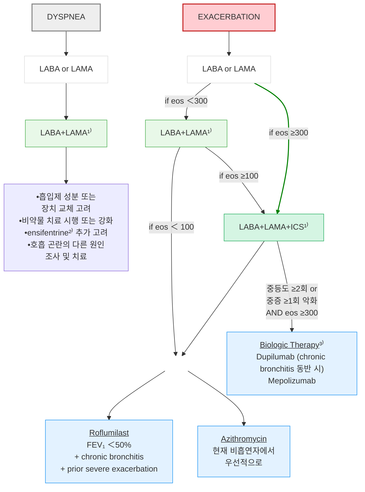
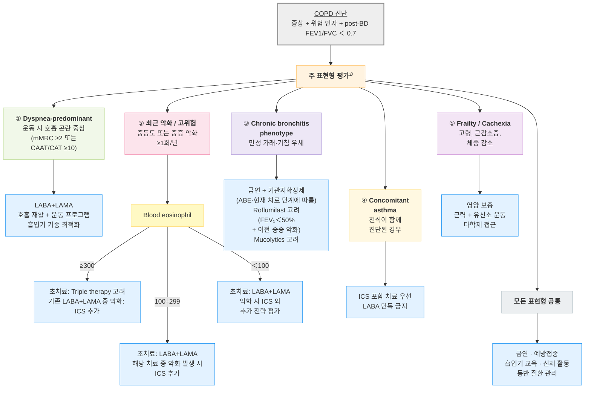
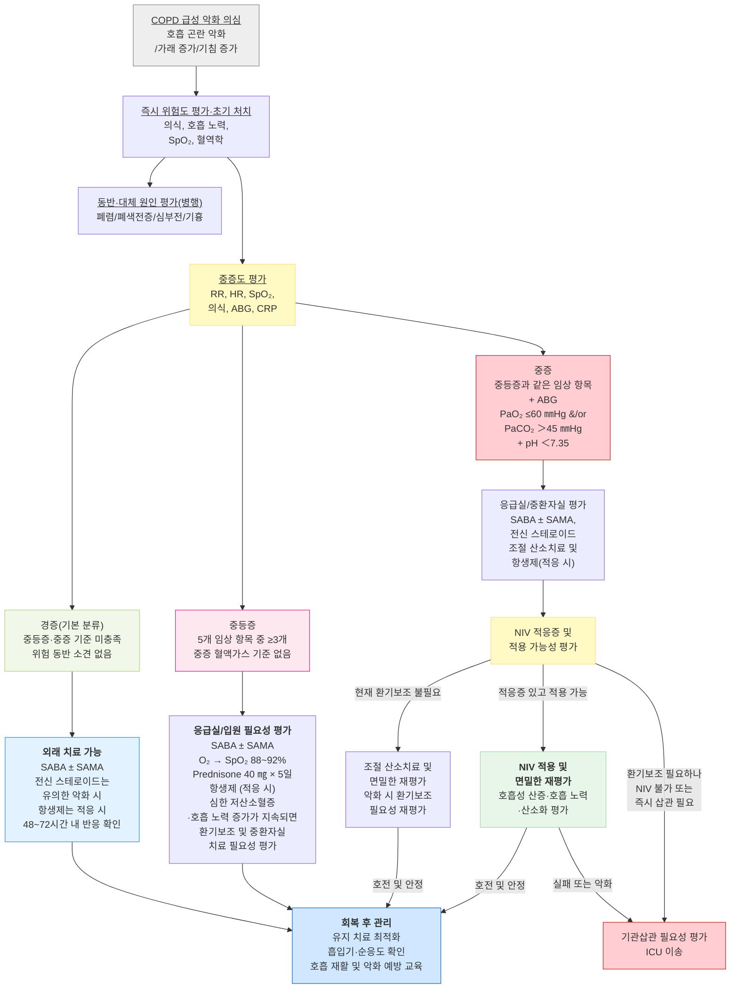

# 만성 폐쇄성 폐질환 COPD

## <mark style="color:green;">일반 사항</mark>

* 지속적이며 자주 진행성 경과를 보이는 기류 장애를 일으키는 기도의 이&#xC0C1;**\[기관지염, 세기관지염]** &/or 폐포의 이&#xC0C1;**\[폐기종]**&#xC5D0; 기인하는 만성 호흡기 증상(**호흡 곤란, 기침, 가래, 악화**)을 특징으로 하는 이질적인(heterogeneous) 폐질환
* 기전&#x20;
  * \[원인] smoking/pollutant, host factor&#x20;
  * → \[Pathobiology] impaired lung growth, accelerated decline, lung injury, lung & systemic inflammation&#x20;
  * → \[병리] small airway disorder or abnormality, emphysema, systemic effect&#x20;
  * → \[결과] airway limitation, resp Sx.
* 유병률 : 국민건강영양조사 자료(2017, 기관지확장제 투여 전 고정비 기준)에서 ≥40세 13.7%, ≥65세 남성 46.8%로 보고됨
* 흔히 다른 만성 질환 동반 : 심혈관 질환, 근골격 이상, 대사증후군, 골다공증, 우울, 불안, 폐암
* 흡입 약물은 증상과 악화를 줄이고 일부 고위험군에서 사망 위험 감소 가능성을 보이지만, 기류 폐쇄를 정상화하지는 못함. 금연, 예방접종, 신체 활동 및 호흡 재활을 함께 시행하는 것이 중요

#### <mark style="color:$primary;">Etiotype에 따른 분류</mark>

1. COPD-G (genetically determined) : α-1 antitrypsin deficiency(AATD); 효과가 작은 여러 유전 변이의 복합 작용
2. COPD-D (abnormal lung development) : early life events (조산, 저체중 출산 등)
3. Environmental COPD
   1. COPD-C (cigarette smoking) : 흡연(간접 흡연, 태아 노출 포함), 전자 담배, 대마초
   2. COPD-P (biomass & pollution) : 가정 내 오염, 대기 오염, 산불 연기, 직업적 노출
4. COPD-I (infection) : 소아 감염, 결핵, HIV 감염
5. COPD-A (COPD & asthma) : 특히 소아 천식
6. COPD-U (COPD of unknown cause)

## <mark style="color:green;">원인 및 위험 인자</mark>

* 흡연 (간접 흡연, 전자 담배 포함)
* 실내 공기 오염 : 요리·화학 연료 사용, 환기 부족
* 실외 공기 오염
* 직업적 노출 : 먼지, 화학 물질/증기
* 연령 증가
* 유전 : α-1 antitrypsin 결핍
* 낮은 사회 경제적 상태
* 천식, 기도 과민
* 만성 기관지염
* 소아기의 중증 호흡기 감염, 폐 성장 지연 요인

## <mark style="color:green;">임상 양상</mark>

* 핵심 양상 : 호흡 곤란, 활동 제한 &/or 기침(± 가래); 급성 악화 가능
* 호흡 곤란 : 점차 악화, 활동 시 악화, 지속적; pursed-lip breathing(오므린 입술 호흡), 부호흡근 사용, 호흡음 감소, 쌕쌕거림
* 만성 기침 (초기에는 아침 기상 시 심함) ± 가래
* 과팽창 : 타진 시 폐 울림 증가, 흉부 전후 직경 증가(barrel chest, protruding abdomen), 횡격막 flattening
* 중심부 청색증(빈호흡, 빈맥 동반), 중심 정맥압 상승, 말초 부종 및 우측 심부전
* 곤봉지는 단순 COPD의 전형적 소견이 아니므로 발견 시 폐암, 기관지확장증, 간질성폐질환 등 다른 원인을 조사
* 피로감, 체중 감소, 식욕 부진
* 하기도 감염 반복

### <mark style="color:$danger;">🚩 Red Flags!</mark>

<mark style="color:$danger;">**즉각 조치**</mark>

* SpO₂가 평소보다 현저히 감소하면서 심한 호흡 곤란·호흡 노력 증가, 새로 발생하거나 악화된 중심부 청색증 `급성 호흡부전`
* 의식 혼탁·심한 졸림 또는 혼수 `고탄산혈증` `환기부전`
* 혈역학적 불안정, 쇼크, 지속되는 압박성 흉통 또는 갑작스러운 흉통과 심한 호흡 곤란 `패혈증` `급성 관상동맥증후군` `폐색전증` `기흉`
* 다량 객혈 또는 객혈과 저산소증·혈역학적 이상 동반 `대량 객혈`
* 급성 호흡성 산증 또는 중증 저산소혈증을 동반한 악화 `중증 ECOPD`

<mark style="color:$warning;">**당일\~수일 내 평가**</mark>

* 휴식 시 호흡 곤란의 뚜렷한 악화, 평소보다 새로 감소한 산소포화도 `ECOPD` `폐렴`
* 새로 발생한 말초 부종, 심부전·부정맥 의심 소견 `우심부전` `심부전` `부정맥`
* 초기 SABA/SAMA 치료에 반응하지 않거나 빠르게 다시 악화 `치료 실패` `폐렴` `다른 심폐질환`
* 새로 발생한 소량 객혈 `폐암` `폐결핵` `기관지확장증`

<mark style="color:$info;">**조기 평가 및 추적**</mark>

* 폐기능 검사상 GOLD 3–4 또는 급격한 FEV₁ 감소 `중증 기류 폐쇄`
* 최근 1년 중등도 또는 중증 악화 ≥1회, 특히 반복 악화 `악화 재발 위험`
* 원인이 설명되지 않는 체중 감소 또는 야간 발한 `폐암` `폐결핵`
* 체중 감소·삶의 질 저하가 지속되거나 가정 내 지원이 불충분 `쇠약` `영양불량` `자가 관리 곤란`


## <mark style="color:green;">진단</mark>

* 특징적 증상 및 반복되는 하기도 감염 병력 &/or 위험 인자 노출 경력 시 의심
* 적절한 증상 또는 위험 인자 노출의 임상 맥락에서 기관지확장제 투여 후 spirometry FEV1/FVC ＜0.7이면 COPD 진단. 기관지확장제 투여 전 ＜0.7이나 투여 후 ≥0.7이면 향후 COPD 발생 위험이 증가하므로 추적 관찰
  * 고정비 ＜0.7은 고령자에서 과진단, 젊은 성인에서 과소진단할 수 있음. 검사 품질·증상·노출력을 확인하고 LLN/z-score를 함께 고려함
  * 기관지확장제 투여 후 FEV₁/FVC가 0.60\~0.80이면 다른 날 재검하여 기류 폐쇄의 지속 여부를 확인함 <mark style="color:$info;">\[GOLD 2026]</mark>
  * 기관지확장제 반응성의 크기는 시간에 따라 변하며 천식과 COPD를 확실히 구분하거나 장기 치료 반응을 예측하지 못함
* 초기 평가 항목 : 기류 폐쇄 정도, 증상 양상/불편 정도, 악화 병력, 혈중 호산구 수, 동반 질환
* 초치료 후 증상이 지속되면 폐 용적, 확산능, 운동 검사, 폐 영상 검사 등 추가 고려


**COPD 선별 검사** : COPD 고위험군(α-1-antitrypsin 결핍, 직업적 toxin 노출 등)을 제외한 무증상 성인에 대한 COPD 선별 검사는 시행하지 않을 것을 권고 <mark style="color:$info;">\[USPSTF 2022]</mark>



**PRISm (Preserved Ratio Impaired Spirometry)** : 기관지확장제 투여 후 FEV₁/FVC ≥0.70이면서 FEV₁ ＜80% 예측치인 상태. 정상 폐활량검사와 구분하며, 원인 평가와 필요시 폐용적 검사 등을 고려함. 향후 기류 폐쇄·심혈관질환·사망 위험 증가와 관련되지만 모두 COPD로 진행하는 것은 아니므로 경과와 폐기능을 추적함 <mark style="color:$info;">\[GOLD 2026]</mark>


### <mark style="color:orange;">검사</mark>

* spirometry (FEV1, FVC) : 가장 유용한 진단 도구
* 최대 호기 유속 : 민감도는 높으나 특이도가 낮아 단독으로는 진단에 적용할 수 없음
* 혈중 호산구 : ICS 사용 시 향후 악화 예방 효과의 가능성을 예측하는 biomarker (단순 증상 개선보다는 악화 빈도 감소에 초점)
  * 단독으로 ICS 사용 여부를 결정하지 않으며, 악화 병력과 함께 해석해야 함

<table><thead><tr><th width="176.4705810546875">혈중 호산구 (cells/μL)</th><th width="194.11767578125">ICS 악화 예방 효과 가능성</th><th>임상적 의미</th></tr></thead><tbody><tr><td><strong>＜100</strong></td><td>낮음</td><td>ICS 추가 효과가 거의 없을 가능성; 세균 감염·폐렴 위험 인자도 함께 평가</td></tr><tr><td><strong>100~299</strong></td><td>연속적으로 증가</td><td>LABA+LAMA 치료 중 악화가 발생하면 ICS 추가 고려</td></tr><tr><td><strong>≥300</strong></td><td>가장 높음</td><td>Group E 초치료로 triple therapy 고려; ICS 중단 시 악화 위험 증가</td></tr></tbody></table>

* 산소화 및 환기 : pulse oximetry(SpO2); SpO2 ≤92%이거나 호흡 부전·우심부전이 의심되면 ABG(PaO2, PaCO2, pH) 고려
  * 야간 저산소증이 의심되는 경우 수면 중 평가
* 흉부 X선 : hyperinflation, vascular marking 감소/bullae (emphysema), thickened bronchial marking (chronic bronchitis)
  * 특이적이지 않음, 다른 질환 감별에 이용
* chest CT : 빈번한 악화 또는 폐기능 검사 중증도와 불일치하는 증상의 원인 감별, 폐 용적 감소술 대상 평가
* 저선량 흉부 CT (LDCT, 폐암 선별) : 국가폐암검진은 해당 연도 기준을 확인(일반적으로 만 54\~74세, 30갑년 이상 고위험군, 2년 주기). 미국 USPSTF는 50\~80세, ≥20갑년이면서 현재 흡연 또는 금연 후 15년 이내인 사람에게 매년 권고 <mark style="color:$info;">\[USPSTF 2021]</mark>
  * COPD 자체만으로 선별검사 대상이 되는 것은 아님

<table><thead><tr><th width="210">CT phenotype</th><th width="230">주요 특징</th><th>임상적 시사점</th></tr></thead><tbody><tr><td><strong>Emphysema-predominant</strong></td><td>저밀도 영역 증가, 혈관 감소</td><td>저체중, DLCO 감소; 적합한 선택 환자에서 LVRS/BLVR 평가</td></tr><tr><td><strong>Airway-predominant</strong></td><td>기관지벽 비후, 점액 저류</td><td>임상적 만성 기관지염 및 악화 병력 평가; CT 소견만으로 roflumilast 적응이 되지는 않음</td></tr><tr><td><strong>Mixed / normal CT</strong></td><td>두 유형 혼재 또는 경미한 변화</td><td>spirometry 중증도와 증상 불일치 시 다른 원인도 평가</td></tr></tbody></table>

* DLCO (폐확산능) : 증상과 spirometry 중증도가 불일치할 때 폐기종 및 가스교환 장애 평가에 도움(DLCO 감소는 폐기종에 특이적이지 않음)
  * 폐 용적 감소술 적응 평가에 참고
* α-1 antitrypsin 결핍 선별 검사 : 모든 COPD 환자에게 일생에 최소 1회 시행 권고 <mark style="color:$info;">\[GOLD 2026]</mark>
  * 특히 젊은 나이 발병, 비흡연자, 하부 폐 우세형 폐기종인 경우 중요
* 6분 보행 검사 (6MWT) : 기능 장애·예후 평가와 호흡 재활 반응 추적에 활용
  * 연령·성별·신장·검사 코스·산소 사용의 영향을 받으므로 단일 절대 절단값보다 기준 예측치와 환자 내 변화를 함께 해석
* CBC : 악화 시 WBC↑(neutrophilia), 만성 저산소증 시 RBC↑
* 가래 염색/배양 검사 : 세균 감염 감별 및 항생제 반응 불량 시 대비하여 고려

### <mark style="color:orange;">환자 평가</mark>

#### <mark style="color:$primary;">ABE Assessment Tool</mark>

* COPD 진단 후 환자 증상(mMRC ≥2 또는 CAAT/CAT ≥10)과 지난 1년의 중등도·중증 악화 병력으로 분류하여 초기 약물 치료를 결정
* FEV1에 따른 GOLD grade는 별도로 평가하며 ABE 분류에 포함하지 않음


GOLD 2023부터 Group C와 D가 통합되어 **Group E**(Exacerbation risk)로 개편됨. 악화 위험이 높은 군에서는 증상 수준에 관계없이 적극적 치료가 권장됨.

* **Group A** : 호흡 곤란 낮음(mMRC 0–1, CAAT/CAT ＜10) + 악화 없음(0회/년) → 기관지 확장제(단·장시간 무관; 이용 가능하고 부담 가능하다면 장시간 제제 선호, 매우 간헐적 호흡 곤란은 예외)
* **Group B** : 호흡 곤란 높음(mMRC ≥2 또는 CAAT/CAT ≥10) + 악화 없음(0회/년) → **LABA+LAMA**로 바로 시작(단일제보다 우수함이 RCT로 확인됨); 병용이 여의치 않으면 LAMA 또는 LABA 단독(계열 간 우열 근거 없음)
* **Group E** : **중등도 또는 중증 악화 1회 이상**/년(입원 여부·증상 정도 무관) → LABA+LAMA; eos ≥300이면 LABA+LAMA+ICS 우선 고려



**GOLD 2026 주요 개정** : Group E 기준이 기존의 "중등도 악화 ≥2회 또는 입원이 필요한 중증 악화 ≥1회"에서 "중등도 또는 중증 악화 ≥1회"로 완화됨. Group B의 LABA+LAMA 초치료 권고는 이전 GOLD부터 유지되는 원칙이며, 모든 환자에게 즉각적 증상 완화를 위한 속효성 기관지확장제를 함께 처방. 다만 중등도 악화 1회군의 향후 악화 위험은 2회 이상군보다 낮으므로, 증상 부담·폐기능·동반 질환과 환자 선호를 함께 고려하여 치료 강화를 개별화함


#### <mark style="color:$primary;">기류 폐쇄 중증도 (GOLD Grade)</mark>

<table><thead><tr><th width="160">GOLD 단계</th><th width="210">중증도</th><th>기관지확장제 투여 후 FEV₁ 기준</th></tr></thead><tbody><tr><td><strong>GOLD 1</strong></td><td>Mild (경증)</td><td>FEV₁ ≥80% 예측치</td></tr><tr><td><strong>GOLD 2</strong></td><td>Moderate (중등도)</td><td>50% ≤ FEV₁ ＜80% 예측치</td></tr><tr><td><strong>GOLD 3</strong></td><td>Severe (중증)</td><td>30% ≤ FEV₁ ＜50% 예측치</td></tr><tr><td><strong>GOLD 4</strong></td><td>Very severe (매우 중증)</td><td>FEV₁ ＜30% 예측치</td></tr></tbody></table>


GOLD grade는 기류 폐쇄 정도와 예후 평가에 사용하며 약물 치료를 직접 결정하지 않음. 약물 치료는 증상, 악화 병력, 혈중 호산구 및 천식 동반 여부에 따라 결정


#### <mark style="color:$primary;">mMRC (modified Medical Research Council) Dyspnea Scale</mark>

* Grade 0 : 힘든 운동을 할 때만 숨참
* Grade 1 : 평지를 빨리 걷거나 약간의 오르막길을 걸을 때 숨참
* Grade 2 : 평지를 걸을 때 숨이 차서 동년배보다 천천히 걷거나, 자기 속도로 걸어도 멈추어 쉬어야 함
* Grade 3 : 평지를 약 100 m 또는 몇 분 걸으면 숨이 차서 멈추어야 함
* Grade 4 : 숨이 너무 차서 집을 나설 수 없거나 옷을 입고 벗을 때도 숨참

#### <mark style="color:$primary;">CAAT/CAT</mark>

* CAT(COPD Assessment Test)은 다른 만성 기도질환에도 적용할 수 있도록 CAAT(Chronic Airways Assessment Test)으로 명칭이 확대됨. 두 도구의 문항·점수는 동일하고 상호 교환 가능
* 환자의 건강 상태 영향을 평가하는 포괄적 도구(8개 항목, 각 0\~5점, 총점 0\~40점)
* 총점 : ≤9점 = 경미한 영향; 10\~20점 = 중간; 21\~30점 = 심함; ≥31점 = 매우 심함

<table data-search="false"><thead><tr><th width="118.82354736328125">항목</th><th width="254.11767578125">0점 상태</th><th width="80">배점</th><th>5점 상태</th></tr></thead><tbody><tr><td><strong>기침</strong></td><td>전혀 기침을 하지 않는다</td><td>0~5</td><td>항상 기침을 한다</td></tr><tr><td><strong>가래</strong></td><td>가슴에 가래가 전혀 없다</td><td>0~5</td><td>가슴에 가래가 가득 차 있다</td></tr><tr><td><strong>가슴 답답함</strong></td><td>가슴 답답함을 전혀 느끼지 않는다</td><td>0~5</td><td>매우 가슴 답답함을 느낀다</td></tr><tr><td><strong>숨참</strong></td><td>언덕이나 계단 1층을 오를 때 전혀 숨이 차지 않는다</td><td>0~5</td><td>언덕이나 계단 1층을 오를 때 매우 숨이 차다</td></tr><tr><td><strong>집안 활동</strong></td><td>집에서 활동하는데 전혀 제약을 받지 않는다</td><td>0~5</td><td>집에서 활동하는데 매우 제약을 받는다</td></tr><tr><td><strong>외출 자신감</strong></td><td>폐 상태에도 불구하고 외출하는데 자신이 있다</td><td>0~5</td><td>폐 문제로 외출하는데 자신이 없다</td></tr><tr><td><strong>수면</strong></td><td>잠을 잘 잔다</td><td>0~5</td><td>폐 문제로 잠을 잘 자지 못한다</td></tr><tr><td><strong>기운</strong></td><td>기운이 왕성하다</td><td>0~5</td><td>기운이 전혀 없다</td></tr></tbody></table>

### <mark style="color:orange;">감별</mark>

<table><thead><tr><th width="139.4117431640625">질환</th><th width="203.529296875">특징적 소견</th><th width="200.588134765625">COPD와의 감별점</th><th>주요 검사</th></tr></thead><tbody><tr><td><strong>COPD</strong></td><td>대개 성인기에 시작, 서서히 진행</td><td>흡연·대기오염·직업 노출 등이 흔하나 비흡연 COPD도 가능</td><td>post-BD FEV1/FVC ＜0.7</td></tr><tr><td><strong>천식</strong></td><td>연령 무관; 야간/새벽 악화와 증상 변동성</td><td>알레르기 병력과 변동성 기류 제한이 흔하나, 기관지확장제 반응성만으로 COPD와 구분할 수 없음</td><td>반복 spirometry/PEF 변동성, 기관지 유발 검사, FeNO 등 임상 맥락에 따라</td></tr><tr><td><strong>울혈성 심부전</strong></td><td>기좌호흡, 발작성 야간 호흡곤란</td><td>부종·울혈 소견; COPD와 동반 가능</td><td>흉부 X선, BNP/NT-proBNP, 심초음파</td></tr><tr><td><strong>기관지확장증</strong></td><td>만성 화농성 가래, 반복 감염</td><td>영상상 기관지 확장/기관지벽 비후</td><td>흉부 고해상 CT</td></tr><tr><td><strong>결핵</strong></td><td>체중 감소, 발열·야간 발한, 노출력</td><td>영상상 침윤·공동 등; 결핵 후 기류 폐쇄도 가능</td><td>AFB 도말/배양·핵산증폭검사, 영상</td></tr><tr><td><strong>폐쇄세기관지염</strong></td><td>비흡연자, RA/이식·독성 노출 병력</td><td>호기 CT상 air trapping</td><td>흡기·호기 고해상 CT</td></tr></tbody></table>

#### <mark style="color:$primary;">COPD vs 천식 vs 심부전 핵심 감별</mark>

| 항목                | COPD                  | 천식                    | 심부전               |
| ----------------- | --------------------- | --------------------- | ----------------- |
| **호흡곤란 양상**       | 대개 활동 시, 지속적·진행성      | 발작적·변동성, 야간/새벽 악화 가능  | 기좌호흡, 발작성 야간 호흡곤란 |
| **흡연·유해 노출력**     | 흔하나 필수는 아님            | 없을 수 있음               | 진단과 직접 관계없음       |
| **알레르기/비염**       | 동반 가능                 | 흔함                    | 감별에 직접적이지 않음      |
| **흉부 X선**         | 과팽창 가능, 정상일 수도 있음     | 대개 정상                 | 심장 비대, 폐울혈·폐부종    |
| **기류 제한**         | post-BD FEV1/FVC ＜0.7 | 변동성 기류 제한; 지속성 폐쇄도 가능 | 대개 폐쇄성 기류 제한 없음   |
| **BNP/NT-proBNP** | 심장질환·우심부전 동반 시 상승 가능  | 대개 정상                 | 상승 가능             |

#### <mark style="color:$primary;">천식 동반 감별</mark> <a href="#asthma-overlap" id="asthma-overlap"></a>


용어 변경(GOLD 2021부터) : "**천식-COPD 중복(Asthma-COPD Overlap)**"이라는 용어를 더 이상 사용하지 않음. 천식과 COPD는 병태생리가 다른 별개의 질환이나(단, 호산구 증가·부분적 가역성 등 일부 treatable trait를 공유할 수 있음), 한 환자에서 두 질환이 공존할 수 있다는 개념으로 재정의됨


* 다음 소견이 있으면 천식 동반 가능성을 고려
  * 어린 시절 천식 또는 알레르기 병력
  * 증상의 현저한 변동성 (특히 야간·새벽 악화)
  * 기관지확장제 투여 후 FEV1의 현저한 증가(예: ≥400 ㎖)
  * 혈중 또는 객담 내 호산구 증가, 혈청 IgE 상승
* 위 소견은 어느 하나만으로 천식 동반을 확진하지 않으며, 병력과 반복 검사를 종합하여 판단함


천식 동반이 의심되면 약물 치료는 우선적으로 **천식 진료 지침을 따름**; 이 경우 ICS 병용은 필수이며 LABA 단독 치료는 피함 <mark style="color:$info;">\[GOLD 2026]</mark>


***

## <mark style="background-color:$warning;">Management</mark>


* 동반 질환 관리
* 비-약물 치료 : 금연, 적절한 영양 및 수분 공급, 활동적 생활 및 운동, 적정 체중 유지, 백신 접종 (인플루엔자, 폐렴구균, Tdap, 대상포진, COVID-19), 호흡 재활 치료 (Group B, E)
* 약물 치료 : 기본 치료제 - 흡입 기관지 확장제
* 저산소혈증 시 산소치료 적응증 평가. 급성 악화에서는 고탄산혈증 위험을 고려하여 일반적으로 목표 SpO₂ 88\~92%로 조절하고, 안정기 장기 산소 치료는 별도 기준에 따라 처방
* 폐쇄수면무호흡 동반 시 지속양압(CPAP) 치료
* 자가 관리 교육 : 위험 인자 관리, 흡입제 사용 교육, 급성 악화 시 대응 요령

#### <mark style="color:$primary;">약물 치료 단계적 접근 (Escalation Ladder)</mark>

<mark style="color:cyan;">**초치료 (Initial)**</mark>&#x20;

* Group A - 기관지 확장제(단·장시간; 장시간 선호) / Group B - LABA+LAMA 병용 시작(병용 곤란 시 LAMA 또는 LABA 단독) / Group E - LABA+LAMA(eos ≥300이면 LABA+LAMA+ICS 우선 고려) → 모든 군에 rescue SABA 병용 처방

<mark style="color:cyan;">**추적(Follow-up)**</mark>&#x20;

* 지속되는 문제(호흡 곤란 or 악화)에 따라 경로 분리
* 호흡 곤란 지속 : LABA 또는 LAMA(단독 사용 중이었다면) → LABA+LAMA → 흡입기 성분/기종 교체, 비약물 치료 강화, ensifentrine 추가 고려(국내 미도입), 호흡 곤란의 다른 원인 조사
* 악화 발생 : LABA 또는 LAMA 단독 중이면 (eos ＜300) LABA+LAMA 또는 (eos ≥300) LABA+LAMA+ICS로 증량. LABA+LAMA 중 악화가 발생하면 eos ≥100에서 LABA+LAMA+ICS로 증량. eos ＜100이거나 triple therapy에도 악화가 지속되면 Roflumilast(FEV1＜50%+만성 기관지염+이전 중증 악화/입원력) / Azithromycin(비흡연자 우선) / 생물학적제제(중등도 ≥2회 또는 중증 ≥1회 악화 + eos ≥300 시 Dupilumab\[만성 기관지염 동반] 또는 Mepolizumab)\
  → NIV, 장기 O2, LVRS/BLVR, 폐 이식 (말기)

#### <mark style="color:$primary;">COPD Management Cycle</mark>

1. Diagnosis : 증상, 위험 인자, spirometry (경계치 시 재검)
2. Initial Assessment : ABE 평가(증상, 지난 1년 악화 병력), 별도의 GOLD spirometry grade, 혈중 호산구 수치, α1-antitrypsin, 동반 질환
3. Initial Management : 금연, 예방접종, 활동적 생활 습관 및 운동, 초기 약물 치료, 자가 관리 교육, 동반 질환 관리
4. Review : 증상(CAT or mMRC), 악화, 흡연 상태, 다른 위험 인자 노출, 흡입제 사용법 및 순응도, 육체적 활동 및 운동, 폐 재활 치료 필요성, 자가 관리 기술, 산소, NIV, 폐용적 감소 등, 예방접종, 동반 질환 관리, Spirometry (최소 매년)
5. Adjust : 약물 치료, 비-약물 치료

## <mark style="color:green;">비-약물 치료 및 예방</mark>

#### <mark style="color:$primary;">금연</mark>

* COPD 진행을 늦추는 가장 효과적인 단일 중재; 모든 단계에서 적극 권고 (☞ [금연](../230_/190_-smoking.md))
* 약물 보조 : varenicline, bupropion, nicotine replacement therapy (NRT)

#### <mark style="color:$primary;">예방접종</mark>

* 인플루엔자 : 매년 접종. 고령자에서는 접종 지침과 가용성에 따라 고용량 또는 면역증강 불활화 백신을 고려
* 폐렴구균 : 연령과 과거 접종력에 따라 예방접종 지침을 적용
* RSV : GOLD 2026이 참조하는 기준에서는 75세 이상 성인과, COPD 등 중증 RSV 위험 인자가 있는 50\~74세 성인에게 1회 접종 권고
* COVID-19, Tdap, 대상포진 : 표준 일정에 따라 적용

#### <mark style="color:$primary;">호흡 재활 치료</mark>

* 대상 : 주로 Group B, E; 중등도\~중증 COPD에서 호흡 곤란, 운동 능력, 삶의 질 유의하게 개선
* 구성 : 운동 훈련, 호흡 근육 훈련, 교육, 영양 상담
* 입원 악화 후 4주 이내 조기 시작하면 삶의 질과 운동 능력을 개선하며 재입원 및 사망을 줄일 가능성이 있으나, 후자의 근거는 연구 간 이질성이 있음

#### <mark style="color:$primary;">장기 산소 치료</mark>

* 적응증 : 안정 상태에서 PaO₂ ≤55 ㎜Hg 또는 SaO₂ ≤88%(3주에 걸쳐 2회 확인); 또는 PaO₂ 55\~60 ㎜Hg 또는 SaO₂ 88%이면서 폐고혈압, 말초 부종을 동반한 우심부전, 또는 적혈구증가증(Hct ＞55%)이 있는 경우
* 하루 ≥15시간 사용 시 생존율 향상
* 산소 유량은 휴식·수면·활동 시 필요량에 맞춰 개별 처방하고, 안정기에 시작한 경우 60\~90일에 실내공기 및 처방 산소 유량에서 ABG 또는 산소포화도로 적응증과 처방 유량을 재평가
* 악화 후 가정 산소 치료를 새로 시작한 경우에는 1\~4주 및 12\~16주에 산소 필요성과 처방을 재평가함 <mark style="color:$info;">\[ATS 2020]</mark>
* 중등도 휴식 저산소혈증이나 운동 시 중등도 탈포화만 있는 경우 장기 산소치료가 생존·입원을 개선하지 못하므로 일률적으로 처방하지 않음. 운동 시 중증 저산소혈증의 이동용 산소는 별도로 평가함 <mark style="color:$info;">\[N Engl J Med 2016; ATS 2020]</mark>
* 비-침습 양압 환기(NIV) : 최근 입원 후에도 현저한 주간 고탄산혈증이 지속되는 등 선택된 중증 COPD 환자에서 전문의 평가 후 고려. 환자 선정과 적절한 환기압 설정이 중요
  * 입원 악화 중의 고탄산혈증은 회복기에 호전될 수 있으므로 급성기 해소 후 2\~4주에 PaCO₂를 재평가하고, 장기 NIV 시작 전 폐쇄수면무호흡을 평가함. 단, 입원 중 NIV를 이탈하지 못하는 환자는 장기 NIV 전환을 별도로 판단함 <mark style="color:$info;">\[ATS 2020]</mark>

#### <mark style="color:$primary;">Frailty 및 Sarcopenia 관리</mark>

* 고령 COPD 환자에서 frailty와 sarcopenia는 재입원율, 사망률, 운동 불내성과 강하게 연관됨
* 평가 : 악력 측정, 보행 속도, SARC-F 설문 등으로 근감소증 선별
* 중재 : 영양 보충(단백질 충분 섭취), 저항 운동 + 유산소 운동 병행, 호흡 재활과 통합

#### <mark style="color:$primary;">기타 비-약물 치료</mark>

* 영양 : 충분한 단백질 섭취와 근감소증 예방이 최우선; 저체중 환자에서 전반적 영양 보충 권고. 고지방/저탄수화물 식이는 CO₂ 생성 감소 이론적 근거가 있으나 임상 실용성은 제한적임
* 수면 : 충분한 수면, 폐쇄수면무호흡 동반 시 CPAP

### <mark style="color:orange;">비-약물 치료 Follow-up</mark>

1. 초치료에 적절히 반응한다면, 그 치료를 유지
   * 매년 독감 백신 접종 등 권고 백신 일정 수행, 자가 관리 교육, 금연 등 행동 위험 인자 평가
   * 신체 활동·운동 프로그램 유지, 적당한 수면, 건강한 식사 격려
2. 그렇지 않다면 우선 순위의 치료 가능한 목표를 고려
   * 호흡 곤란 : 일반적 자가 관리 교육, 호흡 재활 프로그램 &/or 유지 운동 프로그램
   * 악화 : 개별화된 자가 관리 교육; 악화 유발 인자 회피, 증상 악화 모니터링·관리 방법, 악화 발생 시 연락처 정보

## <mark style="color:green;">약물 치료</mark>

### <mark style="color:orange;">기관지 확장제</mark>

* 대부분의 COPD 환자에서 1차 선택제
* 흡입 기관지 확장제 : 증상 치료의 중심; 증상 예방 및 완화를 위하여 규칙적으로 투여
* 간헐적 호흡 곤란만 있는 환자를 제외하고는 속효성 제제보다 지속성 제제를 선호
* SABA, SAMA : 규칙적 &/or 필요시 사용; FEV1 및 증상 완화 효과
  * 응급 약제로는 SABA를 선택 (☞ [급여기준](https://www.hira.or.kr/rc/insu/insuadtcrtr/InsuAdtCrtrPopup.do?mtgHmeDd=20220301\&sno=6\&mtgMtrRegSno=0006))
  * SABA & SAMA 병용 시 각각의 단독 사용보다 효과적
  * 급성기 SABA±SAMA와 안정기 장기 병용을 구분함. LAMA 사용 중에는 SAMA를 지속적으로 병용하지 않고 입마름·배뇨장애 등 항콜린 부작용을 평가함
* LABA, LAMA : 폐 기능, 호흡 곤란, 건강 상태 개선 및 악화 빈도 감소에 유효
  * 단일제 간 비교에서는 LAMA가 LABA보다 악화 감소에 유리한 근거가 있으나, Group B와 E의 권고 초치료는 LABA+LAMA 병용
  * LABA & LAMA 각각의 단독 사용보다 병용 시 효과적
* tiotropium : 운동 기능 향상에 유효
* theophylline : routine use는 권고되지 않음 (아래 Methylxanthine 항목 참고)

#### <mark style="color:$primary;">흡입기 기종별 선택 원칙</mark>

<table><thead><tr><th width="110">기종</th><th width="200">특징</th><th width="180">적합 대상</th><th>주의사항</th></tr></thead><tbody><tr><td><strong>DPI</strong></td><td>흡입으로 약물이 방출되어 분무-흡입 동조 불필요</td><td>충분히 빠르고 강하게 흡입 가능한 환자</td><td>중증 악화 중이거나 흡입 유속이 낮은 쇠약 고령자에서 불리</td></tr><tr><td><strong>pMDI</strong></td><td>가압 용기; 분무-흡입 동조 필요</td><td>동조 가능한 환자</td><td>동조가 어려우면 spacer 병용; 흔들기 여부는 제품별 사용법 확인</td></tr><tr><td><strong>SMI</strong></td><td>낮은 속도로 비교적 오래 분무</td><td>흡입 유속이 낮거나 pMDI 동조가 어려운 환자</td><td>제품별 초기 장전·카트리지 교체·세척법 교육</td></tr><tr><td><strong>네뷸라이저</strong></td><td>분무-흡입 동조 불필요</td><td>중증 악화 또는 휴대 흡입기 사용이 어려운 환자</td><td>기기 세척·오염 방지; 유지치료 시 편의성·비용 고려</td></tr></tbody></table>


흡입기 기종 변경 시에는 반드시 새 기종의 사용법을 재교육하고, 다음 방문에서 사용 상태를 확인. 잘못된 흡입 기술은 치료 실패의 가장 흔한 원인임


#### <mark style="color:$primary;">β2-작용제</mark>

* 임상 증상은 호전시키지만 폐 기능 악화 지연 또는 사망률 감소 효과는 입증 안 됨
* 부작용 : 빈맥, 떨림, 저칼륨혈증
* salbutamol의 허가상 외래 자가 사용은 24시간 최대 8회 분무임
  * 의료진 감시하 급성 악화의 반복 투여는 별도 프로토콜로 구분함
  * 주요 금기 : 성분·교감신경흥분성 아민류 과민증, 비후성 심근병증
* 흡입 SABA : salbutamol
* 흡입 LABA : 1일 2회 - formoterol, salmeterol; 1일 1회 - indacaterol, olodaterol, vilanterol

<table><thead><tr><th width="74">분류</th><th width="263">성분명 [상품명]</th><th width="294">흡입제 용량</th><th width="101">작용 시간(hr)</th></tr></thead><tbody><tr><td>SABA</td><td>salbutamol <mark style="color:blue;">[벤토린 에보할러]</mark></td><td>100 μg/puff 1~2 puffs prn<br>외래 자가 사용: 24시간 최대 8회 분무</td><td>4–6</td></tr><tr><td>LABA</td><td>indacaterol <mark style="color:blue;">[온브리즈 흡입용캡슐]</mark></td><td>150 or 300 μg/C qd</td><td>24</td></tr></tbody></table>

#### <mark style="color:$primary;">항콜린제(Antimuscarinics)</mark>

* 호흡기 평활근의 M3 muscarine 수용체에서 acetylcholine의 기관지 수축 작용 차단
* 악화 감소에 있어 LAMA가 LABA보다 유효
* 부작용 : 입마름
* SAMA : ipratropium, oxitropium
  * 주요 금기 : 폐쇄각 녹내장, 전립선비대증, 아트로핀 계열 약물 과민증. 약물이 눈에 들어가지 않도록 마우스피스 사용을 우선 고려하고, LAMA 병용 중에는 항콜린 효과 중복을 평가함
* LAMA : aclidinium, glycopyrronium, tiotropium, umeclidinium

<table><thead><tr><th width="81">분류</th><th width="202">성분명 [상품명]</th><th width="168">흡입제 용량</th><th width="207">네뷸라이저 용액</th><th width="102">작용 시간(hr)</th></tr></thead><tbody><tr><td>SAMA</td><td>ipratropium <br><mark style="color:blue;">[아트로벤트흡입액유디비]</mark></td><td>-</td><td>500 μg/2 ㎖/일회용 용기<br>1회 100~500 μg, 1일 4회</td><td>6–8</td></tr><tr><td rowspan="4">LAMA</td><td>aclidinium <br><mark style="color:blue;">[에클리라 제뉴에어]</mark></td><td>400 μg bid</td><td>-</td><td>12</td></tr><tr><td>tiotropium <br><mark style="color:blue;">[스피리바 흡입용캡슐]</mark></td><td>18 μg 1C qd</td><td>-</td><td>24</td></tr><tr><td>tiotropium <br><mark style="color:blue;">[스피리바 레스피맷]</mark></td><td>2.5 μg/puff 2 puffs qd(총 5 μg)</td><td>-</td><td>24</td></tr><tr><td>umeclidinium <br><mark style="color:blue;">[인크루즈 엘립타]</mark></td><td>62.5 μg qd</td><td>-</td><td>24</td></tr></tbody></table>

#### <mark style="color:$primary;">LAMA+LABA 흡입 복합제</mark>

* COPD 단독 환자의 일반적인 초치료에서는 LAMA+LABA가 ICS+LABA보다 선호되며 폐렴 위험도 낮음. 단, ICS의 악화 예방 효과는 악화 병력과 혈중 호산구 수에 따라 달라짐

<table><thead><tr><th width="396">성분명 [상품명]</th><th>흡입제 용량</th><th>작용 시간(hr)</th></tr></thead><tbody><tr><td>formoterol / aclidinium <mark style="color:blue;">[듀어클리어 제뉴에어]</mark></td><td>12/400 μg 1 puff bid</td><td>12</td></tr><tr><td>indacaterol / glycopyrronium <mark style="color:blue;">[조터나 흡입용캡슐]</mark></td><td>110/50 μg 1C qd</td><td>24</td></tr><tr><td>olodaterol / tiotropium <mark style="color:blue;">[바헬바 레스피맷]</mark></td><td>2.5/2.5 μg/puff, 2 puffs qd(총 5/5 μg)</td><td>24</td></tr><tr><td>vilanterol / umeclidinium <mark style="color:blue;">[아노로 엘립타]</mark></td><td>25/62.5 μg 1 puff qd</td><td>24</td></tr></tbody></table>

#### <mark style="color:$primary;">Methylxanthine</mark>

* stable COPD에서 기관지 확장 효과는 제한적이며 독성 위험 때문에 routine use는 권고되지 않음
* 부작용 : 용량에 따른 독성(유효 농도와 독성 농도의 차이가 적음); 구역, 구토, 설사, 불면, 흥분, 떨림, 두통, 부정맥, 발작
* 적용 : 다른 모든 제제를 사용하기 어렵거나 효과가 없는 경우에 한하여 마지막 수단으로 선택
* theophylline은 다른 흡입치료를 사용할 수 없는 예외적 상황에서만 고려하며 저용량으로 시작 <mark style="color:blue;">\[테올란비]</mark>
  * 고령, 간기능 저하, 심부전, 발열성 질환 및 약물 상호작용 시 청소율 감소에 주의. 성인 신기능 저하만으로 일률적인 감량이 필요한 것은 아님
  * 혈중 농도는 기관·검사실 기준과 임상상을 함께 해석하며, 시작·용량 변경·독성 의심·흡연 상태 또는 상호작용 약물 변화 시 측정

### <mark style="color:orange;">스테로이드</mark>

#### <mark style="color:$primary;">흡입 스테로이드 (ICS)</mark>


**COPD에서 ICS의 위상** : ICS+LABA 단독 조합은 COPD 단독 환자에서 LABA+LAMA에 비해 우선 권고되지 않음. ICS는 적응증이 있는 환자에서 Triple therapy(LABA+LAMA+ICS) 형태로 사용하는 것이 원칙이며, ICS+LABA 조합은 천식 동반 환자 또는 기존 ICS+LABA로 안정 유지 중인 환자에서만 지속 가능


* Group E 초치료 : blood eosinophil ≥300 cells/μL이면 LABA+LAMA+ICS를 고려(직접적인 초치료 RCT 근거보다는 기존 치료 환자 자료에 근거한 실용적 권고)
* LABA+LAMA 치료 중 중등도 또는 중증 악화 발생 : eosinophil ≥100 cells/μL이면 LABA+LAMA+ICS로 escalation 권고. 효과는 연속적으로 증가하며 ≥300에서 가장 클 가능성
* ICS 사용에 불리한 요인 : 반복 또는 중증 폐렴, eosinophil ＜100 cells/μL, 이전 mycobacterial 감염 등
  * 절대 금기라기보다 기대 이득과 위험을 비교하되, 천식 동반 시 ICS 포함 치료가 필수
* ICS는 COPD에서 단독 유지치료로 사용하지 않으며, 규칙적 사용 시 폐렴 위험이 증가할 수 있음
* ICS 중단(Withdrawal) 기준 : 다음에 해당하는 경우 ICS 중단을 고려할 수 있음
  * ICS가 부적절하게 시작되었거나 임상 반응이 없었던 경우
  * 유의한 부작용 또는 중증·반복 폐렴이 발생한 경우
  * 단, eos ≥300인 환자에서 ICS를 중단하면 악화 위험이 증가할 수 있으므로 신중히 결정

#### <mark style="color:$primary;">ICS+LABA 흡입 복합제</mark>

* 천식 동반 환자 또는 기존 ICS+LABA로 안정 유지 중인 환자에서 지속 가능; 신규 COPD 단독 환자에서는 LABA+LAMA를 우선 고려
* COPD 허가 함량과 천식 허가 함량이 다를 수 있으므로 제품별 국내 허가사항을 확인하고 임의로 흡입 횟수를 조절하지 않음

| 성분명                         | 국내 제품 및 COPD 허가 함량 예                                     | 용법          |
| --------------------------- | -------------------------------------------------------- | ----------- |
| fluticasone / vilanterol    | <mark style="color:blue;">\[렐바 엘립타]</mark> 100/25 μg     | 1 puff qd   |
| budesonide / formoterol     | <mark style="color:blue;">\[심비코트 터부헬러]</mark> 160/4.5 μg | 2 puffs bid |
| beclomethasone / formoterol | <mark style="color:blue;">\[포스터]</mark> 100/6 μg (HFA)   | 2 puffs bid |


위 표는 대표 예시이며 동일 성분이라도 제형·함량별 COPD 허가 여부가 다를 수 있음. 국내 COPD 허가 조건도 제품마다 다름(렐바: 정기적 기관지확장제 치료에도 악화 이력이 있고 FEV₁ ＜70% 예측치, 심비코트: 중증 COPD, 포스터: 반복 악화 이력이 있는 중증 COPD). fluticasone propionate/salmeterol 제네릭(콤포나·플루테롤)은 현재 천식만 허가되어 있음


#### <mark style="color:$primary;">LABA+LAMA+ICS (Triple Therapy)</mark>

* ICS 적응증이 있는 환자에서 현재 COPD 약물 치료의 최적 병용 요법 (보험주의)
* ETHOS, IMPACT 연구에서 악화 고위험 환자의 LAMA+LABA 대비 triple therapy가 사망 위험 감소 가능성을 시사했으나, 환자 선택과 ICS 관련 폐렴 위험을 함께 고려

<table><thead><tr><th width="456">성분명 [상품명]</th><th>용법</th></tr></thead><tbody><tr><td>fluticasone / umeclidinium / vilanterol <mark style="color:blue;">[트렐리지 엘립타]</mark> ¹⁾</td><td>100/62.5/25 μg 1 puff qd</td></tr><tr><td>budesonide / glycopyrronium / formoterol <mark style="color:blue;">[브레즈트리 에어로스피어]</mark> ²⁾</td><td>160/7.2/5.0 μg/puff, 2 puffs bid</td></tr><tr><td>beclomethasone / formoterol / glycopyrronium <mark style="color:blue;">[트림보우]</mark></td><td>100/6/12.5 μg/puff, 2 puffs bid<br>(전달용량 약 87/5/9 μg)</td></tr><tr><td>beclomethasone / formoterol / glycopyrronium <mark style="color:blue;">[트림보우넥스트할러]</mark> (DPI) ³⁾</td><td>100/6/12.5 μg, 2 puffs bid</td></tr></tbody></table>

> _¹⁾트렐리지 엘립타 : 100/62.5/25 μg이 COPD 적응 용량; 200/62.5/25 μg은 천식 용량_\
> _²⁾표기 함량은 1 puff 기준. 브레즈트리는 글리코피로늄 14.4 μg 함량의 천식 허가 제품이 별도로 있으므로 COPD 처방 시 7.2 μg 함량 확인. 표는 대표 예시이며 동일 성분이라도 함량·적응증이 제품별로 다를 수 있어 처방 전 최신 국내 허가사항과 급여기준 확인. 에너제어 흡입용캡슐은 천식 허가 제품이므로 COPD 허가 triple therapy 표에서 제외_\
> _³⁾트림보우넥스트할러는 2026-06 허가된 DPI 제형으로 중증 COPD에만 허가됨(pMDI인 트림보우는 천식·COPD 모두 허가)_

#### <mark style="color:$primary;">전신 스테로이드</mark>

* 안정기 COPD에서 전신 스테로이드의 장기 유지치료는 권고하지 않음(근병증, 골다공증, 당뇨, 감염 등 위해)
* 임상적으로 유의한 급성 악화에서만 단기간 사용: prednisone-equivalent 40 ㎎/d ×5일 <mark style="color:$info;">\[GOLD 2026]</mark>
  * 국내에서 흔히 사용하는 prednisolone 30 ㎎/d ×5일은 NICE 기준에 부합하며 5일 요법은 일반적으로 감량 없이 중단 가능

### <mark style="color:orange;">Phosphodiesterase-4 억제제 (PDE4i)</mark>

* cAMP의 대사 억제 → 세포 내 cAMP 농도↑ → 항염증 효과, eosinophil 이동 및 화학 주성 억제 → FEV1 개선, 악화 감소
* 적용 : 최적 흡입치료에도 악화가 지속되며 FEV1 ＜50%, 임상적 만성 기관지염 및 이전 중증 악화/입원력이 있는 환자에서 추가 고려
* 부작용 : 설사, 구역, 복통, 식욕 감퇴, 두통, 체중 감소; 불면·불안·우울 및 자살 관련 이상반응 가능
* 투여 전 체중과 정신건강 병력을 평가하고 치료 중 추적. 저체중 환자는 특히 신중히 판단하며, 설명되지 않는 유의한 체중 감소 또는 새로운 정신과적 증상이 발생하면 중단 필요성을 포함하여 즉시 재평가
* roflumilast : 500 ㎍(0.5 ㎎) qd <mark style="color:blue;">\[닥사스]</mark>
  * 국내 허가 : 증상 악화 병력이 있고 만성 기관지염을 수반한 중증 COPD에서 기관지확장제의 부가 유지요법
  * 국내 급여 : 위 허가 범위에서 ① FEV₁ ＜50% 예측치 또는 ② β₂ 작용제·항콜린제 등의 지속 투여에도 연 ≥2회 악화 시 투여소견서로 인정하며, LABA 또는 LAMA 1종과 병용하는 기준임. GOLD 추적 치료의 선택 기준과 급여 조건을 구분함 <mark style="color:$info;">\[심평원 고시 제2021-270호]</mark>
  * 국내 주요 금기 : Child-Pugh B·C, 자살 관념·행동 관련 우울증 병력, 중증 면역학적 질환·급성 감염, 암(기저세포암종 제외), 면역억제제 투여(단기 전신 스테로이드 제외), 잠복 감염, NYHA III·IV 심부전 등

### <mark style="color:orange;">항생제 (장기 예방 목적)</mark>

* 금연·흡입기 교육·적절한 유지 흡입치료에도 악화가 반복되는 COPD에서 호흡기내과와 협의하여 선별적으로 고려함(허가 외 사용). 비폐쇄성 만성 기관지염에는 표준치료로 사용하지 않음
* azithromycin : 250 ㎎ qd 또는 500 ㎎ 주 3회가 최대 1년간 연구되었으며, 1년을 넘는 효과·안전성 근거는 없음
* 현재 흡연자에서는 이득이 작을 수 있으므로 현재 비흡연자에서 우선 고려함
* 시작 전 심전도(QTc), 간기능, 청각 증상·위험, 약물상호작용 및 객담 항산균 검사를 포함한 결핵·NTM 가능성을 평가함. 활동성 NTM 감염에 macrolide 단독 예방요법을 적용하지 않음
* 치료 중 악화 빈도·삶의 질 등 이득, QTc·간기능·청각 이상 및 내성균을 재평가하고, 이득이 없거나 위해가 크면 중단함 <mark style="color:$info;">\[GOLD 2026; BTS 2020]</mark>

### <mark style="color:orange;">생물학적 제제 (Biologic Therapy)</mark> <a href="#biologic-therapy" id="biologic-therapy"></a>


**GOLD 2025\~2026 순차 도입** : LABA+LAMA+ICS(triple therapy)로도 악화가 지속되는 호산구 증가 COPD에서 생물학제제를 추가 고려함. 주요 임상시험은 최적 삼제요법에도 지난 1년 **중등도 악화 ≥2회 또는 중증 악화 ≥1회**, 혈중 호산구 ≥300 cells/μL인 환자를 주로 대상으로 함. 이 조건은 근거가 확보된 시험 대상의 범위이며, 국내 허가 문구나 Group E 분류 기준과 구분함. Dupilumab은 GOLD 2025부터, mepolizumab 추가와 근거를 정리한 Fig 3.11 신설은 GOLD 2026부터 반영됨


* **dupilumab** : IL-4/IL-13 수용체 공통 부위를 차단함
  * &#x20;만성 기관지염 동반 COPD(GOLD 2–3)에서 악화 감소·폐기능·삶의 질 개선(52주)이 확인됨
  * 300 ㎎ 매 2주 피하주사 <mark style="color:blue;">\[듀피젠트]</mark> (☞ [급여기준](https://www.hira.or.kr/rc/insu/insuadtcrtr/InsuAdtCrtrPopup.do?mtgHmeDd=20260801\&sno=1\&mtgMtrRegSno=0005))
* **mepolizumab** : 항 IL-5 단클론항체로 만성 기관지염 동반 여부와 관계없이 COPD(GOLD 2–4)의 악화 감소 근거가 있음
  * 100 ㎎ 매 4주 피하주사 <mark style="color:blue;">\[누칼라오토인젝터주]</mark>  (☞ [급여기준](https://www.hira.or.kr/rc/insu/insuadtcrtr/InsuAdtCrtrPopup.do?mtgHmeDd=20260701\&sno=1\&mtgMtrRegSno=0004))
* 위두 제제는 급성 악화 구제치료나 비폐쇄성 만성 기관지염에 사용하지 않음
* benralizumab(항 IL-5 수용체)은 COPD 악화 감소 효과가 RCT에서 확인되지 않아 권고하지 않음

### <mark style="color:orange;">Mucolytics</mark>

* 일부 COPD 환자에서 악화 감소 가능성이 있으나 효과는 제한적이며, 흡입 유지치료를 대체하지 않음
* NAC·carbocisteine은 주로 ICS를 사용하지 않는 환자에서 근거가 제시됨
  * Erdosteine은 ICS 병용 여부와 관계없이 주로 경증 악화 감소 근거가 있어 같은 제한을 일괄 적용하지 않음 <mark style="color:$info;">\[GOLD 2026]</mark>
* N-acetylcysteine(NAC) : 200 ㎎ bid <mark style="color:blue;">\[뮤테란]</mark>&#x20;
  * COPD 허가 용량은 급성질환의 200 ㎎ tid와 다르며, COPD 악화 예방 연구의 600 ㎎ bid는 위 허가 용량을 초과함
  * 경증\~중등도 COPD 968명의 2024년 무작위시험에서는 2년 투여로 전체 악화율·폐기능의 유의한 개선이 없었으므로 일률적 장기 투여를 권하지 않음 <mark style="color:$info;">\[Nat Commun 2024]</mark>
  * 과민반응·위십이지장궤양·해당 제형의 유당 관련 유전 질환 등 금기와 기관지연축에 유의
  * 아목시실린·독시사이클린 등 경구 항생제와는 허가사항에 따라 ≥2시간 간격을 둠
* carbocisteine : 초기 750 ㎎ tid, 증상 호전 후 375 ㎎ qid <mark style="color:blue;">\[리나치올]</mark>. (500 ㎎ 제형은 500 ㎎ tid 허가)
  * 금기 : 위·십이지장궤양
* erdosteine : COPD 악화 예방 연구 용량 300 ㎎ bid <mark style="color:blue;">\[엘도스]</mark>
  * 중증 신장애(CrCl ＜25 ㎖/min)·중증 간장애·간경변·소화성궤양·시스타티오닌 합성효소 결핍 등 금기. 경증\~중등도 간장애에서는 1일 300 ㎎을 초과하지 않음
  * 급성 호흡기질환의 연속 10일 이상 투여 제한을 만성질환의 일률적 투여 상한으로 해석하지 않음. 만성 치료는 임상적 이득·이상반응을 재평가하여 개별화함
* 객담 배출 능력을 확인하고 진해제를 일률적으로 병용하지 않음. 임상적 이득이 없으면 중단함 (☞ [만성 기관지염](067_-chronic-bronchitis.md))

### <mark style="color:orange;">기타</mark>

* α-1 antitrypsin augmentation : 중증 AATD와 폐기종이 있는 선택 환자에서 전문의가 고려하며 국내 도입·허가·접근성 확인 필요
* 진해제 : 유효성에 대한 증거 없음; 권고 안 함
* 신경근 전기자극(neuromuscular electrical stimulation), 얼굴에 향하는 선풍기 등은 선택 환자의 호흡곤란 완화에 고려
* **저용량 지속형 opioid**: 안정기 COPD의 지속적 호흡곤란에 대한 효과는 일관되지 않으며, 2026년 무작위 교차시험에서도 경구 morphine·경피 fentanyl은 위약 대비 이득을 보이지 않음. 일반적인 증상 치료로 일률적으로 사용하지 않고, 난치성 호흡곤란의 완화의료 상황에서는 전문가가 이득·위해와 환자 목표를 개별 평가 <mark style="color:$info;">\[Eur Respir J 2026]</mark>

### <mark style="color:orange;">초기 약물 치료 (Initial Pharmacological Treatment)</mark>

<table><thead><tr><th width="120">GOLD Group</th><th width="220">기준(치료 나이브 환자)</th><th>초치료</th></tr></thead><tbody><tr><td>Group A</td><td>악화 0회/년 + mMRC 0–1 및 CAAT/CAT ＜10</td><td>기관지확장제(단·장시간 무관, 장시간 선호)</td></tr><tr><td>Group B</td><td>악화 0회/년 + mMRC ≥2 또는 CAAT/CAT ≥10</td><td><strong>LABA+LAMA</strong>(불가 시 LAMA 또는 LABA 단독)</td></tr><tr><td>Group E</td><td>중등도 또는 중증 악화 ≥1회/년</td><td>LABA+LAMA; eos ≥300이면 LABA+LAMA+ICS 우선 고려</td></tr></tbody></table>

<p align="center"><em><mark style="color:$info;">Ref. GOLD 2026, Fig 3.8</mark></em></p>

### <mark style="color:orange;">유지 약물 치료 조정 (Follow-up Pharmacological Treatment)</mark>

1. 초치료에 적절히 반응한다면, 그 치료를 유지
2. 그렇지 않다면
   * 순응도, 흡입기 사용 방법, 영향을 줄 수 있는 동반 질환 등 확인
   * 표적이 되는 주된 치료 특성을 고려 (dyspnea or exacerbations)\
     두 가지 모두 표적이 된다면 exacerbation pathway를 선택
   * 현재의 치료와 향후 적응증에 맞춰 치료를 조정
   * 반응 평가, 조정 및 재평가
   * 이 권고는 진단 시의 ABE assessment에 의존하지 않음
   * 천식이 없는 기존 LABA+ICS 사용자에서 악화가 발생하면 eos ≥100은 LABA+LAMA+ICS로 증량, eos ＜100은 LABA+LAMA로 전환을 고려함. 호흡 곤란이 주 문제이면 과거 ICS 반응을 함께 평가함. 유의한 ICS 부작용 또는 중증·반복 폐렴에서는 ICS 중단의 이득과 위험을 별도로 평가함

***



> _eos = blood eosinophil count (cells/μL)_\
> _¹⁾single inhaler 권고_ \
> _²⁾PDE3/4 억제제, 네뷸라이저 흡입; 국내 미도입_ \
> _³⁾dupilumab·mepolizumab은 성인 COPD 추가 유지치료로 국내 허가(2026-10-25)_\
> _악화 횟수 표기는 주요 임상시험의 근거 대상이며, 허가·급여 조건과 구분함_

<p align="center"><strong>COPD 유지 약물 치료 조정 알고리듬</strong><br><em><mark style="color:$info;">Ref. GOLD 2026, Fig 3.9</mark></em></p>

***



> _이 알고리듬은 초기 치료와 치료 중 조정 원칙을 함께 요약한 것임. 신규 환자는 ABE 초치료 기준, 기존 치료 중 악화가 발생한 환자는 follow-up 알고리듬을 우선 적용함. 혈중 호산구 수만으로 ICS를 추가하지 않음_
>
> _¹⁾주 표현형 평가: Dyspnea burden(mMRC / CAT), Exacerbation 빈도, Blood eosinophil, Chronic bronchitis 여부, Emphysema/hyperinflation, Asthma feature, Frailty/cachexia_
>
>

<p align="center"><strong>COPD 표현형 기반 치료 알고리듬</strong><br><em><mark style="color:$info;">저자 재구성 (참고 문헌 : GOLD 2026)</mark></em></p>

***

## <mark style="color:green;">악화 관리 (Exacerbation)</mark>

### <mark style="color:orange;">정의 및 원인</mark>

* 정의 : 수일에 걸쳐(최대 약 14일 이내) 발생하는 호흡 곤란 &/or 기침·가래의 악화로 추가 치료가 필요한 사건
* 원인 : 기도 감염(가장 흔함 - 바이러스·세균 혼합), 대기 오염, 순응도 저하

### <mark style="color:orange;">증상</mark>

* 호흡 곤란 악화, 기침 증가, 가래 양 증가, 가래 색 변화(화농성), 부호흡근 사용, paradoxical chest wall movement, 청색증 발생 또는 악화, 말초 부종, 정신 상태 악화

### <mark style="color:orange;">중증도 분류</mark>

* 다음은 GOLD 2026(v1.3)의 Figure 4.2에 따른 현재 악화의 중증도 분류임. 혈액가스 관련 기술은 Rome 원안과 구분함
* 경증(기본 분류) : 중등증·중증 기준에 해당하지 않는 경우
  * 참고 소견 - dyspnea VAS(0\~10점) ＜5, RR ＜24/분, HR ＜95/분, 실내공기 또는 평소 산소 처방에서 resting SpO₂ ≥92%이면서 평소 대비 감소 ≤3%, CRP ＜10 ㎎/L(측정한 경우)
* 중등증 : 다음 5개 중 최소 3개 - ① VAS(0\~10점) ≥5, ② RR ≥24/분, ③ HR ≥95/분, ④ 실내공기 또는 평소 산소 처방에서 SpO₂ ＜92% 또는 평소보다 ＞3% 감소, ⑤ CRP ≥10 ㎎/L(측정한 경우)&#x20;
  * ABG를 시행하면 PaO₂ 70\~80 ㎜Hg의 저산소혈증이 나타날 수 있음(이 범위는 중등증의 필수 조건이 아님)
* 중증 : 중등증과 같은 임상 항목에 더해, ABG에서 PaO₂ ≤60 ㎜Hg의 저산소혈증 및/또는 고탄산혈증과 산증(PaCO₂ ＞45 ㎜Hg, pH ＜7.35) <mark style="color:$info;">\[GOLD 2026, Fig 4.2]</mark>
  * 만성 저산소혈증 환자에서는 평소 혈액가스와 현재 산소 투여 조건을 함께 해석함


중증도 분류만으로 치료 장소를 자동 결정하지 않음. 기저 COPD 중증도, 동반 질환, 의식 상태, 치료 반응과 가정 내 지원을 함께 평가하여 외래·응급실·입원 여부 결정. 심한 저산소혈증이나 호흡 노력 증가가 있으면 분류와 관계없이 즉시 평가·처치함



**ABE 평가의 악화 병력과 현재 악화 중증도의 구분** : ABE 분류의 과거 중등도·중증 악화는 당시 치료·의료이용(중등도 - 전신 스테로이드 &/or 항생제 치료, 중증 - 입원 또는 응급실 방문)으로 판단함. Rome 분류 및 이를 바탕으로 한 GOLD 2026 도표는 현재 악화를 증상·활력징후·산소화·CRP·혈액가스로 평가하는 도구이므로, 과거 기록에 이 자료가 없다는 이유로 악화 병력에서 제외하지 않음. KCD J44.- 5단위 중증도도 현재 악화의 Rome/GOLD 중증도 분류와 별개임


### <mark style="color:orange;">입원 평가 대상</mark>

* 심각한 증상 : 휴식 시 호흡 곤란, SpO₂ 급감, 혼란, 졸음
* 급성 호흡 부전
* 새로운 신체 징후 : 청색증, 말초 부종
* 초기 치료에 반응 없음
* 심각한 합병증 : 심부전, 새롭게 발생한 부정맥
* 불충분한 가정 내 지원

### <mark style="color:orange;">감별</mark>

<table><thead><tr><th width="190">감별 질환</th><th>감별 검사</th></tr></thead><tbody><tr><td><strong>폐렴</strong></td><td>흉부 X선, CBC, CRP</td></tr><tr><td><strong>폐색전증</strong></td><td>D-dimer, CT angiography; 병력(객혈, 수술, 골절, 암, DVT)</td></tr><tr><td><strong>심부전</strong></td><td>흉부 X선, Pro-BNP/BNP, 심초음파</td></tr><tr><td><strong>기흉/흉수</strong></td><td>흉부 X선, 흉부 초음파</td></tr><tr><td><strong>심근경색/부정맥</strong></td><td>ECG, troponin</td></tr></tbody></table>

### <mark style="color:orange;">치료</mark>

**기관지 확장제**&#x20;

* SABA ± SAMA 투여를 가능한 한 빨리 시작
* 안정되면 기존 또는 새로 최적화한 장시간 기관지확장제 유지치료를 가능한 한 빨리 재개

**전신 스테로이드**&#x20;

* 임상적으로 유의한 중등증·중증 악화에서는 prednisone-equivalent 40 ㎎/d ×5일 <mark style="color:$info;">\[GOLD 2026]</mark>
* prednisolone 30 ㎎/d ×5일 <mark style="color:blue;">\[소론도]</mark> <mark style="color:$info;">\[NICE NG115]</mark>

**산소 공급**&#x20;

* 목표 SpO₂ 88\~92%; ABG로 hypercapnia와 acidosis 모니터링(입원 치료)
* 과도한 산소 공급은 CO₂ retention과 respiratory acidosis를 악화시킬 수 있으므로 목표 범위에 맞춰 조절

**NIV (비-침습 양압 환기)**&#x20;

* COPD 급성 악화에서 기관 삽관 및 사망률 감소 효과
* 적응증 : 호흡성 산증(pH ≤7.35 및 PaCO₂ ≥45 ㎜Hg), 호흡근 피로·호흡 노력 증가를 동반한 심한 호흡곤란, 또는 조절 산소치료에도 지속되는 저산소혈증 등
* 적용 곤란/금기 : 기도 보호 불가 또는 협조 불가, 분비물 처리 불가, 혈역학적 불안정, 치료되지 않은 기흉 등
* NIV 중 의식·혈역학·가스교환이 악화되거나 초기 치료에 반응하지 않으면 기관삽관·중환자실 치료 필요성을 즉시 평가하며, NIV를 계속 시도하느라 삽관을 지연하지 않음

**항생제**&#x20;

* 악화의 많은 경우가 세균 감염과 무관
* 아래 기준으로 판단

#### <mark style="color:$primary;">항생제</mark>

<mark style="color:cyan;">**항생제 투여 여부**</mark>

* 가래 화농성 증가가 있으면서 다음 중 1개 이상을 동반하면 항생제 투여 고려 : 호흡 곤란 증가, 가래 양 증가, 발열 <mark style="color:$info;">\[GOLD 2026]</mark>
* 다음 상황에서도 고려 : 이전 악화 시 객담 배양 양성 병력, 침습적 또는 비침습적 기계환기 필요 <mark style="color:$info;">\[GOLD 2026]</mark>
* CRP는 단독 처방 기준이 아님. COPD 악화의 PACE 연구 전략에서는 ＜20 ㎎/L이면 항생제 이득 가능성이 낮고, 20\~40 ㎎/L이면 주로 화농성 객담이 있을 때 이득 가능성을 고려하며, ＞40 ㎎/L이면 이득 가능성이 높은 것으로 안내함. 급성 기관지염 챕터의 일반 하기도감염 평가 기준(20/100 ㎎/L)과 적용 대상이 다르므로 혼용하지 않음 <mark style="color:$info;">\[N Engl J Med 2019; NICE NG237]</mark>
* 객담 배양은 모든 외래 환자에게 routine으로 시행하지 않으며, 빈번한 악화, 중증 기류 폐쇄, 과거 내성균·Pseudomonas 분리, 기계환기 또는 경험적 치료 실패 시 우선 시행

<mark style="color:cyan;">**항생제 선택**</mark> <mark style="color:$info;">\[NICE NG114]</mark>

* 아래는 NICE 지침임. 국내 감수성·최근 항생제 사용·과거 배양·동반 질환·알레르기와 신기능을 고려하여 선택하며 모든 환자에게 동일하게 적용하지 않음. 장기 macrolide 예방요법 중 급성 악화가 발생하면 다른 계열의 항생제를 선택함
* 48\~72시간 후에도 호전되지 않으면(반응 불충분) 폐렴·기관지확장증·심부전·내성균·복약 순응도 등을 재평가하고, 최근 사용 약제와 배양 결과에 따라 다른 계열 또는 적절한 대체제로 변경. 단순히 약제만 교체하지 않음

**1차 선택(성인 경구)**

* amoxicillin : 500 ㎎ tid ×5일 <mark style="color:blue;">\[파목신]</mark>
* doxycycline : 첫날 100 ㎎ bid, 이후 100 ㎎ qd × 4일(총 5일) <mark style="color:blue;">\[모노신]</mark>&#x20;
  * 중증 감염에서의 100 ㎎ bid 유지와 구분하고 임부·수유부·12세 미만 등 국내 금기를 확인함
* clarithromycin : 500 ㎎ bid ×5일 <mark style="color:blue;">\[클래리시드]</mark>&#x20;
  * 신기능에 따른 감량, QT 연장 위험 및 병용약 상호작용을 확인. 특히 simvastatin 등 병용금기 약제 확인

**대체제**&#x20;

* 항생제 반복 복용, 내성균 보유 병력, 합병증 발생 고위험 등 치료 실패 위험이 높은 경우 고려
* amoxicillin/clavulanate : 500/125 ㎎(총 625 ㎎) tid ×5일 <mark style="color:blue;">\[오구멘틴]</mark>&#x20;
  * 페니실린 과민증·중증 β-lactam 과민반응 및 이 약 관련 황달·간장애 병력 금기
  * 신기능에 따라 용량 조정
* sulfamethoxazole/trimethoprim : 800/160 ㎎(2T) bid ×5일 <mark style="color:blue;">\[셉트린]</mark>
  * 유익성에 대한 세균학적 증거가 있는 경우 고려
* levofloxacin : 다른 권장 항생제가 부적절한 경우에만 선택
  * 건·근골격계, 말초신경 및 중추신경계의 중대하고 지속될 수 있는 이상반응에 주의
  * 500 ㎎ qd ×5일 <mark style="color:blue;">\[크라비트]</mark> (허가 투여기간은 만성 기관지염의 급성 세균성 악화에서 7일)

**IV**&#x20;

* 경구 항생제를 적용할 수 없거나 중증인 경우
* 입원 투여. 투여 48시간 후 재검토하여 가능하면 경구 전환


**Pseudomonas 고위험군** : 다음에 해당하는 경우 _Pseudomonas_ 감염 가능성이 높으므로 항녹농균 항생제 적용을 고려함; 심한 기류 제한 (GOLD 3–4), 최근 반복 입원 또는 잦은 항생제 사용, 과거 _Pseudomonas_ 분리 병력, 기관지확장증 동반


### <mark style="color:orange;">악화 예방</mark>

* 호흡 재활 치료, 금연, 규칙적인 약제 투약
* 예방접종(인플루엔자, 폐렴구균, COVID-19, RSV 등 연령·위험도별 권고)

***



> _중증도는 GOLD 2026 최종본 Figure 4.2에 따르며, 만성 저산소혈증에서는 기저 혈액가스·산소 처방을 함께 해석함. 동반·대체 원인 평가는 초기 처치 및 중증도 평가와 병행함_

<p align="center"><strong>COPD 급성 악화 관리 알고리듬</strong><br><em><mark style="color:$info;">저자 재구성 (참고 문헌 : GOLD 2026)</mark></em></p>

***

## <mark style="color:green;">시술 및 기타 처치</mark>

* 폐 용적 감소 수술(LVRS) / 기관지경 폐 용적 감소술(BLVR) : 적절한 약물·비약물 치료 후에도 증상이 심하고 폐기종·과팽창이 있는 선택 환자에서 CT 분포, 측부 환기, 폐기능·운동능력 등을 종합하여 전문기관에서 평가함
* 폐 이식 : 말기 COPD에서 BODE index, 악화·입원, 가스교환, 폐고혈압, 동반 질환 및 연령 등을 종합하여 평가함. BODE 7\~10은 이식 대기자 등록을 고려하는 지표 중 하나이며 단독 결정 기준은 아님

## <mark style="color:green;">예후 및 모니터링</mark>


**Disease Activity (질병 활성도) - GOLD 2026 신설 개념** : COPD 관리의 핵심 목표를 "악화 없음 + 증상 악화 없음 + 폐기능의 가속화된 저하 없음"으로 정의되는 **저활성도(low disease activity)** 상태 달성으로 명시함. \*\*질병 안정(disease stability)\*\*은 악화가 없고, 증상 악화가 없으며, 폐기능의 가속화된 저하가 없는 상태를 뜻함. \*\*질병 조절(disease control)\*\*은 낮은 질병 활성도와 함께 증상 부담도 낮은 상태를 뜻함. 구조적 손상으로 증상 부담이 큰 환자에서도 질병 안정을 치료 목표로 삼을 수 있음. 조기 진단·조기 개입이 구조적 손상을 최소화하여 이후 활성도 조절을 용이하게 함 <mark style="color:$info;">\[GOLD 2026]</mark>


* 치료 시작·변경 후에는 임상 중증도에 따라 조기에 재평가하고, 안정 후에는 통상 3\~12개월 간격으로 개별화하여 모니터링
  * 증상, 악화, 치료 효과·부작용, 흡입기 사용, 순응도, 생활 습관 및 위험 요인 점검
* 입원 악화 후에는 퇴원 1개월 이내와 약 3개월에 재평가하여 유지치료·흡입기 사용·호흡 재활·산소 필요성을 점검함 <mark style="color:$info;">\[GOLD 2026]</mark>
* 폐렴 또는 다른 합병증이 의심되거나 증상과 폐기능이 불일치하면 흉부 X선 또는 필요시 chest CT 시행
* 가정 산소 치료 시 pulse oximetry와 임상 상태를 모니터링하고, 장기 산소 치료 항목의 일정에 따라 산소 필요성과 처방 유량을 재평가
  * 가정 산소 치료 : 만성 중증 휴식 저산소증이 있는 환자에서 장기 공급(≥15시간/일) 시 생존율 향상 효과
* 연 1회 이상 spirometry 시행
* 심혈관 질환, 골다공증, 우울증, 폐암 동반 시 예후 불량


**Beta-blocker와 COPD** : COPD 환자에서 심부전, 허혈성 심질환, 부정맥 등 심혈관 적응증이 있는 경우, 심장 선택적 β1-차단제(bisoprolol, metoprolol 등)는 안전하게 사용 가능하며 금기가 아님. β2-수용체 차단이 적어 기관지 수축 위험이 낮음. 심혈관 질환은 COPD 사망의 주요 원인이므로 적응증이 있다면 적극적으로 투여 고려. 단, 심혈관 적응증이 없는 COPD에서 악화 예방 목적으로 β-차단제를 사용하지 않음(bisoprolol은 악화를 줄이지 못했고, metoprolol은 입원 악화를 늘림) <mark style="color:$info;">\[JAMA 2024]</mark>


***

## <mark style="color:red;">질병코드</mark>

* J44.0- 급성 하기도감염을 동반한 만성 폐쇄성 폐질환 Chronic obstructive pulmonary disease with acute lower respiratory infection
* J44.1- 급성 악화를 동반한 상세불명의 만성 폐쇄성 폐질환 Chronic obstructive pulmonary disease with acute exacerbation, unspecified
* J44.8- 기타 명시된 만성 폐쇄성 폐질환 Other specified chronic obstructive pulmonary disease
* J44.9- 상세불명의 만성 폐쇄성 폐질환 Chronic obstructive pulmonary disease, unspecified


J44.-는 5단위 중증도 세분류까지 기재해야 완전코드임 : 0 경도(mild), 1 중등도(moderate), 2 중증(severe), 9 상세불명(unspecified). 예) J44.11 급성 악화를 동반한 상세불명의 만성 폐쇄성 폐질환, 중등도



J42(상세불명의 만성 기관지염)는 비폐쇄성 만성 기관지염에도 사용할 수 있어 COPD를 의미하는 코드로 일괄 적용하지 않음. COPD가 확인된 만성 기관지염 표현형은 임상 상태에 맞는 J44.-를 사용하며, COPD가 확인되지 않은 환자에게 급여를 목적으로 J44.1을 추가하지 않음 (☞ [만성 기관지염](067_-chronic-bronchitis.md)).


***

## <mark style="color:purple;">처방례</mark>

> **처방례 1. Group A - 매우 간헐적인 호흡 곤란**
>
> ```
> salbutamol 흡입제 [벤토린 에보할러]  100 μg/puff  1~2 puffs  prn
> ```
>
> _✽ Group A는 단시간 또는 장시간 기관지 확장제 모두 가능하나, GOLD 2026은 이용 가능하고 비용 부담이 없다면 장시간 제제(LAMA 또는 LABA)를 선호하도록 권고(매우 간헐적인 호흡 곤란은 예외적으로 SABA prn 유지 가능). 위 처방은 매우 간헐적 증상의 예시이며, 규칙적 증상이면 장시간 제제로 시작을 고려함._

> **처방례 2. Group B - 증상 부담 높음, 악화 없음**
>
> ```
> vilanterol / umeclidinium 흡입제 [아노로 엘립타]  25/62.5 μg  1 puff  qd
> ─────────────────────────────────────────────────────────────
> salbutamol 흡입제 [벤토린 에보할러]  100 μg/puff  1~2 puffs  prn
> ```
>
> _✽ 현행 GOLD에서 Group B는 LABA+LAMA 병용이 1차 권고(이 권고는 GOLD 2026에서 새로 도입된 것이 아니라 이전부터 유지). 병용이 여의치 않은 경우(비용·부작용 등) LAMA 또는 LABA 단독(예: tiotropium)도 가능하며 계열 간 우열 근거는 없음._

> **처방례 3. Group E - 중등도 또는 중증 악화 ≥1회/년, eos ＜300**
>
> ```
> vilanterol / umeclidinium 흡입제 [아노로 엘립타]  25/62.5 μg  1 puff  qd
> ─────────────────────────────────────────────────────────────
> salbutamol 흡입제 [벤토린 에보할러]  100 μg/puff  1~2 puffs  prn
> ```
>
> _✽ Group E(중등도 또는 중증 악화 1회 이상/년 - GOLD 2026부터 기준 완화)에서는 LAMA+LABA 복합제가 1차 권고. 초기 eos ＜300이면 ICS 없이 시작하지만, 치료 중 다시 중등도·중증 악화가 발생하면 eos ≥100에서는 triple therapy로 escalation함. eos ＜100 또는 triple therapy에도 악화가 지속되면 azithromycin(현재 비흡연자)이나, FEV1＜50%+만성 기관지염+이전 중증 악화/입원력이 있는 경우 roflumilast를 고려함. Triple therapy에도 중등도 ≥2회 또는 중증 ≥1회 악화가 지속되고 eos ≥300이면 dupilumab(만성 기관지염 동반) 또는 mepolizumab을 고려함._

> **처방례 4. Group E - 중등도 또는 중증 악화 ≥1회/년, eos ≥300**
>
> ```
> fluticasone / umeclidinium / vilanterol [트렐리지 엘립타]  100/62.5/25 μg  1 puff  qd
> ─────────────────────────────────────────────────────────────────────
> salbutamol 흡입제 [벤토린 에보할러]  100 μg/puff  1~2 puffs  prn
> ```
>
> _✽ Group E에서 eos ≥300 cells/μL이면 ICS 포함 triple therapy를 고려함. 반복·중증 폐렴 등 ICS 위해 요인을 함께 평가함. 현재 흡연은 ICS 반응을 낮출 수 있으나 그 자체가 금기는 아님._

> **처방례 5. 급성 악화 - 외래 치료 (경·중등도)**
>
> ```
> prednisolone 5 ㎎ [소론도]  6T  qd  × 5일   (30 ㎎/d)
> ────────────────────────────────────────────────
> clarithromycin 250 ㎎ [클래리시드]  2T  bid  × 5일  ▷ 항생제 적응 충족 시
> ────────────────────────────────────────────────
> salbutamol 흡입제 [벤토린 에보할러]  100 μg/puff  1~2 puffs  prn
>                                               (24시간 최대 8회 분무)
> ```
>
> _✽ 임상적으로 유의한 급성 악화에서는 전신 스테로이드 5일 단기 요법을 사용하며, 30 ㎎/d는 NICE 권고 용량임(GOLD는 prednisone-equivalent 40 ㎎/d). 항생제는 화농성 가래를 포함한 증상 조합, 이전 객담 배양 또는 기계환기 필요 등을 근거로 결정하며 CRP 상승만으로 시작하지 않음. Clarithromycin은 신기능에 따른 감량, QT 연장 위험 및 simvastatin 등 병용금기 약제를 확인함. 벤토린은 위 외래 자가 사용 상한을 적용하며, 그 이상이 필요하면 임의 증량하지 않고 재평가함. 의료진 감시하 급성기 반복 투여는 별도 프로토콜로 시행함. 48\~72시간 내 반응을 확인하고 회복 후 장시간 유지치료를 최적화함._

***

### <mark style="color:$success;">핵심 복약 지도</mark>

* **흡입기 사용법 교육** : 잘못된 흡입 기술은 치료 실패의 가장 흔한 원인; 흡입기 종류(MDI, DPI, SMI)에 따라 사용법이 다르므로 직접 시연하여 교육
  * pMDI : 제품별 흔들기 여부 확인(벤토린은 흔듦) → 숨을 충분히 내쉬기 → 흡입구 물기 → 분무와 동시에 천천히 깊게 흡입(약 4\~5초) → 가능한 약 10초간 숨 참기. 벤토린 외래 자가 사용은 24시간 최대 8회 분무임
  * DPI : 흡입 방식이 기기마다 다르므로 제품별로 교육함
    * 핸디헬러(스피리바) : 캡슐 진동이 느껴질 정도로 천천히 깊게 흡입하고, 같은 캡슐로 한 번 더 흡입
    * 브리즈헬러(온브리즈·조터나), 터부헬러, 제뉴에어 : 빠르고 깊게 흡입
    * 엘립타 : 길고 꾸준하게 깊이 흡입
    * 공통 : 흡입 전 숨은 기기 밖으로 내쉬고, 흡입용 캡슐은 삼키지 않고 지정 기기에 넣어 사용
    * **최대 흡기 유속(PIF)이 낮은 경우**(근력 저하, 고령, 중증 악화 중)에는 DPI가 약물을 충분히 전달하지 못할 수 있으므로 SMI 또는 네뷸라이저로 전환 고려
  * ICS 포함 흡입제 사용 후 반드시 **구강 헹굼** (구강 칸디다, 구내염 예방)
  * 포스터(pMDI)는 사용 전 냉장(2\~8℃) 보관하고, 사용을 시작한 뒤에는 25℃ 이하에서 최대 3개월까지 사용
* **유지(controller) vs 응급(rescue) 흡입제 구분** : LAMA/LABA는 매일 규칙적으로 사용하는 유지제; SABA는 증상이 갑자기 심해질 때 사용하는 응급제 - 증상이 없어도 유지제를 중단하지 않도록 강조
* **전신 스테로이드 단기 요법** : 통상 5일 요법은 감량 없이 종료 가능하나 최근 반복 투여·장기 복용·부신기능저하 위험은 별도 평가함. 혈당 상승(당뇨 환자 주의), 수면 장애·기분 변화 등을 설명함
* **roflumilast (닥사스)** : 복용 초기 설사·구역 등 위장관 부작용이 흔함. 체중을 정기적으로 측정하고 유의한 체중 감소, 심한 복통, 새로 생기거나 악화된 불면·불안·우울·자살 생각이 있으면 즉시 의료진에게 알림
* **theophylline** : 혈중 농도 범위가 좁아 유효 농도와 독성 농도의 차이가 적음; clarithromycin·erythromycin, ciprofloxacin 등 일부 항생제와 상호작용하고 금연 시 청소율이 감소할 수 있으므로 임의 용량 변경 금지

***

## <mark style="color:green;">주요 참고문헌 및 확인 자료</mark>

### <mark style="color:orange;">임상 근거</mark>

*   GOLD. Global Strategy for the Diagnosis, Management, and Prevention of COPD. 2026 Report(v1.3, 8 December 2025) and Pocket Guide. - ABE 평가, 초기·추적 약물치료, 생물학적 제제 및 급성 악화 관리. 악화 중증도는 Report 본문 94쪽 및 Figure 4.2(96쪽; PDF 뷰어 107/248쪽)를 확인

    [https://goldcopd.org/2026-gold-report-and-pocket-guide/](https://goldcopd.org/2026-gold-report-and-pocket-guide/)
*   대한결핵 및 호흡기학회. COPD 진료지침. 2024 개정. - 국내 COPD 진료 및 관리

    [https://www.lungkorea.org/bbs/?code=guide](https://www.lungkorea.org/bbs/?code=guide)
*   NICE. Chronic obstructive pulmonary disease in over 16s: diagnosis and management. NG115. - COPD 관리와 악화 시 prednisolone 30 ㎎ 5일 요법

    [https://www.nice.org.uk/guidance/ng115](https://www.nice.org.uk/guidance/ng115)
*   NICE. Chronic obstructive pulmonary disease (acute exacerbation): antimicrobial prescribing. NG114. - 항생제 선택·용량·기간 및 재평가

    [https://www.nice.org.uk/guidance/ng114](https://www.nice.org.uk/guidance/ng114)
*   American Thoracic Society. Long-Term Noninvasive Ventilation in Chronic Stable Hypercapnic Chronic Obstructive Pulmonary Disease. An Official ATS Clinical Practice Guideline. Am J Respir Crit Care Med. 2020. - 장기 NIV의 회복기 2\~4주 재평가, OSA 선별 및 NIV 이탈 불가 환자의 예외

    [https://doi.org/10.1164/rccm.202006-2382ST](https://doi.org/10.1164/rccm.202006-2382ST)
*   American Thoracic Society. Home Oxygen Therapy for Adults with Chronic Lung Disease. An Official ATS Clinical Practice Guideline. Am J Respir Crit Care Med. 2020. - LTOT·이동용 산소, 악화 후 산소 필요성 재평가 및 산소 안전 교육

    [https://doi.org/10.1164/rccm.202009-3608ST](https://doi.org/10.1164/rccm.202009-3608ST)
*   Long-Term Oxygen Treatment Trial Research Group. A Randomized Trial of Long-Term Oxygen for COPD with Moderate Desaturation. N Engl J Med. 2016. - 중등도 휴식·운동 시 탈포화에서 장기 산소치료의 생존·입원 개선 미입증

    [https://doi.org/10.1056/NEJMoa1604344](https://doi.org/10.1056/NEJMoa1604344)
*   ISHLT. Consensus document for the selection of lung transplant candidates. 2021 update. - COPD 이식 의뢰·대기자 등록 시 BODE와 추가 위험 인자의 종합 평가

    [https://www.jhltonline.org/article/S1053249821024074/pdf](https://www.jhltonline.org/article/S1053249821024074/pdf)
*   Butler CC, et al. C-Reactive Protein Testing to Guide Antibiotic Prescribing for COPD Exacerbations. N Engl J Med. 2019. - PACE 연구의 COPD 악화 CRP 보조 판단 전략

    [https://doi.org/10.1056/NEJMoa1803185](https://doi.org/10.1056/NEJMoa1803185)
*   Smith D, et al. British Thoracic Society guideline for the use of long-term macrolides in adults with respiratory disease. Thorax. 2020. - 장기 macrolide 시작 전 ECG·간기능·객담 NTM 검사와 추적 평가

    [https://doi.org/10.1136/thoraxjnl-2019-213929](https://doi.org/10.1136/thoraxjnl-2019-213929)
*   Zhou Y, et al. Effect of high-dose N-acetylcysteine on exacerbations and lung function in patients with mild-to-moderate COPD. Nat Commun. 2024. - 경증\~중등도 COPD에서 NAC 600 ㎎ bid 2년 투여의 전체 악화율·폐기능 개선 미입증

    [https://doi.org/10.1038/s41467-024-51079-1](https://doi.org/10.1038/s41467-024-51079-1)
*   Sciurba FC, et al. Mepolizumab to Prevent Exacerbations of COPD with an Eosinophilic Phenotype. N Engl J Med. 2025. - MATINEE 연구

    [https://doi.org/10.1056/NEJMoa2413181](https://doi.org/10.1056/NEJMoa2413181)
*   van Dijk M, et al. Fentanyl or morphine for persistent dyspnoea in COPD: a multicentre randomised crossover trial. Eur Respir J. 2026;68:2501431. doi:10.1183/13993003.01431-2025. - 안정기 COPD의 지속적 호흡곤란에서 opioid의 효과를 평가한 무작위시험

    [https://doi.org/10.1183/13993003.01431-2025](https://doi.org/10.1183/13993003.01431-2025)

### <mark style="color:orange;">허가·급여 확인 자료</mark>

*   식품의약품안전처. 의약품안전나라 - 의약품 품목허가정보. - 국내 제품별 적응증·용법·금기 및 허가 상태

    [https://nedrug.mfds.go.kr/index](https://nedrug.mfds.go.kr/index)
*   건강보험심사평가원. 보험인정기준 및 약제기준정보. - 약제별 급여 적용 범위와 세부 인정기준

    [https://www.hira.or.kr/](https://www.hira.or.kr/)
*   건강보험심사평가원. Roflumilast 경구제, 고시 제2021-270호(2021.11.1. 시행).

    [급여기준](https://www.hira.or.kr/rc/insu/insuadtcrtr/InsuAdtCrtrPopup.do?mtgHmeDd=20211101\&sno=4\&mtgMtrRegSno=0002)
*   건강보험심사평가원. Mepolizumab 주사제, 고시 제2026-133호(2026.7.1. 시행). - 중증 호산구성 천식의 급여기준으로 COPD 급여와 구분

    [급여기준](https://www.hira.or.kr/rc/insu/insuadtcrtr/InsuAdtCrtrPopup.do?mtgHmeDd=20260701\&sno=1\&mtgMtrRegSno=0004)
* 관련 약제 허가·급여 대조 확인일 : 2026-10-25. 누칼라오토인젝터주 COPD 적응증의 2026-10-22 허가 변경을 반영함. 허가와 급여는 구분하며 처방 시 최신 고시를 확인함

***

## <mark style="color:blue;">환자 안내서</mark>

#### <mark style="color:$primary;">COPD란 무엇인가요?</mark>

담배 연기나 공기 오염 등으로 기도와 폐가 좁아지고 손상되어 숨이 점점 더 차게 되는 만성 폐 질환입니다. 완치보다는 진행을 늦추고 증상을 조절하는 것이 치료 목표입니다.

#### <mark style="color:$primary;">가장 중요한 것: 금연</mark>

지금 당장 금연하면 폐 기능 저하 속도가 크게 느려집니다. 금연 약물 처방도 가능하니 상담해 주세요. 산소를 사용하는 경우 담배를 피우거나 불 가까이 가지 마세요. 화재 위험이 있습니다.

#### <mark style="color:$primary;">흡입제는 매일 사용하세요</mark>

증상이 없어 보여도 장기 흡입제(LAMA, LABA)는 매일 규칙적으로 사용해야 합니다. 사용 방법을 모르거나 잘 안 되면 언제든지 다시 알려달라고 하세요.

#### <mark style="color:$primary;">응급 흡입제(살부타몰 등) 사용 시</mark>

숨이 갑자기 많이 차거나 심해질 때 처방된 방법대로 사용합니다. 평소보다 자주 필요하거나 효과가 충분하지 않으면 당일 의료진에게 연락하세요.

#### <mark style="color:$primary;">예방접종을 챙기세요</mark>

독감 예방주사는 매년 맞고, 폐렴구균·COVID-19·RSV 등은 연령, 위험도와 과거 접종력에 맞춰 의료진과 접종 일정을 확인하세요.

#### <mark style="color:$primary;">악화 시 연락하거나 즉시 내원해야 하는 증상</mark>

평소보다 숨이 차거나 가래가 늘고 화농성으로 변하면 당일 의료진에게 연락하세요. 응급 흡입제에도 호전되지 않는 심한 호흡곤란, 입술이 파래짐, 의식이 흐려짐, 흉통 또는 실신이 있으면 즉시 119를 부르거나 응급실로 가세요.

#### <mark style="color:$primary;">규칙적인 운동을 하세요</mark>

무리하지 않는 선에서 걷기 등을 꾸준히 하면 호흡 기능을 유지하는 데 큰 도움이 됩니다.

#### <mark style="color:$primary;">악화 행동 계획 (Exacerbation Action Plan)</mark>

| 단계           | 상황                                                | 행동                                                                     |
| ------------ | ------------------------------------------------- | ---------------------------------------------------------------------- |
| 🟡 주의        | 평소보다 숨이 더 차거나 가래가 늘고 색이 변할 때                      | 응급 흡입제를 처방된 행동계획에 따라 사용하고 당일 의료진에게 연락. 서면 계획 없이 스테로이드·항생제를 임의로 시작하지 않음 |
| 🔴 즉시 내원/119 | 응급 흡입제에도 숨이 매우 차거나 입술이 파래지고, 흉통·실신 또는 의식 혼미가 있을 때 | 즉시 응급실 방문 또는 119 호출                                                    |
