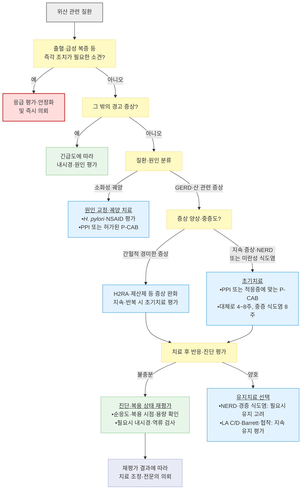

# 소화기계 약제 Gastrointestinal Drugs


별도 표시가 없으면 허가된 성인 경구 투여 용법임. 허가된 적응증이라도 급여 인정 범위는 다를 수 있음.

임신·수유 중 사용은 각각 금기·근거 부족·조건부 사용을 구분하여 판단함. 본문에는 임신·수유 중 고려할 수 있는 약제와 치료 선택에 중요한 예외를 중심으로 기재하며, 개별 약제의 임부·수유부 금기는 원칙적으로 반복하지 않음. 별도 표시가 없다는 것이 사용 가능 또는 안전성 확립을 뜻하지 않음. 임신 중 사용 근거를 수유 중 사용에 그대로 적용하지 않으며, 수유 중 사용은 별도로 판단함.

항암치료·수술 관련 항구토제는 주요 약제와 핵심 주의사항을 중심으로 소개함. 전문영역의 세부 병용·주사 투여요법은 해당 전문 프로토콜에 따름.


## <mark style="color:green;">처방 안전 요약</mark>

### <mark style="color:orange;">위험군별 주의 약제</mark>

#### <mark style="color:$primary;">QT 연장 위험 약제</mark>

* 심장 질환·QTc 연장·저칼륨혈증·저마그네슘혈증 환자에서 병용 주의; 아래 약제 2개 이상 병용 시 위험 증가
* <mark style="color:red;">**domperidone**</mark> : 강력한 CYP3A4 억제제 또는 QT 연장 약제와 병용 금기(예: clarithromycin, ondansetron); prucalopride와도 DUR 병용금기. metoclopramide와는 QTc 연장에 따른 심각한 심실성 부정맥 위험으로 DUR 병용금기.
* <mark style="color:red;">**ondansetron**</mark> : QT 연장은 용량 의존적임; 선천성 QT 연장증후군에서는 회피하고 저칼륨혈증·저마그네슘혈증은 투여 전 교정
* <mark style="color:red;">**erythromycin**</mark> : CYP3A4 기질·억제제; QT 연장 약제와 이중 위험
* <mark style="color:red;">**metoclopramide**</mark> : 드물지만 QTc 연장 보고; 고용량·IV 투여 시 주의

#### <mark style="color:$primary;">CKD에서 주의 약제</mark>

* 신기능 저하 시 축적·전해질 이상 위험이 증가함
  * Al 제제는 특히 중증 CKD(eGFR ＜30 ㎖/min/1.73㎡)에서 회피
  * MgO·Mg(OH)₂ 제제는 신장애 환자에게 금기
  * 다른 약제의 감량 기준은 CrCl 또는 GFR 등 해당 품목의 기준을 적용
* <mark style="color:red;">**MgO, Mg hydroxide**</mark> : 고마그네슘혈증. 중증 CKD·고령·장운동 저하에서 위험이 높음
  * [<mark style="color:blue;">마그밀</mark>](https://www.health.kr/drug/A11ABBBBB1168)·[<mark style="color:blue;">마그밀에스</mark>](https://www.health.kr/drug/2014072100012)는 신장애 환자에게 금기
* <mark style="color:red;">**Al hydroxide·phosphate 제산제**</mark> : Al 축적 독성 (뇌증, 골연화증)
* <mark style="color:red;">**bismuth**</mark> : 장기·고용량에서 신경 독성. [<mark style="color:blue;">데놀</mark>](https://www.health.kr/drug/A11AOOOOO0795)(tripotassium bismuth dicitrate)은 신장애 환자에게 금기
* <mark style="color:red;">**H2RA**</mark> : famotidine·cimetidine 등은 신기능에 따른 감량 또는 투여 간격 조절이 필요함. Lafutidine은 신배설 비중이 상대적으로 낮으며, 투석 환자에서는 저용량부터 신중히 투여함. 성분·적응증별 기준을 구분함
* <mark style="color:red;">**metoclopramide**</mark> : 신배설 비중이 높아 신기능 저하 시 노출 및 추체외로 이상반응 증가
* <mark style="color:red;">**인산염 함유 관장제**</mark> : 고인산혈증·저칼슘혈증·급성 신손상 위험
* <mark style="color:red;">**sucralfate**</mark> : 장기 사용 시 Al 축적; CKD에서 주의

#### <mark style="color:$primary;">고령자에서 주의 약제</mark>

* <mark style="color:red;">**metoclopramide**</mark> : 추체외로 증상·지연운동이상증 위험↑; 만성 사용 회피
* **항콜린성 진경제** : <mark style="color:red;">**dicyclomine·hyoscyamine**</mark> 등은 인지 기능 저하·섬망 위험이 있어 [Beers Criteria](../231_/215_-care-of-the-older-patient.md#medication-safety)에서 회피 권고. <mark style="color:red;">**hyoscine N-butylbromide**</mark>는 4급 암모늄 화합물로 중추 침투가 적으나 변비·요폐·빈맥 등 말초 항콜린 부작용으로 고령에서 주의
* **benzodiazepine 계 보조 항구토제** (<mark style="color:red;">**diazepam, lorazepam**</mark> 등) : 낙상, 인지 저하; 고령에서 가능한 회피
* **1세대 항히스타민제** (<mark style="color:red;">**dimenhydrinate, promethazine**</mark> 등) : 과진정, 섬망, 낙상 위험
* <mark style="color:red;">**mineral oil (경구)**</mark> : 흡인 위험 (연하장애·와상 환자 금기)
* <mark style="color:red;">**PPI**</mark> : 확실한 적응증(고위험 NSAID 사용, 바렛 식도, 중증 식도염 등)이 없으면 8주를 넘는 사용을 피함(Beers Criteria); 정기적으로 감량·중단 평가

#### <mark style="color:$primary;">환자군별 우선 선택</mark>

* **심장 질환자의 구역·구토** : QT 연장 위험 약제 병용·전해질 이상을 우선 점검. 원인에 맞는 항구토제를 선택
  * domperidone은 가능한 회피하고 심부전·QT 연장·전해질 이상 등 금기 상황에서는 투여하지 않으며, itopride, mosapride도 적응증과 상호작용을 확인
* **CKD 환자의 속쓰림·역류** : H2RA (용량 조절) 또는 PPI를 우선 선택
  * Mg·Al 제제는 독성 위험
* **고령 환자의 변비** : PEG 우선, lactulose는 대안. 자극성 하제는 필요시 구제 또는 병용요법으로 사용
  * 항콜린성 진경제는 변비를 악화시킬 수 있어 회피; Mg 제제는 신장애를 확인

### <mark style="color:orange;">장기 사용 주의 약제</mark>

<table data-search="false"><thead><tr><th width="155.11114501953125">약제</th><th width="322.4444580078125">장기 사용 문제</th><th>권고</th></tr></thead><tbody><tr><td><strong>PPI</strong></td><td>중단 시 일시적 반동성 위산 과분비 가능. 장 감염 외 폐렴·골절·CKD·치매 등은 주로 관찰 연구의 연관성이며 인과관계가 확립되지 않음</td><td>확실한 적응증이 있으면 유지하되 정기적으로 적응증·최저 유효 용량 재평가</td></tr><tr><td><strong>metoclopramide</strong></td><td>노출 기간·누적 용량에 따라 비가역적 지연운동이상증 위험 증가; 과거 추정치보다 실제 위험은 낮으나 고령 여성·당뇨병·간신장 기능 저하·항정신병약 병용 시 위험 증가</td><td>최대 5일 사용 허가</td></tr><tr><td><strong>domperidone</strong></td><td>QT 연장·심실성 부정맥(심장돌연사)</td><td>구역·구토에 최저 유효 용량 사용; 일반적으로 1주를 초과하지 않음</td></tr><tr><td><strong>자극성 하제</strong></td><td>복통·설사·전해질 이상; 장기 안전성 자료는 제한적이나 치료 용량에서 대장 기능이 영구적으로 손상된다는 근거는 불충분</td><td>bisacodyl·Na picosulfate는 단기 또는 구제요법; 장기 필요시 원인과 반응 재평가</td></tr><tr><td><strong>MgO (고용량)</strong></td><td>고마그네슘혈증 - 중증 CKD·고령에서 위험 증가</td><td>신장애 환자 금기; 고령에서 장기 사용 시 신기능, (필요시) Mg 확인</td></tr><tr><td><strong>항콜린성 진경제</strong></td><td>인지 기능 저하(누적 항콜린 부담), 변비 악화, 요폐</td><td>고령에서 최소화; 인지 저하 병력자 회피</td></tr><tr><td><strong>H2RA</strong></td><td>연속 사용 수일~수주 후 내성(tachyphylaxis); 중단 후 일시적 반동 증상 가능</td><td>야간 증상에는 필요시 또는 단기간 사용; 지속 필요성 재평가</td></tr></tbody></table>

### <mark style="color:orange;">주요 약물 상호작용</mark>

<table data-search="false"><thead><tr><th width="157.77777099609375">약물</th><th width="177.7777099609375">기전</th><th>임상적 위험 및 주의</th></tr></thead><tbody><tr><td><strong>erythromycin</strong></td><td>CYP3A4 중등도 억제제 + 기질</td><td>일부 statin(횡문근융해), warfarin, cyclosporine 독성↑; QT 연장 약제 병용 시 심각한 부정맥 위험</td></tr><tr><td><strong>cimetidine</strong></td><td>CYP1A2·2C9·2C19·2D6·3A4 광범위 억제</td><td>theophylline, warfarin, phenytoin, diazepam, lidocaine 농도·독성↑; clopidogrel 활성화·항혈소판 효과↓ 가능. H2RA 중 상호작용 가장 많음 → famotidine 선호</td></tr><tr><td><strong>PPI (특히 omeprazole·</strong> <strong>esomeprazole)</strong></td><td>CYP2C19 억제</td><td>clopidogrel 병용 시 omeprazole·esomeprazole을 피하고 pantoprazole 등 대안 고려; 위산 억제로 ketoconazole·itraconazole·atazanavir 흡수 감소; 고용량 methotrexate 병용 시 농도↑(일시 중단 고려)</td></tr><tr><td><strong>domperidone</strong></td><td>CYP3A4 기질</td><td>강력한 CYP3A4 억제제·QT 연장 약제 병용 금기</td></tr><tr><td><strong>sucralfate</strong></td><td>킬레이션·흡착 (CYP 비관여)</td><td>quinolone, tetracycline, levothyroxine 등 흡수 감소 → 약제별 권장 간격 확인(일률적으로 2시간을 적용하지 않음)</td></tr><tr><td><strong>Al/Mg 함유 제산제</strong></td><td>킬레이션·흡착 (CYP 비관여)</td><td>quinolone, tetracycline, 철분제·levothyroxine·bisphosphonate 등 흡수 저하 → 약제별 권장 간격 확인. 마그밀·마그밀에스는 tetracycline계 항생제와 병용하지 않음</td></tr><tr><td><strong>P-CAB</strong> <strong>(tegoprazan 등)</strong></td><td>약제별 CYP 대사 + 위산 억제</td><td>위산 의존 흡수 약제(atazanavir·rilpivirine·일부 azole계 등)의 농도 감소; CYP 상호작용은 성분별 허가사항 확인</td></tr></tbody></table>

### <mark style="color:orange;">임신 중 고려할 수 있는 약제</mark>

* 비약물 치료를 우선 적용하고, 증상·임신 시기·치료 필요성에 따라 약제를 선택함. 아래 약제도 무조건적인 안전성을 뜻하지 않으며, 필요한 최소 용량·기간으로 사용함

<table data-search="false"><thead><tr><th width="185">임상 상황</th><th width="270">고려할 수 있는 약제</th><th>선택 조건 및 주의</th></tr></thead><tbody><tr><td><strong>속쓰림·역류</strong></td><td>알긴산 제제 또는 적절한 제산제</td><td>생활 습관 조절로 충분하지 않을 때 단기간 고려. 복합 성분과 나트륨·칼슘 함량, 신기능 등을 확인. Na bicarbonate를 주성분으로 하는 흡수성 제산제는 피하되, 임신 중 고려할 수 있는 알긴산 복합제와 구분함. 철분제 등과는 제품별 권장 복용 간격을 둠</td></tr><tr><td><strong>위산 억제가 필요한 지속 증상·궤양 등</strong></td><td>omeprazole 또는 famotidine</td><td>Omeprazole은 임신 중 사용 자료가 비교적 풍부한 PPI이며, famotidine도 선택 가능함. 두 약제 간 고정된 선택 순서보다 증상 중증도와 치료 필요성에 따라 선택하며, 모두 치료상 이득이 위험보다 클 때 사용. 다른 PPI·P-CAB에 동일한 근거를 일괄 적용하지 않음</td></tr><tr><td><strong>임신성 구역·구토</strong></td><td>doxylamine/pyridoxine; 불충분 반응 시 metoclopramide 등</td><td>Doxylamine/pyridoxine이 일차 선택지. Metoclopramide는 추체외로 이상반응 때문에 이차 선택하며 최대 5일 사용. 상세 용법과 ondansetron의 조건은 아래 ‘임신 구토의 약물 선택’ 참조</td></tr><tr><td><strong>변비</strong></td><td>psyllium/ispaghula(차전자피); lactulose 또는 PEG(macrogol)</td><td>식이·수분·활동 조절 후 차전자피 단일성분 제제를 우선 고려하고, 불충분하면 lactulose 또는 PEG 고려. 충분한 물과 함께 사용하며 복합제·장정결제에 동일하게 적용하지 않음. 설사·탈수·전해질 이상에 유의. 반응이 불충분하면 원인을 재평가하고, 임신 중 사용 조건을 충족하는 자극성 하제의 단기 구제요법을 선택적으로 고려함</td></tr></tbody></table>

<mark style="color:$info;">\[RCOG 2024; NICE NG201; UKTIS 2024\~2026; 품목 허가사항]</mark>

* 수유 중 변비 : 임신과 별도로 판단. 만삭·건강한 영아를 수유하는 경우 차전자피·lactulose·PEG를 고려할 수 있으며, 삼투성 하제 사용 시 영아의 설사·구토·보챔을 관찰. 복합제 성분·품목별 사용 조건을 구분 <mark style="color:$info;">\[NHS SPS 2023]</mark>

## <mark style="color:green;">위장 운동 촉진제 (Prokinetics)</mark> 

* 투여 시간 : 성분·제형별로 다름
  * 일반적으로 식전 복용 - 식후 위 배출과 증상에 대비, 일부 약제에서 음식에 의한 흡수 지연을 피함
    * mosapride 일반정은 식전 또는 식후 가능으로 허가
  * SIBO에서 위장 운동 촉진제의 야간 투여 용법은 제한적 근거의 허가 외 용법임
* 기능성 소화불량에서 성분 간 효과 차이는 뚜렷하지 않음
  * 수 주 단위의 사용이 많으므로 중추·심장 부작용이 적은 mosapride, itopride, 현호색·견우자 추출물을 우선 고려
  * BBB 통과 D2 길항제(metoclopramide, levosulpiride, clebopride)와 domperidone은 단기 사용
* 항콜린제와 함께 투여 시 상호 길항작용으로 효과가 상쇄될 수 있음
* 위장관 출혈·기계적 폐색/천공 등 위장관 운동 자극이 위험한 상황에서는 회피; 성분별 허가·금기를 확인

<table data-search="false"><thead><tr><th width="230">성분명 [상품명]</th><th width="220">주요 작용 기전</th><th>상용량</th></tr></thead><tbody><tr><td><strong>metoclopramide</strong> <mark style="color:blue;">[</mark><a href="https://www.health.kr/drug/A11A0570A0089"><mark style="color:blue;">맥페란</mark></a><mark style="color:blue;">]</mark></td><td>D2 길항, 5-HT4 작용; 고용량에서 5-HT3 길항</td><td>염산메토클로프라미드로서 1일 10~30 ㎎을 2~3회 식전 분할; 최대 30 ㎎/d 또는 0.5 ㎎/㎏/d 중 낮은 용량, 최대 5일</td></tr><tr><td><strong>levosulpiride</strong> <mark style="color:blue;">[</mark><a href="https://www.health.kr/drug/A11A1890A0158"><mark style="color:blue;">레보프라이드</mark></a><mark style="color:blue;">]</mark></td><td>D2 길항</td><td>25 ㎎ tid 식전</td></tr><tr><td><strong>clebopride</strong> (유통제품없음)</td><td>D2 길항, 5-HT4 작용</td><td>0.5 ㎎ tid</td></tr><tr><td><strong>itopride</strong> (급여제품없음)</td><td>D2 길항, acetylcholinesterase 억제</td><td>50 ㎎ tid 식전</td></tr><tr><td><strong>domperidone</strong> <mark style="color:blue;">[</mark><a href="https://www.health.kr/drug/A11A0570A0382"><mark style="color:blue;">돔피돈</mark></a><mark style="color:blue;">]</mark></td><td>말초 D2 길항</td><td>10 ㎎ tid 식전(최대 30 ㎎/d)</td></tr><tr><td><strong>mosapride</strong> <mark style="color:blue;">[</mark><a href="https://www.health.kr/drug/A11AIIIII0006"><mark style="color:blue;">가스모틴</mark></a><mark style="color:blue;">]</mark>, <mark style="color:blue;">[</mark><a href="https://www.health.kr/drug/2017120400002"><mark style="color:blue;">가스모틴에스알</mark></a><mark style="color:blue;">]</mark></td><td>선택적 5-HT4 작용</td><td>일반정 5 ㎎ tid, 식전 또는 식후; 가스모틴에스알 15 ㎎ qd 공복, 부수거나 씹지 않고 통째로 복용</td></tr><tr><td><strong>DA-9701</strong>(현호색·견우자 추출물) <mark style="color:blue;">[</mark><a href="https://www.health.kr/drug/2011051800003"><mark style="color:blue;">모티리톤</mark></a><mark style="color:blue;">]</mark></td><td>D2 길항, 5-HT4 작용 등 복합 기전</td><td>30 ㎎ tid 식전</td></tr></tbody></table>

### <mark style="color:orange;">Dopamine D2 receptor antagonist</mark>

* 기전 : 도파민 수용체 차단 → acetylcholine 분비↑ → 위장관 수축↑; CTZ 억제 → 항구토 효과
* 주로 상부 위장관 운동에 작용하며, 대장 통과 개선을 위한 변비 치료제로 일률적으로 적용하지 않음
* 부작용
  * BBB 통과 약제 (metoclopramide, levosulpiride, clebopride) : 추체외로 증상, 진정, 저혈압, 설사, 근육 긴장 이상, 고프로락틴혈증(유즙 분비, 성 기능 장애); 만성 사용 및 고령에서의 사용 회피
  * 중추 침투가 적은 약제 (domperidone, itopride) : 중추 부작용이 상대적으로 적음
  * 심장 부작용 : domperidone
  * 고프로락틴혈증 : BBB 통과 약제 장기 투여 시 유즙 분비, 여성형유방증, 생리 불순, 성욕 감소 유발 가능; 중추 침투가 적은 domperidone, itopride도 고프로락틴혈증을 일으킬 수 있음
* **metoclopramide** : 지연운동이상증(tardive dyskinesia)은 드물지만 비가역적일 수 있으며 노출 기간·누적 용량에 따라 위험 증가. 고령 여성·당뇨병·간신장 기능 저하·항정신병약 병용 시 특히 주의
  * 구역·구토에 대하여 최대 5일 사용 허가
  * 구토했더라도 투여 간격은 최소 6시간 유지
  * CrCl ＞15\~≤60 ㎖/min 및 중증 간장애 시 일일 용량을 50% 감량
  * CrCl ≤15 ㎖/min 시 통상 용량의 25%를 투여
  * 금기 : 1세 미만·파킨슨병·간질·levodopa/도파민 작용제 병용
* **levosulpiride** : 약물 유발 파킨슨증의 흔한 원인 약제. 고령자에서 장기 처방을 피하고, 새로 생긴 떨림·서동·보행 장애에 대하여 이 약제 복용 여부를 확인함
* **domperidone** : 일반적으로 1주를 초과하지 않음
  * 심한 신장애에서 반복 투여 시 투여 횟수를 1일 1\~2회로 줄이고 필요시 용량도 감량
  * 금기 : QT 연장·심부전 등 심장 기저질환·전해질 이상·중등도\~중증 간장애
  * 강력한 CYP3A4 억제제 또는 QT 연장 약제와 병용 금기; metoclopramide와 DUR 병용금기

### <mark style="color:orange;">5-HT4 receptor agonists</mark>

* 기전 : 5-HT4 수용체 작용 → acetylcholine 분비↑ → 위장관 수축↑
* 해당 약제 : metoclopramide, clebopride, mosapride, prucalopride
* **mosapride** : 일반정은 보통 2주 투여해도 호전이 없으면 장기간 지속하지 않음. 중추 침투가 적어 중추 부작용이 상대적으로 적음. CYP3A4로 대사되어 erythromycin 등 억제제 병용 시 혈중 농도가 높아질 수 있으나, QT 연장 위험은 뚜렷하지 않음

### <mark style="color:orange;">Acetylcholinesterase inhibitor</mark>

* **pyridostigmine** : 중증 근무력증 치료제로, 일부 만성 장운동 장애·만성 장가성폐색에서 전문진료 하에 허가 외 사용. 보고된 경구 용량은 60\~180 ㎎/d 등이나 최적 용법은 확립되지 않음 <mark style="color:blue;">\[</mark>[<mark style="color:blue;">메스티논</mark>](https://www.health.kr/drug/A11A1590B0047)<mark style="color:blue;">]</mark>
  * 금기 : 기계적 장폐색·기관지 천식

### <mark style="color:orange;">Motilin receptor agonist</mark>

* 임상 적용 : motilin 수용체 자극으로 위 배출을 촉진함. 위마비에서 단기 사용을 고려하며, SIBO 재발 예방을 위한 일상적 장기 사용은 근거가 부족함

**Erythromycin**

* 작용 : macrolide 항생제로 motilin 수용체에 작용하여 위 배출을 촉진함
  * 위장운동 촉진 목적으로 항균치료보다 낮은 용량을 사용하기도 함
* 주의 : CYP3A4 억제제 및 기질이며, QT 연장·torsades de pointes 위험이 있음
* 부작용 : 구역, 구토, 내성 발생
* 용법 : 저용량을 단기간 사용(허가 외 사용). AGA 2025는 위마비에서 40\~150 ㎎을 식전 30분에 투여하는 예시를 제시하며, 50\~250 ㎎ tid도 사용됨
  * 반복·장기 사용 시 tachyphylaxis와 항생제 내성 문제 고려
* 회피 : QT 연장 약제 병용, 중증 간 기능 저하

## <mark style="color:green;">진경제 (GI antispasmodic)</mark> 

* IBS·기능성 복통에서는 항콜린 작용이 없는 trimebutine, pinaverium 등을 우선 고려하고, 항콜린제는 단기·필요시 사용함

### <mark style="color:orange;">항콜린제 (Anticholinergic)</mark>

* 3급 아민(dicyclomine, hyoscyamine, atropine)은 중추 부작용이 있고, 4급 암모늄(hyoscine N-butylbromide, cimetropium)은 중추 침투가 적음
* 부작용 : 입마름, 소변 저류, 시야 흐림, 어지럼, 졸림, 녹내장 악화; 3급 아민은 인지 저하·섬망 위험이 추가됨
* 금기(성분별로 다름) : 녹내장, 전립선비대에 의한 배뇨장애, 장폐색·거대결장, 중증 근무력증, 빈맥성 부정맥·중증 심질환; dicyclomine은 역류성식도염도 금기
* 고령에서 가능한 회피
* 지속 사용 시 효과와 항콜린 부담을 재평가
* **hyoscine N-butylbromide**(scopolamine butylbromide) : 10\~20 ㎎ tid\~qid <mark style="color:blue;">\[</mark>[<mark style="color:blue;">부스코판</mark>](https://www.health.kr/drug/A11A0760A0001)<mark style="color:blue;">]</mark>
* **cimetropium** : 50 ㎎ bid\~tid <mark style="color:blue;">\[</mark>[<mark style="color:blue;">알피움</mark>](https://www.health.kr/drug/A11AOOOOO7809)<mark style="color:blue;">]</mark>; 주사 1회 5 ㎎ IM/IV <mark style="color:blue;">\[</mark>[<mark style="color:blue;">브로퓸주사</mark>](https://www.health.kr/drug/2018031900011)<mark style="color:blue;">]</mark>
* **dicyclomine** : 10\~20 ㎎ tid\~qid <mark style="color:blue;">\[</mark>[<mark style="color:blue;">스파토민</mark>](https://www.health.kr/drug/A11ABBBBB2442)<mark style="color:blue;">]</mark>
* hyoscine N-butylbromide <mark style="color:blue;">\[</mark>[<mark style="color:blue;">프리판주</mark>](https://health.kr/drug/A11AMMMMM2977)<mark style="color:blue;">]</mark>
* **atropine** <mark style="color:blue;">\[</mark>[<mark style="color:blue;">아트로핀주</mark>](https://health.kr/drug/A11ABBBBB2781)<mark style="color:blue;">]</mark>

### <mark style="color:orange;">장 선택적 칼슘 통로 차단제 (GI-selective CCB)</mark>

* 주의 : 졸음이 생길 수 있어 운전·기계 조작에 주의
* **pinaverium** : 50 ㎎ tid 식사 중 충분한 물과 함께 통째로 삼킴 <mark style="color:blue;">\[</mark>[<mark style="color:blue;">디세텔</mark>](https://www.health.kr/drug/A11A0950A0197)<mark style="color:blue;">]</mark>
  * 식도 자극·궤양 예방을 위해 씹거나 빨지 않으며, 누운 자세 또는 취침 직전 복용을 피함

### <mark style="color:orange;">말초 opioid 수용체 조절제 (Peripheral opioid receptor modulator)</mark>

* 말초 μ·κ·δ opioid 수용체에 작용하여 장운동을 양방향으로 조절함(저하 시 항진, 항진 시 억제)
* 금기 : 과민증 외 특별한 금기 없음
* **trimebutine** : 100\~200 ㎎ tid 식전 <mark style="color:blue;">\[</mark>[<mark style="color:blue;">포리부틴정</mark>](https://health.kr/drug/A11A0500A0119)<mark style="color:blue;">]</mark>

### <mark style="color:orange;">직접 평활근 이완제 (Direct smooth muscle relaxant)</mark>

* 항콜린 작용이 없음
* **phloroglucinol** : 1회 2정, 증상 발현 시 물 한 컵에 녹이거나 설하에서 녹여 복용 <mark style="color:blue;">\[</mark>[<mark style="color:blue;">후로스판</mark>](https://www.health.kr/drug/A11A1560A0119)<mark style="color:blue;">]</mark>
  * 금기 : 이 약에 과민증
  * morphine 및 그 유도체와는 병용을 피함
* **tiropramide** : 경구 100 ㎎ bid\~tid <mark style="color:blue;">\[</mark>[<mark style="color:blue;">티로파</mark>](https://www.health.kr/drug/A11A0430A0302)<mark style="color:blue;">]</mark>
  * 주의 : 항콜린 작용은 없으나 녹내장·전립선비대증에서는 신중 투여
  * 금기 : 위장관 협착, 거대결장, 허탈 상태, 중증 간부전

## <mark style="color:green;">항구토제 (Antiemetic)</mark>

* 화학요법·수술 후 구역/구토 : ondansetron
* 멀미·내이 질환 : dimenhydrinate 또는 meclizine
* 임신성 구역/구토 : doxylamine + pyridoxine
* 만성 기능성 구역 : 원인 평가 후 저용량 amitriptyline/nortriptyline 등 신경조절제를 선택적으로 고려함(허가 외 사용; 위마비의 일차치료와 구분)

### <mark style="color:orange;">항히스타민제, 1세대 (First-generation H1-receptor antagonists)</mark>

* 대상 : 멀미, 내이 장애 관련 구역/구토; 임신성 구역/구토
* 항콜린 작용이 있음
* **dimenhydrinate** : 50 ㎎ tid\~qid <mark style="color:blue;">\[</mark>[<mark style="color:blue;">보나링에이</mark>](https://www.health.kr/drug/A11A0950A0043)<mark style="color:blue;">]</mark>
  * 회피 : 고령 - 과진정·섬망 위험
* **doxylamine/pyridoxine** : 각각 10 ㎎ 함유 지연방출 복합제
  * <mark style="color:blue;">\[</mark>[<mark style="color:blue;">디클렉틴</mark>](https://www.health.kr/drug/2015120100015)<mark style="color:blue;">]</mark> 취침 전 2정으로 시작하고, 조절되지 않으면 단계적으로 최대 4정/d(아침 1정·오후 1정·취침 전 2정)까지 증량. 공복에 통째로 복용. 필요시가 아니라 정해진 일정에 따라 매일 복용하며, 지속 필요성을 재평가함
  * 졸음·항콜린 부작용 및 다른 진정제와의 중복에 주의함
* **hydroxyzine** : 진정·항콜린·QT 연장 위험이 있어 일반적인 구역·구토의 표준 약제로 권고하지 않음 <mark style="color:blue;">\[</mark>[<mark style="color:blue;">아디팜</mark>](https://www.health.kr/drug/A11AFFFFF0070)<mark style="color:blue;">]</mark>
* **meclizine** : 멀미 25\~50 ㎎ 승차 1시간 전, 필요시 24시간마다 반복; 미로염·메니에르증후군 등은 25 ㎎ bid\~tid, 원칙적으로 최대 75 ㎎/d <mark style="color:blue;">\[</mark>[<mark style="color:blue;">염산메클리진</mark>](https://health.kr/drug/A11A2240B0022)<mark style="color:blue;">]</mark>
  * 고령에서 항콜린 부작용 주의
  * 금기 : 협우각 녹내장·BPH 등 배뇨장애·12세 이하 소아
* promethazine : 미유통


**임신 구토의 약물 선택**

* doxylamine/pyridoxine <mark style="color:blue;">\[디클렉틴]</mark>이 일차 선택지임. pyridoxine 10\~25 ㎎ q6\~8h 단독 사용도 가능 <mark style="color:blue;">\[</mark>[<mark style="color:blue;">피리독신정</mark>](https://health.kr/drug/A11A2070B0077)<mark style="color:blue;">]</mark>
* 경증 임신성 구역·구토에서는 생강 250 ㎎ q6h 또는 총 1 g/d를 보조적으로 고려 가능(식품·보충제 근거 용량); 출혈 위험 약제 병용·응고장애에서 주의. 임신오조의 치료로는 권하지 않으며 효과적인 항구토 치료·수액 치료를 지연하지 않음
* 반응 불충분 시 metoclopramide를 이차 선택지로 고려할 수 있음. 추체외로 이상반응에 주의하고 최소 유효 용량으로 최대 5일 사용함
* Ondansetron은 허가 외 이차 선택지로 사용함. 임신 초기 노출 시 구순·구개열의 작은 절대위험 증가 가능성(한 대규모 관찰연구에서 출생 1만 건당 약 11건 → 14건)이 보고되었으나 심장기형 증가가 일관되게 확인된 것은 아님. 조절되지 않는 임신오조의 위험과 비교하여 설명하고 결정함
* 해외 임신 구토 권고에 포함된 약제라도 그대로 대입하지 않음. Meclizine·domperidone은 임부에게 투여하지 않는 품목이므로 위의 임신 구토 선택지와 구분함
* 이차 약제에도 조절되지 않으면 산과 전문진료로 의뢰함. 탈수·경구 섭취 곤란·현저한 체중감소·전해질 이상이 동반되면 당일 평가하고 입원 치료 필요성을 판단함
* 지속 구토·현저한 경구 섭취 감소 또는 입원이 필요한 임신오조에서는 thiamine을 보충함. 특히 포도당 수액이나 정맥영양 투여 전에 보충하여 Wernicke 뇌병증을 예방함


### <mark style="color:orange;">5-HT3 receptor antagonists</mark>

* 대상 : 화학요법·방사선치료 유발 및 수술 후 구역·구토의 핵심 약제
  * 원인에 따라 다른 계열과 병용
* 부작용 : 두통, 무기력, 변비, 어지럼, QT 연장 (IV 고용량 주의)
* **ondansetron** : 경구 4\~8 ㎎(적응증별 용법 구분); 중등도\~중증 간장애는 최대 8 ㎎/d <mark style="color:blue;">\[</mark>[조프란](https://www.health.kr/searchDrug/result_drug.asp?drug_cd=A11ABBBBB1541)<mark style="color:blue;">]</mark>
  * 선천성 QT 연장증후군에서 회피하고 투여 전 전해질 이상 교정
  * apomorphine(심한 저혈압·의식 소실)·domperidone·ribociclib(QT 연장·부정맥)과 병용 금기
  * 급성 위장관염 구토 및 IBS-D에는 허가 외 사용이며, 허가된 항암치료·수술 후 구역/구토 용법을 그대로 대입하지 않음
* **granisetron** : CINV(Chemotherapy-Induced Nausea and Vomiting) 2 ㎎ qd 또는 1 ㎎ bid <mark style="color:blue;">\[</mark>[<mark style="color:blue;">카이트릴</mark>](https://www.health.kr/drug/A11AFFFFF0178)<mark style="color:blue;">]</mark>
* dolasetron : 해외 약제. QT 연장 위험으로 IV CINV 요법은 사용하지 않음
* **palonosetron** : CINV 및 PONV(Postoperative Nausea and Vomiting) 예방에 사용; 전문기관에서 적응증별 프로토콜에 따라 투여 <mark style="color:blue;">\[</mark>[알록시주](https://health.kr/drug/A11APPPPP1958)<mark style="color:blue;">]</mark>

### <mark style="color:orange;">NK1 receptor antagonists</mark>

* 대상 : 화학요법 유발 구역/구토의 예방
* 항암요법의 구토 유발 위험도에 맞춰 병용
* 고위험 항암요법에서는 5-HT3 길항제 + NK1 길항제 + dexamethasone + olanzapine의 4제 예방요법을 권고 <mark style="color:$info;">\[MASCC/ESMO 2023]</mark> (olanzapine의 항구토 목적 사용은 허가 외 사용임)
* **aprepitant** : CINV 예방 시 제1일 [125 ㎎](https://www.health.kr/drug/A11AOOOOO5502), 제2\~3일 [80 ㎎](https://www.health.kr/drug/A11AOOOOO5503) qd <mark style="color:blue;">\[</mark>[에멘드캡슐](https://health.kr/drug/A11AOOOOO5503)<mark style="color:blue;">]</mark>
* fosaprepitant <mark style="color:blue;">\[</mark>[<mark style="color:blue;">에멘드주</mark>](https://www.health.kr/drug/2011071500002)<mark style="color:blue;">]</mark>, netupitant/palonosetron 복합제 <mark style="color:blue;">\[</mark>[<mark style="color:blue;">아킨지오</mark>](https://www.health.kr/drug/2018062900002)<mark style="color:blue;">]</mark>, rolapitant(해외 약제)

### <mark style="color:orange;">위장관 신경조절제 (TCA·Mirtazapine)</mark> 

* 대상 : 초기 치료에도 증상이 지속되는 기능성 소화불량(FD), 만성 구역·구토 증후군 등에서 저용량으로 선택적으로 고려함(해당 소화기 증상에 허가 외 사용; 적응증별 근거 수준은 다름)
  * FD에서는 특히 상복부 통증이 두드러지는 경우 2차 치료로 고려함. 위장관 통증·감각 신호를 조절하는 목적으로 사용하며 항우울 치료 용량과 구분함 (☞ [소화불량](075_-indigestion-dyspepsia.md))
  * 2025 AGA 지침은 nortriptyline을 위마비의 일차치료로 사용하지 않도록 조건부 권고함
* **amitriptyline** : [10 ㎎](https://www.health.kr/drug/A11A0570B0082)\~[25 ㎎](https://www.health.kr/drug/A11A0570A0148) hs부터 시작하여 반응·부작용에 따라 조정 <mark style="color:blue;">\[에트라빌]</mark>
* **nortriptyline** : [10 ㎎](https://www.health.kr/drug/A11A1130A0032)\~[25 ㎎](https://www.health.kr/drug/A11A1130A0033) hs부터 시작하여 반응·부작용에 따라 조정 <mark style="color:blue;">\[센시발]</mark>
* 고령에서는 항콜린 부작용·기립저혈압·심독성 때문에 가급적 피함. Amitriptyline은 부정맥·심근경색 회복 초기·녹내장·전립선비대 등 배뇨장애·MAO 억제제 투여 중 등에 금기; nortriptyline은 해당 품목의 금기·주의를 별도로 확인
* Domperidone과 병용하지 않으며 다른 QT 연장 약제와의 상호작용도 확인. 초기 2\~4주에 내약성·기분 변화·복약 상태를 평가하고, 심한 두근거림·실신·요폐·눈 통증과 시야 흐림 발생 시 중단·즉시 평가
* **Mirtazapine**은 TCA가 아닌 별도 계열의 항우울제로, 체중 감소·조기 포만감이 두드러지는 치료 불응성 FD에서 전문 진료를 통해 선택적으로 고려함(허가 외 사용; 근거 제한적). 상세 적응 상황과 치료 방향은 [소화불량](075_-indigestion-dyspepsia.md) 참조

### <mark style="color:orange;">Benzodiazepine</mark>

* 대상 : 예기성 항암화학요법 유발 구역·구토 등에서 제한적으로 사용하는 보조요법
  * 일반적인 불안 동반 구토의 일률적 치료제로 사용하지 않음
* lorazepam <mark style="color:blue;">\[</mark>[<mark style="color:blue;">아티반</mark>](https://www.health.kr/drug/A11ABBBBB0915)<mark style="color:blue;">]</mark> 등은 예기성 구역·구토에서 항암치료 계획에 따라 제한적으로 병용(항구토 목적은 허가 외 사용)
* 일반 외래 구토에 정규 반복 처방을 일률적으로 적용하지 않음
* 회피 : 고령 - 낙상·진정·의존

## <mark style="color:green;">Probiotics</mark>

* 장내 미생물 조절을 목적으로 사용되지만, 효과는 균주·조합·적응증에 따라 다르고 개인차가 크며, 대부분의 적응증에서 충분히 입증되지 않음
* 복부 팽만·팽창의 일상적 치료로 권고하지 않음; 복부 가스 제거제로 일률적으로 처방하지 않음 <mark style="color:$info;">\[AGA 2023]</mark>
* IBS에 대해서는 지침 간 차이가 있음
  * AGA 2020은 임상시험 내 사용으로 제한하는 반면, 2025 IBS 서울 컨센서스는 매우 낮은 근거로 선택적 사용을 약하게 권고함. 시험적으로 사용하면 효과를 평가하고 호전이 없으면 중단 <mark style="color:$info;">\[AGA 2020; J Neurogastroenterol Motil 2025]</mark>
* 성인 급성 감염성 설사 : 지침 간 차이가 있음. IDSA 2017은 정상 면역 성인에서 선택적 사용을 약하게 권고하지만, ACG 2016은 항생제 관련 설사를 제외한 성인 급성 설사에서 사용을 권고하지 않음. 성인·균주별 근거가 제한적이므로 일상적으로 처방하지 않음 <mark style="color:$info;">\[IDSA 2017; ACG 2016]</mark>
* 유산균·비피더스균 : _Lacticaseibacillus rhamnosus_ <mark style="color:blue;">\[</mark>[<mark style="color:blue;">람노스산</mark>](https://www.health.kr/drug/2019040500076)<mark style="color:blue;">]</mark>·<mark style="color:blue;">\[</mark>[<mark style="color:blue;">람노스과립</mark>](https://www.health.kr/drug/A11AOOOOO9524)<mark style="color:blue;">]</mark>, _Bifidobacterium bifidum_ 함유 제제, _Lactobacillus acidophilus_ 함유 제제
* _Saccharomyces boulardii_ <mark style="color:blue;">\[</mark>[<mark style="color:blue;">비오플250산</mark>](https://www.health.kr/drug/2010112500008)<mark style="color:blue;">]</mark>·<mark style="color:blue;">\[</mark>[<mark style="color:blue;">비오플250캡슐</mark>](https://www.health.kr/drug/2013031200010)<mark style="color:blue;">]</mark> : 드물게 진균혈증 위험이 있어 중심정맥관 보유자·중환자·면역저하자에서는 사용을 피함. 캡슐·산제를 개봉할 때 주변 중심정맥관의 오염에도 주의함
* _Bacillus subtilis_ + _Enterococcus faecium_ 복합 제제 <mark style="color:blue;">\[</mark>[<mark style="color:blue;">메디락에스산</mark>](https://www.health.kr/drug/A11A2140A0150)<mark style="color:blue;">]</mark>·<mark style="color:blue;">\[</mark>[<mark style="color:blue;">메디락에스</mark>](https://www.health.kr/drug/A11A2140A0147)<mark style="color:blue;">]</mark>

**AGA Probiotics 권고 (2020) 및 CDI 업데이트 (2026)**

* 성인·소아의 IBS·크론병·궤양성 대장염·_C. difficile_ 감염 치료 : 임상시험 외 사용을 뒷받침할 근거가 불충분
* 성인·소아의 항생제 투여 중 _C. difficile_ 감염 예방 : AGA 2020은 _S. boulardii_ 등 특정 균주·조합에 한하여 조건부로 고려하였으나, AGA 2026 CDI 업데이트는 초발·재발 CDI 예방 목적으로 probiotics 사용을 권고하지 않음. 항생제 관련 설사(AAD) 예방과 CDI 예방은 구분함
* pouchitis : 근거가 있는 특정 다균주 조합에 한하여 고려 가능
* 소아 급성 감염성 위장관염 : 일상적 사용을 권고하지 않음
* 조산아·저체중 출생아 : 일부 균주가 괴사성 장염·사망을 줄일 가능성이 있으나, 균주에 의한 균혈증·진균혈증과 사망 사례도 보고됨. NICU 전문진료 환경에서 균주·제품 품질·면역저하·중심정맥관 여부를 평가하여 사용

## <mark style="color:green;">복부 가스·팽만 관련 약제 (Antiflatulent)</mark>

* Probiotics는 복부 팽만·팽창의 일상적 치료로 권고하지 않음

### <mark style="color:orange;">Galactosidase</mark>

* α-Galactosidase : 콩류 등 발효성 탄수화물 섭취로 인한 가스·팽만 감소에 고려
* β-Galactosidase(lactase) : 유당불내증 <mark style="color:blue;">\[</mark>[<mark style="color:blue;">갈타제산</mark>](https://www.health.kr/drug/A11A3060A0167)<mark style="color:blue;">]</mark>

### <mark style="color:orange;">Simethicone</mark>

* 기능성 팽만·영아 산통 등에서 일관된 효과 근거는 제한적이나 전신 흡수가 거의 없어 비교적 안전한 증상 완화제로 사용
* 용법 : 40\~80 ㎎ tid 식후 또는 취침 시 <mark style="color:blue;">\[</mark>[<mark style="color:blue;">가소콜액</mark>](https://www.health.kr/drug/2019101700032)<mark style="color:blue;">]</mark>

### <mark style="color:orange;">비흡수성 항생제 (Non-absorbable antibiotic)</mark>

* 작용 : 장내 세균 활동을 억제하여 탄수화물 발효 감소
* 대상 : 임상 소견과 위험 인자 또는 검사로 SIBO가 뒷받침되는 환자
  * 단순 복부 팽만만으로 반복 경험적 투여하지 않음
* 부작용 : 부종, 구역, 어지럼, 가스
* **rifaximin** : SIBO에 400 ㎎ tid × 7\~14일(허가 외 요법); 최적 용량·기간은 확립되지 않음 <mark style="color:blue;">\[</mark>[<mark style="color:blue;">노르믹스</mark>](https://www.health.kr/drug/A11AOOOOO0736)<mark style="color:blue;">]</mark>
  * 고암모니아혈증 치료의 보조요법은 12세 이상에서 400 ㎎ q8h이며, 치료는 통상 7일을 넘지 않도록 함
  * 금기 : 열·혈변 동반 설사, 장폐색·중증 궤양성 장질환
* **rifaximin 550 ㎎** : 18세 이상 현성 간성뇌증의 재발 감소에 1T bid 장기 투여 <mark style="color:blue;">\[</mark>[<mark style="color:blue;">틱스타</mark>](https://www.health.kr/drug/2023080800002)<mark style="color:blue;">]</mark>
  * 금기 : 장폐쇄증

### <mark style="color:orange;">Bismuth</mark>

* **Bismuth subsalicylate** : 악취 방귀 완화에 대하여 제한적 근거가 있으나, 일상적으로 권하지 않음(허가 외 사용)
  * 급성 설사·여행자 설사의 용법과 주의사항 ☞ 아래 [Bismuth subsalicylate](073_-gidrugs.md#bismuth-subsalicylate) 참조

## <mark style="color:green;">변비 치료제 (Laxative)</mark>


**반응 불충분 시** : 약물 유발·내분비/신경계 원인과 분변 매복을 점검하고, 하제를 계속 증량하기 전에 항문직장내압검사·풍선배출검사 등으로 배변장애를 평가. 배변장애가 확인되면 골반저 바이오피드백을 우선 적용; 적절한 약물·비약물 치료 후에도 지속되는 경우에 난치성으로 평가. Rome V는 배출 곤란 증상과 ARM·BET·배변조영술 중 ≥1개에서 배출 장애를 확인하면 배변협동장애 진단이 가능하며, 원문 해설은 검사 1개 이상을 probable, 2개 이상 일치를 definite로 구분 <mark style="color:$info;">\[AGA 2026; Rome V 2026]</mark>


### <mark style="color:orange;">식이 섬유 (Dietary fiber)</mark>

(☞ [변비](082_-constipation.md))

* 작용 : 소장에서 소화·흡수되지 않은 일부 식이섬유가 대장 미생물에 의해 발효되어 단쇄지방산과 가스를 생성
  * 발효성·점성·수분 보유력은 식이섬유 종류별로 다르며, 모든 식이섬유가 같은 정도로 발효되는 것은 아님; 개인차가 있음
* 함유 음식 : 밀기울, 전곡류, 채소, 과일 (☞ [영양/식이 지침](../231_/217_-nutritiondiet-guideline.md))
* 변비 치료의 초기 임상 목표 : 음식과 보충제를 합한 총 식이섬유 20\~30 g/d를 참고하여 기존 섭취량·증상·내약성에 따라 서서히 증량함
  * 효과와 내약성은 수일\~수주에 걸쳐 평가하며, 이 범위를 일반인의 KDRI 충분섭취량이나 일률적 상한으로 사용하지 않음
  * 일반적인 고섬유식 전체의 근거와 특정 섬유·식품의 근거를 구분. 키위 2\~3개/d를 최소 4주 시도하는 식이 선택지는 [변비](082_-constipation.md) 참조 <mark style="color:$info;">\[BDA 2025]</mark>
* 심한 서행성 변비에서는 효과가 제한적일 수 있으며, 분변 매복·장관 협착/폐쇄에서는 증상 악화 가능
* 부작용 : 복부 가스, 팽만감, 복통(특히 대변 저류가 있는 경우)

### <mark style="color:orange;">부피 형성 하제 (Bulk-forming)</mark> 

* 작용 : Bulk-forming laxative는 장 내에서 수분을 흡수해 팽창
* 종류 : psyllium/ispaghula(차전자피), methylcellulose, karaya, guar gum, wheat dextrin, 해초, 한천
* 충분한 물과 함께 섭취 필수. 수분 섭취가 부족하면 오히려 장 내에서 굳어 변비가 악화되거나, 드물게 장폐색을 유발할 수 있음
* 투여 후 보통 2\~3일 내 반응; 아기오는 약 1주 사용해도 호전이 없으면 중단하고 재평가
* 수용성 섬유 중 psyllium의 효과 근거가 상대적으로 풍부하며, 모든 섬유 제제가 같은 효과를 보이지 않음; 개인차가 있음
* 부작용 : 복부 가스, 팽만감, 협착 시 impaction, Ca·Fe 흡수 장애

<table><thead><tr><th width="213">성분명 [상품명]</th><th>용법</th></tr></thead><tbody><tr><td><strong>psyllium</strong>(차전자피)</td><td>제제별 함량에 따라 충분한 물과 함께 복용함 •연하장애·장폐색 또는 협착이 있으면 피함</td></tr><tr><td><strong>agiocur pregranules</strong> <mark style="color:blue;">[</mark><a href="https://www.health.kr/drug/A11A1310A0185"><mark style="color:blue;">아기오과립</mark></a><mark style="color:blue;">]</mark></td><td>6 g/P, 1~2P qd 저녁 식후. 1포에 차전자 3.9 g·차전자피 0.13 g을 포함하며 순수 차전자피 6 g과 같지 않음. 씹지 말고 물 1~2컵과 함께 복용; 취침 직전·누운 상태 복용 금지. 심한 당뇨병 금기; 장운동 억제 지사제 및 다른 하제와 병용하지 않음</td></tr><tr><td><strong>calcium polycarbophil</strong> <mark style="color:blue;">[</mark><a href="https://www.health.kr/drug/A11AOOOOO6150"><mark style="color:blue;">웰콘정</mark></a><mark style="color:blue;">]</mark></td><td>2T (625 ㎎/T) qd~qid; 최소 250 ㎖의 물과 함께 복용, 최대 5 g/d. 취침 직전 복용을 피하고 복용 후 최소 1시간 뒤 취침 •금기 : 고칼슘혈증·신결석·중증 신부전(투석 환자 제외) •투석 환자는 신중 투여; 칼슘제·활성형 비타민 D·digoxin 병용 주의</td></tr><tr><td><strong>methylcellulose</strong> (복합제)</td><td>-</td></tr></tbody></table>

### <mark style="color:orange;">삼투성 하제 (Hyperosmotics)</mark>

* 작용 : 흡수되지 않는 성분이 삼투압으로 장관 내 수분을 유지·증가시켜 대변을 무르게 하고 양을 늘림
  * 비흡수성 당류는 대장 세균의 발효로 유기산이 생기며 삼투 효과가 더해지나, 가스·팽만이 PEG보다 흔함
* 종류 : magnesium oxide(MgO), magnesium hydroxide\[Mg(OH)₂], 비흡수성 당류, glycerol, PEG
  * 비흡수성 당류 : lactulose, lactitol, sorbitol
* PEG는 효과·내약성이 양호하고 AGA-ACG 2023 지침에서 강하게 권고함
* Mg 제제 중 AGA-ACG 2023이 평가한 것은 MgO로, 조건부로 권고됨(근거 수준 매우 낮음). Mg(OH)₂는 따로 평가되지 않았으나 작용 기전이 같으며, 두 성분 모두 변비 치료에 사용됨
  * MgO와 Mg(OH)₂는 같은 ㎎이라도 마그네슘 함량이 달라(MgO 약 60%, Mg(OH)₂ 약 42%) 용량을 그대로 바꿔 쓰지 않음
* MgO·Mg(OH)₂는 신장애 환자에서 금기. 특히 중증 CKD·고령·장운동 저하에서 고마그네슘혈증 위험이 높음. 고령에서 장기 사용 시 신기능과 혈청 Mg를 확인하되, 그 결과를 신장애에서의 사용 허용으로 해석하지 않음
* 약제별로 효과 발현이 다르며 PEG는 보통 1\~4일 내 반응; 장기 투여 가능
* 부작용 : 구역, 복부 팽만, 가스, 설사
* 마그밀·마그밀에스는 tetracycline계 항생제와 병용하지 않으며 다른 흡수 상호작용 약제는 약제별 간격을 구분. 다량의 우유·칼슘제 병용 시 우유 알칼리 증후군 주의

<table><thead><tr><th width="283">성분명 [상품명]</th><th>용법</th></tr></thead><tbody><tr><td>magnesium oxide(<strong>MgO</strong>) <mark style="color:blue;">[마그밀에스]</mark></td><td>250 ㎎/T; 500~1,000 ㎎/d 등 저용량으로 시작하여 반응에 따라 조절</td></tr><tr><td><strong>Mg hydroxide</strong>[Mg(OH)₂] <mark style="color:blue;">[마그밀]</mark></td><td>500 ㎎/T; 저용량부터 반응에 따라 조절</td></tr><tr><td><strong>lactulose</strong> <mark style="color:blue;">[</mark><a href="https://www.health.kr/drug/2013010200015"><mark style="color:blue;">듀락칸이지</mark></a><mark style="color:blue;">]</mark></td><td>15 ㎖/P; 성인 초기 2~3일은 15~30 ㎖ qd 아침 식전, 이후 10~15 ㎖/d로 조절; 심한 경우 45 ㎖/d까지. 15 ㎖ 미만 용량은 계량 가능한 병 제형 이용</td></tr><tr><td><strong>lactitol</strong> <mark style="color:blue;">[</mark><a href="https://www.health.kr/drug/2013010200014"><mark style="color:blue;">포탈락</mark></a><mark style="color:blue;">]</mark></td><td>초기 20 g qd, 반응에 따라 보통 10 g qd로 감량; 아침 또는 저녁 식사와 함께 복용. 포당 함량을 확인하여 g 단위로 처방함</td></tr><tr><td>
<strong>PEG</strong> (polyethylene glycol) 3350

<mark style="color:blue;">[</mark><a href="https://www.health.kr/drug/A11AOOOOO8335"><mark style="color:blue;">마이락스산</mark></a><mark style="color:blue;">]</mark> (비급여)
</td><td>17 g/P 1P qd; 약 240 ㎖의 물 또는 음료에 녹여 가능하면 아침에 복용. 식사와 무관; 보통 1~4일 내 효과. 다른 경구약과 2시간 이상 간격; 첫 사용 후 약 1주에도 호전이 없으면 중단·재평가</td></tr></tbody></table>

* **glycerin** <mark style="color:blue;">\[</mark>[<mark style="color:blue;">그린관장약</mark>](https://www.health.kr/drug/2019102200016)<mark style="color:blue;">]</mark> : 직장용 삼투성 하제임. 관장액은 제품 농도·용량을 구분하며, 직장 손상·출혈 또는 장폐색 의심 시 사용하지 않음

### <mark style="color:orange;">자극성 하제 (Stimulant)</mark>

* 작용 : 장 속으로의 수분 분비 및 장 운동 자극
* 종류 : anthraquinone계(senna, cascara), diphenylmethane계(bisacodyl, Na picosulfate), 기타
  * castor oil - 현재 거의 폐기됨
  * phenolphthalein - 발암 가능성으로 FDA OTC 퇴출(1999); 현재 사용되지 않음
* 대상 : 다른 하제에 반응이 불충분할 때 단기 또는 구제요법으로 사용
  * 이유 : 주요 임상시험이 4주 정도로 장기 사용 근거가 부족하고, 복부 경련·설사가 흔하며 과량 사용 시 탈수·저칼륨혈증 위험이 있음. 단, 치료 용량에서 대장 기능이 영구적으로 손상된다는 근거는 불충분함
* senna는 조건부로 지속 사용 가능하나 장기 자료는 제한적
* 경구 투여 6\~12시간 후 반응; 직장 투여 15\~60분 후 반응
* 부작용 : 복통, 구역, 설사 및 과량 사용 시 전해질 불균형
* 금기 : 장폐쇄
* [AGA-ACG 2023 만성 특발성 변비 지침](https://pmc.ncbi.nlm.nih.gov/articles/PMC10542656/) : PEG는 만성 사용에 강한 권고. bisacodyl, Na picosulfate는 단기 또는 구제요법에 강한 권고. senna는 조건부 권고

<table><thead><tr><th width="248">성분명 [상품명]</th><th>용법</th></tr></thead><tbody><tr><td><strong>bisacodyl</strong> <mark style="color:blue;">[</mark><a href="https://www.health.kr/drug/A11A2070A0084"><mark style="color:blue;">신일비사코딜</mark></a><mark style="color:blue;">]</mark> (비급여)</td><td>5 ㎎/T; 성인 10 ㎎ qd 취침 시. 씹거나 부수지 않음; 우유·제산제와 1시간 이상 간격. 1주 이상 연속 사용하지 않으며 매일 필요하면 원인 재평가. 이뇨제·부신피질호르몬제 및 다형성 심실빈맥을 초래하는 약물과 병용하지 않음</td></tr><tr><td><strong>bisacodyl</strong> <mark style="color:blue;">[</mark><a href="https://www.health.kr/drug/A11A0760A0010"><mark style="color:blue;">둘코락스좌약</mark></a><mark style="color:blue;">]</mark></td><td>10 ㎎/S, 1S qd 필요시 직장 투여</td></tr><tr><td><strong>senna</strong> <mark style="color:blue;">[</mark><a href="https://www.health.kr/drug/A11A1310A0162"><mark style="color:blue;">아락실과립</mark></a><mark style="color:blue;">]</mark> (senna·차전자 성분 복합제)</td><td>1회 4~8 g, 1일 1회 저녁 또는 2회 아침·저녁; 취침 직전·누운 상태에서 복용하지 않음. Senna의 장기 사용 근거를 이 복합제에 일률적으로 적용하지 않으며, 약 1주 사용해도 개선되지 않으면 중단·원인 재평가</td></tr><tr><td><strong>Na picosulfate</strong></td><td>변비 치료용 단일제는 국내 유통 제품 없음. 해외 단일제 성인 용법 5~10 ㎎ qd 취침 시; 저용량부터 반응에 따라 조절. 장정결용 복합제 용법과 구분</td></tr></tbody></table>

### <mark style="color:orange;">대변 연화제 및 복합하제 (Stool softener)</mark>

* 대상 : 수술 후, 출산 후, 치핵, 치열
* **docusate** : 계면활성 작용의 대변 연화제
  * 복합제(비급여) : <mark style="color:blue;">\[</mark>[<mark style="color:blue;">둘코락스에스</mark>](https://www.health.kr/drug/2009092300055)<mark style="color:blue;">]</mark> (bisacodyl + docusate sodium), <mark style="color:blue;">\[</mark>[<mark style="color:blue;">메이킨큐</mark>](https://www.health.kr/drug/2014103100002)<mark style="color:blue;">]</mark> (bisacodyl + casanthranol + docusate sodium + ursodeoxycholic acid)
  * 관행적으로 사용되지만 단독 변비 개선 효과를 뒷받침하는 근거가 제한적임
  * 충분한 물과 함께 섭취 필수

### <mark style="color:orange;">윤활제 (Lubricant)</mark>

* mineral oil : 해외 용법 15\~45 ㎖/d (회피 : 고령·연하장애 - 흡인 시 지방성 폐렴; 지용성 Vit 흡수 장애)

### <mark style="color:orange;">Prokinetic agent (5-HT4 agonist)</mark>

* 작용 : GI motility 조절 → 대장 통과 시간 단축
* 대상 : 다른 하제에 반응이 없는 환자
* 주의/금기 : 장폐쇄/천공 의심, 심한 염증성 장질환; 4주 이내 효과 없으면 재평가
* **prucalopride** : 2 ㎎ qd, 식사 무관; ≥65세는 1 ㎎ qd로 시작하여 필요시 2 ㎎으로 증량 <mark style="color:blue;">\[</mark>[<mark style="color:blue;">레졸로</mark>](https://www.health.kr/drug/2012103000010)<mark style="color:blue;">]</mark> (비급여)
  * 중증 신장애(GFR ＜30 ㎖/min/1.73㎡) 또는 중증 간장애(Child-Pugh C)는 1 ㎎ qd
  * 금기 : 투석이 필요한 신장애
  * 병용금기 : domperidone(돔피돈)
  * 부작용 : 두통, 복통, 구역, 설사
  * 과거 다른 5-HT4 작용제와 달리 뚜렷한 심혈관 위험 증가는 확인되지 않았으나, 새로운 우울감·자살사고 등 정신 증상 발생 시 중단하고 평가
  * 급여 등재 품목의 성분 급여기준 : 2종 이상의 경구 완하제(부피 형성·삼투성 등)를 6개월 이상 투여해도 증상 완화에 실패한 만성 변비에서 인정하며, 4주 투여 후 반응에 따라 지속 여부 결정. 품목별 급여 여부는 다르며 이 기준 충족이 비급여 품목의 급여를 뜻하지 않음 <mark style="color:$info;">\[HIRA]</mark>
  * 레졸로는 비급여이며 [모비졸로](https://www.health.kr/drug/2019030800039)는 급여 등재 품목; 성분의 임상 사용 조건과 품목별 급여 조건을 구분

### <mark style="color:orange;">Colonic secretagogue</mark>

#### <mark style="color:$primary;">선택적 Chloride channel activator (ClC-2)</mark>

* 작용 : chloride·수분 분비 자극, 장 운동 증가
* 부작용 : 구역, 설사, 두통, 복부 팽만
* lubiprostone : 해외 약제(허가 취하). 해외 성인 CIC 용법 24 ㎍ bid, 음식·물과 함께 복용

#### <mark style="color:$primary;">Guanylate cyclase-C agonist</mark>

* 작용 : 수분 분비·장 운동 자극
* 부작용 : 설사, 복부 팽만; 기계적 장폐쇄에서 금기
* linaclotide : 해외 약제; CIC·IBS-C에 사용하는 guanylate cyclase-C 작용제
* plecanatide : 해외 약제; CIC·IBS-C에 사용

### <mark style="color:orange;">Opioid antagonist</mark>

* 작용 : peripherally acting μ-opioid receptor antagonist → opioid의 장 억제 효과 차단; 중추 진통 효과는 대체로 보존되지만 opioid 금단 증상 가능
* 대상 : opioid 유발 변비(OIC); 일반 하제에 반응이 불충분할 때 고려
* 금기 : 장폐쇄
* 해외 약제 : methylnaltrexone, naloxegol, naldemedine; 성분별 CYP3A4 상호작용·신장/간 기능 용량을 구분
* naloxegol의 미국 용법 : 25 ㎎ qd 공복(식전 1시간 또는 식후 2시간); CrCl ＜60 ㎖/min이면 12.5 ㎎ qd로 시작. 강력한 CYP3A4 억제제 병용 금기. 중등도 억제제는 회피하고 불가피하면 12.5 ㎎ qd로 감량; 심한 지속 복통·설사는 중단·평가하며 장벽 손상 위험 환자의 장천공에 주의
* alvimopan은 일반적인 OIC 치료제가 아니라 수술 후 장운동 회복에 제한적으로 사용하는 약제로 구분

## <mark style="color:green;">지사제 (Antidiarrheal agent)</mark>

* 급성 설사는 경구수분 보충이 기본 치료법이며, 원인과 탈수·전해질 상태를 평가함
* 충분히 수분을 보충한 정상 면역 성인의 무혈변·무발열 비염증성 급성 수양성 설사에서 loperamide를 선택적 증상 완화제로 사용 가능

### <mark style="color:orange;">Opioid 수용체 작용제</mark>

* 주의 : 이질·침습성 병원균 감염 시 증상 악화, 마비성 장폐색, 원인균 배출 지연
  * 혈변·발열·전신 독성·침습성 장염·STEC 또는 CDI 의심·급성 중증 대장염·장폐색 위험이 있으면 사용하지 않음
* **loperamide** : 처음 4 ㎎, 이후 묽은 변마다 2 ㎎; 최대 16 ㎎/d <mark style="color:blue;">\[</mark>[<mark style="color:blue;">로프민</mark>](https://www.health.kr/drug/A11A1660A0057)<mark style="color:blue;">]</mark>
  * 이 책에서는 일반 외래·여행 중 급성 설사 자가 치료를 보수적으로 최대 8 ㎎/일, 최대 2일로 제한함(위의 허가용량 상한과 구분)
  * 만성 설사의 유지용량은 최저 유효용량으로 개별 조절 (☞ [만성 설사](084_-chronic-diarrhea.md))
  * 소아 감염성 급성 설사에는 사용하지 않음(IDSA는 18세 미만에서 비권고)
  * 복부 팽만·변비·심한 통증이 생기거나, 급성 설사는 48시간·만성 설사는 10일 이내 호전이 없으면 중단·재평가
  * 과량 사용 시 QT 연장·torsades de pointes·심정지 위험
* **diphenoxylate**/**atropine** : 유통 확인 안 됨. 중추 억제·항콜린 이상반응이 있어 일반 외래의 선택지로 제시하지 않음(해외 지침 - 성인 최대 20 ㎎/d)

### <mark style="color:orange;">진경제 (GI antispasmodic)</mark>

* 작용 : 복통·복부 불편감 호전
* 용법 : 성분별로 다름. 항콜린성 진경제는 식전 또는 필요시 사용하며, pinaverium은 식사 중 충분한 물과 함께 복용 (☞ [진경제](073_-gidrugs.md#gi-antispasmodic))

### <mark style="color:orange;">5-HT3 receptor antagonists</mark>

* 작용 : serotonin 차단 → 위장관 motility·sensation 억제 → 설사형 IBS 개선
* 부작용 : 변비, 허혈성 대장염(중대한 이상반응)
* **ramosetron** : IBS-D 치료제로 허가. 성인 남성 5 ㎍ qd(2.5\~10 ㎍/d), 성인 여성 2.5 ㎍ qd(불충분 시 최대 5 ㎍/d) <mark style="color:blue;">\[</mark>[<mark style="color:blue;">이리콜</mark>](https://www.health.kr/drug/2024122300007)<mark style="color:blue;">]</mark>·<mark style="color:blue;">\[</mark>[<mark style="color:blue;">이리스탑</mark>](https://www.health.kr/drug/2025042900008)<mark style="color:blue;">]</mark>·<mark style="color:blue;">\[</mark>[<mark style="color:blue;">이리퀵</mark>](https://www.health.kr/drug/2025050200017)<mark style="color:blue;">]</mark>
  * 변비·굳은 변 발생 시 감량·휴약·중단을 고려
  * 새로 발생한 복통·혈변은 중단 후 허혈성 대장염 평가
  * CYP1A2 억제제(fluvoxamine 등) 병용 시 혈중 농도 상승, SSRI·SNRI 등 세로토닌성 약물 병용 시 신중 투여
* alosetron : 기존 치료에 반응하지 않는 중증 IBS-D 성인 여성에서 제한적으로 사용
  * 심각한 변비·허혈성 대장염 위험; 변비·허혈성 대장염 병력 등에서 금기. 해외 약제

### <mark style="color:orange;">Probiotics</mark>

* 효과는 균주·조합·적응증에 따라 다르며 설사·변비에 일률적으로 사용하지 않음
* 복부 팽만·팽창 치료로 권고하지 않음 (☞ [Probiotics](073_-gidrugs.md#probiotics))

### <mark style="color:orange;">흡착제 (Adsorbent)</mark> 

#### <mark style="color:$primary;">Dioctahedral smectite</mark>

* 알루미늄·마그네슘의 이중 silicate로 구성된 천연 점토; 장점막 보호·흡착 작용. 유통 확인 안 됨
* 별도로 2026년 7월 허가 변경에서 소아 급성 설사 적응증이 삭제되고 만 19세 미만 소아·청소년 사용이 제한됨

#### <mark style="color:$primary;">Kaolin-pectin</mark>

* 급성 설사에서 임상 효과 근거가 제한적이므로 일상적 일차치료로 권고하지 않음 (허가 제품 없음)

### <mark style="color:orange;">분비 억제제 (Antisecretory agent)</mark>

#### <mark style="color:$primary;">Racecadotril</mark> 

* 작용 : enkephalinase 억제로 과도한 장액 분비를 감소시킴
* <mark style="color:blue;">\[하이드라섹]</mark> (비급여)
  * 성인 캡슐 : [100 ㎎](https://www.health.kr/drug/2019012500080) tid, 식전 복용. 정상 배변이 2회 있을 때까지 사용하며 최대 7일
  * 소아 산제 : 생후 3개월 이상. 1회 1.5 ㎎/㎏ 또는 체중별 포 단위로 1일 3회 일정한 간격으로 투여하며, 음식·물·분유에 섞으면 즉시 복용함; 정상 배변이 2회 있을 때까지 사용하며 최대 7일임
    * 9 ㎏ 미만 - [10 ㎎](https://www.health.kr/drug/2014112100011) 1포; 9 ㎏ 이상\~13 ㎏ 미만 - 10 ㎎ 2포; 13 ㎏ 이상\~27 ㎏ 이하 - [30 ㎎](https://www.health.kr/drug/2014112100010) 1포; 27 ㎏ 초과 - 30 ㎎ 2포
* 경구수분·전해질 보충의 보조요법이며 수분 보충을 대체하지 않음
* 지침상 대상 : ESPGHAN/ESPID 2014는 소아 급성 위장관염에서 ORS의 선택적 보조요법으로 고려하도록 약하게 권고함(근거 수준 중등도). IDSA 2017도 근거 설명에서 대변량 감소 효과를 언급하지만, 별도의 성인 일상 사용 권고를 제시하지 않음. 소아 지침의 권고를 성인의 일상적 투여 근거로 확대하지 않음
* 금기 : 3개월 미만·혈변/화농성 변과 발열·항생제 관련 설사·만성 설사·조절되지 않는 구토·ACE 억제제에 의한 혈관부종 병력
* 간·신장애 : 성인 캡슐은 신중 투여, 소아 산제는 금기
* ACE 억제제 병용 시 혈관부종 위험 증가에 주의
* 혈관부종·DRESS 의심 시 중단하고 재투여하지 않음

#### <mark style="color:$primary;">Bismuth subsalicylate</mark> 

* 작용 : 항분비·항염·항균 작용을 통한 경증 급성 설사·여행자 설사의 증상 완화
* 급성 설사·여행자 설사 : 현탁액 30 ㎖(525 ㎎)를 30분마다 또는 60 ㎖(1,050 ㎎)를 1시간마다 필요시 복용
  * 24시간 최대 240 ㎖(30 ㎖ 기준 8회 용량), 최대 2일 <mark style="color:blue;">\[</mark>[<mark style="color:blue;">펩토무스현탁액</mark>](https://www.health.kr/drug/2023041200001)<mark style="color:blue;">]</mark>
* Salicylate 과민, 소화성 궤양·출혈 이상·혈변/흑변, 다른 salicylate 제제 병용 시 사용하지 않음
* 바이러스 감염이 의심되는 소아·청소년은 Reye 증후군 위험 때문에 피함
* 신기능 저하·통풍 환자 및 항응고제·methotrexate·probenecid 복용자는 가능한 한 사용을 피하고, 신기능 저하 환자는 자가사용하지 않음
* 임부(특히 임신 후기)·수유부는 사용하지 않음 - salicylate가 흡수되어 aspirin과 같은 태아·신생아 위험(동맥관 조기 폐쇄, 출혈)이 있으므로 ORS를 우선함
* 복용 전 현탁액을 잘 흔듦. 혀·변의 일시적 흑색 변색이 생길 수 있음
* 이명·청력 저하, 증상 악화 또는 2일 이상 지속 시 중단·평가

### <mark style="color:orange;">담즙산 결합제 (Bile acid sequestrant)</mark>

* **cholestyramine** : 담즙산 설사(BAD)에 사용. [한국희귀필수의약품센터](https://www.kodc.or.kr/) 공급 제품 <mark style="color:blue;">\[</mark>[<mark style="color:blue;">에픽콜레스티라민현탁용산(라이트)</mark>](https://www.kodc.or.kr/KDCB101)<mark style="color:blue;">]</mark> 4 g/포; BAD에는 식약처 인정 범위 외 사용
  * 다른 경구약은 결합제 복용 최소 1시간 전 또는 4\~6시간 후 복용
  * 세부 용법·주의 (☞ [만성 설사](084_-chronic-diarrhea.md))
* colesevelam : 유통 확인 안 됨

## <mark style="color:green;">제산제 (Antacid)</mark>

* 작용 : 이미 분비된 위산을 중화함(분비 억제 아님)
  * 수분 내에 효과가 나타나지만 지속시간이 짧아, 공복 복용 시 약 30분, 식후 1시간 복용 시 약 3시간 지속됨
* 주의 : 상부 위장관 증상을 차폐, 신부전 시 부작용 상승. PPI·H2RA 대체 이후 보조적 역할
* 용법 : 복용 시점·횟수는 성분·제형별로 다름
  * Almagate : 식후 30분\~1시간에 1일 3회, 필요시 취침 전에 1회 추가 복용

<table><thead><tr><th width="290">성분명 [상품명]</th><th>주요 부작용 및 주의</th></tr></thead><tbody><tr><td><strong>Al hydroxide/phosphate</strong> (비급여) <mark style="color:blue;">[</mark><a href="https://www.health.kr/drug/A11ABBBBB0219"><mark style="color:blue;">겔포스현탁액</mark></a><mark style="color:blue;">]</mark>, <mark style="color:blue;">[</mark><a href="https://www.health.kr/drug/A11A0341A0009"><mark style="color:blue;">암포젤</mark></a><mark style="color:blue;">]</mark></td><td>변비; 장기 대량 투여 시 Al 독성. 중증 신장애에서 회피</td></tr><tr><td><strong>almagate</strong> <mark style="color:blue;">[알마겔]</mark> (<a href="https://www.health.kr/drug/A11A0450A0398">정</a>/<a href="https://www.health.kr/drug/A11A0450A0370">현탁액</a>)</td><td>변비 또는 설사; Al 및 Mg 포함, CKD에서 축적 주의</td></tr><tr><td><strong>Na bicarbonate</strong> <mark style="color:blue;">[</mark><a href="https://www.health.kr/drug/A11A6630B0003"><mark style="color:blue;">타스나</mark></a><mark style="color:blue;">]</mark> (비급여)</td><td>Na·수분 저류, 알칼리혈증. (회피 : 심부전·고혈압·부종·임신)</td></tr><tr><td><strong>Ca carbonate</strong> <mark style="color:blue;">[</mark><a href="https://www.health.kr/drug/A11A2950B0150"><mark style="color:blue;">씨씨본</mark></a><mark style="color:blue;">]</mark></td><td>고칼슘혈증, 대사성 알칼리증. (회피 : 고칼슘혈증·신결석)</td></tr><tr><td><strong>Mg(OH)₂</strong> <mark style="color:blue;">[마그밀]</mark>, <strong>MgO</strong> <mark style="color:blue;">[마그밀에스]</mark></td><td>설사·고마그네슘혈증. 신장애 환자 금기</td></tr></tbody></table>

## <mark style="color:green;">위 점막 보호제 (Gastric mucosal protective agent)</mark>

### <mark style="color:orange;">Sucralfate</mark>

* 성분 : Al hydroxide + sucrose octasulfate
* 작용 : 궤양 부위에 보호막을 형성하여 점막 보호·치유를 촉진함
  * 약한 산 중화능이 있으나 제산제는 아님
* 효과 : 궤양 치유를 돕지만 _H. pylori_ 제균이나 NSAID 조절을 대신하지 않으며, 현대 표준치료인 PPI/P-CAB과 일률적으로 동등한 약제로 해석하지 않음
* 부작용 : 변비, Al 관련 독성; 중증 신장애에서 회피하고 CKD에서 장기 사용 주의
* 용법 : 공복 투여(pH 3.5 이하에서는 궤양 바닥에 부착됨). 아래는 기존 허가 용법이며, 현재 유통 제품은 없음
  * 소화성 궤양 : 치료 1 g tid\~qid, 재발 예방 1 g bid
  * 역류성식도염의 허가 용법 : 1 g qid 식전 1시간 및 취침 시. 허가 적응증과 지침상 우선순위는 다르며, ACG는 임신 중 증상 완화 등 예외를 제외하면 일반 GERD 치료제로 권고하지 않음 <mark style="color:$info;">\[ACG GERD 2022]</mark>
* 약물 상호 작용 : quinolone·tetracycline·levothyroxine 등 여러 약제의 흡수 감소. 필요한 간격은 약제별로 다르므로 허가사항 확인(예: ciprofloxacin은 sucralfate 복용 최소 2시간 전 또는 6시간 후 투여). 제산제는 sucralfate 전후 30분 이내 피함

### <mark style="color:orange;">Bismuth</mark>

* 작용 : 점막 보호; _H. pylori_ 항균 작용
* 부작용 : 변비, 검은 변; 고용량·장기 사용 시 신경 독성
* tripotassium bismuth dicitrate : 300 ㎎/T(산화비스무트로서 120 ㎎), 1T qid <mark style="color:blue;">\[데놀]</mark>
  * 투여 전후 30분 음식·음료·제산제 회피
  * 허가 적응증 : 위·십이지장궤양 환자에서 _H. pylori_ 박멸을 위한 항생제 병용요법
  * 금기 : 신장애
* Tetracycline 기반 bismuth 4제는 2025년 국내 제균 개정 지침(2026년 발표)의 권고 요법이나, 데놀 개별 허가사항에는 tetracycline 흡수 저해에 따른 병용 회피 문구가 있음. 지침상 구성과 품목 허가 문구의 차이를 구분하여 적용하며 상세 요법은 (☞ [_H. pylori_ 감염](080_-h_pylori-infection.md)) 참조

### <mark style="color:orange;">Prostaglandin E analogue</mark>

* 작용 : 점막 보호·재생 증진
* 대상 : NSAID 투여 환자 (특히 위궤양·출혈 병력자에서 병용)
* 부작용 : 설사, 복통
* **misoprostol** : 200 ㎍ qid, 음식과 함께 복용 <mark style="color:blue;">\[</mark>[<mark style="color:blue;">싸이토텍</mark>](https://www.health.kr/drug/A11A4340A0040)<mark style="color:blue;">]</mark>
  * 금기 : 임부 - 자궁수축·유산 위험. 임신 가능 여성은 투여 전 임신 배제 및 피임 등 허가사항 준수

### <mark style="color:orange;">기타 점막 보호제 (Mucosal protective agents)</mark>

* 위염의 위점막 병변 개선, 궤양·역류 관련 증상 개선 등 성분별 허가 적응증이 다름
  * 위염의 내시경 병변 개선 자료를 궤양·출혈 예방 효과로 확대 해석하지 않으며, NSAID 고위험 환자의 PPI 등 표준 예방요법을 대체하지 않음
  * 경험적으로 사용할 때 2주 정도 사용해도 호전이 없으면 중단하고, _H. pylori_·NSAID 사용·경고 증상 등 원인을 재평가함
* Na alginate : 점막 피복·역류 증상 완화; 부작용-변비·설사; 1\~3 g tid\~qid 공복 <mark style="color:blue;">\[</mark>[<mark style="color:blue;">거드액</mark>](https://www.health.kr/drug/2018120300069)<mark style="color:blue;">]</mark>
* benexate betadex : 400 ㎎ bid <mark style="color:blue;">\[</mark>[<mark style="color:blue;">울굿</mark>](https://www.health.kr/drug/A11A0340A0036)<mark style="color:blue;">]</mark>
* ecabet : 1 g bid (유통제품없음)
* irsogladine : 4 ㎎ qd <mark style="color:blue;">\[</mark>[<mark style="color:blue;">가스론엔</mark>](https://www.health.kr/drug/A11AKP08A0400)<mark style="color:blue;">]</mark>
* polaprezinc : 75 ㎎ bid <mark style="color:blue;">\[</mark>[<mark style="color:blue;">프로맥</mark>](https://www.health.kr/drug/2013061800005)<mark style="color:blue;">]</mark>
* rebamipide : 100 ㎎ tid <mark style="color:blue;">\[</mark>[<mark style="color:blue;">무코스타</mark>](https://www.health.kr/drug/A11A4270A0014)<mark style="color:blue;">]</mark>
* sulglycotide : 200 ㎎ tid <mark style="color:blue;">\[</mark>[<mark style="color:blue;">글립타이드</mark>](https://www.health.kr/drug/A11AOOOOO2797)<mark style="color:blue;">]</mark>
* teprenone : 50 ㎎ tid <mark style="color:blue;">\[</mark>[<mark style="color:blue;">셀벡스</mark>](https://www.health.kr/drug/A11A0100A0250)<mark style="color:blue;">]</mark>
* 애엽95%에탄올연조엑스(20→1) : 60 ㎎ tid <mark style="color:blue;">\[</mark>[<mark style="color:blue;">스티렌</mark>](https://www.health.kr/drug/A11AOOOOO5702)<mark style="color:blue;">]</mark>, 90 ㎎ bid <mark style="color:blue;">\[</mark>[<mark style="color:blue;">스티렌투엑스</mark>](https://www.health.kr/drug/2015110200032)<mark style="color:blue;">]</mark>
  * 60·90 ㎎은 추출물 함량이며 eupatilin 단일성분량이 아님
* 육계건조엑스(16\~26→1) : 75 ㎎ tid 식후 <mark style="color:blue;">\[</mark>[<mark style="color:blue;">지텍</mark>](https://www.health.kr/drug/2022071900004)<mark style="color:blue;">]</mark>

## <mark style="color:green;">위산 분비 억제제 (Gastric antisecretory drug)</mark>

* GERD·소화성 궤양·_H. pylori_ 제균 : PPI 또는 P-CAB
* H2RA : 경증·간헐적 산 관련 증상의 비교적 빠른 완화, 필요시 사용 및 보조요법
* 최적 PPI에도 지속되는 야간 위장 증상에 대하여 취침 시 H2RA를 단기·필요시 추가 고려; 위내 pH의 야간 저하만으로 routine 병용하지 않음

#### <mark style="color:$primary;">위산 분비 억제제 3계열 비교</mark>

<table data-search="false"><thead><tr><th width="128">비교 항목</th><th>H2RA</th><th>PPI</th><th>P-CAB</th></tr></thead><tbody><tr><td><strong>작용 기전</strong></td><td>H2 수용체 길항</td><td>산성 환경에서 활성화된 후 H⁺/K⁺-ATPase를 비가역적으로 억제</td><td>산에 의한 활성화 없이 H⁺/K⁺-ATPase를 K⁺ 경쟁적·가역적으로 억제</td></tr><tr><td><strong>효과 발현</strong></td><td>빠름</td><td>초회부터 작용하나 충분한 산 억제 효과까지 반복 투여가 필요함</td><td>초회부터 빠른 산 억제</td></tr><tr><td><strong>복용 시점</strong></td><td>대체로 식사 무관</td><td>대부분 식전 30~60분; dexlansoprazole·에소메졸디알 등 일부 제형은 식사 무관</td><td>대체로 식사 무관</td></tr><tr><td><strong>산 억제·</strong> <strong>야간 산 억제</strong></td><td>PPI/P-CAB보다 약함</td><td>강력한 산 억제; 야간 산 돌파가 발생할 수 있음</td><td>강력한 산 억제; 일부 성분에서 표준 용량 PPI보다 우수한 야간 산 억제 확인</td></tr><tr><td><strong>내성</strong></td><td>연속 사용 수일~수주 후 tachyphylaxis</td><td>임상적으로 유의한 tachyphylaxis 없음</td><td>임상적으로 유의한 tachyphylaxis 없음</td></tr><tr><td><strong>주요 임상 역할</strong></td><td>경증·간헐적 산 관련 증상 완화, 필요시 보조요법</td><td>GERD·소화성 궤양·<em>H. pylori</em> 제균의 주요 약제</td><td>GERD·소화성 궤양·<em>H. pylori</em> 제균에 사용; 성분별 허가 적응증·용법 구분</td></tr><tr><td><strong>약물 상호작용</strong></td><td>성분별 차이; cimetidine은 CYP 억제로 상호작용이 많음</td><td>위산 의존 흡수 약제 및 성분별 CYP 상호작용</td><td>위산 의존 흡수 약제 및 성분별 CYP 상호작용; 상호작용이 없는 계열은 아님</td></tr><tr><td><strong>장기 안전성</strong></td><td>장기 사용 경험 풍부</td><td>장기 사용 경험과 근거 풍부; 확실한 적응증에서 이득이 위험보다 큼</td><td>장기 자료가 축적되고 있으나 PPI보다 제한적이며 성분별 차이가 큼</td></tr></tbody></table>


**비교표 해석** - 위내 pH 개선이 증상 개선의 우월성을 뜻하지는 않음. 미란성 식도염의 우월성 근거는 특히 vonoprazan과 표준 용량 lansoprazole의 비교 결과가 중심이므로 다른 P-CAB 또는 고용량 PPI와의 비교에 그대로 적용하지 않음. CYP2C19 유전형의 영향이 적다는 것과 CYP2C19 억제에 의한 병용약 상호작용이 적다는 것은 구분함.

_<mark style="color:$info;">Ref.</mark>_ [_<mark style="color:$info;">ACG GERD 지침 2022</mark>_](https://pubmed.ncbi.nlm.nih.gov/34807007/)_<mark style="color:$info;">,</mark>_ [_<mark style="color:$info;">AGA P-CAB 임상 업데이트 2024</mark>_](https://pubmed.ncbi.nlm.nih.gov/39269391/)_<mark style="color:$info;">,</mark>_ [_<mark style="color:$info;">vonoprazan·lansoprazole 비교시험 2023</mark>_](https://pubmed.ncbi.nlm.nih.gov/36228734/)_<mark style="color:$info;">,</mark>_ [_<mark style="color:$info;">tegoprazan·esomeprazole 야간 증상·수면 비교시험 2023</mark>_](https://pubmed.ncbi.nlm.nih.gov/36581325/)_<mark style="color:$info;">,</mark>_ [_<mark style="color:$info;">VISION 5년 안전성 연구</mark>_](https://pubmed.ncbi.nlm.nih.gov/39209187/)_<mark style="color:$info;">,</mark>_ [_<mark style="color:$info;">vonoprazan 미국 허가사항</mark>_](https://dailymed.nlm.nih.gov/dailymed/drugInfo.cfm?setid=0cc52ac5-77ec-4d66-a770-762a1a960914)_<mark style="color:$info;">.</mark>_


### <mark style="color:orange;">H2-수용체 차단제 (H2-receptor antagonist, H2RA)</mark>

* 내성 및 반동 : 연속 투여 수일\~수주 후 tachyphylaxis로 산 억제 효과가 감소할 수 있음
  * 중단 후 일시적 반동 증상이 나타날 수 있으나, 지속 기간을 일률적으로 적용하지 않음
* 용량 보정 후 제제별 유의한 효과 차이 없음
* 일반적으로 식후 또는 취침 전 투여함; 음식으로 유발되는 속쓰림을 예방하려면 식사 15\~60분 전에 복용함(해외 일반의약품 용법)
* 제산제와 함께 복용하면 일부 H2RA의 흡수가 감소하므로 1시간 정도 간격을 두며, 필요한 간격은 성분별로 다름
* 주의 : 고령·CKD 시 성분별 감량. cimetidine 장기·고용량 사용 시 여성형유방증·발기부전과 약물 상호작용 주의
* cimetidine은 CYP450 광범위 억제로 약물상호작용이 가장 많음

<table><thead><tr><th width="195">성분명 [상품명]</th><th width="110">표준 일일 용량</th><th>상용량</th></tr></thead><tbody><tr><td><strong>cimetidine</strong> <mark style="color:blue;">[</mark><a href="https://www.health.kr/drug/2014082600003"><mark style="color:blue;">에취투비</mark></a><mark style="color:blue;">]</mark></td><td>800 ㎎</td><td>400 ㎎ bid 또는 800 ㎎ hs; 위염의 점막 병변 개선은 200 ㎎ bid 또는 400 ㎎ qd</td></tr><tr><td><strong>famotidine</strong> <mark style="color:blue;">[</mark><a href="https://www.health.kr/drug/A11A0150B0001"><mark style="color:blue;">가스터</mark></a><mark style="color:blue;">]</mark>¹⁾</td><td>40 ㎎</td><td>20 ㎎ bid, 40 ㎎ hs; 위염의 점막 병변 개선은 10 ㎎ bid 또는 20 ㎎ hs</td></tr><tr><td><strong>nizatidine</strong>²⁾ <mark style="color:blue;">[</mark><a href="https://www.health.kr/drug/A11A4370A0013"><mark style="color:blue;">액시드</mark></a><mark style="color:blue;">]</mark></td><td>300 ㎎</td><td>150 ㎎ bid, 300 ㎎ hs</td></tr><tr><td><strong>roxatidine</strong> <mark style="color:blue;">[</mark><a href="https://www.health.kr/drug/A11A0740A0330"><mark style="color:blue;">록산</mark></a><mark style="color:blue;">]</mark></td><td>150 ㎎</td><td>75 ㎎ bid</td></tr><tr><td><strong>lafutidine</strong> <mark style="color:blue;">[</mark><a href="https://www.health.kr/drug/A11APPPPP0584"><mark style="color:blue;">스토가</mark></a><mark style="color:blue;">]</mark></td><td>20 ㎎</td><td>10 ㎎ bid</td></tr></tbody></table>

> _¹⁾ famotidine : cimetidine보다 CYP 관련 상호작용 부담이 적어 H2RA 중 우선 고려할 수 있음. 약한 CYP1A2 억제에 따른 tizanidine 병용 주의(가능하면 회피) 및 위산도 변화에 따른 상호작용은 확인함. 구강붕해정 <mark style="color:blue;">\[</mark>_[_<mark style="color:blue;">가스터디</mark>_](https://www.health.kr/drug/A11AJJJJJ0138)_<mark style="color:blue;">]</mark>은 삼킴곤란·수분 제한 환자에서 선택할 수 있음. 효과 발현은 일반정과 같으며, 누운 상태에서 물 없이 복용하지 않음_\
> _&#xB2;⁾ 인체 발암 추정물질 NDMA(IARC Group 2A) 함유로 ranitidine <mark style="color:blue;">\[큐란]</mark>, <mark style="color:blue;">\[잔탁]</mark> 일부 리콜(2019.09.) 후 전 제품 시장 철수; nizatidine 역시 일부 제품에서 NDMA 검출로 리콜 사례 있으므로 주의_

### <mark style="color:orange;">프로톤 펌프 차단제 (Proton pump inhibitor, PPI)</mark> 

* 기전 : prodrug → 위 벽세포 산성 환경에서 활성화 → H⁺-K⁺-ATPase에 비가역적 결합
* 산 분비 억제 : 표준 용량에서 강력한 위산 억제; 초회부터 작용하지만 충분한 효과까지 반복 투여가 필요하며 성분·용량·환자별 차이가 있음
* 투여 시간 : 대부분의 일반형은 아침 첫 식사 30\~60분 전; bid는 아침·저녁 식전
  * dexlansoprazole 및 <mark style="color:blue;">에소메졸디알</mark> [20 ㎎](https://www.health.kr/drug/2020100700006)·[40 ㎎](https://www.health.kr/drug/2020100700005)은 식사 무관
* 대사 : 간 CYP2C19·3A4. CYP2C19 유전형에 따라 약물 노출과 산 억제 효과가 달라짐(급속 대사형에서 효과 감소 가능). 영향의 크기는 성분별로 다르며 rabeprazole·esomeprazole에서 상대적으로 작음
* 약물 상호작용 : CYP2C19 억제에 의한 clopidogrel 활성화 저해, 위산 의존 흡수 약제 흡수 감소; 일부 PPI는 diazepam·warfarin·phenytoin 등의 대사에도 영향
  * clopidogrel 병용 : 위장관 출혈 위험이 높아 예방이 필요한 환자(출혈 기왕력, 이중 항혈소판요법, 항응고제·스테로이드 병용, 고령 등)에서는 PPI를 과도하게 회피하지 않되, omeprazole과 esomeprazole 병용은 피하고 pantoprazole 등 대안을 우선 고려. 약력학적 항혈소판 효과 감소와 실제 심혈관 사건 증가 여부는 구분함. P-CAB도 성분별 상호작용이 있으며 vonoprazan은 CYP2C19 억제로 clopidogrel의 항혈소판 효과를 감소시킬 수 있음 <mark style="color:$info;">\[Eur J Clin Pharmacol 2022]</mark>
* 안전성 : 장 감염 위험이 소폭 증가할 수 있음. 폐렴·골절·CKD·치매·당뇨병 등은 주로 관찰 연구의 연관성이며 인과관계는 확립되지 않음. 급성 세뇨관간질성 신염은 드물지만 인정되는 약물이상반응으로, 치료 중 어느 시점에도 발생할 수 있으므로, 의심이 되는 경우 중단·평가. 확실한 적응증에서는 이득이 위험보다 크며, 저마그네슘혈증·비타민 B12 결핍 등은 위험 인자와 증상에 따라 평가


**PPI 감량·중단 원칙** (AGA 2022 및 IPF 지침 반영)\
• 확실한 적응증 없는 모든 PPI 만성 투여자 → 감량 고려; 정기 재평가\
• PPI bid 만성 투여자 → 대부분 qd로 step-down 고려\
• 유지 적응증 : 중증 미란성 식도염·소화성 협착 등 complicated GERD, 바렛 식도, 호산구성 식도염, 상부 GI 출혈 고위험 등\
• IPF의 호흡기 예후 개선만을 목적으로 한 위산억제 치료는 권고하지 않음; GERD 등 별도 적응증이 있으면 해당 적응증에 따라 치료\
• 장기 치료 후 중단 시 일시적 반동성 상부 위장관 증상이 발생할 수 있음을 안내; 감량 또는 즉시 중단 모두 가능하며 필요시 H2RA·제산제 단기 투여 고려\
• PPI 관련 이상반응(PAAE) 우려만으로 중단할 필요 없음

_<mark style="color:$info;">Ref. AGA PPI de-prescribing update. 2022; ATS/ERS/JRS/ALAT IPF guideline. 2022.</mark>_


<table data-search="false"><thead><tr><th width="182">성분명 [상품명]</th><th width="127">표준 용량 참고값¹⁾</th><th width="210">소화성 궤양²⁾</th><th>GERD²⁾</th></tr></thead><tbody><tr><td><strong>omeprazole</strong> <mark style="color:blue;">[</mark><a href="https://www.health.kr/drug/A11A0120A0565"><mark style="color:blue;">오엠피</mark></a><mark style="color:blue;">]</mark></td><td>20 ㎎</td><td>20 ㎎ qd</td><td>20 ㎎ qd</td></tr><tr><td><strong>esomeprazole</strong> <mark style="color:blue;">[</mark><a href="https://www.health.kr/drug/2014070100017"><mark style="color:blue;">오엠피에스</mark></a><mark style="color:blue;">]</mark>·<mark style="color:blue;">[</mark><a href="https://www.health.kr/drug/A11AGGGGA5271"><mark style="color:blue;">넥시움</mark></a><mark style="color:blue;">]</mark></td><td>20 ㎎</td><td>NSAID 관련 GU 치료·예방 20 ㎎ qd; 제균 병용 20 ㎎ bid</td><td>20~40 ㎎ qd</td></tr><tr><td><strong>lansoprazole</strong> <mark style="color:blue;">[</mark><a href="https://www.health.kr/drug/A11A0101A0362"><mark style="color:blue;">란스톤</mark></a><mark style="color:blue;">]</mark></td><td>30 ㎎</td><td>GU 30 ㎎ qd ×8주; DU 15 ㎎ qd ×4주</td><td>ERD 치유 30 ㎎ qd; 증상 치료·유지 15 ㎎ qd</td></tr><tr><td><strong>dexlansoprazole</strong> <mark style="color:blue;">[덱실란트디알]</mark></td><td>-</td><td>(허가 없음)</td><td>미란성 식도염 치유 <a href="https://www.health.kr/drug/2012102300008">60 ㎎</a> qd ×최대 8주; 치유 유지·비미란성 GERD 증상 치료 <a href="https://www.health.kr/drug/2012102300007">30 ㎎</a> qd(적응증별 기간 구분)</td></tr><tr><td><strong>pantoprazole</strong> <mark style="color:blue;">[</mark><a href="https://www.health.kr/drug/2010102700001"><mark style="color:blue;">판토록</mark></a><mark style="color:blue;">]</mark></td><td>40 ㎎</td><td>40 ㎎ qd</td><td>미란성 식도염 40 ㎎ qd; 반응 불충분 시 평가 후 증량. 20 ㎎ 제형의 경증 증상·유지 용법과 구분함</td></tr><tr><td><strong>rabeprazole</strong> <mark style="color:blue;">[</mark><a href="https://www.health.kr/drug/A11ALLLLL0193"><mark style="color:blue;">파리에트</mark></a><mark style="color:blue;">]</mark></td><td>20 ㎎</td><td>10~20 ㎎ qd</td><td>10~20 ㎎ qd; 불충분 반응 시 증량은 별도 평가</td></tr><tr><td><strong>ilaprazole</strong> <mark style="color:blue;">[</mark><a href="https://www.health.kr/drug/A11AKP08D0089"><mark style="color:blue;">놀텍</mark></a><mark style="color:blue;">]</mark></td><td>-</td><td>10 ㎎ qd</td><td>20 ㎎ qd</td></tr></tbody></table>

> _**¹⁾** NICE CG184의 표준 용량 참고값임. 동일한 산 억제력·임상 효과를 뜻하는 직접 환산표가 아님._\
> _&#xB2;⁾ 소화성궤양·GERD 용량은 대표 품목의 적응증별 용법으로 구분함. GU=위궤양, DU=십이지장궤양, ERD=미란성 GERD임. 일반형·서방형·복합제는 자동 대체하지 않음 \[품목 허가사항]_\
> _&#xD65C;동성 궤양 치료를 임의의 on-demand 투여로 대체하지 않음_

* 위염의 위점막 병변 개선 : esomeprazole 10 ㎎ qd <mark style="color:blue;">\[</mark>[<mark style="color:blue;">에스코텐</mark>](https://www.health.kr/drug/2021120100018)<mark style="color:blue;">]</mark>
* <mark style="color:blue;">에소메졸디알</mark>(esomeprazole Mg trihydrate)은 20·40 ㎎ 이중방출 제형으로, ERD 치유 40 ㎎ qd ×4주(필요시 4주 추가), 유지 20 ㎎ qd. 식사 무관이며 위염용 [10 ㎎](https://www.health.kr/drug/2022100400002) 제품 또는 제균·궤양 예방용 일반형과 구분


**Omeprazole과 esomeprazole의 차이** : Omeprazole은 R형·S형 이성질체의 혼합물(racemate), esomeprazole은 S형 이성질체임. Esomeprazole은 동일 용량에서 평균 약물 노출(AUC)과 위산 억제 효과가 더 크며, CYP2C19 유전형에 따른 노출 변동이 상대적으로 적음

* **임상 효과** : 미란성 식도염에서 esomeprazole 20 ㎎과 omeprazole 20 ㎎의 치유율은 대체로 유사함. Esomeprazole 40 ㎎과 omeprazole 20 ㎎의 비교시험에서는 전자가 더 높은 치유율을 보였으나, 용량이 달라 성분 자체의 우월성으로 단정하지 않음. 적응증·중증도·반응에 따라 선택함.
* **상호작용** : 두 약제 모두 CYP2C19 억제로 clopidogrel의 활성화를 저해할 수 있으므로 병용을 피하고 pantoprazole 등 대안을 고려함(위 ‘clopidogrel 병용’ 참조).

_<mark style="color:$info;">Ref. Omeprazole·esomeprazole 허가사항; 미란성 식도염 비교 임상시험.</mark>_


### <mark style="color:orange;">칼륨 경쟁적 위산 분비 억제제 (Potassium-competitive acid blocker, P-CAB)</mark>

* 기전 : 위 벽세포 H⁺/K⁺-ATPase에 K⁺와 경쟁적·가역적 결합 → 산 억제; 활성화에 위산 불필요 → 빠른 발현·식사 무관 복용
* 장점 : 대체로 식사 무관 복용이 가능하고 초회부터 빠른 산 억제를 보임. 야간 산 억제의 크기와 임상 증상 개선은 성분·비교 용량에 따라 다르므로 계열 전체의 우월성으로 일반화하지 않음
* _H. pylori_ 제균에서는 성분·항생제 조합·기간과 내성 양상에 따라 성적이 달라지므로 PPI보다 일률적으로 우월하다고 단정하지 않음
* 효과·부작용에 관한 연구 결과가 성분마다 다르므로, 특정 P-CAB의 연구 결과를 다른 P-CAB에 그대로 적용하지 않음
* CYP2C19 유전형 영향 : 대체로 적으나, CYP2C19 억제에 의한 병용약 상호작용과는 별개임
* PPI와의 임상 효과 비교
  * 미란성 식도염 : PPI는 치유·유지치료 근거가 풍부하며 P-CAB도 효과적인 치료 선택지임. 중증 식도염에서 일부 P-CAB 성분의 우월성이 확인되었으나 계열 전체로 일반화하지 않음
  * 비미란성 GERD·증상 조절 : PPI는 임상 경험과 근거가 풍부함. P-CAB도 효과가 있으나 PPI 대비 증상 개선의 일률적 우월성은 확립되지 않음
* [_H. pylori_ 제균](080_-h_pylori-infection.md) : [ACG 2024](https://gi.org/journals-publications/ebgi/schoenfeld_sep2024/)는 감수성 확인 없는 clarithromycin 3제요법을 권고하지 않으며, 14일 bismuth 4제요법을 우선 권고하고 vonoprazan-amoxicillin 2제요법 등을 대안으로 제안함. 국내에서는 내성 양상·가이드라인·제품 허가요법을 우선하며, P-CAB 기반 7일 clarithromycin 3제요법을 국제 지침의 보편적 우선 요법으로 해석하지 않음. 제균 확인검사는 치료 종료 최소 4주 후 시행하며, 검사 전 PPI·P-CAB은 2주, 항생제·bismuth는 4주 중단함
  * 2025년 국내 제균 개정 지침 : clarithromycin 감수성 기반 맞춤 치료 우선. 감수성 확인 PPI 3제 7일, 내성 확인 고전적 bismuth 4제 10일; 검사 불가 시 동시 치료 10일이 주요 경험적 선택지이며, 변형 bismuth 4제 등도 고려함. 고전적 bismuth 4제의 경험적 일차 사용은 조건부 권고이며 구제요법으로 남겨두는 선택을 선호함. P-CAB 3제의 허가 기간은 tegoprazan 7일, fexuprazan 14일로 다름
* 필요시 유지치료 : 국내 2025 GERD 서울 컨센서스 개정은 초기치료 후 조절된 NERD·경증 미란성 식도염에서 PPI 또는 P-CAB의 필요시 유지치료를 권고함. 중증 식도염·합병증에서는 지속 유지치료를 평가하며 성분·제형별 허가 범위와 구분함
* 장기 안전성 자료가 축적되고 있으나 PPI보다 제한적이며 성분별 차이가 큼. vonoprazan에는 5년 추적 무작위 연구가 있음
* P-CAB은 성분별 대사·허가사항이 다름
  * 간·신장 기능 저하·고령의 주의 기준과 위산 의존 흡수 약제(atazanavir, rilpivirine, 일부 azole계 등)의 병용금기·주의를 성분별로 구분

<table><thead><tr><th width="145">성분명 [상품명]</th><th width="222">특징</th><th>주요 적응증 및 용법</th></tr></thead><tbody><tr><td><strong>revaprazan</strong> <mark style="color:blue;">[</mark><a href="https://www.health.kr/drug/A11APPPPP0348"><mark style="color:blue;">레바넥스</mark></a><mark style="color:blue;">]</mark></td><td>초기 acid pump antagonist; 후속 P-CAB보다 산 억제 근거가 제한적</td><td>십이지장궤양·위궤양의 단기치료 및 급·만성 위염의 위점막 병변 개선에 200 ㎎ qd; GERD·<em>H. pylori</em> 제균의 허가요법으로 제시하지 않음</td></tr><tr><td><strong>vonoprazan</strong> <mark style="color:blue;">[보신티]</mark></td><td>국제 임상 근거가 풍부함; 2026. 11. 1.부터 급여 <mark style="color:$info;">[보건복지부 고시 제2026-222호]</mark></td><td>위궤양 <a href="https://www.health.kr/drug/2025122200010">20 ㎎</a> qd ×최대 8주; 미란성 GERD 20 ㎎ qd ×4주(불충분 시 8주까지); 치유 후 유지 <a href="https://www.health.kr/drug/2025122200009">10 ㎎</a> qd(불충분 시 20 ㎎ qd); NSAID 투여 시 위·십이지장궤양 재발 방지 10 ㎎ qd. 국내 <em>H. pylori</em> 제균 적응증은 없으며 해외 제균요법과 구분함. 실제 공급 여부 확인</td></tr><tr><td><strong>fexuprazan</strong> <mark style="color:blue;">[</mark><a href="https://www.health.kr/drug/2022010300016"><mark style="color:blue;">펙수클루</mark></a><mark style="color:blue;">]</mark></td><td>강력한 산 억제; 반감기 약 9시간</td><td>미란성 GERD 40 ㎎ qd ×4주(불충분 시 4주 추가); 급·만성 위염 점막 병변 개선 10 ㎎ bid ×2주; NSAID 유도성 위·십이지장궤양 예방 20 ㎎ qd ×24주; <em>H. pylori</em> 제균 40 ㎎ + amoxicillin 1 g + clarithromycin 500 ㎎ 각각 bid ×14일</td></tr><tr><td><strong>tegoprazan</strong>¹⁾ <mark style="color:blue;">[케이캡]</mark></td><td>빠른 산 억제, CYP3A4 대사; 장기 자료 축적 중</td><td>미란성 GERD <a href="https://www.health.kr/drug/2018070600004">50 ㎎</a> qd ×4주(불충분 시 4주 추가); 비미란성 GERD 50 ㎎ qd ×4주; 위궤양 50 ㎎ qd ×8주; 미란성 GERD 치료 후 유지 <a href="https://www.health.kr/drug/2022072100009">25 ㎎</a> qd; NSAIDs 관련 소화성궤양 예방 25 ㎎ qd; <em>H. pylori</em> 제균 50 ㎎ + amoxicillin 1 g + clarithromycin 500 ㎎ 각각 bid ×7일(경험적 우선 제균요법 여부와 구분)</td></tr><tr><td><strong>zastaprazan</strong>²⁾ <mark style="color:blue;">[자큐보]</mark></td><td>2024년 허가·출시</td><td>미란성 GERD <a href="https://www.health.kr/drug/2024042500003">20 ㎎</a> qd ×4주(미치유 시 4주 추가); 위궤양 20 ㎎ qd ×최대 8주. 식사 무관. 일반정·<a href="https://www.health.kr/drug/2025103100002">구강붕해정</a>이 있으며, 구강붕해정은 혀 위에서 녹이거나 물과 함께 복용함</td></tr></tbody></table>

> _¹⁾ tegoprazan : 25 ㎎은 미란성 GERD 치료 후 유지 및 NSAIDs 관련 소화성궤양 예방 용량이며, NSAIDs 관련 궤양 예방 적응증이 추가됨; 구역·설사·소화불량·두통 등이 보고됨_
>
> _²⁾ zastaprazan은 위궤양 적응증이 추가되어 있으며, 일반 정제와 구강붕해정 제형이 있음_

***

<strong>위산 분비 억제제 선택 알고리듬</strong>

<em><mark style="color:$info;">저자 재구성 (참고 문헌 : ACG GERD 2022; GERD 서울 컨센서스 2025; AGA P-CAB 2024)</mark></em>

***

## <mark style="color:green;">주요 참고문헌 및 확인 자료</mark>

### <mark style="color:orange;">임상 근거</mark>

*   <mark style="color:$info;">CDC Yellow Book 2026. Travelers’ Diarrhea. - Bismuth subsalicylate의 역할과 신기능 저하·병용약물 관련 주의</mark>

    [https://www.cdc.gov/yellow-book/hcp/preparing-international-travelers/travelers-diarrhea.html](https://www.cdc.gov/yellow-book/hcp/preparing-international-travelers/travelers-diarrhea.html)
*   <mark style="color:$info;">Shane AL, et al. IDSA 2017 Clinical Practice Guidelines for the Diagnosis and Management of Infectious Diarrhea. - 급성 수양성 설사에서 loperamide 사용 대상과 회피 상황</mark>

    [https://www.idsociety.org/practice-guideline/infectious-diarrhea/](https://www.idsociety.org/practice-guideline/infectious-diarrhea/)
*   <mark style="color:$info;">Riddle MS, et al. ACG Clinical Guideline: Diagnosis, Treatment, and Prevention of Acute Diarrheal Infections in Adults. Am J Gastroenterol. 2016;111:602-622. - 성인 급성 설사에서 probiotics 비권고(항생제 관련 설사 제외)</mark>

    [https://pubmed.ncbi.nlm.nih.gov/27068718/](https://pubmed.ncbi.nlm.nih.gov/27068718/)
*   <mark style="color:$info;">Guarino A, et al. ESPGHAN/ESPID Evidence-Based Guidelines for the Management of Acute Gastroenteritis in Children in Europe: Update 2014. J Pediatr Gastroenterol Nutr. 2014;59(1):132-152. - 소아 급성 위장관염에서 racecadotril 보조요법</mark>

    [https://doi.org/10.1097/MPG.0000000000000375](https://doi.org/10.1097/MPG.0000000000000375)
*   <mark style="color:$info;">Staller K, et al. AGA Clinical Practice Guideline on Management of Gastroparesis. Gastroenterology. 2025;169:828-861. - 4시간 위배출검사 및 위마비 약물치료; 미국 권고와 국내 허가 차이 구분</mark>

    [https://pubmed.ncbi.nlm.nih.gov/40976635/](https://pubmed.ncbi.nlm.nih.gov/40976635/)
*   <mark style="color:$info;">Chang L, et al. AGA-ACG Clinical Practice Guideline: Pharmacological Management of Chronic Idiopathic Constipation. 2023. - PEG, 자극성 하제, 분비촉진제 및 prucalopride의 근거</mark>

    [https://pmc.ncbi.nlm.nih.gov/articles/PMC10542656/](https://pmc.ncbi.nlm.nih.gov/articles/PMC10542656/)
*   <mark style="color:$info;">Choi Y, et al. 2025 Seoul Consensus on Clinical Practice Guidelines for Irritable Bowel Syndrome. J Neurogastroenterol Motil. 2025. - IBS에서 probiotics 등 치료의 근거 수준과 지침 간 차이</mark>

    [https://doi.org/10.5056/jnm25007](https://doi.org/10.5056/jnm25007)
*   <mark style="color:$info;">Su GL, et al. AGA Clinical Practice Guidelines on the Role of Probiotics in the Management of Gastrointestinal Disorders. 2020. - 질환·균주·조합별 권고와 근거 한계</mark>

    [https://gastro.org/clinical-guidance/role-of-probiotics-in-the-management-of-gastrointestinal-disorders/](https://gastro.org/clinical-guidance/role-of-probiotics-in-the-management-of-gastrointestinal-disorders/)
*   <mark style="color:$info;">Moshiree B, et al. AGA Clinical Practice Update on Evaluation and Management of Belching, Abdominal Bloating, and Distention. 2023. - 복부 팽만·팽창에서 probiotics 비권고</mark>

    [https://gastro.org/clinical-guidance/evaluation-and-management-of-belching-abdominal-bloating-and-distention/](https://gastro.org/clinical-guidance/evaluation-and-management-of-belching-abdominal-bloating-and-distention/)
*   <mark style="color:$info;">Katz PO, et al. ACG Clinical Guideline for the Diagnosis and Management of Gastroesophageal Reflux Disease. 2022. - PPI 사용·안전성 및 GERD 치료</mark>

    [https://pubmed.ncbi.nlm.nih.gov/34807007/](https://pubmed.ncbi.nlm.nih.gov/34807007/)
*   <mark style="color:$info;">Huh CW, et al. 2025 Focused Update of the Seoul Consensus on GERD. J Neurogastroenterol Motil. 2026;32:7-18. - 초기·유지 치료의 병형별 구분</mark>

    [https://doi.org/10.5056/jnm25128](https://doi.org/10.5056/jnm25128)
*   <mark style="color:$info;">Bang CS, et al. 국내</mark> _<mark style="color:$info;">H. pylori</mark>_ <mark style="color:$info;">진료지침 2025 개정. Korean J Gastroenterol. 2026;86:156-192. - 감수성 기반 및 경험적 제균요법</mark>

    [https://doi.org/10.4166/kjg.2026.040](https://doi.org/10.4166/kjg.2026.040)
*   <mark style="color:$info;">Targownik LE, et al. AGA Clinical Practice Update on De-Prescribing of Proton Pump Inhibitors. 2022. - 유지 적응증 평가, 감량·중단 및 반동 증상 안내</mark>

    [https://pubmed.ncbi.nlm.nih.gov/35183361/](https://pubmed.ncbi.nlm.nih.gov/35183361/)
*   <mark style="color:$info;">Raghu G, et al. ATS/ERS/JRS/ALAT. Idiopathic Pulmonary Fibrosis (an Update) and Progressive Pulmonary Fibrosis in Adults. 2022. - IPF 호흡기 예후 개선만을 위한 위산억제 치료 비권고</mark>

    [https://pubmed.ncbi.nlm.nih.gov/35486072/](https://pubmed.ncbi.nlm.nih.gov/35486072/)
*   <mark style="color:$info;">Patel A, et al. AGA Clinical Practice Update on Integrating Potassium-Competitive Acid Blockers Into Clinical Practice. 2024. - P-CAB의 역할, 성분별 근거 및 한계</mark>

    [https://pubmed.ncbi.nlm.nih.gov/39269391/](https://pubmed.ncbi.nlm.nih.gov/39269391/)
*   <mark style="color:$info;">Chey WD, et al. ACG Clinical Guideline: Treatment of</mark> _<mark style="color:$info;">Helicobacter pylori</mark>_ <mark style="color:$info;">Infection. 2024. - 감수성 미확인 clarithromycin 요법의 제한과 제균요법 선택</mark>

    [https://gi.org/journals-publications/ebgi/schoenfeld\_sep2024/](https://gi.org/journals-publications/ebgi/schoenfeld_sep2024/)
*   <mark style="color:$info;">Nelson-Piercy C, et al. RCOG. The Management of Nausea and Vomiting in Pregnancy and Hyperemesis Gravidarum. Green-top Guideline No. 69. 2024. - 임신 구토·임신오조의 약물치료와 thiamine 보충</mark>

    [https://pubmed.ncbi.nlm.nih.gov/38311315/](https://pubmed.ncbi.nlm.nih.gov/38311315/)
*   <mark style="color:$info;">UK Teratology Information Service (UKTIS). Use of Proton Pump Inhibitors in Pregnancy (2025); Use of H2 Receptor Antagonists in Pregnancy (2024); Treatment of Constipation in Pregnancy (2026). - 임신 중 위산 억제제와 하제의 선택 및 근거 한계</mark>

    [PPI](https://uktis.org/monographs/use-of-proton-pump-inhibitors-ppis-in-pregnancy/) · [H2RA](https://uktis.org/monographs/use-of-h2-receptor-antagonists-in-pregnancy/) · [변비 치료](https://uktis.org/monographs/treatment-of-constipation-in-pregnancy/)
*   <mark style="color:$info;">NICE. Antenatal care. NG201. - 임신 중 속쓰림에 대한 제산제·알긴산 제제의 사용</mark>

    [https://www.nice.org.uk/guidance/ng201/chapter/recommendations](https://www.nice.org.uk/guidance/ng201/chapter/recommendations)
*   <mark style="color:$info;">Uemura N, et al. VISION: Vonoprazan의 5년 유지치료 안전성 연구. Clin Gastroenterol Hepatol. 2025;23:748-757. - 장기 안전성 자료; 다른 P-CAB에 일괄 적용하지 않음</mark>

    [https://pubmed.ncbi.nlm.nih.gov/39209187/](https://pubmed.ncbi.nlm.nih.gov/39209187/)
*   <mark style="color:$info;">Staller K, et al. AGA Clinical Practice Update on Evaluation and Management of Refractory Constipation: Expert Review. Clin Gastroenterol Hepatol. 2026;24:296-305. - 난치성 판정 전 배변장애 평가와 바이오피드백</mark>

    [https://www.cghjournal.org/article/S1542-3565(25)00856-0/fulltext](https://www.cghjournal.org/article/S1542-3565\(25\)00856-0/fulltext)
*   <mark style="color:$info;">Malagelada C, et al. European Guideline on Chronic Nausea and Vomiting - A UEG and ESNM Consensus for Clinical Management. 2025. - 기능성 만성 구역·구토의 신경조절제 치료와 근거 한계</mark>

    [https://doi.org/10.1002/ueg2.12711](https://doi.org/10.1002/ueg2.12711)
*   <mark style="color:$info;">Herrstedt J, et al. 2023 updated MASCC/ESMO consensus recommendations: prevention of nausea and vomiting following high-emetic-risk antineoplastic agents. Support Care Cancer. 2024;32:47. - 고위험 항암치료의 olanzapine 포함 4제 예방요법</mark>

    [https://pubmed.ncbi.nlm.nih.gov/38127246/](https://pubmed.ncbi.nlm.nih.gov/38127246/)
*   <mark style="color:$info;">MHRA. Ondansetron: small increased risk of oral clefts following use in the first 12 weeks of pregnancy. 2020. - 관찰연구에서의 작은 절대위험 증가와 상담</mark>

    [https://www.gov.uk/drug-safety-update/ondansetron-small-increased-risk-of-oral-clefts-following-use-in-the-first-12-weeks-of-pregnancy](https://www.gov.uk/drug-safety-update/ondansetron-small-increased-risk-of-oral-clefts-following-use-in-the-first-12-weeks-of-pregnancy)
*   <mark style="color:$info;">Higuchi T, et al. Influence of daily versus alternate-day dosing of vonoprazan on intragastric pH, serum gastrin, and the antiplatelet function of clopidogrel. Eur J Clin Pharmacol. 2022;78:955-963. - vonoprazan 병용 시 clopidogrel 항혈소판 효과 감소</mark>

    [https://doi.org/10.1007/s00228-022-03313-2](https://doi.org/10.1007/s00228-022-03313-2)
*   <mark style="color:$info;">Rao SSC, et al. Anorectal Disorders. Gastroenterology. 2026;170:1318-1346. - Rome V 배변협동장애 진단과 probable/definite 구분</mark>

    [https://doi.org/10.1053/j.gastro.2026.01.037](https://doi.org/10.1053/j.gastro.2026.01.037)
*   <mark style="color:$info;">Cho YS, et al. 2022 Seoul Consensus on Clinical Practice Guidelines for Functional Constipation. J Neurogastroenterol Motil. 2023;29:271-305. 국문판 Korean J Gastroenterol. 2025;85:319-344. - 기능성 변비의 진단·검사·약물·바이오피드백 권고</mark>

    [영문판](https://doi.org/10.5056/jnm23066) · [국문판](https://doi.org/10.4166/kjg.2024.156)
*   <mark style="color:$info;">Dimidi E, et al. British Dietetic Association Guidelines for the Dietary Management of Chronic Constipation in Adults. J Hum Nutr Diet. 2025;38:e70133. - 섬유·식품·probiotics별 효과와 근거 한계</mark>

    [https://doi.org/10.1111/jhn.70133](https://doi.org/10.1111/jhn.70133)
*   <mark style="color:$info;">NHS Specialist Pharmacy Service. Using laxatives during breastfeeding. 2023. - 만삭·건강한 영아 수유 시 하제 선택과 영아 관찰</mark>

    [https://www.sps.nhs.uk/articles/using-laxatives-during-breastfeeding/](https://www.sps.nhs.uk/articles/using-laxatives-during-breastfeeding/)

### <mark style="color:orange;">허가·급여 확인 자료</mark>

* [식품의약품안전처. 의약품안전나라 - 의약품 품목허가정보.](https://nedrug.mfds.go.kr/index) - 제품별 적응증·용법·금기·허가 상태 및 DUR 병용금기 확인
*   <mark style="color:$info;">건강보험심사평가원. 약제급여기준 및 의약품안전사용서비스(DUR). - 약제별 급여기준과 병용·연령·용량·투여기간 주의 정보</mark>

    [https://www.hira.or.kr](https://www.hira.or.kr)
*   <mark style="color:$info;">미국 FDA·DailyMed. 의약품 허가사항 - naloxegol의 신기능별 용량, clopidogrel-PPI 상호작용, PPI 급성 세뇨관간질성 신염, famotidine-tizanidine 및 vonoprazan 상호작용 확인. 국내 허가와 구분</mark>

    [https://dailymed.nlm.nih.gov](https://dailymed.nlm.nih.gov)
*   <mark style="color:$info;">식품의약품안전처. 디옥타헤드랄스멕타이트 성분 제제 허가사항 변경 및 질의응답(2026. 7.) - 소아 적응증 삭제와 만 19세 미만 사용 제한. 대한약사회·인천시약사회 공지에 수록된 식약처 회신 참조</mark>

    [허가사항 변경 안내](https://www.kpanet.or.kr/kpa0400/board.cm?boardSeq=225522\&menuCd=1000090400), [관련 질의응답 안내](https://www.kpanet.or.kr/kpa0400/board.cm?boardSeq=225645\&menuCd=1000090400)
*   <mark style="color:$info;">보건복지부 고시 제2026-133호(2026. 7. 1. 시행). - Zastaprazan 경구제의 위궤양 치료 급여 확대</mark>

    [https://www.hira.or.kr/bbsDummy.do?brdBltNo=12124\&brdScnBltNo=4\&pgmid=HIRAA020002000100](https://www.hira.or.kr/bbsDummy.do?brdBltNo=12124\&brdScnBltNo=4\&pgmid=HIRAA020002000100)
*   <mark style="color:$info;">보건복지부 고시 제2026-192호(2026. 10. 1. 시행). - 육계건조엑스 경구제 지텍정75밀리그램의 급여기준 신설</mark>

    [https://www.hira.or.kr/bbsDummy.do?brdBltNo=12283\&brdScnBltNo=4\&pgmid=HIRAA020002000100](https://www.hira.or.kr/bbsDummy.do?brdBltNo=12283\&brdScnBltNo=4\&pgmid=HIRAA020002000100)
*   <mark style="color:$info;">보건복지부 고시 제2026-222호(2026. 11. 1. 시행). - Vonoprazan fumarate·tosylate 경구제의 급여기준 신설. 실제 공급 여부와 구분</mark>

    [https://www.hira.or.kr/bbsDummy.do?brdBltNo=12315\&brdScnBltNo=4\&pgmid=HIRAA020002000100](https://www.hira.or.kr/bbsDummy.do?brdBltNo=12315\&brdScnBltNo=4\&pgmid=HIRAA020002000100)
*   <mark style="color:$info;">NICE CG184. Appendix A: Dosage information on proton pump inhibitors. - 표준 용량 참고값과 중증 식도염 용량의 구분</mark>

    [https://www.nice.org.uk/guidance/cg184/chapter/appendix-a-dosage-information-on-proton-pump-inhibitors](https://www.nice.org.uk/guidance/cg184/chapter/appendix-a-dosage-information-on-proton-pump-inhibitors)
