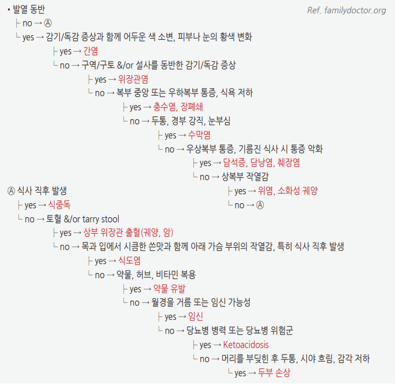

# 위장 질환의 감별 Differential Diagnosis of Gastrointestinal Disorders

## <mark style="color:green;">일반 사항</mark>

성인의 복통·소화불량·삼킴곤란·구역/구토·설사·트림·복부 팽만을 증상과 위험도에 따라 감별함. 증상의 위치·시간 양상은 진단 단서이며, 단독으로 원인 질환을 확정하지 않음. 소아의 연령별 진단기준과 응급 평가는 별도로 적용함.

## <mark style="color:green;">원인 및 위험 인자</mark>

기질성 위장관 질환, 장-뇌 상호작용 장애(DGBI), 약물·식이, 감염 및 위장관 외 질환을 함께 고려함. 고령, 면역저하, 복부 수술력, 혈관질환·심방세동, 임신 가능성, 위장관암 가족력은 감별과 검사 문턱에 영향을 줌.

### <mark style="color:orange;">약물에 의한 위장관 증상</mark>

<table><thead><tr><th width="230">증상</th><th>흔한 원인 약물</th></tr></thead><tbody><tr><td>GERD 악화</td><td>칼슘채널차단제(CCB), 질산염제(nitrates), 항콜린제, theophylline 등</td></tr><tr><td>약물 유발 식도염</td><td>bisphosphonate, doxycycline, 철분제, KCl, NSAIDs</td></tr><tr><td>위궤양 / 위장관 출혈</td><td>NSAIDs, aspirin; 항혈소판제·항응고제 병용 시 출혈 위험 증가</td></tr><tr><td>설사</td><td>metformin, 마그네슘 제제, 항생제, PPI, colchicine, acarbose, SSRI, 하제 등</td></tr><tr><td>변비</td><td>opioid, 항콜린제, 철분제, calcium, verapamil 등</td></tr><tr><td>오심 / 구토</td><td>GLP-1/GIP 작용제, opioid, digoxin, levodopa, 항암제, 항생제 등</td></tr><tr><td>조기 포만감 / 위배출 지연</td><td>GLP-1 수용체 작용제, GLP-1/GIP 이중 작용제, opioid, 항콜린제 등</td></tr></tbody></table>


GLP-1 수용체 작용제(예: semaglutide, liraglutide) 및 GLP-1/GIP 이중 작용제(예: tirzepatide)는 오심, 구토, 조기 포만감, 위배출 지연, 설사 또는 변비를 유발할 수 있음. 당뇨병·비만 치료제의 투여 여부와 시작·증량 시점을 병력 청취에 포함함. 증상이 지속되거나 심하면 단순 약물 부작용으로 단정하지 않고 탈수, 담낭질환, 췌장염, 장폐색 등 다른 원인을 평가하며, 처방 의료진과 감량·일시 중단 여부를 협의함.


약물 관련성을 평가할 때는 일반약·건강기능식품·한약·하제도 확인함. 약물 투여와 증상 발생의 시간 관계를 확인하되, 필요한 약제의 감량·중단은 적응증과 대체 치료를 함께 고려함.

## <mark style="color:green;">임상 양상</mark>

### <mark style="color:orange;">질환에 따른 주요 증상</mark>

<table><thead><tr><th width="220">질환</th><th>주요 증상 및 특징</th></tr></thead><tbody><tr><td>기능성 소화불량</td><td>증상을 설명할 구조적·전신성·대사성 질환이 없으면서 일상생활에 지장을 주는 식후 포만감, 조기 포만감, 상복부 통증, 상복부 작열감 중 하나 이상이며 PDS 또는 EPS 기준을 충족함. 진단 전 최소 6개월 전에 시작되어 최근 3개월간 기준 충족 (☞ <a href="076_-functional-dyspepsia-fd.md">기능성 소화불량</a>)</td></tr><tr><td>식후곤란증후군(PDS)</td><td>일상생활에 지장을 주는 식후 포만감 및/또는 조기 포만감이 주 2일 이상(Rome V); 상복부 팽만·트림·구역 동반 가능. 구역이 주증상이거나 구토가 지속되면 PDS 진단에서 제외하고 다른 구역·구토 질환 및 위마비 평가</td></tr><tr><td>상복부통증증후군(EPS)</td><td>일상생활에 지장을 주는 상복부 통증 및/또는 작열감이 주 1일 이상이며 PDS 기준은 충족하지 않음(Rome V). 구역이 주증상이거나 구토가 지속되면 다른 질환 평가</td></tr><tr><td>위식도역류질환(GERD)</td><td>흉골 뒤 작열감(heartburn)과 산 역류가 전형적 증상이며, 작열감이 목 쪽으로 상승할 수 있음 (☞ <a href="081_-gerd.md">위식도역류질환</a>)</td></tr><tr><td>유문부 폐쇄, 위마비</td><td>식후 포만감, 조기 포만감, 오심·구토; 충분한 금식 후에도 유발되는 진수음(succussion splash)은 위 내용물 저류를 시사할 수 있으나 특이도는 제한적</td></tr><tr><td>장폐색</td><td>산통성 복통, 복부 팽만, 구토, 가스·대변 배출 감소/중단; 초기에는 고음성·증가된 장음이 들릴 수 있으나 진행하면 감소 또는 소실 가능. 장음만으로 폐색 여부를 판단하지 않으며, 부분 폐색에서는 대변·가스 배출이 일부 남을 수 있음</td></tr><tr><td>장마비</td><td>복부 팽만, 오심·구토, 가스·대변 배출 감소와 감소된 장음; 기계적 폐색과 감별 필요</td></tr><tr><td>장허혈</td><td>초기에는 복부 진찰 소견에 비해 매우 심한 통증(pain out of proportion)이 나타날 수 있으나, 진행하면 압통·복막자극징후 발생</td></tr><tr><td>내장성 복통</td><td>위치가 불명확한 정중선 주변 또는 광범위한 통증; 자율신경 증상 동반 가능</td></tr><tr><td>췌장염, 담낭염</td><td>구토로 호전되지 않는 지속적 상복부 또는 우상복부 통증; 각각 등 또는 우견갑부로 방사 가능</td></tr><tr><td>복막 자극</td><td>움직임·기침으로 악화되는 통증, 불수의적 guarding, rigidity, 반발압통; 고령자·면역저하자에서는 소견이 뚜렷하지 않을 수 있음</td></tr><tr><td>복벽 통증</td><td>국소적으로 명확한 압통; 복근을 긴장시킬 때 통증이 유지·증가하는 Carnett 징후가 시사적</td></tr><tr><td>삼투성 설사</td><td>금식 시 감소하거나 호전 (☞ <a href="083_-acute-diarrhea.md">설사</a>)</td></tr><tr><td>분비성 설사</td><td>금식 중에도 지속되는 다량의 수양성 설사</td></tr><tr><td>염증성 설사</td><td>혈변·점액변, 발열, 복통, 배변 절박감; 감염성 장염과 IBD 등 감별</td></tr></tbody></table>

### <mark style="color:orange;">증상 및 병력에 따른 감별</mark>

<table><thead><tr><th width="300">증상 / 소견</th><th>시사 진단</th></tr></thead><tbody><tr><td>삼킴곤란, 삼킴 통증</td><td>구인두 또는 식도 질환; 진행성 고형식 삼킴곤란은 구조적 병변 우선 배제</td></tr><tr><td>설명되지 않는 흉부 통증</td><td>심장 원인을 먼저 평가한 후 GERD·식도 운동장애·기능성 흉통 고려</td></tr><tr><td>목의 덩어리 느낌(globus sensation)</td><td>인후두 또는 식도 질환, 기능성 globus</td></tr><tr><td>스트레스로 악화</td><td>DGBI에서 흔하지만 기질성 질환을 배제하지 않음</td></tr><tr><td>잠에서 깰 정도의 통증·설사</td><td>기질성 질환 가능성을 높임</td></tr><tr><td>불수의적 복부 근육 경직, 반발압통</td><td>복막 자극</td></tr><tr><td>발열</td><td>감염·염증 질환; 종양열 등도 감별</td></tr><tr><td>어지럼증과 이명을 동반한 구역/구토</td><td>전정계 질환</td></tr><tr><td>체중 감소, 피로감</td><td>종양, 염증 질환, 흡수장애, 내분비·대사 질환, 우울증 등</td></tr><tr><td>기립성 저혈압</td><td>실혈, 탈수, 패혈증, 자율신경계 이상</td></tr><tr><td>선홍색 또는 적갈색 혈변</td><td>대개 하부위장관 출혈; 혈역학적 불안정을 동반한 대량 혈변에서는 상부위장관 출혈도 고려</td></tr><tr><td>하부위장관 출혈(고령)</td><td>게실 출혈, 혈관이형성증, 대장암, 허혈성 대장염 등</td></tr><tr><td>하부위장관 출혈(청년)</td><td>항문 질환, 감염성 장염, 염증성 장질환 등</td></tr><tr><td>흑색변(melena)</td><td>대개 상부위장관 출혈; 소장 또는 우측 대장 출혈도 가능. 철분·bismuth 등에 의한 검은 변과 구분</td></tr><tr><td>복통이 배변과 연관됨</td><td>IBS 시사</td></tr><tr><td>반복적 복부 팽만</td><td>DGBI, 변비, 음식 불내성; 위험 인자가 있을 때 SIBO 등 고려</td></tr></tbody></table>

### <mark style="color:$danger;">🚩 Red Flags!</mark>

<mark style="color:$danger;">**즉각 조치**</mark>

* 반발압통, 판자배, 불수의적 근육 경직 → 복막염·천공을 고려하여 응급 평가  `[복막 자극]`
* 토혈·혈변·흑색변과 혈역학적 불안정, 실신·의식 변화 → 소생술과 응급 출혈 평가  `[중증 위장관 출혈]`
* 갑작스럽고 심한 복통, 특히 진찰 소견에 비해 매우 심한 통증 또는 쇼크 동반 → 장허혈·대동맥 질환 응급 평가; 급성 장간막허혈 의심 시 CT 혈관조영술을 지연하지 않음  `[장허혈·대동맥 질환]`
* 심한 복통과 팽만·지속 구토·가스/대변 배출 감소 또는 중단 → 응급 영상·외과 평가  `[장폐색·교액]`
* 지속적 담즙성 구토 또는 분변성 구토, 특히 심한 복통·팽만 동반 → 폐색 등 응급 원인 평가  `[폐색 의심 구토]`
* 침도 삼키지 못하거나 침을 흘리는 급성 음식 매복 → 기도·흡인 위험 평가 및 응급 내시경; 완전 식도 폐색은 가능하면 2시간 이내, 늦어도 6시간 이내 처치  `[완전 식도 폐색]`
* 감염 의심과 저혈압·의식 변화·호흡곤란·저관류, 또는 원인 불명의 쇼크 → 응급 소생 및 원인 평가  `[패혈증·쇼크]`
* 상복부 불편감·구역과 흉부 압박감·식은땀·호흡곤란 등 허혈 의심 소견 → ECG·troponin을 포함한 응급 평가  `[급성관상동맥증후군]`
* 임신 가능성이 있는 여성의 복통과 실신·쇼크 또는 질출혈 → 자궁외임신 등 응급 평가  `[산부인과 응급질환]`

<mark style="color:$warning;">**당일~수일 내 평가**</mark>

* 침은 삼킬 수 있으나 급성 음식 매복이 지속됨 → 당일 평가하여 24시간 이내 내시경; 침도 삼키지 못하면 즉각 조치  `[불완전 식도 폐색]`
* 새로 발생하거나 진행하는 삼킴곤란·삼킴 통증 → 수일 내 조기 평가; 급성 매복은 위 처치 시한 적용  `[식도 구조·염증 질환]`
* 혈역학적으로 안정적이어도 새로 발생한 토혈·흑색변 또는 지속·반복되는 유의한 혈변 → 당일 평가  `[위장관 출혈]`
* 설명되지 않는 체중 감소 또는 철결핍·철결핍빈혈 → 감소 속도·빈혈 정도·동반 증상에 따라 조기 내시경 등 평가  `[악성종양·출혈·흡수장애]`
* 심한 구역·구토로 탈수·전해질 이상 또는 경구 섭취 곤란 → 당일 평가  `[탈수·대사 이상]`
* 반복되는 야간 설사 또는 야간 증상과 체중 감소·발열·빈혈 동반 → 조기 기질성 질환 평가  `[염증·분비성 질환]`
* 복부 종괴 촉지 → 조기 영상·내시경 평가  `[복부 종괴]`
* 발열과 황달·우상복부 통증 → 당일 평가; 저혈압·의식 변화·장기기능장애 동반 시 즉각 조치  `[급성 담관염]`

<mark style="color:$info;">**조기 평가 및 추적**</mark>

* 40세 이상에서 새로 발생한 소화불량 → 최근 내시경 결과·위험도·경과를 고려하여 조기 상부위장관 내시경 계획. 연령만으로 응급 또는 당일 검사의 적응증이 되는 것은 아님  `[위암 등 기질성 질환]`
* 적절한 경험적 치료에도 반응하지 않는 소화불량, 반복 복통 또는 만성 설사 → 진단과 검사 필요성 재평가  `[지속·반복 증상]`
* _H. pylori_ 제균 실패 또는 제균 여부 미확인 → 이전 항생제 노출을 고려한 구제요법 및 제균 확인 계획  `[H. pylori 감염]`
* 조직검사상 위축성 위염·장상피화생 → 병변 범위·위험도·가족력에 따른 추적 계획  `[위 전암성 병변]`
* 자가면역 위염 의심 → 철결핍·비타민 B12 결핍·악성빈혈·자가면역 갑상선질환 평가  `[자가면역 위염]`
* 위암·대장암 가족력이 있는 환자의 새로 발생하거나 지속되는 증상 → 가족력의 구체적 내용과 동반 경고 징후에 따라 검사 시기 결정  `[위장관암 가족력]`
* DGBI로 판단되지만 삶의 질 저하가 크거나 초기 치료에 반응하지 않음 → 동반 질환·진단·치료 전략 재평가  `[난치성 DGBI]`


야간 복통 하나만으로 기질성 질환을 확정하거나 일률적으로 긴급 검사를 시행하지 않음. 반복되는 야간 설사, 진행성 경과, 출혈·체중 감소 등 동반 소견을 함께 평가함.


_<mark style="color:$info;">Ref. ESGE foreign body guideline. Endoscopy. 2016; WSES acute mesenteric ischemia guideline. World J Emerg Surg. 2022; 국내 기능성 소화불량 진료지침. 2020.</mark>_

## <mark style="color:green;">진단</mark>

### <mark style="color:orange;">위장관 증상 접근</mark>

다음 5단계 순서로 평가함.

### <mark style="color:orange;">Step 1 - Red Flags 확인</mark>

앞의 Red Flags에 따라 긴급도를 분류함. 경고 징후가 없더라도 진행성 경과나 고위험 배경이 있으면 기질성 질환 가능성을 재평가함.

### <mark style="color:orange;">Step 2 - 해부학적 위치 분류</mark>

<table><thead><tr><th width="200">부위</th><th>주요 감별 질환</th></tr></thead><tbody><tr><td>식도</td><td>GERD, 식도염(호산구성 식도염 포함), 식도 협착·종양, 식도 운동장애</td></tr><tr><td>상복부</td><td>기능성 소화불량, 위염, 소화성 궤양(PUD), 췌담도 질환</td></tr><tr><td>우상복부</td><td>담석증, 담낭염, 담관염, 간질환</td></tr><tr><td>등으로 방사되는 상복부</td><td>췌장염, 췌장질환, 대동맥 질환</td></tr><tr><td>우하복부</td><td>충수염, 크론병(Crohn disease), 비뇨생식기 질환</td></tr><tr><td>좌하복부</td><td>게실염, 대장염, 비뇨생식기 질환</td></tr><tr><td>전반적 복통</td><td>장염, 장폐색, 장허혈, 복막염, DGBI</td></tr></tbody></table>


상복부 불편감·오심은 급성관상동맥증후군, 하엽 폐렴, 폐색전증, 대동맥 질환, 당뇨병케톤산증 등 비위장관 질환으로 나타날 수 있음. 고령자·당뇨병 환자·심혈관 위험군에서는 ECG ± troponin을, 임신 가능성이 있는 여성의 복통·구토에서는 임신반응검사를 임상적으로 고려함.


### <mark style="color:orange;">Step 3 - 시간 및 유발·완화 패턴 평가</mark>

<table><thead><tr><th width="230">발생 양상</th><th>시사 진단</th></tr></thead><tbody><tr><td>갑작스러운 심한 통증</td><td>천공, 장허혈, 대동맥 질환, 담석 산통·요관 산통 등</td></tr><tr><td>급성 발현 후 수 시간~수일 지속</td><td>감염성 위장염, 충수염, 담낭염, 급성 췌장염, 장폐색</td></tr><tr><td>수 주~수개월 반복</td><td>DGBI, 소화성 궤양, 염증성 장질환, 담석 질환, 신생물</td></tr><tr><td>식후 악화</td><td>PDS, 담낭 질환, 위마비, 만성 장허혈; 위궤양에서도 가능</td></tr><tr><td>공복·야간 악화, 음식 또는 제산제로 일시 호전</td><td>십이지장궤양에서 가능하나 진단적 특이도는 낮음</td></tr><tr><td>복통이 배변과 연관되거나 배변 빈도·형태 변화 동반</td><td>IBS</td></tr><tr><td>금식 중에도 지속되는 야간 설사</td><td>분비성·염증성 설사 등 기질성 질환 가능성</td></tr><tr><td>수면 중 통증·설사로 각성</td><td>기질성 질환 가능성을 높이지만 단독 진단 기준은 아님</td></tr></tbody></table>


식사·배변과의 연관성 및 통증 위치는 가능성을 시사할 뿐 진단적 특이도가 제한적임. 고전적인 위궤양·십이지장궤양 통증 패턴만으로 진단하거나 내시경 필요성을 판단하지 않음.


### <mark style="color:orange;">Step 4 - DGBI 가능성 및 기질성 질환 평가</mark>

<table><thead><tr><th width="260">DGBI 가능성을 높이는 소견</th><th>기질성 질환 평가가 필요한 소견</th></tr></thead><tbody><tr><td>특정 증상 기반 진단기준 충족</td><td>체중 감소</td></tr><tr><td>증상 변동성이 큼</td><td>철결핍·빈혈</td></tr><tr><td>식사·배변·스트레스와 일정한 연관</td><td>진행성 악화</td></tr><tr><td>적절한 기본 평가에서 원인 질환이 확인되지 않음</td><td>야간 증상</td></tr><tr><td>만성적으로 반복되는 경과</td><td>고령에서 새로 발생한 증상</td></tr><tr><td>다른 DGBI 또는 만성 통증 증후군 동반</td><td>위장관 출혈·복부 종괴·지속 구토</td></tr></tbody></table>


스트레스 연관성이나 정상 검사 결과만으로 DGBI를 진단하거나 기질성 질환을 배제할 수 없음. DGBI는 증상 기반 기준과 제한적인 필수 평가를 이용한 적극적 진단이며, 기질성 질환과 동반될 수도 있음.


**DGBI**

* 기능성 위장관 질환(FGID)은 현재 **장-뇌 상호작용 장애(disorders of gut-brain interaction, DGBI)**라는 개념으로 분류함
* 장-뇌 축(gut-brain axis), 내장 과민성, 운동·점막/면역 기능 변화, 장내 미생물 및 중추 감작 등이 병태생리에 관여
* DGBI는 단일 진단명이 아니라 분류 체계이며, 2026년 Rome V가 발표됨

**Rome V를 반영한 성인 DGBI 주요 분류·대표 질환**

* 위십이지장 기능성 질환: 기능성 소화불량(FD)―식후곤란증후군(PDS), 상복부통증증후군(EPS)
* 식도 기능성 질환: 기능성 흉통, 기능성 삼킴곤란, 기능성 가슴쓰림, 역류과민성
* 장 질환: 과민성 장 증후군(IBS), 만성 변비(chronic constipation; 기존 기능성 변비), 기능성 설사, 기능성 복부 팽만(functional abdominal bloating; 객관적 팽창 동반 가능)
* 중추 매개 위장관 통증 장애: 중추매개 복통증후군(CAPS)
* 항문직장 질환: 배변협응장애(dyssynergic defecation) 등


**Rome V 핵심 변화**

* **성인 PDS**: 일상생활에 지장을 주는 식후 포만감 및/또는 정상 식사량을 끝내기 어렵게 하는 조기 포만감이 주 2일 이상. 식후 2시간 이내 유발·악화되는 상복부 통증·작열감도 PDS에 포함될 수 있음.
* **성인 EPS**: 일상생활에 지장을 주는 상복부 통증 및/또는 작열감이 주 1일 이상이며 **PDS 기준은 충족하지 않음**. Rome IV의 PDS–EPS 중복 분류와 구분함. 구역이 주증상이거나 구토가 지속되면 PDS·EPS 진단에서 제외함.
* FD의 기간 기준은 최소 6개월 전 시작, 최근 3개월간 기준 충족임.
* **성인 IBS**: 지속적이지 않고 반복되는 복통 **또는 복부 불편감**이 최근 3개월 동안 평균 월 3일 이상이며, 배변과의 관련성·배변 빈도 변화·대변 형태 변화 중 2개 이상과 연관. 증상은 진단 최소 6개월 전에 시작됨.
* 기간 기준을 충족하기 전에도 경고 징후와 임상 경과를 평가하고 필요한 증상 치료를 지연하지 않음.

_<mark style="color:$info;">Ref. Rome Foundation. Rome V Criteria. 2026.</mark>_


### <mark style="color:orange;">Step 5 - 경험적 치료 vs 조기 검사</mark>

<table><thead><tr><th width="260">상황</th><th>접근</th></tr></thead><tbody><tr><td>40세 미만 소화불량 + alarm feature 없음</td><td>국내에서는 _H. pylori_ test-and-treat 또는 제한된 기간의 경험적 치료 고려</td></tr><tr><td>40세 이상 새로 발생한 소화불량</td><td>조기 상부위장관 내시경 권고</td></tr><tr><td>전형적 GERD 증상 + alarm feature 없음</td><td>경험적 PPI 치료 가능</td></tr><tr><td>Alarm feature 존재</td><td>증상과 의심 질환에 맞추어 조기 내시경·영상·혈액검사</td></tr><tr><td>지속 구토 / 탈수</td><td>전해질·신기능 평가 및 폐색 등 원인에 따른 영상검사</td></tr><tr><td>만성 설사</td><td>수양성·혈성·지방성 양상을 구분하여 필요한 혈액·대변검사를 선택하고 약물·감염·염증·흡수장애 평가; 수양성 설사에서는 분변 calprotectin/lactoferrin, Giardia, celiac disease, 담즙산 설사와 현미경적 대장염을 고려</td></tr></tbody></table>

_<mark style="color:$info;">Ref. Clinical Practice Guidelines for Functional Dyspepsia in Korea. J Neurogastroenterol Motil. 2020; Second Asian Consensus Report on Functional Dyspepsia (2025): Updated Recommendations. 2026; AGA chronic diarrhea guideline. 2019.</mark>_

### <mark style="color:orange;">기본 평가와 표적 검사</mark>

* 활력징후·의식·탈수·소변량과 영양 상태를 확인하고 복부 팽만, 국소 압통, 복막 자극, 종괴·탈장 여부를 진찰함. 출혈·항문 질환·분변 매복이 의심되면 직장수지검사를 고려함.
* 검사는 증상과 의심 질환에 맞추어 선택함. 빈혈·출혈 의심 시 CBC·철 대사, 지속 구토·탈수 시 전해질·신기능·혈당, 췌담도 질환 의심 시 lipase·간기능검사와 적절한 초음파/CT를 고려함. 모든 DGBI 의심 환자에게 광범위 검사나 CT를 반복하지 않음.
* 복막 자극징후·부분 폐색·초기 장허혈은 진찰이나 단일 검사만으로 배제할 수 없음. **정상 lactate로 급성 장간막허혈을 배제하지 않음**.

### <mark style="color:orange;">삼킴곤란의 구분</mark>

* 삼킴 시작 곤란·기침·사레·젖은 목소리는 구인두 삼킴곤란과 흡인 가능성을 시사함. 식도 증상은 음식이 내려가다 걸리는 느낌이 전형적이나 환자가 지목하는 위치만으로 병변 위치를 확정하지 않음.
* 고형식에서 시작하여 진행하는 증상은 협착·종양 등 구조적 병변, 처음부터 고형식·액체 모두의 증상은 운동장애를 시사함. 이 양상만으로 확진하지 않음.
* 반복 음식 매복·고형식 삼킴곤란, 특히 아토피 병력이 있으면 **호산구성 식도염(EoE)**을 고려함. 육안상 식도가 정상이어도 식도 조직검사가 필요할 수 있음.

_<mark style="color:$info;">Ref. BSG/BSPGHAN eosinophilic oesophagitis guideline. Gut. 2022.</mark>_

### <mark style="color:orange;">만성 설사의 평가</mark>

* **4주 이상 지속되는 설사**는 수양성·염증성/혈성·지방성 양상, 체중 변화, 식이·약물, 항생제·입원·여행·수술력을 확인함. 고령자·변비 환자는 분변 매복에 의한 넘침설사도 고려함.
* 기능성 설사/IBS-D가 의심되는 만성 수양성 설사에서는 분변 calprotectin 또는 lactoferrin으로 IBD 선별을 고려함. CRP·ESR만으로 IBD를 배제하지 않음.
* Giardia 분변항원 또는 PCR 검사를 고려함. 다른 기생충 검사는 여행·노출 위험에 따라 선택하고, 항생제·의료기관 노출 후 새로 발생한 설사에서는 _C. difficile_을 고려함.
* Celiac disease 검사는 **글루텐 섭취 중 tTG-IgA와 total IgA**를 이용함. IgA 결핍 시 IgG 기반 검사로 보완하고, 양성이거나 임상적 의심이 높으면 전문 평가 및 십이지장 생검을 고려함. 검사 전에 임의로 글루텐 제한 식이를 시작하지 않음.
* 담즙산 설사(회장 질환·절제, 담낭절제 후 또는 원발성)와 **현미경적 대장염**을 고려함. 후자는 대장내시경 외관이 정상일 수 있어 의심 시 **우측·좌측 대장 생검**이 필요함.
* 혈변·체중 감소·빈혈·저알부민혈증, 지방변·흡수장애, 면역저하 또는 중요한 가족력이 있으면 의심 질환에 따른 평가를 확대함. **AGA 2019의 제한 검사 권고는 경고 징후가 없는 면역정상 성인의 만성 수양성 설사에 대한 것으로, 모든 만성 설사에 동일하게 적용하지 않음**.

_<mark style="color:$info;">Ref. AGA chronic watery diarrhea guideline. Gastroenterology. 2019; UEG/EMCG microscopic colitis guideline. United European Gastroenterol J. 2021; ACG celiac disease guideline. Am J Gastroenterol. 2023.</mark>_

### <mark style="color:orange;">구역·구토의 감별 진단</mark>

<figure><figcaption></figcaption></figure>

***

<table><thead><tr><th width="230">발생 양상·동반 소견</th><th>주요 감별 진단</th></tr></thead><tbody><tr><td>급성, 설사·복통 동반</td><td>감염성 위장염, 식중독</td></tr><tr><td>급성, 심한 복통·복부 팽만</td><td>장폐색, 장허혈, 충수염, 담낭염, 췌장염 등 급성 복부질환</td></tr><tr><td>약물 시작·증량 후</td><td>GLP-1/GIP 작용제, opioid, 항생제, digoxin, levodopa, 항암제 등</td></tr><tr><td>가임기 여성</td><td>임신; 복통·출혈 동반 시 자궁외임신 등 산부인과 응급질환</td></tr><tr><td>두통·시야 또는 신경학적 증상 동반</td><td>편두통, 두개내압 상승, 중추신경계 질환</td></tr><tr><td>현훈·이명 동반</td><td>말초 또는 중추 전정계 질환</td></tr><tr><td>대사 이상·전신질환 소견</td><td>DKA, 요독증, 부신기능저하, 고칼슘혈증, 갑상선질환 등</td></tr><tr><td>만성 식후 포만감·조기 포만감</td><td>위마비, 유문부 폐쇄, 기능성 소화불량</td></tr><tr><td>삽화성 반복 구토, 사이에는 호전</td><td>주기성 구토증후군, 편두통 관련 구토</td></tr><tr><td>식후 최근 섭취한 음식이 구역·헛구역질 없이 반복적으로 입으로 올라옴</td><td>반추증후군(rumination syndrome); GERD의 역류 및 실제 구토와 구분</td></tr><tr><td>장기간 cannabis 사용, 뜨거운 목욕으로 일시 호전</td><td>칸나비노이드 과다구토증후군(cannabinoid hyperemesis syndrome); 뜨거운 목욕 반응만으로 확진하지 않으며 대마 중단 후 호전 여부가 중요함</td></tr></tbody></table>

* 구토는 능동적 배출이며 대개 구역·헛구역질을 동반함. 수동적 역류·반추와 구분하고, 원인이 불명확한 지속 증상은 약물·대사·기계적 폐색을 먼저 평가함.
* 위마비는 증상만으로 진단하지 않음. 기계적 폐색을 배제하고 **객관적 위배출 지연**을 확인해야 함. AGA 2025는 의심 환자에서 **4시간 위배출검사**를 2시간 검사보다 권고함. 검사 전 혈당과 위배출에 영향을 주는 약물의 조정 여부를 검사실 프로토콜에 따라 확인함.
* 내시경에서 음식물이 남아 있다는 사실만으로 위마비를 확진하지 않음. 약물·금식 상태·폐색 등도 고려함.

_<mark style="color:$info;">Ref. UEG/ESNM chronic nausea and vomiting guideline. United European Gastroenterol J. 2025; AGA gastroparesis guideline. Gastroenterology. 2025; ACG gastroparesis guideline. Am J Gastroenterol. 2022.</mark>_

### <mark style="color:orange;">상부위장관 내시경 적응증</mark>

#### 일반 원칙

* 증상·의심 질환에 맞는 상부위장관 경고 징후 존재; 하부위장관 증상은 대장 평가 등 적절한 검사 선택
* 40세 이상에서 새로 발생한 소화불량; 최근 내시경 결과·위험도·임상 경과도 함께 고려
* 원인 불명 상부위장관 출혈 의심 또는 철결핍빈혈; 성인 남성·폐경 후 여성의 원인 불명 철결핍빈혈은 하부위장관 평가도 함께 고려
* 지속 구토 또는 진행성 삼킴곤란·삼킴 통증
* 적절한 경험적 치료에도 지속되는 증상
* 내시경 결과가 진단·치료 방침 또는 조직검사 여부를 바꿀 가능성이 있는 경우


40세 미만이고 alarm feature가 없는 소화불량에서는 _H. pylori_ 요소호기검사(UBT) 또는 분변항원검사에 따른 **test-and-treat** 전략이나 제한된 기간의 경험적 치료를 고려할 수 있음. 다만 우리나라는 위암 고발생 지역이므로 위험도와 임상 경과에 따라 내시경 문턱을 낮춤. _H. pylori_ 검사 전 PPI/P-CAB는 최소 2주, 항생제와 bismuth는 최소 4주 중단함. 제균 치료 후에는 항생제·bismuth 종료 최소 4주 후, PPI/P-CAB 중단 최소 2주 후 UBT·분변항원검사 또는 적절한 생검검사로 제균 성공을 확인함. 혈청항체검사는 제균 성공 확인에 사용하지 않음.


#### 우리나라 위암 국가검진

* 국가암검진사업은 **40세 이상** 남녀를 대상으로 **2년** 간격의 위암 검진을 시행하며, 위내시경검사를 우선하고 시행하기 어려운 경우 위장조영검사를 선택적으로 고려함.
* **개정 국가 위암 검진 권고안(2025; 2026년 발표)**은 **40～74세 무증상 성인에서 위내시경검사만을 2년 간격의 1차 검진법으로 권고**함. 위장조영검사는 위내시경이 불가능한 특수한 상황에서 고려하며, 일반적인 경우에는 조건부 비권고임.
* **75세 이상**은 건강 상태·기대여명·검진 이득과 위해를 고려하여 개별 결정함. 이 근거 기반 권고안의 연령 범위와 국가검진사업의 행정상 대상 기준은 구분함.
* 무증상 인구의 검진 주기는 증상 환자의 진단 내시경 시기와 동일한 개념이 아님.
* 위축성 위염·장상피화생 환자의 추적 간격은 병변 범위, 조직학적 중증도(OLGA/OLGIM), 위암 가족력, _H. pylori_ 상태 및 내시경 질에 따라 개별화함.
* 광범위 장상피화생, 불완전형 장상피화생, OLGA/OLGIM III–IV 또는 위암 직계가족력 등 고위험 소견이 있으면 전문 평가로 추적 간격을 개별화함. 국내 2023 지침은 2년보다 짧은 추적 간격의 이득을 판단할 근거가 불충분하여 찬반 권고를 제시하지 못했으므로, 위 소견만으로 일률적인 연 1회 검사를 권고하지 않음. 조직학적 이형성·종양 의심 병변은 별도 진단·치료 경로를 적용함.

_<mark style="color:$info;">Ref. 국립암센터. 국가 위암 검진 권고안(2025), 2026년 발표; Clinical Practice Guideline for Gastritis in Korea. J Korean Med Sci. 2023.</mark>_

## <mark style="color:$warning;">Management</mark>


경고 징후의 긴급도에 따라 원인 평가를 우선하고, 증상 치료와 수분·영양 관리를 병행함. DGBI가 확인되면 질환의 장-뇌 상호작용 기전을 설명하고 식이·행동치료·필요한 약물 치료를 개별화함.


### <mark style="color:orange;">GLP-1/GIP 작용제 투여 환자의 내시경 전 주의사항</mark>

GLP-1 수용체 작용제 및 GLP-1/GIP 이중 작용제는 상부위장관 내시경 시 위 내용물 잔류와 검사 중단·재검사 가능성을 높일 수 있음. 다만 위 내용물 잔류 증가가 임상적으로 유의한 흡인 위험 증가로 직접 이어지는지는 아직 불확실함.

* OCULUS 무작위 연구(JAMA Intern Med 2026, 중간분석 60명): 정규 투여 일정 유지군의 임상적으로 유의한 잔류 위 내용물 25.0% vs 보류군 3.1%; 위내시경 단독 하위군 46.7% vs 5.0%. 대장내시경을 함께 받아 전날 맑은 유동식을 섭취한 하위군에서는 양 군 모두 0%였으나, 식이 효과를 독립적으로 검증하도록 설계된 비교는 아님. 중등도 진정/감시마취하 검사에서 안정 용량을 최소 1개월간 유지한 환자 대상이며, 위마비·위출구 폐색·전신마취 예정 등은 제외함. 조기 종료된 소규모 연구로, 흡인 사건 감소를 입증한 결과는 아님
* OCULUS의 용량 1회 보류는 주 1회 제제에서 마지막 투여부터 검사까지 7\~13일, 매일 제제에서는 최소 1일의 약제 비투여 간격을 의미함. 해당 간격을 모든 환자에게 적용할 표준으로 해석하지 않음
* 국내 후향 연구(World J Diabetes 2025; 한국인 제2형 당뇨병 환자): GLP-1 제제 사용군에서 위점막 가시성 불량과 검사 중단·재검사 위험 증가 보고


⚠️ GLP-1/GIP 작용제 투여 환자의 상부위장관 내시경 전 관리

국제 다학제 권고 사이에도 약제 중단과 식이 관리 범위가 일치하지 않음. 기존 다학제 권고는 대체로 무증상 환자에서 약제를 계속하면서 위험 기반 관리 또는 24시간 고형식 제한을 제안하지만, 2026년 OCULUS 연구에서는 시술 전 예정 용량 1회 보류가 잔류 위 내용물을 감소시킴.

* 증량기, 고용량, 심한 오심·구토·복부 팽만·경구 섭취 곤란, 위마비 또는 위배출 지연 질환, opioid 사용 등 위험 인자를 확인함. OCULUS에서는 유의한 잔류 위 내용물이 있었던 환자도 당일 상부위장관 증상이 없었으므로, **무증상만으로 위 내용물 잔류를 배제하지 않는다**.
* 약제 유지 또는 시술 전 예정 용량 보류는 당뇨병 조절 상태, 투여 목적, 증상 및 기관의 내시경·마취 프로토콜에 따라 개별 결정함.
* 시술 전 24시간 고형식을 피하고 맑은 유동식만 섭취하는 방법은 잔류 위 내용물 감소를 위한 합리적 전략임. 이후 맑은 유동식의 중단 시간은 적용 지침과 기관 프로토콜에 따름. **SPAQI 2025**는 고형식 24시간 제한과 함께 고탄수화물 맑은 유동식(포도당 ≥10%)은 8시간, 저탄수화물/무탄수화물 맑은 유동식은 4시간 금식을 권고함. 이 시간을 모든 국제 지침의 공통 기준으로 제시하지 않음.
* 당뇨병 환자는 식이 제한 또는 약제 보류 기간에 혈당을 모니터링하고 필요시 처방 의료진과 혈당강하제 조정을 협의함.
* 심한 위장관 증상이 있으면 선택적 시술 연기를 우선 고려함. 응급 내시경은 약제 중단 간격을 채우기 위해 지연하지 않고 흡인 위험과 기도 보호 전략을 함께 결정함.
* 금식 미준수 또는 고위험 환자에서는 숙련된 검사자가 위 초음파(POCUS)를 고려할 수 있음. 잔류물이 의심되면 시술 연기 또는 기도 보호 전략은 내시경·마취팀이 개별 결정함.


_<mark style="color:$info;">Ref. SPAQI multidisciplinary consensus statement. Br J Anaesth. 2025; Holding vs Continuing GLP-1/GIP Agonists Before Upper Endoscopy: OCULUS Randomized Clinical Trial. JAMA Intern Med. 2026.</mark>_

_<mark style="color:$info;">OCULUS 논문의 2026년 5월 4일·18일 정정은 Visual Abstract의 막대그래프와 Figure 2의 군 표시 오류에 관한 것임. 위 수치는 정정된 본문 기준의 intention-to-treat 분석임.</mark>_

### <mark style="color:orange;">트림 및 복부 팽만의 평가 및 관리</mark>


**bloating**은 주관적 팽만감, **distention**은 객관적 복부 팽창을 의미함. 두 증상이 반드시 함께 존재하지는 않음. 난치성 복부 팽창(refractory abdominal distention)에서는 횡격막-복벽 불협응(abdominophrenic dyssynergia, APD)을 고려하며, 횡격막 호흡 훈련이 도움이 될 수 있음.


<figure><figcaption></figcaption></figure>

<strong>트림의 진단 및 관리 알고리듬</strong>

<figure><figcaption></figcaption></figure>

<strong>복부 팽만의 진단 및 관리 알고리듬</strong>

_<mark style="color:$info;">APD = abdominophrenic dyssynergia; ARM = anorectal manometry; CBT = 인지행동치료; CD = celiac disease; CIP = chronic idiopathic intestinal pseudo-obstruction; CMP = comprehensive metabolic profile; FODMAP = fermentable oligosaccharides, disaccharides, monosaccharides and polyols; HRM = high-resolution manometry; NCGS = nonceliac gluten sensitivity; SIBO = small intestinal bacterial overgrowth; TLESR = transient lower esophageal sphincter relaxation; VH = visceral hypersensitivity</mark>_

<em><mark style="color:$info;">Ref. AGA Clinical Practice Update on Evaluation and Management of Belching, Abdominal Bloating, and Distention. Gastroenterology. 2023; Fig. 4, 5.</mark></em>

### <mark style="color:orange;">AGA 트림 및 복부 팽만 관리 핵심 권고 (2023)</mark>

1. 병력·신체진찰과 impedance-pH 검사는 **위상부 트림(supragastric belching; 공기가 위까지 도달하지 않고 식도로 들어왔다가 배출됨)**과 위 트림(gastric belching)의 감별에 도움이 됨.
2. Supragastric belching에는 인지행동치료, 횡격막 호흡, 언어치료(speech therapy) 등 장-뇌 행동치료를 단독 또는 병합하여 고려함. Central neuromodulator는 별도의 약물 치료 선택지로 고려할 수 있음.
3. 원발성 복부 팽만/팽창에는 증상 기반 Rome 진단기준을 사용함. **AGA 2023 원문은 당시 Rome IV를 인용**하였음. Rome V의 성인 기능성 복부 팽만은 주 1회 이상 반복되고 주증상이어야 하며, IBS·만성 변비·기능성 설사·PDS 기준을 충족하지 않아야 함(최소 6개월 전 시작, 최근 3개월간 기준 충족).
4. 탄수화물 효소 결핍은 식이 제한 및/또는 호흡 검사로 평가할 수 있음. SIBO 위험이 있는 일부 환자에서는 소장 흡인검사 또는 glucose/lactulose 기반 수소 호흡 검사를 선택적으로 고려함. 호흡 검사는 위양성·위음성 및 장 통과시간의 영향을 고려하여 해석하며, 팽만만으로 SIBO를 진단하지 않음.
5. 복부 팽만 환자에서 celiac disease 혈청검사를 고려할 수 있음. 만성 설사·철결핍·체중 감소·가족력 등 위험도를 함께 평가하며, 검사 방법과 양성 후 접근은 진단 절을 따름.
6. Alarm feature, 최근 증상 악화 또는 비정상 신체진찰 소견이 있을 때 복부 영상 또는 상부위장관 내시경을 선택함. 안정적인 단독 팽만에서 두 검사를 일상적으로 시행하지 않음.
7. Gastric emptying study는 복부 팽만에 일상적으로 시행하지 않으며, 오심·구토가 동반된 경우 고려함.
8. 변비 연관 복부 팽만 또는 배출 장애 환자에서는 골반저 질환을 배제하기 위한 anorectal physiology test를 고려함.
9. Low-FODMAP 등 제한 식이는 가능하면 위장관 영양 전문 영양사의 지도하에 시행하고, 반응 확인 후 불필요한 장기 제한을 피함.
10. **AGA 2023은 복부 팽만/팽창 치료 목적으로 probiotics 사용을 권고하지 않음.**
11. 골반저 이상이 확인된 경우 biofeedback therapy가 도움이 될 수 있음.
12. Central neuromodulator(예: 항우울제)는 내장 과민성을 감소시키고 감각 역치를 높이며 심리적 동반 문제를 개선하여 복부 팽만 치료에 사용될 수 있음.
13. 변비가 동반된 경우 변비 약물 치료를 고려함.
14. 최면요법, 인지행동치료 등 brain-gut behavioral therapy를 사용할 수 있음.
15. APD 치료에 횡격막 호흡 훈련 및 central neuromodulator를 사용할 수 있음.


위 내용은 AGA 2023 전문가 검토의 핵심 권고에 현재 진단기준 및 임상 적용 설명을 덧붙인 요약임. Central neuromodulator를 DGBI·팽만 치료에 사용할 때는 성분·제품별 국내 허가 적응증과 급여 범위를 구분함. 복부 팽만 자체에 대한 사용은 허가 외일 수 있음.


### <mark style="color:orange;">Clinical Pearls</mark>

* **Pain out of proportion** - 초기 장허혈에서는 진찰 소견에 비해 통증이 매우 심할 수 있음; 긴급도는 Red Flags 기준 적용
* **야간 증상** - 수면 중 통증·설사로 반복해서 각성하면 기질성 질환 가능성이 높아지지만 단독 진단 기준은 아님
* **복통과 배변의 연관성** - IBS를 시사하지만 다른 질환을 배제하지 않음
* **진행성 삼킴곤란** - 구조적 식도 질환 배제 필요; 내시경 평가 대상
* **산통성 복통 + 팽만 + 구토 + 가스/대변 배출 중단** - 장폐색 가능성; 부분 폐색에서는 일부 배변이 남을 수 있음
* **식후 조기 포만감 + 오심/구토** - 기계적 폐색을 먼저 배제한 후 위마비 의심 시 **표준화된 4시간 고형식 위배출검사** 고려
* **증상 기반 기준 충족 + 적절한 기본 평가에서 원인 불명** - DGBI를 적극적으로 진단하고 brain-gut 접근 고려
* **GLP-1/GIP 작용제 시작·증량 후 위장관 증상** - 약물 관련성을 평가하되 지속적·중증 증상에서는 다른 원인을 함께 배제하고 처방 의료진과 용량 조정을 협의

***

## <mark style="color:green;">질병코드</mark>

* <mark style="color:$danger;">R10</mark> 복부 및 골반 통증 — Abdominal and pelvic pain
* <mark style="color:$danger;">R11</mark> 구역 및 구토 — Nausea and vomiting
* <mark style="color:$danger;">R13</mark> 삼킴곤란 — Dysphagia
* <mark style="color:$danger;">R14</mark> 고창 및 연관된 병태 — Flatulence and related conditions
설사는 임상 진단에 따라 다음 국내 코드를 선택함.

* <mark style="color:$danger;">A09.9</mark> 상세불명 기원의 위장염 및 결장염 — Gastroenteritis and colitis of unspecified origin
* <mark style="color:$danger;">K52.9</mark> 상세불명의 비감염성 위장염 및 결장염 — Noninfective gastroenteritis and colitis, unspecified
* <mark style="color:$danger;">K59.1</mark> 기능성 설사 — Functional diarrhoea


미국 ICD-10-CM의 R19.7을 국내 KCD 설사 코드로 그대로 옮기지 않음. 원인 질환이 확인되면 원인 질환을 중심으로 코딩하고, 필요시 별도 평가·치료한 증상을 추가함. R10·R11 등 세분류가 있는 범주는 실제 임상 기록에 맞는 세부 코드를 선택함.


## <mark style="color:green;">주요 참고문헌 및 확인 자료</mark>

### <mark style="color:orange;">임상 근거</mark>

* Rome Foundation. Rome V Criteria. 2026. — DGBI 분류 및 PDS·IBS 등 증상 기반 진단기준

  [https://theromefoundation.org/rome-v-criteria/](https://theromefoundation.org/rome-v-criteria/)

* Clinical Practice Guidelines for Functional Dyspepsia in Korea. J Neurogastroenterol Motil. 2020. — 국내 소화불량 평가 및 40세 이상 내시경 접근

  [https://pubmed.ncbi.nlm.nih.gov/31917913/](https://pubmed.ncbi.nlm.nih.gov/31917913/)

* Second Asian Consensus Report on Functional Dyspepsia (2025): Updated Recommendations. J Gastroenterol Hepatol. 2026. — 아시아 지역 기능성 소화불량 진단·치료 원칙

  [https://pubmed.ncbi.nlm.nih.gov/41656163/](https://pubmed.ncbi.nlm.nih.gov/41656163/)

* AGA. Evaluation and Management of Belching, Abdominal Bloating and Distention. 2023. — 트림·복부 팽만·팽창의 평가와 행동·식이·약물 접근

  [https://gastro.org/clinical-guidance/evaluation-and-management-of-belching-abdominal-bloating-and-distention/](https://gastro.org/clinical-guidance/evaluation-and-management-of-belching-abdominal-bloating-and-distention/)

* AGA. Clinical Practice Guideline on Management of Gastroparesis. 2025. — 위마비 의심 시 4시간 위배출검사

  [https://pubmed.ncbi.nlm.nih.gov/40976635/](https://pubmed.ncbi.nlm.nih.gov/40976635/)

* AGA. Laboratory Evaluation of Functional Diarrhea and Diarrhea-Predominant Irritable Bowel Syndrome in Adults. 2019. — 만성 수양성 설사에서 선별 검사와 감별

  [https://pubmed.ncbi.nlm.nih.gov/31302098/](https://pubmed.ncbi.nlm.nih.gov/31302098/)

* 국립암센터. 국가 위암 검진 권고안(2025). 2026년 개정안 발표. — 위내시경 단독 1차 검진, 2년 간격 및 고령자 개별 판단

  [https://www.ncc.re.kr/webzine/202608/sub_01_view.jsp?tab=tab5](https://www.ncc.re.kr/webzine/202608/sub_01_view.jsp?tab=tab5)

* Clinical Practice Guideline for Gastritis in Korea. J Korean Med Sci. 2023. — 위축성 위염·장상피화생의 평가; 2년 미만 추적 간격에 대한 근거 불충분

  [https://pubmed.ncbi.nlm.nih.gov/37012690/](https://pubmed.ncbi.nlm.nih.gov/37012690/)

* SPAQI. Perioperative Management of Patients Taking Glucagon-Like Peptide 1 Receptor Agonists: Multidisciplinary Consensus Statement. Br J Anaesth. 2025. — GLP-1 작용제 사용 환자의 식이·금식 및 시술 전후 관리

  [https://pubmed.ncbi.nlm.nih.gov/40379536/](https://pubmed.ncbi.nlm.nih.gov/40379536/)

* Effect of Glucagon-Like Peptide-1 Receptor Agonists on Gastric Mucosal Visibility During Upper Endoscopy in Asian Patients With Diabetes. World J Diabetes. 2025. — 국내 당뇨병 환자에서 위점막 가시성 및 검사 중단·재검사와의 연관성

  [https://pubmed.ncbi.nlm.nih.gov/41480609/](https://pubmed.ncbi.nlm.nih.gov/41480609/)

* Holding vs Continuing GLP-1/GIP Agonists Before Upper Endoscopy: The OCULUS Randomized Clinical Trial. JAMA Intern Med. 2026. — 용량 1회 보류와 잔류 위 내용물; 흡인 사건에 관한 결론의 한계

  [https://pubmed.ncbi.nlm.nih.gov/41837981/](https://pubmed.ncbi.nlm.nih.gov/41837981/)

* ACG. Guideline: Treatment of Helicobacter pylori Infection. 2024. — 제균 확인 시점 및 PPI/P-CAB·항생제·bismuth 중단 간격

  [https://gi.org/journals-publications/ebgi/schoenfeld_sep2024/](https://gi.org/journals-publications/ebgi/schoenfeld_sep2024/)

* UEG/ESNM. European Guideline on Chronic Nausea and Vomiting. United European Gastroenterol J. 2025;13:427–471. — 구토·역류·반추 구분 및 운동장애 평가

  [https://pubmed.ncbi.nlm.nih.gov/39754724/](https://pubmed.ncbi.nlm.nih.gov/39754724/)

* ACG. Clinical Guideline: Gastroparesis. Am J Gastroenterol. 2022. — 내시경 잔류 음식만으로 위마비를 확진할 수 없음

  [https://pmc.ncbi.nlm.nih.gov/articles/PMC9373497/](https://pmc.ncbi.nlm.nih.gov/articles/PMC9373497/)

* UEG/EMCG. European Guidelines on Microscopic Colitis. United European Gastroenterol J. 2021;9:13–37. — 정상 내시경 외관에서도 우측·좌측 대장 생검

  [https://pubmed.ncbi.nlm.nih.gov/33619914/](https://pubmed.ncbi.nlm.nih.gov/33619914/)

* ACG. Guidelines Update: Diagnosis and Management of Celiac Disease. Am J Gastroenterol. 2023. — 혈청검사·IgA 결핍·생검 평가

  [https://pubmed.ncbi.nlm.nih.gov/36602836/](https://pubmed.ncbi.nlm.nih.gov/36602836/)

* BSG/BSPGHAN. Joint Consensus Guidelines on Eosinophilic Oesophagitis. Gut. 2022. — 삼킴곤란·음식 매복에서 정상 육안 소견에도 식도 생검 고려

  [https://pmc.ncbi.nlm.nih.gov/articles/PMC9279848/](https://pmc.ncbi.nlm.nih.gov/articles/PMC9279848/)

* ESGE. Removal of Foreign Bodies in the Upper Gastrointestinal Tract in Adults. Endoscopy. 2016. — 완전 식도 폐색의 응급 내시경과 음식 매복의 처치 시한

  [https://pubmed.ncbi.nlm.nih.gov/26862844/](https://pubmed.ncbi.nlm.nih.gov/26862844/)

* AGA. Clinical Practice Guidelines on Gastrointestinal Evaluation of Iron Deficiency Anemia. Gastroenterology. 2020. — 성인 남성·폐경 후 여성의 상부·하부위장관 평가

  [https://pubmed.ncbi.nlm.nih.gov/32810434/](https://pubmed.ncbi.nlm.nih.gov/32810434/)

* WSES. Acute Mesenteric Ischemia: Updated Guidelines. World J Emerg Surg. 2022. — 의심 시 CT 혈관조영술, 정상 lactate의 배제 한계

  [https://doi.org/10.1186/s13017-022-00443-x](https://doi.org/10.1186/s13017-022-00443-x)

### <mark style="color:orange;">허가·급여 확인 자료</mark>

* 건강보험심사평가원. 제9차 한국표준질병·사인분류 관련 상병마스터 반영 안내(2026년 시행). — 국내 상병코드 확인

  [https://www.hira.or.kr/rc/drug/insuadtcrtr/bbsView.do?brdBltNo=53037&brdScnBltNo=4&pgmid=HIRAA030069000400](https://www.hira.or.kr/rc/drug/insuadtcrtr/bbsView.do?brdBltNo=53037&brdScnBltNo=4&pgmid=HIRAA030069000400)

* 식품의약품안전처. 의약품안전나라 — 의약품 품목허가정보. — 국내 제품별 적응증·용법·금기 및 허가 상태

  [https://nedrug.mfds.go.kr/index](https://nedrug.mfds.go.kr/index)

* 건강보험심사평가원. 약제급여기준 및 의약품안전사용서비스(DUR). — 약제별 급여기준과 병용·연령·용량·투여기간 주의 정보

  [https://www.hira.or.kr](https://www.hira.or.kr)
