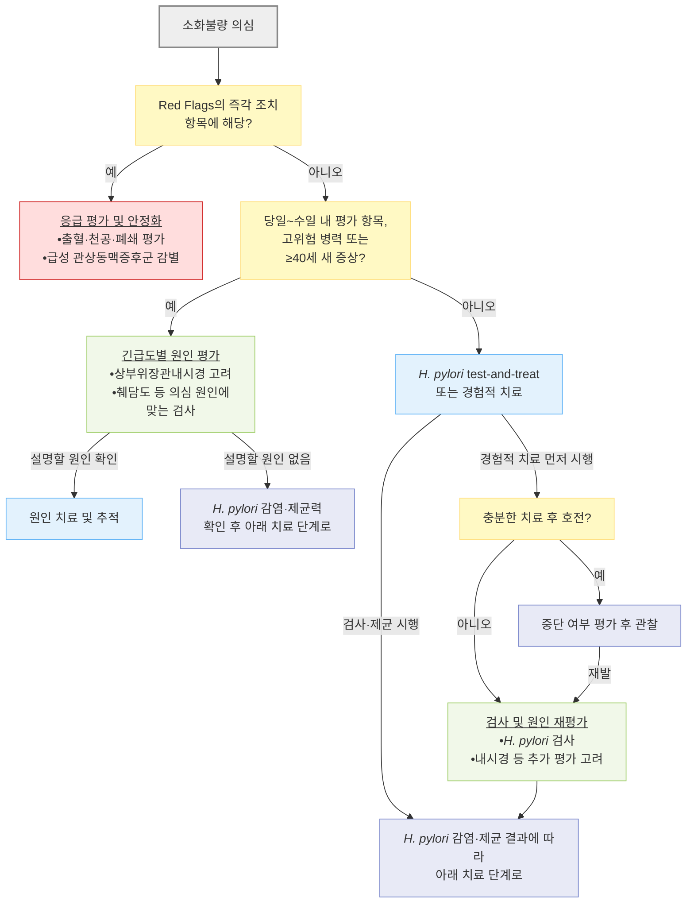
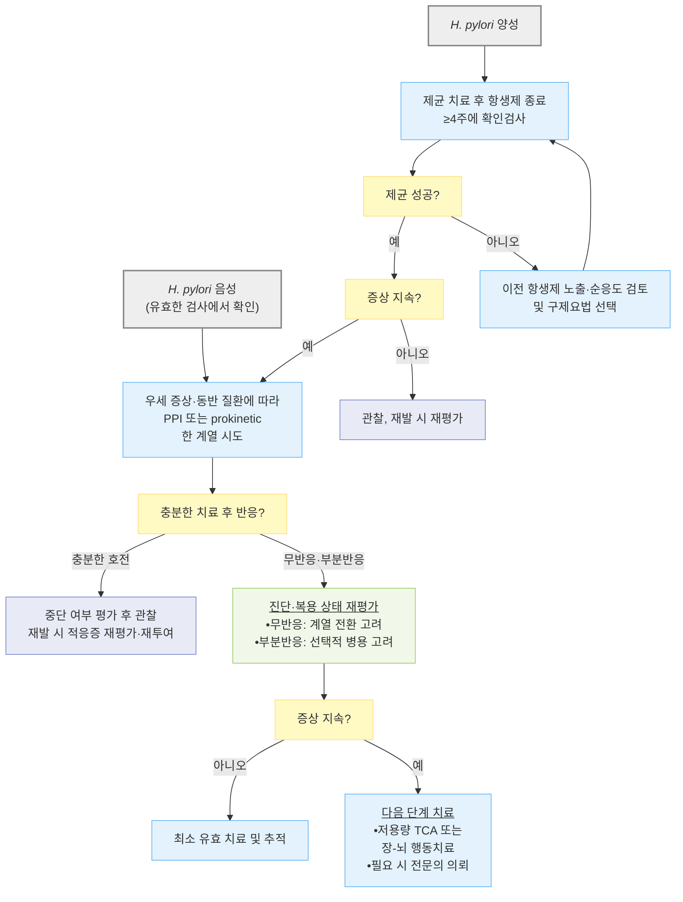

# 소화불량 Indigestion, Dyspepsia

## <mark style="color:green;">일반 사항</mark>

* **소화불량 (indigestion, dyspepsia)** : 상복부에서 기원한다고 생각되는 상복부 통증·작열감, 식후 충만감 또는 조기 포만감을 말함 <mark style="color:$info;">\[Rome V 2026]</mark>
* 구역, 트림, 복부 팽만이 동반될 수 있으나 핵심 소화불량 증상은 아님
* 환자는 흔히 "소화가 안 된다", "명치가 답답하다", "먹은 것이 내려가지 않는다"고 표현함. "내려가지 않는 느낌"은 식후 충만감에 가깝지만, "답답함"은 가슴쓰림·복부 팽만·흉부 압박감을 뜻하기도 하므로 구체적인 증상과 식사·신체 활동과의 관계를 확인하여 분류함. 걷거나 계단을 오를 때 생기는 답답함은 심근허혈을 먼저 감별함
* 반복적·지속적 구토는 다른 질환 또는 Red Flag를 시사
* 전형적인 가슴쓰림·산 역류는 GERD 의심 증상으로 별도 평가함; FD와 GERD는 상당 부분 중첩됨
* 유병률 : 소화불량 증상은 일반 인구에서 매우 흔하나 조사마다 정의가 다르고 보고 수치의 차이가 큼. Rome 기준(최근 3개월 충족, 6개월 이전 시작)을 적용한 기능성 소화불량은 성인 약 7% 수준임 <mark style="color:$info;">\[BSG 2022]</mark>
* 병태생리 : 위 운동 장애(위저부 이완 장애, 위배출 지연), 내장 감각 과민(visceral hypersensitivity), 뇌-장 축(brain-gut axis) 이상, 십이지장 저등급 염증(호산구·비만세포 침윤, 점막 투과성 증가), 장내 미생물 불균형, _H. pylori_ 감염 등 복합 기전
  * "검사는 정상인데 왜 아픈가요?"라는 환자 질문에는 '내장 감각 과민'으로 설명할 수 있음

#### <mark style="color:$primary;">유형</mark>

* **기질성 소화불량 (organic dyspepsia)** : 소화성 궤양, GERD, 위암, 췌담도 질환 등 증상을 설명하는 기질적 원인이 확인되는 소화불량
* **기능성 소화불량 (functional dyspepsia, FD)** : 증상을 설명할 만한 기질적·전신적·대사성 질환이 없는 경우
  * FD는 뇌-장 상호작용 장애 (disorder of gut-brain interaction, DGBI)의 대표 질환임
* **일시적 소화불량 증상** : 과식, 빠른 식사, 고지방 음식, 스트레스 상황에서의 식사, 과음, 과다 카페인 섭취 등에 의해 수일간 발생
  * 공인된 별도 진단 유형은 아니며, 지속 또는 재발하거나 Red Flag가 동반되면 다른 원인을 평가
* _**H. pylori**_**&#x20;연관 소화불량** : _H. pylori_ 감염 환자에서 제균 성공 후 증상이 장기간(보통 6\~12개월) 소실된 경우
  * 기능성 소화불량은 제균 성공 후에도 증상이 지속됨
* **미조사 소화불량 (uninvestigated dyspepsia)** : 증상 원인에 대한 적절한 평가가 아직 이루어지지 않은 상태
  * 기능성 소화불량 확진과 구분
* **GERD overlap** : 상복부 작열감·식후 불편감·가슴쓰림이 소화불량과 동반되는 경우가 외래에서 매우 흔함
  * 소화불량에서 PPI partial response도 흔히 관찰됨
* **IBS overlap** : 소화불량 환자의 약 1/3은 IBS 증상을 동반하며 IBS overlap은 치료가 더 까다로울 수 있음
  * IBS 증상에 대한 제한적 Low-FODMAP 식이와 장-뇌 행동치료를 고려할 수 있으나, 순수 FD에 대한 식이 조절 근거는 부족함

#### <mark style="color:$primary;">관련 증상 정의</mark>

* **구역 (nausea)** : 토하고 싶은 느낌
* **구토 (vomiting, emesis)** : 장/흉복벽 근육 수축에 의한 위장관 내용물의 입을 통한 압박 방출
* **역류 (regurgitation)** : 구역 없이, 힘들이지 않은 상태에서의 위 내용물의 입을 통한 방출
* **되새김 (rumination)** : 섭취한 음식물이 구역 없이 반복적으로 역류하여 다시 씹거나 삼키게 되는 현상
  * 대개 의도적인 행동이 아니며, 횡격막 호흡법 등 행동치료로 조절 가능
* **삼킴곤란 (dysphagia)** : 음식물이 입에서 내려가는 과정의 문제로, 음식물이 가슴에 들러붙거나 걸려 있는 느낌
* **삼킴통증 (odynophagia)** : 삼킬 때의 통증
  * 감염 또는 정제/캡슐 약제에 의한 구인두·식도 점막 궤양, GERD 환자에서 식도 궤양 또는 염증 시 발생
* **인두이물감 (globus pharyngeus)** : 목 안의 덩어리 또는 꽉 찬 느낌
  * 삼킴에는 제한이 없거나 삼킴으로 호전되며, 스트레스·불안에 의해 악화될 수 있음
* **가슴쓰림 (heartburn)** : 흉골 뒤의 타는 듯한 느낌으로, 식후 또는 누운 자세에서 악화될 수 있음
  * 운동 시 흉부·상복부 불편감은 심근허혈과의 감별이 필요하며, 제산제로 호전되어도 심장 원인을 배제하지 못함

## <mark style="color:green;">원인 및 위험 인자</mark>

* **기능성 소화불량** : 소화불량의 가장 흔한 원인으로, 기질적 질병 없이 발생
* **위식도역류질환 (GERD)** : 하부 식도괄약근(LES) 긴장 감소 또는 이완
* **내장 감각 과민 (visceral hypersensitivity)** : 위장 감각 신경 과민
  * 일반적으로 소화불량 환자는 낮은 위저부 팽창 압력에서도 불편감을 느낌. IBS 환자에서도 관찰됨
* **LES 이완 유발 요인** : 음주, 흡연, 카페인, 지방식
  * 같은 음식에도 반응이 환자마다 다를 수 있음. 일률적인 제한 식단보다 식사-증상 일기를 이용해 개인별 유발 음식을 확인
* **복부 가스 생성** : 탄산음료, 당분, 불용성 식이 섬유, 껌 씹기, 빨리 먹기
* **감염 후 기능성 소화불량** : 급성 세균성·바이러스성 위장관염 후 새로 발생할 수 있음
* _**H. pylori**_**&#x20;감염**
  * 양성 FD 환자에서 제균 치료는 일부의 장기 증상 개선에 기여하며 소화성 궤양·위암 예방 이득도 고려
* **약물**
  * 점막 손상 : NSAID, aspirin, bisphosphonate, 철분제, 스테로이드(NSAID 병용 시 위험 증가)
  * LES 이완·역류 악화 : CCB, nitrate, 항콜린제, estrogen·progesterone
  * 위배출 지연·위장 운동 저하 : GLP-1 계열 약물, opioid, 항콜린제, dopamine 작용제·levodopa
  * 구역·위장관 자극 : metformin, digoxin, SSRI·SNRI, donepezil, 항생제(특히 macrolide), orlistat, fibrate
  * 장기 PPI 사용과 bloating 또는 장내 미생물 변화의 연관성이 보고되었으나 인과관계는 불확실함 - 적응증과 최소 유효 용량을 주기적으로 재평가
* **기타** : 유전, 비만, 임신, 스트레스, 우울, 불안, 신체증상장애, 폭식증, 알코올 남용
* **기질적 질환** : 소화성 궤양, 위암, 위출구 폐쇄, 위마비, 담낭·췌장 질환, 셀리악병
* **유사 증상** : 급성 관상동맥증후군, 장폐쇄, 충수염, 게실염, 폐렴, 요로 결석, 자궁외임신·PID, 전정계 질환 등
  * 증상 위치·동반 소견에 따라 복부 외 원인까지 감별

## <mark style="color:green;">임상 양상</mark>

* 상복부 통증 또는 작열감 (epigastric pain/burning) : 식사로 유발·악화되거나 식사와 무관하게 발생 가능
  * EPS(epigastric pain syndrome) 아형의 주 증상
* 조기 포만감 (early satiety) : 식사 시작 후 얼마 지나지 않아 포만감이 발생하여 정상 식사량을 다 먹지 못함
  * PDS(postprandial distress syndrome) 아형의 주 증상
* 식후 충만감 (postprandial fullness) : 식사 후 음식물이 위에 오래 남아 있는 불쾌한 느낌
  * PDS 아형
* 구역 (nausea) : 구토를 동반하거나 단독으로 발생
  * 기능성 소화불량 및 위마비의 흔한 증상
* 가스/트림 (gas/belching) : 삼킨 공기 또는 위장 내 가스 축적으로 발생
* 복부 팽만감 (bloating) : 주관적 팽창 느낌
  * 기질적 또는 기능적 원인 가능

### <mark style="color:$danger;">🚩 Red Flags!</mark>

<mark style="color:$danger;">**즉각 조치**</mark>

* 토혈 또는 흑색변, 특히 실신·저혈압·빈맥·식은땀 동반 `상부위장관 출혈`
* 갑작스러운 심한 복통과 복벽 경직·반발통, 또는 심한 복부 팽창과 가스·대변 배출 중단 `위장관 천공` `장폐쇄`
* 운동 시 또는 지속되는 흉부·상복부 압박감과 호흡곤란·식은땀·방사통 `급성 관상동맥증후군`
* 침도 삼키지 못하는 급성 삼킴곤란·음식물 걸림 `식도 음식물 폐색`

<mark style="color:$warning;">**당일\~수일 내 평가**</mark>

* **(당일)** 반복 구토로 수분 섭취가 어렵거나 소변량 감소·탈수 소견 `탈수` `전해질 이상` `위출구 폐쇄`
* **(당일)** 발열·황달과 우상복부 통증, 또는 등으로 뻗치는 지속적 상복부 통증 `급성 담관염` `급성 췌장염`
* 진행성 삼킴곤란·삼킴통증, 원인 불명 체중 감소·철결핍빈혈, 복부 종괴 `위암` `식도암` `소화성 궤양`

<mark style="color:$info;">**조기 평가 및 추적**</mark>

* ≥40세에서 새로 발생한 소화불량, 또는 위암 가족력·위암 전구 병변(위축성 위염·장상피화생) `위암`
* 적절한 초기 치료에 반응하지 않거나 반복 재발, 과도한 음식 회피·식사 제한 동반 `불응성 소화불량` `위마비` `회피·제한적 음식섭취장애`

　☞ [위장 증상의 감별](074_-gidz.md#red-flags)

## <mark style="color:green;">진단</mark>

* 증상과 징후를 근거로 진단
  * Red Flags 유무가 초기 평가의 핵심
* 신체검사를 통하여 복부 종괴·압통·황달 등 기질 질환 시사 소견이 있는지 확인; 정상 소견만으로 기질 질환을 배제할 수 없음
* 식사-증상 일기 작성이 유용 - 음식 종류뿐 아니라 식사 속도, 식사량, 스트레스 상황, 수면 부족과의 연관을 함께 기록하면 유발 인자 파악에 도움
* 내시경상 경미한 발적이나 비특이적 위염 소견만으로 소화불량의 원인을 확정하지 않고, 증상을 설명할 병변인지 판단

### <mark style="color:orange;">Diagnostic Framework \[Rome V, 2026]</mark>

* 아래는 Rome V의 정량적 진단 기준 요약임. 임상에서는 적절한 평가 후 증상의 양상, 불편도, 기능 영향을 바탕으로 진단·치료함 <mark style="color:$info;">\[Rome V 2026]</mark>

#### <mark style="color:$primary;">기능성 소화불량 (Functional dyspepsia)</mark>

* 증상 기준 : 일상생활에 지장을 주는 ① 조기 포만감, ② 식후 충만감, ③ 상복부 통증, ④ 상복부 작열감 중 ≥1개가 있고, 이를 설명할 기질적·전신적·대사성 질환이 없어야 함
* 정량 기준 : 최근 3개월간 증상 기준을 충족하고, 진단 ≥6개월 전 증상 시작
  * 임상에서는 이 기간을 기다리느라 필요한 평가·치료를 늦추지 않음
* PDS : 조기 포만감 또는 식후 충만감이 ≥2일/주, 식사 후 2시간 이내 유발되는 증상을 뜻하며, 동반 식후 통증·작열감·구역·상복부 팽만·과다 트림도 포함될 수 있음
* EPS : 배꼽 위 복부 중앙의 상복부 통증 또는 작열감이 ≥1일/주이고 PDS 기준은 충족하지 않음; Rome IV의 EPS/PDS 중첩 분류를 Rome V에서는 적용하지 않음
  * 잠정 기준으로 식후 악화가 50% 이상이면 식후형, 50% 미만이면 식사 무관형 EPS로 구분
* 구역이 주증상이거나 지속적 구토가 있으면 PDS/EPS 대신 CNVS(chronic nausea and vomiting syndrome)·위마비 등 다른 진단을 검토 <mark style="color:$info;">\[Rome V 2026]</mark>

　☞ [기능성 소화불량](076_-functional-dyspepsia-fd.md)

#### <mark style="color:$primary;">만성 구역/구토증후군 (Chronic nausea vomiting syndrome)</mark>

* 발생한 지 최소 6개월 되었고 최근 3개월간 다음 조건을 모두 충족

1. ≥2일/주 발생하는 일상생활에 지장을 주는 구역증
   * 구토는 필수가 아니며 동반될 수 있음(구역 없이 구토만 있으면 해당하지 않음)
2. 다음 상태 배제 : 자가 유도 구토, 섭식 장애, 역류, 반추
3. 일상적인 평가에서 증상을 설명할 기질적·전신적·대사 질환의 증거 없음; 내시경 등은 임상 상황에 따라 시행
4. PDS 증상이 우세하면 CNVS 진단에서 제외하고 PDS를 검토. 구역·지속적 구토가 우세하고 객관적 위배출 지연이 있으면 위마비를 고려

* **주기성 구토증후군(cyclic vomiting syndrome, CVS)** : 발병·지속 기간(최대 10일)이 정형화된 반복 구토 삽화가 지난 1년간 ≥3회, 최근 6개월간 ≥2회(≥1주 간격); 편두통 병력·가족력이 흔함
  * 삽화 사이에는 경한 구역이나 드문 구토가 남을 수 있음

#### <mark style="color:$primary;">되새김증후군 (Rumination syndrome)</mark>

* 발생한 지 최소 6개월 되었고 최근 3개월간 다음 조건을 모두 충족
  1. 뱉거나 다시 씹어 삼키게 되는, 섭취한 음식의 힘들이지 않는 듯한 반복적인 역류
  2. 역류 전 헛구역질(retching) 또는 구역(nausea)이 선행되지 않음

#### <mark style="color:$primary;">인두이물감 (Globus pharyngeus)</mark>

* 최소 1회/주 발생하며 발생한 지 최소 6개월 되었고 최근 3개월간 다음 조건을 모두 충족
  1. 진찰·후두경·내시경에서 구조적 이상이 없는, 인후부의 지속 또는 간헐적인, 통증이 없는 덩어리 또는 이물감
     1. 식간에 발생
     2. 삼킴곤란 또는 삼킴통증 없음
  2. 식도 근위부 위 점막 이소증(gastric inlet patch) 없음
  3. 위식도 역류 또는 EoE 등 비역류성 식도염이 증상의 원인이라는 증거 없음
  4. Chicago v4.0에 따른 EGJ 기능·연동 장애(achalasia, 확증된 EGJOO, 원위부 식도연축, 과수축성 식도, 수축 소실)가 없음. IEM만으로 진단을 배제하지 않음
* Rome V의 정량적 globus 기준은 최적화한 산 분비 억제 치료 ≥8주 후에도 지속되는 증상을 전제로 함. 이 조건을 경고 증상 없는 모든 globus 환자에게 일률적으로 PPI를 처방하는 근거로 적용하지 않음

#### <mark style="color:$primary;">기능성 가슴쓰림 (Functional heartburn)</mark>

* 최소 1회/주 발생하며 발생한 지 최소 6개월 되었고 최근 3개월간 다음 조건을 모두 충족
  1. 흉골 뒤의 타는 듯한 불편감 또는 통증
  2. 최적화한 산 분비 억제 치료 ≥8주에도 증상이 지속됨
  3. 객관적 GERD 또는 EoE 등 비역류성 식도염이 증상의 원인이라는 증거 없음
     * 역류검사에서 역류 사건과 증상 사이 연관성이 있으면 역류 과민성을 감별
  4. Chicago v4.0에 따른 EGJ 기능·연동 장애 없음(IEM 제외); GERD 평가는 Lyon 2.0에 따른 내시경·역류검사 소견을 종합하며, 정상 MNBI는 기능성 가슴쓰림을 지지하는 소견

#### <mark style="color:$primary;">기능성 삼킴곤란 (Functional dysphagia)</mark>

* 최근 3개월간 기준을 충족하고 진단 6개월 이전에 증상 시작, 주 ≥1회 증상 존재, 다음 모두 충족
  * 고형식 또는 액체가 식도에 걸리거나 비정상적으로 통과하는 느낌
  * 식도 점막·구조 이상이 증상의 원인이라는 증거 없음
  * GERD 또는 EoE 등 비역류성 식도염이 증상의 원인이라는 증거 없음
  * Chicago v4.0에 따른 EGJ 기능·연동 장애 없음(IEM 제외)

　☞ [삼킴곤란](077_-dysphagia.md#functional-dysphagia-rome-v-2026)

### <mark style="color:orange;">검사</mark>

#### <mark style="color:$primary;">실험실 검사</mark>

* 모든 환자에게 일률적으로 시행하지 않고 병력과 진찰 소견에 따라 선택
* CBC : 위장관 출혈, 빈혈, 체중 감소 의심 시
* 전해질, Ca, RFT, 혈당, TSH : 대사성 질환 또는 위장 운동 장애 의심 시
* LFT, lipase(우선; 필요 시 amylase) : 담도·췌장 질환 의심 시
* 단백질·알부민 : 영양불량 또는 흡수장애 의심 시
* u-hCG : 임신 가능성이 있는 환자

#### _<mark style="color:$primary;">H. pylori</mark>_ <mark style="color:$primary;"></mark><mark style="color:$primary;">검사</mark>

* ＜40세이고 Red Flag·고위험 병력이 없는 미조사 소화불량에서 비침습적 test-and-treat를 고려
* 경험적 치료를 먼저 선택할 수도 있으며 검사 접근성·이전 치료·환자 선호를 반영
* 내시경을 우선한 환자에서도 _H. pylori_ 검사·제균력을 확인 (☞ [헬리코박터 감염](080_-h_pylori-infection.md))
* 비침습적 활동성 감염 검사는 요소 호기 검사(UBT) 또는 검증된 대변 항원검사를 사용
  * 혈청 항체는 과거 감염·제균 후에도 양성일 수 있어 제균 성공 확인에는 사용하지 않음
* 위음성 예방을 위해 검사 전 PPI/P-CAB은 ≥2주, 항생제·비스무트는 ≥4주 중단
  * 중단하지 못한 상태의 음성 결과는 감염 배제 근거로 삼지 않음
  * 중단 기간의 증상 조절에는 H2RA·제산제를 고려하되 H2RA의 검사 전 중단 시점은 검사기관 지침 적용

#### <mark style="color:$primary;">영상 검사</mark>

* 췌장·담관·혈관 질환, volvulus 의심 시
* 흉부/복부 X선, CT, 복부 초음파

#### <mark style="color:$primary;">상부위장관내시경</mark>

* 연령과 무관하게 Red Flag, 고위험 병력 또는 적절한 경험적 치료에도 지속되는 증상이 있으면 원인에 맞춰 시행. 급성 출혈·심근허혈·천공 의심 시에는 응급 평가·안정화가 선행됨
* 국내에서는 ≥40세에 새로 발생한 미조사 소화불량이면 상부위장관내시경을 우선 고려 (☞ [위장 증상의 감별](074_-gidz.md#upper-gi-endoscopy))
* ＜40세이고 Red Flag·고위험 병력이 없으면 위의 비침습적 접근을 먼저 시행하고 내시경은 미룰 수 있음
* 위암 가족력, 위암 전구 병변, 흡연, 원인 불명 체중 감소 등 개인별 위암 위험과 이전 내시경·국가검진 결과를 함께 판단
* 국가암검진사업의 위암 검진은 만 40세 이상에서 2년 간격으로 시행하며 위내시경을 우선함
  * 2026년 발표 국가 위암 검진 권고안은 40\~74세 무증상 성인에서 2년 간격 위내시경 단독 1차 검진을 권고하고, ≥75세는 건강 상태·기대여명에 따라 개별 결정. 행정상 검진 대상과 근거 기반 권고 연령을 구분하며, 증상 환자의 진단 내시경은 검진 주기와 별도로 판단 <mark style="color:$info;">\[국립암센터 2026]</mark>
* 북미에서는 ≥60세를 내시경 기준으로 제시하나 국내에 그대로 적용하지 않음 <mark style="color:$info;">\[ACG/CAG 2017]</mark>

#### <mark style="color:$primary;">기타</mark>

* 셀리악병 혈청 검사 : 만성 설사, 철결핍, 체중 감소, 가족력 또는 IBS 중첩 시 고려(국내 유병률은 매우 낮음)
* 기생충 검사, 변 지방/elastase 검사 : 관련 노출력, 만성 설사 또는 흡수장애 소견이 있을 때 선택적으로 시행

### <mark style="color:orange;">감별</mark>

#### <mark style="color:$primary;">증상 시작에 따라</mark>

* 갑자기 발생 : 담낭염, 식중독, 위장염, 췌장염, 약물
* 서서히 발생 : GERD, 위마비, 대사 이상, 임신, 약물

#### <mark style="color:$primary;">증상 발생 상황에 따라</mark>

* 식후 충만감·조기 포만감 우세 : PDS, 위마비, 위출구 폐쇄 가능성
* 공복 또는 식사와 무관한 상복부 통증·작열감 : EPS, 소화성 궤양 등 고려
* 눕거나 야간에 악화되는 가슴쓰림·산 역류 : GERD 가능성
* 반복적·지속적 구토, 야간에 깨우는 증상 또는 진행성 악화는 전형적인 단순 소화불량으로 보지 않고 별도 평가

#### <mark style="color:$primary;">구토물의 양상에 따라</mark>

* 소화 안 된 음식물 : 구역·헛구역질 없는 역류와 삼킴곤란 동반 시 achalasia·식도 게실·협착 감별; 식후 수 시간이 지난 음식물의 구토는 위마비·위출구 폐쇄에서도 가능
* 부분 소화된 음식물 : 위장 출구 폐쇄, 위마비
* 담즙 포함 : 십이지장 내용물 역류로 보일 수 있어 비특이적; 심한 복통·팽창·배변 중단 동반 시 장폐쇄 감별
* 악취 또는 대변성 : fistula, 장 폐쇄
* 구토량만으로 기질성 여부를 구분하지 않으며, 반복적·지속적 구토 자체를 Red Flag로 평가

#### <mark style="color:$primary;">복통 부위/양상에 따라</mark>

　☞ [복통](../220_/003_-abdominal-pain.md)

* Epigastric : 췌장 질환, 소화불량, 위염, 소화성 궤양, GERD, MI
* RUQ : 담관 질환, 담낭염
* RLQ : 충수염
* LLQ : 게실염
* Pelvic : PID, 난소 질환, 자궁외임신
* 심한 통증 : 담관 질환, 췌장 질환, 소장 폐쇄, peritoneal irritation
* 구토 전 심한 통증 : 소장 폐쇄

#### <mark style="color:$primary;">동반/관련 증상에 따라</mark>

* 발열 : 감염 질환
* 체중 감소 : 악성 종양
* 설사, malaise, 근육통, 두통 : 바이러스 감염
* 두통, 경부 강직, 어지럼, 국소 신경학적 이상 소견 : 뇌염, 뇌막염, 두부 손상, 편두통, 두개 내압 증가
* 조기 포만감, 식후 충만감, 구역·구토 : 위마비 가능성(증상만으로 확진 불가)
* 반복되는 정형화된 구토 삽화와 편두통 병력 : cyclic vomiting syndrome
* 머리 움직임·자세 변화와 연관된 어지럼·구역 : 전정계 질환
* 어지럼, 안진 : 전정신경염
* lactose, 밀가루 음식, 콩류 등 음식과 관련된 복부 팽만 : lactose intolerance, 셀리악병, carbohydrate malabsorption, 올리고당 발효(예: 콩류)
* 가슴쓰림 : GERD, 소화불량
* 빈맥, 저혈압 : 탈수, 패혈증, 심근경색


**위마비(gastroparesis)** : 다음 상황에서 위마비 가능성을 적극 고려

• 당뇨병 환자 (특히 유병 기간이 긴 경우)\
• GLP-1 계열 약물(semaglutide, tirzepatide 등) 사용 중 새로 발생한 조기 포만감·구역\
• 식후 수 시간이 지나도 음식물이 남아있는 느낌 또는 소화 안 된 음식물 구토\
• 내시경에서 적절한 금식 후에도 음식물 저류 확인(단, 이 소견만으로 확진하지 않음)\
• 체중 감소 동반

**진단** : 먼저 상부위장관내시경 등으로 기계적 폐쇄를 배제. 위마비 진단에는 표준화된 4시간 고형식 위배출 신티그래피 등 검증된 4시간 위배출검사로 위배출 지연을 객관적으로 확인; 일반적인 FD에서 일률적으로 시행하지 않음. 검사 전 고혈당 및 GLP-1 계열 약물·opioid·prokinetic 등 교란 요인을 확인하고, 약물 반감기·임상 상황에 맞춰 검사기관과 중단 계획을 정함. 장시간 작용하는 GLP-1 약물에 일률적인 48시간 중단만 적용하지 않음 <mark style="color:$info;">\[AGA 2025]</mark>

GLP-1 계열 약물 사용자는 적절한 금식 후에도 내시경에서 위 내 음식물 잔류가 있을 수 있으므로 검사 전 식이 조절 계획을 검사기관과 정함


#### <mark style="color:$primary;">EPS / PDS / GERD overlap 감별</mark>

* Rome V에서는 PDS 기준 충족 시 식후 통증·작열감을 PDS에 포함하며, EPS는 PDS 기준이 없는 경우로 구분. “+++ / ±”는 경향을 나타내며 진단 기준이나 약물 반응의 정량 지표가 아님

<table data-header-hidden data-search="false"><thead><tr><th></th><th></th><th></th><th></th></tr></thead><tbody><tr><td>구분</td><td>EPS (Epigastric Pain Syndrome)</td><td>PDS (Postprandial Distress Syndrome)</td><td>GERD overlap<br>(FD + GERD 중첩)</td></tr><tr><td><strong>핵심 증상</strong></td><td>상복부 통증, 작열감</td><td>조기 포만감, 식후 충만감</td><td>가슴쓰림, 산 역류 + FD 증상</td></tr><tr><td><strong>식사와 관계</strong></td><td>식사로 유발·악화되거나 식사와 무관하게 발생 가능</td><td>식후 악화가 특징적</td><td>식후·눕거나 야간에 악화</td></tr><tr><td><strong>조기 포만감</strong></td><td>PDS 기준 미충족</td><td>핵심 증상</td><td>동반 가능</td></tr><tr><td><strong>가슴쓰림/역류</strong></td><td>±</td><td>±</td><td>+++</td></tr><tr><td><strong>야간·체위성 증상</strong></td><td>드묾</td><td>드묾</td><td>흔함</td></tr><tr><td><strong>PPI 반응</strong></td><td>일부에서 도움; 아형만으로 예측 불가</td><td>아형만으로 예측 불가</td><td>효과 기대 가능</td></tr><tr><td><strong>Prokinetics 반응</strong></td><td>아형만으로 예측 불가</td><td>일부에서 도움; 아형만으로 예측 불가</td><td>선택적으로 고려</td></tr><tr><td><strong>병태생리 핵심</strong></td><td>내장 과민 (visceral hypersensitivity)</td><td>위 적응 장애·감각 과민 등; 위배출 지연이 필수는 아님</td><td>산 역류 + FD 기전 혼합</td></tr><tr><td><strong>외래 표현</strong></td><td>속이 쓰리고 아프다</td><td>조금만 먹어도 꽉 찬다</td><td>신물 올라오고 타는 느낌</td></tr><tr><td><strong>1차 접근</strong></td><td><em>H. pylori</em> 평가 → PPI 고려</td><td>식사 조절; PPI 또는 prokinetic 선택적 시도</td><td>생활 교정 + PPI</td></tr></tbody></table>


**가스·복부 팽만·트림이 우세한 경우** : 이 증상들은 기능성 소화불량에 동반될 수 있으나 단독으로는 FD 진단을 충족하지 않음. 식사·탄산음료·껌·공기 삼킴, 변비, IBS, 유당·탄수화물 흡수장애와 위상부 트림(supragastric belching) 등을 우선 평가함. Rome V는 일상에 지장을 주는 트림이 주 3일을 넘고, 최근 3개월간 이 기준을 충족하며 증상 시작이 진단 ≥6개월 전인 경우 트림 장애로 분류함. 식후 증상 발생 시점(식후 30분)으로 위와 소장 원인을 구분할 수는 없음. 호흡검사, 셀리악병 혈청검사, 영상·내시경, 위배출검사 및 항문직장 기능검사는 위험 인자·Red Flag와 임상적 의심이 있을 때 선택적으로 시행함.


***



<p align="center"><strong>소화불량 초기 평가 알고리듬</strong></p>



> _H. pylori 검사 전 PPI/P-CAB은 ≥2주, 항생제·비스무트는 ≥4주 중단. 제균 성공은 항생제 종료 ≥4주 후 UBT 또는 대변 항원검사로 확인하며, 증상 호전만으로 판단하지 않음_
>
> _초기 약제는 우세 증상, 동반 GERD, 이전 반응과 부작용을 종합하여 선택; 아형별 고정 처방이나 일률적 병용은 피함. Mosapride는 보통 2주, <a href="https://www.health.kr/drug/2011051800003">모티리톤</a>은 4주, PPI는 4\~8주에 반응을 평가. 장-뇌 행동치료는 환자 선호에 따라 더 이른 단계에서도 고려하며, 새 Red Flag가 생기면 즉시 원인 평가_

<p align="center"><strong>기능성 소화불량 치료 단계</strong><br><em><mark style="color:$info;">저자 재구성 (참고 문헌 : Oh JH 2020 J Neurogastroenterol Motil; Black CJ 2022 Gut; Chey WD 2024 Am J Gastroenterol)</mark></em></p>

***

## <mark style="background-color:$warning;">Management</mark>

### <mark style="color:orange;">치료 방침</mark>

* 심각한 기질적 원인이 없는 경우 안심시킴
* Red Flag 없는 ＜40세 : 비침습적 _H. pylori_ test-and-treat 또는 경험적 치료를 선택
  * → 유효한 검사에서 _H. pylori_ (−)이거나 제균 성공 후 증상 지속 시 우세 증상·동반 질환에 맞는 치료
  * → 적절한 치료에 반응하지 않거나 반복 재발 시 상부위장관내시경 고려
* ≥40세의 새 증상 또는 Red Flag·고위험 병력 : 긴급도별 원인 평가와 상부위장관내시경 고려
  * → 원인에 따른 치료
* 약물이 원인인 경우 용량 조절 또는 약물 교체
  * GLP-1 계열 약물 사용 중 새로운 소화불량 발생 시 연관성 확인
* PDS/EPS는 증상 양상을 이해하는 데 유용하지만 약물 반응을 확정적으로 예측하지 못함
  * 2025년 무작위시험에서는 아형별 초기 치료의 우월성이 입증되지 않았으나, 아형별 효과 차이가 전혀 없다는 뜻은 아님. 이 연구는 Rome V 발표 전 연구로, 개정 아형별 치료 전략을 직접 검증한 것은 아님. 한 계열을 우선 시도하고 불응 시 다른 계열로 전환, 부분반응 시 선택적으로 병용 <mark style="color:$info;">\[BSG 2022; Aliment Pharmacol Ther 2025]</mark>
* FD는 P-CAB의 허가 적응증이 아님. 동반 GERD 등 별도의 허가 질환이 있으면 해당 질환의 용법으로 치료

## ## <mark style="color:green;">비-약물 치료 및 예방</mark> <a href="#non-drug-treatment" id="non-drug-treatment"></a>

### <mark style="color:orange;">식생활 교정</mark>

1. 식사를 거른 뒤 과식하지 않도록 규칙적인 식사 시간을 유지함.
2. 한 번에 많이 먹지 않고 증상에 따라 소량씩 나누어 먹음.
3. 역류가 동반되면 야식을 줄이고 잠자리에 들기 약 3시간 전에 식사를 마침.
4. 음식은 천천히 꼭꼭 씹어 먹음.
5. 충분한 수면을 취함.
6. 금연함.
7. 규칙적인 유산소 운동을 권장함; 식후 가벼운 산책 등 내약성에 맞춰 시행함.
8. 스트레스를 관리함.

### <mark style="color:orange;">증상 유발 음식의 선택적 회피</mark>

일률적인 제한 식단보다 식사-증상 일기를 이용해 개인별 유발 음식을 확인:

* 고지방 음식 : 지방이 많은 육류, 버터, 튀긴 음식, 치즈
* 과식 (한 번에 많은 양 섭취)
* 맵고 짠 자극적인 음식 : 매운 고추, 생마늘
* 카페인 음료(커피, 차), 알코올, 탄산음료
* 개인적으로 증상을 유발하는 음식


다음 음식들은 일부 환자에서 증상을 유발한다고 호소하지만 보편적으로 제한할 근거는 충분하지 않음. 개인 반응에 따라 선택적으로 조절: 떡·면류, 질긴 고기·뿌리채소, 보리·현미·통밀, 당분이 많은 식품, 잡곡류


### <mark style="color:orange;">식이 요법</mark>

* 심한 PDS 또는 위마비가 의심되어 고형식 섭취가 어려우면 부드러운 소입자식·영양 음료를 선택적으로 고려; 일반적인 소화불량에서 일률적으로 권고하지 않음. 체중 감소·과도한 음식 회피 시 영양 평가와 회피·제한적 음식섭취장애(ARFID) 가능성도 검토
* 식후 증상이 주된 환자는 소식, 저지방 식사
* [Low-FODMAP diet](087_-ibs.md#low-fodmap) : FODMAP(Fermentable Oligo-, Di-, Mono-saccharide, And Polyol) 식품은 소장에서 잘 흡수되지 않고 장내 발효와 삼투압 작용으로 가스·팽만을 유발할 수 있음; IBS overlap 또는 bloating 우세 환자에서 제한적으로 고려하되 순수 FD에서의 근거는 부족함. 장기간 과도한 제한은 영양 불균형 위험이 있어 식사 일기로 개인별 유발 음식을 먼저 파악하고, 필요하면 영양 전문가의 지도를 받음
  * FODMAP 고함유 식품 : 과당(고과당 옥수수 시럽 중 과당이 포도당보다 많은 제품, 사과, 배, 꿀, 수박, 건포도), 유당, fructan(마늘, 양파, 부추, 아스파라거스), 밀 제품(빵, 파스타, 시리얼), 소르비톨(stone fruits), 라피노오스(콩류, 양배추)

### <mark style="color:orange;">장-뇌 행동치료</mark>

* 약물 치료에 반응하지 않는 경우뿐 아니라 스트레스·불안과 증상의 연관이 뚜렷하거나 환자가 선호하는 경우에도 장-뇌 행동치료로 고려
* 인지행동치료(CBT), 최면요법(gut-directed hypnotherapy), 이완요법이 일부 환자에서 효과적
* 마음챙김·스트레스 관리 : 보조적으로 고려할 수 있으나 FD에 대한 직접 근거는 제한적. 치료 목표와 환자 선호에 따라 적용

## <mark style="color:green;">약물 치료</mark> <a href="#drug-treatment" id="drug-treatment"></a>

<mark style="color:cyan;">**허가·급여 적용**</mark>

* 임상 권고, 품목허가, 건강보험 급여는 서로 구분. FD 단독인 경우 PPI·P-CAB·저용량 TCA가 지침상 인정되더라도 보험급여가 적용되는 것은 아님
* mosapride, itopride, levosulpiride, 현호색·견우자 엑스는 기능성 소화불량(증상)에 허가된 약제이며, PPI·P-CAB·저용량 TCA는 FD 단독에 허가 외 사용임
* 동반 GERD·궤양·위염 등이 실제 확인된 경우 해당 질환과 성분·용량·기간의 허가 및 급여기준을 적용

#### _<mark style="color:$primary;">H. pylori</mark>_ <mark style="color:$primary;"></mark><mark style="color:$primary;">제균 치료</mark>

* 활동성 _H. pylori_ 감염이 확인된 소화불량 환자에게 제균 치료 권고 (☞ [헬리코박터 감염](080_-h_pylori-infection.md#management))
  * 알레르기·이전 항생제 노출 및 국내 내성 양상을 고려하여 요법 선택 <mark style="color:$info;">\[ACG 2024; J Gastroenterol Hepatol 2026]</mark>
* 제균은 대조 치료보다 장기 증상 개선에 추가 이득이 있으나 효과 크기는 제한적
  * 메타분석에서 제균 치료는 FD 증상을 일부 환자에서만 완화하며 효과의 크기는 작았음. 제균에 성공한 경우에 효과가 더 컸으나 무작위 비교 결과는 아님. 이상반응·치료 중단은 제균군에서 더 흔했음 <mark style="color:$info;">\[Gut 2022]</mark>
* 제균 후 증상이 장기간 소실되면 _H. pylori_ 연관 소화불량으로 볼 수 있으며, 제균 성공 후에도 증상이 지속되면 기능성 소화불량·GERD 등 다른 원인을 치료

#### <mark style="color:$primary;">PPI (Proton Pump Inhibitor)</mark>

* 임상적 사용 : _H. pylori_ (−) 또는 제균 후 증상 지속 시 1차 약제로 고려; EPS 및 GERD 중첩에서 특히 고려하지만 PDS에서도 효과가 있을 수 있음 (☞ [소화기계 약제](073_-gidrugs.md#proton-pump-inhibitor-ppi))
* FD 단독 치료는 허가 외 사용이며, 동반 GERD·궤양 등 허가 질환이 있으면 해당 용법 적용
* 4\~8주 투여 후 재평가하고 효과가 없으면 지속하지 않음
* 중단 후 재발하는 경우 적응증을 재평가하여 간헐적 또는 유지 투여 고려


**PPI 약물 상호작용 주의**\
PPI는 위산을 억제하여 위내 pH를 높이고 일부 약물의 흡수에 영향을 줄 수 있음. 일부 성분은 CYP2C19 등을 억제하여 병용 약물의 대사에도 영향을 줌:\
• **clopidogrel** 병용 시 : omeprazole/esomeprazole은 CYP2C19 경쟁적 억제로 clopidogrel 활성화를 저해 - 항혈소판 효과 감소 우려; omeprazole/esomeprazole과 clopidogrel의 병용을 피하고, 산 억제가 필요하면 pantoprazole 또는 rabeprazole 등 대안 고려\
• **철분제** : 위산 감소로 비헴철 흡수가 저하될 수 있으며 단순히 복용 간격을 두는 것만으로 해결되지 않을 수 있음 - PPI 필요성·용량과 철분 투여 방법 재평가\
• **항진균제** : itraconazole(캡슐), ketoconazole 등 위산 의존 약제의 흡수 감소 가능; 제형에 따라 다름


#### <mark style="color:$primary;">H2 차단제 (H2RA)</mark>

* FD의 단기 산 억제 치료에서 PPI의 대안으로 고려할 수 있으며, PPI를 사용하기 어렵거나 경증·간헐적 증상인 경우에도 선택 가능; PPI보다 열등하다는 충분한 근거는 없음
* famotidine : FD 증상 완화를 위해 고려할 수 있음 (☞ [소화기계 약제](073_-gidrugs.md#h2-h2-receptor-antagonist-h2ra))
  * <mark style="color:blue;">\[<a href="https://www.health.kr/drug/A11A0150B0001">가스터</a>]</mark> 위궤양·역류성식도염에서 20 ㎎ bid 또는 40 ㎎ hs, 급성위염·만성위염 급성악화기의 위점막병변 개선 목적으로 10 ㎎ bid 또는 20 ㎎ hs, 신기능 저하 시 감량·간격 조절
* 연속 사용 시 빠르게 내성이 생겨 효과가 감소할 수 있으므로 불필요한 장기 지속·증량을 피함
* cimetidine은 CYP 약물 상호작용 주의가 필요하며 현재 사용 감소 추세임
* ranitidine은 NDMA 발생 문제로 시장 철수 상태임

#### <mark style="color:$primary;">P-CAB (Potassium-Competitive Acid Blocker)</mark>

* GERD 등 허가 질환에서는 빠르고 강한 산 억제제로 사용하나, FD 자체는 허가 적응증이 아님
* FD 연구는 제한적·이질적이며 제2차 아시아 합의안도 확정적 결론을 내리지 않음 <mark style="color:$info;">\[J Gastroenterol Hepatol 2026]</mark>
* fexuprazan 10 ㎎ <mark style="color:blue;">\[<a href="https://www.health.kr/drug/2022081900004">펙수클루</a>]</mark>는 급성·만성위염의 위점막 병변 개선 적응증(10 ㎎ bid, 2주)이 있으나 FD 적응증은 아님. 내시경 소견이 증상을 설명하지 못하는 경우 위염 적응증으로 FD를 대체하지 않음
* 동반 GERD 등 별도의 허가 질환은 해당 질환·제형의 용량으로 치료하며, 구체적인 용법은 소화기계 약제 챕터 참조
* CYP2C19 유전형의 영향을 덜 받는다는 이유만으로 clopidogrel과의 상호작용이 모든 P-CAB에서 없다고 단정하지 않음

#### <mark style="color:$primary;">Prokinetics</mark>

* 적응 : PDS(식후 충만감, 조기 포만감) 우세 환자에서 고려 (☞ [소화기계 약제](073_-gidrugs.md#prokinetics))
  * _H. pylori_ 제균 또는 산 분비 억제 치료에도 증상이 지속될 때 선택적 단독 또는 병용 사용
* 약제 선택 시 신경계·내분비계 이상반응과 환자 위험을 고려하여 mosapride·itopride·현호색·견우자 엑스를 우선 고려
* 복용 시점과 재평가 시점은 성분별로 구분
  * mosapride는 보통 2주, 모티리톤은 4주 투여에도 개선이 없으면 장기 투여하지 않음
  * 다른 약제들도 효과·이상반응을 조기에 확인하며 무반응 상태로 반복 처방하지 않음

<table><thead><tr><th width="154">약물</th><th width="194">용량</th><th>상품명 / 특이사항</th></tr></thead><tbody><tr><td>mosapride</td><td>5 ㎎ tid (식전 또는 식후)<br>서방정 15 ㎎ qd (공복)</td><td><mark style="color:blue;">[<a href="https://www.health.kr/drug/A11AIIIII0006">가스모틴</a>]</mark>, <mark style="color:blue;">[<a href="https://www.health.kr/drug/2017120400002">가스모틴에스알</a>]</mark> - 보통 2주에 반응 재평가. 드물게 중증 간기능 장애·황달</td></tr><tr><td>itopride</td><td>50 ㎎ tid (식전)</td><td><mark style="color:blue;">[<a href="https://www.health.kr/drug/2015050100105">가나톤</a>]</mark> - 비급여(2025. 2. 1. 급여 삭제); D2 차단 + AChE 억제; 고프로락틴혈증·유즙분비, 드물게 떨림</td></tr><tr><td>levosulpiride*</td><td>25 ㎎ tid (식전)</td><td><mark style="color:blue;">[<a href="https://www.health.kr/drug/A11A1890A0158">레보프라이드</a>]</mark> - D2 차단; 추체외로 증상·고프로락틴혈증; 고령자에서 가급적 회피, 장기 반복 처방 회피; 신기능 저하 시 주의; 임부·수유부 금기</td></tr><tr><td>현호색·견우자 엑스(DA-9701)</td><td>30 ㎎(1정) tid (식전)</td><td><mark style="color:blue;">[모티리톤]</mark> - 4주에 개선 없으면 중단·전환</td></tr></tbody></table>

> _위 약제들은 기능성 소화불량에 허가됨_
>
> _\*levosulpiride는 단기 사용을 원칙으로 하며, 고령자에서는 가급적 피하고 장기 반복 처방을 피함. 새로 생긴 떨림·서동·경직·보행장애는 약물 유발 파킨슨증 가능성을 평가 <mark style="color:$info;">\[Mov Disord 2009]</mark>_


**metoclopramide는 기능성 소화불량의 routine 장기 치료제로 사용하지 않음** : <a href="https://www.health.kr/drug/A11A0570A0089">맥페란정</a>은 구역·구토 관련 허가 적응증에 **최대 5일** 사용하며 최소 유효 용량·최단기간을 적용. 급성 근긴장이상, 정좌불능, 파킨슨증 및 지연성 운동장애 위험이 있음. **파킨슨병, levodopa·dopamine 작용제 병용, 위장관 출혈·기계적 폐색·천공 등은 금기**; 고령자·항정신병약 병용 환자는 특히 이상반응 위험 평가


#### <mark style="color:$primary;">위장관 신경조절제 (GI Neuromodulators)</mark>

* 기능성 소화불량(FD)에서 위장관 감각 과민과 통증 신호 등을 조절하기 위해 일부 항우울제를 저용량으로 사용함. FD 치료 목적은 허가 외 사용이며, 동반 우울·불안의 치료 적응증과 구분함
* _H. pylori_ 감염 여부에 맞는 처치와 PPI 등 초기 치료에도 증상이 지속하면 증상 유형과 환자 위험을 평가하여 선택적으로 고려함. SSRI/SNRI를 FD 증상 치료에서 TCA와 동등한 대안으로 일률적으로 권고하지 않음

**저용량 삼환계 항우울제 (TCA)**

* 내장 과민성을 줄이고 통증 역치를 높이는 목적으로 사용하며, 특히 상복부 통증이 두드러지는 FD에서 2차 치료제로 고려 (☞ [소화기계 약제](073_-gidrugs.md#tca))
* amitriptyline <mark style="color:blue;">\[<a href="https://www.health.kr/drug/A11A0570B0082">에트라빌</a>]</mark> 10 ㎎ hs(취침 시)부터 시작하여 내약성과 반응에 따라 2\~3주 간격으로 서서히 증량(보통 30\~50 ㎎ 이하) <mark style="color:$info;">\[BSG 2022]</mark>; 2\~4주에 이상반응·순응도를 확인하고 가능하면 8\~12주에 효과 판정
  * 금기 : 녹내장, 전립선비대 등 배뇨장애, 부정맥, 심근경색 회복 초기, MAO 저해제 투여 중
* 졸림, 구강건조, 변비, 배뇨곤란, 기립저혈압·낙상, QT 연장에 주의. 고령자에서는 강한 항콜린 작용과 낙상 위험 때문에 가급적 피함. 심장질환·전도장애, QT 연장 약물 병용 등 위험이 있으면 시작 전 심전도·전해질 평가 고려
* 효과가 있으면 6\~12개월 유지 후 서서히 감량을 고려; 기간은 재발·내약성에 따라 개별화 <mark style="color:$info;">\[BSG 2022]</mark>

**Mirtazapine (NaSSA)**

* 조기 포만감과 체중 감소가 두드러지는 치료 불응성 FD에서 기질 질환·영양 문제를 먼저 평가한 뒤 전문 진료에서 선택적으로 고려할 수 있음(허가 외 사용, 근거 제한적). 일차 치료제로 일률적으로 사용하지 않음 <mark style="color:$info;">\[J Gastroenterol Hepatol 2026]</mark>
* 진정·졸림, 식욕·체중 증가 등을 고려하여 선택하며, TCA와 임상 근거 및 적용 대상이 동일한 것으로 취급하지 않음

#### <mark style="color:$primary;">제산제 및 기타</mark>

* 제산제 : 급성 증상 완화 목적의 단기 사용; magnesium hydroxide/aluminum hydroxide 복합제 등은 제품별 용법 적용. FD의 지속적 치료 근거는 부족함 (☞ [소화기계 약제](073_-gidrugs.md#antacid))
  * 신기능 저하에서는 Mg·Al 축적 위험을 평가하며, 특히 중증 신기능 저하에서는 해당 제제를 가급적 피함. <mark style="color:blue;"><a href="https://www.health.kr/drug/A11ABBBBB1168">마그밀</a></mark> 등 신장애 환자에게 금기인 품목은 투여하지 않음; 단순 감량·투여 간격 연장으로 대체하지 않음. 금기·주의 범위는 실제 처방 품목의 허가사항을 적용하며, 한 품목의 금기를 모든 Mg·Al 복합제에 일률적으로 확대하지 않음
* simethicone (소포제) : 가스/팽만감의 단기 증상 완화에 선택적으로 사용하나 FD 자체에 대한 근거는 제한적
* 프로바이오틱스/프리바이오틱스 : FD에서 일률적으로 권고할 근거가 부족하며 균주·용량·기간도 표준화되지 않음. 복부 팽만·팽창의 치료 목적으로는 프로바이오틱스를 권고하지 않음 <mark style="color:$info;">\[AGA 2023]</mark>

### <mark style="color:orange;">증상 아형별 처방 방향</mark>

<table data-search="false"><thead><tr><th width="185">우세 증상</th><th width="199">먼저 고려</th><th>치료 방향</th></tr></thead><tbody><tr><td><strong>상복부 작열감·통증</strong></td><td>EPS, GERD overlap</td><td>PPI 우선 고려</td></tr><tr><td><strong>조기 포만감</strong></td><td>PDS (± 위마비)</td><td>식사 조절; PPI 또는 prokinetic 선택적 시도</td></tr><tr><td><strong>식후 충만감</strong></td><td>PDS, IBS overlap</td><td>식사 조절; PPI 또는 prokinetic 선택적 시도</td></tr><tr><td><strong>신물 / 역류</strong></td><td>GERD</td><td>PPI + 생활 교정</td></tr><tr><td><strong>Bloating / 가스</strong></td><td>식이 요인, 변비, IBS overlap</td><td>원인 평가; IBS 중첩 시 Low-FODMAP 제한적 고려</td></tr><tr><td><strong>구역 우세</strong></td><td>위마비, 약물 부작용</td><td>원인 약물 검토; 위마비 의심 시 객관적 평가</td></tr><tr><td><strong>반복 재발 + 적절한 검사 정상</strong></td><td>DGBI (기능성 소화불량)</td><td>저용량 TCA 또는 장-뇌 행동치료 고려</td></tr></tbody></table>

***

## <mark style="color:red;">질병코드</mark>

* K30 기능성 소화불량 Functional dyspepsia
* R10.12 명치통증 Epigastric pain
* R10.19 상세불명의 상복부통증 Upper abdominal pain, unspecified

✽ K30에는 소화불량·식후불편증후군(PDS)·상복부통증증후군(EPS)이 포함됨. R10.12·R10.19는 기능성 소화불량 확진 전 증상 코드가 필요한 경우에 사용하며, "소화불량 NOS"는 R10.19에 포함됨

✽ GERD, 소화성 궤양 등 증상을 설명하는 원인 질환이 확인되면 해당 질환 코드를 사용; 비특이적 위염 소견만으로 FD를 배제하지 않음

***

## <mark style="color:purple;">처방례</mark>

> **처방례 1.** _H. pylori_ 양성 소화불량
>
> ```
> ※ H. pylori 제균 치료 시행
>    환자별 제균 요법 선택
> ```
>
> (☞ [헬리코박터 감염](080_-h_pylori-infection.md))
>
> _✽제균 완료 후 4\~8주 내 증상 재평가; 증상이 지속되면 제균 성공 여부를 확인하면서 우세 증상에 따라 PPI 또는 prokinetics 고려_\
> _✽제균 성공과 증상 호전은 별개임. 제균 성공 후에도 증상이 지속되면 기능성 소화불량·GERD 등 다른 원인을 평가·치료_\
> _✽제균 성공 확인: 항생제 치료 종료 후 최소 4주에 요소 호기 검사(UBT) 또는 대변 항원 검사. 검사 전 PPI/P-CAB은 2주, 항생제·비스무트는 4주 중단_

> **처방례 2.** _H. pylori_ 음성 또는 제균 후 지속 증상 - EPS 아형 (상복부 통증/작열감; PDS 기준 미충족)
>
> ```
> 넥시움 20 ㎎/T  1T  qd  아침 식전 30분  4주  (FD: 허가 외 사용)
> ```
> 약제 정보: [넥시움정 20㎎](https://www.health.kr/drug/A11AGGGGA5271)
>
> _✽4주 후 증상 재평가; 소실 시 투약 중단 후 관찰; 재발 시 간헐적 투여 고려_\
> _✽EPS 우세형(상복부 통증·작열감)에 우선 고려; PDS 우세형(식후 충만감·조기 포만감)에서는 prokinetics를 선택적으로 고려_

> **처방례 3.** _H. pylori_ 음성 또는 제균 후 지속 증상 - PDS 아형 (식후 충만감·조기 포만감 우세)
>
> ```
> 가스모틴 5 ㎎/T  1T  tid  식전 또는 식후  2주
> ```
> 약제 정보: [가스모틴정 5㎎](https://www.health.kr/drug/A11AIIIII0006)
>
> _✽보통 2주에 반응 확인; 개선이 없으면 장기 투여하지 않음. 식후 충만감, 조기 포만감이 주 증상인 PDS에서 고려; itopride 50 ㎎ tid 식전 \[가나톤] (비급여)으로 대체 가능_\
> _✽식후 증상과 통증·작열감이 함께 있으면 우세 증상에 따라 단독치료부터 시작하고, 반응이 불충분하면 선택적으로 병용_

> **처방례 4.** 초기 치료 불응 / 통증 과민 우세
>
> ```
> 에트라빌 10 ㎎/T  1T  hs  취침 시  2주 (초기 처방)  (허가 외 사용)
> ```
> 약제 정보: [에트라빌정 10㎎](https://www.health.kr/drug/A11A0570B0082)
>
> _✽PPI가 효과 없으면 불필요하게 지속하지 않음. PPI 부분반응이나 동반 GERD 등 별도 적응증이 있을 때만 병용 고려_\
> _✽저용량 TCA(보통 10\~50 ㎎)는 내장 과민성 억제 및 통증 역치 상향 목적; 우울증 치료와 다른 목적이며 낮은 용량부터 시작함을 환자에게 설명_\
> _✽녹내장·전립선비대 등 배뇨장애·부정맥·심근경색 회복 초기·MAO 저해제 병용 등 금기 확인 후 적용; 초기 졸림·구강건조·변비·배뇨곤란·기립저혈압 가능성을 안내_\
> _✽2\~4주 내 내약성·순응도를 확인하고 내약성과 반응에 따라 서서히 증량; 가능하면 8\~12주에 효과 판정. 중대한 이상반응이 있으면 기다리지 않고 중단·평가; 효과가 있으면 6\~12개월 유지 후 서서히 감량 고려_

***

### <mark style="color:$success;">핵심 복약 지도</mark>

> _**H. pylori**_**&#x20;제균 치료를 받으셨나요?**
>
> * 제균에 성공해도 소화불량 증상이 바로 없어지지 않을 수 있습니다. 남은 증상은 기능성 소화불량이나 역류질환 등 다른 원인 때문일 수 있습니다.
> * 증상만으로 제균 성공 여부를 판단할 수 없습니다. 항생제 치료 종료 후 최소 4주에 요소 호기 검사(UBT) 또는 대변 항원 검사로 반드시 확인하십시오.
> * 정확한 검사를 위해 검사 전 PPI/P-CAB은 2주, 항생제·비스무트는 4주 중단해야 합니다. 중단 방법은 담당 의사와 상의하십시오.

> **PPI(위산 억제제)를 처방 받으셨나요?**
>
> * PPI는 위산 분비를 억제하여 상복부 통증, 작열감, 속쓰림을 완화합니다.
> * 일반적으로 **식사 30\~60분 전** 복용합니다. 제품별 복용법이 다를 수 있으므로 처방 지시를 따르십시오.
> * 보통 4\~8주 후 효과를 평가합니다. 효과가 없는데도 계속 복용하거나 임의로 장기 복용하지 마십시오.
> * 장기 복용과 일부 이상반응의 연관성이 보고되어 있으나, 적응증이 있으면 치료 이득이 더 큽니다. 장기 복용이 필요하면 담당 의사와 필요성·용량을 정기적으로 재평가하십시오.

> **위장 운동 개선제(prokinetics)를 처방 받으셨나요?**
>
> * 식후 충만감, 조기 포만감, 구역 증상 완화를 위해 사용하며 효과에는 개인차가 있습니다.
> * 가스모틴 일반정은 식전 또는 식후에 복용할 수 있습니다. 가나톤·레보프라이드·모티리톤은 식전, 가스모틴에스알 서방정은 공복에 복용하며, 부수거나 씹지 말고 통째로 삼키십시오. 약 봉투와 처방 지시를 따르십시오.
> * 정해진 시점에 효과를 평가하고 호전되면 중단 여부를 상의하십시오. Mosapride는 보통 2주, 모티리톤은 4주 사용해도 개선이 없으면 계속 복용하지 말고 담당 의사와 상의하십시오.
> * Mosapride 복용 중 눈이나 피부가 노래지거나 소변 색이 짙어지는 등 간기능 이상 징후가 생기면 복용을 멈추고 바로 진료받으십시오.
> * Levosulpiride 복용 중 손떨림, 동작이 느려짐, 몸이 굳는 느낌, 보행 이상 또는 유즙 분비가 생기면 복용을 멈추고 담당 의사와 상의하십시오.

> **저용량 항우울제(amitriptyline 등)를 처방 받으셨나요?**
>
> * 소화불량 치료에서는 **위장관의 통증 신호를 조절**하는 목적으로 낮은 용량부터 사용합니다. 이 처방만으로 우울증이 있다는 뜻은 아닙니다.
> * 취침 전 복용하며, 졸음·집중력 저하가 생길 수 있으므로 운전·위험한 기계 조작을 피하십시오. 음주와 수면제 등 진정 작용이 있는 약의 임의 병용도 피하십시오.
> * 구강건조, 변비, 배뇨곤란, 어지럼이 생길 수 있습니다. 심하거나 지속되면 담당 의사와 상의하십시오.
> * 2\~4주 내에 부작용과 복용 상태를 확인하고, 잘 견딜 수 있으면 보통 8\~12주에 효과를 평가합니다. 호전되어 중단할 때는 담당 의사와 상의하여 서서히 감량하십시오.
> * 소변이 전혀 나오지 않거나 심한 두근거림·실신이 생기면 다음 복용을 보류하고 즉시 진료받으십시오. 새로 심한 초조·비정상적인 행동 변화나 자신을 해치려는 생각이 생기면 즉시 의료진에게 알리고 진료받으십시오.

> **언제 다시 병원을 방문해야 하나요?**
>
> * 약제별로 정한 재평가 시점에도 증상이 호전되지 않는 경우(가스모틴 보통 2주, 모티리톤 4주, PPI 4\~8주); 악화되면 예정일보다 먼저 진료
> * **피를 토하거나 대변이 검게 변하는(흑색변)** 경우 - 즉시 내원
> * 침도 못 삼키거나 음식물이 걸린 경우 - 즉시 응급 진료; 삼킴곤란·삼킴통증이 진행하는 경우 - 빠른 시일 내 진료
> * 체중이 특별한 이유 없이 계속 줄어드는 경우 - 빠른 시일 내 진료
> * 구토가 반복되어 물을 마시기 어렵거나 소변량이 줄어드는 경우 - 당일 진료
> * 갑작스러운 심한 복통, 또는 흉부·명치 압박감에 식은땀·호흡곤란이 동반되는 경우 - 즉시 응급 진료; 심하면 119 요청
> * 발열·황달과 복통이 동반되는 경우 - 당일 응급 평가

***

## <mark style="color:green;">주요 참고문헌 및 확인 자료</mark>

### <mark style="color:orange;">임상 근거</mark>

* [Rome Foundation. Rome V Diagnostic Criteria. 2026.](https://theromefoundation.org/rome-v-criteria/) - DGBI 진단 체계, PDS ≥2일/주 및 EPS의 PDS 배제 조건, CNVS·CVS·식도 질환의 정량 기준
* [Oh JH, et al. Clinical Practice Guidelines for Functional Dyspepsia in Korea. J Neurogastroenterol Motil 2020;26:29-50.](https://doi.org/10.5056/jnm19209) - 국내 위암 역학을 고려한 내시경 접근과 FD 치료
* [Black CJ, et al. British Society of Gastroenterology Guidelines on the Management of Functional Dyspepsia. Gut 2022;71:1697-1723.](https://gut.bmj.com/content/71/9/1697) - 임상 진단, 초기 치료, 신경조절제·행동치료 및 영양 관리
* [Mahadeva S, et al. Second Asian Consensus Report on Functional Dyspepsia (2025): Updated Recommendations. J Gastroenterol Hepatol 2026;41:832-853.](https://doi.org/10.1111/jgh.70222) - 아시아 FD 진료 권고; P-CAB·프로바이오틱스 근거의 한계
* [Chuah KH, et al. Clinical Trial: Treatment of Functional Dyspepsia According to Subtype Compared With Empirical Proton Pump Inhibitor. Aliment Pharmacol Ther 2025;61(2):258-267.](https://pubmed.ncbi.nlm.nih.gov/39618195/) - 아형에 따른 초기 치료의 우월성이 확인되지 않은 무작위시험
* [Ford AC, et al. Efficacy of Helicobacter pylori Eradication Therapy for Functional Dyspepsia: Updated Systematic Review and Meta-analysis. Gut 2022;71:1967-1975.](https://pubmed.ncbi.nlm.nih.gov/35022266/) - 증상 소실과 개선을 구분한 제균 효과 및 NNT
* [Chey WD, et al. ACG Clinical Guideline: Treatment of Helicobacter pylori Infection. Am J Gastroenterol 2024;119:1730-1753.](https://doi.org/10.14309/ajg.0000000000002968) - 제균 치료 선택과 증상 호전 여부에 관계없는 제균 성공 확인
* [Moayyedi PM, et al. ACG and CAG Clinical Guideline: Management of Dyspepsia. Am J Gastroenterol 2017;112:988-1013.](https://pubmed.ncbi.nlm.nih.gov/28631728/) - 북미 내시경 연령 기준(≥60세)
* [국립암센터. 국가 위암 검진 권고안(2025). 2026.](https://www.cancer.go.kr/download.do?uuid=aee14bea-4026-4bbd-8e96-476903584660.pdf) - 위내시경 단독 1차 검진과 40\~74세 권고, 고령자 개별 판단
* [Staller K, et al. AGA Clinical Practice Guideline on Management of Gastroparesis. Gastroenterology 2025;169:828-861.](https://doi.org/10.1053/j.gastro.2025.08.004) - 4시간 위배출검사와 고혈당·약물 교란 요인 평가
* [Moshiree B, et al. AGA Clinical Practice Update on Evaluation and Management of Belching, Abdominal Bloating, and Distention: Expert Review. Gastroenterology 2023;165:791-800.](https://gastro.org/clinical-guidance/evaluation-and-management-of-belching-abdominal-bloating-and-distention/) - 복부 팽만·트림의 선택적 검사와 프로바이오틱스 비권고
* [Shin HW, et al. Levosulpiride-induced movement disorders. Mov Disord 2009;24:2249-2253.](https://doi.org/10.1002/mds.22805) - 고령자에서의 약물 유발 파킨슨증·지연운동이상증 및 중단 후 지속 가능성

### <mark style="color:orange;">허가·급여 확인 자료</mark>

* [식품의약품안전처. 의약품안전나라 - 의약품 품목허가정보.](https://nedrug.mfds.go.kr/index) - 국내 제품별 적응증·용법·금기 및 허가 상태 확인; 마그밀의 신장애 금기, 에트라빌의 녹내장·배뇨장애·부정맥 등 금기, 모티리톤의 무반응 시 중단·전환 기준 포함
* [국립중앙의료원 약제부. 급여삭제로 인한 코드 종료 알림: 가나칸정 50mg 외 2품목. 2025. 3. 17.](https://www.nmc.or.kr/mdntf/board/B0000073/24120) - 가나톤정 50 ㎎ 등의 급여 삭제·비급여 전환 확인

***

## <mark style="color:blue;">환자 안내서</mark>


**소화불량, 대부분은 기능적 문제입니다**

소화불량은 위 내시경 등 검사에서 특별한 이상이 발견되지 않는 "기능성 소화불량"이 가장 많습니다. 위가 음식을 소화하는 속도나 방식에 문제가 생기거나, 위장이 음식에 과민하게 반응하는 것이 주된 원인입니다. 생활 습관 조절과 적절한 치료로 증상을 줄일 수 있으나 호전과 재발이 반복될 수 있습니다.


#### <mark style="color:$primary;">왜 소화불량이 생기나요?</mark>

* 일부에서는 위가 음식에 맞춰 충분히 늘어나지 않거나 음식이 내려가는 속도가 달라져 불편감이 생깁니다. 모든 환자의 위 운동이 느린 것은 아닙니다.
* 위장 신경이 예민해지면 정상적인 소화 과정에서도 통증이나 불편감을 느낍니다.
* 스트레스, 수면 부족, 불규칙한 식사, 음주, 흡연이 소화 기능을 나쁘게 합니다.
* 소염진통제(NSAID), 아스피린, 일부 당뇨 주사제(GLP-1 계열) 등이 위장 운동이나 점막에 영향을 줄 수 있습니다.
* 장내 미생물의 변화도 연구되고 있지만, 소화불량이나 복부 팽만 때문에 모든 환자가 프로바이오틱스를 복용할 필요는 없습니다.

#### <mark style="color:$primary;">일상생활에서 어떻게 관리하나요?</mark>

* 🍽️ **소량씩 천천히** : 한 번에 많이 먹지 말고 한 끼 양을 나누어 천천히 드십시오. 음식은 꼭꼭 씹고, 하루 전체 섭취량을 지나치게 줄이지 마십시오. 체중이 줄거나 식사가 어려우면 진료받으십시오.
* ⏰ **규칙적 식사** : 식사를 거른 뒤 과식하지 않도록 일정한 식사 시간을 유지하십시오. 역류가 동반되면 야식을 줄이고 잠자리에 들기 약 3시간 전에는 식사를 마치십시오.
* ☕ **개인별 유발 음식 조절** : 식사-증상 일기로 본인에게 증상을 일으키는 음식을 확인하십시오. 커피·차(카페인), 알코올, 맵거나 기름진 음식, 탄산음료는 증상을 악화시킬 때 줄이십시오.
* 🚭 **금연** : 흡연은 역류 증상을 악화시킬 수 있고 건강에 해로우므로 금연하십시오.
* 🏃 **규칙적인 운동** : 무리하지 않는 유산소 운동을 꾸준히 하십시오. 식후 가벼운 산책도 선택할 수 있습니다.
* 😌 **스트레스 관리** : 스트레스는 위장 기능에 직접 영향을 미칩니다. 규칙적인 수면과 이완 활동으로 스트레스를 줄이십시오.

#### <mark style="color:$primary;">약은 어떻게 드셔야 하나요?</mark>

* 위산 억제제(PPI)는 일반적으로 **식사 30\~60분 전** 복용합니다. 위장 운동 개선제(prokinetics)는 성분·제품에 따라 복용 시점이 다르므로 약 봉투와 처방 지시를 따르십시오.
* 정해진 시점에 효과와 이상반응을 담당 의사와 재평가하십시오. 소화제만 반복해서 복용하거나 임의로 복용 기간을 늘리지 마십시오. 심한 이상반응이 의심되면 다음 복용을 보류하고 바로 진료받으십시오.
* 취침 전에 복용하는 약(amitriptyline 등)은 **처방받은 취침 전 시간에** 복용하십시오. 졸음·집중력 저하가 생길 수 있으므로 운전·위험한 기계 조작을 피하고 음주하지 마십시오.
* 헬리코박터 제균 치료를 받았다면 증상이 좋아져도 제균 성공 확인검사가 필요합니다. 항생제 종료 후 최소 4주가 지난 뒤 검사하며, 위산 억제제 등의 중단 시점은 담당 의사와 정하십시오.

#### <mark style="color:$primary;">이럴 때는 빨리 병원을 방문하세요</mark>

* 피를 토하거나 대변이 검게 변하는 경우: **즉시 진료**
* 갑자기 시작된 심한 복통 또는 실신이 있는 경우: **즉시 응급 진료**
* 가슴이나 명치의 압박감에 식은땀·호흡곤란이 동반되는 경우: **즉시 응급 진료**; 심하면 119를 요청하십시오.
* 발열·눈이나 피부가 노래짐(황달)과 복통이 함께 생기는 경우: **당일 응급 평가**
* 구토가 반복되어 물을 마시기 어렵거나 소변량이 줄어드는 경우: **당일 진료**
* 침도 못 삼키거나 음식물이 걸린 경우: **즉시 응급 진료**
* 음식 삼키기가 점점 어려워지거나 삼킬 때 통증이 생기는 경우: **빠른 시일 내 진료**
* 특별한 이유 없이 체중이 계속 줄어드는 경우: **빠른 시일 내 진료**
