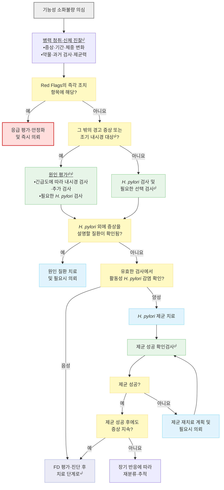

# 기능성 소화불량 Functional Dyspepsia, FD

## <mark style="color:green;">일반 사항</mark>

* 상복부 통증·작열감, 식후 충만감 또는 조기 포만감이 만성적으로 재발하며, 적절한 평가에서 이 증상을 설명할 기질적·전신적·대사 질환이 확인되지 않는 상태
* GERD·IBS가 흔히 동반됨
* 과거에는 non-ulcer dyspepsia로 불렸음; indigestion 또는 dyspepsia는 기능성 소화불량보다 넓은 증상 개념
* 유병률 : Rome IV를 적용한 국제 인구 조사에서 약 7%; 진단 기준·조사 방법·국가에 따라 차이가 큼
* 분류 : postprandial distress syndrome(PDS)과 epigastric pain syndrome(EPS)으로 나눔
  * Rome V에서는 PDS 기준을 충족하면 식후 통증·작열감도 PDS에 포함하고 EPS는 PDS 기준을 충족하지 않는 경우로 한정하여, Rome IV의 PDS/EPS 중첩 분류를 적용하지 않음
  * 실제 환자에서는 식후 증상과 통증·작열감이 함께 나타나는 경우가 흔하므로 진단 아형과 임상 증상 양상을 구분하여 치료를 선택
* Refractory functional dyspepsia : 정의가 완전히 통일되어 있지는 않으나, 적절한 초기 치료에도 임상적으로 의미 있는 증상이 지속되는 경우를 지칭
  * 진단 전 복약 순응도와 기질적 질환을 재평가
* 대부분의 소화불량 환자에서 증상의 기저 원인은 기능성 소화불량
* FD 자체는 생명을 위협하는 질환이 아니지만 증상이 재발하고 삶의 질을 크게 저하시킬 수 있음
  * 임상시험에서 위약 반응도 흔하므로 약물 반응만으로 진단을 확정하거나 부정하지 않음

## <mark style="color:green;">원인 및 위험 인자</mark>

* 정확한 단일 원인은 불명확함 (☞ [소화불량](075_-indigestion-dyspepsia.md))
* FD는 장-뇌 상호작용 장애(disorder of gut-brain interaction, DGBI)에 속하며, 아래 기전이 환자별로 복합적으로 관여
  * 내장 과민성(visceral hypersensitivity) : 위장 자극에 대한 과도한 감각 반응
  * 위 배출 지연 : 음식물의 위 통과 시간 연장
  * 위 적응(gastric accommodation) 장애 : 식후 위저부가 충분히 이완되지 않음
    * 특히 조기 포만감과 밀접하게 연관
  * 중추신경계-장신경계 이상 상호작용
  * 십이지장 미세염증(duodenal microinflammation) : 일부 환자에서 십이지장 호산구증가증(duodenal eosinophilia), 비만세포(mast cell) 활성화 및 십이지장 점막 투과성 증가가 관찰됨; post-infectious FD 및 음식 항원 관련 증상과의 연관성이 제시됨
  * 장내 미생물총 이상 (dysbiosis) - 연구 진행 중; 아직 표준 치료 근거로 권고되지 않음
  * _H. pylori_ 감염 : 일부 환자에서 제균 후 장기간의 증상 호전을 보임

### <mark style="color:orange;">관련 위험 인자</mark>

* 증상 유발·악화 음식 : 고지방식, 카페인, 매운 음식, 밀 등이 보고되나 개인차가 커서 일률적으로 적용되는 원인 음식은 없음
* 정신사회적 요소 : 스트레스, 불안, 우울, 신체화장애
* 위장관 운동 이상, 내장 과민, 위장관 감염(post-infectious FD)
* 흡연, NSAID·opioid·GLP-1 수용체 작용제 등이 소화불량을 유발·악화할 수 있음
* 유전, 가족 환경, 여성

## <mark style="color:green;">임상 양상</mark>

* postprandial fullness(식후 충만감) : 식사 후 위장에 음식이 지속적으로 남아 있는 듯한 불편한 느낌. 환자가 '더부룩함'으로 표현하는 증상에는 충만감과 상복부 팽만감이 섞여 있으므로 구분 (☞ [위장증상의감별](074_-gidz.md))
  * 팽만감(bloating)은 PDS의 핵심 증상이 아니며, 팽만감이 주된 증상이면 기능성 복부 팽만 등을 감별
* early satiety(조기 포만감) : 식사를 시작하면서 곧 느껴지는, 식사량에 부합하지 않는 불편한 위장 포만감
  * 통상적인 분량의 음식을 다 먹을 수 없음
* epigastric pain(상복부 통증) : 명치 부위(배꼽 위 복부 중앙부)의 통증
  * 일상생활에 지장을 주는 정도의 불편도와 빈도를 확인
* epigastric burning(상복부 작열감) : 상복부에 느껴지는 주관적인 화끈거림 또는 열감

### <mark style="color:$danger;">🚩 Red Flags!</mark>

<mark style="color:$danger;">**즉각 조치**</mark>

* 토혈·흑색변, 특히 실신·저혈압·빈맥 동반 `상부 위장관 출혈`
* 갑자기 발생한 심한 복통, 반발통·복벽 경직 `천공` `급성 복증`
* 상복부 불편감과 흉부 압박감·호흡곤란·식은땀 동반 `급성 관상동맥증후군`
* 상복부 통증·발열·황달과 저혈압·의식 변화 등 전신 상태 악화 동반 `중증 급성 담관염` `패혈증`

<mark style="color:$warning;">**당일\~수일 내 평가**</mark>

* **(당일)** 지속적 구토 또는 수분 섭취 곤란·탈수 `위장관 폐쇄` `대사 이상`
* **(당일)** 새로 발생한 황달 또는 지속적 상복부 통증에 발열·오한 동반 `급성 담관염` `급성 췌장염`
* 진행성 연하곤란·연하통, 원인 불명 체중감소·철결핍성 빈혈 `상부 위장관 악성종양`
* 등으로 퍼지는 지속적 상복부 통증, 복부 종괴 `췌장·담도 질환`

<mark style="color:$info;">**조기 평가 및 추적**</mark>

* ≥40세에서 아직 평가되지 않은 지속·반복 소화불량, 특히 새로 발생하거나 양상이 변한 경우; 위암 가족력 `위암`
* 경고 징후가 없으나 적절한 초기 치료에도 증상이 지속·악화함 `기질적 질환` `난치성 FD`&#x20;

　☞ [위장 증상의 감별](074_-gidz.md#red-flags)

## <mark style="color:green;">진단</mark>

* 전형적인 증상 양상과 적절한 평가를 바탕으로 적극적으로 진단하되, 증상을 설명할 기질적·전신적·대사 질환을 배제
* 임상적으로는 경고 징후가 없고 연령·위암 위험에 맞는 평가를 거친 성인에서 일상생활에 지장을 주는 상복부 통증·상복부 작열감, 조기 포만감 및/또는 식후 충만감이 ＞8주 지속되면 FD를 적극적으로 진단할 수 있음 <mark style="color:$info;">\[BSG 2022]</mark>
* Rome V의 정량적 연구 기준은 아래 기간·빈도 조건을 적용
* 임상에서는 Rome V가 강조하는 증상 양상, 불편도와 기능 영향도 함께 판단
* 감별 : 소화성 궤양·위암, GERD, 췌장·담도 질환, 위마비, 약물 유발 소화불량, 대사·전신 질환

### <mark style="color:orange;">Diagnostic criteria (</mark>[<mark style="color:orange;">Rome V 2026</mark>](https://theromefoundation.org/rome-v-criteria/)<mark style="color:orange;">)</mark>

#### <mark style="color:$primary;">Functional dyspepsia</mark>

* 일상생활에 지장을 주는 ① 식후 충만감, ② 조기 포만감, ③ 상복부 통증, ④ 상복부 작열감 중 ≥1개가 있고 아래 PDS 또는 EPS 기준에 해당
* 성인 연구 기준은 진단 시점으로부터 ≥6개월 전에 증상이 시작되고 최근 3개월간 기준을 충족해야 함. 증상을 설명할 만한 구조적·전신적·대사 질환의 근거가 없어야 함

#### <mark style="color:$primary;">Postprandial distress syndrome (PDS, 식후곤란증후군)</mark>

* ≥2일/주 불편한 식후 충만감 또는 평소 식사량을 마치지 못하게 하는 조기 포만감
* 위 핵심 증상이 있으면 음식 섭취로 유발·악화되는 상복부 통증·작열감, 구역, 상복부 팽만·과도한 트림도 PDS의 일부로 평가
* 식후 증상은 식사 후 2시간 이내 유발되는 증상을 뜻함
* 구역이 우세하거나 구토가 지속되면 PDS 진단에서 제외하고 만성 구역·구토증후군(CNVS, chronic nausea vomiting syndrome)·위마비 등 평가; 경미한 식후 구역의 동반과 구별
* 가슴쓰림은 위십이지장 증상이 아니나 흔히 동반됨

#### <mark style="color:$primary;">Epigastric pain syndrome (EPS, 상복부통증증후군)</mark>

* ≥1일/주 불편한 상복부 통증 또는 작열감(배꼽 위 복부 중앙부에 국한)
  * 식사로 유발·악화되거나 식사와 무관하게 발생 가능
* Rome V에서는 PDS 기준을 충족하지 않는 경우로 분류
  * PDS 핵심 증상을 동반하는 식후 통증·작열감은 우선 PDS의 일부로 평가
* 구역이 우세하거나 구토가 지속되면 EPS 진단에서 제외하고 CNVS·위마비 등 평가
* 통증이 배변으로 일관되게 호전되면 장 질환에 의한 증상인지 검토
* EPS의 잠정적 세부 분류 : 통증·작열감이 식후 시작·악화되는 비율이 ≥50%이면 식후 EPS, ＜50%이면 식사 비관련 EPS; 치료를 고정하는 기준으로 사용하지는 않음
* PDS/EPS 아형은 Rome V에서 서로 배타적으로 분류하나 실제 증상은 함께 나타날 수 있으며, 아형만으로 병태생리나 약물 반응을 단정하지 않음
* 임상에서는 필요한 평가 후 진단·치료하며 연구용 기간·빈도를 채우기 위해 진료를 늦추지 않음

### <mark style="color:orange;">검사</mark>

* 내시경 검사가 모든 환자에게 일률적으로 필요한 것은 아니나, ≥40세의 아직 평가되지 않은 만성 소화불량, 경고 증상, 치료 불응 또는 진단 불확실 시 고려
  * 내시경상 경미한 발적이나 비특이적 위염만으로 증상의 원인을 단정하지 않음
* 혈액·영상검사 : 병력·진찰에 따라 검사를 선택; 모든 환자에게 혈액·영상검사를 일괄 시행하지 않음
* 위 배출검사·식도 pH 검사는 routine으로 시행하지 않음. 위마비가 의심되는 경우(지속적 구역·구토, 당뇨·위 수술력)에만 기계적 폐쇄 배제 후 4시간 고형식 위배출 신티그래피를 고려

### <mark style="color:orange;">Test-and-Treat 전략</mark>

* 내시경에 앞서 _H. pylori_ 검사를 시행하여 양성이면 제균하고, 음성이면 경험적 약물 치료를 하는 초기 접근법
* 적용 대상 : ＜40세이면서 경고 증상·주요 위암 위험 인자가 없는 환자 <mark style="color:$info;">\[J Neurogastroenterol Motil 2020]</mark>
* 위암 역학을 고려한 국내 지침은 ≥40세의 만성 소화불량에서 조기 상부 위장관 내시경을 권고함. 특히 아직 평가되지 않았거나 새로 발생·변화한 증상이 중요
  * 이미 충분히 평가된 안정적 FD에서 연령만으로 내시경을 반복하지 않음
* 과정
  1. _H. pylori_ 검사 : 요소 호기 검사 또는 대변 항원 검사
  2. _H. pylori_ 양성 시 제균 치료 시행하고 제균 성공 여부 확인
  3. _H. pylori_ 음성 또는 제균 후에도 증상 지속 → 위산 억제제 또는 위장관 운동 촉진제 등 경험적 치료 시행; 제균 효과의 장기 판정을 기다리는 동안에도 증상 치료 가능
  4. 치료 불응, 진단 불확실 또는 경고 증상 발생 시 내시경 및 필요한 추가 검사로 전환


**Test-and-Treat 전략의 근거**\
• 경고 증상 없는 젊은 환자 대부분은 내시경에서 중요한 이상 소견이 나오지 않음\
• _H. pylori_ 제균의 이중 효과 : 소화불량 증상 호전 + 위암 예방\
• 불필요한 내시경 감소 : 검사에 따른 비용과 불편함, 부작용을 줄임


* 내시경을 포함한 필요한 평가에서 증상을 설명할 질환이 없고, 전형적 증상이 있으면 FD로 진단
  * 제균·PPI 치료 실패는 FD의 필수 진단 조건이 아님 - PPI 반응만으로 FD와 GERD를 구분하지 않음


**_H. pylori_-associated dyspepsia**

* _H. pylori_ 양성 소화불량 환자에서는 먼저 제균 치료를 시행.\
  제균 성공 후에도 증상이 지속되면 FD 가능성을 평가하고 치료
* 제균 후 증상이 소실되고 그 효과가 6개월 이상 유지되면 _H. pylori_-associated dyspepsia로 분류하여 FD와 구별. 이는 장기적 분류 기준이며, 분류를 위해 6\~12개월 동안 FD 치료를 보류할 필요는 없음
* 제균은 일부 환자에서 장기 소화불량 증상 개선과 위암 위험 감소를 기대할 수 있으나 평균적인 증상 이득은 제한적임(증상 개선 NNT 약 9, 소실 NNT 약 14; 제균 성공 시 효과가 더 큼) <mark style="color:$info;">\[Gut 2022]</mark>. 제균 요법·허가·급여는 해당 장을 따름 (☞ [헬리코박터](080_-h_pylori-infection.md))


***



> ¹⁾_FD 중심 병력 청취 및 신체 진찰_\
> _- 경고 증상 여부_\
> _- 증상의 시작 시기 및 기간_\
> _- 감염 또는 정신적 문제 후 발생 여부_\
> _- 다른 상부 위장관 문제 존재 여부_\
> _- 상복부 증상과 배변의 관계를 확인; IBS에 의한 증상과 별도의 FD 증상을 구분하고 동반 IBS도 평가_\
> _- 전형적 가슴쓰림·산 역류 여부를 확인; GERD가 증상을 설명하는지와 FD 동반 여부를 평가_\
> _- 체중 감소 평가_\
> _- 다른 gut-brain interaction 이상에 의한 하부 GI 증상 여부_\
> _- 다른 기능성 비위장관 질환의 존재 여부_\
> _- H. pylori 과거 검사·제균력, PPI·항생제 복용력_\
> _- 약물(NSAID, opioid, GLP-1 수용체 작용제 등)_
>
> ²⁾_선택 검사_\
> _- H. pylori 검사(요소 호기 또는 대변 항원; 검사 전 PPI/P-CAB ≥2주, 항생제·비스무트 ≥4주 중단). 제균 후에는 항생제 종료 ≥4주 후, 같은 중단 조건을 지켜 성공 확인_\
> _- 필요시 CBC·간기능·전해질 등 선택; 만성 설사·철결핍·흡수장애 또는 위험 인자가 있으면 셀리악병 혈청검사 고려. 국내 저유병률을 고려하여 일률적 선별검사로 적용하지 않음_
>
> ³⁾_필요시 추가 검사_\
> _- 상부 위장관 내시경: 국내에서는 ≥40세의 아직 평가되지 않은 만성 소화불량, 경고 증상, 치료 불응 또는 진단 불확실 시 고려_\
> _- 복부 CT: 복통과 체중감소, 황달 등 췌장·담도 질환이 의심될 때 고려_\
> _- 초음파: biliary colic 특징이 있는 상복부 통증_
>
> ⁴⁾_FD 진단_\
> _- gut-brain axis의 맥락에서 상태에 대하여 설명_\
> _- 약물, 정신 치료 등 치료 방법 협의_\
> _- 환자의 이전 치료 및 선호도를 고려_\
> _- H. pylori 양성이면 제균 후 증상 경과를 함께 판단; 제균 확인검사를 기다리는 동안에도 증상 치료가 가능하며, 제균 실패 시 재치료를 계획. 증상이 지속되면 장기 분류 판정을 기다리지 않고 FD 치료를 병행하며, 제균 후 증상 소실이 6개월 이상 유지되면 H. pylori-associated dyspepsia로 재분류_\
> _- 환자 교육, 추적 관리 계획: 증상이 호전과 악화를 반복하는 경과가 흔하며 장기 관리가 필요할 수 있음, 치료는 삶의 질 향상을 목표로 함을 설명_

<p align="center"><strong>기능성 소화불량 진단 및 초기 평가 알고리듬</strong><br><em><mark style="color:$info;">저자 재구성 (참고 문헌 : BSG 2022; J Neurogastroenterol Motil 2020; ACG 2024)</mark></em></p>

***

## <mark style="background-color:$warning;">Management</mark>

### <mark style="color:orange;">치료 방침</mark>

* 환자 교육, 생활 습관 조절 및 필요시 약물·행동치료를 함께 적용
  * 정해진 추적 시점에 우세 증상·식사량·체중·일상기능의 변화를 평가
* 초기 약제는 우세 증상, 동반 GERD, 이전 치료 반응, 부작용 위험 및 가용성을 종합하여 선택
  * PDS/EPS 아형은 증상 표현형을 이해하는 데 유용하지만 임상 증상이 중첩될 수 있고 특정 병태생리나 약물 반응을 정확히 예측하지 못함. 아형별 초기 치료가 경험적 PPI보다 우월하지 않았다는 무작위시험도 있음 <mark style="color:$info;">\[Aliment Pharmacol Ther 2025]</mark>
* _H. pylori_(+) 환자에 대하여 제균 요법 시행 (☞ [헬리코박터](080_-h_pylori-infection.md))
* _H. pylori_(-) 또는 제균 요법 후 증상 지속 시 위산 억제제 또는 위장관 운동 촉진제 등 한 계열을 우선 시도
  * → 약제별 적절한 기간 후 반응을 평가하고 불응 시 다른 계열로 전환, 부분반응 시 선택적 병용 고려\
    → 지속·재발 시 최소 유효 용량 사용
* 심한 증상, 경고 징후, 난치성 환자 등은 의뢰
  * 경고 징후는 Red Flags의 긴급도에 따라 평가하며 경험적 FD 치료로 검사를 미루지 않음
* 불안·우울 또는 섭식장애가 뚜렷하면 초기부터 관련 전문가와 병행 치료를 고려하며 여러 FD 약제의 실패를 기다리지 않음 <mark style="color:$info;">\[J Gastroenterol Hepatol 2026]</mark>

#### <mark style="color:$primary;">FD-GERD Overlap</mark>

* FD와 GERD는 흔히 동반되며 외래에서 매우 흔한 임상 상황
* FD와 NERD는 증상이 겹칠 수 있으나 상복부 작열감만으로 GERD를 진단하지 않음
* PPI 반응만으로 FD와 GERD를 확정적으로 구분할 수 없음
* 증상 : 상복부 작열감, 식후 역류, 과도한 트림, 흉부·상복부 불편감
* 치료 : 전형적 역류 증상 또는 검사로 GERD 동반이 판단되면 해당 GERD 지침과 허가사항에 따라 PPI 또는 P-CAB을 사용; alginate를 보조적으로 고려. 잔여 FD 증상은 별도로 평가
* 역류가 동반되면 야식 제한, 식후 바로 눕지 않기, 과체중 시 체중 감량을 병행
* 난치성 증상에서는 진단을 재평가하고 저용량 TCA 또는 gut-brain behavioral therapy를 고려


**임신 중 증상 치료**

* 생활 습관·식사 조절을 우선 적용하고, 임신성 구역·구토와 동반 GERD 등 증상의 원인을 구분함
* 속쓰림·역류가 동반되면 알긴산 제제 또는 적절한 제산제를 단기간 고려할 수 있음. 위산 억제가 필요하면 임신 중 사용 자료가 비교적 풍부한 omeprazole이나 대안인 famotidine을 치료상 이득이 위험보다 클 때 선택함. FD 자체에 대한 PPI 사용은 허가 외 사용이며, 임신 중 모든 소화불량에 일률적으로 투여하지 않음
* 임신성 구역·구토에는 doxylamine/pyridoxine을 일차 선택지로 고려함. 이는 FD 자체의 치료와 구분하며, 상세 약제 선택은 (☞ [소화기계 약제](073_-gidrugs.md)) 참조
* 임신·수유 중 사용 가능 여부는 성분·품목별로 판단하며, 이 장에서 임부·수유부 금기를 따로 표시하지 않았다는 것이 임신·수유 중 사용 가능 또는 안전성 확립을 뜻하지 않음


## ## <mark style="color:green;">비-약물 치료 및 예방</mark> <a href="#non-drug-treatment" id="non-drug-treatment"></a>

* 안심시킴
* 증상의 원리를 설명(gut-brain interaction, 식이, 스트레스, 인지, 행동, 감정과의 관련성 설명)
* 생활 습관 개선 : 금연, 음주 제한, 규칙적 생활, 적당한 운동(유산소 운동)
* 식이 요법 : 개인별 증상 유발 음식, 특히 고지방식을 확인하여 제한하고 잘 씹어 소량씩 자주 섭취
  * 2026년 PDS 환자 60명을 대상으로 한 6주 무작위시험에서 [Low FODMAP diet](087_-ibs.md#low-fodmap)가 전통적 식이 조언보다 증상과 삶의 질을 더 개선함. 다만 단일기관·소규모·단기간 연구이고 IBS 동반자가 63%여서 FD 전체로 일반화하기 어려움 <mark style="color:$info;">\[Clin Gastroenterol Hepatol 2026]</mark>
  * 기본 식이 조절에도 불편한 PDS, 특히 IBS 동반 환자에서 영양 전문가 지도하에 제한된 기간 시도 후 반응을 평가하고 음식을 재도입하여 개인화할 수 있음
  * 장기적인 광범위 제한식은 피함
* 심리 치료 : 인지-행동 치료(CBT), gut-directed hypnotherapy, mindfulness, psychotherapy, 스트레스 관리; 특히 초기 치료 불응 시 고려 <mark style="color:$info;">\[BSG 2022; J Gastroenterol Hepatol 2026]</mark>
* 침 치료 : 일부 무작위시험에서 증상 개선이 보고되어 환자 선호·접근성에 따라 보조적으로 고려할 수 있음. 연구 간 이질성이 있으며 표준 평가·치료를 대체하지 않음
  * 경피적 귀 미주신경 자극 등은 근거가 제한적임 <mark style="color:$info;">\[J Gastroenterol Hepatol 2026]</mark>
* 반드시 필요한 것 외의 약제(진통제 등) 사용을 피함. Opioid를 FD 증상 치료 목적으로 사용하지 않음
* 중증·난치성 FD에서 심한 식사 회피, 체중감소 또는 영양불량이 있으면 avoidant/restrictive food intake disorder(ARFID) 등 섭식장애를 평가하고 지나치게 제한적인 식단을 피하기 위해 영양 전문가와 협진


**FD 증상 증폭 모델 :** 여러 요인이 서로 영향을 주는 예시이며, 모든 환자에서 같은 순서로 진행하는 것은 아님

* 음식 자극 → 위 운동 이상 / accommodation 장애 → 내장 과민성 증가 → 불안·hypervigilance·스트레스 → 증상 증폭 → 식사 회피 / 불안 강화 → 만성화
* 치료 목표 : 환자별 위 운동·감각 과민·스트레스 및 식사 회피 등 조절 가능한 요인을 치료하여 증폭 고리를 줄이고 삶의 질 회복
* 설명 예시 : "내시경이 정상이어도 불편함은 실제로 존재합니다. 위의 운동이나 감각, 위장과 뇌 사이의 신호 조절이 달라져 같은 자극에도 더 강하게 느낄 수 있습니다."


## <mark style="color:green;">약물 치료</mark> <a href="#drug-treatment" id="drug-treatment"></a>

#### <mark style="color:$primary;">우세 증상을 참고한 약제 선택</mark>

* PDS/EPS 아형만으로 약물 반응을 예측하거나 치료를 고정하지 않음
* 아래 표는 환자별 초기 약제 선택의 참고 자료임

<table data-search="false"><thead><tr><th width="233">임상 상황</th><th width="272">고려할 수 있는 초기 접근</th><th>비고</th></tr></thead><tbody><tr><td><strong>상복부 통증·작열감 우세</strong></td><td>PPI 또는 H2RA</td><td>저용량 또는 표준용량으로 4~8주; 반응이 없으면 다른 계열 고려</td></tr><tr><td><strong>식후 충만감·조기 포만감 우세</strong></td><td>prokinetic</td><td>약제별 근거와 부작용이 다름</td></tr><tr><td><strong>식사 관련 증상 + 통증·작열감</strong></td><td>한 계열 우선 시도 후 전환 또는 선택적 병용</td><td>처음부터 routine 병용하지 않음</td></tr><tr><td><strong>초기 치료 불응·통증 과민 우세</strong></td><td>진단·순응도 재평가 후 저용량 TCA ± gut-brain behavioral therapy</td><td>TCA는 FD에 허가 외 사용; 부작용 설명</td></tr><tr><td><strong>조기 포만감+체중감소</strong></td><td>영양·ARFID 평가; 전문의 판단하 mirtazapine 고려</td><td>근거 제한, 허가 외 사용</td></tr><tr><td><strong>지속적 구역·구토</strong></td><td>FD 이외 질환·CNVS·위마비 감별</td><td>원인 평가 후 선택적 치료</td></tr><tr><td><strong>FD-GERD overlap</strong></td><td>전형적 증상·검사로 판단한 동반 GERD는 해당 지침에 따라 치료</td><td>GERD 치료와 FD 치료를 구분</td></tr></tbody></table>

### <mark style="color:orange;">위산 분비 억제제 (PPI, H2-수용체 차단제, P-CAB)</mark>

* PPI 또는 H2RA를 초기 치료제로 고려할 수 있음
  * 특히 상복부 통증·작열감이나 GERD가 동반된 환자에서 고려
* [H2RA](073_-gidrugs.md#h2-h2-receptor-antagonist-h2ra) : PPI의 유효한 대안이며, PPI보다 열등하다고 단정할 수 없음
  * 연속 사용 시 수일\~수주 내 내성(tachyphylaxis)이 나타날 수 있어 단기 또는 간헐 사용 고려
  * famotidine 등은 신기능에 따라 감량 또는 투여 간격 연장. Cimetidine은 CYP 관련 상호작용이 많으므로 다약제 복용자에서 특히 주의; 성분·적응증별 용법은 해당 장 참조 (☞ [소화기계 약제](073_-gidrugs.md))

[**PPI**](073_-gidrugs.md#proton-pump-inhibitor-ppi)

* FD에서는 저용량 또는 표준용량을 4\~8주 시도하고 반응을 평가
  * FD 자체에서 고용량 증량의 추가 이득은 확립되지 않음
  * 반응·유지 적응증을 평가하고, 증상 조절 후 최소 유효 용량 또는 간헐 투여를 고려
* 드물지만 급성 세뇨관간질성 신염은 인정되는 PPI 약물이상반응이며, 의심되면 중단·평가함
* FD 단독 치료는 허가 외 사용임. 동반되어 있는 GERD·소화성궤양 등은 해당 기준 적용
* omeprazole·esomeprazole은 clopidogrel과의 병용을 피하고 필요시 pantoprazole 등 대안을 고려
* 위산도 변화에 따른 흡수 상호작용과 다른 병용약도 확인
* omeprazole : 20 ㎎ qd, 아침 공복 복용 <mark style="color:blue;">\[<a href="https://www.health.kr/drug/A11A0120A0565">오엠피</a>]</mark>
* dexlansoprazole : 30 ㎎ qd, 식사와 관계없이 복용 가능 <mark style="color:blue;">\[<a href="https://www.health.kr/drug/2012102300007">덱실란트디알</a>]</mark>

[**P-CAB**](073_-gidrugs.md#potassium-competitive-acid-blocker-p-cab)

* FD 자체에 대한 P-CAB의 효과 근거는 아직 불충분하며, FD 치료 목적으로 routine 사용하지 않음
* FD 단독 치료는 허가 외 사용임. 동반되어 있는 GERD·소화성궤양 등은 해당 기준 적용
* tegoprazan <mark style="color:blue;">\[<a href="https://www.health.kr/drug/2018070600004">케이캡</a>]</mark>, fexuprazan <mark style="color:blue;">\[<a href="https://www.health.kr/drug/2022010300016">펙수클루</a>]</mark>

### <mark style="color:orange;">위장관 운동 촉진제</mark>

* 일부 FD 환자에서 유효하며 식후 충만감·조기 포만감이 우세할 때 선택할 수 있으나, 약제별 근거와 부작용이 다름 (☞ [Prokinetics](073_-gidrugs.md#gi-prokinetic-agent))
* _H. pylori_ 제균 치료 또는 위산 억제 치료에도 증상이 지속되는 환자에서 고려할 수 있음
* 수 주 단위 치료가 필요하면 중추·심장 부작용이 적은 mosapride, itopride, 현호색·견우자 추출물을 우선 고려
* 위장관 운동 자극이 위험한 상황(위장관 출혈·기계적 폐색·천공)에서는 투여를 피하고 성분별 금기를 확인
* mosapride 일반정 : 5 ㎎ tid, 식전 또는 식후; 5-HT4 수용체 작용제 <mark style="color:blue;">\[<a href="https://www.health.kr/drug/A11AIIIII0006">가스모틴</a>]</mark>
  * 허가 효능 : 기능성 소화불량으로 인한 소화기 증상(속쓰림·구역·구토). 보통 2주 투여에도 개선이 없으면 장기간 지속하지 않음; 서방정과 용법을 혼동하지 않음
  * 설사·어지럼, 드문 중증 간기능장애에 유의. 항콜린제와 병용 시 운동 촉진 효과가 감소할 수 있음
* 현호색·견우자 추출물(DA-9701) : 30 ㎎ tid 식전; D2 길항, 5-HT4 작용 등 복합 기전 <mark style="color:blue;">\[<a href="https://www.health.kr/drug/2011051800003">모티리톤</a>]</mark>
  * 허가 효능 : 기능성 소화불량증. 약 4주 투여에도 개선이 없으면 중단·치료 전환을 고려
  * 변비·설사·어지럼, 간효소·prolactin 상승 등이 보고됨; 고령자는 신중 투여
* itopride : 50 ㎎ tid 식전; D2 수용체 차단 + acetylcholinesterase 억제 <mark style="color:blue;">\[<a href="https://www.health.kr/drug/2015050100105">가나톤</a>]</mark>(급여삭제)
  * 효과가 없으면 장기간 지속하지 않음; 유즙 분비·여성형유방증 등 고프로락틴혈증에도 유의
* levosulpiride : 25 ㎎ tid 식전; D2 수용체 차단제 <mark style="color:blue;">\[<a href="https://www.health.kr/drug/A11A1890A0158">레보프라이드</a>]</mark>
  * 허가 효능 : 기능성 소화불량으로 인한 증상 완화
  * 추체외로증상·지연성 운동장애, 고프로락틴혈증 위험이 있어 단기 사용을 원칙으로 하고 고령자에서는 가급적 피함. 새로 발생한 떨림·서동·보행 장애는 약물 유발 파킨슨증 가능성을 평가 <mark style="color:$info;">\[Mov Disord 2009]</mark>
  * 주요 금기 : 간질·조증, 크롬친화세포종, 악성유선병증, 위장관 출혈·기계적 폐색·천공; 신배설 약제로 신기능 저하·고령에서 축적과 이상반응에 유의하고 용량·투여간격을 신중히 조정
* domperidone : 성인 10 ㎎ tid 식전, 최대 30 ㎎/d; 말초 D2 수용체 차단제 <mark style="color:blue;">\[<a href="https://www.health.kr/drug/A11A0570A0382">돔피돈</a>]</mark>
  * 허가 효능 : 구역·구토 증상 완화에 허가; FD 자체의 장기 치료제로 사용하지 않음
  * QT 연장·심실성 부정맥 위험으로 최소 유효 용량·최단기간 사용하며 일반적으로 1주를 초과하지 않음
  * 금기 : 프로락틴분비종양, QT 연장·서맥·심부전 등 심장 기저질환·유의한 전해질 이상, 중등도\~중증 간장애, amitriptyline, ondansetron, clarithromycin 등 QT 연장 약제 또는 강력한 CYP3A4 억제제와 병용 금기
  * 심한 신장애에서 반복 투여가 필요하면 투여 횟수 감소 등 제품별 조정 기준 확인
* metoclopramide : 추체외로증상과 지연성 운동장애 위험 때문에 만성 FD에 routine 사용하지 않음. 다른 원인을 평가한 심한 구역·구토에 불가피하게 사용할 때만 허가 적응증에 따라 최소 용량·최단기간 사용하며 최대 5일을 넘기지 않음. 투여 간격은 최소 6시간 유지
  * FD·위마비 자체는 허가 적응증이 아님 <mark style="color:blue;">\[<a href="https://www.health.kr/drug/A11A0570A0089">맥페란</a>]</mark>
* acotiamide : 100 ㎎ tid ×4wk; acetylcholinesterase 억제 등을 통한 말초 콜린성 신경 조절. PDS에서 유효성이 보고 (국내 미유통)

### <mark style="color:orange;">제산제</mark>

* FD 자체의 지속적 증상 개선 근거는 부족하여 routine 치료로 권고하지 않음. 동반 속쓰림 등에 한해 단기간 보조적으로 고려 <mark style="color:$info;">\[BSG 2022]</mark>
* 복용 시점·횟수는 성분·제형별로 다름 (☞ [제산제](073_-gidrugs.md#antacid))
* 예방 효과가 없으므로 장기간 지속 또는 빈번한 투여는 피함
* almagate <mark style="color:blue;">\[<a href="https://www.health.kr/drug/A11A0450A0398">알마겔</a>]</mark> : 식후 30분\~1시간에 1일 3회, 필요시 취침 전에 1회 추가 복용
  * 신장애에서 알루미늄·마그네슘 축적 위험이 있으며, 심한 신장애에서는 권고하지 않음
  * tetracycline계 항생제와 병용하지 않음
  * quinolone·철분제 등도 흡수를 방해하므로 병용약별 간격 확인

### <mark style="color:orange;">점막 보호제</mark>

* 일부 약제에서 증상 개선이 보고되었으나 근거가 제한적이며, EPS에서 위산 억제제와의 routine 병용이 단독요법보다 우월하다고 확립되지 않음 (☞ [점막보호제](073_-gidrugs.md#gastric-mucosal-protective-agent))
* 애엽95%에탄올연조엑스 <mark style="color:blue;">\[<a href="https://www.health.kr/drug/A11AOOOOO5702">스티렌</a>]</mark>, benexate <mark style="color:blue;">\[<a href="https://www.health.kr/drug/A11A0340A0036">울굿</a>]</mark>, rebamipide <mark style="color:blue;">\[<a href="https://www.health.kr/drug/A11A4270A0014">무코스타</a>]</mark>
* FD 단독 치료는 적응증 아님. 위염, 위궤양 등에 대하여 적용

### <mark style="color:orange;">위저부 이완제 (Fundus relaxant drug)</mark>

* azapirone 계열 5-HT1A 수용체 작용제(buspirone, tandospirone)
* 위 적응 개선을 목적으로 연구되었으나 통상적인 FD 일차 치료제는 아님
* 일부 소규모 연구에서 위 적응·증상 개선이 보고됐지만 효과는 확립되지 않음
* tandospirone : 10 ㎎ tid ×4wk; 소규모 RCT와 간접 비교에서 유효 가능성이 보고되었으나 근거 수준은 낮고, buspirone보다 우월하다는 직접 비교 RCT는 없음 (국내 미유통)
* buspirone : 10 ㎎ tid ×4wk; 식사 15분 전 복용. 일부 소규모 연구에서 gastric accommodation 및 조기 포만감 개선이 보고되었으나 결과가 일관되지 않음. FD 단독 치료는 적응증이 아님 <mark style="color:blue;">\[<a href="https://www.health.kr/drug/A11A0930A0245">부스파</a>]</mark>

### <mark style="color:orange;">항우울제 (Gut-brain neuromodulator)</mark>

* gut-brain neuromodulator로서 장-뇌 신호와 통증 과민성을 조절하는 목적으로 사용
* 특히 통증이 두드러진 환자에서 근거가 있으나 PDS/EPS 아형만으로 사용 여부를 결정하지 않음
* FD 사용은 허가 외 사용
* 적절한 제균·초기 약물 치료에도 호전되지 않으면 2차 약제로 [TCA](073_-gidrugs.md#tca) 고려
* TCA는 낮은 용량부터 서서히 증량하고 초기 2\~4주에 내약성·복약 상태를 확인; 충분한 기간의 치료 후 효과를 판단. 유효하면 6\~12개월 유지 후 점진적 감량을 고려 <mark style="color:$info;">\[BSG 2022]</mark>; TCA의 항콜린 작용은 일부 prokinetics의 운동 촉진 효과를 낮출 수 있어 병용 필요성을 재평가
* SSRI/SNRI는 FD 증상 자체의 치료 효과가 확립되어 있지 않음; 동반 불안·우울장애는 별도로 평가·치료 <mark style="color:$info;">\[BSG 2022]</mark>
* 저용량으로 시작하여 내약성에 따라 증량. 고령자에서는 amitriptyline, imipramine을 가급적 피함; 강한 항콜린 작용, 진정, 기립저혈압·낙상 위험을 먼저 평가 <mark style="color:$info;">\[AGS Beers 2023]</mark>
* amitriptyline : 일반 성인 10 ㎎ 취침 시부터 시작하여 반응·내약성에 따라 10\~25 ㎎ 등으로 조정하고, 필요시 30\~50 ㎎/d까지 신중히 증량 고려 <mark style="color:blue;">\[<a href="https://www.health.kr/drug/A11A0570B0082">에트라빌</a>]</mark>
  * 고령자에서는 대안이 없고 이득이 위험보다 클 때에만 5\~10 ㎎ 등으로 매우 신중하게 시작; 낮은 용량도 위험을 없애지는 못함
  * 주요 금기 : 부정맥, 심근경색 회복 초기, 녹내장, 전립선비대 등 배뇨장애, MAO 억제제 투여 중 등. 고령자·심질환·QT 연장 위험 또는 관련 약물 병용 시 처방 전 심전도·전해질 및 상호작용 평가; 양극성장애·자살위험도 확인. domperidone과 병용하지 않음
* imipramine : <a href="https://www.health.kr/drug/A11A0970A0140">25</a> ㎎ 취침 시 시작하여 필요시 50 ㎎까지 고려 <mark style="color:blue;">\[이미프라민]</mark>
* mirtazapine : 15 ㎎ 취침 시 <mark style="color:blue;">\[<a href="https://www.health.kr/drug/A11ABBBBB1118">레메론</a>]</mark>
  * 조기 포만감과 체중감소가 두드러진 난치성 FD에서 전문의 판단하에 고려; 일률적 사용을 권고할 근거는 부족
  * 졸림·체중 증가 및 대사 부작용 주의

### <mark style="color:orange;">Probiotics</mark>

* 특정 균주에서 일부 증상 개선 가능성이 보고되나 균주 간 결과가 일관되지 않으며 현재 연구 단계에 머물고 있음; routine 사용은 권고하지 않음 <mark style="color:$info;">\[J Gastroenterol Hepatol 2026]</mark>

### <mark style="color:orange;">실험적 / 근거 제한 약제</mark>

* 아래 약제들은 외래 활용성이 낮고 가이드라인 권고 수준이 약하여 routine 사용은 권고하지 않음
* 식물성 제제(phytotherapy) : 일부 가이드라인에서 단기 사용 가능성을 언급
  * STW 5 (이베로가스트) : 9가지 식물 추출물 복합 제제; 일부 RCT에서 FD 증상 호전이 보고되었으나 드물게 중증 약물유발 간손상이 보고되어 황달·진한 소변 등 발생 시 즉시 중단·평가
  * 페퍼민트 오일 단독의 FD 근거는 매우 제한적이며 하부식도괄약근 이완으로 역류를 악화시킬 수 있음. 연구는 주로 peppermint oil-caraway oil 복합제에 국한

***

## <mark style="color:red;">질병코드</mark>

* K30 기능성 소화불량 Functional dyspepsia

***

## <mark style="color:purple;">처방례</mark>

> **처방례 1. Epigastric pain syndrome (EPS)**
>
> ```
> 오엠피정 20 ㎎/T   1T   qd   아침 식전 30~60분   ×4주 후 평가   (FD: 허가 외 사용·보험주의)
> ```
> 약제 정보: [오엠피정 20㎎](https://www.health.kr/drug/A11A0120A0565)
>
> _✽상복부 통증·작열감이 우세하면 저용량 또는 표준용량 PPI를 4\~8주 시도할 수 있음. 이 예는 4주에 반응을 평가하고 필요시 총 8주까지 치료. 증상 호전 시 중단 또는 필요시 최소 유효 용량으로 조정하며 점막보호제의 routine 병용은 필요하지 않음. 오엠피는 장용정으로 씹거나 분쇄하지 않음. Clopidogrel 복용 중이면 omeprazole을 피하고 대안을 선택함_

> **처방례 2. Postprandial distress syndrome (PDS)**
>
> ```
> 가스모틴정 5 ㎎/T    3T   #3   식전 또는 식후   ×2주 후 평가
> ```
> 약제 정보: [가스모틴정 5㎎](https://www.health.kr/drug/A11AIIIII0006)
>
> _✽식후 충만감·조기 포만감이 우세하면 prokinetic을 초기 약제로 선택할 수 있음. 1회 1T씩 1일 3회 복용. 보통 2주에 반응을 평가하며 호전이 없으면 장기간 지속하지 않음. 제산제는 PDS 기본 처방에 일괄 포함하지 않음_

> **처방례 3. 초기 치료 불응 / 통증 과민 우세**
>
> ```
> 에트라빌정 10 ㎎/T    1T   qd   취침 시   ×2주(초기)   (허가 외 사용)
> ```
> 약제 정보: [에트라빌정 10㎎](https://www.health.kr/drug/A11A0570B0082)
>
> _✽진단·복약 순응도를 재평가한 뒤 저용량 TCA를 gut-brain neuromodulator로 고려. 불안·우울 동반 자체가 처방 기준은 아니며 별도의 정신질환은 해당 진단에 따라 치료함. 고령자에서는 가급적 피함. 예외적으로 대안이 없고 이득이 위험보다 크다고 판단할 때에만 5\~10 ㎎ 등으로 매우 신중하게 시작함. 금기·상호작용을 먼저 확인하고 초기 2주에 내약성을 평가하여 필요시 서서히 증량함. 2주는 첫 재평가 시점이며 효과 판정·전체 치료기간을 뜻하지 않음; 유효하면 6\~12개월 유지 후 감량 고려_

***

### <mark style="color:$success;">핵심 복약 지도</mark>

> **위산 분비 억제제 (PPI / H2RA)**
>
> 1. 일반적인 PPI는 하루 한 번 아침 식사 30\~60분 전에 복용합니다. Dexlansoprazole 등은 음식과 관계없이 복용할 수 있으므로 제품별 지시에 따릅니다.
> 2. 4\~8주 치료 후 증상이 호전되면 의사와 상의하여 중단·최소 유효 용량 유지·재발 시 단기 재투여 중 적절한 방법을 정합니다. PPI는 제산제처럼 복용 즉시 증상을 없애는 약은 아닙니다.
> 3. PPI는 대체로 안전하지만 불필요한 장기 복용은 피합니다. 장기 사용과 여러 이상반응의 연관성이 보고되었으나 인과관계가 확정되지 않은 것도 많습니다.
> 4. 장기간 복용했다면 중단 후 일시적인 산 분비 반동이 생길 수 있으므로 중단 방법을 의사와 상의합니다.
> 5. H2-수용체 차단제는 PPI와 복용 시점이 다를 수 있으며 약제와 신장 기능에 따라 용량 조절이 필요합니다. 제품별 처방 지시에 따릅니다.

> **위장관 운동 촉진제 (Prokinetics)**
>
> 1. 복용 시점과 횟수는 약제별로 다르므로 처방 지시에 따릅니다. Mosapride 일반정은 식전 또는 식후 복용할 수 있고 서방정은 용법이 다릅니다. 모티리톤은 식전 복용합니다. 가스모틴은 보통 2주, 모티리톤은 약 4주에 효과를 평가하고 호전이 없으면 처방을 재검토합니다.
> 2. 식후 충만감, 조기 포만감 완화를 목적으로 사용합니다.
> 3. Metoclopramide(맥페란)는 손발 떨림, 근육 경직 등 추체외로 부작용과 지연성 운동장애 위험 때문에 만성 기능성 소화불량에 routine으로 사용하지 않습니다. 허가 적응증으로 처방된 경우에도 최대 치료기간은 5일입니다.
> 4. Domperidone은 구역·구토 완화에 단기간 사용하며 일반적으로 1주를 넘기지 않습니다. Metoclopramide와 함께 복용하면 안 되며, 다른 약, 특히 에트라빌 같은 일부 항우울제·일부 항생제·항구토제와의 병용도 미리 확인합니다.
> 5. Levosulpiride 등을 복용 중 새로 손떨림·근육 경직·걸음걸이 변화 또는 유즙 분비·월경 이상이 생기면 복용을 멈추고 진료받으십시오. Domperidone 등을 복용 중 심한 두근거림·실신이 생기면 복용을 중단하고 즉시 응급평가를 받으십시오.

> **저용량 항우울제 (TCA - gut-brain neuromodulator)**
>
> 1. 기능성 소화불량에서는 우울증 치료 용량보다 낮은 용량으로 위장과 뇌 사이 신경 신호를 조절하여 통증 과민성을 낮추는 목적으로 사용합니다.
> 2. 보통 취침 전에 복용합니다. 술은 피하고, 졸림·어지럼이 있으면 운전하거나 위험한 기계를 조작하지 마십시오.
> 3. 효과를 확인하기까지 수 주가 필요할 수 있습니다. 처음에는 보통 2주 전후에 부작용과 복용 상태를 확인하고, 효과가 있으면 수개월 유지한 뒤 의사와 상의하여 서서히 줄입니다.
> 4. 구갈, 변비, 어지러움이 나타날 수 있으며, 특히 고령자는 낙상에 주의합니다.
> 5. 장기 복용 후 중단할 때는 의사와 상의하여 서서히 줄입니다. 다만 실신·심한 두근거림, 갑작스러운 눈 통증·시야 흐림, 소변이 나오지 않는 증상이나 심한 혼란이 생기면 복용을 멈추고 즉시 진료받으십시오. 심한 기분 변화·자해 생각이 생기면 즉시 의료진에게 알리고 도움을 받으십시오.

> **언제 다시 병원을 방문해야 하나요?**
>
> * 피를 토하거나 검은 변, 실신 또는 갑작스럽고 매우 심한 복통이 있는 경우 - **즉시 응급평가**
> * 상복부 불편감에 가슴 압박감·숨참·식은땀이 동반되는 경우 - **즉시 119 또는 응급실**
> * 물도 마시기 어려운 구토·탈수, 새 황달 또는 상복부 통증과 발열·오한이 동반되는 경우 - **당일 평가**; 의식 저하·실신 등 전신 상태가 나쁘면 **즉시 응급평가**
> * 음식을 삼키기 점점 어려워지거나, 원인 없이 체중이 감소하거나, 구토가 반복되는 경우 - **당일\~수일 내 진료·필요시 내시경 평가**
> * 약제별 예정된 재평가 시점에도 호전이 없으면 외래에서 진단·치료 재평가. 특히 가스모틴은 보통 **2주**, 모티리톤은 약 **4주**, PPI는 **4\~8주**에 반응 확인; 그 전이라도 악화되면 앞당겨 진료
> * 약 복용 후 호흡곤란·입술 또는 혀의 부종·실신이 생긴 경우 - **즉시 119 또는 응급실**
> * 약 복용 중 황달·진한 소변 또는 심한 전신 발진이 생긴 경우 - **약 복용을 중단하고 당일 진료**

***

## <mark style="color:green;">주요 참고문헌 및 확인 자료</mark>

### <mark style="color:orange;">임상 근거</mark>

*   Rome Foundation. Rome V Criteria. 2026. - <mark style="color:$info;">DGBI 진단 체계와 질환별 빈도·기간 및 배제 조건(PDS ≥2일/주, EPS ≥1일/주)</mark>

    [https://theromefoundation.org/rome-v-criteria/](https://theromefoundation.org/rome-v-criteria/)
*   Oh JH, et al. Clinical Practice Guidelines for Functional Dyspepsia in Korea. J Neurogastroenterol Motil. 2020;26:29-50. - <mark style="color:$info;">국내 위암 역학을 고려한 내시경 접근과 FD 치료</mark>

    [https://pmc.ncbi.nlm.nih.gov/articles/PMC6955183/](https://pmc.ncbi.nlm.nih.gov/articles/PMC6955183/)
*   Black CJ, et al. British Society of Gastroenterology guidelines on the management of functional dyspepsia. Gut. 2022;71:1697-1723. - <mark style="color:$info;">임상 진단, 초기 치료, 신경조절제·행동치료 및 영양 관리</mark>

    [https://gut.bmj.com/content/71/9/1697](https://gut.bmj.com/content/71/9/1697)
*   Mahadeva S, et al. Second Asian Consensus Report on Functional Dyspepsia (2025): Updated Recommendations. J Gastroenterol Hepatol. 2026;41:832-853. - <mark style="color:$info;">아시아 FD 진료 권고; P-CAB·프로바이오틱스 근거의 한계</mark>

    [https://pubmed.ncbi.nlm.nih.gov/41656163/](https://pubmed.ncbi.nlm.nih.gov/41656163/)
*   Shiha MG, et al. Low Fermentable Oligosaccharides, Disaccharides, Monosaccharides, and Polyols Diet vs Traditional Dietary Advice in Postprandial Functional Dyspepsia: A Randomized Clinical Trial. Clin Gastroenterol Hepatol. 2026. Online ahead of print. doi:10.1016/j.cgh.2026.06.006. - <mark style="color:$info;">단일기관 PDS 60명, 6주 식이 중재; IBS 동반 63%와 장기·일반화의 한계</mark>

    [https://pubmed.ncbi.nlm.nih.gov/42297316/](https://pubmed.ncbi.nlm.nih.gov/42297316/)
*   Chuah KH, et al. Clinical Trial: Treatment of Functional Dyspepsia According to Subtype Compared With Empirical Proton Pump Inhibitor. Aliment Pharmacol Ther. 2025;61:258-267. - <mark style="color:$info;">아형별 초기 치료(EPS esomeprazole, PDS itopride)가 경험적 PPI보다 우월하지 않았던 무작위시험</mark>

    [https://pubmed.ncbi.nlm.nih.gov/39618195/](https://pubmed.ncbi.nlm.nih.gov/39618195/)
*   Ford AC, et al. Efficacy of Helicobacter pylori Eradication Therapy for Functional Dyspepsia: Updated Systematic Review and Meta-analysis. Gut. 2022;71:1967-1975. - <mark style="color:$info;">증상 소실(NNT 14)과 개선(NNT 9)을 구분한 제균 효과</mark>

    [https://pubmed.ncbi.nlm.nih.gov/35022266/](https://pubmed.ncbi.nlm.nih.gov/35022266/)
*   Chey WD, et al. ACG Clinical Guideline: Treatment of Helicobacter pylori Infection. Am J Gastroenterol. 2024;119:1730-1753. - <mark style="color:$info;">제균 치료 선택과 증상 호전 여부에 관계없는 제균 성공 확인; 아래는 ACG 공식 요약 자료</mark>

    [https://gi.org/journals-publications/ebgi/schoenfeld\_sep2024/](https://gi.org/journals-publications/ebgi/schoenfeld_sep2024/)
*   Mohamedali Z, et al. Effect of Buspirone on Upper Gastrointestinal Disorders of Gut-Brain Interaction: A Systematic Review and Meta-analysis. J Neurogastroenterol Motil. 2025;31:18-27. - <mark style="color:$info;">전체 FD/위마비 증상에서 유의한 효과 미확인; 일부 팽만 증상 개선 신호와 근거 한계</mark>

    [https://pubmed.ncbi.nlm.nih.gov/39779200/](https://pubmed.ncbi.nlm.nih.gov/39779200/)
*   Cao L, et al. Randomized clinical trial: the effects of mirtazapine in functional dyspepsia patients. Ther Adv Gastroenterol. 2025;18:17562848241311129. - <mark style="color:$info;">치료 불응 FD에서 mirtazapine 추가 치료의 효과; 단일기관·단일눈가림(환자 눈가림, 추적 담당 의사는 배정군 인지) 및 위약대조가 아닌 추가치료 설계의 한계</mark>

    [https://pubmed.ncbi.nlm.nih.gov/39758962/](https://pubmed.ncbi.nlm.nih.gov/39758962/)
*   Nguyen HT, et al. Mirtazapine in Treating Functional Dyspepsia: A Systematic Review and Meta-Analysis. Gastroenterology Res. 2026;19:184-189. - <mark style="color:$info;">RCT 3개; 증상 개선 신호가 있으나 소규모 연구·이질성 및 총 표본수의 보고 불일치로 해석에 주의</mark>

    [https://pmc.ncbi.nlm.nih.gov/articles/PMC13568771/](https://pmc.ncbi.nlm.nih.gov/articles/PMC13568771/)
*   Shin HW, et al. Levosulpiride-induced movement disorders. Mov Disord. 2009;24:2249-2253. - <mark style="color:$info;">약물 유발 파킨슨증·지연성 운동장애에 대한 국내 임상 자료</mark>

    [https://pubmed.ncbi.nlm.nih.gov/19795476/](https://pubmed.ncbi.nlm.nih.gov/19795476/)
*   American Geriatrics Society. 2023 Updated AGS Beers Criteria for Potentially Inappropriate Medication Use in Older Adults. J Am Geriatr Soc. 2023;71:2052-2081. - <mark style="color:$info;">고령자의 강한 항콜린성 항우울제 회피와 이상반응 위험</mark>

    [https://doi.org/10.1111/jgs.18372](https://doi.org/10.1111/jgs.18372)
*   UK Teratology Information Service (UKTIS). Use of Proton Pump Inhibitors in Pregnancy (2025); Use of H2 Receptor Antagonists in Pregnancy (2024). - <mark style="color:$info;">임신 중 위산 억제제가 필요한 경우의 선택 및 근거 한계</mark>

    [PPI](https://uktis.org/monographs/use-of-proton-pump-inhibitors-ppis-in-pregnancy/) · [H2RA](https://uktis.org/monographs/use-of-h2-receptor-antagonists-in-pregnancy/)
*   NICE. Antenatal care. NG201; RCOG. Green-top Guideline No. 69. 2024. - <mark style="color:$info;">임신 중 속쓰림의 제산제·알긴산 치료 및 임신성 구역·구토의 약제 선택</mark>

    [NICE NG201](https://www.nice.org.uk/guidance/ng201/chapter/recommendations) · [RCOG 2024](https://doi.org/10.1111/1471-0528.17739)

### <mark style="color:orange;">허가·급여 확인 자료</mark>

* [식품의약품안전처. 의약품안전나라 - 의약품 품목허가정보.](https://nedrug.mfds.go.kr/index) - <mark style="color:$info;">국내 제품별 적응증·용법·금기 및 허가 상태 확인</mark>
*   건강보험심사평가원. 약제급여기준 및 의약품안전사용서비스(DUR). - <mark style="color:$info;">약제별 급여기준과 병용·연령·용량·투여기간 주의 정보</mark>

    [https://www.hira.or.kr](https://www.hira.or.kr)

***

## <mark style="color:blue;">환자 안내서</mark>


**기능성 소화불량 - 위장 운동과 감각 조절의 변화로 생기는 불편함**

기능성 소화불량(FD)은 위나 십이지장에 증상을 설명할 만한 궤양·종양 등의 구조적 이상이 확인되지 않는데도 식후 더부룩함·조기 포만감·상복부 통증이 반복되는 만성 소화 장애입니다. 위장과 뇌 사이의 신호 조절 변화가 중요한 기전입니다. 단순히 마음의 문제로 생기거나 증상을 상상해서 느끼는 병은 아닙니다.

내시경이 정상이라고 증상이 없는 것은 아닙니다. 구조적 이상으로 설명되지 않더라도 위의 운동이나 감각, 위장과 뇌 사이의 신호 조절이 달라져 불편함을 느낄 수 있습니다.

**치료 목표는 증상을 줄이고 식사와 일상생활의 질을 회복하는 것입니다.** 증상이 좋아졌다 나빠지는 경과를 반복할 수 있지만, 적절한 관리와 치료로 장기간 호전될 수 있습니다.


#### <mark style="color:$primary;">왜 소화불량이 생기나요?</mark>

* 위장이 음식에 지나치게 민감하게 반응하거나(내장 과민), 음식이 위에서 배출되는 속도가 느리거나, 위가 충분히 늘어나지 않아 증상이 생깁니다.
* 스트레스·불안·우울은 장과 뇌 사이의 신호를 교란하여 증상을 악화시킵니다.
* 헬리코박터균 감염, 특정 음식(고지방식, 카페인, 매운 음식), 진통제(NSAIDs) 복용 등이 유발 또는 악화 요인이 될 수 있습니다.

#### <mark style="color:$primary;">일상생활에서 어떻게 관리하나요?</mark>

* **한 번에 많은 양을 먹기 어렵다면 식사량을 나누어 천천히 드십시오.** 하루 전체 식사량과 영양 섭취가 부족해지지 않도록 하십시오.
* 특히 기름진 음식을 줄이고, 음식과 증상을 기록하여 본인에게 실제로 증상을 유발하는 음식만 선택적으로 피하십시오. 무리한 제한식은 영양 부족을 일으킬 수 있습니다.
* 기본 조절로 좋아지지 않으면 일부 환자에서 저포드맵(low FODMAP) 식단을 짧게 시도할 수 있습니다. 영양 전문가와 상의하여 효과를 확인하고 음식을 다시 추가하십시오. 모든 환자가 장기간 유지해야 하는 식단은 아닙니다.
* 역류 증상도 있다면 **식사 후 바로 눕지 마십시오.**
* **규칙적인 유산소 운동**(걷기, 수영 등)이 위장 운동과 심리 안정에 도움이 됩니다.
* 흡연과 기능성 소화불량의 연관성이 보고되어 있으며 전반적인 건강을 위해 금연을 권장합니다.
* 스트레스를 받을 때 증상이 심해진다면 복식 호흡, 명상, 요가 등 이완 기법을 시도해 보십시오.

#### <mark style="color:$primary;">약은 어떻게 써야 하나요?</mark>

* 처방된 약은 정해진 시간과 방법을 지켜 복용하십시오.
* 대부분의 위산 억제제(PPI)는 아침 식사 30\~60분 전에 복용하지만, 음식과 관계없이 복용하는 제품도 있으므로 처방 지시에 따릅니다.
* 위장 운동 촉진제도 약제에 따라 복용 시점이 다르므로 처방 지시에 따릅니다.
* 에트라빌 같은 저용량 삼환계 항우울제(TCA)는 우울증 치료 용량보다 낮은 용량으로 위장 신경의 과민성을 조절하기 위해 처방할 수 있습니다. 처방받았다고 해서 우울증이 있다는 뜻은 아닙니다. 효과를 평가하기까지 수 주가 필요할 수 있습니다.
* 약제별 치료 기간과 중단 방법이 다릅니다. 가스모틴은 보통 2주, 모티리톤은 약 4주, PPI는 4\~8주에 효과를 평가하므로 예약된 시점에 진료받으십시오. 에트라빌은 초기 2주 전후에 부작용을 먼저 확인합니다.
* 에트라빌을 복용하는 동안 술은 피하고, 졸리거나 어지러우면 운전하지 마십시오. 심한 두근거림·실신, 소변이 나오지 않음, 심한 눈 통증·시야 흐림이 생기면 복용을 멈추고 즉시 진료받으십시오.
* 헬리코박터 제균약은 증상이 좋아져도 정해진 기간 끝까지 복용하고, 제균 성공 확인검사를 받으십시오. 검사는 보통 항생제 종료 후 최소 4주가 지나 시행하며, 검사 전 PPI·P-CAB은 최소 2주, 항생제·비스무트는 최소 4주 중단해야 하므로 의료진과 검사·중단 일정을 정하십시오.

#### <mark style="color:$primary;">이럴 때는 다시 진료받으세요</mark>

* 피를 토하거나 검은 변, 실신 또는 갑작스럽고 매우 심한 복통이 있으면 **즉시 응급실을 방문하십시오.**
* 상복부 불편감에 가슴 압박감·숨참·식은땀이 동반되면 **즉시 119 또는 응급실을 이용하십시오.**
* 구토 때문에 물도 마시기 어렵거나 탈수 증상이 생기면 **당일 진료받으십시오.** 새 황달이나 복통과 발열·오한이 함께 생겨도 당일 평가가 필요하며, 의식이 흐려지거나 실신하면 즉시 응급실을 이용하십시오.
* 음식을 삼키기 점점 어려워지거나, 원인 없이 체중이 감소하거나, 구토가 반복되면 **당일\~수일 내 진료받으십시오.**
* 약제별 예정된 재평가 시점에도 호전되지 않으면 진단과 치료를 다시 확인하십시오. 그 전이라도 증상이 악화되면 앞당겨 진료받으십시오.
* 약 복용 후 호흡곤란·입술 또는 혀의 부종·실신이 생기면 복용을 중단하고 **즉시 119 또는 응급실을 이용하십시오.** 새 황달·진한 소변 또는 심한 전신 발진이 생기면 복용을 멈추고 **당일 진료받으십시오.**
