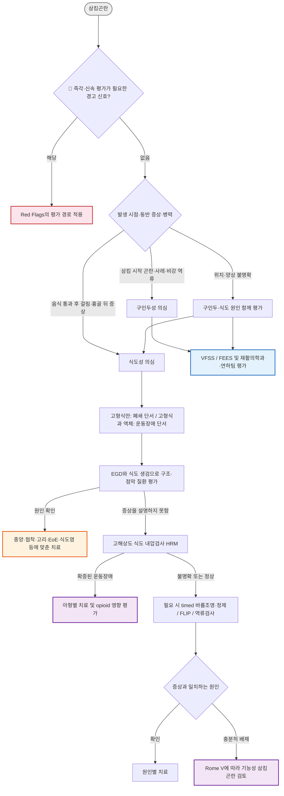

# 삼킴곤란 Dysphagia

## <mark style="color:green;">일반 사항</mark>

* 삼킴곤란(연하곤란, dysphagia) : 구강에서 위장으로 음식물을 이동시키는 과정에서의 어려움; 부위와 기전에 따라 구분
* 삼킴(연하)은 구강기(oral phase) → 인두기(pharyngeal phase) → 식도기(esophageal phase)의 3단계로 이루어지며, 각 단계의 장애에 따라 임상 양상이 다름
* 본문의 검사·치료 경로와 약물 용량은 성인 중심임
* 유병률 : 정의·선별도구·대상 집단에 따라 큰 차이가 있음. 일반 인구의 삼킴곤란은 약 10\~20%로 추정되며, 지역사회 노인의 구인두성 삼킴곤란은 약 23%로 보고됨
  * 입원·요양 시설 거주 노인과 뇌졸중·파킨슨병 등 신경계 질환 환자에서 더 흔함. 서로 다른 집단·평가방법에서 얻은 수치를 동일한 유병률로 적용하지 않음  <mark style="color:$info;">[UEG/ESNM 2025]</mark>

#### <mark style="color:$primary;">삼킴곤란의 분류</mark>

<table><thead><tr><th width="181">유형</th><th width="184">정의</th><th>특징</th></tr></thead><tbody><tr><td>Oral dysphagia</td><td>구강에서 저작 및 bolus 형성 단계의 문제</td><td>씹기 어려움, 구강 내 음식물 조절 곤란</td></tr><tr><td>Oropharyngeal dysphagia</td><td>구인두→상부 식도로의 이송 장애</td><td>삼킴 시작 즉시 증상; 흡인, 비강 역류 동반 가능</td></tr><tr><td>Esophageal dysphagia</td><td>식도→위로의 이송 장애</td><td>삼킴 수 초 후 흉부 걸림 느낌</td></tr><tr><td>이송삼킴곤란 (transfer dysphagia)</td><td>구강·인두에서 식괴를 넘기는 과정의 장애; 통상 구인두성 삼킴곤란과 동의어</td><td>흡인·사레·비강 역류가 동반될 수 있으나 정의에 필수는 아님</td></tr></tbody></table>

#### <mark style="color:$primary;">관련 증상 구분</mark>

* 삼킴통증(odynophagia) : 삼킬 때 발생하는 통증; 구인두 또는 식도의 염증·궤양 (감염, 약물 유발, 위산 역류 등)
* 인두이물감(globus pharyngeus) : 목 안의 이물감; 삼킴에 제한 없고 삼킴으로 오히려 호전됨 (☞ [소화불량](075_-indigestion-dyspepsia.md))
* 먹기공포증(phagophobia) : 질식·사레 등에 대한 공포로 삼킴·섭취를 회피함. 기질적 삼킴곤란 및 섭식장애와의 감별이 필요하며, 공포가 있다는 이유만으로 신체 질환을 배제하지 않음


**Globus vs 삼킴곤란 감별** : '목에 뭔가 걸린 느낌(globus sensation)'을 호소하지만 실제 음식물 통과에는 지장이 없고, 오히려 음식을 먹을 때 증상이 완화된다면 인두이물감(globus pharyngeus)을 시사함. GERD가 동반될 수 있으나 인두이물감만으로 역류가 원인이라고 판단하지 않음; 실제 삼킴곤란·삼킴통증이 없다는 점이 핵심 차이임


### <mark style="color:orange;">노인 연하장애 - Presbyphagia & Sarcopenic Dysphagia</mark>

* Presbyphagia (노인성 연하 변화) : 노화에 따른 근력 감소, 치아 손실, 타액 분비 감소, 감각 둔화 등으로 나타나는 생리적 연하 기능 변화; 질환 자체를 뜻하지 않으며, 새로 발생한 증상성 삼킴곤란을 정상 노화로 간주해서는 안 됨. 뚜렷한 증상이 없어도 일부 노인에서는 silent aspiration 위험이 증가할 수 있음
* Sarcopenic dysphagia (근감소성 삼킴장애) : 전신 근감소증(sarcopenia)과 연하 관련 근육의 근력·근육량 감소가 연관된 삼킴곤란; 단순한 노화 변화와 구분함
  * 고령·저영양·반복 입원·장기 와상 환자에서 빈도 높음
  * 진단 : 전신 근감소증과 삼킴곤란을 함께 확인하고, 신경계·구조적 질환 등 다른 주된 원인을 평가함. 혀압 저하 등은 보조 소견이며, 전신 근감소증만으로 원인을 확정하지 않음
  * 치료 : 연하 재활 운동 + 전신 저항성 운동 + 영양 지원. 단백질 필요량은 영양 상태·신기능·동반 질환에 따라 개별화하며, 비타민 D는 결핍 시 보충
* 반복 흡인성 폐렴의 중요한 위험 요인; 노인 외래에서 적극적인 연하 평가 권장

### <mark style="color:orange;">**약제 유발성 식도염 (Pill esophagitis)**</mark>&#x20;

* 알약을 소량의 물과 함께 또는 누운 상태에서 복용하면 식도에 정체되어 점막을 직접 손상할 수 있음. 증상(급작스러운 삼킴통증, 흉통, 삼킴곤란)은 복용 수 시간\~수일 내 나타날 수 있음

<table><thead><tr><th width="273.3333740234375">대표 약물</th><th width="191.5555419921875">기전</th><th>주의사항</th></tr></thead><tbody><tr><td>Bisphosphonate (알렌드로네이트)</td><td>직접 점막 자극</td><td>일반 물 약 200 mL 이상과 복용; 복용 후 최소 30분 및 첫 음식 섭취 전까지 눕지 않음; 제품별 허가사항 확인</td></tr><tr><td>Doxycycline / Tetracycline</td><td>직접 점막 손상</td><td>취침 직전 복용 금지; 충분한 물과 복용</td></tr><tr><td>NSAIDs / Aspirin</td><td>직접 점막 손상·점막 방어 저하</td><td>충분한 물과 복용; 위장관 위험은 별도 평가</td></tr><tr><td>Clindamycin</td><td>직접 점막 독성</td><td>취침 직전 복용 금지; 충분한 물과 복용</td></tr><tr><td>Pinaverium</td><td>식도에 정체될 때 점막 자극·궤양</td><td>식사 중 충분한 물과 함께 통째로 삼킴; 씹거나 빨지 않음. 누운 자세 또는 취침 직전 복용 회피</td></tr><tr><td>Iron 제제, 칼륨제제</td><td>직접 점막 자극</td><td>충분한 물과 복용; 제형 변경 고려</td></tr><tr><td>고용량 비타민 C</td><td>산성 자극</td><td>불필요한 대용량 복용 회피</td></tr></tbody></table>

## <mark style="color:green;">원인 및 위험 인자</mark>

#### <mark style="color:$primary;">기계적 폐쇄</mark>

* 구인두(oropharyngeal) : 두경부 암종, 편도 비대 및 편도주위농양, 후두개염, 인두 농양
* Zenker diverticulum (인두식도게실) : 윤상인두근 위쪽 Killian triangle의 점막 탈출; 노인 남성에서 호발; 입 냄새(halitosis)와 미소화된 음식물 역류가 핵심 단서; 내시경·수술로 치료
* 윤상인두근 바(Cricopharyngeal bar) : 바륨 검사/VFSS의 측면 영상에서 보통 **C5\~C6 높이의 후벽에서 내강으로 돌출되는 압흔**; 무증상 우연 소견도 흔함. Zenker diverticulum과 연관될 수 있으나 모든 병변이 전구 병변인 것은 아님; 증상과 폐쇄 소견이 일치할 때 확장술 또는 근절개술 고려
* 식도(esophageal) : 식도암, 소화성 협착(peptic stricture), Schatzki ring, 식도웹(esophageal web), 식도게실
* 외부 압박 : 갑상선 비대, 종격동 종양, 대동맥류, 심비대
* 경추 골성 돌기(cervical osteophyte) : DISH(미만성 특발성 골격 과골증) 또는 전방 경추 골증식증; 노인에서 식도 외부 압박에 의한 구인두 삼킴곤란 유발; 경추 X-ray 또는 CT로 확인

#### <mark style="color:$primary;">염증성·면역성 질환</mark>

* 호산구성 식도염(Eosinophilic esophagitis, EoE) : 성인 고형식 삼킴곤란 및 음식물 저류(food impaction)의 주요 원인; 젊은 남성·알레르기 병력 흔함
* 위식도역류질환(GERD) : 역류성 식도염 및 만성 염증 → peptic stricture; 기능성 삼킴곤란은 GERD가 증상을 설명하지 않음을 확인한 뒤 진단
* 방사선 치료 후 섬유화, 구강점막염

#### <mark style="color:$primary;">신경근육 질환</mark>

* 뇌혈관 질환(CVA) : 구인두성 삼킴곤란의 주요 원인
* 파킨슨병, 알츠하이머병, 다발성 경화증, ALS, 중증 근무력증, 염증성 근육병
* 윤상인두근 기능 이상(Cricopharyngeal dysfunction) : 상부 식도괄약근(UES) 이완 불충분 → 반복 삼킴, 흡인, 목의 걸림감; Zenker diverticulum의 병태생리적 기반
* 이완불능증(achalasia) : 하부 식도괄약근 이완 불능 + 연동 소실
* 원위부 식도연축(distal esophageal spasm, DES), 과수축성 식도(hypercontractile esophagus; jackhammer는 그 표현형 중 하나)
* 피부경화증(scleroderma) : 식도 하부의 연동운동 저하·소실과 하부 식도괄약근(LES) 압력 저하 → GERD·소화성 협착 유발 가능
* 기타 : 당뇨병신경병증, SLE 등

#### <mark style="color:$primary;">약물 유발 운동 장애</mark>

* Opioid 유발 식도 운동 장애(OIED, Opioid-Induced Esophageal Dysfunction) : 만성 opioid 사용 → μ-opioid receptor 활성화 → EGJ outflow obstruction, 경련성 운동 이상(achalasia type III 유사 소견) 유발; HRM에서 achalasia 유사 패턴; opioid 감량·중단 시 호전 가능. tramadol은 μ-receptor 활성화가 상대적으로 약하므로 OIED 유발이 가능하나 전형적 opioid에 비해 낮음
* 항콜린제는 타액 감소와 식도 운동 저하로 삼킴을 악화시킬 수 있음. CCB와 nitrate는 LES 압력·식도 수축을 낮추고 역류를 악화시킬 수 있으나, 일부 경련성 운동 장애의 단기 증상 조절에 사용되기도 함

#### <mark style="color:$primary;">감염</mark>

* 식도 칸디다증(면역 저하자, 광범위 항생제, 흡입 스테로이드), CMV 식도염, HSV 식도염
* 디프테리아·뇌막염·라임병·공수병 등은 드물게 구인두 기능 또는 신경계를 침범하여 삼킴곤란을 유발할 수 있으나, 감염성 식도염과는 구분

#### <mark style="color:$primary;">위험 인자</mark>

* 고령, 흡연, 과음, 비만, 철 결핍(Plummer-Vinson syndrome)
* GERD, 뇌졸중, COPD, 두경부암
* 두경부·흉부 수술, 방사선 치료, 화학요법
* 전신 근감소증(sarcopenia), 저영양, 장기 와상
* 직접 점막 손상 관련 : bisphosphonate, NSAID, tetracycline/doxycycline, clindamycin, pinaverium, 고용량 비타민 C, 철분제, 칼륨제제 등
* 항콜린제의 구강 건조·운동 저하는 알약의 직접 점막 독성과 구분함
* 운동 장애 유발 : opioid(tramadol은 위험 낮음), 항콜린제, CCB

## <mark style="color:green;">임상 양상</mark>

* 구강 내 음식물 조절 어려움, 저작 곤란, 침 흘림
* 삼킴 시작 어려움, 삼킴 후 식도 걸림 느낌
* 삼킴 중 기침, 사레, 구역
* 음식물의 비강 역류 또는 기도 흡인
* 목소리 변화(쉰 목소리, 물 먹은 듯한 wet voice - 흡인 의심)
* 흡인성 폐렴(반복성 폐렴 시 silent aspiration 의심)
* 체중 감소, 탈수, 영양 결핍

###  <mark style="color:$danger;">🚩 Red Flags!</mark>


**즉각 조치**

* 침·구강 분비물도 삼키지 못하는 완전 식도폐쇄 → 즉시 응급실 의뢰; 기도 보호 평가와 함께 가능하면 2시간 이내, 늦어도 6시간 이내 응급 내시경  `[음식물 저류/완전 폐쇄]`
* 호흡곤란·협착음·청색증 등 → 즉시 응급 평가 및 기도 확보 필요성 판단  `[기도 폐쇄/중증 흡인]`
* 갑작스러운 삼킴곤란과 편측 마비·안면마비·구음장애·의식 변화 → 즉시 뇌졸중 응급 경로 적용; 연하 선별 전 경구 섭취·경구약 보류  `[급성 뇌졸중]`
* 부식성 물질 섭취, 식도 내 날카로운 이물·버튼전지, 심한 흉통·피하기종·쇼크 등 → 즉시 응급실 의뢰  `[부식성 손상/고위험 이물/천공 의심]`
* 대량 토혈·흑변에 실신·혈역학적 불안정 동반 → 즉시 응급실 의뢰  `[중증 위장관 출혈]`



**당일\~수일 내 평가**

* 음식이 걸린 상태가 지속되나 침·분비물은 처리 가능 → 당일 응급실 의뢰, 24시간 이내 내시경; 통과할 때까지 물·음식을 더 먹이지 않음. 약물 시도로 내시경을 지연하지 않음  `[불완전 음식물 저류]`
* 진행성 삼킴곤란, 원인 불명 체중 감소·철 결핍 빈혈 또는 안정된 상태의 위장관 출혈 → 신속한 내시경·전문 평가  `[악성 종양/협착/출혈]`
* 지속적·심한 삼킴통증, 면역 저하자의 새 삼킴곤란·삼킴통증 → 중증 통증·섭취 불가 시 당일 평가  `[감염성·약제 유발성 식도염]`
* 반복 흡인·흡인성 폐렴, 현저한 탈수·영양 결핍 → 폐렴·탈수·호흡기 증상은 당일 평가, 영양 지원 및 연하검사 계획  `[흡인/영양·수분 부족]`
* 쉰 목소리·경부 종괴 또는 두경부암·식도암 위험이 동반된 새 삼킴곤란 → 신속한 이비인후과·소화기 평가  `[두경부·식도 병변]`



**조기 평가 및 추적**

* 급성 폐쇄·흡인·체중 감소 없이 안정적이더라도 반복되거나 지속되는 삼킴곤란 → 구인두성/식도성으로 구분하여 원인 평가; 식도성은 EGD를 계획하고 PPI 반응만으로 검사를 생략하지 않음  `[지속성 삼킴곤란]`
* 음식물 저류가 저절로 해소되거나 제거 후 호전됨 → EoE·고리·협착 등 원인 평가와 추적을 완료  `[음식물 저류 후 추적]`


_<mark style="color:$info;">Ref. ESGE 2016; UEG/ESNM 2025. 공통 감별은 ☞ [위장질환의 감별](074_-gidz.md).</mark>_

## <mark style="color:green;">진단</mark>

#### <mark style="color:$primary;">병력 및 진찰</mark>

* 발병 시점·진행 속도, 고형식/액체/알약과의 관계, 사레·역류·삼킴통증·체중 감소, 식사 시간 및 음식 회피·잘게 자르기·물을 곁들이는 보상 행동 확인
* 신경계·두경부 질환, 수술·방사선 치료력, 아토피 병력과 전체 약물 복용력 확인
* 활력징후·산소화, 체중 변화·탈수, 구강·치아·혀·의치, 경부 종괴, 발성·기침력 및 뇌신경·사지 신경학적 소견 평가
* 급성 신경계 질환·분비물 조절 장애 등 고위험 환자에게 비표준 물 삼키기 검사를 무리하게 시행하지 않음. 검증된 선별검사와 필요 시 VFSS/FEES를 사용함

#### <mark style="color:$primary;">1차 감별 : 구인두성 vs 식도성</mark>


**외래 triage의 핵심** : 삼킴곤란을 접하면 구인두성인지 식도성인지를 먼저 판단함. 단, 환자가 느끼는 걸림 위치가 실제 병변 위치와 일치하지 않는 경우가 흔함. 원위부 식도 병변도 '목에 걸린다'고 표현하는 경우가 많으므로, 위치 표현보다 증상 발생 시점·동반 증상·병력 전체를 종합하여 판단해야 함.


<table><thead><tr><th width="190">특징</th><th width="257.77777099609375">구인두성 (Oropharyngeal)</th><th>식도성 (Esophageal)</th></tr></thead><tbody><tr><td>증상 발생 시점</td><td>삼킴 시작 즉시</td><td>삼킴 수 초 후</td></tr><tr><td>위치 표현</td><td>목, 상부 흉골</td><td>흉골 뒤, 흉부 중하부</td></tr><tr><td>사레 / 흡인</td><td>흔함</td><td>드묾</td></tr><tr><td>비강 역류</td><td>가능</td><td>없음</td></tr><tr><td>Wet voice / 식후 기침</td><td>흔함</td><td>드묾</td></tr><tr><td>침 흘림</td><td>흔함</td><td>드묾</td></tr><tr><td>주요 원인</td><td>신경근육 질환 (CVA, 파킨슨병 등)</td><td>기계적 폐쇄 / 운동 장애</td></tr><tr><td>우선 검사</td><td>VFSS / FEES</td><td>상부 소화관 내시경 (EGD)</td></tr></tbody></table>

#### <mark style="color:$primary;">고형식 → 유동식 진행 패턴 평가</mark>

* 감별에 유용한 임상 단서이나 음식 형태만으로 확진하지 않음
* 어떤 음식에서 증상이 있는지 확인
  * 기계적 폐쇄 : 초기에는 고형식에서만 증상 → 병변이 진행·협착이 심해질수록 유동식까지 증상 확대
  * 운동 장애 : 처음부터 고형식과 유동식 모두에서 증상이 나타날 수 있음. 심한 기계적 협착도 두 형태 모두의 통과를 방해하므로 EGD·생검으로 구조·점막 병변을 먼저 평가함

#### <mark style="color:$primary;">흡인 위험 침상 평가 단서</mark>

<table><thead><tr><th width="282.22222900390625">임상 소견</th><th>의미</th></tr></thead><tbody><tr><td>식사 중·후 기침</td><td>후두 침투(laryngeal penetration) 또는 흡인 의심</td></tr><tr><td>Wet voice (식후 목소리 변화)</td><td>후두 전정부·인두 잔류 또는 흡인 의심</td></tr><tr><td>반복적 폐렴 (특히 중력 의존성 폐 부위)</td><td>Silent aspiration 의심</td></tr><tr><td>식사 시간 현저히 연장 (30분 이상)</td><td>연하 기능 저하, 피로성 흡인</td></tr><tr><td>식욕 저하 + 원인 불명 체중 감소</td><td>만성 삼킴곤란으로 인한 영양 결핍</td></tr><tr><td>침 흘림, 구강 분비물 조절 곤란</td><td>구인두 기능 저하</td></tr></tbody></table>


후두 침투는 물질이 후두 안으로 들어왔으나 성대 아래로 내려가지 않은 상태, 흡인은 성대 아래로 내려간 상태임. 침상 소견이나 선별검사는 흡인 여부를 확진하지 못하며 silent aspiration을 놓칠 수 있음. 위험이 의심되면 VFSS 또는 FEES로 확인함.


### <mark style="color:orange;">선별 검사 도구</mark>&#x20;

#### <mark style="color:$primary;">EAT-10 (Eating Assessment Tool-10)</mark>&#x20;

* 연하장애 선별을 위한 10문항 자가보고 설문지. 아래는 문항 내용의 이해를 위한 요약이며, 실제 점수 산정에는 검증된 한국어판 원문을 사용함
* 각 문항 0\~4점 (정상=0점, 중증=4점); 총점 ≥3점이면 연하장애를 의심하고 전문 평가 고려. 선별도구일 뿐 원인 진단이나 흡인 배제에는 사용할 수 없음; 가능하면 검증된 한국어판(K-EAT-10) 사용

1. 삼킴 문제 때문에 체중이 감소하였습니다.
2. 삼킴 문제 때문에 외식이 어렵습니다.
3. 액체를 삼킬 때 힘이 듭니다.
4. 고형식을 삼킬 때 힘이 듭니다.
5. 알약을 삼킬 때 힘이 듭니다.
6. 삼킴이 고통스럽습니다.
7. 삼킴 문제 때문에 먹는 즐거움이 감소했습니다.
8. 삼킬 때 음식이 목에 걸립니다.
9. 먹을 때 기침이 납니다.
10. 삼킴은 스트레스를 줍니다.

### <mark style="color:orange;">검사</mark>

<table><thead><tr><th width="154.26312255859375">검사</th><th width="245.4736328125">적응증</th><th>특이사항</th></tr></thead><tbody><tr><td>혈액 검사 ¹⁾</td><td>빈혈·영양 결핍·전신 또는 신경근육 질환 의심</td><td>병력과 진찰에 따라 선택; 모든 환자의 일률적 초기 검사 아님</td></tr><tr><td>상부 소화관 내시경 (EGD)</td><td>식도성 삼킴곤란의 1차 검사</td><td>구조·점막 병변 평가, 조직검사 및 확장술 가능; 원인 불명 식도성 삼킴곤란/EoE 의심 시 내시경이 정상이어도 2개 이상의 식도 높이에서 총 6개 이상 생검</td></tr><tr><td>비디오 투시 연하 검사 (VFSS)</td><td>구인두 삼킴곤란, 흡인 평가</td><td>실시간 삼킴 역학·흡인 시점 및 음식 질감·보상 자세 효과 평가; 방사선 피폭; 언어재활사 협력 권장</td></tr><tr><td>섬유내시경 연하 <br>검사 (FEES)</td><td>구인두 삼킴곤란; 침상 환자, 이동 어려운 환자</td><td>방사선 피폭 없이 인두·후두와 분비물 관리 평가; 삼킴 순간 white-out 등 한계가 있어 VFSS와 상호 보완적</td></tr><tr><td>Barium esophagogram</td><td>Schatzki ring, Zenker 게실, 근위부 협착 의심; EGD 음성이나 폐쇄·운동 이상 의심</td><td>Zenker/고위 식도 병변 의심 시 EGD보다 먼저 고려; 폐쇄성 증상에는 가능하면 timed upright protocol + 13-mm barium tablet; 급성 음식물 저류·고도 폐쇄에서는 흡인 위험과 내시경 시야 방해 때문에 적용하지 않음</td></tr><tr><td>고해상도 식도 내압 검사 (HRM)</td><td>EGD/생검으로 기계적·점막 원인을 배제한 뒤 운동 장애 의심</td><td>Chicago Classification v4.0; achalasia 아형, EGJOO, DES, hypercontractile esophagus 등 분류. 검사 전 금식 및 약물 중단은 검사 목적·반감기·안전성을 고려하여 검사실 지침에 따름</td></tr><tr><td>24시간 pH/임피던스-pH 검사</td><td>EGD·생검·HRM 후에도 원인이 불분명하고 GERD 관여 여부 확인 필요</td><td>검증되지 않은 GERD는 보통 산억제제 중단 상태에서 평가; 이미 확진된 GERD의 치료 불응 평가와 구분함</td></tr><tr><td>FLIP</td><td>HRM 결과가 경계성이거나 HRM을 완료하지 못했으나 EGJ 폐쇄 의심</td><td>EGJ 팽창성 평가; HRM의 보완검사이며 일률적 대체검사는 아님</td></tr><tr><td>후두경 검사</td><td>쉰 목소리·경부 종괴·상기도 증상 또는 지속되는 인두 증상</td><td>후두·하인두 병변 평가; 경고 증상 동반 시 기간을 기다리지 말고 이비인후과 의뢰</td></tr></tbody></table>

¹⁾ 필요에 따라 CBC, ferritin/철 검사, 전해질·신기능, 단백질/albumin, TFT, Vit B12 등. 피로성 연하장애·안검하수 등 중증 근무력증이 의심될 때 anti-AChR Ab 등 표적 검사

### <mark style="color:orange;">증상 및 병력에 따른 감별</mark>

<table><thead><tr><th width="334.73687744140625">단서</th><th>시사하는 진단</th></tr></thead><tbody><tr><td>삼킴 시작 즉시 사레, 비강 역류, 흡인</td><td>구인두성 삼킴곤란 (신경근육 원인 우선)</td></tr><tr><td>삼킴 수 초 후 흉골 하부 걸림 느낌</td><td>식도성 삼킴곤란</td></tr><tr><td>진행성 고형식 삼킴곤란, 수 주~수개월</td><td>악성 종양 (식도암, 두경부암) - until proven otherwise</td></tr><tr><td>수년간 지속되는 간헐적 고형식 삼킴곤란</td><td>양성 질환 (Schatzki ring, EoE)</td></tr><tr><td>고형식 + 유동식 모두 삼킴 장애</td><td>신경근육 장애, achalasia</td></tr><tr><td>지속적인 가슴쓰림 선행</td><td>소화성 협착 (peptic stricture)</td></tr><tr><td>쉰 목소리 동반</td><td>후두·두경부 병변, 신경계 질환 등; 증상 선후만으로 양성·악성을 구분하지 않음</td></tr><tr><td>흉통 동반</td><td>심장 원인 배제 후 GERD, DES·과수축성 식도 등 평가</td></tr><tr><td>입 냄새(halitosis) + 미소화 음식 역류</td><td>Zenker diverticulum (인두식도게실)</td></tr><tr><td>젊은 남성 + 알레르기 병력 + food impaction</td><td>EoE (호산구성 식도염)</td></tr><tr><td>알약 복용 직후 또는 수 시간 내 삼킴통증</td><td>약제 유발성 식도염</td></tr><tr><td>면역 저하, 광범위 항생제·흡입 스테로이드</td><td>감염성 식도염 (칸디다, CMV, HSV)</td></tr><tr><td>Opioid 장기 복용</td><td>OIED (opioid 유발 식도 운동 장애)</td></tr><tr><td>노인 + 전신 근감소 + 구조적 이상 없음</td><td>근감소성 삼킴장애 고려; 증상성 삼킴곤란을 정상 노화로 단정하지 않음</td></tr></tbody></table>

<a id="functional-dysphagia"></a>

### <mark style="color:orange;">기능성 삼킴곤란 진단 기준 — ROME V, 2026</mark>

* 정량적 연구 기준: 발병 ≥6개월, 최근 3개월간 ≥1회/주 증상이 있고 다음 조건 충족

1. 고형식 또는 액체가 식도에 걸리거나 비정상적으로 통과하는 느낌
2. 식도 점막·구조 이상이 증상의 원인이라는 증거 없음
3. GERD 또는 EoE 등 비역류성 식도염이 증상을 설명하지 않음
4. Chicago v4.0에 따른 achalasia, 확증된 EGJOO, 수축 소실, 과수축성 식도, 원위부 식도연축이 없음. **비효율적 식도운동(IEM)만으로 진단을 배제하지 않음**; IEM이 확인되면 실제 음식 통과 이상과 증상의 관련성을 개별 판단

* GERD는 Lyon 2.0에 따라 내시경·역류검사를 종합하여 평가. 정상 바륨 식도조영(정제 또는 고형 bolus 포함), 정상 FLIP 또는 HRM 중 정상 고형식 시험 소견은 진단을 뒷받침할 수 있음
* 임상에서는 적절한 평가 후 증상의 양상·불편도와 기능 영향을 판단하며, 연구용 기간을 채우기 위해 평가를 늦추지 않음

_<mark style="color:$info;">Ref. Rome V 2026; Chicago Classification v4.0; Lyon Consensus 2.0.</mark>_

***



<p align="center"><strong>삼킴곤란 진단 알고리듬</strong></p>

<p align="center"><em><mark style="color:$info;">Ref. UEG/ESNM 2025; ACG Esophageal Physiologic Testing 2020; Chicago Classification v4.0; Rome V 2026.</mark></em></p>

* Zenker 게실·고위 협착 의심 시 계획된 바륨 식도조영을 EGD보다 먼저 고려함. 급성 음식물 저류·천공 의심에는 이 순서를 적용하지 않음

***

## <mark style="background-color:$warning;">Management</mark>

### <mark style="color:orange;">치료 방침</mark>

* 삼킴곤란의 치료는 원인 질환 치료가 우선이며, 동시에 영양·수분 상태 유지와 흡인 예방에 중점을 둠
* 구인두성 삼킴곤란은 연하 재활 치료가 핵심
* 식도성 삼킴곤란은 원인에 따라 내시경 시술 또는 수술을 포함한 전문과 협진이 필요
* 영양 및 수분 섭취 상태 정기 모니터링; 의미 있는 체중 감소 시 영양 지원 계획 수립
* 흡인 위험 평가; 흡인성 폐렴 예방 우선
* 치아·잇몸·혀·의치를 규칙적으로 세정하고 필요 시 치과·구강 관리 지원. 경관 영양 중에도 구강 관리를 지속 <mark style="color:$info;">[국내 구인두 삼킴장애 진료지침 2023]</mark>
* 처방약 전체 검토 (opioid, 항콜린제, bisphosphonate 등 유발 약물 여부)
* 원인 질환 확인 및 전문과 의뢰
* 경구 섭취가 안전하지 않거나 영양·수분 요구량을 충족하지 못하는 경우 예상 기간·치료 목표·환자 의사를 고려하여 비위관(NG tube) 또는 PEG 영양 고려. 경관 영양 자체가 구강 분비물·역류물 흡인을 예방하지는 않음


**음식물 저류 후 원인 평가**

음식물 제거 시 안전하면 외관이 정상이어도 ≥2개 식도 높이에서 총 ≥6개 생검하여 EoE를 평가함. 심하게 손상된 저류 부위는 피해서 채취함. 생검을 못 했거나 자연 해소된 경우에도 조기 추적 EGD·생검을 계획함. EoE가 의심되면 추적 생검 전 PPI·식이 변경이 진단에 미칠 영향을 전문의가 판단함.


## <mark style="color:green;">비-약물 치료 및 예방</mark>

### <mark style="color:orange;">연하 재활: 보상 전략 vs 재활 전략</mark>

* 보상 전략 : 즉각적으로 흡인 위험을 줄이지만 근본 기능은 개선하지 않음
* 재활 전략 : 시간이 걸리지만 연하 근육 기능 자체를 향상시킴
* 현대 연하 재활은 보상 전략(Compensatory strategies)과 재활 전략(Rehabilitative strategies)으로 구분. 두 전략을 환자 상태에 맞게 병행하는 것이 원칙

#### <mark style="color:$primary;">보상 전략 (Compensatory)</mark>

* 자세 조절 : 식사 시 90° 직립, 식후 30분 이상 직립 유지
* 턱 당김 기법(Chin-tuck maneuver) : 일부 환자에서 기도 입구를 좁히고 bolus 흐름을 조절하여 흡인을 줄일 수 있으나 모든 연하장애에 효과적인 것은 아님; VFSS/FEES로 효과 확인 후 적용
* Head rotation : 편측 인두 약화가 확인된 경우 약한 쪽으로 고개를 돌려 bolus를 상대적으로 건강한 쪽으로 유도; 개별 평가 후 적용
* 식이 질감 조절 : IDDSI 단계에 맞게 (아래 참조)

#### <mark style="color:$primary;">재활 전략 (Rehabilitative)</mark>

* Shaker exercise (고개 들기 운동) : 어깨를 바닥에 둔 채 누운 자세에서 발끝을 보듯 고개를 듦. 대표 연구 프로토콜은 1분 유지·1분 휴식 × 3회 후 반복 고개 들기 30회이며, 실제 강도·횟수는 피로·경추 상태에 맞춰 조절함; 설골상근 강화와 UES 개방 개선 목적
* CTAR (Chin Tuck Against Resistance) : 턱 아래 공에 저항하여 턱 당기기; 설골상근 강화
* Effortful swallow (힘껏 삼킴) : 의도적으로 세게 삼킴 → 인두 수축력 및 음식물 제거율 향상
* Mendelsohn maneuver : 삼킴 시 후두 거상을 의도적으로 2\~3초 연장 → UES 개방 시간 증가
* Masako maneuver : 혀를 치아 사이에 살짝 물고 침 삼킴 → 후인두벽 움직임 훈련; 음식물과 함께 시행하지 않음
* 감각 촉진 : 신맛·냉자극은 일부 환자에서 도움이 될 수 있으나 효과 근거가 제한적임. 묽은 레몬즙 등을 임의로 먹이는 방법으로 적용하지 않으며 연하팀이 안전성을 평가함


언어재활사(SLP)와의 협력 하에 VFSS/FEES 결과를 바탕으로 개별화된 운동 프로그램을 처방하는 것이 원칙. 경추질환·심한 쇠약 등에서는 Shaker exercise가 부적절할 수 있음


### <mark style="color:orange;">식이 조절 - IDDSI 기준</mark>

* **IDDSI (International Dysphagia Diet Standardisation Initiative)** : 국제표준화 연하장애 식이 단계 (Level 0\~7); 환자의 연하 능력에 맞는 식이 질감을 표준화하여 흡인 위험을 최소화함

<table><thead><tr><th width="130">IDDSI 단계</th><th width="241.0526123046875">표준 명칭</th><th>구분</th></tr></thead><tbody><tr><td>Level 0</td><td>Thin (묽은 액체)</td><td>음료</td></tr><tr><td>Level 1</td><td>Slightly Thick (약간 걸쭉)</td><td>음료</td></tr><tr><td>Level 2</td><td>Mildly Thick (약하게 걸쭉)</td><td>음료</td></tr><tr><td>Level 3</td><td>Moderately Thick / Liquidised</td><td>음료·음식</td></tr><tr><td>Level 4</td><td>Extremely Thick / Pureed</td><td>음료·음식</td></tr><tr><td>Level 5</td><td>Minced &amp; Moist (다지고 촉촉한 음식)</td><td>음식</td></tr><tr><td>Level 6</td><td>Soft &amp; Bite-sized (부드럽고 한입 크기 음식)</td><td>음식</td></tr><tr><td>Level 7</td><td>Regular / Easy to Chew</td><td>일반식·씹기 쉬운 일반식</td></tr></tbody></table>

* 과거의 nectar·honey·pudding 농도 용어를 IDDSI 단계와 단순 대응시키지 않음
* 단계는 음료·음식의 물성을 표시함. 조리·온도·방치 시간에 따라 변하므로 IDDSI 흐름·포크·스푼 검사 등으로 실제 제공 상태를 확인함  <mark style="color:$info;">[IDDSI]</mark>
* IDDSI 단계는 흡인 위험의 경증·중등도와 일대일 대응하지 않으며, VFSS/FEES에서 확인한 병태와 환자의 선호·수분 섭취·영양 상태에 따라 선택

* 증점제(thickener) : 검사 중 흡인을 줄일 수 있으나 폐렴 예방 효과는 확립되지 않음. 과도한 증점은 인두 잔류·수분 섭취 감소·탈수·식욕 저하·복약 문제를 유발할 수 있어 환자 선호와 섭취량을 함께 평가하고 정기적으로 재평가함  <mark style="color:$info;">[ASHA; 국내 구인두 삼킴장애 진료지침 2023]</mark>
* Free Water Protocol : 인지·이동 능력, 호흡 상태, 구강 위생 및 지시 이행을 평가하여 엄격히 선별한 환자에게 식간의 맹물 섭취를 허용하는 접근. 근거는 주로 재활 입원 환자의 소규모 연구이며 모든 흡인 환자에게 일반화하지 않음. 연하팀의 정해진 구강 관리·섭취 시간 지침을 따르고, 약 복용이나 다른 묽은 음료에 임의 확대하지 않음  <mark style="color:$info;">[Gillman et al. 2017; ASHA]</mark>

***

## <mark style="color:green;">약물 치료</mark>

### <mark style="color:orange;">GERD / 소화성 협착</mark>

**PPI (proton pump inhibitor)**&#x20;

* 위산 분비 억제로 증상 호전 및 협착 재발 방지
* omeprazole 20\~40 ㎎ qd, pantoprazole 40 ㎎ qd, esomeprazole 20\~40 ㎎ qd
* 통상 식전 30\~60분 복용; 소화성 협착 확장술 후에는 장기 유지 고려 <mark style="color:blue;">\[넥시움 정]</mark>, <mark style="color:blue;">\[판토록 정]</mark>

### <mark style="color:orange;">호산구성 식도염 (EoE)</mark>

* **진단** : 식도 기능장애 증상 + 식도 생검 **≥15 eos/hpf** + 식도 호산구증가의 다른 원인 평가. 정상 내시경 소견만으로 배제하지 않으며, ≥2개 높이에서 총 ≥6개 생검
* 초기 진단검사는 임상적으로 안전하면 PPI·제거식 등에 의한 위음성을 줄이는 조건에서 계획. 치료 중 음성 생검이지만 의심이 높으면 전문의가 치료 중단 후 재검 여부를 판단하며, 음식물 저류의 응급 내시경을 지연시키거나 천식 치료제를 임의 중단하지 않음 <mark style="color:$info;">[ACG 2025]</mark>


**EoE와 PPI 반응** : 이전에 사용하던 "PPI-responsive EoE"라는 표현은 현재 권장되지 않음. PPI는 EoE의 1차 항염증 치료 옵션 중 하나로 인정되며, PPI에 반응하더라도 EoE 진단이 배제되지 않음  <mark style="color:$info;">[ACG 2025]</mark>.

**EoE 내시경 소견** (정상이어도 생검 필수) : feline esophagus (다발성 동심성 고리), linear furrows (세로 홈), white exudates, stricture, mucosal fragility


* **초기 항염증 치료 - 공동 의사결정으로 한 가지 선택**
  * **PPI** : 고용량 PPI를 8\~12주 투여 후 내시경·조직검사로 반응 평가(예: omeprazole 20 ㎎ bid 또는 등가 PPI; 중증도·반응에 따라 전문의가 증량). 국내 EoE 허가 적응증이 없는 PPI의 사용은 허가 외 사용으로 구분
  * **Swallowed topical steroid** : budesonide 또는 fluticasone 단일 성분을 식도에 도달하도록 삼킴. 국내 EoE 전용 제제의 허가·유통 여부를 확인하며, 천식용 제제 전용은 허가 외 사용
    * budesonide 점성 현탁액: 성인 총 2\~4 ㎎/일이 지침 범위이며, 조제 현탁액의 한 예는 1 ㎎ bid임. 전용 경구 제제와 조제 현탁액은 제형·허가 용량이 같지 않음. 전용 제제가 없을 때 budesonide 분무용현탁액을 점성 매개체에 섞는 조제법은 허가 외 사용이므로 소화기내과 협진
    * fluticasone 단일 성분 정량분무 흡입제: ACG 2025 성인 유도요법 예는 880 μg bid(총 1,760 μg/일)이며 제형·용량을 확인. **fluticasone/formoterol 복합제는 사용하지 않음**
    * 일반적으로 식후 또는 취침 전에 투여하고, 투여 후 30\~60분 음식·음료를 피함. 구강·식도 칸디다증 및 드문 부신 억제에 유의하며, 다른 경로 스테로이드 병용·장기 고용량 등은 개별 모니터링함. 구강 칸디다 예방 방법은 제형별 복약지도에 따름
  * **경험적 제거식** : 가능하면 1-food(우유) 또는 2-food(우유·밀) 제거처럼 덜 제한적인 방식부터 시작하고 영양사와 협력. 알레르기검사만으로 제거 식품을 결정하지 않음
* **Dupilumab (IL-4/IL-13 신호 억제 생물학적 제제)** <mark style="color:blue;">\[듀피젠트 주]</mark>
  * PPI 등 초기 치료에 반응하지 않거나 불내성인 경우, 반복적 food impaction/fibrostenotic EoE 또는 치료가 필요한 다발성 아토피 질환이 동반된 경우 전문의가 고려
  * 미국 EoE 적응증은 ≥1세·체중 ≥15 ㎏이나, **국내 dupilumab 허가사항에는 EoE 적응증이 없음(2026년 10월 26일 확인)**. 해외 권고와 국내 허가 외 사용을 구분하며 전문의가 판단 <mark style="color:$info;">[미국 FDA; 국내 식약처 품목허가정보]</mark>
* **반응 평가 및 유지 치료** : 증상만으로 관해를 판단하지 않고 PPI·국소 스테로이드 등은 보통 8\~12주 후 EGD와 생검으로 평가(조직학적 반응은 일반적으로 ＜15 eos/hpf). Dupilumab은 반응 속도와 임상 경과에 따라 평가 시점을 개별화하며 ACG 해설에는 12\~24주 평가의 전문가 진료 예시가 있음; 일률적인 의무 시점은 아님 <mark style="color:$info;">[ACG 2025 공식 해설]</mark>. 관해 후에도 선택한 식이 또는 약물 유지 치료를 지속하여 재발·섬유화·협착 위험을 낮춤

### <mark style="color:orange;">식도 운동 장애</mark>

* **이완불능증(achalasia)** — LES 폐쇄를 줄이는 시술이 치료의 중심이며 약물 효과는 제한적; 시술로 정상 연동운동이 회복되는 것은 아님
  * 시술 치료가 어렵거나 시술 대기 중인 선택된 환자에서만 단시간 작용 nitrate 또는 CCB를 고려. 효과가 제한적이고 저혈압·두통·말초부종 등이 흔하며 국내 적응증·제형 확인 필요
  * 지속 효과를 기대하는 시술이 어려운 쇠약·고위험 환자에서는 **내시경 보툴리눔 독소 주사**를 고려. 효과가 일시적이며 반복 치료가 필요할 수 있음 <mark style="color:$info;">[ACG Achalasia 2020]</mark>
  * Nitrate·nifedipine 등은 전문의가 선택적으로 판단하며 일반 외래에서 routine 사용을 피함. 급격한 저혈압 위험에 주의
* **원위부 식도연축(distal esophageal spasm, DES) / 과수축성 식도**
  * GERD·기계적 폐쇄를 먼저 배제/치료하고, 선택된 환자에서 CCB 또는 nitrate 단기 시도; 증상을 유발하는 매우 뜨겁거나 찬 음식은 회피
  * sildenafil 등 평활근 이완제의 근거는 소규모 연구에 제한되므로 routine 처방하지 않음
* **Opioid 유발 식도 운동 장애(OIED)**
  * 처방의와 협의한 원인 opioid 감량·중단 또는 대체가 우선임. 갑자기 중단하지 않으며, 불가역적 시술 전에 약물 영향 및 중단 후 재평가 가능성을 검토함
  * methylnaltrexone 등 말초 μ-opioid 수용체 길항제는 증례 수준 근거만 있어 표준 치료가 아님
* **EGJOO** : HRM 소견만으로 임상적 폐쇄를 확정하지 않음. 삼킴곤란·흉통과 timed barium esophagram 또는 FLIP의 지지 소견을 함께 확인하고 기계적 원인·opioid 영향을 배제한 뒤 침습 치료 여부를 판단 <mark style="color:$info;">[Chicago v4.0]</mark>
* **기능성 삼킴곤란** : 구조적·점막 질환, GERD/EoE 및 주요 운동 장애를 충분히 배제한 뒤 설명·안심, 식이/행동 조절과 필요 시 CBT 등 다학제 치료 고려. TCA/SSRI의 직접 근거는 제한적이며, 특히 고령자에서 TCA의 항콜린 부작용이 삼킴을 악화시킬 수 있으므로 routine 처방하지 않음

### <mark style="color:orange;">감염성 식도염</mark>

* **칸디다 식도염** : 전신 항진균제가 필요함. IDSA 지침 용량은 fluconazole 200\~400 ㎎ qd × 14\~21일  <mark style="color:blue;">\[디푸루칸 캡슐]</mark>
  * **국내 허가 용량과 구분** : 디푸루칸캡슐50㎎의 식도 칸디다증 허가 용법은 50 ㎎ qd × 14\~30일, 난치성은 100 ㎎ qd로 증량임. 위 200\~400 ㎎ 요법은 지침 기반의 허가 범위 밖 용량임  <mark style="color:$info;">[IDSA 2016; 국내 제품설명서]</mark>
  * 반복 투여 시 신기능에 따라 유지용량 조정(일반적으로 CrCl ≤50 mL/min이면 부하용량 이후 50%; 투석 환자는 별도 조정), 간독성·QT 연장·약물상호작용 확인. 임신 중 사용은 전문의와 대체 치료를 검토함
  * 임상적으로 전형적인 선택된 환자에서 치료적 시도 가능하나 약 7일 내 호전이 없으면 내시경·생검으로 내성 또는 다른 원인 재평가. 구강 칸디다가 없어도 식도 감염을 배제할 수 없고, nystatin만으로는 식도 감염 치료가 불충분함
* **HSV 식도염** : 면역 상태·중증도·경구 섭취 가능 여부에 따라 acyclovir 경구 또는 정맥 치료를 선택함. 면역 정상 환자는 자연 호전될 수 있으며 항바이러스 치료의 비교시험 근거가 제한적이므로 단일 용법을 모든 환자에게 적용하지 않음  <mark style="color:$info;">[Kim & Lee 2025]</mark>
  * 경구 섭취가 가능한 선택된 환자에서 acyclovir 400 ㎎ 1일 5회가 사용되며, 면역 저하자는 흔히 14\~21일 치료함  <mark style="color:blue;">\[동아조비락스 정200㎎]</mark>. 국내 통상 단순포진 허가 용법(200 ㎎ 1일 5회, 보통 5일)과 용량·기간이 다른 식도염 치료 요법으로 구분함
  * 중증·경구 섭취 불가 환자는 정맥 치료를 고려함. HIV 환자의 내장 침범 HSV에 대한 NIH 권고는 acyclovir 10 ㎎/㎏ IV q8h, 최소 10\~14일임  <mark style="color:$info;">[NIH HSV 2025/2026]</mark>. 일반 HSV 식도염의 모든 면역 상태에 이 용량·기간을 일괄 적용하지 않음; 신기능 조정·수액 및 신독성·신경독성 감시, 감염내과 협진
* **CMV 식도염** : ganciclovir 5 ㎎/㎏ IV q12h(신기능 정상 성인의 유도 용량 예); 신기능에 따른 용량 조정과 CBC·골수억제 모니터링. 기간은 면역 상태·중증도·반응에 따라 결정하며 HIV 관련 CMV 식도염의 NIH 권고는 21\~42일 및 증상·징후 해소까지임. 경구 섭취·흡수가 가능하면 valganciclovir 전환을 검토; 감염내과 협진 <mark style="color:$info;">[NIH Adult/Adolescent OI Guidelines]</mark>
* 면역저하자의 CMV·HSV 의심 식도염은 내시경·조직검사 등으로 원인을 확인. 혈중 CMV PCR 양성만으로 CMV 식도염을 확진하지 않음

### <mark style="color:orange;">약제 유발성 식도염 (Pill esophagitis)</mark>

* 원인 약물 즉시 중단 또는 복용 방법 변경 (충분한 물, 직립 자세)
* sucralfate 또는 PPI는 통증·동반 산 역류에 보조적으로 고려할 수 있으나 근거는 제한적이며 일률적 필수 치료가 아님 <mark style="color:blue;">\[아루사루민 현탁액]</mark>
* 대부분 원인 약물 중단 후 수일\~수 주 내 호전. 지속되거나 출혈·체중 감소·심한 통증이 있으면 EGD 시행

## <mark style="color:green;">시술 및 기타 처치</mark>

<table><thead><tr><th width="180">상태</th><th>1차 시술/수술</th><th>비고</th></tr></thead><tbody><tr><td>이완불능증 (achalasia)</td><td>공기 풍선 확장술, POEM, Heller myotomy</td><td>풍선 확장술·근절개술이 어려우면 보툴리눔 독소 주사 고려. Type I·II는 숙련도와 환자 특성에 따라 선택; type III는 긴 근절개가 가능한 POEM이 특히 유리. POEM 후 GERD 위험이 상대적으로 높아 추적 필요; 고령·빠른 체중 감소·짧은 증상 기간 또는 EGJ 통과 저항 시 종양성 pseudoachalasia를 의심하고 CT/EUS 등을 추가 검토</td></tr><tr><td>DES / Hypercontractile esophagus</td><td>약물 치료 우선; 선택된 중증 불응 환자에서 긴 근절개/POEM 검토</td><td>침습 치료 근거가 제한적이므로 전문센터에서 증상-검사 일치 여부를 재확인</td></tr><tr><td>EoE</td><td>내시경 확장술 (endoscopic dilation)</td><td>임상적으로 의미 있는 협착/좁은 식도에서 고려; 확장술은 염증을 치료하지 않으므로 항염증 치료 병행</td></tr><tr><td>소화성 협착</td><td>내시경 확장술 (bougie 또는 balloon)</td><td>PPI 유지로 재협착 방지</td></tr><tr><td>Schatzki ring</td><td>내시경 확장술 또는 링 절개</td><td>반복 확장 필요한 경우 있음; EoE 가능성 평가</td></tr><tr><td>Zenker 게실</td><td>내시경 게실절개술 또는 외과 myotomy</td><td>내시경 치료가 증가 추세이며 윤상인두근 절개 병행; 해부학·크기·전문가 경험에 따라 선택</td></tr><tr><td>피부경화증</td><td>PPI + 전신 질환 관리</td><td>확장술은 협착 동반 시에만</td></tr><tr><td>두경부암·식도암 관련 협착</td><td>절제 가능성·치료 목표에 따른 수술·방사선/항암 치료 및 선택적 완화 처치</td><td>소화기내과·외과·종양내과·방사선종양과 협진; 스텐트·확장술은 종양 위치·천공/누공 위험과 완치 목적 치료 계획을 고려하여 선택</td></tr></tbody></table>

***

## <mark style="color:purple;">처방례</mark>

> **처방례 1. EGD로 확인된 역류성 식도염/소화성 협착**
>
> ```
> 에소메프라졸 마그네슘 40 ㎎ (넥시움 정)   1T   qd   식전 30~60분
> (야간 증상 지속 시 추가: 파모티딘 20 ㎎ (가스터 정)   1T   취침 전)
> ```
>
> _✽ 지속성·진행성 식도성 삼킴곤란은 PPI 경험적 치료에 앞서 EGD로 기계적·점막 원인을 평가함. 야간 역류 증상이 객관적으로 지속되면 취침 전 H₂ 차단제를 단기 추가할 수 있으나 tachyphylaxis에 주의. 중증 역류성 식도염 또는 협착 등 적응증이 있을 때 추적 EGD/확장술과 PPI 유지 기간을 결정함._

> **처방례 2. 식도 칸디다증**
>
> ```
> 플루코나졸 50 ㎎ (디푸루칸 캡슐)   4~8C   qd   14~21일
> (총 200~400 ㎎/일; 지침 용량, 국내 식도 칸디다증 허가 용량과 다름)
> ```
>
> _✽ IDSA 성인 지침 용량의 예임. 국내 디푸루칸캡슐50㎎ 허가 용량은 50 ㎎ qd × 14\~30일, 난치성은 100 ㎎ qd로 증량이며 위 처방은 허가 범위 밖 용량임. 신기능에 따라 감량하고 QT 연장·간독성 및 warfarin, sulfonylurea 등 상호작용을 확인함. 경구 섭취가 어렵거나 중증 면역 저하자는 전문과 협진. nystatin은 구인두 칸디다에만 유효하며 식도 감염에는 불충분._

> **처방례 3. 호산구성 식도염(EoE) - 초기 치료 선택 예시**
>
> ```
> [선택지 A - 고용량 PPI]
> 오메프라졸 20 ㎎ (오엠피 정20㎎)   1T   bid   식전 30~60분   8~12주
>
> [선택지 B - swallowed topical steroid; 전문의 처방·국내 허가사항 확인]
> 부데소니드 0.5 ㎎/2 mL 네뷸라이저 액 (풀미코트레스퓰 분무용현탁액) 1회 2 amp (1 ㎎)
>   → 전문의가 처방한 점성 매개체·배합법에 따라 조제하여 천천히 삼킴   bid
>   → EoE 치료 목적으로는 폐로 흡입하지 않음; 총 2 ㎎/일
>   → 복용 후 30~60분 음식·음료 금지 / 구강 위생은 제형별 지시에 따름
> ```
>
> _✽ 국내 EoE 허가 적응증이 없는 약물·제형은 허가 외 사용으로 구분함. PPI·swallowed topical steroid·덜 제한적인 경험적 제거식 중에서 공동 의사결정으로 초기 치료를 선택하며, 일률적인 순차 치료가 아님. 천식용 budesonide의 EoE 사용은 국내 허가 외 사용임. 8\~12주 후 내시경·생검으로 재평가하고 관해 후 유지 치료를 결정함. 반복 food impaction·fibrostenotic EoE·초기 치료 불응 또는 다발성 아토피 질환 동반 시 국내 EoE 허가 적응증이 없는 dupilumab의 사용 여부를 전문의가 판단함._


**이완불능증 약물 처방에 관한 주의** : nitrate·nifedipine 등의 약물 효과는 제한적이고 국내 이완불능증 허가 적응증과 구분해야 하므로 일반 외래 처방례로 제시하지 않음. 진단 확정과 POEM·풍선 확장술·Heller myotomy 등 시술 치료를 위한 소화기내과 협진이 우선임.


***

### <mark style="color:$success;">핵심 복약 지도</mark>

> **PPI (넥시움, 판토록 등) 복용 안내**
>
> 1. 대부분의 PPI는 **식사 30\~60분 전** 복용이 가장 효과적입니다. 제품별 복용법과 처방 지시를 따르십시오.
> 2. 증상이 호전되더라도 **의사가 지시한 기간까지 복용**하십시오. 장기간 복용 후 임의로 갑자기 중단하면 일시적인 반동성 위산 분비로 증상이 재발할 수 있습니다.
> 3. 장기 복용 중 검사 여부는 신장질환, 영양 결핍, 골절 위험, 이뇨제 병용 등 개인의 위험 인자에 따라 결정합니다. 모든 환자에게 일률적인 정기 혈액검사가 필요한 것은 아닙니다.

> **삼켜서 사용하는 국소 스테로이드 - EoE용 복용 안내**
>
> 1. 천식용 제제를 EoE에 처방받은 경우에는 **폐로 흡입하는 것이 아니라 의사가 알려 준 방법으로 삼키는 것**입니다. 단일 성분 제제인지 반드시 확인하십시오.
> 2. 복용 후 **30\~60분은 음식이나 음료를 드시지 마십시오.** 바로 드시면 약이 씻겨 내려가 효과가 줄어들 수 있습니다.
> 3. 구강·식도 칸디다증이 발생할 수 있습니다. 입안의 흰 반점, 통증 또는 삼킴통증이 생기면 진료받으십시오. 구강 세척 시점과 방법은 처방받은 제형의 지시를 따르십시오.
> 4. 증상만 좋아졌다고 임의로 중단하지 말고, 예정된 내시경·조직검사로 염증이 호전되었는지 확인하십시오.

> **알약 복용 방법 안내 - 약제 유발성 식도염 예방**
>
> 1. 수분 제한이 없다면 알약은 **충분한 물(일반적으로 약 200 mL)**과 함께 복용하십시오. 약마다 필요한 물의 양이 다를 수 있으므로 허가사항을 확인하십시오.
> 2. 복용 후 **최소 30분은 눕지 마십시오.** 취침 직전 복용은 피하세요.
> 3. 이미 삼킴곤란이나 사레가 있다면 임의로 알약 삼키기 기법을 시도하지 말고 의사·약사에게 액상제, 더 작은 제형 또는 다른 투여 경로가 가능한지 문의하십시오.
> 4. 서방정·장용정·항암제 등은 임의로 부수거나 캡슐을 열지 마십시오. 분쇄 가능 여부를 약사에게 확인하십시오.
> 5. bisphosphonate(골다공증약), 독시사이클린, 클린다마이신 등은 식도 자극에 특히 주의하십시오. Pinaverium(일부 진경제)은 식사 중 충분한 물과 함께 통째로 삼키며, 누운 자세나 취침 직전 복용을 피하십시오.
> 6. 알약 복용 후 타는 듯한 통증이나 새 삼킴곤란이 생기면 원인 약물의 다음 복용 여부를 처방의와 상의하고 신속히 내원하십시오.

> **언제 다시 병원을 방문해야 하나요?**
>
> * 원인 평가 후 치료 중인 환자에서 예정된 추적 시점에도 호전되지 않는 경우. 새로 생기거나 진행하는 삼킴곤란은 4\~8주를 기다리지 말고 신속히 평가
> * 삼킴 시 **심한 통증**이 생기거나 갑자기 악화된 경우 - 빠른 내원
> * **음식이 걸린 느낌이 지속되거나 침도 삼키지 못하는 경우(food impaction)** - 즉시 응급실 방문; 물·음식을 더 삼켜 밀어 넣으려 하지 않음
> * **체중 감소, 혈변, 심한 피로감**이 동반되는 경우 - 즉시 내원

***

### <mark style="color:blue;">환자 안내서</mark>


**삼킴곤란(연하곤란), 음식 삼키기가 어려운 증상입니다**

음식이나 음료를 삼킬 때 목이나 가슴에서 걸리거나 아프거나 사레가 드는 증상을 삼킴곤란이라고 합니다. 원인이 다양하므로 정확한 진단과 원인에 맞는 치료가 중요합니다.


#### <mark style="color:$primary;">왜 삼킴이 어려워지나요?</mark>

삼킴은 입 → 목구멍(인두) → 식도를 거쳐 위까지 음식물이 이동하는 과정입니다. 이 경로 어디에서든 문제가 생기면 삼킴곤란이 발생합니다. 흔한 원인으로는 위산 역류(GERD), 식도 협착, 식도 운동 장애, 알레르기성 식도 염증(EoE), 신경 질환(뇌졸중, 파킨슨병), 감염 등이 있으며, 노인에서는 전신 근감소증과 영양 부족도 중요한 원인입니다. 새로 생긴 삼킴곤란을 단순한 노화로 여기지 마십시오.

#### <mark style="color:$primary;">식사할 때 이렇게 하세요</mark>

* **식사 중에는 허리를 세우고** 앉으십시오. 식후에도 최소 30분은 눕지 마세요.
* 음식을 **작은 크기**로 잘라서 **천천히, 충분히 씹어** 드십시오.
* 음식의 질감과 음료의 농도는 연하검사 결과에 따라 달라집니다. 처방받은 IDDSI 단계가 있다면 그 지침을 따르십시오.
* 식사 중에는 대화나 TV 시청보다 **삼킴에 집중**하세요.
* 물이나 묽은 음료가 항상 안전한 것은 아닙니다. 물을 함께 마실지, 걸쭉하게 만들어야 할지는 의사나 언어재활사의 지시를 따르십시오.

#### <mark style="color:$primary;">흡인을 예방하려면</mark>

* 음식이 기도로 잘못 들어가는 것을 **흡인**이라고 합니다. 반복되면 폐렴이 생길 수 있어 위험합니다.
* 사레가 자주 들거나, 식후 기침이 잦거나, 식사 후 목소리가 변한다면 흡인이 의심됩니다. 기침이나 사레 없이 음식·침이 기도로 들어가는 경우도 있습니다.
* 턱 당기기(chin-tuck), 고개 돌리기 등의 자세는 환자마다 효과가 다릅니다. 연하검사에서 도움이 확인되어 교육받은 자세만 사용하십시오.
* 피로가 심할 때는 식사량을 줄이거나 잠깐 쉬어 가며 드십시오.
* 치아·혀·잇몸과 틀니를 규칙적으로 닦으십시오. 입으로 식사하지 않고 관으로 영양을 공급받더라도 입안 청결을 유지해야 합니다.

#### <mark style="color:$primary;">연하 재활 운동</mark>

* 의사나 언어재활사가 권장하는 **연하 운동**을 매일 꾸준히 하십시오.
* 고개 들기 운동(Shaker exercise) 등은 특정 연하 기능 저하에 사용하며, 목 질환이나 심한 쇠약이 있으면 적합하지 않을 수 있습니다. 처방받은 운동만 정확한 방법으로 시행하십시오.
* 연하 운동은 수 주 이상 꾸준히 해야 효과가 나타납니다.

#### <mark style="color:$primary;">이럴 때는 즉시 또는 신속히 병원을 방문하세요</mark>

* 음식이 걸린 느낌이 계속되거나 침도 삼키지 못할 때 → **응급실 방문**; 더 먹거나 물로 밀어 넣으려 하지 마십시오
* 숨이 가쁘거나 목에서 쌕쌕 소리가 날 때 → **119 또는 응급실 방문**
* 갑자기 삼키기 어려워지면서 얼굴·팔다리 마비나 말이 어눌해지는 증상이 있을 때 → **즉시 119**
* 삼킴곤란과 함께 체중이 빠질 때 → **신속한 진료**
* 삼킴 시 매번 심한 통증이 있을 때 → **신속한 진료**
* 반복적으로 폐렴이 생기는 경우 → **신속한 진료**

***

### <mark style="color:red;">질병코드 — KCD-9</mark>

| 코드 | 한글명 | 영문명 |
| --- | --- | --- |
| R13 | 삼킴곤란 | Dysphagia |
| K20 | 식도염 | Oesophagitis |
| K20.0 | 호산구성 식도염 | Eosinophilic esophagitis |
| K21.0 | 식도염을 동반한 위-식도역류병 | Gastro-oesophageal reflux disease with oesophagitis |
| K22.0 | 분문의 이완불능증 | Achalasia of cardia |
| K22.2 | 식도폐쇄 | Oesophageal obstruction |
| K22.4 | 식도의 운동장애 | Dyskinesia of oesophagus |
| Q39.3 | 식도의 선천성 협착 | Congenital stenosis and stricture of oesophagus |

* 증상 코드와 확진된 원인 질환 코드를 구분하여 적용함. Q39.3은 선천성 협착에 해당하며 성인의 후천성 협착과 구분함
* 코드·표준명은 제공된 KCD9_251216.xlsx와 대조함

### <mark style="color:red;">허가·급여 구분</mark>

* 임상 지침의 권고, 국내 품목허가, 건강보험 인정 범위는 별개임. EoE에 대한 PPI·천식용 국소 스테로이드 전용·dupilumab, fluconazole의 지침상 고용량은 해당 허가 범위와 구분함
* 이 장의 허가 외 처방례만으로 급여 인정이 보장되지 않으며, 적용 약제·적응증·용량에 해당하는 급여기준을 구분하여 판단함

***

## <mark style="color:green;">주요 참고문헌 및 확인 자료</mark>

### <mark style="color:orange;">임상 근거</mark>

* Mari A, et al. Esophageal and Oropharyngeal Dysphagia: Clinical Recommendations From UEG and ESNM. United European Gastroenterol J. 2025;13:855–901. doi:10.1002/ueg2.70062. — 성인 삼킴곤란의 진단 순서·생검·HRM·VFSS/FEES

  [https://onlinelibrary.wiley.com/doi/10.1002/ueg2.70062](https://onlinelibrary.wiley.com/doi/10.1002/ueg2.70062)

* Rome Foundation. Rome V Criteria. 2026. — DGBI 진단 체계와 질환별 빈도·기간 및 배제 조건

  [https://theromefoundation.org/rome-v-criteria/](https://theromefoundation.org/rome-v-criteria/)

* Dellon ES, et al. ACG Clinical Guideline: Diagnosis and Management of Eosinophilic Esophagitis. Am J Gastroenterol. 2025;120:31–59. doi:10.14309/ajg.0000000000003194. — 진단·생검, 초기 치료의 공동 의사결정, 확장술·항염증 유지 치료; ACG 공식 해설

  [ACG 공식 해설](https://gi.org/journals-publications/ebgi/eluri_feb2025/) · [ACG 용량 요약](https://gi.org/wp-content/uploads/2024/12/EOE-highlights.pdf)

* ACG. Clinical Use of Esophageal Physiologic Testing. 2020. — 내시경 이후 HRM·바륨 조영·FLIP의 선택과 상호 보완

  [https://pmc.ncbi.nlm.nih.gov/articles/PMC9468980/](https://pmc.ncbi.nlm.nih.gov/articles/PMC9468980/)

* Esophageal Motility Disorders on High-resolution Manometry: Chicago Classification Version 4.0. 2021. — 운동장애 분류와 EGJOO의 임상적 확증

  [https://pmc.ncbi.nlm.nih.gov/articles/PMC8034247/](https://pmc.ncbi.nlm.nih.gov/articles/PMC8034247/)

* ACG. Diagnosis and Management of Achalasia. 2020. — 아형별 근치 치료와 근치 치료 부적합 환자의 보툴리눔 독소 주사

  [https://pmc.ncbi.nlm.nih.gov/articles/PMC9896940/](https://pmc.ncbi.nlm.nih.gov/articles/PMC9896940/)

* Clinical Practice Guidelines for Oropharyngeal Dysphagia. 2023. — 국내 연하 재활·영양 지원·구강 관리 권고

  [https://doi.org/10.5535/arm.23069](https://doi.org/10.5535/arm.23069)

* ASHA. Adult Dysphagia / Flexible Endoscopic Evaluation of Swallowing. — 침상 평가의 한계, 후두 침투·흡인과 개별화한 연하 평가

  [https://www.asha.org/practice-portal/clinical-topics/adult-dysphagia/](https://www.asha.org/practice-portal/clinical-topics/adult-dysphagia/)

* Sharma SC, Sakthivel P. Cricopharyngeal Bar. 2017. — 측면 조영검사에서 C5～C6 후벽 압흔 소견

  [https://www.panafrican-med-journal.com/content/article/27/288/full/](https://www.panafrican-med-journal.com/content/article/27/288/full/)

* IDDSI. Framework and Testing Methods. — 음료·음식 질감 단계와 제공 시점의 물성 검사

  [https://www.iddsi.org/standards/framework](https://www.iddsi.org/standards/framework)

* Gillman A, Winkler R, Taylor NF. Implementing the Free Water Protocol does not Result in Aspiration Pneumonia in Carefully Selected Patients with Dysphagia: A Systematic Review. Dysphagia. 2017;32:345–361. doi:10.1007/s00455-016-9761-3. — 선별·인지·이동 능력과 적용 한계

  [https://pubmed.ncbi.nlm.nih.gov/27878598/](https://pubmed.ncbi.nlm.nih.gov/27878598/)

* Kim NY, Lee J. Infective Esophagitis. 2025. doi:10.7704/kjhugr.2025.0007. — HSV 식도염의 임상 양상·치료 및 면역 상태에 따른 차이

  [https://doi.org/10.7704/kjhugr.2025.0007](https://doi.org/10.7704/kjhugr.2025.0007)

* NIH. Herpes Simplex Virus: Adult and Adolescent Opportunistic Infections. 2025 개정, 2026 검토. — HIV 환자의 내장 침범 HSV 정맥 치료; 면역 정상자와 구분

  [https://clinicalinfo.hiv.gov/en/guidelines/hiv-clinical-guidelines-adult-and-adolescent-opportunistic-infections/herpes-simplex](https://clinicalinfo.hiv.gov/en/guidelines/hiv-clinical-guidelines-adult-and-adolescent-opportunistic-infections/herpes-simplex)

* NIH. Cytomegalovirus Disease: Adult and Adolescent Opportunistic Infections. — HIV 관련 CMV 식도염의 진단·치료기간; 다른 면역저하 상태와 구분

  [https://clinicalinfo.hiv.gov/en/guidelines/hiv-clinical-guidelines-adult-and-adolescent-opportunistic-infections/cytomegalovirus](https://clinicalinfo.hiv.gov/en/guidelines/hiv-clinical-guidelines-adult-and-adolescent-opportunistic-infections/cytomegalovirus)

* IDSA. Clinical Practice Guideline for the Management of Candidiasis. 2016. — 식도 칸디다증의 전신 항진균제 용량·기간

  [https://www.idsociety.org/practice-guideline/candidiasis/](https://www.idsociety.org/practice-guideline/candidiasis/)

* ESGE. Removal of Foreign Bodies in the Upper Gastrointestinal Tract in Adults. 2016. — 완전 식도폐쇄와 불완전 음식물 저류의 내시경 긴급도

  [https://www.esge.com/assets/downloads/pdfs/guidelines/2016_s_0042_100456.pdf](https://www.esge.com/assets/downloads/pdfs/guidelines/2016_s_0042_100456.pdf)

* SAGES. 2024 Update to Guidelines for the Use of POEM in the Treatment of Achalasia. — 시술 선택 및 POEM 후 역류 관리

  [https://www.sages.org/publications/guidelines/update-to-guidelines-for-the-use-of-poem-for-achalasia/](https://www.sages.org/publications/guidelines/update-to-guidelines-for-the-use-of-poem-for-achalasia/)

### <mark style="color:orange;">허가·급여 확인 자료</mark>

* 식품의약품안전처. 의약품안전나라 — 의약품 품목허가정보. — 국내 제품별 적응증·용법·금기 및 허가 상태

  [https://nedrug.mfds.go.kr/index](https://nedrug.mfds.go.kr/index)

* 건강보험심사평가원. 약제급여기준 및 의약품안전사용서비스(DUR). — 약제별 급여기준과 병용·연령·용량·투여기간 주의 정보

  [https://www.hira.or.kr](https://www.hira.or.kr)

* 한국화이자. 디푸루칸캡슐50㎎ 국내 제품설명서 — 상품명·제형, 국내 식도 칸디다증 허가 용량과 지침 용량의 구분

  [https://labeling.pfizer.com/ShowLabeling.aspx?id=16166](https://labeling.pfizer.com/ShowLabeling.aspx?id=16166)

* 사노피 코리아. 듀피젠트프리필드주300밀리그램 제품정보 — 국내 EoE 미허가 확인(2026-10-26)

  [https://www.sanofi.com/ko/south-korea/product-information/dupixent-prefilled-injection-300mg-dupilumab-recombinant](https://www.sanofi.com/ko/south-korea/product-information/dupixent-prefilled-injection-300mg-dupilumab-recombinant)

* 종근당. 오엠피정20㎎ 제품정보 — omeprazole 성분·함량·제형 및 국내 적응증

  [https://www.ckdpharm.com/product/productView.do?prodCode=CKD0000057](https://www.ckdpharm.com/product/productView.do?prodCode=CKD0000057)

* 한국아스트라제네카. 풀미코트레스퓰분무용현탁액0.5㎎/2mL 제품정보 — budesonide 성분·함량·흡입용 제형; EoE 전용은 허가 외 사용

  [https://astrazeneca.co.kr/product/?vid=40](https://astrazeneca.co.kr/product/?vid=40)

* Regeneron/Sanofi. DUPIXENT US Prescribing Information. — 미국 EoE 적응증의 연령·체중 조건

  [https://www.regeneron.com/downloads/dupixent_fpi.pdf](https://www.regeneron.com/downloads/dupixent_fpi.pdf)

* KCD-9. 제공된 KCD9_251216.xlsx — 질병코드·한글 및 영문 표준명 대조

* Health Canada. DICETEL 제품설명서 — pinaverium의 식도 자극 예방을 위한 식사 중 복용·충분한 물·취침 직전 복용 회피

  [https://pdf.hres.ca/dpd_pm/00028699.PDF](https://pdf.hres.ca/dpd_pm/00028699.PDF)
