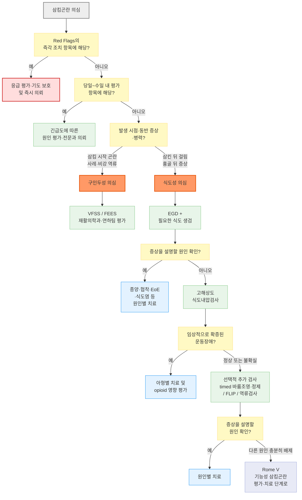

# 삼킴곤란 Dysphagia

## <mark style="color:green;">일반 사항</mark>

* 삼킴곤란(연하곤란, dysphagia) : 구강에서 위장으로 음식물을 이동시키는 과정에서의 어려움; 부위와 기전에 따라 구분
* 삼킴(연하)은 구강기(oral phase) → 인두기(pharyngeal phase) → 식도기(esophageal phase)의 3단계로 이루어지며, 각 단계의 장애에 따라 임상 양상이 다름
* 유병률 : 성인의 약 4%가 최근 1년간 삼킴 문제를 경험하며, 노인·요양 시설 거주자·신경계 질환 환자에서 더 흔함; 정의·선별도구·대상 집단에 따라 큰 차이가 있음 <mark style="color:$info;">\[Otolaryngol Head Neck Surg 2014; Clin Gastroenterol Hepatol 2020]</mark>

#### <mark style="color:$primary;">삼킴곤란의 분류</mark>

<table><thead><tr><th width="158">유형</th><th>정의</th><th>특징</th></tr></thead><tbody><tr><td><strong>Oral dysphagia</strong></td><td>구강기 장애 : 씹기와 식괴(bolus) 형성의 장애; 흔히 구인두성에 포함하여 평가</td><td>씹기 어려움, 구강 내 음식물 조절 곤란</td></tr><tr><td><strong>Oropharyngeal dysphagia</strong></td><td>구인두→상부 식도로의 이송 장애</td><td>삼킴 시작 즉시 증상; 흡인, 비강 역류 동반 가능</td></tr><tr><td><strong>Esophageal dysphagia</strong></td><td>식도→위로의 이송 장애</td><td>삼킴 수 초 후 흉부 걸림 느낌</td></tr></tbody></table>

* 이송삼킴곤란(transfer dysphagia) : 구강·인두에서 식괴(bolus, 삼키기 위해 뭉친 음식 덩이)를 넘기는 과정의 장애로, 통상 구인두성 삼킴곤란과 같은 뜻으로 사용함. 흡인·사레·비강 역류가 동반될 수 있으나 정의에 필수는 아님

#### <mark style="color:$primary;">관련 증상 구분</mark>

* 삼킴통증(odynophagia) : 삼킬 때 발생하는 통증
  * 구인두 또는 식도의 염증·궤양 (감염, 약물 유발, 위산 역류 등)
* 인두이물감(globus pharyngeus) : 목 안의 이물감
  * 실제 음식물 통과 장애·삼킴통증이 없고, 흔히 식사 사이에 느끼며 음식 섭취 시 완화될 수 있음
* 먹기공포증(phagophobia) : 질식·사레 등에 대한 공포로 삼킴·섭취를 회피함
  * 기질적 삼킴곤란 및 섭식장애와의 감별이 필요하며, 공포가 있다는 이유만으로 신체 질환을 배제하지 않음


**Globus vs 삼킴곤란 감별** : '목에 뭔가 걸린 느낌(globus sensation)'을 호소하지만 실제 음식물 통과에는 지장이 없고, 오히려 음식을 먹을 때 증상이 완화된다면 인두이물감(globus pharyngeus)을 시사함. GERD가 동반될 수 있으나 인두이물감만으로 역류가 원인이라고 판단하지 않음. Globus는 실제 삼킴곤란이나 삼킴통증이 없음


### <mark style="color:orange;">노인 연하장애 - Presbyphagia & Sarcopenic Dysphagia</mark>

* Presbyphagia (노인성 연하 변화) : 노화에 따른 근력 감소, 치아 손실, 타액 분비 감소, 감각 둔화 등으로 나타나는 생리적 연하 기능 변화
  * 질환 자체를 뜻하지 않으며, 새로 발생한 증상성 삼킴곤란을 정상 노화로 간주해서는 안 됨
  * 뚜렷한 증상이 없어도 일부 노인에서는 silent aspiration 위험이 증가할 수 있음
* Sarcopenic dysphagia (근감소성 삼킴장애) : 전신 근감소증(sarcopenia)과 연하 관련 근육의 근력·근육량 감소가 연관된 삼킴곤란; 단순한 노화 변화와 구분함
  * 고령·저영양·반복 입원·장기 와상 환자에서 빈도 높음
  * 진단 : 전신 근감소증과 삼킴곤란을 함께 확인하고, 신경계·구조적 질환 등 다른 주된 원인을 평가함
    * 전신 근감소증만으로 원인을 확정하지 않음
  * 치료 : 연하 재활 운동 + 전신 저항성 운동 + 영양 지원
    * 단백질 필요량은 영양 상태·신기능·동반 질환에 따라 개별화하며, 비타민 D는 결핍 시 보충
* 반복 흡인성 폐렴의 중요한 위험 요인
* 노인 외래에서 적극적인 연하 평가 권장

### <mark style="color:orange;">약제 유발성 식도염 (Pill esophagitis)</mark>

* 알약·캡슐이 식도에 정체되어 점막에 직접 손상이 발생한 상태
* 알약을 소량의 물과 함께 또는 누운 상태에서 복용하면 발생
* 증상(급작스러운 삼킴통증, 흉통, 삼킴곤란)은 복용 수 시간\~수일 내 나타날 수 있음

<table data-search="false"><thead><tr><th width="164">대표 약물</th><th width="241">기전</th><th>주의사항</th></tr></thead><tbody><tr><td><strong>Bisphosphonate (Alendronate)</strong></td><td>직접 점막 자극</td><td>약 200 ㎖ 이상의 물로 복용; 최소 30분 및 첫 음식 섭취 전까지 눕지 않음. 알렌드로네이트는 협착·이완불능증 등 식도 배출 지연 질환 또는 30분간 직립 유지 불가 시 금기; 제품별 허가사항 확인</td></tr><tr><td><strong>Doxycycline / Tetracycline</strong></td><td>직접 점막 손상</td><td>취침 직전 복용 금지; 충분한 물로 복용</td></tr><tr><td><strong>NSAIDs / Aspirin</strong></td><td>직접 점막 손상·점막 방어 저하</td><td>충분한 물로 복용; 위장관 위험은 별도 평가</td></tr><tr><td><strong>Clindamycin</strong></td><td>직접 점막 독성</td><td>취침 직전 복용 금지; 충분한 물로 복용</td></tr><tr><td><strong>Pinaverium</strong><br><mark style="color:blue;">[디세텔]</mark></td><td>식도에 정체될 때 점막 자극·궤양</td><td>식사 중 충분한 물과 함께 통째로 삼킴; 씹거나 빨지 않음. 누운 자세 또는 취침 직전 복용 회피</td></tr><tr><td><strong>Iron 제제, 칼륨제제</strong></td><td>직접 점막 자극</td><td>충분한 물로 복용; 제형 변경 고려</td></tr><tr><td><strong>고용량 비타민 C</strong></td><td>산성 자극</td><td>불필요한 대용량 복용 회피</td></tr></tbody></table>

## <mark style="color:green;">원인 및 위험 인자</mark>

#### <mark style="color:$primary;">기계적 폐쇄</mark>

* 구인두(oropharyngeal) : 두경부 암종, 편도 비대 및 편도주위농양, 후두개염, 인두 농양
* Zenker diverticulum (인두식도게실) : 윤상인두근 위쪽 Killian triangle의 점막 탈출; 노인 남성에서 호발. 입 냄새(halitosis)와 미소화된 음식물 역류가 핵심 단서; 내시경·수술로 치료
* 윤상인두근 바(Cricopharyngeal bar) : 바륨 검사/VFSS의 측면 영상에서 보통 C5\~C6 높이의 후벽에서 내강으로 돌출되는 압흔; Zenker diverticulum과 연관될 수 있으나 모든 병변이 전구 병변인 것은 아님; 무증상 우연 소견도 흔함; 증상과 폐쇄 소견이 일치할 때 확장술 또는 근절개술 고려
* 식도(esophageal) : 식도암, 소화성 협착(peptic stricture), Schatzki ring, 식도웹(esophageal web), 식도게실
* 외부 압박 : 갑상선 비대, 종격동 종양, 대동맥류, 심비대, 혈관 기형(우측 쇄골하동맥 기시 이상 등에 의한 dysphagia lusoria)
* 경추 골성 돌기(cervical osteophyte) : DISH(미만성 특발성 골격 과골증) 또는 전방 경추 골증식증; 노인에서 식도 외부 압박에 의한 구인두 삼킴곤란 유발; 경추 X-ray 또는 CT로 확인
* 수술 후 : 경추 전방 수술, 위저부주름술(fundoplication), 위밴드 등 비만 수술 후 삼킴곤란

#### <mark style="color:$primary;">염증성·면역성 질환</mark>

* 호산구성 식도염(Eosinophilic esophagitis, EoE) : 고형식 삼킴곤란 및 음식물 저류의 주요 원인; 젊은 남성, 알레르기 병력이 흔함
* 위식도역류질환(GERD) : 역류성 식도염 및 만성 염증 → peptic stricture
* 식도 편평태선(esophageal lichen planus) : 점막 박리·협착 유발; 주로 중년 이후 여성에서 보고됨; 구강·피부 편평태선 동반 여부를 확인하며 반복 확장술에도 재발하는 협착에서 감별
* 방사선 치료 후 섬유화, 구강점막염

#### <mark style="color:$primary;">신경근육 질환</mark>

* 뇌혈관 질환(CVA) : 구인두성 삼킴곤란의 주요 원인
* 파킨슨병, 알츠하이머병, 다발성 경화증, ALS, 중증 근무력증, 염증성 근육병
* 봉입체근염(inclusion body myositis, IBM) : 고령에서 서서히 진행하는 구인두성 삼킴곤란의 원인이며 윤상인두근 기능 이상을 흔히 동반함. 안인두근이영양증(OPMD; 안검하수 동반), 근긴장성 이영양증도 감별
* 보툴리눔 중독 : 급성 하행성 마비와 함께 삼킴곤란·구음장애·복시가 나타남
* 윤상인두근 기능 이상(Cricopharyngeal dysfunction) : 상부 식도괄약근(UES) 이완 불충분 → 반복 삼킴, 흡인, 목의 걸림감; Zenker diverticulum의 병태생리적 기반
* 이완불능증(achalasia) : 하부 식도괄약근 이완 불능 + 연동 소실
* 원위부 식도연축(distal esophageal spasm, DES), 과수축성 식도(hypercontractile esophagus; jackhammer는 그 표현형 중 하나)
* 피부경화증(scleroderma) : 식도 하부의 연동운동 저하·소실과 하부 식도괄약근(LES) 압력 저하 → GERD·소화성 협착 유발 가능
* 기타 : 당뇨병신경병증, SLE 등

#### <mark style="color:$primary;">약물 유발 운동 장애</mark>

* Opioid 유발 식도 운동 장애(OIED, Opioid-Induced Esophageal Dysfunction) : 만성 opioid 사용 → μ-opioid receptor 활성화 → EGJ outflow obstruction, 경련성 운동 이상(achalasia type III 유사 소견) 유발; HRM에서 achalasia 유사 패턴; opioid 감량·중단 시 호전 가능. tramadol도 OIED를 유발할 수 있으나 전형적 opioid보다 위험이 낮은 것으로 보고되며 근거는 제한적임
* 항콜린제는 타액 감소와 식도 운동 저하로 삼킴을 악화시킬 수 있음. CCB와 nitrate는 LES 압력·식도 수축을 낮추고 역류를 악화시킬 수 있으나, 일부 경련성 운동 장애의 단기 증상 조절에 사용되기도 함
* 항정신병약은 추체외로 증상·지연성 운동장애로 구인두성 삼킴곤란을 일으킬 수 있으며, BZD 등 진정제는 각성·협조 저하로 흡인 위험을 높임. 경부 보툴리눔 독소 주사 후에도 일시적 삼킴곤란이 생길 수 있음

#### <mark style="color:$primary;">감염</mark>

* 식도 칸디다증(면역 저하자, 광범위 항생제, 흡입 스테로이드), CMV 식도염, HSV 식도염
* 디프테리아·뇌막염·라임병·공수병 등은 드물게 구인두 기능 또는 신경계를 침범하여 삼킴곤란을 유발할 수 있으나, 감염성 식도염과는 구분

#### <mark style="color:$primary;">위험 인자</mark>

* 고령, 흡연, 과음, 비만, 철 결핍(Plummer-Vinson syndrome)
* GERD, 뇌졸중, COPD, 두경부암
* 두경부·흉부·경추 전방 수술, 방사선 치료, 화학요법
* 전신 근감소증(sarcopenia), 저영양, 장기 와상
* 직접 점막 손상 관련 : bisphosphonate, NSAID, tetracycline/doxycycline, clindamycin, pinaverium, 고용량 비타민 C, 철분제, 칼륨제제 등
* 항콜린제의 구강 건조·운동 저하는 알약의 직접 점막 독성과 구분함
* 운동 장애 유발 : opioid(tramadol도 유발 가능하나 일부 다른 opioid보다 위험이 낮게 보고됨), 항콜린제, CCB, 항정신병약

## <mark style="color:green;">임상 양상</mark>

* 구강 내 음식물 조절 어려움, 저작 곤란, 침 흘림
* 삼킴 시작 어려움, 삼킴 후 식도 걸림 느낌
* 삼킴 중 기침, 사레, 구역
* 음식물의 비강 역류 또는 기도 흡인
* 목소리 변화(쉰 목소리, 물 먹은 듯한 wet voice - 흡인 의심)
* 흡인성 폐렴(반복성 폐렴 시 silent aspiration 의심)
* 체중 감소, 탈수, 영양 결핍

### <mark style="color:$danger;">🚩 Red Flags!</mark>

<mark style="color:$danger;">**즉각 조치**</mark>

* 침·구강 분비물도 삼키지 못함  `완전 식도폐쇄` `음식물 저류`
* 호흡곤란·협착음(stridor)·청색증·저산소증  `기도 폐쇄` `중증 흡인`
* 갑작스러운 삼킴곤란과 편측 마비·안면마비·구음장애·의식 변화  `급성 뇌졸중`
* 부식성 물질 섭취, 날카로운 이물·버튼전지 삼킴, 심한 흉통·피하기종·쇼크  `부식성 손상` `고위험 이물` `식도 천공`
* 대량 토혈·흑변과 실신·혈역학적 불안정  `중증 위장관 출혈`

<mark style="color:$warning;">**당일\~수일 내 평가**</mark>

* **(당일)** 음식이 걸린 느낌이 지속되나 침·분비물은 삼킬 수 있음  `불완전 음식물 저류`
* **(당일)** 혈역학적으로 안정되어 있어도 새 토혈·흑변이 있음  `위장관 출혈`
* **(당일)** 흡인 후 새 발열·기침·호흡기 증상 또는 현저한 탈수·섭취 불가  `흡인성 폐렴` `탈수`
* 진행성 삼킴곤란, 원인 불명 체중 감소·철 결핍 빈혈  `식도암` `협착`
* 지속적·심한 삼킴통증, 면역 저하자의 새 삼킴곤란·삼킴통증  `감염성 식도염` `약제 유발성 식도염`
* 반복 흡인·폐렴 병력 또는 영양 결핍  `흡인` `영양 결핍`
* 쉰 목소리·경부 종괴가 동반되거나 두경부암·식도암 위험이 있는 사람의 새 삼킴곤란  `두경부암` `식도암`

<mark style="color:$info;">**조기 평가 및 추적**</mark>

* 급성 폐쇄·흡인·체중 감소 없이 반복되거나 지속되는 삼킴곤란  `소화성 협착` `EoE` `식도 운동 장애`
* 저절로 해소되었거나 제거 후 호전된 음식물 저류  `EoE` `Schatzki 고리` `협착`

## <mark style="color:green;">진단</mark>

#### <mark style="color:$primary;">병력 및 진찰</mark>

* 병력 : 발병 시점·진행 속도, 고형식·액체·알약 중 어디에서 증상이 있는지, 사레·역류·삼킴통증·체중 감소 확인
  * 식사 시간 연장, 음식 회피·잘게 자르기·물을 곁들여 삼키기 등 보상 행동 확인
  * 신경계·두경부 질환, 수술·방사선 치료력, 아토피 병력과 전체 약물 복용력 확인
* 진찰 : 활력징후·산소포화도, 체중 변화·탈수, 구강·치아·혀·의치, 경부 종괴, 발성·수의적 기침의 세기, 뇌신경 및 사지 신경학적 소견 평가

#### <mark style="color:$primary;">1차 감별 : 구인두성 vs 식도성</mark>


**외래 triage의 핵심** : 삼킴곤란을 접하면 구인두성인지 식도성인지를 먼저 판단함. 단, 환자가 느끼는 걸림 위치가 실제 병변 위치와 일치하지 않는 경우가 흔함. 원위부 식도 병변도 '목에 걸린다'고 표현하는 경우가 많으므로, 위치 표현보다 증상 발생 시점·동반 증상·병력 전체를 종합하여 판단해야 함.


<table data-search="false"><thead><tr><th width="197">특징</th><th>구인두성 (Oropharyngeal)</th><th>식도성 (Esophageal)</th></tr></thead><tbody><tr><td><strong>증상 발생 시점</strong></td><td>삼킴 시작 즉시</td><td>삼킴 수 초 후</td></tr><tr><td><strong>위치 표현</strong></td><td>목, 상부 흉골</td><td>흉골 뒤, 흉부 중하부</td></tr><tr><td><strong>사레 / 흡인</strong></td><td>흔함</td><td>드묾</td></tr><tr><td><strong>비강 역류</strong></td><td>가능</td><td>없음</td></tr><tr><td><strong>Wet voice / 식후 기침</strong></td><td>흔함</td><td>드묾</td></tr><tr><td><strong>침 흘림</strong></td><td>흔함</td><td>드묾</td></tr><tr><td><strong>주요 원인</strong></td><td>신경근육 질환 (CVA, 파킨슨병 등)</td><td>기계적 폐쇄 / 운동 장애</td></tr><tr><td><strong>우선 검사</strong></td><td>VFSS / FEES</td><td>상부 소화관 내시경 (EGD)</td></tr></tbody></table>

#### <mark style="color:$primary;">고형식 → 유동식 진행 패턴 평가</mark>

* 감별에 유용한 임상 단서이지만 음식 형태만으로 확진하지 않음
* 어떤 음식에서 증상이 있는지 확인
  * 기계적 폐쇄 : 초기에는 고형식에서만 증상 → 병변이 진행·협착이 심해질수록 유동식까지 증상 확대
  * 운동 장애 : 처음부터 고형식과 유동식 모두에서 증상이 나타날 수 있음. 심한 기계적 협착도 두 형태 모두의 통과를 방해하므로 EGD·생검으로 구조·점막 병변을 먼저 평가함

#### <mark style="color:$primary;">흡인 위험 침상 평가 단서</mark>

<table><thead><tr><th width="290">임상 소견</th><th>의미</th></tr></thead><tbody><tr><td>식사 중·후 기침</td><td>후두 침투(laryngeal penetration) 또는 흡인 의심</td></tr><tr><td>Wet voice (식후 목소리 변화)</td><td>후두 전정부·인두 잔류 또는 흡인 의심</td></tr><tr><td>반복적 폐렴 (특히 중력 의존성 폐 부위)</td><td>Silent aspiration 의심</td></tr><tr><td>식사 시간 현저히 연장 (30분 이상)</td><td>연하 기능 저하·피로 가능성; 시간만으로 흡인을 진단하지 않음</td></tr><tr><td>식욕 저하 + 원인 불명 체중 감소</td><td>만성 삼킴곤란으로 인한 영양 결핍</td></tr><tr><td>침 흘림, 구강 분비물 조절 곤란</td><td>구인두 기능 저하</td></tr></tbody></table>


후두 침투는 물질이 후두 안으로 들어왔으나 성대 아래로 내려가지 않은 상태, 흡인은 성대 아래로 내려간 상태임. 침상 소견이나 선별검사는 흡인 여부를 확진하지 못하며 silent aspiration을 놓칠 수 있음. 위험이 의심되면 VFSS 또는 FEES로 확인함.


### <mark style="color:orange;">선별 검사 도구</mark>

* 구인두성 삼킴곤란·흡인이 의심되면 검증된 선별검사(예: GUSS, V-VST, 3-oz 물 삼키기 검사)로 조기에 평가하고, 양성이거나 흡인이 계속 의심되면 VFSS/FEES로 확인함. 조기 선별은 폐렴 감소와 관련됨 <mark style="color:$info;">\[Ann Rehabil Med 2023]</mark>
  * 의식 저하·분비물 조절 장애가 있으면 물·음식을 이용한 직접 삼킴 검사를 보류하고 연하팀 평가를 의뢰함. 각성·침 삼킴·기침 등 사전 안전성 평가를 통과한 환자에서 검증된 단계적 선별검사를 시행함

#### <mark style="color:$primary;">EAT-10 (Eating Assessment Tool-10)</mark>

* 연하장애 선별을 위한 10문항 자가보고 설문지. 삼킴 문제와 관련하여 다음을 질문 : ① 체중 감소 ② 외식 곤란 ③ 액체 삼키기의 어려움 ④ 고형식 삼키기의 어려움 ⑤ 알약 삼키기의 어려움 ⑥ 삼킴 통증 ⑦ 먹는 즐거움 감소 ⑧ 목에 걸림 ⑨ 식사 중 기침 ⑩ 삼킴에 대한 스트레스
* 각 문항 0\~4점(총 0\~40점); 총점 ≥3점이면 연하장애를 의심하고 전문 평가 고려. 선별도구일 뿐 원인 진단이나 흡인 배제에는 사용할 수 없음
* [한국어판(K-EAT-10) 연구 참조](https://doi.org/10.12963/csd.22941)

#### <mark style="color:$primary;">침상 선별검사 (GUSS, V-VST, 3-oz 물 삼키기 검사)</mark>

* 흡인 위험이 있는 환자를 선별하여 기구 검사(VFSS/FEES)나 식이 조절로 연결하기 위한 검사
  * 음성이어도 흡인, 특히 증상 없는 흡인(silent aspiration)을 완전히 배제하지는 못함
* **GUSS**(Gugging Swallowing Screen) : 급성 뇌졸중 환자용으로 개발됨. 먼저 각성 상태, 수의적 기침·헛기침, 침 삼키기를 확인한 뒤 이를 통과하면 반고형식 → 액체 → 고형식 순으로 직접 삼키게 함. 20점 만점으로 점수가 낮을수록 중증이며, 점수에 따라 식이 단계를 권함
* **V-VST**(Volume-Viscosity Swallow Test) : 중간 점도(nectar) → 묽은 액체 → 높은 점도(푸딩) 순으로 각각 5·10·20 ㎖를 삼키게 함. 기침, 목소리 변화, 산소포화도 3% 이상 저하(안전성)와 입술 닫힘, 구강·인두 잔류, 나누어 삼키기(효율성)를 관찰함. 안전성 이상이 보이면 해당 점도의 증량을 멈추고 프로토콜에 따라 더 높은 점도를 평가함. 안전하게 삼킬 수 있는 양과 점도를 함께 정할 수 있음
* **3-oz 물 삼키기 검사**(Yale Swallow Protocol) : 물 약 90 ㎖를 중단 없이 연속으로 마시게 하여, 다 마시지 못하거나 마시는 중 또는 마신 직후 기침·사레가 있으면 실패로 판정함. 흡인 검출 민감도는 높으나 특이도는 낮음. 의식이 명료하고 분비물 조절이 되는 환자에게만 시행함

### <mark style="color:orange;">검사</mark>

* 식도성 삼킴곤란 시 내시경검사를 시행하며, PPI 경험적 치료에 대한 반응만으로 내시경검사를 생략하지 않음

<table data-search="false"><thead><tr><th width="154.26312255859375">검사</th><th width="245.4736328125">적응증</th><th>특이사항</th></tr></thead><tbody><tr><td><strong>혈액 검사</strong>¹⁾</td><td>빈혈·영양 결핍·전신 또는 신경근육 질환 의심</td><td>병력과 진찰에 따라 선택; 모든 환자의 일률적 초기 검사 아님</td></tr><tr><td><strong>상부 소화관 내시경 (EGD)</strong></td><td>식도성 삼킴곤란의 1차 검사</td><td>구조·점막 병변 평가, 조직검사 및 확장술 가능; 원인 불명 식도성 삼킴곤란/EoE 의심 시 내시경이 정상이어도 2개 이상의 식도 높이에서 총 6개 이상 생검</td></tr><tr><td><strong>비디오 투시 연하 검사 (VFSS)</strong>²⁾</td><td>구인두 삼킴곤란, 흡인 평가</td><td>실시간 삼킴 역학·흡인 시점 및 음식 질감·보상 자세 효과 평가; 언어재활사 협력 권장</td></tr><tr><td><strong>섬유내시경 연하</strong><br><strong>검사 (FEES)</strong>³⁾</td><td>구인두 삼킴곤란; 침상 환자, 이동 어려운 환자</td><td>방사선 피폭 없이 인두·후두와 분비물 관리 평가; 삼킴 순간 white-out 등 한계가 있어 VFSS와 상호 보완적</td></tr><tr><td><strong>Barium esophagogram</strong></td><td>Schatzki ring, Zenker 게실, 근위부 협착 의심; EGD 음성이나 폐쇄·운동 이상 의심</td><td>Zenker/고위 식도 병변 의심 시 EGD보다 먼저 고려; 폐쇄성 증상에는 가능하면 timed upright protocol + 13 ㎜ barium tablet; 급성 음식물 저류·고도 폐쇄에서는 흡인 위험과 내시경 시야 방해 때문에 적용하지 않음</td></tr><tr><td><strong>경부·흉부 CT</strong></td><td>외부 압박(갑상선·종격동·혈관 이상), 경추 골극, 천공 의심</td><td>천공·종격동 합병증이 의심되면 우선 시행. 합병증 없는 비골성 음식물 저류에는 일상적 영상검사가 필요하지 않음 [Endoscopy 2016]</td></tr><tr><td><strong>고해상도 식도 내압 검사 (HRM)</strong></td><td>EGD/생검으로 기계적·점막 원인을 배제한 뒤 운동 장애 의심</td><td>Chicago Classification v4.0; achalasia 아형, EGJOO, DES, hypercontractile esophagus 등 분류. 검사 전 금식 및 약물 중단은 검사 목적·반감기·안전성을 고려하여 검사실 지침에 따름</td></tr><tr><td><strong>24시간 pH/임피던스-pH 검사</strong></td><td>EGD·생검·HRM 후에도 원인이 불분명하고 GERD 관여 여부 확인 필요</td><td>검증되지 않은 GERD는 보통 산억제제 중단 상태에서 평가; 이미 확진된 GERD의 치료 불응 평가와 구분함</td></tr><tr><td><strong>FLIP</strong></td><td>HRM 결과가 경계성이거나 HRM을 완료하지 못했으나 EGJ 폐쇄 의심</td><td>EGJ 팽창성 평가; HRM의 보완검사이며 일률적 대체검사는 아님</td></tr><tr><td><strong>후두경 검사</strong></td><td>쉰 목소리·경부 종괴·상기도 증상 또는 지속되는 인두 증상</td><td>후두·하인두 병변 평가; 경고 증상 동반 시 기간을 기다리지 말고 이비인후과 의뢰</td></tr></tbody></table>

> ¹⁾ **혈액검사** : _필요에 따라 CBC, ferritin/철 검사, 전해질·신기능, 단백질/albumin, TFT, Vit B12 등. 근위약·근육통 등 염증성 근육병이 의심되면 CK, 피로성 연하장애·안검하수 등 중증 근무력증이 의심되면 anti-AChR Ab 등 표적 검사_
>
> ²⁾ **VFSS**(비디오투시 연하검사) : _조영제를 섞은 여러 질감의 음식을 삼키는 과정을 투시 영상으로 촬영함. 구강에서 식도 입구까지 전 과정과 흡인의 시점·원인을 보고, 턱 당기기 등 보상 자세나 식이 질감 조절의 효과를 바로 확인할 수 있음. 방사선 노출이 있고 검사실로 이동해야 함_
>
> ³⁾ **FEES**(섬유내시경 연하검사) : _코로 넣은 내시경으로 인두·후두를 직접 보면서 음식을 삼키게 함. 침상에서 방사선 없이 반복 시행할 수 있고 분비물 고임을 직접 확인함. 삼키는 순간에는 화면이 가려져 그 순간의 흡인은 직접 보지 못하며, 식도 단계는 평가할 수 없음_

### <mark style="color:orange;">증상 및 병력에 따른 감별</mark>

<table data-search="false"><thead><tr><th width="351">단서</th><th>시사하는 진단</th></tr></thead><tbody><tr><td>삼킴 시작 즉시 사레, 비강 역류, 흡인</td><td>구인두성 삼킴곤란 (신경근육 원인 우선)</td></tr><tr><td>삼킴 수 초 후 흉골 하부 걸림 느낌</td><td>식도성 삼킴곤란</td></tr><tr><td>진행성 고형식 삼킴곤란, 수 주~수개월</td><td>악성 종양 (식도암, 두경부암) - until proven otherwise</td></tr><tr><td>수년간 지속되는 간헐적 고형식 삼킴곤란</td><td>양성 질환 (Schatzki ring, EoE)</td></tr><tr><td>고형식 + 유동식 모두 삼킴 장애</td><td>신경근육 장애, achalasia</td></tr><tr><td>지속적인 가슴쓰림 선행</td><td>소화성 협착 (peptic stricture)</td></tr><tr><td>쉰 목소리 동반</td><td>후두·두경부 병변, 신경계 질환 등; 증상 선후만으로 양성·악성을 구분하지 않음</td></tr><tr><td>흉통 동반</td><td>심장 원인 배제 후 GERD, DES·과수축성 식도 등 평가</td></tr><tr><td>입 냄새(halitosis) + 미소화 음식 역류</td><td>Zenker diverticulum (인두식도게실)</td></tr><tr><td>젊은 남성 + 알레르기 병력 + food impaction</td><td>EoE (호산구성 식도염)</td></tr><tr><td>중년 이후 여성, 반복 확장술에도 재발하는 협착, 구강 편평태선</td><td>식도 편평태선</td></tr><tr><td>고령, 서서히 진행하는 구인두성 삼킴곤란 + 손가락 굴곡·대퇴사두근 약화</td><td>봉입체근염(IBM)</td></tr><tr><td>알약 복용 직후 또는 수 시간 내 삼킴통증</td><td>약제 유발성 식도염</td></tr><tr><td>면역 저하, 광범위 항생제·흡입 스테로이드</td><td>감염성 식도염 (칸디다, CMV, HSV)</td></tr><tr><td>Opioid 장기 복용</td><td>OIED (opioid 유발 식도 운동 장애)</td></tr><tr><td>노인 + 전신 근감소 + 구조적 이상 없음</td><td>근감소성 삼킴장애 고려; 증상성 삼킴곤란을 정상 노화로 단정하지 않음</td></tr></tbody></table>

### <mark style="color:orange;">기능성 삼킴곤란(Functional dysphagia) 진단 기준 - Rome V</mark>

* 연구용 진단 기준 : 적어도 진단 6개월 전에 증상이 시작되었고 최근 3개월간 기준을 충족하며, 주 1회 이상 증상이 있으면서 다음을 모두 충족
  1. 고형식 및/또는 액체가 식도에 달라붙거나 걸리거나 비정상적으로 통과하는 느낌
  2. 증상을 설명하는 식도 점막 또는 구조 이상이 없음¹⁾
  3. 증상을 설명하는 GERD 또는 비역류성 식도염이 없음²⁾
  4. 증상을 설명하는 식도위 접합부 유출 폐쇄 또는 식도 연동 장애가 없음³⁾

> ¹⁾_정제 또는 마시멜로를 포함한 정상 바륨 식도조영, 또는 정상 FLIP 소견은 진단을 뒷받침할 수 있음_\
> ²⁾_역류는 Lyon Consensus 2.0에 따라 내시경 또는 역류 검사로 평가함_\
> ³⁾_Chicago Classification v4.0에 따라 평가함. 단, 비효율적 식도운동(IEM) 자체는 기능성 삼킴곤란의 배제 요건이 아님. HRM 중 정상 고형식 시험은 진단을 뒷받침할 수 있음_

* Rome 임상 기준 : 기질적 질환을 충분히 배제하고 증상의 질적 특성을 충족하며 환자와 의사가 충분히 불편하다고 판단하면 빈도·기간 기준을 완화할 수 있음. 통상 약 8주 지속 여부를 참고하되, 의학적 평가로 다른 질환을 충분히 배제한 경우 예외를 둘 수 있음. 연구용 6개월을 채우기 위해 평가·치료를 늦추지 않음 <mark style="color:$info;">\[Gastroenterology 2026, 2022]</mark>

***



> 걸림 위치·양상이 불명확하면 구인두성과 식도성 원인을 함께 평가함. 고형식에만 증상이 있으면 폐쇄, 고형식과 액체 모두에 있으면 운동장애를 시사하나 EGD로 구조·점막 병변을 먼저 평가함. Zenker 게실·고위 협착이 의심되면 계획된 바륨 식도조영을 EGD보다 먼저 고려하되, 급성 음식물 저류·천공 의심에는 적용하지 않음

<p align="center"><strong>삼킴곤란 진단 알고리듬</strong><br><em><mark style="color:$info;">저자 재구성 (참고 문헌 : UEG/ESNM 2025; ACG Esophageal Physiologic Testing 2020;</mark></em><br><em><mark style="color:$info;">Chicago Classification v4.0; Rome V 2026)</mark></em></p>

***

## <mark style="background-color:$warning;">Management</mark>


### <mark style="color:orange;">치료 방침</mark>

* 삼킴곤란의 치료는 원인 질환 치료가 우선이며, 동시에 영양·수분 상태 유지와 흡인 예방에 중점을 둠
* 구인두성 삼킴곤란은 연하 재활 치료가 핵심
* 식도성 삼킴곤란은 원인에 따라 내시경 시술 또는 수술을 포함한 전문과 협진이 필요
* 급성 뇌졸중 환자는 검증된 연하 선별검사 전까지 경구 섭취·경구약을 보류함
* 영양 및 수분 섭취 상태 정기 모니터링; 의미 있는 체중 감소 시 영양 지원 계획 수립
* 흡인 위험 평가; 흡인성 폐렴 예방 우선. 의사·간호사·재활치료사 등 다학제 접근을 권함 <mark style="color:$info;">\[Ann Rehabil Med 2023]</mark>
* 치아·잇몸·혀·의치를 규칙적으로 세정하고 필요시 치과·구강 관리 지원. 경관 영양 중에도 구강 관리를 지속 <mark style="color:$info;">\[Ann Rehabil Med 2023]</mark>
* 처방약 전체 검토 (opioid, 항콜린제, 항정신병약, 진정제, bisphosphonate 등 유발 약물 여부)
* 원인 질환 확인 및 전문과 의뢰
* 경구 섭취가 안전하지 않거나 영양·수분 요구량을 충족하지 못하는 경우 예상 기간·치료 목표·환자 의사를 고려하여 비위관(NG tube) 또는 PEG 영양 고려. 경관 영양 자체가 구강 분비물·역류물 흡인을 예방하지는 않음
* 진행된 치매에서는 경관 영양이 흡인성 폐렴·생존을 개선한다는 근거가 없어 일상적으로 권하지 않으며, 신중한 손 급식(careful hand feeding)과 환자·보호자와의 치료 목표 논의를 우선함


**음식물 저류(food bolus impaction)**

* 내시경 시점 : 침도 삼키지 못하는 완전 폐쇄는 가능하면 2시간 이내, 늦어도 6시간 이내 응급 내시경; 불완전 폐쇄는 24시간 이내. 기도 보호 여부를 함께 평가함 <mark style="color:$info;">\[Endoscopy 2016]</mark>
* 통과할 때까지 물·음식을 더 먹이지 않음. glucagon 등 약물 시도로 내시경을 지연하지 않음
* 원인 평가 : 음식물 제거 시 안전하면 외관이 정상이어도 ≥2개 식도 높이에서 총 ≥6개 생검하여 EoE를 평가함. 심하게 손상된 저류 부위는 피해서 채취함. 생검을 못 했거나 자연 해소된 경우에도 조기 추적 EGD·생검을 계획함. EoE가 의심되면 추적 생검 전 PPI·식이 변경이 진단에 미칠 영향을 전문의가 판단함


## ## <mark style="color:green;">비-약물 치료 및 예방</mark> <a href="#non-drug-treatment" id="non-drug-treatment"></a>

### <mark style="color:orange;">연하 재활: 보상 전략 vs 재활 전략</mark>

* 보상 전략 : 자세 조절, 식괴의 양·질감 조절 등으로 즉각적인 삼킴 안전성·효율 개선을 돕는 접근; 효과는 개인별로 확인함
* 재활 전략 : 시간이 걸리지만 연하 근육 기능 자체를 향상시킴
* 현대 연하 재활은 보상 전략(Compensatory strategies)과 재활 전략(Rehabilitative strategies)으로 구분. 두 전략을 환자 상태에 맞게 병행하는 것이 원칙

#### <mark style="color:$primary;">보상 전략 (Compensatory)</mark>

* 자세 조절 : 식사 시 90° 직립, 식후 30분 이상 직립 유지
* 턱 당김 기법(Chin-tuck maneuver) : 일부 환자에서 기도 입구를 좁히고 식괴의 흐름을 조절하여 흡인을 줄일 수 있으나 모든 연하장애에 효과적인 것은 아님; VFSS/FEES로 효과 확인 후 적용
* Head rotation : 편측 인두 약화가 확인된 경우 약한 쪽으로 고개를 돌려 식괴를 상대적으로 건강한 쪽으로 유도; 개별 평가 후 적용
* 식이 질감 조절 : IDDSI 단계에 맞게 (아래 참조)

#### <mark style="color:$primary;">재활 전략 (Rehabilitative)</mark>

* Shaker exercise (고개 들기 운동) : 어깨를 바닥에 둔 채 누운 자세에서 발끝을 보듯 고개를 듦. 대표 연구 프로토콜은 1분 유지·1분 휴식 × 3회 후 반복 고개 들기 30회이며, 실제 강도·횟수는 피로·경추 상태에 맞춰 조절함; 설골상근 강화와 UES 개방 개선 목적
* CTAR (Chin Tuck Against Resistance) : 턱 아래 공에 저항하여 턱 당기기; 설골상근 강화
* Effortful swallow (힘껏 삼킴) : 혀·인두 압력과 혀뿌리 후퇴를 증가시켜 식괴 이동 개선을 도울 수 있음; 잔류가 증가하는 경우도 있어 검사에서 효과 확인 후 적용
* Mendelsohn maneuver : 삼킴 시 후두 거상을 의도적으로 2\~3초 연장 → UES 개방 시간 증가
* Masako maneuver : 혀를 치아 사이에 살짝 물고 침 삼킴 → 후인두벽 움직임 훈련; 음식물과 함께 시행하지 않음
* 감각 자극 치료 : 구인두 감각 자극(온도·촉각 자극 등)은 낮은 근거 수준의 조건부 권고로, 연하 기능과 삶의 질 개선을 위해 고려함. 묽은 레몬즙 등을 임의로 먹이는 방식이 아니라 연하팀이 안전성을 평가하여 시행함 <mark style="color:$info;">\[Ann Rehabil Med 2023]</mark>
* 신경근 전기자극(NMES) : 표면 NMES는 전통적 연하 재활과 병행할 때 비진행성 신경계 병변·두경부암 환자의 연하 기능 개선에 권고·제안됨. 바이오피드백 훈련도 보조적으로 고려 <mark style="color:$info;">\[Ann Rehabil Med 2023]</mark>


언어재활사(SLP)와의 협력 하에 VFSS/FEES 결과를 바탕으로 개별화된 운동 프로그램을 처방하는 것이 원칙. 경추질환·심한 쇠약 등에서는 Shaker exercise가 부적절할 수 있음


### <mark style="color:orange;">식이 조절 - IDDSI 기준</mark>

* **IDDSI (International Dysphagia Diet Standardisation Initiative)** : 국제표준화 연하장애 식이 단계 (Level 0\~7); 환자의 연하 능력에 맞는 식이 질감을 표준화하여 흡인 위험을 최소화함

<table data-search="false"><thead><tr><th width="119">IDDSI 단계</th><th width="352">표준 명칭</th><th>구분</th></tr></thead><tbody><tr><td>Level 0</td><td>Thin (묽은 액체)</td><td>음료</td></tr><tr><td>Level 1</td><td>Slightly Thick (약간 걸쭉)</td><td>음료</td></tr><tr><td>Level 2</td><td>Mildly Thick (약하게 걸쭉)</td><td>음료</td></tr><tr><td>Level 3</td><td>Moderately Thick / Liquidised</td><td>음료·음식</td></tr><tr><td>Level 4</td><td>Extremely Thick / Pureed</td><td>음료·음식</td></tr><tr><td>Level 5</td><td>Minced &#x26; Moist (다지고 촉촉한 음식)</td><td>음식</td></tr><tr><td>Level 6</td><td>Soft &#x26; Bite-sized (부드럽고 한입 크기 음식)</td><td>음식</td></tr><tr><td>Level 7</td><td>Regular / Easy to Chew</td><td>일반식·씹기 쉬운 일반식</td></tr></tbody></table>

* 이 밖에 수분이나 열을 가하면 녹거나 부드러워지는 전환 음식(transitional foods)을 별도로 정의함
* 단계는 음료·음식의 물성을 표시함. 조리·온도·방치 시간에 따라 변하므로 IDDSI 흐름·포크·스푼 검사 등으로 실제 제공 상태를 확인함 <mark style="color:$info;">\[IDDSI]</mark>
* IDDSI 단계는 흡인 위험의 경증·중등도와 일대일 대응하지 않으며, VFSS/FEES에서 확인한 병태와 환자의 선호·수분 섭취·영양 상태에 따라 선택
* 증점제(thickener) : 검사 중 흡인을 줄일 수 있으나 폐렴 예방 효과는 확립되지 않음. 과도한 증점은 인두 잔류·수분 섭취 감소·탈수·식욕 저하·복약 문제를 유발할 수 있어 환자 선호와 섭취량을 함께 평가하고 정기적으로 재평가함 <mark style="color:$info;">\[ASHA; Ann Rehabil Med 2023]</mark>
* Free Water Protocol : 인지·이동 능력, 호흡 상태, 구강 위생 및 지시 이행을 평가하여 엄격히 선별한 환자에게 식간의 맹물 섭취를 허용하는 접근. 근거는 주로 재활 입원 환자의 소규모 연구이며 모든 흡인 환자에게 일반화하지 않음. 연하팀의 정해진 구강 관리·섭취 시간 지침을 따르고, 약 복용이나 다른 묽은 음료에 임의 확대하지 않음 <mark style="color:$info;">\[Dysphagia 2017; ASHA]</mark>

***

## <mark style="color:green;">약물 치료</mark> <a href="#drug-treatment" id="drug-treatment"></a>

### <mark style="color:orange;">GERD / 소화성 협착</mark>

[**PPI**](073_-gidrugs.md#proton-pump-inhibitor-ppi) **(proton pump inhibitor)**

* 위산 분비 억제로 증상 호전 및 협착 재발 방지
* omeprazole 20 ㎎ qd <mark style="color:blue;">\[오엠피]</mark>; pantoprazole 40 ㎎ qd <mark style="color:blue;">\[판토록]</mark>; esomeprazole 20\~40 ㎎ qd <mark style="color:blue;">\[넥시움]</mark>. 적응증·중증도·반응에 따른 증량은 별도 판단
* 대부분의 일반형 PPI는 아침 첫 식사 30\~60분 전 복용; bid이면 아침·저녁 식전
  * dexlansoprazole·에소메졸디알은 식사 무관
* 소화성 협착·중증 미란성 식도염·PPI로 관해된 EoE는 유지 적응증이 될 수 있으므로 단순히 8주를 넘었다는 이유로 중단하지 않으며, 주기적으로 최저 유효 용량과 필요성을 재평가함
* clopidogrel 병용 시 omeprazole·esomeprazole을 피하고 pantoprazole 등 대안을 고려함
* 최적 PPI에도 남는 야간 역류 증상에는 취침 전 H₂ 차단제를 단기·필요시 추가할 수 있으나 일률적으로 병용하지 않음; famotidine은 신기능에 따라 조정
* 미란성 식도염에는 P-CAB(tegoprazan <mark style="color:blue;">\[케이캡]</mark>, fexuprazan <mark style="color:blue;">\[펙수클루]</mark> 등)도 허가되어 있으나, 소화성 협착의 확장술 후 재협착 예방 근거는 PPI 중심임

### <mark style="color:orange;">호산구성 식도염 (EoE)</mark>

* **진단** : 식도 기능장애 증상 + 식도 생검 ≥15 eos/hpf + 식도 호산구증가의 다른 원인 평가
  * 정상 내시경 소견만으로 배제하지 않으며, ≥2개 높이에서 총 ≥6개 생검
  * 추적 EGD에서도 EREFS(부종·고리·삼출물·세로 홈·협착)와 조직 호산구 수를 함께 기록
* 초기 진단검사는 임상적으로 안전하면 PPI·제거식 등에 의한 위음성을 줄이는 조건에서 계획
  * 치료 중 음성 생검이지만 의심이 높으면 전문의가 치료 중단 후 재검 여부를 판단하며, 음식물 저류의 응급 내시경을 지연시키거나 천식 치료제를 임의 중단하지 않음 <mark style="color:$info;">\[Am J Gastroenterol 2025]</mark>


**EoE와 PPI 반응** : 이전에 사용하던 "PPI-responsive EoE"라는 표현은 현재 권장되지 않음. PPI는 EoE의 1차 항염증 치료 옵션 중 하나로 인정되며, PPI에 반응하더라도 EoE 진단이 배제되지 않음 <mark style="color:$info;">\[Am J Gastroenterol 2025]</mark>.

**EoE 내시경 소견** (정상이어도 생검 필수) : EREFS - 부종(edema), 고리(rings; 다발성 동심성 고정 고리, 기관화), 삼출물(white exudates), 세로 홈(furrows), 협착(stricture). 점막 취약성(crepe-paper mucosa)도 동반될 수 있음


* **초기 항염증 치료** - 공동 의사결정으로 한 가지 선택
  * **PPI** : 고용량 PPI를 8\~12주 투여 후 내시경·조직검사로 반응 평가(예: omeprazole 20 ㎎ bid 또는 등가 PPI; 중증도·반응에 따라 전문의가 증량). EoE 허가 적응증이 없는 PPI는 허가 외 사용
  * **Swallowed topical steroid** : budesonide 또는 fluticasone 단일 성분을 식도에 도달하도록 삼킴. EoE 전용 budesonide 제제(경구 현탁액·구강붕해정)는 해외 약제이며, 천식용 제제를 EoE에 쓰는 것은 허가 외 사용
    * budesonide 점성 현탁액 : 성인 총 2\~4 ㎎/일이 지침 범위이며, 조제 현탁액의 한 예는 1 ㎎ bid임. budesonide 분무용현탁액을 점성 매개체에 섞는 조제법은 전문과 협진
    * fluticasone 단일 성분 정량분무 흡입제 : ACG 2025 성인 유도요법 예는 880 ㎍ bid(총 1,760 ㎍/일)이며 제형·용량을 확인. fluticasone/formoterol 복합제는 사용하지 않음
    * 일반적으로 식후 또는 취침 전에 투여하고, 투여 후 30\~60분 음식·음료를 피함. 구강·식도 칸디다증 및 드문 부신 억제에 유의하며, 다른 경로 스테로이드 병용·장기 고용량 등은 개별 모니터링함. 구강 칸디다 예방 방법은 제형별 복약지도에 따름
  * **경험적 제거식** : 가능하면 1-food(우유) 또는 2-food(우유·밀) 제거처럼 덜 제한적인 방식부터 시작하고 영양사와 협력. 알레르기검사만으로 제거 식품을 결정하지 않음
* **Dupilumab** (IL-4/IL-13 신호 억제 생물학적 제제) <mark style="color:blue;">\[듀피젠트프리필드주]</mark>
  * PPI 등 초기 치료에 반응하지 않거나 불내성인 경우, 반복적 food impaction/fibrostenotic EoE 또는 치료가 필요한 다발성 아토피 질환이 동반된 경우 고려
  * 미국 EoE 적응증은 ≥1세·체중 ≥15 ㎏이나, 국내 dupilumab 허가사항에는 EoE 적응증이 없음(2026년 11월 1일 기준). 해외 권고와 허가 외 사용을 구분하며 전문의가 판단 <mark style="color:$info;">\[FDA; 식약처]</mark>
* **반응 평가 및 유지 치료** : 증상만으로 관해를 판단하지 않고 PPI·국소 스테로이드 등은 보통 8\~12주 후 EGD와 생검으로 평가(조직학적 반응은 일반적으로 ＜15 eos/hpf). Dupilumab은 반응 속도와 임상 경과에 따라 평가 시점을 개별화하며 ACG 해설에는 12\~24주 평가의 전문가 진료 예시가 있음; 일률적인 의무 시점은 아님 <mark style="color:$info;">\[Am J Gastroenterol 2025]</mark>. 관해 후에도 선택한 식이 또는 약물 유지 치료를 지속하여 재발·섬유화·협착 위험을 낮춤

### <mark style="color:orange;">식도 운동 장애</mark>

* **이완불능증(achalasia)** - LES 폐쇄를 줄이는 시술이 치료의 중심이며 약물 효과는 제한적; 시술로 정상 연동운동이 회복되는 것은 아님
  * 시술 치료가 어렵거나 시술 대기 중인 선택된 환자에서만 단시간 작용 nitrate 또는 CCB를 고려. 효과가 제한적이고 저혈압·두통·말초부종 등이 흔하며 적응증·제형 확인 필요
  * 지속 효과를 기대하는 시술이 어려운 쇠약·고위험 환자에서는 내시경 보툴리눔 독소 주사를 고려. 효과가 일시적이며 반복 치료가 필요할 수 있음 <mark style="color:$info;">\[Am J Gastroenterol 2020]</mark>
  * Nitrate·nifedipine 등은 전문의가 선택적으로 판단하며 일반 외래에서 routine 사용을 피함. 급격한 저혈압 위험에 주의
* **원위부 식도연축(distal esophageal spasm, DES) / 과수축성 식도**
  * GERD·기계적 폐쇄를 먼저 배제/치료하고, 선택된 환자에서 CCB 또는 nitrate 단기 시도; 증상을 유발하는 매우 뜨겁거나 찬 음식은 회피
  * sildenafil 등 평활근 이완제의 근거는 소규모 연구에 제한되므로 routine 처방하지 않음; nitrate와 PDE5 억제제는 심한 저혈압 위험으로 병용 금기
* **비효율적 식도운동(IEM) / 수축 소실(absent contractility)** : 원인 질환·동반 GERD와 섭취·영양 문제를 평가함. 식도 연동운동을 확실히 회복시키는 약물은 확립되지 않았으며, metoclopramide·domperidone 등을 삼킴곤란 치료 목적으로 일률적으로 투여하지 않음 <mark style="color:$info;">\[United European Gastroenterol J 2025]</mark>
* **Opioid 유발 식도 운동 장애(OIED)**
  * 처방의와 협의한 원인 opioid 감량·중단 또는 대체가 우선임. 갑자기 중단하지 않으며, 불가역적 시술 전에 약물 영향 및 중단 후 재평가 가능성을 검토함
  * 2025년 소규모 전향 연구에서 opioid를 ≥7일 중단한 19명 중 10명(52.6%)의 운동장애가 소실됨. 중단 기간은 약물 반감기·금단 위험에 따라 개별화하며, 이 수치를 모든 환자에게 일반화하지 않음 <mark style="color:$info;">\[Am J Gastroenterol 2025]</mark>
  * naloxegol 등 말초 μ-opioid 수용체 길항제는 소규모 증례 보고 수준으로 OIED의 표준 치료가 아님 <mark style="color:$info;">\[ACG Case Rep J 2022]</mark>
* **EGJOO** : HRM 소견만으로 임상적 폐쇄를 확정하지 않음. 삼킴곤란·흉통과 timed barium esophagram 또는 FLIP의 지지 소견을 함께 확인하고 기계적 원인·opioid 영향을 배제한 뒤 침습 치료 여부를 판단 <mark style="color:$info;">\[Neurogastroenterol Motil 2021]</mark>
* **기능성 삼킴곤란** : 구조적·점막 질환, GERD/EoE 및 주요 운동 장애를 충분히 배제한 뒤 설명·안심, 식이/행동 조절과 필요시 CBT 등 다학제 치료 고려. TCA/SSRI의 직접 근거는 제한적이며, 특히 고령자에서 TCA의 항콜린 부작용이 삼킴을 악화시킬 수 있으므로 routine 처방하지 않음

### <mark style="color:orange;">감염성 식도염</mark>

* **칸디다 식도염** : 전신 항진균제가 필요함. IDSA 지침 용량은 fluconazole 200\~400 ㎎ qd × 14\~21일 <mark style="color:blue;">\[디푸루칸]</mark>
  * **허가 용량과 구분** : 디푸루칸캡슐50㎎의 식도 칸디다증 허가 용법은 50 ㎎ qd × 14\~30일, 난치성은 100 ㎎ qd로 증량임. 위 200\~400 ㎎ 요법은 지침 기반의 허가 범위 밖 용량임 <mark style="color:$info;">\[Clin Infect Dis 2016; 제품설명서]</mark>
  * 반복 투여 시 신기능에 따라 유지용량 조정(일반적으로 CrCl ≤50 ㎖/min이면 부하용량 이후 50%; 투석 환자는 별도 조정), 간독성·QT 연장·약물상호작용 확인. domperidone과 병용 금기이며 warfarin·sulfonylurea 등과도 상호작용을 확인함
  * 임상적으로 전형적인 선택된 환자에서 경험적 치료가 가능하나, 48\~72시간에 초기 반응·섭취 상태를 점검하되, 그 시점의 무반응만으로 치료 실패를 단정하지 않음. 적절한 항진균 치료에도 약 7일 이내 호전이 없으면 EGD·생검/배양 등으로 내성 또는 다른 원인을 평가함; 악화·출혈·섭취 불가 시 더 일찍 평가 <mark style="color:$info;">\[Clin Infect Dis 2016; NIH]</mark>. 구강 칸디다가 없어도 식도 감염을 배제할 수 없고, nystatin만으로는 식도 감염 치료가 불충분함
  * 경구 투여가 불가능하면 정맥 fluconazole 또는 echinocandin 등 전신 치료를 전문의와 결정하고, 경구 섭취가 가능해지면 전환을 검토함; 각 주사제의 식도 감염 용량·허가 및 급여는 별도 확인
* **HSV 식도염** : 면역 상태·중증도·경구 섭취 가능 여부에 따라 acyclovir 경구 또는 정맥 치료를 선택함. 면역 정상 환자는 자연 호전될 수 있으며 항바이러스 치료의 비교시험 근거가 제한적이므로 단일 용법을 모든 환자에게 적용하지 않음 <mark style="color:$info;">\[Korean J Helicobacter Up Gastrointest Res 2025]</mark>
  * 경구 섭취가 가능한 선택된 환자에서 acyclovir 400 ㎎ 1일 5회가 사용되며, 면역 저하자는 흔히 14\~21일 치료함 <mark style="color:blue;">\[메노바]</mark>. 경구 acyclovir의 통상 단순포진 치료는 200 ㎎ 1일 5회, 보통 5일이며, 중증 면역저하·흡수장애에서는 허가상 400 ㎎ 증량 또는 정맥 전환이 가능함. 식도염의 치료기간을 통상 피부·점막 단순포진의 5일 요법과 구분하여 결정함
  * 중증·경구 섭취 불가 환자는 정맥 acyclovir(신기능 정상 성인 5\~10 ㎎/㎏ q8h, 중증도·침범 범위에 따라)를 고려함. 신기능 조정·수액 및 신독성·신경독성 감시, 감염내과 협진
* **CMV 식도염** : ganciclovir 5 ㎎/㎏ IV q12h(신기능 정상 성인의 유도 용량 예); 신기능에 따른 용량 조정과 CBC·골수억제 모니터링. 기간은 면역 상태·중증도·반응에 따라 결정하며 HIV 관련 CMV 식도염의 NIH 권고는 21\~42일 및 증상·징후 해소까지임. 경구 섭취·흡수가 가능하면 valganciclovir 전환을 검토; 감염내과 협진 <mark style="color:$info;">\[NIH]</mark>
* 면역저하자의 CMV·HSV 의심 식도염은 내시경·조직검사 등으로 원인을 확인. 혈중 CMV PCR 양성만으로 CMV 식도염을 확진하지 않음

### <mark style="color:orange;">약제 유발성 식도염 (Pill esophagitis)</mark>

* 원인 약물 즉시 중단 또는 복용 방법 변경 (충분한 물, 직립 자세)
* PPI는 통증·동반 산 역류에 보조적으로 고려할 수 있으나 근거는 제한적이며 일률적 필수 치료가 아님
* 대부분 원인 약물 중단 후 수일\~수 주 내 호전. 지속되거나 출혈·체중 감소·심한 통증이 있으면 EGD 시행

## <mark style="color:green;">시술 및 기타 처치</mark>

<table data-search="false"><thead><tr><th width="158">상태</th><th>1차 시술/수술</th><th>비고</th></tr></thead><tbody><tr><td><strong>이완불능증 (achalasia)</strong></td><td>공기 풍선 확장술, POEM, Heller myotomy</td><td>풍선 확장술·근절개술이 어려우면 보툴리눔 독소 주사 고려. Type I·II는 숙련도와 환자 특성에 따라 선택; type III는 긴 근절개가 가능한 POEM이 특히 유리. Heller myotomy는 통상 부분 위저부주름술을 병행하여 역류를 줄임. POEM 후에는 무증상 역류성 식도염도 가능하므로 내시경·필요시 역류검사와 PPI 필요성을 평가; 증상만으로 역류 유무를 판단하지 않음; 고령·빠른 체중 감소·짧은 증상 기간 또는 EGJ 통과 저항 시 종양성 pseudoachalasia를 의심하고 CT/EUS 등을 추가 검토</td></tr><tr><td><strong>원위부 식도연축 / Hypercontractile esophagus</strong></td><td>약물 치료 우선; 선택된 중증 불응 환자에서 긴 근절개/POEM 검토</td><td>침습 치료 근거가 제한적이므로 전문센터에서 증상-검사 일치 여부를 재확인</td></tr><tr><td><strong>EoE</strong></td><td>내시경 확장술 (endoscopic dilation)</td><td>임상적으로 의미 있는 협착/좁은 식도에서 고려; 확장술은 염증을 치료하지 않으므로 항염증 치료 병행</td></tr><tr><td><strong>소화성 협착</strong></td><td>내시경 확장술 (bougie 또는 balloon)</td><td>PPI 유지로 재협착 방지</td></tr><tr><td><strong>Schatzki ring</strong></td><td>내시경 확장술 또는 링 절개</td><td>반복 확장 필요한 경우 있음; EoE 가능성 평가</td></tr><tr><td><strong>Zenker 게실</strong></td><td>내시경 게실절개술(Z-POEM 포함) 또는 외과 myotomy</td><td>내시경 치료가 증가 추세이며 윤상인두근 절개 병행; 해부학·크기·전문가 경험에 따라 선택</td></tr><tr><td><strong>피부경화증</strong></td><td>PPI + 전신 질환 관리</td><td>확장술은 협착 동반 시에만</td></tr><tr><td><strong>두경부암·식도암 관련 협착</strong></td><td>절제 가능성·치료 목표에 따른 수술·방사선/항암 치료 및 선택적 완화 처치</td><td>소화기내과·외과·종양내과·방사선종양과 협진; 스텐트·확장술은 종양 위치·천공/누공 위험과 완치 목적 치료 계획을 고려하여 선택</td></tr></tbody></table>

***

## <mark style="color:red;">질병코드</mark>

* R13 삼킴곤란 Dysphagia
* K20.0 호산구성 식도염 Eosinophilic esophagitis
* K20.8 기타 및 상세불명 식도염 Other and unspecified oesophagitis
* K21.0 식도염을 동반한 위-식도역류병 Gastro-oesophageal reflux disease with oesophagitis
* K22.0 분문의 이완불능증 Achalasia of cardia
* K22.2 식도폐쇄 Oesophageal obstruction
* K22.4 식도의 운동장애 Dyskinesia of oesophagus
* K22.5 후천성 식도게실 Diverticulum of oesophagus, acquired
* B37.80 칸디다식도염 Candidal esophagitis

> 증상 코드와 확진된 원인 질환 코드를 구분하여 적용함

***

## <mark style="color:purple;">처방례</mark>

> **처방례 1. EGD로 확인된 역류성 식도염/소화성 협착**
>
> ```
> 넥시움정 40 ㎎/T   1T   qd   아침 식전 30~60분   ×4주 후 평가
> (최적 PPI에도 야간 역류 증상이 남는 선택된 환자에서만 단기·필요시 추가)
> 가스터 20 ㎎/T   1T   취침 전; 신기능에 따라 조정
> ```
>
> _✽ 지속성·진행성 식도성 삼킴곤란은 PPI 경험적 치료에 앞서 EGD로 기계적·점막 원인을 평가함. 이 예는 4주에 반응을 평가하고 필요시 총 8주까지 치유 치료를 시행함. 야간 역류 증상이 객관적으로 지속되면 취침 전 H₂ 차단제를 단기 추가할 수 있으나 tachyphylaxis에 주의. 중증 역류성 식도염 또는 협착 등 적응증이 있을 때 추적 EGD/확장술과 PPI 유지 기간을 결정함._

> **처방례 2. 식도 칸디다증**
>
> ```
> 디푸루칸 50 ㎎/C   4~8C   qd   14~21일
> (총 200~400 ㎎/일; 지침 용량, 식도 칸디다증 허가 용량과 다름)
> ```
>
> _✽ IDSA 성인 지침 용량의 예임. 디푸루칸캡슐50㎎ 허가 용량은 50 ㎎ qd × 14\~30일, 난치성은 100 ㎎ qd로 증량이며 위 처방은 허가 범위 밖 용량임. 신기능에 따라 감량하고 QT 연장·간독성 및 warfarin, sulfonylurea 등 상호작용을 확인함. 48\~72시간에 초기 반응을 점검하고, 적절한 치료에도 약 7일 이내 호전이 없으면 내시경 등으로 재평가; 악화·출혈·섭취 불가 시 더 일찍 평가. 경구 섭취가 어렵거나 중증 면역 저하자는 전문과 협진. nystatin은 구인두 칸디다에만 유효하며 식도 감염에는 불충분._

> **처방례 3. 호산구성 식도염(EoE) - 초기 치료 선택 예시**
>
> ```
> [선택지 A - 고용량 PPI]
> 오엠피 20 ㎎/T   1T   bid   식전 30~60분   8~12주
>
> [선택지 B - swallowed topical steroid; 전문의 처방]
> 풀미코트레스퓰분무용현탁액 0.5 ㎎/2 ㎖   1회 2앰플(1 ㎎)   bid
>   → 전문의가 처방한 점성 매개체·배합법에 따라 조제하여 천천히 삼킴
>   → EoE 치료 목적으로는 폐로 흡입하지 않음; 총 2 ㎎/일
>   → 복용 후 30~60분 음식·음료 금지 / 구강 위생은 제형별 지시에 따름
> ```
>
> _✽ EoE 허가 적응증이 없는 약물·제형은 허가 외 사용으로 구분함. PPI·swallowed topical steroid·덜 제한적인 경험적 제거식 중에서 공동 의사결정으로 초기 치료를 선택하며, 일률적인 순차 치료가 아님. 8\~12주 후 내시경·생검으로 재평가하고 관해 후 유지 치료를 결정함. 반복 food impaction·fibrostenotic EoE·초기 치료 불응 또는 다발성 아토피 질환 동반 시 EoE 허가 적응증이 없는 dupilumab의 사용 여부를 전문의가 판단함._


**이완불능증 약물 처방에 관한 주의** : nitrate·nifedipine 등의 약물 효과는 제한적이고 이완불능증 허가 적응증과 구분해야 하므로 일반 외래 처방례로 제시하지 않음. 진단 확정과 POEM·풍선 확장술·Heller myotomy 등 시술 치료를 위한 소화기내과 협진이 우선임.


***

### <mark style="color:$success;">핵심 복약 지도</mark>

> **PPI (넥시움, 판토록 등) 복용 안내**
>
> 1. 대부분의 일반형 PPI는 **식사 30\~60분 전** 복용합니다. 하루 2회이면 아침·저녁 식전에 복용합니다. 식사와 무관한 제형도 있으므로 제품별 복용법과 처방 지시를 따르십시오.
> 2. 증상이 호전되더라도 **의사가 지시한 기간까지 복용**하십시오. 장기간 복용 후 중단하면 일시적인 반동 증상이 생길 수 있습니다. 중단이 적절한 경우 감량 또는 바로 중단하는 방법을 의사와 정할 수 있으며, 협착·중증 식도염·EoE의 유지 치료는 임의로 중단하지 마십시오.
> 3. 장기 복용 중 검사 여부는 신장질환, 영양 결핍, 골절 위험, 이뇨제 병용 등 개인의 위험 인자에 따라 결정합니다. 모든 환자에게 일률적인 정기 혈액검사가 필요한 것은 아닙니다.

> **Fluconazole(디푸루칸) - 식도 칸디다증 복용 안내**
>
> 1. 식사와 관계없이 정해진 용량을 하루 한 번 복용하며, 증상이 좋아져도 처방된 기간(보통 14\~21일)을 지키십시오. 신장 기능에 따라 용량이 달라질 수 있으므로 임의로 조절하지 마십시오.
> 2. 돔페리돈과 함께 복용하면 안 됩니다. Warfarin·일부 당뇨병약·부정맥약 등을 복용한다면 처방 전에 알리십시오.
> 3. 심한 두근거림·실신, 호흡곤란·입술 또는 혀의 부종이 생기면 복용을 중단하고 즉시 응급평가를 받으십시오. 황달·진한 소변·심한 발진이 생기면 복용을 멈추고 당일 진료받으십시오.
> 4. 임신 가능성·임신 계획·수유 여부를 미리 알리십시오. 반복 치료 중과 마지막 복용 후 1주까지의 피임 필요성을 의사와 상의하십시오.
> 5. 치료 시작 후 48\~72시간에 증상·섭취 상태를 확인하고, 적절한 치료에도 약 7일 이내 호전이 없으면 다시 진료받으십시오. 더 악화되거나 물도 삼킬 수 없으면 기다리지 마십시오.

> **삼켜서 사용하는 국소 스테로이드 - EoE용 복용 안내**
>
> 1. 천식용 제제를 EoE에 처방받은 경우에는 **폐로 흡입하는 것이 아니라 의사가 알려 준 방법으로 삼키는 것**입니다. 단일 성분 제제인지 반드시 확인하십시오.
> 2. 복용 후 **30\~60분은 음식이나 음료를 드시지 마십시오.** 바로 드시면 약이 씻겨 내려가 효과가 줄어들 수 있습니다.
> 3. 구강·식도 칸디다증이 발생할 수 있습니다. 입안의 흰 반점, 통증 또는 삼킴통증이 생기면 진료받으십시오. 구강 세척 시점과 방법은 처방받은 제형의 지시를 따르십시오.
> 4. 증상만 좋아졌다고 임의로 중단하지 말고, 예정된 내시경·조직검사로 염증이 호전되었는지 확인하십시오.

> **알약 복용 방법 안내 - 약제 유발성 식도염 예방**
>
> 1. **삼킴 평가에서 경구약과 물을 안전하게 삼킬 수 있고** 수분 제한이 없다면 알약은 충분한 물(일반적으로 약 200 ㎖)과 함께 복용하십시오. 약마다 필요한 물의 양이 다를 수 있으므로 허가사항을 확인하십시오.
> 2. 복용 후 **최소 30분은 눕지 마십시오.** 취침 직전 복용은 피하세요.
> 3. 이미 삼킴곤란이나 사레가 있다면 임의로 알약 삼키기 기법을 시도하지 말고 의사·약사에게 액상제, 더 작은 제형 또는 다른 투여 경로가 가능한지 문의하십시오.
> 4. 서방정·장용정·항암제 등은 임의로 부수거나 캡슐을 열지 마십시오. 일부 PPI는 과립을 씹거나 부수지 않고 물에 분산하는 방법 등이 허용되지만 제품마다 다릅니다. 약사에게 제형 변경·분산 가능 여부와 안전한 투여 방법을 확인하십시오.
> 5. bisphosphonate(골다공증약), 독시사이클린, 클린다마이신 등은 식도 자극에 특히 주의하십시오. 피나베리움(일부 진경제)은 식사 중 충분한 물과 함께 통째로 삼키며, 누운 자세나 취침 직전 복용을 피하십시오.
> 6. 알약 복용 후 타는 듯한 통증이나 새 삼킴곤란이 생기면 원인 약물의 다음 복용 여부를 처방의와 상의하고 신속히 내원하십시오.

> **언제 다시 병원을 방문해야 하나요?**
>
> * 원인 평가 후 치료 중인 환자에서 예정된 추적 시점에도 호전되지 않는 경우. 새로 생기거나 진행하는 삼킴곤란은 4\~8주를 기다리지 말고 신속히 평가
> * 삼킴 시 **심한 통증**이 생기거나 갑자기 악화된 경우 - 빠른 내원
> * **음식이 걸린 느낌이 지속되거나 침도 삼키지 못하는 경우(food impaction)** - 즉시 응급실 방문; 물·음식을 더 삼켜 밀어 넣으려 하지 않음
> * **새 토혈·검은 변**이 있으면 당일 진료; 실신·심한 어지럼·호흡곤란이 동반되면 즉시 응급실 방문
> * **원인 불명 체중 감소·빈혈·심한 피로감**이 동반되는 경우 - 신속한 진료

***

## <mark style="color:green;">주요 참고문헌 및 확인 자료</mark>

### <mark style="color:orange;">임상 근거</mark>

*   Mari A, et al. Esophageal and Oropharyngeal Dysphagia: Clinical Recommendations From UEG and ESNM. United European Gastroenterol J. 2025;13:855-901. doi:10.1002/ueg2.70062. - 성인 삼킴곤란의 진단 순서·생검·HRM·VFSS/FEES

    [https://onlinelibrary.wiley.com/doi/10.1002/ueg2.70062](https://onlinelibrary.wiley.com/doi/10.1002/ueg2.70062)
*   Bhattacharyya N. The Prevalence of Dysphagia among Adults in the United States. Otolaryngol Head Neck Surg. 2014;151:765-769. doi:10.1177/0194599814549156. - 최근 1년 삼킴 문제 유병률(약 4%)

    [https://doi.org/10.1177/0194599814549156](https://doi.org/10.1177/0194599814549156)
*   Adkins C, et al. Prevalence and Characteristics of Dysphagia Based on a Population-Based Survey. Clin Gastroenterol Hepatol. 2020;18:1970-1979. doi:10.1016/j.cgh.2019.10.029. - 평생 경험 기준 유병률(약 16%)과 진료 이용

    [https://pmc.ncbi.nlm.nih.gov/articles/PMC7180111/](https://pmc.ncbi.nlm.nih.gov/articles/PMC7180111/)
*   Rome Foundation. Rome V Criteria. 2026. - 기능성 삼킴곤란의 연구용 진단 기준과 보조 소견(정제·마시멜로 조영, FLIP, HRM 고형식 시험)

    [https://theromefoundation.org/rome-v-criteria/](https://theromefoundation.org/rome-v-criteria/)
*   Disorders of Gut-Brain Interaction and the Rome V Process. Gastroenterology. 2026. - 연구용 기준과 진료용 Rome 임상 기준(빈도·기간 기준 완화)의 구분

    [https://www.gastrojournal.org/article/S0016-5085(26)00145-9/fulltext](https://www.gastrojournal.org/article/S0016-5085\(26\)00145-9/fulltext)
*   Drossman DA, Tack J. Rome Foundation Clinical Diagnostic Criteria for Disorders of Gut-Brain Interaction. Gastroenterology. 2022;162:675-679. - 진료용 임상 기준의 도입과 빈도·기간 기준 완화

    [https://pubmed.ncbi.nlm.nih.gov/34808139/](https://pubmed.ncbi.nlm.nih.gov/34808139/)
*   Dellon ES, et al. ACG Clinical Guideline: Diagnosis and Management of Eosinophilic Esophagitis. Am J Gastroenterol. 2025;120:31-59. doi:10.14309/ajg.0000000000003194. - 진단·생검, 초기 치료의 공동 의사결정, 확장술·항염증 유지 치료; ACG 공식 해설

    [ACG 공식 해설](https://gi.org/journals-publications/ebgi/eluri_feb2025/) · [ACG 용량 요약](https://webfiles.gi.org/links/committees/DigitalCommsAndPubs/ACG-EOE-Guidelines-Highlights-2025.pdf)
*   ACG. Clinical Use of Esophageal Physiologic Testing. 2020. - 내시경 이후 HRM·바륨 조영·FLIP의 선택과 상호 보완

    [https://pmc.ncbi.nlm.nih.gov/articles/PMC9468980/](https://pmc.ncbi.nlm.nih.gov/articles/PMC9468980/)
*   Yadlapati R, et al. Esophageal Motility Disorders on High-resolution Manometry: Chicago Classification Version 4.0. Neurogastroenterol Motil. 2021;33:e14058. - 운동장애 분류와 EGJOO의 임상적 확증

    [https://pmc.ncbi.nlm.nih.gov/articles/PMC8034247/](https://pmc.ncbi.nlm.nih.gov/articles/PMC8034247/)
*   Vaezi MF, et al. ACG Clinical Guidelines: Diagnosis and Management of Achalasia. Am J Gastroenterol. 2020. - 아형별 근치 치료와 근치 치료 부적합 환자의 보툴리눔 독소 주사

    [https://pmc.ncbi.nlm.nih.gov/articles/PMC9896940/](https://pmc.ncbi.nlm.nih.gov/articles/PMC9896940/)
*   Yang S, et al. Clinical Practice Guidelines for Oropharyngeal Dysphagia. Ann Rehabil Med. 2023;47(Suppl 1):S1-S26. doi:10.5535/arm.23069. - 조기 선별, 감각 자극·NMES 병행 재활, 질감 조절, 구강 관리, 다학제 접근

    [https://doi.org/10.5535/arm.23069](https://doi.org/10.5535/arm.23069)
*   노동경, et al. 한국어판 Eating Assessment Tool (EAT-10)의 타당도 및 신뢰도: 뇌졸중 환자의 흡인 위험 예측. Commun Sci Disord. 2022;27:830-843. doi:10.12963/csd.22941. - K-EAT-10 문항(부록)과 뇌졸중 환자 대상 검증

    [https://doi.org/10.12963/csd.22941](https://doi.org/10.12963/csd.22941)
*   ASHA. Adult Dysphagia / Flexible Endoscopic Evaluation of Swallowing. - 침상 평가의 한계, 후두 침투·흡인과 개별화한 연하 평가

    [https://www.asha.org/practice-portal/clinical-topics/adult-dysphagia/](https://www.asha.org/practice-portal/clinical-topics/adult-dysphagia/)
*   Sharma SC, Sakthivel P. Cricopharyngeal Bar. 2017. - 측면 조영검사에서 C5\~C6 후벽 압흔 소견

    [https://www.panafrican-med-journal.com/content/article/27/288/full/](https://www.panafrican-med-journal.com/content/article/27/288/full/)
*   IDDSI. Framework and Testing Methods. - 음료·음식 질감 단계, 전환 음식과 제공 시점의 물성 검사

    [https://www.iddsi.org/standards/framework](https://www.iddsi.org/standards/framework)
*   Gillman A, et al. Implementing the Free Water Protocol does not Result in Aspiration Pneumonia in Carefully Selected Patients with Dysphagia: A Systematic Review. Dysphagia. 2017;32:345-361. doi:10.1007/s00455-016-9761-3. - 선별·인지·이동 능력과 적용 한계

    [https://pubmed.ncbi.nlm.nih.gov/27878598/](https://pubmed.ncbi.nlm.nih.gov/27878598/)
*   Kim NY, Lee J. Infective Esophagitis. Korean J Helicobacter Up Gastrointest Res. 2025. doi:10.7704/kjhugr.2025.0007. - HSV 식도염의 임상 양상·치료 및 면역 상태에 따른 차이

    [https://doi.org/10.7704/kjhugr.2025.0007](https://doi.org/10.7704/kjhugr.2025.0007)
*   NIH. Herpes Simplex Virus: Adult and Adolescent Opportunistic Infections. 2025 개정, 2026 검토. - HIV 환자의 HSV 치료; 면역 정상자와 구분

    [https://clinicalinfo.hiv.gov/en/guidelines/hiv-clinical-guidelines-adult-and-adolescent-opportunistic-infections/herpes-simplex](https://clinicalinfo.hiv.gov/en/guidelines/hiv-clinical-guidelines-adult-and-adolescent-opportunistic-infections/herpes-simplex)
*   NIH. Cytomegalovirus Disease: Adult and Adolescent Opportunistic Infections. - HIV 관련 CMV 식도염의 진단·치료기간; 다른 면역저하 상태와 구분

    [https://clinicalinfo.hiv.gov/en/guidelines/hiv-clinical-guidelines-adult-and-adolescent-opportunistic-infections/cytomegalovirus](https://clinicalinfo.hiv.gov/en/guidelines/hiv-clinical-guidelines-adult-and-adolescent-opportunistic-infections/cytomegalovirus)
*   Ezquerra-Durán A, et al. Prospective Evaluation of Opioid Cessation in Patients With Suspected Opioid-Induced Esophageal Dysfunction (OIED). Am J Gastroenterol. 2025. doi:10.14309/ajg.0000000000003297. - opioid 중단 후 증상·내압 소견 변화의 소규모 전향 연구

    [https://pubmed.ncbi.nlm.nih.gov/39791564/](https://pubmed.ncbi.nlm.nih.gov/39791564/)
*   Ulteig C, et al. Effect of Naloxegol on Opioid-Induced Esophageal Motility Disorder. ACG Case Rep J. 2022. - 3명 증례 보고; 표준 치료 근거와 구분

    [https://pmc.ncbi.nlm.nih.gov/articles/PMC8791044/](https://pmc.ncbi.nlm.nih.gov/articles/PMC8791044/)
*   NIH. Candidiasis (Mucocutaneous): Adult and Adolescent Opportunistic Infections. 2026 검토. - 경험적 치료 후 7일 무반응 시 내시경 평가; HIV 환자 대상 지침임

    [https://clinicalinfo.hiv.gov/en/guidelines/hiv-clinical-guidelines-adult-and-adolescent-opportunistic-infections/candidiasis](https://clinicalinfo.hiv.gov/en/guidelines/hiv-clinical-guidelines-adult-and-adolescent-opportunistic-infections/candidiasis)
*   Pappas PG, et al. Clinical Practice Guideline for the Management of Candidiasis: 2016 Update by the IDSA. Clin Infect Dis. 2016;62:e1-50. - 식도 칸디다증의 전신 항진균제 용량·기간

    [https://www.idsociety.org/practice-guideline/candidiasis/](https://www.idsociety.org/practice-guideline/candidiasis/)
*   Birk M, et al. Removal of Foreign Bodies in the Upper Gastrointestinal Tract in Adults: ESGE Clinical Guideline. Endoscopy. 2016;48:489-496. - 완전 식도폐쇄와 불완전 음식물 저류의 내시경 긴급도, 영상검사 적응증, 약물 시도로 내시경을 지연하지 않음

    [https://www.esge.com/assets/downloads/pdfs/guidelines/2016\_s\_0042\_100456.pdf](https://www.esge.com/assets/downloads/pdfs/guidelines/2016_s_0042_100456.pdf)
*   SAGES. 2024 Update to Guidelines for the Use of POEM in the Treatment of Achalasia. - 시술 선택 및 POEM 후 역류 관리

    [https://www.sages.org/publications/guidelines/update-to-guidelines-for-the-use-of-poem-for-achalasia/](https://www.sages.org/publications/guidelines/update-to-guidelines-for-the-use-of-poem-for-achalasia/)
*   Regeneron/Sanofi. DUPIXENT US Prescribing Information. - 미국 EoE 적응증의 연령·체중 조건

    [https://www.regeneron.com/downloads/dupixent\_fpi.pdf](https://www.regeneron.com/downloads/dupixent_fpi.pdf)
*   Health Canada. DICETEL 제품설명서. - pinaverium의 식도 자극 예방을 위한 식사 중 복용·충분한 물·취침 직전 복용 회피

    [https://pdf.hres.ca/dpd\_pm/00028699.PDF](https://pdf.hres.ca/dpd_pm/00028699.PDF)
*   EMA. Fluconazole PSUSA/00001404/202303. 2023. - 반복 치료 중 및 마지막 투여 후 1주까지 피임 상담

    [EMA 안전성 개정 자료](https://www.ema.europa.eu/en/documents/psusa/fluconazole-cmdh-scientific-conclusions-and-grounds-variation-amendments-product-information-and-timetable-implementation-psusa-00001404-202303_en.pdf)

### <mark style="color:orange;">허가·급여 확인 자료</mark>

* [식품의약품안전처. 의약품안전나라 - 의약품 품목허가정보.](https://nedrug.mfds.go.kr/index) - 국내 제품별 적응증·용법·금기 및 허가 상태 확인
* [건강보험심사평가원. 약제급여기준 및 의약품안전사용서비스(DUR).](https://www.hira.or.kr) - 약제별 급여기준과 병용·연령·용량·투여기간 주의 정보

***

## <mark style="color:blue;">환자 안내서</mark>


**삼킴곤란(연하곤란), 음식 삼키기가 어려운 증상입니다**

음식이나 음료를 삼키기 어렵거나 목이나 가슴에 걸리는 느낌이 드는 증상을 삼킴곤란이라고 하며, 통증이나 사레가 동반될 수 있습니다. 원인이 다양하므로 정확한 진단과 원인에 맞는 치료가 중요합니다.


#### <mark style="color:$primary;">왜 삼킴이 어려워지나요?</mark>

삼킴은 입 → 목구멍(인두) → 식도를 거쳐 위까지 음식물이 이동하는 과정입니다. 이 경로 어디에서든 문제가 생기면 삼킴곤란이 발생합니다. 흔한 원인으로는 위산 역류(GERD), 식도 협착, 식도 운동 장애, 알레르기성 식도 염증(EoE), 신경 질환(뇌졸중, 파킨슨병), 감염 등이 있으며, 노인에서는 전신 근감소증과 영양 부족도 중요한 원인입니다. 일부 약(진정제, 항정신병약 등)도 삼킴을 어렵게 할 수 있습니다. 새로 생긴 삼킴곤란을 단순한 노화로 여기지 마십시오.

#### <mark style="color:$primary;">식사할 때 이렇게 하세요</mark>

* 아래 식사 안내는 **평가 후 경구 식사가 허용된 경우**에 적용합니다. 금식·경관 영양 지시를 받았다면 그 지시를 따르십시오.
* **식사 중에는 허리를 세우고** 앉으십시오. 식후에도 최소 30분은 눕지 마세요.
* 처방받은 음식 질감을 지키고, 씹는 음식이 허용되면 **작게 나누어 천천히, 충분히 씹어** 드십시오.
* 음식의 질감과 음료의 농도는 연하검사 결과에 따라 달라집니다. 처방받은 IDDSI 단계가 있다면 그 지침을 따르십시오.
* 식사 중에는 대화나 TV 시청보다 **삼킴에 집중**하세요.
* 물이나 묽은 음료가 항상 안전한 것은 아닙니다. 물을 함께 마실지, 걸쭉하게 만들어야 할지는 의사나 언어재활사의 지시를 따르십시오.

#### <mark style="color:$primary;">흡인을 예방하려면</mark>

* 음식이 기도로 잘못 들어가는 것을 **흡인**이라고 합니다. 반복되면 폐렴이 생길 수 있어 위험합니다.
* 사레가 자주 들거나, 식후 기침이 잦거나, 식사 후 목소리가 변한다면 흡인이 의심됩니다. 기침이나 사레 없이 음식·침이 기도로 들어가는 경우도 있습니다.
* 턱 당기기(chin-tuck), 고개 돌리기 등의 자세는 환자마다 효과가 다릅니다. 연하검사에서 도움이 확인되어 교육받은 자세만 사용하십시오.
* 피로가 심할 때는 잠깐 쉬고 식사를 나누어 드십시오. 하루 전체 섭취량이 부족하거나 체중이 줄면 영양 지원 방법을 상의하십시오.
* 치아·혀·잇몸과 틀니를 규칙적으로 닦으십시오. 입으로 식사하지 않고 관으로 영양을 공급받더라도 입안 청결을 유지해야 합니다.

#### <mark style="color:$primary;">연하 재활 운동</mark>

* 의사나 언어재활사가 권장하는 **연하 운동**을 매일 꾸준히 하십시오.
* 고개 들기 운동(Shaker exercise) 등은 특정 연하 기능 저하에 사용하며, 목 질환이나 심한 쇠약이 있으면 적합하지 않을 수 있습니다. 처방받은 운동만 정확한 방법으로 시행하십시오.
* 연하 운동은 수 주 이상 꾸준히 해야 효과가 나타납니다.

#### <mark style="color:$primary;">이럴 때는 즉시 또는 신속히 병원을 방문하세요</mark>

* 음식이 걸린 느낌이 계속되거나 침도 삼키지 못할 때 → **응급실 방문**; 더 먹거나 물로 밀어 넣거나 억지로 토하려 하지 마십시오
* 숨이 가쁘거나 목에서 쌕쌕 소리가 날 때 → **119 또는 응급실 방문**
* 갑자기 삼키기 어려워지면서 얼굴·팔다리 마비나 말이 어눌해지는 증상이 있을 때 → **즉시 119**
* 삼킴곤란과 함께 체중이 빠질 때 → **신속한 진료**
* 삼킴 시 매번 심한 통증이 있을 때 → **신속한 진료**
* 반복적으로 폐렴이 생기는 경우 → **신속한 진료**
* 피를 토하거나 검은 변이 새로 생기면 → **당일 진료**; 심한 어지럼·실신·숨참이 함께 있으면 **즉시 119 또는 응급실 방문**
* 흡인 후 새 발열·기침이 생기거나 물도 마실 수 없을 때 → **당일 진료**; 호흡곤란이 있으면 **즉시 119**
