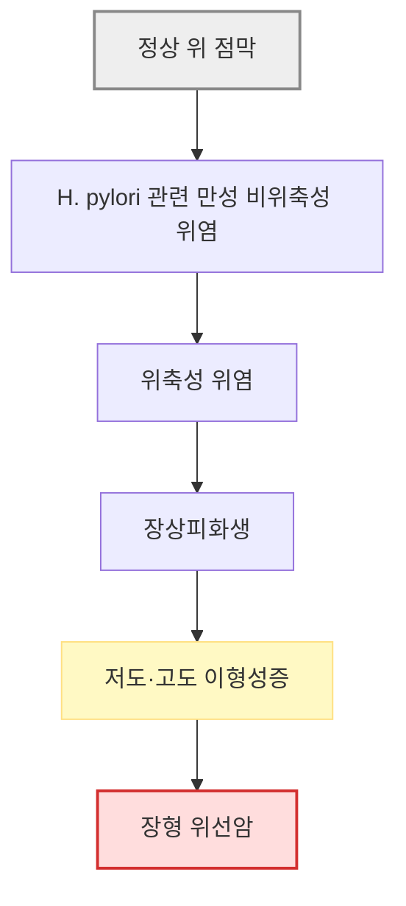

# 위염 Gastritis

## <mark style="color:green;">일반 사항</mark>

* **위병증 (gastropathy)** : 염증이 없거나 경미하면서 위 점막의 상피·혈관 손상이 주된 상태
* **위염 (gastritis)** : 조직학적으로 확인된 위 점막의 염증 상태; 임상 증상 및 내시경 소견만으로는 확진 불가
* **"위염" 과잉 진단 주의 - 증상 ≠ 위염**
  * 상복부 통증·속쓰림·더부룩함이 있다고 해서 모두 "위염"은 아님. 실제 외래에서는 기능성 소화불량(FD), GERD, 소화성 궤양, 약물 유발 증상, 담도 질환 등이 흔히 혼재하며, 이들이 진짜 원인인 경우가 많음
  * 내시경상 단순 발적(erythema, "minimal change gastritis")은 임상적으로 무의미한 경우가 매우 흔함. 경미한 점막 발적은 정상 변이 또는 비특이 변화일 수 있으며, 증상과의 연관성은 낮음; 내시경 소견이 곧 증상의 원인이라고 단정하지 말 것


H. pylori 음성인 조직학적 위염에서는 자가면역 위염, lymphocytic·eosinophilic·collagenous gastritis, Crohn병, CMV 등 드문 원인을 임상 맥락에 따라 감별함. 약물·담즙 역류에 의한 반응성 위병증은 염증이 적은 점막 손상으로 구분함. PPI 복용은 H. pylori 검사의 위음성과 위체부 우세 분포에 영향을 줄 수 있으므로 검사 시 복용력을 확인함.


#### <mark style="color:$primary;">분류</mark>

<table><thead><tr><th width="193.15789794921875">유형</th><th width="254.21051025390625">특징 및 원인</th><th>임상적 의의</th></tr></thead><tbody><tr><td>Patchy erythema</td><td>위 점막의 국소 발적; "minimal change gastritis"</td><td>대부분 임상적으로 무의미. 과잉 진단·치료 주의</td></tr><tr><td>Erosive gastritis / Reactive gastropathy</td><td>NSAID, 알코올 등 유해 인자</td><td>점막 손상; 출혈 가능</td></tr><tr><td>Hemorrhagic gastritis / gastropathy</td><td>NSAID·알코올 또는 중환자의 저관류·저산소증 등</td><td>출혈성 점막 손상; 원인·출혈 중증도에 따라 평가</td></tr><tr><td>Reflux gastritis</td><td>담즙·췌장액의 역류; 위 수술 후 또는 유문 기능 장애와 관련</td><td>반응성 위병증 소견; 증상과의 인과관계는 신중히 판단</td></tr><tr><td>Infectious gastritis</td><td>H. pylori, 면역저하자의 CMV 등</td><td>H. pylori가 가장 흔한 만성 위염 원인</td></tr><tr><td>Atrophic gastritis</td><td>만성 염증에 의한 선(gland) 소실; 주원인은 H. pylori와 자가면역</td><td>위암 전구 병변; 범위·중증도에 따라 위험 층화</td></tr></tbody></table>

#### <mark style="color:$primary;">만성 위염의 자연 경과 (Correa Cascade)</mark>

***



<p align="center"><strong>Correa cascade</strong></p>

***

* 모든 환자가 위암으로 진행하는 것은 아님. 이 경로는 위험 층화를 설명하는 모형이며, 제균의 위암 예방 효과는 위축·장상피화생이 생기기 전에 가장 크고 제균 후에도 진행된 전암병변의 위험은 남을 수 있음 <mark style="color:$info;">\[Korean J Helicobacter Up Gastrointest Res 2026]</mark>


**Correa cascade**는 주로 H. pylori 관련 다초점 위축성 위염에서 장형 위암으로 진행하는 경로임. 자가면역 위염은 위체부 우세 위축·고가스트린혈증 및 Type 1 위 신경내분비종양 위험을 포함하는 별도 경로로 이해함.

**OLGA/OLGIM 병기** : 조직검사를 기반으로 위암 위험도를 Stage 0\~IV로 분류. Stage III\~IV 또는 전정부와 위체부를 모두 침범한 광범위 위축·장상피화생은 고위험군으로 감시함. APAGE는 III\~IV에서 2년, II에서 3년 간격을, MAPS III는 진행성 병변에서 3년 간격을 제시함. 2년 주기의 국가 위암검진을 늦추는 의미로 적용하지 않으며 개인 위험도에 따라 조정함. <mark style="color:$info;">\[Gut 2026; Endoscopy 2025]</mark>

**OLGIM(장상피화생 기반) vs OLGA(위축 기반)** : OLGIM은 관찰자 간 일치도가 높아 MAPS·APAGE가 선호하지만, 위축만 있고 장상피화생이 적은 고위험 환자를 과소평가할 수 있음. 공식 병기가 없으면 여러 생검에서의 뚜렷하고 광범위한 위축·장상피화생 또는 불완전형 장상피화생을 진행성 병변의 지표로 봄. <mark style="color:$info;">\[Gut 2026]</mark>


#### <mark style="color:$primary;">자가면역 위염 (Autoimmune Gastritis)</mark>

* 위 벽세포에 대한 면역반응으로 위체부·저부의 산 분비샘이 손상되는 질환임. 항벽세포항체·항내인자항체가 진단을 보조하며 전정부는 상대적으로 보존됨. H. pylori 음성은 진단 요건이 아니며 과거 또는 현재 감염이 병존할 수 있음
* 진행 순서 주의 : 철결핍빈혈이 B12 결핍보다 먼저 나타나는 경우가 흔함 - 위산 저하로 비헴철 흡수 장애 → 이후 내인자 결핍으로 Vit B12 흡수 장애(악성빈혈) 순으로 진행
* 자가면역 갑상선질환, 제1형 당뇨병 등 다른 자가면역질환과 동반 가능하며, 특히 자가면역 갑상선질환은 선별함 <mark style="color:$info;">\[Gastroenterology 2021]</mark>
* 의심 시 검사: CBC, Fe·ferritin, Vit B12 ± methylmalonic acid, 항벽세포항체(anti-PCA), 항내인자항체(anti-IFA), 공복 혈청 가스트린 ± pepsinogen I 및 I/II ratio, 갑상선 기능검사
  * Anti-PCA는 비교적 민감하지만 특이도가 낮고, anti-IFA는 특이도가 높지만 민감도가 낮음. 항체 음성만으로 배제하지 않으며 위체부 우세 위축의 조직 소견과 함께 판단
* 악성빈혈은 자가면역 위염의 후기 발현임. 철결핍이 병존하면 대구성 변화가 가려질 수 있고 B12 결핍 신경 증상은 빈혈 없이도 나타날 수 있음
* 새로 진단된 악성빈혈에서 최근 적절한 내시경이 없으면 부위별 조직검사를 포함한 내시경으로 위체부 우세 위축 및 동반 위선암·신경내분비종양을 평가 <mark style="color:$info;">\[Gastroenterology 2021]</mark>

## <mark style="color:green;">원인 및 위험 인자</mark>

#### <mark style="color:$primary;">감염성</mark>

* H. pylori : 가장 흔한 만성 위염 원인; 성인 혈청 유병률은 1998년 66.9%에서 2015\~2016년 51.0%로 감소했으나 서구보다 여전히 높음. 젊은 연령층일수록 낮음 <mark style="color:$info;">\[Korean J Helicobacter Up Gastrointest Res 2026]</mark> (☞ [헬리코박터](080_-h_pylori-infection.md))
* 기타 감염·기생충 : CMV 등(주로 면역저하자), Anisakis(생선회 섭취 후 급성 상복부 통증); 화농성 위염은 매우 드묾

#### <mark style="color:$primary;">화학적·물리적 자극</mark>

* 약물 : Aspirin, NSAID(비감염성 반응성 위병증의 가장 흔한 원인), 철분제 등. 스테로이드 단독의 위험은 크지 않으나 NSAID 병용 시 궤양·출혈 위험 증가
* 알코올 : 위 점막 직접 손상 + 위산 분비 자극
* 담즙 역류 : 위 절제술 후, 유문 기능 이상
* 방사선 치료

#### <mark style="color:$primary;">전신 질환 및 생리적 스트레스</mark>

* 저혈량, 저산소증 (ICU, 심한 화상·외상, 패혈증)
* Portal hypertension (portal hypertensive gastropathy)
* 자가면역 위염 및 악성빈혈(pernicious anemia); 당뇨병·갑상선질환은 위장운동 이상 또는 자가면역질환 동반 여부를 평가

#### <mark style="color:$primary;">생활 습관 및 기타</mark>

* 흡연·과음은 점막 손상 또는 위암 위험과 관련됨. 고염식·염장식품은 위축·장상피화생 및 위암 위험과 연관됨 <mark style="color:$info;">\[Gut 2026]</mark>
* 고지방·자극성 식이, 불규칙한 식사, 심리적 스트레스는 소화불량 증상을 악화시킬 수 있으나 조직학적 위염의 직접 원인으로 단정하지 않음
* 고령과 위암 가족력은 위염의 직접 원인이라기보다 위암 위험도와 내시경 필요성을 판단하는 요인

## <mark style="color:green;">임상 양상</mark>

**상복부 증상**

* 무증상이 흔함. 증상이 있더라도 비특이적이며, 증상과 내시경 소견의 불일치가 매우 흔함
* 상복부 불편감·팽만감 : 주로 식후 악화
* 상복부 쓰림·작열감, 속쓰림, 구역·구토, 조기 포만감
* 식욕 저하, 피로감

**신체 소견**

* 상복부 압통 (경증, 비특이적); 복막 자극 징후 없음 → 있으면 다른 진단 고려

**만성 위염 동반 증상**

* 피로감, 빈혈 증상 (위축성·자가면역 위염 시 철결핍빈혈 또는 악성빈혈)
* 비의도적 체중 감소는 위염의 전형적 증상이라기보다 위암 등 기질적 질환을 배제해야 하는 경고 징후

### <mark style="color:$danger;">🚩 Red Flags!</mark>

<mark style="color:$danger;">**즉각 조치**</mark>

* 토혈·흑색변, 또는 실신·저혈압·빈맥을 동반한 위장관 출혈 의심 `상부위장관 출혈`
* 갑작스러운 심한 복통, 복부 강직·반발통 `소화성 궤양 천공` `급성 복증`
* 음식이 걸려 침도 삼키지 못하거나 호흡곤란 동반 `식도 음식물 매복` `기도 폐쇄`
* 상복부 불편감에 흉부 압박감·식은땀·호흡곤란 동반 `급성 관상동맥증후군`
* 발열·황달·우상복부 통증에 저혈압·의식 변화 등 전신 상태 악화 동반 `중증 급성 담관염` `패혈증`

<mark style="color:$warning;">**당일\~수일 내 평가**</mark>

* **(당일)** 새 황달 또는 발열·오한을 동반한 지속적 우상복부·상복부 통증 `급성 담관염` `급성 담낭염`
* **(당일)** 지속 구토로 수분 섭취가 어렵거나 탈수 동반 `위출구 폐색` `탈수`
* 진행성 연하곤란·연하통 `식도암` `식도 협착`
* 비의도적 체중 감소, 원인 불명의 철결핍빈혈, 복부 종괴 `위암` `위장관 악성종양`

<mark style="color:$info;">**조기 평가 및 추적**</mark>

* 적절한 경험적 치료에도 지속·악화되는 상복부 증상 `기질적 상부위장관 질환`
* 위암 직계 가족력이 있는 사람에게 새로 생긴 소화불량 증상 `위암`

　☞ [위장질환의 감별](074_-gidz.md)

## <mark style="color:green;">진단</mark>

### <mark style="color:orange;">검사</mark>

#### <mark style="color:$primary;">내시경 검사</mark>

**적응증** (☞ [위장질환의 감별](074_-gidz.md))

* Red Flags 존재
* 적절한 경험적 치료 후에도 증상이 지속·악화되거나 진단이 불확실한 경우
* 국가 위암검진 대상(만 40세 이상)이면서 검진 시기가 된 경우에는 검진을 안내함. 의학적 검진 권고 연령은 40\~74세이며 75세 이상은 개별 판단. 새 증상이 있으면 검진 주기와 별개로 진단 목적 내시경의 필요성을 평가
* 위암 가족력 등 위암 고위험군; 연령만으로 모든 환자에게 즉시 재검을 요구하지 않고 최근 내시경 결과와 위험도를 함께 고려

**검사 전 준비**

* H. pylori 검사 목적이면 가능할 때 PPI 또는 P-CAB을 2주 이상 중단. 중단이 어렵다면 검사 민감도 저하 가능성을 해석에 반영
* 항생제와 bismuth는 H. pylori 검사 전 4주 이상 중단
* 단순한 위축·장상피화생 조직 평가만을 위해 모든 환자에서 PPI를 반드시 중단하는 것은 아님

**Updated Sydney System (조직검사)**

* 위축·장상피화생의 범위와 병기 평가가 필요한 경우 Antrum 2곳 + body 2곳 + incisura angularis 1곳 생검(총 5개 부위); 전정부/각절흔과 위체부 검체는 각각 구분된 용기에 담아 병리 의뢰
* H. pylori 밀도, 염증 활성도, 만성 위염 정도, 위축, 장상피화생을 각각 0\~3등급으로 평가
* 고화질 백색광 및 영상강화 내시경으로 범위·국소 병변을 평가하고 의심 병변은 별도 표적 생검. 단순 발적만 있는 모든 환자에게 5부위 생검을 일률적으로 시행하는 것은 아님
* 위축·장상피화생이 있으면 동반된 국소 신생물 병변을 주의 깊게 찾음 <mark style="color:$info;">\[Gut 2026]</mark>

**Kyoto 내시경 분류 (Kyoto Classification)**

* 내시경 소견을 기반으로 H. pylori 감염 상태 및 위암 위험도를 평가하는 체계
* 위축(atrophy), 장상피화생(IM), 주름 비대(enlarged folds), 결절성(nodularity), 미만성 발적(diffuse redness)의 5개 항목을 합산하여 0\~8점으로 평가; RAC(regular arrangement of collecting venules)는 미만성 발적 평가에 반영하며 별도 독립 점수 항목은 아님
* OLGA/OLGIM과의 상관성이 검증되었고, 체계적 문헌고찰에서 4점 이상은 위암 위험 증가를 시사함. 다만 비전문가 시행과 실제 진료 환경에서의 검증은 아직 부족함 <mark style="color:$info;">\[Gut 2026]</mark>

#### <mark style="color:$primary;">H. pylori 검사</mark>

　(☞ [헬리코박터](080_-h_pylori-infection.md))

* 비침습적 : 요소호기검사(UBT) 또는 단클론 대변항원검사(SAT); 혈청항체는 과거 감염도 반영하므로 활동성 감염 진단과 제균 확인에 부적합
* 침습적 (내시경 시행 시) : 신속 요소분해효소검사(CLO), 조직검사, 배양, clarithromycin 내성 유전자 PCR(DPO-PCR)
* 1차 제균 전 clarithromycin 내성 검사(PCR 또는 염기서열 분석)를 이용한 맞춤치료가 권고됨. 의원에서는 검체를 수탁기관에 의뢰하거나, 어려우면 경험적 4제요법을 선택 <mark style="color:$info;">\[Korean J Helicobacter Up Gastrointest Res 2026]</mark>
* 산 억제제 복용 중이거나 활동성 출혈·심한 위축이 있는 경우 음성 결과의 위음성 가능성을 고려하고, 적절한 약물 중단 후 UBT/SAT 등으로 재평가
* 제균 확인 : 모든 치료 환자에서 UBT 또는 SAT로 확인. 치료 종료 후 최소 4주, PPI/P-CAB 중단 후 2주 이상 경과 후 시행

#### <mark style="color:$primary;">혈액 및 기타 검사</mark>

* 빈혈 검사 : CBC, reticulocyte, Fe, ferritin, TIBC
  * 원인 불명의 철결핍빈혈 시 자가면역 위염(AIG) 가능성을 고려 (B12 결핍보다 먼저 나타남)
* Vit B12, 엽산 : 위축성·자가면역 위염 의심 시
* 자가항체 : 항벽세포항체(PCA), 항내인자항체(IFA) - 자가면역 위염 의심 시
* 출혈·빈혈이 의심되면 CBC·철대사검사 및 적절한 내시경 평가를 우선하며, 음성 대변잠혈검사만으로 상부위장관 출혈을 배제하지 않음
* 공복 혈청 가스트린 : 위체부 위축성 위염에서 상승 가능. PPI/P-CAB과 신기능 저하도 수치를 높일 수 있으므로 복용력·신기능과 함께 해석; Zollinger-Ellison syndrome 감별 시 위산분비 상태를 함께 평가

### <mark style="color:orange;">위염·기능성 소화불량·GERD 감별</mark>

* "위염" 진단을 받은 환자의 상당수에서 FD 또는 GERD가 실제 원인임을 주목

<table><thead><tr><th width="171.47369384765625">특징</th><th>위염 (Gastritis)</th><th>기능성 소화불량 (FD)</th><th>GERD</th></tr></thead><tbody><tr><td>진단 기반</td><td>조직학적 염증</td><td>증상 기준 충족 + 설명 가능한 구조적 질환 없음</td><td>전형적 증상으로 임상 진단 가능; 필요시 내시경·역류검사</td></tr><tr><td>내시경-증상 연관</td><td>대체로 낮음</td><td>정상 또는 비특이적 소견 흔함</td><td>미란성 식도염이 있으면 객관적 근거</td></tr><tr><td>조기 포만감</td><td>비특이적</td><td>흔함(PDS 핵심 증상)</td><td>비전형적</td></tr><tr><td>식후 충만감·팽만감</td><td>비특이적</td><td>흔함</td><td>동반 가능</td></tr><tr><td>신물 역류·흉부 작열감</td><td>비전형적</td><td>주증상이면 다른 진단 고려</td><td>전형적</td></tr><tr><td>누울 때·야간 악화</td><td>비특이적</td><td>가변적</td><td>흔함</td></tr><tr><td>스트레스 연관</td><td>증상 악화 가능</td><td>흔함</td><td>증상 인지에 영향 가능</td></tr><tr><td>H. pylori 연관</td><td>강함</td><td>일부 overlap</td><td>직접적 연관 약함</td></tr><tr><td>NSAID 연관</td><td>강함(주로 반응성 위병증)</td><td>직접적 연관 약함</td><td>직접적 연관 약함</td></tr><tr><td>PPI 반응</td><td>NSAID 관련 미란 등 원인에 따라 다름</td><td>일부 환자에서 호전</td><td>산 역류 증상에서 비교적 양호</td></tr><tr><td>Prokinetic 반응</td><td>제한적</td><td>PDS에서 선택적으로 고려</td><td>routine 사용하지 않음</td></tr><tr><td>치료 핵심</td><td>원인 제거(H. pylori, NSAID 등)</td><td>교육·증상 아형별 치료·gut-brain axis 관리</td><td>산 역류 억제, 체중·식사시간 등 생활 교정</td></tr></tbody></table>

***

```mermaid
```

> 모든 경로에서 NSAID·aspirin 복용력을 확인하고 원인을 교정함. 심뇌혈관질환의 2차 예방용 aspirin은 임의 중단하지 않고 처방의와 조정함\
> 증상 아형별 치료 : 산 관련 증상은 적응증에 맞는 산 억제제, 식후 충만·조기 포만은 FD 교육·식이 조절·선택적 운동 촉진제\
> 제균 확인 검사는 항생제·bismuth 종료 후 최소 4주, PPI·P-CAB 중단 후 최소 2주가 지난 뒤 시행함\
> 2차례 이상 제균에 실패하면 감수성 검사가 가능한 전문기관에 의뢰함. 제균 후에도 위축·장상피화생은 위험도별로 감시함\
> 재평가 후에도 호전이 없으면 저용량 TCA 등 neuromodulator(허가 외 사용)를 포함하여 전문의와 협진함

<p align="center"><strong>위염 진단 및 치료 알고리듬</strong><br><em><mark style="color:$info;">저자 재구성 (참고 문헌 : J Korean Med Sci 2023; Korean J Helicobacter Up Gastrointest Res 2026)</mark></em></p>

***

## <mark style="background-color:$warning;">Management</mark>

### <mark style="color:orange;">치료 방침</mark>

* 원인 제거가 치료의 핵심 - H. pylori 양성이면 제균, NSAID 관련이면 중단·대체; 약물 치료는 증상 완화와 점막 회복을 보조하는 역할
* H. pylori 제균 : 2025 개정 국내 지침은 H. pylori 위염에서도 위암 예방을 위한 제균을 제안함(약한 권고, 중등도 근거). 감염 확인 후 이득·위험을 설명하고 치료하며, 제균 후에도 위축·장상피화생의 위험도별 감시는 지속. 10 ㎜ 이하 위 과형성 용종이 있는 H. pylori 감염 환자도 용종 퇴축을 위한 제균이 제안됨 <mark style="color:$info;">\[Korean J Helicobacter Up Gastrointest Res 2026]</mark> (☞ [소화불량](075_-indigestion-dyspepsia.md), [헬리코박터](080_-h_pylori-infection.md))
* 제균 요법 선택(2025 개정 국내 지침) : clarithromycin 내성 검사 기반 맞춤치료(감수성 → PPI·amoxicillin·clarithromycin 7일, 내성 → bismuth 4제요법 10일)를 우선 권고하고, 검사가 어려우면 10일 concomitant 요법을 경험적 1차로 권고. Bismuth 4제요법은 이상반응과 구제요법 가치를 고려해 다른 요법을 쓸 수 없을 때 1차로 사용하며, bismuth를 추가한 변형 4제요법(PAMB·PACB)이 경험적 1차 선택지로 새로 제시됨. P-CAB은 PPI를 대체할 수 있음. 순차요법과 PAM 요법은 1차 권고에서 제외됨 <mark style="color:$info;">\[Korean J Helicobacter Up Gastrointest Res 2026]</mark>
* 유발 약물 중단·대체 : NSAID → 중단 우선; 재투여가 불가피하면 활동성 궤양·출혈 등 금기가 없는지 확인한 뒤 COX-2 억제제와 PPI 등 예방 전략 검토; Aspirin → 심혈관 적응증과 위장관 위험을 재평가하여 필요한 경우 PPI 병용; 심뇌혈관질환의 2차 예방용 aspirin은 임의 중단하지 않고 처방의와 조정 (☞ [통증](../220_/001_-pain.md#nsaids))
* 만성 위염 후유증 치료 : 위축성 위염에 의한 철·B12 결핍 → 해당 결핍 보충 (☞ [빈혈](../230_/192_-anemia.md#vit-b12-cobalamin-deficiency))
* 스트레스 관련 상부위장관 출혈 예방(ICU 고위험) : 응고병증, 쇼크, 만성 간질환 등 위험인자가 있는 중환자에게 저용량 PPI 또는 H2RA 사용을 고려. 기계환기 단독은 확립된 독립 위험인자가 아니며, 위험인자 또는 중증 상태가 해소되면 중단하고 ICU 퇴실 후 불필요하게 지속하지 않음 <mark style="color:$info;">\[Crit Care Med 2024]</mark>

#### <mark style="color:$primary;">위염-기능성 소화불량 Overlap</mark>

* 내시경상 경미한 위염 소견이 있어도 증상의 주 원인이 기능성 소화불량(FD)인 경우가 매우 흔함. H. pylori (-)이고 NSAID를 복용하지 않는 환자에서 위염과 소화불량 증상이 공존한다면 FD overlap을 항상 고려

**FD overlap 가능성이 높은 경우**

* 식후 팽만감·조기 포만감이 주 증상 (FD-PDS 아형 시사)
* 스트레스 시 증상 악화, 증상 변동성 큼
* 내시경 소견이 정상 또는 경미한 발적 수준
* PPI 4\~6주 충분 용량 치료 후에도 반응 불충분
* 불안·우울 등 심리적 동반 증상

**치료 방향 전환**

* 식후 충만감·조기 포만감이 주된 경우 운동 촉진제를 선택적으로 고려(mosapride, itopride, 모티리톤); 모든 PPI 불응 환자에게 일률적으로 추가하지 않음
* 환자 교육 : 증상의 기전 설명, 경과 예측, 기능성 질환의 개념 설명
* 식이·스트레스 관리 적극 병행
* 장기 PPI 단독 투여의 효과를 재평가하고 step-down 계획 수립
* 필요시 neuromodulator (저용량 TCA, 체중 감소·조기 포만감이 두드러지면 mirtazapine; FD에 허가 외 사용) 고려 → 소화기내과 협진

#### <mark style="color:$primary;">모니터링 및 감시 내시경</mark>

* 증상 지속·악화 : 기존 내시경 시행 여부와 Red Flags를 확인한 뒤 미시행 환자는 내시경을 고려하고, 최근 적절한 내시경이 정상이었다면 FD·GERD·PUD·담췌질환·약물 원인을 재평가
* 광범위 위축·장상피화생 또는 OLGA/OLGIM III\~IV : 고품질 내시경 감시. APAGE는 III\~IV에 2년, II에 3년 간격을 제안하며 MAPS III는 진행성 병변에 3년 간격을 권고. 2년 주기의 국가 위암검진을 늦추지 않고 적용하며, 광범위·진행성 병변에 위암 직계 가족력이 동반되면 1\~2년 간격을 고려 <mark style="color:$info;">\[Gut 2026; Endoscopy 2025]</mark>
* 경도 위축·장상피화생(OLGA/OLGIM I) 또는 전정부에 국한된 경도\~중등도 병변 : 위암 직계 가족력, 불완전형 장상피화생, 지속 H. pylori 감염, 흡연, 질 낮은 기저 내시경 등 추가 위험인자가 없으면 별도의 감시 내시경을 일률적으로 권고하지 않음. 국가암검진 주기와 개인 위험도를 함께 고려 <mark style="color:$info;">\[Gut 2026]</mark>
* 내시경에서 보이는 이형성증(저도·고도) : 전문기관에서 병기 평가 후 내시경 절제 등 치료 결정. 단순 위염의 정기 감시 경로로 관리하지 않음
* 비가시성 이형성증 또는 indefinite for dysplasia : 소화기 병리 전문가 재판독 및 고화질·영상강화 내시경 재평가. 재평가에도 병변이 없으면 고도 이형성증은 6개월, 저도/불명확 이형성증은 12개월 후 추적 <mark style="color:$info;">\[Endoscopy 2025]</mark>
* 자가면역 위염 : MAPS III는 위선암·위 신경내분비종양 발견을 위해 3년 간격 고품질 내시경을 제안함. AGA는 최적 간격이 확립되지 않았다고 보아 개별 평가와 공동 의사결정을 권하므로, 국가검진 주기, 위축 범위·가족력·동반 병변에 따라 개별화. CBC·Fe/ferritin·Vit B12를 정기 모니터링하며, 작은 Type 1 NET 절제 후에는 종양 부담에 따라 1\~2년 간격 내시경 고려 <mark style="color:$info;">\[Endoscopy 2025; Gastroenterology 2021]</mark>


**국가 위암검진** : 만 40세 이상은 2년마다 위암 검진 대상. 국가 위암 검진 권고안(2025, 2026년 발표)은 40\~74세에 위내시경을 단독 1차 검진법으로 권고하고, 위장조영검사는 내시경을 받을 수 없는 경우에만 고려함. 75세 이상은 이득·위해를 상담해 개별 결정함. 이는 무증상 성인의 검진 권고이며 경고 증상이 있는 환자의 진단 검사 연령을 제한하지 않음. 실제 검진 방법과 본인부담은 해당 연도 국가암검진 기준으로 확인


## <mark style="color:green;">비-약물 치료 및 예방</mark>

* 금연 : 위 점막 혈류 감소, 점막 재생 지연, H. pylori 제균율 저하
* 절주/금주 : 알코올은 위 점막 직접 손상 및 위산 분비 자극
* 식이 조절 : 과식·폭식을 피하고 개인적으로 증상을 유발하는 음식만 선택적으로 제한. 모든 환자에게 맵고 기름진 음식·커피·신 과일즙을 일률적으로 금지하거나 하루 5\~6회 식사를 권할 근거는 부족함. 위축·장상피화생이 있으면 짠 음식·염장식품을 줄이고 채소·과일 섭취를 늘리도록 권함. GERD가 동반되면 야식과 식후 바로 눕기를 피함
* 스트레스 관리 : 인지행동치료, 이완 요법, 규칙적인 수면·운동

**약물 관련 위염 예방법**

* NSAID 장기 복용 불가피 시 : 위장관·심혈관·신장 위험을 함께 평가. 위장관 고위험에서는 PPI 병용을 고려하고 심혈관 위험이 낮으면 COX-2 억제제를 선택할 수 있음. Celecoxib는 허혈성 심질환·말초동맥질환·뇌혈관질환·NYHA II\~IV 심부전 등 허가 금기를 적용
* 매우 높은 위장관 위험 환자(궤양 출혈 기왕력 등) : 활동성 궤양·출혈이 없고 NSAID가 반드시 필요하면 심혈관·신장 위험과 금기를 함께 평가하여 COX-2 억제제 + PPI 조합 고려
* Aspirin 복용 중 위장 증상 : 심혈관 적응증을 재평가하고, 지속이 필요하며 위장관 고위험이면 PPI 병용 및 H. pylori 평가 고려. 장용정 전환만으로 임상적으로 중요한 위장관 출혈이 예방되지는 않음
* 경구 bisphosphonate : 일반 물 한 컵(약 180\~240 ㎖)과 함께 복용하고 alendronate·일반형 risedronate는 최소 30분, ibandronate는 최소 60분간 눕지 않음. 제형별 공복·식사 간격을 적용하며 주된 점막 손상은 식도염임

## <mark style="color:green;">약물 치료</mark>

　☞ [소화기계 약제](073_-gidrugs.md)


처방 시 최신 품목정보/급여기준 조회. 별도 표시가 없으면 허가된 성인 경구 용법임. 허가된 적응증이라도 급여 인정 범위는 다를 수 있음.


#### <mark style="color:$primary;">제산제 (Antacids)</mark>

* 위산 중화를 통한 즉각적 증상 완화; 통상적인 증상 완화 용량으로 궤양의 표준 치유 치료를 대신하지 않음; 복용 시점·횟수는 성분·제형별 허가사항에 따름
* Al 함유 제산제는 신장애에서 축적 독성에 주의하고 중증 신장애에서는 회피함. MgO·Mg(OH)₂는 신장애 환자 금기이며, Al·Mg 복합제인 almagate는 신장애에서 축적에 주의하여 장기·고용량 사용을 피함. 흡착·킬레이트 형성·위내 pH 변화로 다른 약의 흡수에 영향을 줄 수 있어 약제별 간격을 확인함(levothyroxine은 최소 4시간 분리). Almagate는 tetracycline계 항생제와 병용하지 않으므로 해당 제균요법 중에는 사용하지 않음
* aluminum hydroxide <mark style="color:blue;">\[암포젤]</mark>
* almagate : Al·Mg 복합 수산화물; 성인 및 12세 이상 1\~1.5 g tid, 식후 30분\~1시간; 필요시 취침 전 1회 추가. 1포(15 ㎖)에 1.5 g <mark style="color:blue;">\[알마겔에프현탁액]</mark>

#### <mark style="color:$primary;">H2-수용체 차단제 (H2RAs)</mark>

* 야간 위산 분비 억제에 효과적; PPI 대비 효과 제한적이나 단기·경증에 활용. 연속 사용 시 수일\~수주 내 내성이 생길 수 있으므로 효과 저하 시 진단·적응증 재평가
* CYP 억제 작용 주의 : Cimetidine은 CYP1A2·CYP2C9·CYP2C19·CYP2D6·CYP3A4 억제로 warfarin, theophylline, phenytoin 등 다수의 약물 상호작용 위험; Famotidine이 상호작용 적어 더 안전한 대안
* famotidine : 위염의 위점막 병변 개선은 10 ㎎ bid 또는 20 ㎎ hs; 신기능에 따라 감량 <mark style="color:blue;">\[가스터디]</mark>
* cimetidine : 위염의 위점막 병변 개선은 200 ㎎ bid 또는 400 ㎎ qd; 약물 상호작용 주의 <mark style="color:blue;">\[에취투비]</mark>

#### <mark style="color:$primary;">PPI (양성자 펌프 억제제)</mark>

* H2RA보다 지속적인 산 억제가 강함. 국내 위염 지침은 NSAID 관련 미란성 위염에서 내시경 소견 개선을 위해 PPI를 선택적으로 고려하도록 했으며 근거 수준은 매우 낮음. 단순 발적이나 조직학적 위염 자체만으로 일률적으로 처방하지 않으며, GERD·궤양·제균 병용은 해당 적응증의 치료 원칙을 적용 <mark style="color:$info;">\[J Korean Med Sci 2023]</mark>
* 증상·점막 병변과 적응증에 맞는 용량을 단기간 사용; 명확한 장기 적응증이 없으면 증상 조절 후 step-down 또는 중단을 계획
* 대부분의 일반형 PPI는 식전 30\~60분 복용으로 효과를 높일 수 있으나, 제형에 따라 식사 영향이 다르므로 제품별 허가사항 확인; CYP2C19 다형성에 따른 개인차 있음
* esomeprazole 10 ㎎ qd : 급성·만성 위염의 위점막 병변 개선 허가 <mark style="color:blue;">\[에스코텐]</mark>, 이중방출 서방형 10 ㎎(식사 무관 복용) <mark style="color:blue;">\[에소메졸디알]</mark>
* clopidogrel 병용 시 omeprazole·esomeprazole은 피하고 pantoprazole 등 대안을 고려함. 위장관 출혈 예방 적응증이 있으면 산 억제제를 일률적으로 배제하지 않으며 P-CAB도 성분별 상호작용 확인
* 일반형 esomeprazole 20 ㎎ qd : NSAID 관련 궤양 예방 등에 사용하며 제균요법 병용은 20 ㎎ bid <mark style="color:blue;">\[넥시움]</mark>. 위염용 10 ㎎ 제품과 적응증·용량을 구분
* 에소메졸디알 20·40 ㎎은 GERD 치료·유지 적응증이며, 위염 적응증은 10 ㎎에만 있음. 궤양 예방·제균 처방의 일반형 PPI와 자동 대체하지 않음
* 아래 일반형 PPI 용량은 GERD·궤양 등 적응증별 예시이며 단순 위염의 공통 허가 용량이 아님
* pantoprazole 20\~40 ㎎ qd <mark style="color:blue;">\[판토록]</mark>
* rabeprazole 10\~20 ㎎ qd <mark style="color:blue;">\[파리에트]</mark>
* lansoprazole 15\~30 ㎎ qd <mark style="color:blue;">\[란스톤]</mark>


**PPI 장기 복용 주의**: 드문 저마그네슘혈증과 장감염 위험에 유의함. 골절·폐렴·만성 신장질환·치매 등과의 연관성은 주로 관찰연구 자료이며 다수는 인과관계가 확립되지 않았음. 다만 급성 세뇨관간질성 신염은 인정되는 드문 약물이상반응으로, 의심 시 중단·평가함. 위축·장상피화생 등 위암 전구병변이 있는 환자에서는 뚜렷한 적응증 없이 PPI·P-CAB을 경험적으로 장기 사용하지 않음 <mark style="color:$info;">\[Gut 2026]</mark>. H. pylori 감염이 동반된 위체부 우세 위염에서는 감염을 진단·치료하고, 명확한 적응증이 있으면 이론적 위험 때문에 필요한 PPI를 중단하지 않음. 정기적으로 적응증을 재평가하여 최소 유효 용량을 사용함.


#### <mark style="color:$primary;">P-CAB (칼륨경쟁적 위산 분비 억제제)</mark>

* 초회부터 빠른 산 억제 발현, 대체로 식사 영향이 적고 CYP2C19 유전형 영향이 상대적으로 적음; CYP 관련 약물 상호작용이 없다는 뜻은 아님
* 국내 H. pylori 지침은 P-CAB 기반 제균요법이 PPI 기반 요법을 대체할 수 있다고 권고함. 다만 국내 제균 근거는 주로 tegoprazan이며, 해외 vonoprazan 제균 연구의 효과를 계열 전체 또는 국내 허가요법에 일률적으로 적용하지 않음 <mark style="color:$info;">\[Korean J Helicobacter Up Gastrointest Res 2026]</mark>
* 약제별 허가 적응증과 용량이 서로 다르므로 “P-CAB 계열”이라는 이유만으로 동일 용량이나 적응증을 적용하지 않음
* tegoprazan : H. pylori 제균 병용은 50 ㎎ bid ×7일; NSAID 관련 궤양 예방은 25 ㎎ qd. 위염의 위점막 병변 개선 적응증은 없음 <mark style="color:blue;">\[케이캡]</mark>
* fexuprazan : 급성 위염 및 만성 위염의 위점막 병변 개선 10 ㎎ bid, 2주(2025년 4월부터 위염 급여); 미란성 GERD는 40 ㎎ qd, 20 ㎎ 제품은 NSAID 유발 위·십이지장궤양 예방 20 ㎎ qd ×24주. 제균 병용 허가용법은 40 ㎎ + amoxicillin 1 g + clarithromycin 500 ㎎ 각각 bid ×14일로, tegoprazan의 7일 용법과 구분 <mark style="color:blue;">\[펙수클루]</mark>
* revaprazan : 급성·만성 위염의 위점막 병변 개선 200 ㎎ qd 허가 <mark style="color:blue;">\[레바넥스]</mark>; 후속 P-CAB의 GERD·제균 근거와 구분 (☞ [소화기계 약제](073_-gidrugs.md))
* vonoprazan : 국내 허가되어 있으며 2026. 11. 1.부터 급여 적용 <mark style="color:blue;">\[보신티]</mark>. 국내 허가는 위궤양·미란성 GERD·치유 후 유지 및 NSAID 투여 시 궤양 재발 방지이며, 위염의 위점막 병변 개선·H. pylori 제균 적응증은 없음. 급여 세부기준과 실제 공급 여부는 처방 전 확인 <mark style="color:$info;">\[보건복지부 고시 제2026-222호]</mark>

#### <mark style="color:$primary;">점막 보호제 (Mucosal Protective Agents)</mark>

* 허가 범위에서 증상·점막 병변에 따라 한 제제를 단기간 선택할 수 있으나, 미란 치유만을 목적으로 일률적으로 사용하지 않음. 국내 위염 지침은 미란 개선만을 목적으로 점막보호제를 사용하는 것을 조건부로 권하지 않음(근거 수준 낮음). 근거 없는 중복 처방은 피함 <mark style="color:$info;">\[J Korean Med Sci 2023]</mark>
* misoprostol : PGE1 유사체; NSAID 유발 위·십이지장염·궤양 예방은 총 400\~800 ㎍/d를 식사 시 및 취침 시 분할 투여(허가 용법). 궤양 치료는 200 ㎍ qid, 4\~8주; 설사·복통 흔함; Mg 함유 제산제 병용 회피, 임신 금기 <mark style="color:blue;">\[싸이토텍]</mark>
* rebamipide : 위 점막 PG 합성 촉진, 염증 억제 (100 ㎎ tid; 위궤양에서는 아침·저녁·취침 전) <mark style="color:blue;">\[무코스타]</mark>
* 애엽95%에탄올연조엑스(20→1) : eupatilin 등을 함유한 생약 추출물이며 60·90 ㎎은 eupatilin 단일성분 용량이 아님. 일반정 60 ㎎ tid, 투엑스정 90 ㎎ bid(식후) <mark style="color:blue;">\[스티렌]</mark>, <mark style="color:blue;">\[스티렌투엑스]</mark>

#### <mark style="color:$primary;">위장관 운동 촉진제 (Prokinetics)</mark>

* 위배출 지연·팽만감·구역이 동반되고 FD-PDS overlap이 의심되는 경우 단기간 선택적으로 고려; 조직학적 위염 자체를 치료하는 약제는 아님
* 고령자 prokinetic 주의 : metoclopramide 등 중추 D2 수용체 길항제는 추체외로 증상(EPS: 손 떨림, 근경직, 지연성 운동이상증)을 유발할 수 있음. Metoclopramide는 최대 5일, domperidone은 일반적으로 1주 이내로 사용함. Domperidone은 QT 연장·심부전·중등도\~중증 간장애 등 금기를 확인하고, clarithromycin 등 강력한 CYP3A4 억제제 또는 ondansetron 등 QT 연장 약제와 병용하지 않음. Mosapride 또는 중추신경계 침투가 적은 itopride도 환자별 금기·상호작용을 확인하고 이상반응 발생 시 중단
* mosapride : 5-HT4 작용제; 위배출 촉진 (일반정 5 ㎎ tid, 식전 또는 식후; 서방형은 별도 용법) <mark style="color:blue;">\[가스모틴]</mark>
* itopride : D2 길항제 + AChE 억제 (50 ㎎ tid, 식전); 급여적정성 재평가로 2025. 2. 1.부터 비급여 <mark style="color:blue;">\[가나톤]</mark>
* Corydalis + Pharbitis nil 복합 추출물 (30 ㎎ tid, 식전) <mark style="color:blue;">\[모티리톤]</mark>

### <mark style="color:orange;">증상 Phenotype별 처방 방향</mark>

* 단일 '위염 처방'보다 증상 중심(phenotype-based)으로 접근하면 효율적임. 감별이 애매한 경우 우선 phenotype에 맞는 1차 약제를 선택하고 약제별 허가 기간에 맞춰 2\~4주 이내 반응을 재평가. 펙수클루 10 ㎎은 2주 투여 후 재평가하며, 지속 증상은 FD·GERD 등 해당 질환의 치료 기간에 맞춰 평가

| 중심 증상                | 가능성 높은 진단                              | 우선 접근                                                              | 핵심 생활 교정                              |
| -------------------- | -------------------------------------- | ------------------------------------------------------------------ | ------------------------------------- |
| 타는 듯 쓰림·공복·야간 악화     | Acid-related dyspepsia / 미란성 위염 / GERD | 적응증에 따라 PPI 또는 P-CAB 단기간                                           | 개인 유발 음식·음주 제한; GERD 동반 시 야식 금지       |
| 조기 포만감               | FD-PDS / 위배출 지연                        | 운동 촉진제 단기간 고려(mosapride, itopride)                                 | 과식을 피하고 필요시 소량 식사·저지방 식사              |
| 식후 팽만감·더부룩함          | FD / IBS overlap                       | FD 치료 원칙에 따라 교육 ± 운동 촉진제                                           | 과식·탄산음료를 피하고 천천히 먹기                   |
| 구역·메스꺼움              | 위배출 지연 / FD / 약물 유발                    | 유발 원인 교정 ± 운동 촉진제·제토제                                              | Metformin·GLP-1 수용체작용제·철분제 등 유발 약물 확인 |
| NSAID 복용 후 시작        | Reactive gastropathy / 미란성 위염          | NSAID 중단·감량 우선; 산 억제제 선택. 재투여 필요시 활동성 궤양·출혈을 배제하고 위험도에 맞는 예방 전략 적용 | 자가 증량·중복 NSAID 복용 금지                  |
| 신물·흉부 작열감·눕거나 야간 악화  | GERD                                   | PPI 또는 P-CAB(표준 용량)                                                | 야식 금지, 식후 눕지 않기, 과체중이면 체중 조절          |
| 스트레스 연관·증상 변동성·검사 정상 | FD / Gut-brain interaction disorder    | 환자 교육 ± 증상 아형별 약제; 필요시 neuromodulator                              | 스트레스 관리, CBT, 수면·운동 습관 교정             |


**임신부 약물 안전성**\
FDA의 A·B·C·D·X 임신 문자등급은 폐기되었으므로 사용하지 않음. 임신 중 위장 증상은 생활요법·제산제 등으로 시작하고, 산 억제제가 필요하면 임신 주수·중증도·개별 제제의 인체 자료를 검토하여 H2RA 또는 PPI를 선택함.\
Misoprostol은 자궁 수축과 유산·조산 위험 때문에 임신부 및 임신 가능성이 있으면서 적절한 피임을 하지 않는 여성의 NSAID 유발 궤양 예방 목적으로 사용하지 않음.\
Tegoprazan·fexuprazan·revaprazan·zastaprazan은 임부·수유부 금기임. Vonoprazan은 DUR 임부금기 2등급이며 허가상 일률적 금기와는 구분하지만, 예상 이득이 위험보다 큰 경우에만 고려하고 투여 중 모유 수유를 피함. 임신 중 위장 증상의 일상적인 대체 산 억제제로 P-CAB을 선택하지 않음.



**급여 관련 유의점**\
약제의 허가 적응증과 건강보험 인정 범위는 구분함. H. pylori 위염의 제균 권고 확대가 모든 단순 위염 환자의 제균약 급여 확대를 의미하지 않음.\
위염용 산 억제제(에스코텐·에소메졸디알 10 ㎎, 펙수클루 10 ㎎)와 일반형 PPI·P-CAB의 GERD·궤양·제균 처방을 구분하며, 위염 상병만으로 모든 산 억제제의 급여가 인정되는 것은 아님.


## <mark style="color:green;">시술 및 기타 처치</mark>

* 출혈성 병변은 상부위장관 출혈의 중증도와 원인에 따라 내시경 지혈 등 치료 적용
* 이형성증·조기 위암·Type 1 위 신경내분비종양은 병변의 크기·깊이·개수와 병리에 따라 내시경 절제 등 전문 치료 결정. 장상피화생 자체에 대한 내시경 절제·소작은 권하지 않음 <mark style="color:$info;">\[Gut 2026]</mark>
* 자가면역 위염의 철결핍은 철분 보충 후 반응을 평가하고 경구 철분 불내약·흡수 장애가 있으면 정맥 철분 고려
* 자가면역 위염으로 B12 결핍이 생긴 경우 지속 보충이 필요하며, NICE는 평생 근육주사 보충을 권고함. 신경 증상 또는 중증 결핍에서는 주사 치료를 우선하며 구체적 용량·제품은 빈혈 챕터 참조 <mark style="color:$info;">\[NICE NG239]</mark>
* 위산 저하가 있는 자가면역 위염에서 다른 적응증 없이 산 억제제를 장기 투여하지 않음

***

## <mark style="color:red;">질병코드</mark>

* K29.0 급성 출혈성 위염 Acute haemorrhagic gastritis
* K29.1 기타 급성 위염 Other acute gastritis
* K29.2 알코올성 위염 Alcoholic gastritis
* K29.3 만성 표재성 위염 Chronic superficial gastritis
* K29.4 만성 위축성 위염 Chronic atrophic gastritis
* K29.5 상세불명의 만성 위염 Chronic gastritis, unspecified
* K29.6 기타 위염 Other gastritis
* K29.7 상세불명의 위염 Gastritis, unspecified

***

## <mark style="color:purple;">처방례</mark>

> **처방례 1. 경증 산 관련 증상 - 단기 제산제**
>
> ```
> 알마겔에프현탁액 15 ㎖/P (almagate 1.5 g)
> 1P  tid  (식후 30분~1시간), 필요시 취침 전 1회 추가
> ```
>
> _✽산 관련 속쓰림에 단기간 사용 후 반응을 재평가함. 2주 정도 복용해도 호전이 없으면 중단하고 재평가. 신장애에서는 축적에 주의하며 tetracycline계 항생제와 병용하지 않음. 팽만감이 주증상이면 FD 등 다른 원인을 평가함._

> **처방례 2. 산 관련 증상이 주된 경증-중등도 환자 - H2RA**
>
> ```
> 가스터디정 20 ㎎/T    1T  qd  (취침 전)   ×2주 후 평가
> ```
>
> _✽단기간 사용 후 반응을 재평가함. 신기능 저하자는 용량 조정이 필요함. 조기 포만감·식후 충만감이 주증상이면 위염 약제를 중첩하기보다 FD-PDS 치료 원칙에 따라 운동 촉진제를 선택적으로 사용함._

> **처방례 3. NSAID 관련 미란성 위염 - PPI**
>
> ```
> 에스코텐정 10 ㎎/T    1T  qd  (아침 식전 30~60분)   ×2주 후 평가
> ```
>
> _✽가능하면 원인 NSAID를 중단·감량함. 국내 위염 지침은 NSAID 관련 미란성 위염에서 PPI를 선택적으로 고려하도록 했으며 근거 수준은 매우 낮음. 증상·병변이 호전되면 명확한 장기 적응증이 없는 한 중단을 계획함._

> **처방례 4. NSAID 불가피 복용 중 - 궤양 예방이 필요한 고위험 환자**
>
> ```
> 넥시움정 20 ㎎/T    1T  qd  (아침 식전 30~60분) 
> ```
>
> _✽활동성 궤양·출혈이 없는 환자의 예방 처방. NSAID 필요성과 심혈관·신장 위험을 재평가하고, 궤양 출혈 기왕력 등 위험이 매우 높으면 NSAID 회피를 우선함. 궤양 치유 후에도 재투여가 불가피하고 금기가 없다면 COX-2 억제제 + PPI를 고려함. 활동성 궤양·위장관 출혈에서는 celecoxib를 사용하지 않음. 점막보호제를 예방 목적으로 일률적으로 추가하지 않음._

> **처방례 5. H. pylori 양성 - 감수성검사 불가 시 경험적 concomitant therapy 예시**
>
> ```
> (10일)
> 아목시실린 500 ㎎/C        2C  bid  (식후)
> 클래리트로마이신 500 ㎎/T   1T  bid  (식후)
> 메트로니다졸 250 ㎎/T       2T  bid  (식후)
> 넥시움 20 ㎎/T            1T  bid  (아침·저녁 식전 30~60분)
> ```
>
> _✽페니실린 알레르기가 없는 성인의 예시임. 2025 개정 국내 지침은 clarithromycin 내성 검사 기반 맞춤치료(감수성 → 7일 3제요법, 내성 → 10일 bismuth 4제요법; 권고문 4-2 기준)와 10일 concomitant 요법을 두 축으로 제시함. 검사가 어려우면 DUR로 이전 macrolide 노출을 확인하고, 노출력이 있으면 bismuth 4제요법 또는 변형 bismuth 4제요법(PAMB)을 고려함. 경험적 clarithromycin 3제요법은 감수성검사가 불가능하고 지역 내성률이 15% 미만으로 예상되는 제한적인 경우에만 고려함. 페니실린 알레르기에서는 bismuth 4제요법을 우선함. 순차요법과 PAM 요법은 1차 권고에서 제외됨. Levofloxacin 요법은 이전 fluoroquinolone 노출이 없거나 감수성이 확인된 경우에 한한 제한적 구제요법임. 신장애에서는 amoxicillin·clarithromycin 용량 조정과 bismuth의 품목 금기를 확인함. Clarithromycin의 QT 연장·CYP3A4 상호작용(일부 statin·항부정맥제 등), metronidazole-warfarin 상호작용 및 임신 가능성을 확인함. P-CAB으로 PPI를 대체할 수 있음. 상세 요법은_ ☞ [_헬리코박터_](080_-h_pylori-infection.md) _챕터 참조. 모든 환자에서 치료 종료 최소 4주 후, PPI/P-CAB 2주 이상 중단 후 UBT 또는 SAT로 제균을 확인함. 메트로니다졸 복용 중 및 종료 후 3일간 금주함._


**제균 기간의 원문 내 불일치** : 2025 개정 지침의 권고문 4-2와 해당 해설은 감수성 확인 균주에 7일 3제요법을 권고하지만, 같은 원문의 요약표 6에는 14일로 기재되어 있음. 이 장은 권고문 4-2를 기준으로 기술했으며 경험적 동시요법 10일 및 P-CAB 성분별 허가 기간과 구분함. 처방 시 정정 공지·기관 프로토콜·품목정보를 함께 확인.


***

### <mark style="color:$success;">핵심 복약 지도</mark>

> **제산제(알마겔 등) 복약 안내**
>
> * 알마겔·알마겔에프는 보통 식후 30분\~1시간에 복용하며, 필요하면 취침 전에 1회 더 복용합니다. 제품과 처방에 따른 횟수를 지키십시오.
> * 다른 약의 흡수를 방해할 수 있어 보통 **2시간 이상** 간격을 두지만, 약 종류에 따라 더 길게 띄워야 합니다. 갑상선호르몬제(레보티록신)는 **최소 4시간** 간격을 두십시오.
> * 신장 기능이 나쁘면 복용 전에 알리십시오. 마그밀·마그밀에스는 신장애 환자가 복용해서는 안 되며, 알마겔도 주의가 필요합니다.
> * 알마겔은 테트라사이클린계 항생제와 함께 복용하지 마십시오. 2주 정도 복용해도 호전이 없으면 진료를 받으십시오.

> **H2 차단제(가스터 등) 복약 안내**
>
> * 보통 하루 1\~2회 규칙적으로 복용합니다. 취침 전 복용이 야간 산 분비 억제에 효과적입니다.
> * 증상이 나아져도 처방 기간 동안 임의로 중단하지 마십시오.
> * 신장 기능이 저하되어 있다면 용량 조정이 필요할 수 있으니 반드시 알려주십시오.

> **PPI / P-CAB 복약 안내**
>
> * 대부분의 일반형 PPI(넥시움 등)는 **식사 30\~60분 전**에 복용하면 효과가 좋습니다. 다만 제형에 따라 차이가 있으므로 처방받은 제품의 복약 안내를 따르십시오.
> * P-CAB(케이캡, 펙수클루 등)는 식사와 무관하게 복용할 수 있으나 적응증별 용량이 다르므로 처방된 횟수와 기간을 지키십시오.
> * PPI는 충분한 효과가 나타나는 데 며칠 걸릴 수 있지만 P-CAB은 비교적 빠르게 작용합니다.
> * 명확한 장기 복용 사유가 없다면 증상이 조절된 뒤 의사와 상의하여 용량을 줄이거나 중단하십시오. 장기간 복용이 필요할 때는 임의로 중단하지 말고 적응증과 이상반응 위험을 정기적으로 재평가하십시오.

> **점막 보호제 복약 안내**
>
> * 무코스타(rebamipide)는 처방된 횟수대로 복용하며 반드시 식후여야 하는 것은 아닙니다. 위궤양에서는 아침·저녁·취침 전 복용하도록 처방할 수 있습니다.
> * 싸이토텍(misoprostol)은 임신 중이거나 임신 가능성이 있으면 복용하지 마십시오. 설사가 흔하며 마그네슘 함유 제산제와 함께 복용하지 마십시오.

> **제균 치료 복약 안내**
>
> * 처방된 약을 빠짐없이 끝까지 복용하십시오. 중간에 중단하면 내성균이 생겨 다음 치료가 어려워집니다.
> * 메트로니다졸 복용 중과 복용 종료 후 3일간은 술을 마시지 마십시오.
> * 항생제·비스무트 복용이 끝난 뒤 최소 4주 후 제균 확인 검사를 받습니다. PPI·P-CAB은 의사와 상의하여 검사 전 최소 2주 중단하십시오. H2 차단제나 제산제의 일시 사용이 필요하면 검사기관의 중단 지침을 확인하십시오.

> **언제 다시 병원을 방문해야 하나요?**
>
> * **타르처럼 끈적한 까만 변(흑색변)이 나오거나 피를 토하는** 경우 → 즉시 응급실
> * 음식이 완전히 걸려 침도 삼키기 어렵거나 호흡이 불편한 경우 → 즉시 응급실
> * 새로 발생하거나 진행하는 연하곤란·연하통, 지속적인 비의도적 체중 감소 → 신속한 진료 및 내시경 평가
> * **예정된 재평가 시점에도 증상이 나아지지 않는** 경우 → 재방문. 가스모틴은 보통 2주, 모티리톤은 약 4주, 위염용 펙수클루 10 ㎎은 2주에 재평가; 그 전이라도 악화되면 진료
> * 약 복용 후 호흡곤란·입술 또는 혀의 부종·실신 → 복용 중단 후 **즉시 119 또는 응급실**; 새 황달·진한 소변·심한 전신 발진 → 복용 중단 후 **당일 진료**

***

## <mark style="color:green;">주요 참고문헌 및 확인 자료</mark>

### <mark style="color:orange;">임상 근거</mark>

* [Kang SJ, et al. Clinical Practice Guideline for Gastritis in Korea. J Korean Med Sci. 2023;38(13):e115.](https://doi.org/10.3346/jkms.2023.38.e115) - 미란성 위염의 PPI·점막보호제, 위축·장상피화생의 위험과 제균
* [Bang CS, et al. Evidence-Based Guidelines for the Diagnosis and Treatment of Helicobacter pylori Infection in Korea: 2025 Revised Edition. Korean J Helicobacter Up Gastrointest Res. 2026;26(2):164-188.](https://doi.org/10.7704/kjhugr.2026.0029) - H. pylori 위염의 제균 적응증, 맞춤치료와 경험적 4제요법, P-CAB 대체
* [Dinis-Ribeiro M, et al. Management of epithelial precancerous conditions and early neoplasia of the stomach (MAPS III): Guideline update 2025. Endoscopy. 2025;57(5):504-554.](https://doi.org/10.1055/a-2529-5025) - 진행성 위축·장상피화생, 비가시성 이형성증, 자가면역 위염의 감시 간격
* [Leung WK, et al. Asian Pacific Association of Gastroenterology task force recommendations on surveillance for Helicobacter pylori associated gastric premalignant conditions. Gut. 2026;75(4):685-704.](https://doi.org/10.1136/gutjnl-2025-335823) - OLGA/OLGIM 병기별 감시 간격, 전구병변에서의 장기 산 억제제 사용
* [Shah SC, et al. AGA Clinical Practice Update on the Diagnosis and Management of Atrophic Gastritis: Expert Review. Gastroenterology. 2021;161(4):1325-1332.](https://gastro.org/clinical-guidance/diagnosis-and-management-of-atrophic-gastritis/) - 자가면역 위염 진단, 악성빈혈 내시경 평가, Type 1 위 신경내분비종양 추적
* [Morgan DR, et al. ACG Clinical Guideline: Diagnosis and Management of Gastric Premalignant Conditions. Am J Gastroenterol. 2025;120:709-737.](https://pubmed.ncbi.nlm.nih.gov/40072510/) - 고위험 전암병변 감시·이형성증 관리
* [Toyoshima O, et al. Endoscopy-based Kyoto classification score of gastritis related to pathological topography of neutrophil activity. World J Gastroenterol. 2020;26:5146-5155.](https://doi.org/10.3748/wjg.v26.i34.5146) - Kyoto 점수의 구성과 조직학적 염증의 관계
* [MacLaren R, et al. SCCM and ASHP Guideline for the Prevention of Stress-Related Gastrointestinal Bleeding in Critically Ill Adults. Crit Care Med. 2024;52(8):e421-e430.](https://doi.org/10.1097/CCM.0000000000006330) - 중환자의 예방 적응증 및 중단 원칙
* [NICE. Vitamin B12 deficiency in over 16s: diagnosis and management. NG239. 2024.](https://www.nice.org.uk/guidance/ng239) - 자가면역 위염에 의한 B12 결핍의 평생 근육주사 보충
* [국립암센터. 개정 국가 위암 검진 권고안 안내. 2026.](https://www.ncc.re.kr/prBoardView1.ncc?nwsId=11419) - 위내시경 단독 1차 검진과 40\~74세 권고, 고령자 개별 판단

### <mark style="color:orange;">허가·급여 확인 자료</mark>

* [식품의약품안전처. 의약품안전나라 - 의약품 품목허가정보.](https://nedrug.mfds.go.kr/index) - 국내 제품별 적응증·용법·금기 및 허가 상태 확인
* [건강보험심사평가원. 약제급여기준 및 의약품안전사용서비스(DUR).](https://www.hira.or.kr) - 약제별 급여기준과 병용·연령·용량·투여기간 주의 정보; vonoprazan 경구제는 보건복지부 고시 제2026-222호(2026. 11. 1. 시행) 확인

확인 기준일 : 2026. 11. 2. 처방 시 최신 품목정보/급여기준 조회.

***

## <mark style="color:blue;">환자 안내서</mark>


**위염, 제대로 알고 관리합시다**

위염은 위 점막에 염증이 생긴 상태입니다. 상복부 불편감·쓰림·구역 등 다양한 증상이 나타날 수 있지만, 비슷한 증상을 일으키는 다른 원인도 매우 많습니다. **위염은 증상만으로 진단되지 않으며, 필요한 경우 내시경과 조직검사 등으로 원인을 확인합니다.** 정확한 진단과 원인 교정, 생활 습관 개선이 치료의 핵심입니다.


#### <mark style="color:$primary;">왜 위염이 생기나요?</mark>

* 가장 흔한 원인은 **헬리코박터 파일로리(H. pylori) 세균 감염**입니다. 이 균이 위 점막에 상주하며 만성 염증을 일으키고, 오래 지속되면 위암 위험이 높아집니다.
* **진통소염제(NSAID), 아스피린** 등은 위 점막 보호 물질의 생성을 줄여 점막을 손상시킵니다.
* 과음은 위 점막을 직접 손상시킬 수 있고, 흡연은 점막 회복과 헬리코박터 치료에 불리합니다.
* 스트레스·불규칙한 식사·특정 음식은 소화불량 증상을 악화시킬 수 있지만, 그것만으로 조직학적 위염이 생긴다고 단정할 수는 없습니다.

#### <mark style="color:$primary;">일상생활에서 어떻게 관리하나요?</mark>

* **금연하십시오.** 흡연은 위 점막 회복을 방해하고 위암 위험을 높입니다.
* **음주를 줄이거나 끊으십시오.** 술은 위 점막에 직접 독성을 줍니다.
* **본인에게 증상을 일으키는 음식만 선택적으로 줄이십시오.** 모든 환자가 맵고 짠 음식·커피 등을 일률적으로 금지할 필요는 없습니다. 다만 위축성 위염·장상피화생이 있다면 짠 음식과 염장식품을 줄이고 채소·과일을 충분히 드십시오.
* **과식·폭식을 피하고 천천히 드십시오.** 필요하면 한 번 식사량을 줄이되 반드시 하루 5\~6회 먹을 필요는 없습니다.
* 역류 증상이 동반되면 야식을 피하고 식사 후 바로 눕지 마십시오.
* **스트레스를 관리하십시오.** 규칙적인 운동과 충분한 수면이 도움이 됩니다.

#### <mark style="color:$primary;">약은 어떻게 복용해야 하나요?</mark>

* 제산제(알마겔 등)는 보통 식후 30분\~1시간에 복용하며, 제품·처방별 횟수와 다른 약과의 간격을 지킵니다. 2주 정도 복용해도 호전이 없으면 진료를 받으십시오.
* 대부분의 위산 억제제(PPI)는 **식사 30\~60분 전**에 복용하지만 제품에 따라 식사와 관계없이 복용하는 약도 있으므로 복약 안내를 따르십시오.
* 점막 보호제는 종류에 따라 복용 시간이 다릅니다. 복약 안내를 꼭 확인하십시오.
* 헬리코박터 양성으로 제균 치료를 받는 경우: **처방된 약을 빠짐없이 끝까지 복용하는 것이 매우 중요합니다.** 중간에 임의로 중단하면 내성균이 생겨 치료가 더 어려워집니다. 항생제·비스무트 치료가 끝난 뒤 최소 4주가 지나 제균 확인검사를 받으십시오. PPI·P-CAB은 검사 전 최소 2주 중단해야 하므로, 의료진과 중단 일정·필요한 대체 약을 정하십시오. 메트로니다졸을 복용한다면 치료 중과 종료 후 3일간 금주하십시오.
* **약물 복용 시 반드시 의사·약사와 상의하십시오.** 특히 **임신 중 또는 임신 가능성이 있는 경우**, 위궤양 예방에 쓰는 일부 약물(misoprostol 등)은 절대 복용해서는 안 되며, 일부 위산 억제제도 임신·수유 중에는 쓰지 않습니다.
* 위산 억제제는 필요할 때 효과적인 약입니다. 다만 불필요한 장기 복용은 피하고, 증상이 조절되면 의사와 상의해 줄이거나 중단하는 것이 좋습니다.

#### <mark style="color:$primary;">이럴 때는 진료를 받으세요</mark>

* **타르처럼 끈적한 까만 변이 나오거나 피를 토하는** 경우 → 즉시 응급실
* **음식이 완전히 걸려 침도 삼키기 어렵거나 호흡이 불편한** 경우 → 즉시 응급실
* **새로 발생하거나 진행하는 연하곤란·연하통, 원인 모를 체중 감소** → 신속히 진료
* 계속 토해 물도 마시기 어렵거나 탈수 증상이 있으면 → **당일 진료**
* 새 황달 또는 복통과 발열·오한이 있으면 → **당일 진료**; 의식이 흐려지거나 실신하면 **즉시 응급실**
* 약 복용 후 호흡곤란·입술 또는 혀의 부종·실신이 생기면 → 복용을 중단하고 **즉시 119 또는 응급실**
* **처방된 치료 기간이 끝나도 증상이 지속되는** 경우 → 외래 재방문; 증상이 악화되거나 경고 증상이 생기면 더 일찍 진료
* 새로 생긴 증상과 함께 빈혈·출혈·반복 구토·연하곤란·체중 감소가 있거나 위암 가족력이 있으면 내시경 필요성을 신속히 평가해야 합니다.


**위 내시경 검진 안내**: 만 40세 이상은 국가암검진에서 2년마다 위암 검진을 받을 수 있으며, 위내시경 검사를 받는 것이 권장됩니다. 75세 이상은 건강 상태에 따라 의사와 상의해 검진 여부를 정합니다. 검진은 위축성 위염·장상피화생 같은 위암 위험 병변과 조기 위암을 발견하는 데 도움이 됩니다.

