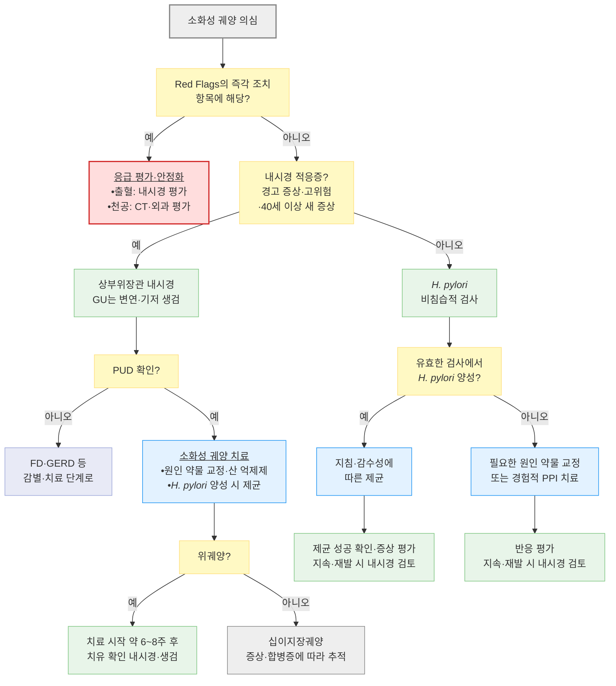
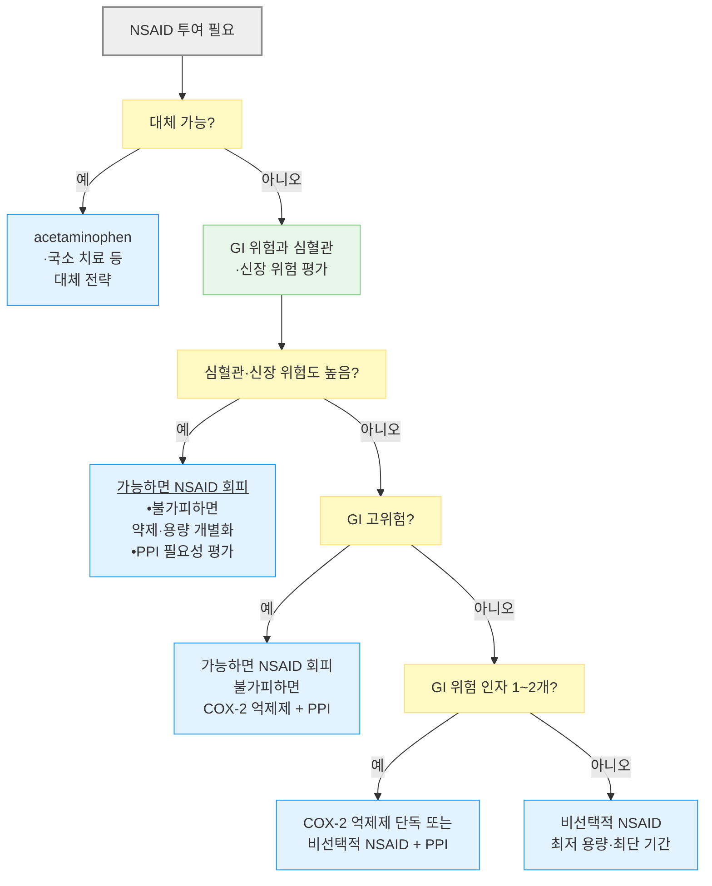

# 소화성 궤양 Peptic Ulcer Disease, PUD

## <mark style="color:green;">일반 사항</mark>

* 위 또는 십이지장 점막의 결손이 점막근층(muscularis mucosae)을 넘어 침범한 병변
  * 내시경상 통상 직경 5 ㎜ 이상인 점막 결손을 궤양으로 정의
* 위궤양 (gastric ulcer, GU) : 십이지장궤양보다 상대적으로 고령에서 흔함
* 십이지장궤양 (duodenal ulcer, DU) : 상대적으로 젊은 연령에서 흔하나 연령만으로 GU와 구분할 수 없음
  * _H. pylori_ 감염 감소와 제균 치료 보급 이후 감소 추세
* refractory peptic ulcer : 적절한 PPI 표준 용량으로 8\~12주 치료 후에도 내시경적으로 완전히 치유되지 않은 궤양; 증상 지속만으로 불응성 궤양으로 판단하지 않음
* recurrent peptic ulcer : 완전한 내시경적 치유 이후 다시 발생

#### <mark style="color:$primary;">역학</mark>

* 국내 소화성 궤양의 빈도와 원인 분포는 조사 시기·대상 및 NSAID/aspirin 사용에 따라 다름
* _H. pylori_ 관련 궤양은 감소하는 반면 고령자와 약제 연관 궤양의 임상적 중요성이 커지고 있음
* NSAID 장기 사용 시 내시경적 궤양은 흔하나 상당수는 무증상이며, 비선택적 NSAID 사용 환자의 대규모 무작위대조시험에서 증상성 궤양을 포함한 상부위장관 임상 사건의 연간 발생률은 2.7\~4.5%, 출혈·천공 등 주요 합병증은 연간 1.0\~1.5%로 보고됨. 출혈성 궤양 병력, 고령, 고용량, 항혈전제 병용 시 위험이 특히 높음 <mark style="color:$info;">\[Gut Liver 2020]</mark>
* 경과 : 적절한 위산 억제 치료와 원인 교정으로 대부분 치유됨
  * _H. pylori_ 제균 성공 시 재발과 재출혈 위험이 크게 감소함
* 주요 합병증 : 출혈(선행 증상 없이 발생 가능), 천공·관통, 위 배출구 폐쇄
  * refractory/recurrent ulcer에서는 합병증 발생 가능성을 고려해야 함

## <mark style="color:green;">원인</mark>

#### <mark style="color:$primary;">병태생리</mark>

* 공격 인자 : 위산, 펩신, 담즙, 췌장액
* 방어 인자 : mucus, bicarbonate, 점막 혈류, prostaglandin, growth factor, cell turnover
* 위궤양 : 주로 방어 기전 손상; 위산 분비는 정상이거나 감소
* 십이지장궤양 : 십이지장으로 유입되는 산 부하 증가(위산 분비가 정상인 경우도 있음)와 십이지장 중탄산염 분비 감소 등 방어 기전 저하

#### <mark style="color:$primary;">주요 원인</mark>

* _H. pylori_ 감염 : NSAID/aspirin과 함께 소화성 궤양의 주요 원인
  * 감염 동반률은 조사 시기·대상과 궤양 부위에 따라 다름
* NSAID/aspirin : _H. pylor&#x69;_&#xC640; 별개의 위험 인자로, 두 요인이 겹치면 궤양·출혈 위험이 더욱 높아짐
  * 국소(직접 점막 손상)와 전신(prostaglandin 억제) 두 가지 경로로 작용
  * 비선택적 NSAID는 COX-1 억제로 prostaglandin 합성 감소 → 점막 방어력 저하
  * 저용량 아스피린(LDA) 단독도 고령에서 의미 있는 PUD/출혈 위험 인자; 과거 궤양 병력 또는 항응고제 병용 시 위험 현저히 증가
* 특발성(idiopathic) 궤양 : _H. pylori_ 음성 + NSAID 비사용 환자에서 발생
  * 재발 및 출혈 위험이 상대적으로 높음
  * 고령, 동반 질환, occult aspirin/NSAID 사용, 미세 허혈 등 관련 가능
  * 전체 PUD 중 비율은 낮으나 임상적으로 중요하며 최근 증가 추세

#### <mark style="color:$primary;">위험 인자</mark>

* 약물
  * 궤양 유발 : NSAID, aspirin(저용량제 포함), 스테로이드(NSAID 병용 시 위험 상승), 일부 경구 bisphosphonate, KCl, 항암제
  * 출혈 위험 증가 : warfarin, DOAC, clopidogrel 등 항응고제·항혈소판제는 궤양의 직접 원인이라기보다 기존 점막 병변의 출혈 위험과 중증도를 높임
  * NSAID 관련 고위험 요소 : 과거 PUD/GI 출혈 병력, 고령(통상 ≥65세), 고용량 또는 복수 NSAID 복용, aspirin·다른 항혈소판제·스테로이드·항응고제 병용
* 흡연
* 기타 : 만성 신부전, 간경변, COPD, 크론병, 방사선 치료, gastrinoma, 림프종


과음은 점막 손상과 증상을 악화시킬 수 있으나 _H. pylori_·NSAID와 같은 주된 궤양 원인은 아님. \
일상적 심리 스트레스도 주된 원인은 아니며, 중환자의 생리적 스트레스에 의한 stress-related mucosal disease와 구분함


## <mark style="color:green;">임상 양상</mark>

* 상복부 복통/불편감/작열감, 가슴쓰림, 산 역류, 조기 포만감, 트림, 구역, 구토
* 흔히 자각 증상이 없음; 출혈이나 천공이 첫 증상으로 나타나는 경우도 있음
  * 특히 NSAID/LDA(저용량 아스피린) 복용 중 무증상 궤양이 흔함
* 증상이 있는 경우 흔히 주기적으로 발생하며 수주 단위로 악화와 완화 반복
* 혈변, 검은 변
* 일부에서 GU는 식후, DU는 공복·야간에 악화되고 음식이나 제산제로 호전되는 전형적 양상을 보일 수 있으나, 증상 양상만으로 궤양의 유무나 위치를 감별할 수 없음

### <mark style="color:$danger;">🚩 Red Flags!</mark>

<mark style="color:$danger;">**즉각 조치**</mark>

* 토혈·커피색 구토·타르 같은 흑색변, 또는 다량의 혈변  `상부위장관 출혈`
* 출혈 의심 증상과 함께 실신·저혈압·빈맥·식은땀·의식 변화  `중증 출혈` `저혈량 쇼크`
* 갑자기 발생한 심한 지속성 복통, 반발통·복부 경직  `궤양 천공` `복막염`
* 반복 구토로 수분 섭취가 불가능하거나 현저한 탈수·전신 상태 악화  `위 배출구 폐쇄`

<mark style="color:$warning;">**당일\~수일 내 평가**</mark>

* 지속·반복되는 구토, 조기 포만감과 체중 감소  `위 배출구 폐쇄` `위암`
* 원인 불명 철결핍빈혈, 진행성 연하곤란, 의도하지 않은 체중 감소, 상복부 종괴  `악성 종양` `잠재 출혈`

<mark style="color:$info;">**조기 평가 및 추적**</mark>

* 적절한 치료에도 증상이 지속·재발하거나 치료 8\~12주 후에도 궤양이 남아 있음  `불응성 궤양` `악성 종양`
* 출혈 등으로 첫 내시경에서 생검하지 못한 위궤양  `악성 궤양`
* 증상이 호전되었으나 치유 확인 내시경을 받지 않은 위궤양  `악성 궤양`

　☞ [위장 증상의 감별](074_-gidz.md#red-flags)

## <mark style="color:green;">진단</mark>

#### <mark style="color:$primary;">병력 및 신체 진찰 소견</mark>

* 상복부 압통 : 비특이적이며 고령자에서는 통증·압통이 뚜렷하지 않을 수 있음
  * 합병증이 없는 PUD 환자는 대부분 비특이적 소견
* NSAID, LDA, OTC, 영양제를 포함하여 현재 복용 중인 모든 약물 확인
* _H. pylori_ 감염·과거 제균 여부 확인

#### <mark style="color:$primary;">실험실 검사</mark>

* 현성 출혈 의심 : CBC, BUN/Cr, 전해질, 간기능, PT-INR, type & screen(필요시 crossmatch)
  * 대변 잠혈검사는 현성 출혈의 확인에 사용하지 않음
* 만성 잠재 출혈 또는 빈혈 : CBC, ferritin, Fe/TIBC, reticulocyte 등 철 결핍 평가
* 공복 혈청 gastrin : 다발성·재발성·불응성 궤양에서 gastrinoma(ZES) 의심 시 고려
  * PPI는 gastrin을 상승시키지만 ZES 의심 환자에서 임의 중단하면 심한 산 과다 합병증이 발생할 수 있음; 위내 pH 평가와 약제 조정은 소화기 전문의 감독 아래 시행

#### <mark style="color:$primary;">헬리코박터 검사</mark>

* 대상 : 새롭게 진단된 PUD, 제균 여부가 확인되지 않은 PUD 과거력, 경험적 치료 후 지속되는 PUD 의심 증상
* 급성 출혈 중 조직 기반 검사는 위음성 가능성이 있으므로 초회 음성이면 출혈 안정 후 비침습적 검사로 재검
  * 출혈·고위험 궤양의 산 억제 치료를 검사 준비 때문에 지연하거나 임의로 중단하지 않음
* 검사 방법, 검사 전 약제 중단 기간 및 제균 확인은 [헬리코박터 감염](080_-h_pylori-infection.md) 챕터 참조

#### <mark style="color:$primary;">영상/내시경 검사</mark>

* 위장관 내시경 검사 : 진단 및 조직 검사, 출혈 병변 처치, 악성 여부 감별의 표준
* 위궤양은 최초 내시경에서 가능한 경우 변연·기저를 포함한 다수 생검으로 악성을 배제. 가능하면 궤양 변연과 기저에서 6개 생검을 시행하며, 출혈·치료 필요로 생검하지 못했다면 통상적인 6\~8주 치유 확인까지 기다리지 않고 2주 이내 조기 재내시경·생검을 시행. 악성을 시사하는 소견이 없는 전형적 십이지장궤양은 생검하지 않음 <mark style="color:$info;">\[Frontline Gastroenterol 2025]</mark>
* 천공·관통·폐쇄 의심 시 복부 CT가 원인과 범위 평가에 유용함
  * 천공 의심 시 진단 목적의 내시경을 우선하지 않음
* 위장관조영술 : 내시경 불가 시 제한적 대체·보조 검사이며 악성 배제와 생검을 대신하지 못함

#### <mark style="color:$primary;">내시경 검사 대상</mark>

* Red Flags 해당
* 치료에 반응하지 않거나 재발
* 40세 이상에서 새로 발생한 상복부 증상은 내시경을 적극 고려 (☞ [내시경 적응증](074_-gidz.md#upper-gi-endoscopy))
* 국가 위암 검진의 시작 연령과 증상 환자의 진단 내시경 적응증은 구분하며, 40세 미만도 경고 증상·위암 가족력·NSAID 복용·치료 반응 등에 따라 결정
* 경고 징후 없는 40세 미만에서 test-and-treat 또는 경험적 PPI에 반응해도 PUD 확진을 의미하지 않음

#### <mark style="color:$primary;">치료 후 내시경 추적 검사</mark>


**위궤양(GU)은 치유 확인 내시경이 원칙** : 위궤양은 위암과 내시경적으로 감별이 어려울 수 있으므로 치유 확인 추적 내시경을 원칙으로 함. 잔존 궤양·불완전 치유 또는 악성 의심 소견이 있으면 재생검하며, 추적 시 궤양 반흔도 생검함. 특히 융기된 반흔은 조기 위암과의 감별이 필요함. 추적의 이득과 환자의 쇠약·동반 질환을 함께 고려하여 일정을 개별화함. <mark style="color:$info;">\[Frontline Gastroenterol 2025]</mark>


* 공통 : 적절한 치료(통상 8\~12주)에도 증상이 지속·재발하거나 출혈·폐쇄 등 합병증이 의심되면 GU·DU 모두 재내시경으로 불응성 궤양·악성·합병증을 평가
* GU : 진단·치료 시작 후 약 6\~8주(치료 종료 무렵)에 치유 확인 + 악성 배제
  * 위암 병력, giant gastric ulcer (＞3 ㎝), 악성 의심 소견, 위암 위험 인자가 있으면 반드시 시행
  * 첫 내시경에서 생검을 하지 않았거나 불충분한 경우(출혈 응급 상황에서 시행한 경우 포함) : 치유 확인 시점까지 기다리지 않고 약 2주 이내 조기 재검·생검
* DU : 악성 가능성이 희박하므로 증상이 호전되면 일상적 추적은 생략 가능; 합병증(출혈·천공·폐쇄)이 있었거나 위험 인자가 지속되면 추적 고려
* _H. pylori_ 관련 PUD : 내시경 추적은 궤양 부위에 따라 위 GU·DU 원칙을 적용하고, 제균 성공 여부는 제균 치료 종료 최소 4주 후 UBT 또는 대변 항원검사로 별도 확인

### <mark style="color:orange;">감별</mark>

* 상복부 증상은 PUD뿐 아니라 기능성 소화불량(FD), 위식도역류질환(GERD), 위암이 유사하게 나타날 수 있으며, overlap 형태로 동반되는 경우도 흔함

<table><thead><tr><th width="155">특징</th><th width="195">PUD</th><th width="185">기능성 소화불량 (FD)</th><th>위식도역류질환 (GERD)</th></tr></thead><tbody><tr><td><strong>통증 양상</strong></td><td>국소적 epigastric pain; 간헐적·주기적</td><td>상복부 통증·작열감 또는 식후 포만감·조기 포만감</td><td>흉골 하부 작열감(heartburn); 산 역류</td></tr><tr><td><strong>식사 연관</strong></td><td>GU 식후, DU 공복·야간 악화가 가능하나 감별력은 낮음</td><td>식후 포만감·조기 포만감이 특징적일 수 있으나, 상복부 통증·작열감은 식사와 무관하게도 발생</td><td>누운 자세, 야식, 과식 후 악화</td></tr><tr><td><strong>야간 통증</strong></td><td>DU에서 가능</td><td>가능</td><td>가능 (야간 역류)</td></tr><tr><td><strong>제산제 반응</strong></td><td>가변적</td><td>가변적</td><td>일시적 개선</td></tr><tr><td><strong>출혈 위험</strong></td><td>있음</td><td>없음</td><td>드묾 (식도염 동반 시)</td></tr><tr><td><strong>내시경 소견</strong></td><td>점막 결손(궤양)</td><td>정상 또는 비특이적</td><td>역류성 식도염 또는 정상(NERD)</td></tr></tbody></table>


증상 양상과 제산제 반응만으로 PUD를 확진하거나 GU와 DU를 구분할 수 없음. PUD 확진과 위암 감별의 표준은 상부위장관 내시경임.


***



> _NSAID·aspirin·항혈전제 복용력은 모든 경로에서 평가함. 제균한 환자는 경로와 관계없이 치료 종료 최소 4주 후, PPI/P-CAB을 2주 중단한 상태에서 UBT 또는 대변 항원검사로 성공 여부를 확인함._

<p align="center"><strong>소화성 궤양 진단 및 치료 알고리듬</strong><br><em><mark style="color:$info;">저자 재구성 (참고 문헌 : Endoscopy 2026; Korean J Gastroenterol 2026;</mark></em><br><em><mark style="color:$info;">Frontline Gastroenterol 2025)</mark></em></p>

***

## <mark style="background-color:$warning;">Management</mark>

### <mark style="color:orange;">치료 방침</mark>


**치료 원칙**

1. 원인 약물 교정 및 위험 인자 관리 (NSAID 중단, 금연, 과음 회피)
2. _H. pylori_ 제균
3. 위산 분비 억제로 점막 치유
4. 합병증 예방


* 활동성 궤양에서는 NSAID 중단을 우선하며 celecoxib는 활동성 소화성 궤양·위장관 출혈 환자에게 금기
  * 궤양 치유 후 재투여가 불가피하면 GI·심혈관·신장 위험과 약제 금기를 평가하여 최저 유효 용량·최단 기간 및 PPI 등 예방 전략을 선택
* aspirin·항혈소판제·항응고제는 적응증과 혈전 위험을 확인한 뒤 조정하며 임의로 중단하지 않음
* _H. pylori_ 양성 시 제균 치료
* 약물 치료 : PPI가 표준 1차 선택이며, PUD 적응증이 허가된 P-CAB은 성분별 허가 범위에서 선택 가능
  * 제산제와 점막 보호제는 증상 완화 또는 보조 치료
* 치료 기간 : GU는 통상 4\~8주(tegoprazan 허가 용법은 8주), DU는 약제에 따라 통상 2\~4주부터 평가하며 큰 궤양·합병성·치유 지연 시 연장
  * 원인·크기·치유 여부와 성분별 허가 용법에 따라 결정하며, 제균 후 추가 산 억제 기간도 개별화


**출혈성 PUD 의심 시 즉각 조치**

1. 기도·호흡·순환 및 활력 징후 확인·모니터링; 의식 저하·지속적 대량 토혈 등으로 기도 보호가 어려우면 선택적으로 기관삽관을 평가하며 일률적으로 시행하지 않음
2. CBC / BUN / Cr / PT-INR / type & screen
3. 항혈전제·항응고제 복용 여부 확인
4. NPO + 정맥로 2개 확보
5. 혈역학적 불안정 시 결정질 수액으로 신속히 소생. Glasgow-Blatchford score로 위험도를 평가하며, 0\~1점이고 신속한 외래 내시경과 재내원이 가능하면 외래 관리 고려. 초기 Hb가 정상이어도 급성 대량 출혈을 배제하지 못함
6. 수혈 : 혈역학적으로 안정되고 심혈관질환이 없는 환자는 Hb ＜7 g/dL에서 적혈구 수혈을 고려(수혈 후 목표 Hb 7\~9 g/dL). 심혈관질환 동반 환자는 Hb ≤8 g/dL 등 더 높은 기준을 적용하고 임상 상태에 따라 결정. 지속 대량 출혈·쇼크에서는 Hb 수치만으로 수혈을 지연하지 않음
7. 소생 후 내원 24시간 이내 상부위장관 내시경 및 필요시 내시경 지혈. 적절한 소생에도 혈역학적으로 불안정한 경우가 아니면 12시간 이내의 응급·긴급 내시경을 일상적으로 권하지 않음


## <mark style="color:green;">비-약물 치료 및 예방</mark> <a href="#non-drug-treatment" id="non-drug-treatment"></a>

* 금연 : 흡연은 위점막 혈류 감소와 prostaglandin 합성 억제로 치유를 지연시키고 재발 위험을 높이므로 금연함
* 절주 : 과음은 위점막을 손상시키고 증상을 악화시킬 수 있으므로 피함
* 식이 : 특별한 맞춤 식사는 필요하지 않음
  * 자극적 음식·커피·탄산음료 등은 개인별로 증상을 유발하면 줄이되 궤양의 직접적 원인은 아님
* 스트레스 관리 : 일상적 심리 스트레스는 PUD의 주된 원인이 아니며 스트레스 관리가 궤양 치유를 앞당긴다는 근거는 없지만, 증상을 악화시키고 흡연·음주·진통제 사용 등에 영향을 줄 수 있어 일반적인 생활 관리로 권함
* NSAID/aspirin 관리 : 가능한 한 최소 기간·최소 용량 사용; 불필요한 병용 회피
  * NSAID 식사 후 복용은 위 불편감(dyspepsia) 감소에 도움이 될 수 있으나 궤양 예방 효과는 없음. 고위험군은 PPI 등 근거와 허가가 확인된 예방 약제를 병용
  * 무증상 NSAID 복용자도 고위험 인자 있는 경우 예방적 약제 병용 필요 (☞ 아래 NSAID 연관 PUD 예방)

## <mark style="color:green;">약물 치료</mark> <a href="#drug-treatment" id="drug-treatment"></a>

#### <mark style="color:$primary;">Proton Pump Inhibitor (</mark>[<mark style="color:$primary;">PPI</mark>](073_-gidrugs.md#ppi)<mark style="color:$primary;">)</mark>

* PUD 치료의 표준 1차 위산 억제제
* 제균 성공·NSAID 중단 여부와 합병증에 따라 추가 투여 및 유지 치료를 결정
* 용법 : 대부분의 일반형은 아침 식전 30\~60분 복용; bid는 아침·저녁 식전
  * 식사 무관 제형의 GERD 적응증을 PUD에 자동 적용하지 않음
* 부작용 : 두통, 복통, 설사/변비
  * 장기 투여 시 일부 환자에서 저마그네슘혈증, Vit B12·철 결핍, 장관 감염 위험 등을 고려하되 폐렴·골절·신장질환 등 다수의 연관성은 주로 관찰연구에서 보고되어 인과성이 확립되지 않음. 다만 급성 세뇨관간질성 신염은 드물지만 인정되는 약물이상반응으로, 의심 시 중단·평가

<table><thead><tr><th width="220">약물</th><th>통상 용량</th></tr></thead><tbody><tr><td><strong>omeprazole</strong> <mark style="color:blue;">[오엠피]</mark></td><td>20 ㎎ qd</td></tr><tr><td><strong>esomeprazole</strong> <mark style="color:blue;">[넥시움]</mark></td><td>NSAID 관련 GU 치료·예방: 20 ㎎ qd</td></tr><tr><td><strong>lansoprazole</strong> <mark style="color:blue;">[란스톤]</mark></td><td>GU 30 ㎎ qd ×8주; DU 15 ㎎ qd ×4주</td></tr><tr><td><strong>pantoprazole</strong> <mark style="color:blue;">[판토록]</mark></td><td>40 ㎎ qd</td></tr><tr><td><strong>rabeprazole</strong> <mark style="color:blue;">[파리에트]</mark></td><td>10~20 ㎎ qd</td></tr><tr><td><strong>ilaprazole</strong> <mark style="color:blue;">[놀텍]</mark></td><td>10 ㎎ qd</td></tr></tbody></table>

* 일반형 esomeprazole은 NSAID 관련 GU 치료·궤양 예방, _H. pylori_ 제균 병용, 정주 지혈 치료 후 재출혈 예방 유지 등 해당 허가 범위로 구분
* lansoprazole의 활동성 DU 단기치료 허가 용법은 15 ㎎ qd ×4주이며, 장용 일반형과 복합·서방 제형을 자동 대체하지 않음
* dexlansoprazole은 PUD 치료 적응증이 없음

<mark style="color:cyan;">**PPI 치료 실패의 흔한 원인**</mark>

* 복약 타이밍 오류 - 대부분의 PPI는 식사 전 복용 시 산 억제 효과가 가장 좋음
* 복약 순응도 불량 (증상 호전 시 임의 중단)
* NSAID/aspirin 지속 복용
* _H. pylori_ 미제균 또는 재감염
* 야간 산 분비 돌파는 산 억제 상태를 평가할 때 참고하되 이것만으로 내시경적 궤양 불유합을 설명하지 않음
* CYP2C19 빠른 대사형(rapid/ultrarapid metabolizer) - 일부 PPI는 CYP2C19에 의해 빠르게 대사되어 산 억제 효과가 낮아질 수 있음; 원인 재평가 후 PUD 적응증이 있는 약제로 변경 또는 용량 증가 고려; 허가 용량 초과 시 허가 외 사용임을 구분
* 궤양이 치유되었는데 증상만 지속되면 FD·GERD 등 동반 질환을 재평가; FD overlap은 내시경적 궤양 불유합의 직접 원인과 구분


**PPI ↔ Clopidogrel 상호작용** : clopidogrel 복용 환자에서 omeprazole·esomeprazole은 CYP2C19 억제로 clopidogrel 활성화를 저하시킬 우려가 있어 가능하면 피하고, pantoprazole <mark style="color:blue;">\[판토록]</mark> 등 상호작용 가능성이 상대적으로 낮은 PPI를 우선 고려함. P-CAB도 성분별 대사·상호작용 특성이 다르므로 계열 전체를 안전한 대안으로 간주하지 말고 개별 허가사항과 상호작용 자료를 확인함


#### <mark style="color:$primary;">Potassium-Competitive Acid Blocker (</mark>[<mark style="color:$primary;">P-CAB</mark>](073_-gidrugs.md#potassium-competitive-acid-blocker-p-cab)<mark style="color:$primary;">)</mark>

* PPI와 달리 산성 환경 활성화가 필요 없이 양성자 펌프를 직접·가역적으로 억제 → 빠른 산 분비 억제 개시, 대체로 식사와 무관 복용 가능
* 일부 성분에서 우수한 야간 산 억제가 확인되었으나 증상·궤양 치유 효과의 계열 전체 우월성을 뜻하지 않음
* CYP2C19 유전적 다형성이 산 억제 효과에 미치는 영향이 상대적으로 적음. 다만 clopidogrel과의 상호작용은 P-CAB 성분별로 다르므로 개별 확인
* 허가된 적응증에서는 PUD 치유 또는 예방 효과가 PPI와 유사한 자료가 있으나 제품별 적응증이 다르고 장기·계열별 안전성 자료는 PPI보다 제한적

<table><thead><tr><th width="199.33331298828125">약물</th><th>허가 용량 및 PUD 관련 적응증</th></tr></thead><tbody><tr><td><strong>tegoprazan</strong> <mark style="color:blue;">[케이캡]</mark></td><td>50 ㎎ qd ×8주: 위궤양; <em>H. pylori</em> 제균 병용 시 50 ㎎ bid ×7일; 25 ㎎ qd: NSAID 관련 위·십이지장궤양 예방; 식사 무관</td></tr><tr><td><strong>zastaprazan</strong> <mark style="color:blue;">[자큐보]</mark></td><td>20 ㎎ qd, 최대 8주: 위궤양; 식사 무관. 위궤양 치료 급여는 2026.7.1부터 적용</td></tr><tr><td><strong>vonoprazan</strong> <mark style="color:blue;">[보신티]</mark></td><td>위궤양 20 ㎎ qd(통상 최대 8주); NSAID 투여 시 위·십이지장궤양 재발 방지 10 ㎎ qd(궤양 병력 확인). 2026.11.1부터 급여기준 신설(고시 제2026-222호); 실제 공급 여부는 별도 확인</td></tr><tr><td><strong>fexuprazan</strong> <mark style="color:blue;">[펙수클루]</mark></td><td>20 ㎎ qd ×24주: NSAID 유도성 위·십이지장궤양 예방(비교임상시험은 24주를 초과하지 않음); 2025년 12월부터 보험 급여 적용. 40 ㎎은 미란성 GERD 치료 및 <em>H. pylori</em> 제균 병용(40 ㎎ + amoxicillin 1 g + clarithromycin 500 ㎎, 각각 bid ×14일) 용량이며, 40 ㎎ 급여는 미란성 GERD 기준으로 제균 병용과 구분. 활동성 PUD 단독 치료 적응증은 아님; 식사 무관</td></tr><tr><td><strong>revaprazan</strong> <mark style="color:blue;">[레바넥스]</mark></td><td>200 ㎎ qd: 위궤양·십이지장궤양의 단기치료; 급·만성 위염의 위점막 병변 개선에도 허가</td></tr></tbody></table>

* tegoprazan은 GU 치료 및 _H. pylori_ 제균 병용요법이 허가됨. 활동성 DU 단독 치료는 허가 외 사용이며, 제균 적응증이나 NSAID 관련 DU 예방 허가를 DU 단독 치료 허가로 해석하지 않음
* vonoprazan은 국내 허가상 _H. pylori_ 제균 적응증이 없으므로 해외 제균요법을 국내 허가요법으로 적용하지 않음. Clopidogrel의 항혈소판 효과를 감소시킬 수 있어 성분별 상호작용을 확인

#### <mark style="color:$primary;">H2 Receptor Antagonist (</mark>[<mark style="color:$primary;">H2RA</mark>](073_-gidrugs.md#h2-h2-receptor-antagonist-h2ra)<mark style="color:$primary;">)</mark>

* 초기 산 억제 작용은 비교적 빠르나 지속적 산 억제와 궤양 치유에서는 PPI보다 효과가 낮음
* 반복 복용 시 수일\~2주 내 산 억제 내성(tachyphylaxis)이 생길 수 있음
* 치료 기간은 약제와 궤양 부위·크기·치유 상태에 따라 결정
* 적용 시기 : PPI 투여가 곤란한 경우 또는 증상 경감 보조 목적. PPI 반응 부족 시에는 우선 복약 순응도·원인 지속·악성 가능성을 재평가
* H2RA는 신기능 저하 시 성분별 감량·투여 간격 조정이 필요하며 고령자·신부전에서는 혼돈 등 중추신경계 이상반응에 유의

<table><thead><tr><th width="222">약물</th><th>용량</th></tr></thead><tbody><tr><td><strong>cimetidine</strong> <mark style="color:blue;">[에취투비]</mark></td><td>400 ㎎ bid 또는 800 ㎎ hs</td></tr><tr><td><strong>famotidine</strong> <mark style="color:blue;">[가스터]</mark></td><td>20 ㎎ bid 또는 40 ㎎ hs</td></tr></tbody></table>

* cimetidine은 warfarin·phenytoin 등과 상호작용이 많아 병용 약제를 확인

#### <mark style="color:$primary;">제산제 및 점막 보호제</mark>

[**제산제**](073_-gidrugs.md#antacid)

* 단독으로는 치료 효과 부족; 증상 완화 또는 PPI 치료 초기 병용 목적
* Al/Mg 함유 제제는 CKD에서 축적에 유의하며, MgO·Mg(OH)₂ 제제는 신장애 금기
* quinolone·철분제 등과의 간격은 병용약별로 확인. 알마겔(almagate)은 lansoprazole·quinolone·철분제 등과 2\~3시간 간격을 두며, tetracycline계 항생제와는 병용하지 않음

[**점막 보호제**](073_-gidrugs.md#gastric-mucosal-protective-agent)

* sucralfate : 점막 보호 효과가 있으나 NSAID 관련 PUD 예방 효과는 입증 불충분하며, 현재 유통 제품이 확인되지 않음. Al 함유로 중증 신장애에서 회피하고 CKD에서 장기 사용 주의; 다른 경구약과의 간격은 약제별로 확인
* teprenone <mark style="color:blue;">\[셀벡스]</mark>, rebamipide <mark style="color:blue;">\[무코스타]</mark> : 점막 방어 인자 강화; 필요시 보조적으로 고려. 합병증 없는 PUD에서 산 억제제에 일률적으로 추가할 필요는 없으며 제균·적절한 산 억제를 대체하지 않음

#### <mark style="color:$primary;">임신 중 약물 선택</mark>

* 임신 중 PUD의 산 억제 치료가 필요하면 famotidine 또는 omeprazole을 임상 상황과 치료상 이득·위험을 평가하여 고려함. 생활 요법과 적절한 제산제는 증상 완화의 보조 수단이며, 확진된 활동성 궤양의 치유 치료를 대신하지 않음
* _H. pylori_ 제균은 일반적으로 출산·수유 이후로 미룸

### <mark style="color:orange;">NSAID 연관 PUD 예방</mark>

* 원칙 : NSAID 필요성을 재평가하고 acetaminophen 등 대체제를 우선 고려
* 심혈관 위험이 높으면 NSAID를 가능한 한 피함. 불가피한 경우 약제 선택과 용량은 심혈관·신장 위험 및 aspirin 병용 여부를 함께 고려하고 PPI 필요성을 평가
* GI 위험과 심혈관 위험이 모두 매우 높으면 NSAID 회피가 원칙
* COX-2 억제제 선택 전 금기를 확인 : celecoxib는 허혈성 심질환·말초동맥질환·뇌혈관질환 및 NYHA II\~IV 심부전에서 금기
  * NSAID별로 궤양·출혈 병력 자체가 금기인 제품도 있으므로 PPI 병용만으로 해당 금기가 해제되지 않음
* 장기 NSAID 시작 전 _H. pylori_ 검사 및 양성 시 제균을 시행
  * 고위험군에서 제균 성공은 PPI 등 예방 약제를 대체하지 않음
* P-CAB은 제품별 PUD 예방 적응증이 다르므로 허가된 성분·용량에 한해 선택
* NSAID 필수 투여 시 : 위험도에 따라 예방 전략 선택

<table><thead><tr><th width="118.88885498046875">GI 위험도</th><th width="294.4444580078125">주요 위험 요소</th><th>심혈관 위험이 낮을 때의 권장 전략</th></tr></thead><tbody><tr><td><strong>저위험</strong></td><td>위험 인자 없음 (＜65세, 과거 궤양 없음)</td><td>비선택적 NSAID를 최저 유효 용량·최단 기간 사용</td></tr><tr><td><strong>중등 위험</strong></td><td>위험 인자 1~2개</td><td>COX-2 억제제 단독 또는 비선택적 NSAID + PPI</td></tr><tr><td><strong>고위험</strong></td><td>과거 궤양 합병증·GI 출혈 또는 위험 인자 다수</td><td>가능하면 NSAID 회피; 불가피하면 COX-2 억제제 + PPI</td></tr></tbody></table>

> _활동성 궤양·출혈이 없는 예방 상황에 적용하며, 활동성 궤양에서 COX-2 전환만으로 지속 복용하는 지침이 아님_


**Aspirin 병용 시 COX-2 억제제의 GI 보호 이점은 감소함.** Aspirin + NSAID 병용 환자는 출혈 고위험군으로 평가하고, NSAID 필요성을 재검토하며 사용 시 PPI를 병용함.

**DOAC(rivaroxaban, dabigatran 등) 복용 중 NSAID 병용**은 상부위장관 출혈 위험을 유의미하게 증가시킴 - 불가피한 경우 PPI 예방 병용 및 면밀한 모니터링.


***



> _장기 사용 전에는 H. pylori 검사 후 양성이면 제균하고, 사용 중에는 적응증과 위험을 정기적으로 재평가함_

<p align="center"><strong>NSAID 관련 소화성 궤양 예방 전략</strong><br><em><mark style="color:$info;">저자 재구성 (참고 문헌 : Gut Liver 2020; Am J Gastroenterol 2009)</mark></em></p>

***

**예방 약제**

* PPI (선호) : 예방 적응증의 허가 용량을 사용. 저용량·유지용량도 예방에 효과적이며 임상 필요에 따라 표준 용량 선택 <mark style="color:$info;">\[Gut Liver 2020]</mark>
* H2RA : PPI 사용이 어려울 때 선택적으로 고려. PPI보다 예방 효과가 작고 반복 복용 시 산 억제 내성이 생길 수 있음. 고용량 요법의 근거 및 신기능별 감량을 고려
* tegoprazan 25 ㎎ qd : NSAID 관련 위·십이지장궤양 예방 허가. 임상시험은 24주까지이며 허가 용법에 고정 투여 기간은 없음. 확인한 2026년 10월 HIRA 급여기준에는 이 예방 적응증이 포함되지 않음 <mark style="color:$info;">\[품목 허가사항; HIRA 2026.10]</mark>
* vonoprazan 10 ㎎ qd : NSAID 지속 투여 시 위·십이지장궤양 재발 방지; 투여 전 궤양 병력을 확인. 2026.11.1부터 급여기준 신설(고시 제2026-222호); 실제 공급 여부 별도 확인
* fexuprazan 20 ㎎ qd : NSAID 유도성 PUD 예방; 허가 용법은 24주이며 그 이상은 비교임상시험 범위를 넘음
* misoprostol (합성 prostaglandin E1 analog) : 예방 허가 용량 400\~800 ㎍/d를 식사 시·취침 시 분할(예: 200 ㎍ qid) <mark style="color:blue;">\[싸이토텍]</mark>; 설사·복통으로 순응도 낮음. Mg 함유 제산제 병용 회피
  * 금기 : 임부 또는 임신 가능성이 있는 여성 - 자궁 수축·유산 위험. 가임 여성은 투여 전 임신검사 음성과 효과적인 피임 등 허가 조건을 확인

### <mark style="color:orange;">헬리코박터 제균</mark>

* 대상 : PUD가 있는 _H. pylori_ 양성 환자 - 제균은 재발 방지의 핵심
* 1차 : 감수성 검사 기반 맞춤 치료(감수성균 7일 3제, 내성균 10일 bismuth 4제); 검사 불가 시 10일 동시 4제요법 <mark style="color:$info;">\[Korean J Gastroenterol 2026]</mark>
* P-CAB 기반 제균의 허가 기간은 성분별로 다름(tegoprazan 7일, fexuprazan 14일)
* 제균 확인 : 치료 종료 최소 4주 후 UBT 또는 대변 항원검사
* 요법별 용량, bismuth 제제, 구제요법 및 지침과 품목허가사항의 차이는 [헬리코박터 감염](080_-h_pylori-infection.md) 챕터 참조

### <mark style="color:orange;">불응 및 궤양 재발</mark>

* NSAID/LDA 등 약물 복용 지속 여부 및 금연 여부 재확인
* 다른 원인 배제 : gastrinoma(ZES), 악성 종양, 크론병
* _H. pylori_ 재검사&#x20;
  * 양성 시 제균 치료 및 확인
  * 음성 시 위음성 가능성 고려 (PPI 복용 중 UBT 위음성 증가)
* 추가 치료 : 원인과 복약 순응도를 재평가하고 GU는 재생검으로 악성을 배제
  * 필요시 PPI를 bid로 증량하여 6\~8주 추가 치료(일반 PUD 허가 용량을 초과할 수 있음)
* 특발성 궤양은 NSAID/aspirin 은폐 복용과 _H. pylori_ 위음성을 충분히 배제한 뒤 진단
  * 반복 출혈·재발 또는 원인 제거 불가 환자는 최소 유효 용량의 장기 산 억제를 고려하고 정기적으로 적응증을 재평가
* _H. pylori_ 제균 성공 및 치유가 확인되고 NSAID/항혈전제 등 지속 위험 인자가 없는 단순 궤양은 일률적인 평생 유지 치료가 필요하지 않음

**Refractory ulcer 감별 체크 리스트**

* NSAID/aspirin 지속 복용 여부 (occult 사용 포함 재확인)
* 복약 순응도 문제 (PPI 타이밍 오류 포함)
* _H. pylori_ 위음성 가능성 (재검 또는 검사 방법 변경)
* 흡연 지속
* 큰 궤양 또는 복합 궤양; giant ulcer의 전통적 정의는 GU ＞3 ㎝, DU ＞2 ㎝
* gastric malignancy (GU는 반드시 조직 검사 확인)
* Zollinger-Ellison syndrome (gastrinoma)
* Crohn disease
* CMV ulcer (면역 저하 환자에서 고려)
* 기타 약제 (bisphosphonate, KCl, chemotherapy)

## <mark style="color:green;">시술 및 기타 처치</mark>

* 출혈 : 소생 후 내원 24시간 이내 내시경 평가 및 적응증에 따른 지혈이 표준. 깨끗한 궤양저 등 저위험 병변은 내시경 지혈이 필요하지 않음  <mark style="color:$info;">\[Endoscopy 2026]</mark>
  * 지혈 성공 후 재출혈 : 재내시경·재지혈을 우선하며, 실패하면 경카테터 동맥색전술(TAE)을 고려. TAE 시행 불가 또는 실패 시 수술
  * 초기 내시경에서 표준·구제 지혈에도 출혈이 지속되면 TAE를 고려. TAE 시행 불가 또는 실패 시 수술
* 고위험 출혈성 궤양의 지혈 후 산 억제 : 초기 72시간 고용량 PPI 치료(예: 80 ㎎ 정주 후 8 ㎎/시간 지속주입 또는 근거 있는 고용량 간헐 정주·경구 요법). 이후 최초 내시경일부터 2주까지 경구 PPI bid를 유지한 뒤 치유·원인에 따라 조정. 내시경 치료를 하지 않은 부착 혈괴(Forrest IIb)도 초기 고용량 PPI 치료 대상  <mark style="color:$info;">\[Endoscopy 2026; Am J Gastroenterol 2021]</mark>
* 천공 : 수술적 치료가 원칙이며 외과 평가가 필요  <mark style="color:$info;">\[World J Emerg Surg 2020]</mark>
* 위 배출구 폐쇄 : 악성 여부 평가 후 산 억제·제균·NSAID 교정을 우선하고, 양성 협착이 지속되면 내시경 풍선확장술 또는 수술
* 합병증 치료 후 외래 관리 : 퇴원 시 정해진 산 억제제 용법과 aspirin·항혈전제 재개 시점 확인, _H. pylori_ 재검·제균 확인, 빈혈 시 철분 보충, 위궤양은 치유 확인 내시경 일정 확인  <mark style="color:$info;">\[Endoscopy 2026; Am J Gastroenterol 2021, 2022]</mark>

***

## <mark style="color:red;">질병코드</mark>

* K25 위궤양 Gastric ulcer
* K26 십이지장궤양 Duodenal ulcer
* K27 상세불명 부위의 소화성 궤양 Peptic ulcer, site unspecified
* K28 위공장궤양 Gastrojejunal ulcer

> 출혈·천공 동반 여부와 급성·만성 여부에 맞는 세부 코드를 선택하고, 부위가 확인되면 K25 또는 K26을 우선 사용. K28은 위공장 문합부궤양에 적용

***

## <mark style="color:purple;">처방례</mark>

> **처방례 1. 십이지장궤양 (경증,&#x20;**_**H. pylori**_**&#x20;음성 또는 제균 완료 후)**
>
> ```
> 란스톤캡슐 15 ㎎/C    1C  qd  (아침 식전 1시간)             ×28일
> 알마겔현탁액 15 ㎖/P   1P  식후 1시간 필요시 (최대 tid + 취침 시 1회)
> ```
>
> _✽lansoprazole 15 ㎎ qd 4주 투여 후 반응 평가; 제산제는 증상이 있을 때만 단기 보조 사용. 알마겔은 란소프라졸 및 흡수에 영향을 받는 다른 경구약과 2\~3시간 간격을 두고 복용하며 신기능을 고려. 본 처방례의 란소프라졸 식전 1시간·알마겔 식후 1시간 일정은 두 약의 2시간 간격을 확보하기 위한 예시임. Tetracycline계 항생제를 포함한 제균요법 중에는 알마겔을 병용하지 않음. H. pylori 양성이면 2025년 국내 개정 지침(2026년 발표)과 감수성·항생제 노출력에 따라 선택한 제균요법 병행._

> **처방례 2. 위궤양 (표준 치료)**
>
> ```
> 판토록정 40 ㎎/T     1T  qd  (아침 식전 30~60분)          ×28일
> ```
>
> _✽pantoprazole 40 ㎎ qd 4주 투여 후 재평가하고 필요하면 4주 연장. 통상 진단·치료 시작 후 약 6\~8주(치료 종료 무렵)에 추적 내시경으로 치유와 악성 가능성을 확인. H. pylori 검사 필수._

> **처방례 3. 위궤양 (허가된 P-CAB 선택)**
>
> ```
> 케이캡정 50 ㎎/T     1T  qd  (식사 무관)           ×56일
> ```
>
> _✽tegoprazan 50 ㎎ qd 8주는 위궤양 허가 용법; 식전 복용이 어려운 환자 등에서 고려. PPI 반응이 불충분하면 변경 전에 복약 순응도·NSAID 지속·H. pylori·악성 가능성을 재평가. Clopidogrel 병용 시에는 P-CAB을 계열 전체의 안전한 대안으로 간주하지 말고 성분별 상호작용 확인. 추적 내시경 필요._

> **처방례 4. 궤양 치유 후 NSAID 재투여가 불가피한 고위험 환자 - 재발 예방**
>
> ```
> 쎄레브렉스캡슐 100 ㎎/C   1C  bid  (식사 무관)       ×28일
> 넥시움정 20 ㎎/T        1T  qd   (아침 식전 30~60분)       ×28일
> ```
>
> _✽활동성 궤양·출혈이 없고 치유가 확인된 후의 예방 처방. Celecoxib는 활동성 소화성 궤양·위장관 출혈 환자에게 금기이며 PPI 병용으로 이 금기가 해제되지 않음. 허혈성 심질환·말초동맥질환·뇌혈관질환·NYHA II\~IV 심부전 등 celecoxib 금기를 배제하고 신기능을 평가한 뒤 반드시 필요한 경우에만 최저 유효 용량·최단 기간 사용함. Aspirin·DOAC 병용 시 NSAID 회피를 우선 재검토하며 PPI를 병용해도 출혈 위험이 없어지는 것은 아님._

> **처방례 5. 지속적인 NSAID 투여가 필요한 소화성궤양 고위험 환자의 예방 (허가된 P-CAB 병용)**
>
> ```
> 낙센정 250 ㎎/T          1T  bid  pc               ×28일
> 펙수클루정 20 ㎎/T       1T  qd   (식사 무관)      ×28일
> ```
>
> _✽활동성 궤양·출혈이 없고, 지속적인 NSAID 투여가 필요하며 궤양·출혈 병력, 고령, 위험 약물 병용 등 소화성궤양 고위험 인자가 있는 환자의 예시임. 선택한 naproxen 제품의 금기에 해당하지 않아야 함. 과거 궤양·출혈 병력 관련 금기도 제품별로 확인하며, 매우 높은 GI 위험에서는 NSAID 회피 또는 적합한 COX-2 억제제+PPI 전략을 우선 검토. Fexuprazan 20 ㎎ qd는 NSAID 유도성 위·십이지장궤양 예방 용법이며 활동성 궤양 치료 처방과 구분함. 허가 용법에 24주가 명시되어 있으나 NSAID 투여가 끝난 뒤까지 예방약을 일률적으로 지속할 필요는 없음. 예시는 4주 처방 후 NSAID 지속 필요성과 위험을 재평가하는 일정임. NSAID는 적응증에 맞는 최저 유효 용량·최단 기간으로 사용하며, 심혈관·신장 위험과 aspirin·항응고제 병용 여부를 먼저 평가._

> **처방례 6. Clarithromycin 감수성 확인 환자 - Tegoprazan 기반 3제 (허가 용법)**
>
> ```
> 케이캡정 50 ㎎/T             1T  bid  (식사 무관)       7일
> 아목시실린 500 ㎎/C         2C  bid  (식후)            7일
> 클래리시드정 250 ㎎/T        2T  bid  (식후)            7일
> ```
>
> _✽Tegoprazan 50 ㎎ bid 기반 3제 요법의 허가 기간은 7일이며, 2025년 국내 개정 지침도 clarithromycin 감수성 균주에 7일 3제를 권고함. 국내 연구에서는 14일 요법의 제균율이 더 높았으나 현 허가 용법과 구분해야 함. 본 예시는 clarithromycin 감수성이 확인된 환자에 적용함. Penicillin·macrolide 알레르기, 신기능에 따른 항생제 감량, QT 연장 및 CYP3A4 관련 병용금기·주의를 확인. 감수성 미확인 환자에게 경험적 1차 선택으로 일률 적용하지 않으며 2025년 국내 개정 지침의 동시 4제 등 다른 권고 요법을 검토함. 제균 후 산 억제제는 GU·합병성 궤양 등에서 총 치유 기간을 충족하도록 투여하고, 제균 종료 최소 4주 후 성공 여부를 확인._

***

### <mark style="color:$success;">핵심 복약 지도</mark>

> **PPI/P-CAB (위산 분비 억제제)는 어떻게 복용해야 하나요?**
>
> * 대부분의 PPI (예: 넥시움, 란스톤, 판토록)는 **아침 식사 30\~60분 전**에 복용하면 효과가 가장 좋습니다. 하루 2회 처방된 경우에는 아침·저녁 식사 전에 복용합니다.
> * P-CAB (예: 케이캡, 펙수클루)는 식사와 무관하게 복용할 수 있습니다.
> * 알마겔현탁액을 함께 처방받았다면 란소프라졸 및 흡수에 영향을 받는 다른 약과 2\~3시간 간격을 두십시오. 테트라사이클린계 항생제를 포함한 제균 치료 중에는 알마겔을 함께 복용하지 마십시오.
> * **의사가 정한 치료 기간을 지키십시오.** 위궤양은 통상 4\~8주, 십이지장궤양은 약에 따라 2\~4주부터 평가하지만 궤양의 크기·원인·합병증에 따라 더 오래 필요할 수 있습니다. 증상만으로 중단 시점을 정하지 마십시오.
> * 특히 장기간 복용 후 중단하면 일시적인 속쓰림이 생길 수 있습니다. 정해진 궤양 치료를 마친 뒤의 감량·중단은 의사의 계획에 따르십시오.

> **헬리코박터 제균 치료 시 주의사항**
>
> * 제균약(항생제 + 위산 억제제 조합)은 처방된 기간(요법에 따라 7\~14일) 동안 규칙적으로 복용해야 합니다. 임의로 중단하면 치료에 실패하고 다음 치료가 어려워질 수 있습니다.
> * 메트로니다졸이 포함되어 있으면 **복용 중 및 마지막 복용 후 3일간 금주**하십시오. 함께 마시면 복통·구역·구토·홍조 등이 나타날 수 있습니다.
> * 복용 중 설사, 복통, 발진 등이 심하면 즉시 연락하세요.
> * 비스무트 약은 변·혀를 검게 만들 수 있습니다. 그래도 타르처럼 끈적한 검은 변, 토혈, 어지럼·식은땀이 있으면 약 때문이라고 단정하지 말고 즉시 진료를 받으십시오.
> * 항생제·비스무트 종료 후 최소 4주가 지나 제균 확인검사를 받습니다. 검사 전 PPI/P-CAB은 최소 2주 중단해야 하므로 의사와 일정을 정하십시오. 활동성·출혈성 궤양의 치유 치료를 검사 때문에 임의로 중단하지 말고 검사 시점을 조정하십시오.

> **위궤양 치료 중인 환자에게 - 추적 내시경 안내**
>
> * 위궤양은 치료 후 반드시 **내시경 추적 검사**를 받아야 합니다. 증상이 없어졌다고 완치된 것이 아니며, 드물게 위암과 구별이 필요한 경우가 있습니다.
> * 보통 처음 진단하여 치료를 시작한 날로부터 약 **6\~8주 후**(치료 종료 무렵)에 내시경을 다시 시행합니다. 처음 검사에서 출혈 등으로 위궤양 조직검사를 하지 못했다면, 보통 **2주 이내 조기 재검·생검**이 필요하므로 지정된 일정을 지키십시오.
> * 십이지장궤양은 증상이 없어지면 추적 내시경이 필수는 아닙니다.

> **NSAID 복용 중인 환자에게**
>
> * 소염진통제(이부프로펜, 나프록센, 디클로페낙 등)는 속이 쓰리지 않아도 위 점막을 손상시킬 수 있습니다.
> * 식사 후 복용하면 위 불편감이 다소 줄어들 수 있으나, **궤양 자체를 예방하지는 못합니다**. 위 보호 약(PPI 또는 P-CAB)이 함께 처방된 경우 함께 복용하면 궤양과 출혈 위험을 줄일 수 있습니다. 위험이 완전히 없어지는 것은 아닙니다.
> * 아스피린, 항혈소판제, 혈액희석제(항응고제), 스테로이드를 함께 드시는 경우 반드시 의사에게 알려주세요 - 위장관 출혈 위험이 높아집니다. 심뇌혈관질환 예방을 위해 처방된 아스피린·항혈전제는 임의로 중단하지 마십시오.

> **언제 다시 병원을 방문해야 하나요?**
>
> * **검은 변(흑색변), 피가 섞인 토사물** → 즉시 응급실
> * **갑자기 심해지는 복통, 복부 경직** → 즉시 응급실 (천공 가능성)
> * **어지럼증·실신·빠른 맥박** 동반 → 즉시 응급실
> * 예정된 재평가 시점에도 호전이 없거나 증상이 다시 나빠지는 경우 → 내원; 악화되면 4\~8주를 기다리지 않음
> * 반복 구토로 물도 마실 수 없거나 현저한 탈수·쇠약이 생긴 경우 → 즉시 진료·필요시 응급실
> * 약 복용 후 호흡곤란·입술 또는 혀의 부종·실신 → 복용 중단 후 즉시 119 또는 응급실; 새 황달·심한 전신 발진 → 중단 후 당일 진료
> * 위궤양 치료 완료 후 추적 내시경 일정 준수; 헬리코박터 제균 확인 검사 일정 준수

***

## <mark style="color:green;">주요 참고문헌 및 확인 자료</mark>

### <mark style="color:orange;">임상 근거</mark>

* <mark style="color:$info;">Bang CS, et al. Evidence-Based Guidelines for the Diagnosis and Treatment of</mark> _<mark style="color:$info;">Helicobacter pylori</mark>_ <mark style="color:$info;">Infection in Korea: 2025 Revised Edition. Korean J Gastroenterol. 2026;86:156-192. - 감수성 기반 맞춤 치료, 동시 4제·bismuth 요법 선택, P-CAB 대체.</mark>

[https://doi.org/10.4166/kjg.2026.040](https://doi.org/10.4166/kjg.2026.040)

* <mark style="color:$info;">Joo MK, et al. Clinical Guidelines for Drug-Related Peptic Ulcer, 2020 Revised Edition. Gut Liver. 2020;14:707-726. - NSAID·aspirin 관련 궤양 예방, PPI 용량 및 제균의 역할.</mark>

[https://pmc.ncbi.nlm.nih.gov/articles/PMC7667931/](https://pmc.ncbi.nlm.nih.gov/articles/PMC7667931/)

* <mark style="color:$info;">Gralnek IM, et al. Endoscopic diagnosis and management of peptic ulcer bleeding: European Society of Gastrointestinal Endoscopy (ESGE) Guideline - Update 2026. Endoscopy. 2026;58:899-924. - 수혈 기준, 내시경 시점, 지혈 후 산 억제, 철분 보충.</mark>

[https://doi.org/10.1055/a-2863-8314](https://doi.org/10.1055/a-2863-8314)

* <mark style="color:$info;">Laine L, et al. ACG Clinical Guideline: Upper Gastrointestinal and Ulcer Bleeding. Am J Gastroenterol. 2021;116:899-917. - 소생·수혈·내시경 시점 및 고위험 궤양 지혈 후 PPI.</mark>

[https://pubmed.ncbi.nlm.nih.gov/33929377/](https://pubmed.ncbi.nlm.nih.gov/33929377/)

* <mark style="color:$info;">Srinivasa A, et al. British Society of Gastroenterology, Association of Upper Gastrointestinal Surgery of Great Britain and Ireland and Royal College of Pathologists Delphi consensus guidance on biopsy sampling during upper gastrointestinal endoscopy in adult patients. Frontline Gastroenterol. 2025. - 위궤양 6개 생검, 생검하지 못한 경우 2주 이내 재검, 전형적 십이지장궤양 생검 불필요.</mark>

[https://doi.org/10.1136/flgastro-2025-103316](https://doi.org/10.1136/flgastro-2025-103316)

* <mark style="color:$info;">Banerjee S, et al. The role of endoscopy in the management of patients with peptic ulcer disease. Gastrointest Endosc. 2010;71:663-668. - 위궤양 추적과 불응성·거대 궤양의 평가.</mark>

[https://www.asge.org/docs/default-source/education/practice\_guidelines/doc-the-role-of-endoscopy-in-the-management-of-patientswith-peptic-ulcer-disease.pdf](https://www.asge.org/docs/default-source/education/practice_guidelines/doc-the-role-of-endoscopy-in-the-management-of-patientswith-peptic-ulcer-disease.pdf)

* <mark style="color:$info;">Chey WD, et al. ACG Clinical Guideline: Treatment of</mark> _<mark style="color:$info;">Helicobacter pylori</mark>_ <mark style="color:$info;">Infection. Am J Gastroenterol. 2024;119:1730-1753. - 미국의 감수성 미확인 감염 치료 원칙; 2025년 국내 개정 지침·허가와 구분.</mark>

[https://doi.org/10.14309/ajg.0000000000002968](https://doi.org/10.14309/ajg.0000000000002968)

* <mark style="color:$info;">Abraham NS, et al. American College of Gastroenterology-Canadian Association of Gastroenterology Clinical Practice Guideline: Management of Anticoagulants and Antiplatelets During Acute Gastrointestinal Bleeding and the Periendoscopic Period. Am J Gastroenterol. 2022;117:542-558. - 이차 예방 aspirin의 유지·지혈 확인 후 재개.</mark>

[https://gi.org/wp-content/uploads/2022/03/ACG-CAG-Guideline.pdf](https://gi.org/wp-content/uploads/2022/03/ACG-CAG-Guideline.pdf)

* <mark style="color:$info;">Tarasconi A, et al. Perforated and bleeding peptic ulcer: WSES guidelines. World J Emerg Surg. 2020;15:3. - 천공 진단과 수술·항생제 치료.</mark>

[https://doi.org/10.1186/s13017-019-0283-9](https://doi.org/10.1186/s13017-019-0283-9)

* <mark style="color:$info;">Lanza FL, et al. Guidelines for prevention of NSAID-related ulcer complications. Am J Gastroenterol. 2009;104:728-738. - NSAID 관련 위장관 위험의 3단계 분류; 국내 2020 지침과 함께 해석.</mark>

[https://doi.org/10.1038/ajg.2009.115](https://doi.org/10.1038/ajg.2009.115)

* <mark style="color:$info;">NICE CG184. Gastro-oesophageal reflux disease and dyspepsia in adults. - 원인별 궤양 치료 및 치료 기간 개별화.</mark>

[https://www.nice.org.uk/guidance/cg184/chapter/Recommendations](https://www.nice.org.uk/guidance/cg184/chapter/Recommendations)

* <mark style="color:$info;">UK Teratology Information Service (UKTIS). Use of Proton Pump Inhibitors (PPIs) in Pregnancy. July 2025, Version 4. - 임신 중 PPI 사용과 omeprazole의 안전성 근거.</mark>

[https://uktis.org/monographs/use-of-proton-pump-inhibitors-ppis-in-pregnancy/](https://uktis.org/monographs/use-of-proton-pump-inhibitors-ppis-in-pregnancy/)

### <mark style="color:orange;">허가·급여 확인 자료</mark>

* [<mark style="color:$info;">식품의약품안전처. 의약품안전나라 - 의약품 품목허가정보.</mark>](https://nedrug.mfds.go.kr/index) <mark style="color:$info;">- 국내 제품별 적응증·용법·금기 및 허가 상태 확인</mark>
* <mark style="color:$info;">건강보험심사평가원. 요양급여의 적용기준 및 방법에 관한 세부사항(약제), 2026년 10월판 및 이후 개정. - Fexuprazan(고시 제2025-189호, 2025.12.1 시행), Zastaprazan(고시 제2026-133호, 2026.7.1 시행), Tegoprazan(고시 제2023-120호, 2023.7.1 시행), Vonoprazan(고시 제2026-222호, 2026.11.1 시행) 구분.</mark>

[https://www.hira.or.kr/ebooksc/2026/10/BZ202610074155599.pdf](https://www.hira.or.kr/ebooksc/2026/10/BZ202610074155599.pdf)

* <mark style="color:$info;">건강보험심사평가원. 고시 제2026-222호(2026.11.1 시행) - Vonoprazan fumarate·tosylate 경구제의 급여기준 신설.</mark>

[https://www.hira.or.kr/bbsDummy.do?brdBltNo=12315\&brdScnBltNo=4\&pgmid=HIRAA020002000100](https://www.hira.or.kr/bbsDummy.do?brdBltNo=12315\&brdScnBltNo=4\&pgmid=HIRAA020002000100)

* <mark style="color:$info;">식품의약품안전처. 넥시움정20밀리그램·펙수클루정40밀리그램·싸이토텍정200마이크로그램 품목허가사항(2026.11.2 확인) - 용량·추가 적응증·금기 및 지침과의 차이. 의약품 링크는 위 의약품안전나라 총괄 링크 참조.</mark>

***

## <mark style="color:blue;">환자 안내서</mark>


**소화성 궤양, 제대로 알고 치료하면 완치할 수 있습니다**

소화성 궤양은 위나 십이지장의 점막이 파여 생기는 상처입니다. 헬리코박터균 감염이나 소염진통제 복용이 주된 원인이며, 약물 치료와 생활 습관 교정으로 충분히 나을 수 있습니다. 단, 치료 기간을 끝까지 완료하는 것이 중요합니다.


#### <mark style="color:$primary;">소화성 궤양은 왜 생기나요?</mark>

* 위 속에는 위산이 분비되는데, 보통 점막이 위산으로부터 자신을 보호합니다. 이 보호막이 손상되거나 위산이 지나치게 많이 분비되면 점막에 상처(궤양)가 생깁니다.
* **헬리코박터 파일로리균**은 위 점막에 살면서 보호막을 약하게 만드는 세균으로, 소화성 궤양의 주요 원인 중 하나입니다. 제균 치료에 성공하면 재발률이 크게 줄어듭니다.
* **소염진통제**(아스피린, 이부프로펜 등)는 위 점막 보호 물질을 억제해 궤양을 유발할 수 있습니다. 증상이 없어도 점막이 손상되어 있을 수 있으므로 주의가 필요합니다.

#### <mark style="color:$primary;">어떤 증상이 나타나나요?</mark>

* 증상이 있는 경우 **명치 부근의 쓰린 통증·속쓰림** 등이 나타날 수 있습니다.
* 일부 환자는 위궤양이 식후, 십이지장궤양이 공복이나 야간에 더 아플 수 있지만, 증상만으로 궤양의 위치나 유무를 판단할 수는 없습니다.
* **증상이 전혀 없는 경우도 많습니다.** 특히 소염진통제를 드시는 분들은 정기적으로 약의 필요성과 궤양·출혈 위험, 위 보호제 필요 여부를 의사와 함께 평가해야 합니다.

#### <mark style="color:$primary;">일상생활에서 어떻게 관리하나요?</mark>

* **금연** : 담배는 궤양 치유를 늦추고 재발 위험을 높일 수 있으므로 금연하세요.
* **절주** : 알코올은 위 점막을 직접 자극합니다. 특히 공복 음주는 삼가야 합니다.
* **식사** : 특별한 궤양식은 필요하지 않습니다. 맵고 자극적인 음식이나 커피·탄산음료는 일부 분들에게 증상을 악화시킬 수 있으므로 본인에게 불편감을 유발할 때만 줄이세요. 이러한 음식이 궤양의 직접적인 원인은 아닙니다.
* **소염진통제** : 소염진통제(이부프로펜 등)는 위 점막을 손상시킬 수 있습니다. 반드시 **의사와 상의하여 복용 여부를 결정**하고, 처방된 경우 최저 용량으로 필요한 기간만 복용하세요. 식후 복용은 속 불편감을 줄일 수 있지만 궤양을 예방하지 못하며, 고위험군은 처방된 위 보호제를 함께 복용해야 합니다.
* **스트레스 관리** : 일상적 심리 스트레스가 소화성 궤양의 주된 원인은 아니지만 증상을 악화시킬 수 있으므로 충분한 수면과 휴식을 취하세요.

#### <mark style="color:$primary;">약은 얼마나 먹어야 하나요?</mark>

* 위궤양은 통상 **4\~8주**, 십이지장궤양은 약에 따라 **2\~4주부터 치료 반응을 평가**합니다. 원인·크기·합병증에 따라 더 오래 복용하거나 제균 후 추가 약이 필요할 수 있으므로 의사가 정한 기간을 지키십시오.
* **헬리코박터균이 있다면 처방된 기간(요법에 따라 7\~14일) 동안 제균 치료**가 필요합니다. 항생제·비스무트 종료 최소 4주 후 제균 확인검사를 받고, PPI·P-CAB은 검사 전 최소 2주 중단해야 하므로 의사와 일정을 정하십시오. 궤양 치유 약을 검사 때문에 임의로 중단하지 마십시오. 메트로니다졸이 포함되면 복용 중과 마지막 복용 후 3일간 금주하십시오.
* **위궤양은 치료 후 내시경 추적 검사**를 받아야 합니다. 증상이 없어도 치유 여부를 확인해야 하며, 의사가 지정한 일정(보통 진단·치료 시작 후 약 6\~8주)을 꼭 지켜주세요.
* 임신 중이거나 임신 계획이 있으면 미리 알려 주세요. 일부 위장약과 제균 치료 약은 임신 중에 쓰지 않거나 출산 후로 미룹니다.

#### <mark style="color:$primary;">이럴 때는 즉시 응급실로 가세요</mark>

* **검은 변(흑변·타르 같은 변), 피를 토하는 경우** → 위장관 출혈로 응급 상황입니다
* **갑자기 심해지는 심한 복통, 배가 딱딱해지는 느낌** → 즉시 응급실로
* **어지럽고 식은땀이 나며 맥박이 빨라지는 경우** → 즉시 응급실로
* **계속 토해 물도 마실 수 없거나 현저한 탈수·쇠약이 생기는 경우** → 즉시 진료·필요시 응급실

#### <mark style="color:$primary;">외래에 다시 방문할 때</mark>

* 치료 중에도 증상이 지속되거나 다시 악화되면 예약일 전이라도 진료를 받으세요.
* 위궤양 치유 확인 내시경과 헬리코박터 제균 확인 검사는 증상이 없어도 정해진 일정에 받으세요. 처음 내시경에서 위궤양 조직검사를 못 했다면 보통 2주 이내 조기 재검이 필요하므로 6\~8주까지 기다리지 마십시오.
* 약 복용 후 호흡곤란·입술 또는 혀의 부종·실신이 생기면 복용을 중단하고 즉시 119 또는 응급실을 이용하십시오.
