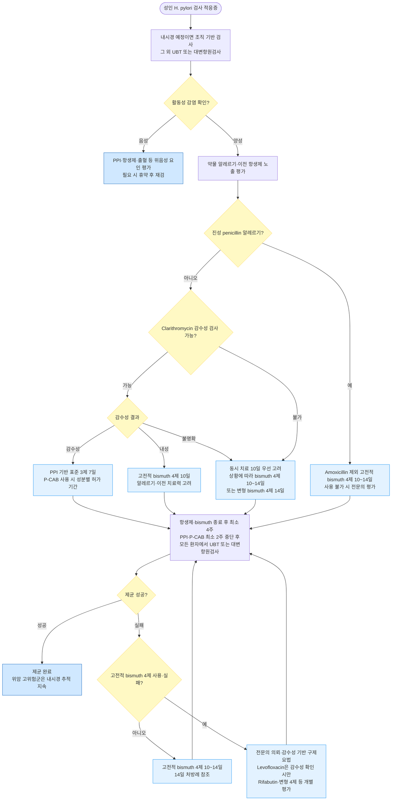

# 헬리코박터 감염 Helicobacter pylori Infection

## <mark style="color:green;">일반 사항</mark>

* 적용 범위 : 18세 이상 성인 감염의 진단·치료를 다룸. 소아·청소년 및 임신·수유 중 환자는 별도 전문 평가에 따름
* 정의 : 그람음성 나선형 세균인 _Helicobacter pylori_ (_H. pylori_)가 위 점막에 만성 감염을 일으키는 상태; 치료 없이는 감염 후 수십 년간 지속되는 만성 감염 상태를 형성함
* 유병률 : 전 세계 인구의 약 절반이 감염된 것으로 추정됨. 국내 성인 감염률은 연령과 검사법에 따라 차이가 크며 감소 추세임. 2016\~2017년 전국 다기관 연구의 혈청양성률은 전체 41.5%, 제균력·위수술력 등을 제외한 무증상 집단에서는 43.9%였고 고령층에서 더 높았음
* 경과 : 감염자의 대다수는 증상이 없지만 대부분 만성 활동성 위염이 지속되며, 일부에서 소화성 궤양·위 MALT 림프종·위암이 발생
* 제균 치료 효과
  * 소화성 궤양 및 위 MALT 림프종의 예후 개선
  * 위암 예방 효과 : 무증상 감염자 및 위암 고위험군을 포함한 연구와 메타분석에서 제균 치료 후 위암 발생 위험이 대체로 약 1/3\~1/2 감소; 조기 위암 절제 후 이시성(metachronous) 위암도 감소
  * Maastricht VI (2022)와 ACG 2024는 확인된 활동성 _H. pylori_ 감염을 원칙적으로 치료할 감염병으로 간주
* 우리나라의 clarithromycin 내성 상황 : 국내 내성률은 지역·검사법에 따라 차이가 있으며 최근 전국 레지스트리(2021~2023년)에서는 배양 33.3%, PCR 31.3%로 보고됨. 국내 2025 개정 지침(2026년 발표)은 감수성 기반 맞춤 치료를 우선하고, 감수성 검사 없이 치료하면 동시 치료 10일을 주요 경험적 요법으로 권고. 경험적 clarithromycin 3제는 내성률이 15% 미만인 지역 등 제한적 상황에서만 고려 <mark style="color:$info;">[국내 H. pylori 지침 2025 개정]</mark>


**H. pylori → 위암 발암 경로 (Correa Cascade)**

_H. pylori_ 감염은 수십 년에 걸친 단계적 발암 경로를 통해 위암을 유발

```
H. pylori 감염
   → 만성 활동성 위염 (chronic active gastritis)
      → 위 점막 위축 (atrophic gastritis)
         → 장상피화생 (intestinal metaplasia)
            → 이형성증 (dysplasia)
               → 위선암 (gastric adenocarcinoma)
```

조기에 제균할수록 cascade 차단 효과가 큼.  위축성 위염 이전 단계에서 제균하면 암 예방 효과가 최대화됨. 위암 고위험군(위암 가족력, 위 선종 절제 후 등)에서 조기 제균이 특히 중요


## <mark style="color:green;">원인</mark>

* 원인균 : _H. pylori_; 위 점막에 정착하여 만성 활동성 위염을 유발함
* 전파 : 분변-경구 및 구강-구강 경로 등이 관여하는 것으로 추정됨. 각 경로의 상대적 기여도는 확정되지 않았으며 주로 소아기에 획득함. 가족·동거인 사이 전파 가능

## <mark style="color:green;">임상 양상</mark>

* 무증상 : 감염자의 대부분; 우연히 내시경 검사나 다른 검사 중 발견
* 소화불량 증상 : 명치 통증 또는 불쾌감, 팽만감, 구역, 조기 포만감. 증상만으로 감염 여부를 판단할 수 없음
* 소화성 궤양 동반 시 다음의 증상 발생
  * 명치 통증, 공복통 또는 야간통. 음식과 통증의 관계만으로 위궤양과 십이지장궤양을 신뢰성 있게 구분할 수 없음
  * 구역, 구토; 출혈 합병증이 생기면 흑변(melena), 토혈 등이 나타날 수 있음
* MALT 림프종 동반 시 : 비특이적 상복부 불편감, 체중 감소, 피로감 등; 대부분 조기에 무증상

## <mark style="color:$danger;">🚩 Red Flags!</mark>

#### 즉각 조치

* 토혈·타르변, 특히 실신·저혈압·빈맥·심한 어지럼·쇠약 동반 → 응급 평가; 순환 불안정 시 소생·출혈 처치  [상부위장관 출혈]
* 갑작스러운 심한 복통, 복부 경직·반발통 → 응급실 평가  [소화성 궤양 천공]
* 제균약 복용 후 호흡 곤란·혀/후두 부종·실신, 또는 물집·점막 병변을 동반한 광범위 발진 → 약제 중단 및 응급 처치  [아나필락시스·중증 피부약물이상반응]

#### 당일~수일 내 평가

* 반복 구토·경구 섭취 불가·탈수, 심한 항생제 관련 설사·혈변 → 당일 평가  [위출구 폐쇄·상부위장관 출혈·항생제 관련 대장염]
* 진행성 삼킴곤란, 의도하지 않은 체중 감소, 철결핍빈혈 → 신속한 내시경 등 원인 평가  [위·식도 악성종양]

#### 조기 평가 및 추적

* 적절한 치료 후에도 증상이 지속·악화되거나 2회 이상 제균 실패 → 조기 재평가 및 감수성 기반 치료 가능한 기관 의뢰  [치료 불응성 감염·동반 위장질환]

　☞ [위장질환의 감별](074_-gidz.md#step-1-red-flags)

## <mark style="color:green;">진단</mark>

#### <mark style="color:$primary;">검사 적응증</mark>

**검사 및 치료의 이익이 명확한 경우 (적극 권고)**

* 활동성 소화성 궤양
* 과거 소화성 궤양 병력 (제균 치료 받은 적 없는 경우)
* 위 MALT 림프종
* 조기 위암 내시경 절제 후 (이시성 재발 예방)
* 경고 증상이 없고 내시경을 우선 시행할 필요가 낮은 소화불량 환자에서 비침습 검사-치료 전략 고려
  * 국제 지침의 만 60세 미만 기준을 참고하되, 국내에서는 위암 위험·연령·가족력·최근 국가검진 내시경 여부를 함께 고려
* 소화성 궤양 병력이 있으면서 저용량 aspirin을 장기 투여하는 환자
* NSAID 장기 투여를 새로 시작하는 환자
* 원인 불명 철결핍빈혈(출혈·흡수장애 등 원인 평가와 병행), 면역혈소판감소증(ITP; 종전 명칭 특발성 혈소판감소성 자반증)
* 위암 환자의 1차 친족
* ACG 2024 기준: _H. pylori_ 감염자와 동거하는 성인 가족은 UBT·대변항원검사 등으로 검사 고려(소아에게 일괄 적용하지 않음)

**추가 적응증 (권고 강도 약함)**

* H. pylori 위염 : 위암 예방을 위해 제균 고려(조건부 권고, 근거 수준 중등도) <mark style="color:$info;">[국내 H. pylori 지침 2025 개정]</mark>
* 기능성 소화불량증
* 양성 위선종 내시경 절제 후
* 10 ㎜ 이하 위 과형성 용종 : 용종 소실을 위해 제균 고려(조건부 권고, 근거 수준 낮음). 큰 용종·출혈·이형성 의심은 별도 내시경 평가 <mark style="color:$info;">[국내 H. pylori 지침 2025 개정]</mark>

**독립적인 검사 적응증이 아니거나 근거가 제한적인 경우**

* 소화성 궤양 병력이 없는 전형적인 GERD, 미란성 식도염, Barrett 식도는 그 자체만으로 검사 적응증은 아님. 그러나 다른 적응증으로 활동성 감염이 확인되면 제균을 회피할 이유가 되지 않음
* 이미 NSAID를 장기간 복용 중인 환자에서는 제균만으로 궤양 위험을 충분히 낮추지 못하므로, 궤양 고위험군은 PPI 위장보호를 병행
* Lymphocytic gastritis는 연관성이 불확실하여 개별 판단

#### <mark style="color:$primary;">검사 종류</mark>

**비침습검사**

<table><thead><tr><th width="160">검사명</th><th width="223">장점 (민감도/특이도)</th><th>단점</th></tr></thead><tbody><tr><td><strong>요소호기검사 (Urea Breath Test, UBT)</strong></td><td>정확도가 높음 (민감도·특이도 ＞90%); 편리·신속; 제균 후 추적 검사 시 국내 1차 선택</td><td>PPI·P-CAB, 항생제, bismuth 복용 시 위음성 가능. 국내에서 주로 사용하는 <sup>13</sup>C-UBT는 비방사성이며, <sup>14</sup>C-UBT만 미량의 방사선에 노출됨</td></tr><tr><td><strong>혈청 항체 검사 (ELISA)</strong></td><td>저렴·편리; 산분비억제제·항생제의 영향을 받지 않음</td><td>과거 감염과 현재 감염을 구별할 수 없고 유병률 감소 환경에서는 양성예측도가 낮음. UBT·대변항원검사 등이 곤란한 제한적 상황의 보조검사이며, 제균 후 추적 검사로 사용하지 않음</td></tr><tr><td><strong>대변 항원 검사 (Stool Ag Test)</strong></td><td>Monoclonal 기반 제품은 민감도·특이도 ＞90%; 국제 지침에서 제균 확인에 UBT와 동등한 대안</td><td>검체 취급·보관에 유의; 국내에서는 UBT를 주로 사용</td></tr></tbody></table>

**침습검사**

<table><thead><tr><th width="143">검사명</th><th width="226">장점 (민감도/특이도)</th><th>단점</th></tr></thead><tbody><tr><td><strong>급속요소분해효소검사 (Rapid Urease Test)</strong></td><td>빠르고 간단 (민감도 80~95%, 특이도 95~100%)</td><td>PPI·P-CAB, 항생제, bismuth 복용 시 위음성 가능; 활동성 출혈 급성기에는 위음성률 증가</td></tr><tr><td><strong>조직 검사</strong></td><td>민감도 80~90%, 특이도 ＞95%; 위염 중증도 및 장상피화생 동시 평가 가능</td><td>채취 부위에 따라 민감도 저하; 비용 높음; 활동성 출혈 급성기에는 민감도 저하</td></tr><tr><td><strong>배양 검사</strong></td><td>항생제 내성 패턴 직접 확인 가능 - 제균 실패 반복 시 핵심 검사</td><td>시간 소요(수 일), 복잡, 고비용; 균 생존 조건 엄격</td></tr><tr><td><strong>PCR 검사</strong><br><strong>(DPO-PCR)</strong></td><td>Clarithromycin 내성 유전자(23S rRNA 돌연변이) 신속 확인; 배양 없이 내성 판단 가능; 대학병원 중심으로 확대 중</td><td>상업적 키트 필요; 모든 내성 기전 검출 불가; 비용</td></tr></tbody></table>

#### <mark style="color:$primary;">검사 유의점</mark>

* **활동성 감염 확인** : 혈청 항체 양성만으로 현재 감염을 단정하지 않으며, 가능하면 UBT·대변항원검사 또는 조직 기반 검사로 확인. 조직 검사는 전정부와 체부에서 채취하여 표본오차를 줄임
* **내시경 우선 여부** : 경고 증상·위암 고위험 소견이 있으면 비침습 검사-치료 전략만으로 내시경을 지연하지 않음
* **감수성 결과 해석** : DPO-PCR의 흔한 23S rRNA 변이 미검출은 검사에 포함되지 않은 내성까지 배제하지 않음. 이전 제균 실패·macrolide 노출력과 함께 해석

* **검사 전 휴약** : 위음성 방지를 위해 UBT·대변항원검사는 항생제·bismuth 종료 후 최소 4주, PPI·P-CAB 종료 후 최소 2주 뒤 시행. 중단 기간에는 필요 시 H2 차단제 또는 제산제로 대체할 수 있으며, H2 차단제의 중단 시점은 검사기관 지침에 따름
  * 혈청 항체 검사는 약제의 영향을 받지 않지만, 항체가 치료 후 수개월~수년간 유지될 수 있으므로 추적 검사로 사용하지 않음
* **상부위장관 출혈(UGIB) 급성기 검사 주의** : 활동성 출혈 시 위 내 혈액이 RUT·조직 검사의 민감도를 현저히 낮춰 위음성을 초래할 수 있음; 급성기에 음성이더라도 감염을 배제하지 않으며, 출혈 호전 및 적절한 휴약 후 UBT 등으로 재검

***



<p align="center"><strong>H. pylori 진단 및 제균 치료 알고리듬</strong></p>

***

## <mark style="background-color:$warning;">Management</mark>

### <mark style="color:orange;">제균 치료 적응증</mark>

**국내 2025 개정 지침과 국제 지침의 적용**

* 소화성 궤양, 위 MALT 림프종, 조기 위암 절제 후, 위암 가족력, 원인 불명 철결핍빈혈·ITP 등은 위의 검사 적응증 참조
* H. pylori 위염의 위암 예방 및 10 ㎜ 이하 위 과형성 용종 소실을 위한 제균이 조건부 권고에 추가됨 <mark style="color:$info;">[국내 H. pylori 지침 2025 개정]</mark>
* 위축성 위염·장상피화생에서 제균해도 위암 위험이 완전히 없어지지 않으므로 위험도에 맞는 내시경 추적을 지속
* 활동성 감염이 확인되면 특별한 금기나 치료 이득을 기대하기 어려운 상황이 아닌 한 제균 치료를 권고
* 이미 장기간 NSAID를 복용하는 궤양 고위험군은 제균만으로 충분하지 않아 PPI 위장보호 병행
* GERD·Barrett 식도 또는 식도선암과 H. pylori의 역상관 보고만으로 필요한 제균 치료를 회피하지 않음
* 위 MALT 림프종은 감염검사가 음성이어도 전문의가 제균 치료를 고려할 수 있으므로 일반적인 활동성 감염 확인 원칙의 예외로 구분

### <mark style="color:orange;">비-약물 치료 및 예방</mark>

* 복약 횟수·기간, 예상 부작용, 확인 검사 일정을 치료 전에 설명하고 복약 계획표 제공
* 금연, 손 씻기, 안전한 식수·음식 위생 권고. 생활 관리만으로 제균되지는 않음
* 가족도 감염이 확인된 경우 각자 적절한 제균 치료를 시행하며 검사 없이 항생제를 함께 복용하지 않음

### <mark style="color:orange;">약물 치료</mark>

#### <mark style="color:orange;">초치료 요법 선택</mark>

* 국내 2025 개정 지침(2026년 발표)을 기본으로 감수성 검사, 이전 항생제 노출, 알레르기, 지역 제균율에 따라 선택
* 감수성 유도 치료에서는 clarithromycin 감수성일 때 PPI 표준 3제 7일, 내성일 때 고전적 bismuth 4제 10일을 권고. 국내 권고 기간과 ACG 2024의 optimized bismuth 4제 14일 권고를 구분 <mark style="color:$info;">[국내 H. pylori 지침 2025 개정; ACG 2024]</mark>
* 감수성 검사 없이 치료하면 동시 치료 10일이 주요 경험적 요법. 고전적 bismuth 4제 10~14일 및 변형 bismuth 4제 14일도 조건부 선택지
* 어떤 요법이든 해당 기관·지역의 제균 성적과 복약 가능성을 고려하고 모든 환자에서 치료 후 제균 확인

##### <mark style="color:$primary;">1차 치료 요법 선택 기준</mark>

<table><thead><tr><th>임상 상황</th><th>선택 요법</th></tr></thead><tbody><tr><td>Clarithromycin 감수성 확인</td><td>PPI 기반 표준 3제 7일; P-CAB 기반은 성분별 허가 기간 적용</td></tr><tr><td>Clarithromycin 내성 확인</td><td>맞춤 치료로 고전적 bismuth 4제 10일</td></tr><tr><td>감수성 검사 불가</td><td>동시 치료 10일 우선 고려; 과거 macrolide 노출·이중내성 위험이 크면 비clarithromycin 요법 고려</td></tr><tr><td>다른 경험적 요법이 적합하지 않음</td><td>고전적 bismuth 4제 10~14일 또는 변형 bismuth 4제 14일을 조건부 고려</td></tr><tr><td>진성 penicillin 알레르기</td><td>Amoxicillin을 제외한 고전적 bismuth 4제; 투여 기간은 맞춤·경험적·구제 치료 맥락에 따라 선택</td></tr><tr><td>이전 제균 치료 실패</td><td>이전 처방·노출력·복약 상태와 감수성 결과로 구제요법 결정</td></tr></tbody></table>

##### <mark style="color:$primary;">표준 3제 요법 (Standard Triple Therapy)</mark>

* 구성 : PPI 표준 용량 + amoxicillin 1 g <mark style="color:blue;">\[파목신]</mark> + clarithromycin 500 ㎎ <mark style="color:blue;">\[클래리시드]</mark>, 각각 bid
* Clarithromycin 감수성 확인 시 국내 맞춤 치료 권고 기간은 7일
* 감수성 검사 없이 사용하는 경험적 3제는 지역 clarithromycin 내성률 ＜15% 등 제한적 조건에서만 14일 고려. 국내 고내성 환경의 일반적인 경험적 1차 선택으로 사용하지 않음

##### <mark style="color:$primary;">동시 치료 (Concomitant Therapy) - 10일</mark>

* 구성 : PPI 표준 용량 + clarithromycin 500 ㎎ + amoxicillin 1 g + metronidazole 500 ㎎ <mark style="color:blue;">\[후라시닐]</mark>, 각각 bid × 10일
* 국내 2025 개정 지침의 주요 경험적 요법. Clarithromycin·metronidazole 이중내성에서는 제균율이 낮아질 수 있음
* 순차 치료(sequential therapy)는 개정 지침의 권고 요법에서 제외되어 신규 처방 선택지로 제시하지 않음 <mark style="color:$info;">[국내 H. pylori 지침 2025 개정]</mark>

##### <mark style="color:$primary;">Bismuth 4제 요법 (Bismuth Quadruple Therapy) - 10\~14일</mark>

* 표준 구성 : PPI 표준 용량 bid + 비스무트시트르산염칼륨 300 ㎎(산화비스무트로서 120 ㎎, 데놀 1정) qid + metronidazole 500 ㎎ tid + tetracycline 500 ㎎ qid
* 적용 : clarithromycin 내성 맞춤 치료는 10일; 경험적 사용은 10~14일의 조건부 선택지이며 구제요법으로 남겨둘 필요도 고려. Clarithromycin 포함 요법 실패 후 국내 구제요법 권고 기간은 10~14일이며, 본 장의 처방례는 14일로 제시
* 제균율은 초치료·구제요법 여부, 내성, 기간, 복약 순응도 및 분석집단에 따라 달라짐. 초치료 성적을 구제요법에 그대로 적용하지 않음
* 주의
  * 복잡한 복용 스케줄 → 복약 달력(pill chart) 제공 권장 (아래 복약 계획 참조)
  * 데놀의 국내 품목 허가상 신장애 환자는 금기. 300 ㎎은 염 함량, 120 ㎎은 산화비스무트 환산량으로 같은 1정이며 용량 오류로 혼동하지 않음 <mark style="color:$info;">[국내 품목 허가사항]</mark>
  * 지침상 고전적 4제는 tetracycline을 포함하지만, 데놀 개별 허가사항에는 tetracycline 흡수 저해에 따른 병용 회피 문구가 있어 지침과 품목 허가의 차이를 설명하고 지침 기반 병용의 근거와 판단을 기록. 단순히 복용 간격을 두면 허가상 병용 회피 문구가 해소되는 것으로 해석하지 않음
  * tetracycline : 국내 품목의 임부·임신 가능 여성·수유부 및 12세 미만 금기 등 제한을 따름. 이 장의 성인 제균 처방을 소아에게 적용하지 않음 <mark style="color:$info;">[국내 품목 허가사항]</mark>
  * 변형 bismuth 4제는 고전적 요법과 구성·권고 근거가 다르므로 구분


**변형 Bismuth 4제 요법 (Modified Bismuth Quadruple Therapy) - 14일**

국내 2025 개정 지침은 PPI·amoxicillin·bismuth에 metronidazole(PAMB) 또는 clarithromycin(PACB)을 조합한 14일 요법을 경험적 초치료의 조건부 대안으로 제시. Tetracycline 수급 불가 상황에만 한정된 권고는 아님. 고전적 tetracycline 기반 요법과 구분하고, 선택한 임상시험·지침의 용량과 복용 횟수를 적용. Penicillin 알레르기 환자에게는 사용하지 않으며 clarithromycin 노출·내성 위험을 고려 <mark style="color:$info;">[국내 H. pylori 지침 2025 개정]</mark>


**Bismuth 4제 요법 복약 계획**

* 식사·취침 시각에 맞추어 약제별 복약 계획을 작성. Tetracycline을 일괄적으로 ‘매 식후·취침 직전’에 복용하도록 안내하지 않음

<table><thead><tr><th>약제</th><th>횟수</th><th>복용 원칙</th></tr></thead><tbody><tr><td>PPI</td><td>bid</td><td>일반적으로 아침·저녁 식전 30분</td></tr><tr><td>데놀</td><td>qid</td><td>매 식전 30분 및 늦은 저녁 등으로 분할; 투여 전후 30분 음식·음료 및 제산제 회피</td></tr><tr><td>Metronidazole</td><td>tid</td><td>매 식후; 복용 중 및 종료 후 최소 3일까지 금주</td></tr><tr><td>Tetracycline</td><td>qid</td><td>식전 1시간 또는 식후 2시간에 분할. 충분한 물과 복용하고 30분 이상 눕지 않음. 마지막 복용도 취침 직전은 피함</td></tr></tbody></table>

* Tetracycline은 유제품·제산제·철분제 등 다가양이온 함유 제제와 2시간 이상 분리. 위 표는 음식과의 관계를 정리한 것으로, 데놀 허가사항의 tetracycline 병용 회피 문구를 대체하지 않음 <mark style="color:$info;">[국내 품목 허가사항·제조사 제품정보]</mark>

##### <mark style="color:$primary;">페니실린 알레르기 환자</mark>

* 경증·비즉시형 반응 등 저위험 과거력 : 병력을 재평가하고 필요 시 전문기관에서 피부검사·경구유발검사를 통해 penicillin allergy 표지 해제(delabeling) 고려; 확인 전에는 bismuth 4제 요법 사용
* 아나필락시스·중증 지연형 반응(SJS/TEN·DRESS 등) : Amoxicillin 회피; 특히 중증 지연형 반응에서는 경구유발검사·탈감작을 시행하지 않음 → bismuth 4제 요법 (tetracycline + metronidazole; amoxicillin 제외) 우선
* Bismuth 4제도 사용할 수 없는 경우 : 소화기내과 의뢰 후 감수성 유도 치료. Clarithromycin·fluoroquinolone 포함 요법은 해당 감수성이 확인된 경우에만 고려

#### <mark style="color:orange;">재치료 프로토콜</mark>

**제균 실패 흔한 원인 - 재치료 전 점검**

1. clarithromycin 또는 fluoroquinolone 내성
2. 복약 불이행 (특히 bismuth 4제의 복잡한 스케줄)
3. PPI 산 억제 불충분 (CYP2C19 급속 대사형)
4. 흡연 (제균율 감소와 관련)

✽ 너무 이른 확인 검사·휴약 미준수는 실제 항생제 내성의 원인이 아니라 결과 해석 오류의 원인이므로, 적절한 시점에 활동성 감염을 재확인

##### <mark style="color:$primary;">1차 재치료 (표준 3제·동시·순차 치료 실패 후)</mark>

* 고전적 Bismuth 4제 요법 10~14일 (상기 구성) - 국내 개정 지침의 우선 구제요법. 본 장은 ACG 2024의 14일 최적화 요법도 고려하여 14일 처방례를 제시 <mark style="color:$info;">[국내 H. pylori 지침 2025 개정; ACG 2024]</mark>

##### <mark style="color:$primary;">Bismuth 4제 실패 후 구제요법</mark>

* Bismuth 4제를 초치료로 사용했는지 2차로 사용했는지 구분하고, 감수성·이전 노출력에 따라 rifabutin 3제 또는 이전에 사용하지 않은 항생제를 활용한 변형 4제를 전문의와 결정. 아래 나열 순서대로 경험적 치료를 반복하지 않음

* Levofloxacin 3제 요법 14일 : PPI 표준 용량 bid + amoxicillin 1 g bid + levofloxacin 500 ㎎ qd (또는 250 ㎎ bid) <mark style="color:blue;">\[크라비트]</mark>
  * 국내 fluoroquinolone 내성률이 높으므로 감수성이 확인된 경우에만 사용
* Rifabutin 3제 요법 14일 : bismuth 4제 실패 후 국내 2025 개정 지침과 국제 지침에서 고려하는 구제요법이며 지침·제품별 rifabutin 및 amoxicillin 용량이 다름
  * 국내 H. pylori 제균 목적은 허가 외 사용에 해당하므로 전문의 협진하에 적용 여부·구체적 처방을 결정
  * 골수억제(호중구감소증), 포도막염 가능; 반복치료·혈액질환 등 고위험군에서 CBC 확인 고려
  * 활동성 결핵 또는 rifamycin 계열 치료력·치료 중인 환자는 내성 선택 위험을 고려하여 감염내과 협진
* 배양 검사 후 감수성 유도 치료 : 2회 이상 실패 시 소화기내과 의뢰 → 내시경 조직으로 배양·항생제 감수성 검사 시행 후 맞춤 치료

#### <mark style="color:orange;">약제</mark>

##### <mark style="color:$primary;">PPI 표준 용량</mark>

* 아래는 **1회 표준 용량**이며 본 장의 제균요법에서는 **1일 2회** 투여. 제형별로 동등하게 대체하지 않음

* omeprazole 20 ㎎ <mark style="color:blue;">\[오엠피]</mark>
* esomeprazole 20 ㎎ <mark style="color:blue;">\[넥시움]</mark>
* lansoprazole 30 ㎎ <mark style="color:blue;">\[란스톤]</mark>
* rabeprazole 20 ㎎ <mark style="color:blue;">\[파리에트]</mark>
* pantoprazole 40 ㎎ <mark style="color:blue;">\[판토록]</mark>

##### <mark style="color:$primary;">P-CAB (Potassium-Competitive Acid Blocker)</mark>

* Tegoprazan 50 ㎎ <mark style="color:blue;">\[케이캡]</mark>
  * 국내 허가 : 표준 3제 요법 7일 투여 허가
  * PPI 대비 강력하고 안정적인 산 억제 효과; CYP2C19 대사 다형성 영향 적음 → 급속 대사자에서 유리
  * 7일 tegoprazan 기반 3제 요법은 lansoprazole 기반 3제 요법에 비열등했으나, clarithromycin 고내성 환경에서는 7일 요법의 절대 제균율이 충분하지 않을 수 있음
  * 처방 시 tegoprazan 50 ㎎ bid (3제 요법 구성 내)
  * 14일 연장 요법의 제균율 향상 보고가 있으나 국내 허가 기간 7일을 벗어나는 사용으로 구분
* 제균용 tegoprazan·fexuprazan은 국내 품목 허가상 임부·수유부 금기
* Fexuprazan 40 ㎎ <mark style="color:blue;">\[펙수클루]</mark>
  * 국내 허가 병용요법 : fexuprazan 40 ㎎ + amoxicillin 1 g + clarithromycin 500 ㎎, 각각 bid × **14일** <mark style="color:$info;">[국내 품목 허가사항]</mark>
  * 강력한 산 억제만으로 clarithromycin 내성을 충분히 극복할 수 없으므로 감수성 확인 원칙을 유지
  * 2026년 9월 단일기관 무작위 연구(79명)에서 7일 fexuprazan 3제와 14일 rabeprazole 3제의 FAS 제균율은 각각 80.0%, 82.1%였음. 소규모 연구의 군 간 유의차 부재만으로 비열등성이 확립되었다고 보지 않으며, 허가된 14일 요법을 7일로 일괄 단축하지 않음 <mark style="color:$info;">[Kim 등, Medicine 2026]</mark>


P-CAB 기반 3제는 성분에 따라 기간이 다름 : tegoprazan은 허가상 7일, fexuprazan은 14일. 지침상 권고·품목 허가·건강보험 급여는 서로 다른 기준이므로 동일하게 취급하지 않음


##### <mark style="color:$primary;">항생제 내성 관리 원칙 (Antimicrobial Stewardship)</mark>

* _H. pylori_ 치료는 항생제 stewardship 원칙을 준수
* Clarithromycin·levofloxacin은 이전 노출·실패 후 경험적 재사용을 피함. 3제요법은 감수성 확인을 원칙으로 하며, 국내 지침의 경험적 동시 치료 10일 및 제한적인 저내성 지역 3제 예외와 구분. Levofloxacin은 본 장에서 감수성 확인 후 사용으로 제한
* Amoxicillin·tetracycline은 내성률이 낮아 재사용 가능. Metronidazole도 bismuth 병용과 충분한 용량·기간으로 재사용을 고려할 수 있어 모든 항생제를 일괄 제외하지 않음 <mark style="color:$info;">[AGA 난치성 H. pylori CPU 2021]</mark>
* 불필요한 salvage 반복 금지 : 경험적 치료 반복보다 배양·감수성 검사 우선
* 2회 이상 실패 시 susceptibility-guided therapy : 배양 검사 시행 또는 의뢰
* 항생제는 처방된 7~14일 요법을 마치면 종료. UBT 음성이 나올 때까지 연장하지 않음. 적절한 휴약 후 제균 확인하고, 실패가 확인되면 다른 요법을 결정

##### <mark style="color:$primary;">약물 부작용 관리</mark>

<table><thead><tr><th width="146.5263671875">약물</th><th>주요 부작용</th><th>대처</th></tr></thead><tbody><tr><td>amoxicillin</td><td>설사, 복통, 발진, 드물게 알레르기 반응</td><td>페니실린 알레르기 사전 확인; 알레르기 의심 시 즉시 중단·평가</td></tr><tr><td>clarithromycin</td><td>금속 맛, 구역, 복통, QT 연장; CYP3A4 약물상호작용</td><td>QT 연장 약물과 simvastatin·lovastatin 등 병용약 확인</td></tr><tr><td>metronidazole</td><td>금속 맛, 구역, 구토; 알코올 병용 시 홍조·두통·빈맥·구토 가능</td><td>치료 기간 중 및 종료 후 최소 3일까지 음주 금지 교육</td></tr><tr><td>bismuth</td><td>변비, 검은 변·흑색 혀, 구역</td><td>일시적 변색을 설명하되 색만으로 출혈 배제 불가; 타르변·어지럼·쇠약·토혈은 응급 평가. 데놀은 신장애 환자 금기</td></tr><tr><td>tetracycline</td><td>광과민성, 식도염</td><td>충분한 물과 함께 복용 후 30분은 눕지 않음; 식전 1시간 또는 식후 2시간; 유제품·제산제·철분제와 2시간 이상 분리</td></tr><tr><td>levofloxacin</td><td>건염·건파열, 말초신경병증, 중추신경계 이상, 혈당 변동, QT 연장</td><td>고령·신기능 저하·스테로이드 병용 환자 주의; 감수성 확인 후 제한적으로 사용</td></tr><tr><td>rifabutin</td><td>골수억제, 포도막염, 체액의 주황색 변색</td><td>전문의 협진; 반복치료·고위험군에서 CBC 확인 고려</td></tr></tbody></table>

### <mark style="color:orange;">치료 후 추적 검사</mark>

* 대상 : 증상 호전 여부와 무관하게 **제균 치료를 받은 모든 환자**
* 방법 : UBT 선호 (정확도가 높고 비침습); 내시경 추적이 필요한 경우 조직 검사
  * UBT와 검증된 monoclonal 대변항원검사 모두 제균 확인에 사용 가능. 국내에서는 UBT가 널리 사용되며 검사 가용성·정확도를 고려하여 선택
* 시기 : 항생제·bismuth 종료 후 최소 4주, PPI·P-CAB 종료 후 최소 2주 뒤 시행. 중단 기간에는 필요 시 H2 차단제 또는 제산제 사용
* 위궤양 : 치유 확인 및 악성 병변 배제를 위해 일반적으로 진단·치료 시작 후 6\~8주경 추적 내시경 고려
* 합병증 없는 십이지장궤양 : 증상이 호전되고 제균 성공이 확인되면 routine 추적 내시경은 일반적으로 불필요
* 위축성 위염·장상피화생, 위선종·조기 위암 절제 후 등 위암 고위험군은 제균 성공 후에도 기존 기준에 따른 내시경 추적을 지속

### <mark style="color:orange;">시술 및 기타 처치</mark>

* 감염 자체에 대한 시술은 없음. 출혈성 궤양의 내시경 지혈, 위 MALT 림프종의 병기 평가·반응 확인, 위암·선종·고위험 용종의 절제와 추적은 해당 질환의 기준에 따름

***

## <mark style="color:purple;">처방례</mark>

모든 수량은 **1회 복용량**이며, 성인 표준 예시임. 신·간기능, 상호작용, 알레르기에 따라 조정

> **처방례 1.** 동시 치료 10일 (경험적 초치료)
>
> ```
> 판토록 40 ㎎/T   1T   bid   (아침·저녁 식전 30분)
> 클래리시드 필름코팅 500 ㎎/T   1T   bid   (아침·저녁 식후)
> 파목신 500 ㎎/C   2C   bid   (아침·저녁 식후)
> 후라시닐 250 ㎎/T   2T   bid   (아침·저녁 식후)
> ※ 총 10일; metronidazole 복용 중 및 종료 후 최소 3일까지 금주
> ```
>
> _✽국내 2025 개정 지침의 주요 경험적 요법. 과거 macrolide 노출 및 clarithromycin·metronidazole 이중내성 위험을 평가. 실패 후 고전적 bismuth 4제 구제요법 고려_

> **처방례 2.** PPI 표준 3제 7일 (clarithromycin 감수성 확인)
>
> ```
> 판토록 40 ㎎/T   1T   bid   (아침·저녁 식전 30분)
> 클래리시드 필름코팅 500 ㎎/T   1T   bid   (아침·저녁 식후)
> 파목신 500 ㎎/C   2C   bid   (아침·저녁 식후)
> ※ 총 7일; clarithromycin 감수성 확인이 전제
> ```
>
> _✽국내 맞춤 치료 권고 기간은 7일. 감수성 미확인 환자에게 이 7일 처방을 경험적으로 적용하지 않음_

> **처방례 3.** 고전적 Bismuth 4제 14일 (구제요법 예)
>
> ```
> 판토록 40 ㎎/T   1T   bid   (아침·저녁 식전 30분)
> 데놀 300 ㎎/T(산화비스무트로서 120 ㎎)   1T   qid   (매 식전 30분·취침 전)
> 후라시닐 250 ㎎/T   2T   tid   (매 식후)
> 테라싸이클린캡슐 250 ㎎/C   2C   qid   (식전 1시간 또는 식후 2시간에 분할)
> ※ 총 14일; metronidazole 복용 중 및 종료 후 최소 3일까지 금주
> ※ Tetracycline 마지막 복용은 취침 직전을 피하고, 충분한 물과 복용 후 30분 이상 눕지 않기
> ※ 유제품·제산제·철분제와 2시간 이상 간격
> ```
>
> _✽후라시닐은 250 ㎎ 2정이 1회 500 ㎎, 테라싸이클린은 250 ㎎ 2캡슐이 1회 500 ㎎. Clarithromycin 내성 맞춤 초치료는 10일, 국내 구제요법은 10~14일 권고. 이 예는 14일 처방이며 데놀·tetracycline의 지침 기반 병용과 품목 허가 차이는 본문 참조_

> **처방례 4.** Levofloxacin 3제 14일 (감수성 확인 구제요법)
>
> ```
> 판토록 40 ㎎/T   1T   bid   (아침·저녁 식전 30분)
> 크라비트 500 ㎎/T   1T   qd   (아침 식후)
> 파목신 500 ㎎/C   2C   bid   (아침·저녁 식후)
> ※ 총 14일; levofloxacin 감수성이 확인된 경우에만
> ```
>
> _✽H. pylori 제균 목적의 levofloxacin 사용은 국내 허가 외 사용. Bismuth 4제 실패 후 전문의 평가하에 선택. 건염·건파열, 신경계 이상 및 QT 연장 위험과 신기능에 따른 용량 조정 고려_

> **처방례 5.** Tegoprazan 기반 3제 7일
>
> ```
> 케이캡 50 ㎎/T   1T   bid   (아침·저녁)
> 클래리시드 필름코팅 500 ㎎/T   1T   bid   (아침·저녁 식후)
> 파목신 500 ㎎/C   2C   bid   (아침·저녁 식후)
> ※ 총 7일; clarithromycin 감수성 확인
> ```
>
> _✽국내 제균 허가 적응증은 소화성 궤양 및/또는 만성 위축성 위염, 기간은 7일. 급여는 소화성 궤양 환자의 허가 병용요법에 인정되며, 14일 연장 처방은 허가 외 사용으로 구분_

> **처방례 6.** Fexuprazan 기반 3제 14일
>
> ```
> 펙수클루 40 ㎎/T   1T   bid   (아침·저녁)
> 클래리시드 필름코팅 500 ㎎/T   1T   bid   (아침·저녁 식후)
> 파목신 500 ㎎/C   2C   bid   (아침·저녁 식후)
> ※ 총 14일; clarithromycin 감수성 확인
> ```
>
> _✽국내 허가 병용요법은 fexuprazan 40 ㎎·amoxicillin 1 g·clarithromycin 500 ㎎ 각각 1일 2회 14일. Tegoprazan 7일 요법과 혼동하지 않으며, 제균 목적 fexuprazan은 현행 급여 인정 대상에 포함되지 않아 해당 약값 전액 본인부담 <mark style="color:$info;">[국내 품목 허가사항]</mark>_

***

### <mark style="color:$success;">핵심 복약 지도</mark>

> **① 제균 치료를 끝까지 완료하는 것이 가장 중요합니다**
>
> * H. pylori 제균 치료는 요법에 따라 7\~14일간 진행됩니다. 증상이 좋아지더라도 중단하지 마십시오.
> * 임의 중단 시 균이 완전히 제거되지 않고 항생제 내성이 발생할 수 있어, 이후 치료가 더 어려워집니다.
> * 처방된 모든 약을 매일 같은 시간에 규칙적으로 복용하십시오.
> * 처방 기간을 마치면 항생제는 끝냅니다. 확인 검사 때까지 계속 복용하거나 남은 항생제를 임의로 다시 드시지 마십시오.

> **② 각 약물 복용 방법**
>
> * **PPI (위산 억제제)** : 일반적으로 식전 30분 복용; 처방전 복용 지시 확인
> * **P-CAB (위산 억제제)** : 식사와 관계없이 복용 가능; 처방전 복용 지시 확인
> * **Amoxicillin (항생제)** : 식후 복용; 페니실린 알레르기가 있으면 처방 전 반드시 알림
> * **Clarithromycin (항생제)** : 식후 복용; 복용 중 금속 맛이 날 수 있으나 치료 종료 후 소실됨
> * **Metronidazole (항생제)** : 식후 복용; **치료 기간 중 및 치료 종료 후 최소 3일까지 음주하지 마십시오** - 홍조, 두근거림, 구역 등의 심한 반응이 생길 수 있습니다
> * **Bismuth (데놀)** : 식전 30분, 취침 전 복용; 대변·혀가 일시적으로 검게 변할 수 있음. 색만으로 출혈을 배제할 수 없으며 타르처럼 끈적한 변·어지럼·쇠약·토혈이 있으면 응급 평가
> * **Tetracycline** : 식전 1시간 또는 식후 2시간에 복용합니다. 충분한 물(200 ㎖ 이상)과 함께 복용하고 30분 이상 눕지 마십시오. 취침 직전은 피하고, 우유·제산제·철분제와 2시간 이상 분리하십시오

> **③ 제균 치료 후 확인 검사가 반드시 필요합니다**
>
> * 항생제 치료 완료 후 최소 4주 뒤 요소호기검사(UBT) 또는 대변항원검사로 제균 성공 여부를 확인합니다.
> * 확인 검사 전 항생제·bismuth는 최소 4주, PPI·P-CAB은 최소 2주간 복용하지 않아야 검사가 정확합니다.
> * 혈액 항체 검사는 치료 성공 여부 판정에 사용할 수 없습니다 (오래 양성 유지).

> **④ 부작용 대처**
>
> * 경미한 복통, 설사, 구역 : 치료 중 자주 나타나며 대부분 치료 완료 후 회복됨; 심하지 않으면 계속 복용
> * 발진, 두드러기, 심한 설사(혈변 동반) : 즉시 중단하고 병원 방문
> * Bismuth 복용 후 검은 변이 생길 수 있으나 출혈과 색만으로 구분할 수 없음. 타르처럼 끈적한 변·어지럼·쇠약·토혈 동반 시 응급실 방문

> **언제 다시 병원을 방문해야 하나요?**
>
> * 제균 확인 검사(UBT) 결과 제균 실패 시 - 재치료 상담
> * 치료 완료 후에도 복통, 흑변, 체중 감소가 지속되는 경우 - 즉시 내원
> * 치료 중 심한 알레르기 반응(발진, 호흡 곤란) - 즉시 내원 또는 응급실

***

### <mark style="color:blue;">환자 안내서</mark>


**헬리코박터균 감염, 치료하면 위암 위험을 줄일 수 있습니다**

헬리코박터균(_H. pylori_)은 위 점막에 서식하는 세균으로, 전 세계 인구의 약 절반이 감염되어 있습니다. 대부분은 아무 증상이 없지만, 오랫동안 치료하지 않으면 위궤양이나 위암의 원인이 될 수 있습니다. 균을 제거(제균 치료)하면 궤양이 낫고 위암 위험도 낮출 수 있습니다.


#### <mark style="color:$primary;">헬리코박터균은 어떻게 감염되나요?</mark>

* 오염된 음식이나 물을 통해 전파됩니다 (분변-경구 경로).
* 어린 시절에 감염된 경우가 많으며, 위생 환경이 개선된 지금은 신규 감염률이 낮아졌습니다.
* 가족 간 전파가 가능합니다. 감염자와 동거하는 성인 가족이나 위암 환자의 1차 친족은 의사와 상의하여 검사를 고려할 수 있습니다.

#### <mark style="color:$primary;">왜 제균 치료를 받아야 하나요?</mark>

* 위궤양·십이지장궤양의 주요 원인 중 하나입니다. 제균 치료 시 궤양 재발과 출혈 위험을 줄일 수 있습니다.
* 연구 대상과 위 점막 상태에 따라 차이가 있지만, 제균 치료를 받으면 위암 발생 위험을 대체로 약 1/3\~1/2 낮출 수 있습니다. 치료하지 않으면 수십 년에 걸쳐 위 점막이 서서히 손상될 수 있습니다.
* 특발성 혈소판감소성 자반증(ITP)이나 원인 불명의 빈혈에도 도움이 될 수 있습니다.
* 현재 감염이 정확히 확인되면 특별한 금기가 있거나 치료 이득을 기대하기 어려운 상황이 아닌 한 제균 치료를 권합니다. 구체적인 치료 방법과 급여 여부는 의사와 상의하십시오.

#### <mark style="color:$primary;">제균 치료는 어떻게 하나요?</mark>

* 보통 **3\~4종류의 약을 7\~14일간** 복용합니다 - 위산 억제제 1종과 항생제 2\~3종이며, 처방에 따라 bismuth를 함께 복용합니다.
* **처방받은 약을 끝까지 모두 복용하는 것이 가장 중요합니다.** 증상이 좋아져도 중단하면 안 됩니다.
* 항생제 복용 중에는 **술을 마시면 안 됩니다** - 특히 metronidazole을 포함하는 처방에서는 홍조·두근거림·구역 등의 심한 반응이 생길 수 있습니다. 치료 종료 후에도 **최소 3일간** 음주를 삼가십시오.
* 데놀(bismuth) 복용 시 대변과 혀가 검게 변할 수 있는데, 약에 의한 일시적 변화일 수 있습니다. 다만 타르처럼 끈적한 변이나 어지럼·쇠약·토혈이 있으면 출혈 가능성이 있으므로 즉시 응급실을 방문하십시오.

#### <mark style="color:$primary;">치료 후 제균 확인이 필요합니다</mark>

* 항생제 치료 완료 후 **최소 4주 뒤** 요소호기검사(숨 쉬는 검사) 또는 대변항원검사로 균이 없어졌는지 확인합니다.
* 검사 전 항생제·bismuth는 최소 4주, 위산 억제제(PPI·P-CAB)는 최소 2주간 복용하지 않아야 검사가 정확합니다.
* 혈액 검사로는 제균 성공 여부를 알 수 없습니다.
* 제균에 실패한 경우 다른 약으로 재치료를 받을 수 있습니다.
* 위축성 위염·장상피화생이 있거나 위선종·조기 위암을 치료받은 환자는 제균에 성공해도 담당 의사가 정한 일정에 따라 위내시경 추적을 계속해야 합니다.

#### <mark style="color:$primary;">재감염 예방과 생활 관리</mark>

* 손 씻기를 철저히 하고, 음식은 충분히 익혀 먹고, 오염 가능성이 있는 물은 끓여 마십시오.
* 제균에 성공해도 감염이 다시 나타날 수 있습니다. 남아 있던 균의 재증식과 새로 감염되는 경우를 구분하며, 발생률은 지역·추적 기간에 따라 달라집니다.
* 재감염이 의심되거나, 정기 위내시경 시 H. pylori 재검이 필요하면 의사에게 말씀하십시오.

#### <mark style="color:$primary;">이럴 때는 즉시 병원을 방문하세요</mark>

* 치료 중 발진, 두드러기, 호흡 곤란 등 알레르기 증상
* 검은 끈적한 변(흑색변, melena), 토혈
* 심한 복통, 발열, 또는 치료 중 갑자기 상태가 나빠지는 경우

***

***

### <mark style="color:red;">질병코드</mark>

B98.0 다른 장에서 분류된 질환의 원인으로서의 헬리코박터 파일로리균

✽B98.0은 원인균을 표시하는 부가 코드로, 위염·소화성 궤양 등 해당 원인 질환 코드를 함께 사용

***

### <mark style="color:red;">보험 적용</mark>

* 아래는 약제별 기준이며, 지침의 치료 권고와 급여 인정은 다름. ‘약값 전액 본인부담’을 모든 진료·검사의 비급여와 동일하게 표현하지 않음
* **PPI·bismuth** : 감염이 확인된 소화성 궤양, 저등급 위 MALT 림프종, 조기 위암 절제 후, ITP, 위선종 내시경 절제 후의 제균에 급여 인정. 위암 1차 가족력·위축성 위염·기타 진료상 필요하여 동의한 제균 등은 해당 약값 전액 본인부담. 약제·함량별 제외 조건을 적용 <mark style="color:$info;">[PPI 고시 2022-268호; bismuth 고시 2022-111호]</mark>
* **Tegoprazan 50 ㎎** : 소화성 궤양 환자의 허가된 제균 항생제 병용요법에 급여 인정. 만성 위축성 위염에 대한 제균 허가가 소화성 궤양과 동일한 급여를 뜻하지 않음 <mark style="color:$info;">[고시 2023-120호]</mark>
* **Fexuprazan 40 ㎎** : 제균 병용요법은 허가되었으나 급여 인정 범위에 포함되지 않아 제균 목적 투여 시 해당 약값 전액 본인부담 <mark style="color:$info;">[고시 2025-189호; 심평원 공개 약제급여기준집 대조]</mark>
* 위 항목으로 항생제·UBT·내성검사의 급여까지 일괄 결정하지 않으며, 검사·약제별 기준을 각각 적용

***

### <mark style="color:$info;">주요 참고문헌 및 확인 자료</mark>

**임상 근거**

* 국내 H. pylori 진료지침 2025 개정(2026년 발표). [Korean J Gastroenterol. 2026;86(3):156–192](https://doi.org/10.4166/kjg.2026.040); [영문판](https://doi.org/10.7704/kjhugr.2026.0029); [동일 지침 Helicobacter 판](https://doi.org/10.1111/hel.70149)
* ACG Clinical Guideline: Treatment of Helicobacter pylori Infection. 2024. [원문](https://doi.org/10.14309/ajg.0000000000002968)
* AGA Clinical Practice Update on the Management of Refractory Helicobacter pylori Infection. 2021. [원문](https://doi.org/10.1053/j.gastro.2020.11.059)
* Maastricht VI/Florence Consensus Report. 2022. [원문](https://doi.org/10.1136/gutjnl-2022-327745)
* Lim SH, et al. Trends in the seroprevalence of Helicobacter pylori infection and its putative eradication rate over 18 years in Korea. PLoS One. 2018;13:e0204762. [원문](https://doi.org/10.1371/journal.pone.0204762)
* Kim JH, et al. Randomized controlled trial comparing 7-day fexuprazan-based and 14-day rabeprazole-based triple therapies for Helicobacter pylori eradication. Medicine. 2026;105:e50627. [원문](https://doi.org/10.1097/MD.0000000000050627)
* CDC. Managing Persons Who Have a History of Penicillin Allergy. [공식 지침](https://www.cdc.gov/std/treatment-guidelines/penicillin-allergy.htm)
* Lim NR, et al. Recurrence of Helicobacter pylori following successful eradication and clinical outcomes in Korean patients. Helicobacter. 2024;29:e13036. [원문](https://doi.org/10.1111/hel.13036)

**허가·급여 확인 자료**

* [식품의약품안전처 의약품안전나라](https://nedrug.mfds.go.kr/) : 품목별 효능·효과, 용법·용량, 금기
* [건강보험심사평가원 약제급여기준집](https://www.hira.or.kr/ebooksc/2026/10/BZ202610074155599.pdf) : PPI·bismuth·tegoprazan·fexuprazan 기준(인쇄면 389~398쪽). 공개 기준집은 2026년 7월 시행 고시까지 수록되어 있으며, 임상 적응증 확대와 급여 인정은 구분
* [종근당 테라싸이클린 제품정보](https://www.ckdpharm.com/product/productView.do?prodCode=CKD0000095) : 식사와의 관계·제품 함량

✽ 임상 근거·허가·공개 급여자료 검토일 : 2026-10-26
