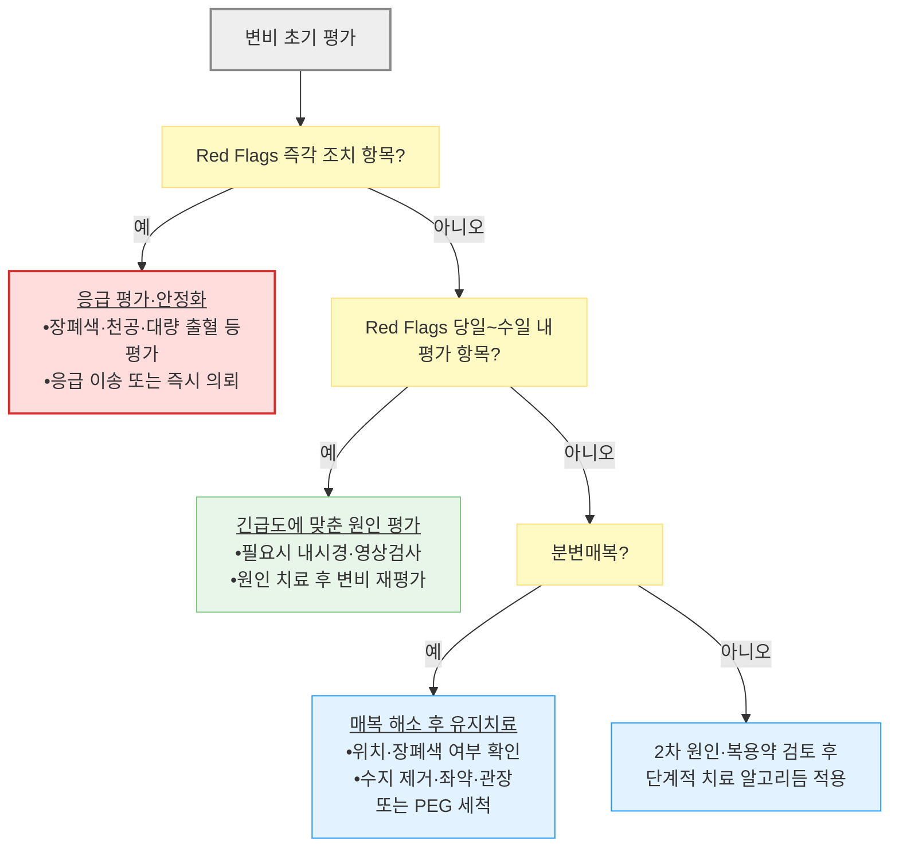
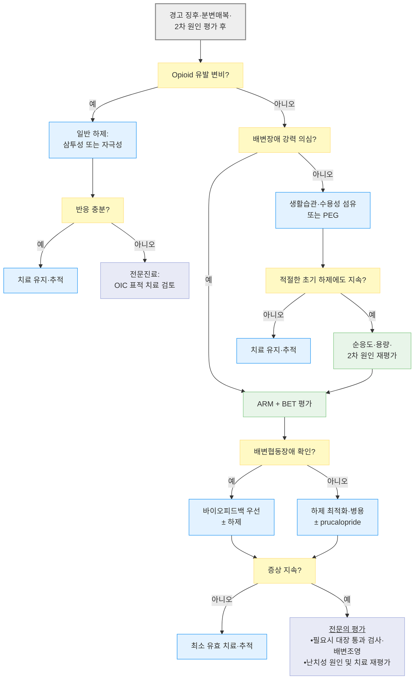

# 변비 Constipation

## <mark style="color:green;">일반 사항</mark>

* 정의 : 희발 배변(주 ＜3회), 단단한 대변, 불완전한 배변감, 배변 시 과도한 힘주기, 항문 폐쇄감, 배변 유도를 위한 수지 조작이 필요한 경우; 대변의 굳기, 배변 빈도와 어려움 등을 종합적으로 평가
* 유병률 : Rome IV 기준 기능성 변비의 전 세계 성인 유병률은 약 10.1%; 진단 기준·지역·연령에 따라 차이가 크며 고령에서는 동반 질환, 활동·식사량 감소, 복용 약물 등의 요인이 관여  <mark style="color:$info;">\[Lancet Gastroenterol Hepatol 2021]</mark>

## <mark style="color:green;">원인 및 위험 인자</mark>

### <mark style="color:orange;">1차성 (기능성)</mark>

* Rome V에서 기능성 변비(functional constipation)의 명칭이 만성 변비(chronic constipation)로 바뀌었으며, 증상 기준은 Rome IV와 같음
* 만성 변비는 증상 기반 진단이며, 다른 원인으로 더 잘 설명되지 않는지 평가해야 함
* 생리 검사에 따라 정상 통과형 변비, 서행성 변비, 배변협동장애로 분류하며, 배변협동장애는 대장 통과 지연과 병존할 수 있음
* 배변장애(defecatory disorder)는 배변협동장애와 직장류·직장탈출 등 구조적 배출장애를 포함하는 상위 개념

#### <mark style="color:$primary;">정상 통과형 변비 Normal-transit constipation</mark>

* 기전 : 대장 통과는 정상이나 대변 굳기 변화, 직장 감각 이상, 배변 불만족감 등이 관여
* 특징 : 가장 흔한 생리학적 아형; 단단한 대변, 힘주기, 불완전 배출감을 호소하며 IBS-C와 증상이 겹치는 경우가 많음
* 진단 : 대장 통과 시간이 정상이며 배변협동장애 동반 여부를 구분; 생리 검사는 치료 반응과 임상적 적응에 따라 시행
* 치료 : 생활 습관 교정과 부피 형성·삼투성 하제에 비교적 잘 반응

#### <mark style="color:$primary;">서행성 변비 Slow-transit constipation</mark>

* 기전 : 대장의 추진성 운동 저하 등 여러 신경근육 기능 이상이 관여하는 것으로 추정
* 특징 : 여성, 정신 질환(우울, 불안, 섭식 장애) 동반 시 더 흔함; 배변 횟수 감소와 변의 감소가 두드러짐
* 진단 : 검사법별 정상 범위를 벗어난 대장 통과 지연
* 치료 : 식이 섬유 효과는 제한적이며 PEG ± prucalopride 등 하제 최적화

#### <mark style="color:$primary;">배변협동장애 Dyssynergic defecation</mark>

* 기전 : 배변 시 골반저·항문괄약근의 이완 부전·역설적 수축 및/또는 불충분한 추진력 형성
* 특징 : 과도한 힘주기, 막힌 느낌, 불완전한 배출감, 수지 조작; 부드러운 대변조차 배변 곤란
* 진단 : 배출 곤란 증상과 ARM·BET·배변조영술 중 하나 이상에서 객관적인 배출 장애 확인 (☞ [배변협동장애 진단 기준](#dyssynergic-defecation-criteria))
* 치료 : 바이오피드백 우선

### <mark style="color:orange;">2차성</mark>

<table data-search="false"><thead><tr><th width="121">범주</th><th>원인 질환 및 약물</th></tr></thead><tbody><tr><td><strong>내분비/대사</strong></td><td>당뇨병, 고칼슘혈증, 저칼륨혈증, 갑상선저하증, 부갑상선항진증, 요독증</td></tr><tr><td><strong>근병증</strong></td><td>amyloidosis, scleroderma, 근긴장성 근디스트로피</td></tr><tr><td><strong>신경 질환</strong></td><td>자율신경병증, 뇌혈관질환, 파킨슨병, 척수 질환</td></tr><tr><td><strong>정신 질환</strong></td><td>불안증, 우울증, 섭식장애, 신체화장애, 치매</td></tr><tr><td><strong>구조 이상</strong></td><td>항문열상, 협착, 결장협착증, IBD, 결장 종괴, 직장탈출증, 직장류, 자궁내막증</td></tr><tr><td><strong>약물</strong></td><td><strong>신경·정신</strong> : opioid, 항우울제(TCA ＞ SSRI), 항정신병제(특히 clozapine), 일부 항경련제, levodopa, 항콜린제(방광 항무스카린제 등), 1세대 항히스타민제<br><strong>심혈관</strong> : CCB(특히 verapamil), clonidine, 이뇨제<br><strong>대사</strong> : GLP-1 수용체 작용제(semaglutide 등), GIP/GLP-1 이중 수용체 작용제(tirzepatide)<br><strong>소화기</strong> : Al 또는 Ca 함유 제산제, 5-HT3 길항제(ondansetron 등), cholestyramine<br><strong>무기질 보충제</strong> : 철분제, 칼슘 보충제<br><strong>기타</strong> : 교감신경 작용제(pseudoephedrine 등)</td></tr><tr><td><strong>생리적 요인</strong></td><td>임신</td></tr></tbody></table>

* IBS-C는 2차성 변비가 아니라 별개의 장-뇌 상호작용 장애이며 만성 변비와 증상이 중복될 수 있음
* clozapine 복용자의 새 변비는 장운동 저하·분변매복·장폐색으로 진행할 수 있으므로 조기에 확인하고 적극적으로 치료

### <mark style="color:orange;">위험 인자</mark>

* 고령, 여성, 스트레스, 신체 활동 부족, 낮은 사회경제적 상태, 다제약물 복용

## <mark style="color:green;">임상 양상</mark>

* 희발 배변(주 3회 미만) 또는 단단하고 덩어리진 대변 (Bristol stool scale 1\~2)
* 배변 시 과도한 힘 필요, 배변에 시간이 많이 소요됨
* 불완전한 배출감, 항문 폐쇄감
* 하복부 불편감/팽만감

### <mark style="color:$danger;">🚩 Red Flags!</mark>

<mark style="color:$danger;">**즉각 조치**</mark>

* 급성 심한 복통과 복막 자극 징후(복근 강직, 반발통)  `장천공` `복막염`
* 심한 복부 팽창, 지속적인 구역·구토, 대변·가스 배출 중단 ± 장음 변화  `기계적 장폐색` `대장 염전`
* 활력징후가 불안정한 대량 직장 출혈  `하부 위장관 출혈`

<mark style="color:$warning;">**당일\~수일 내 평가**</mark>

* **(당일)** 흑색변  `상부 위장관 출혈`
* **(당일)** 고령자에서 overflow diarrhea·요폐·급성 섬망을 동반한 변비  `분변매복`
* 혈변 또는 철결핍빈혈  `대장암` `하부 위장관 출혈`
* 설명되지 않는 체중 감소 또는 지속적·진행성 배변 습관 변화, 특히 중·고령에서 새로 발생한 경우  `대장암`
* 지속적인 발열·전신 증상과 함께 새로 발생한 변비  `복강 내 염증` `악성 종양`
* 직장 탈출 또는 반복적 직장 출혈  `직장탈출증` `직장 종괴`

<mark style="color:$info;">**조기 평가 및 추적**</mark>

* 초기 치료를 재평가·조정하였으나 적절한 식이·하제 치료에 4\~8주 이상 반응 없음  `배변협동장애` `2차성 변비`
* 대장암 고위험 가족력이 있는 환자의 지속적인 변비·배변 습관 변화  `대장암`

## <mark style="color:green;">진단</mark>

### <mark style="color:orange;">만성 변비 진단 기준</mark>

* 증상 시작이 진단 최소 6개월 전이고, 최근 3개월 동안 다음 기준 충족 <mark style="color:$info;">\[Rome V 2026]</mark>

1. 다음 항목 중 ≥2개 해당
   1. 배변 횟수의 ＞¼에서 힘을 주어야 함
   2. 배변 횟수의 ＞¼에서 덩어리 또는 단단한 대변 (Bristol stool scale 1\~2)
   3. 배변 횟수의 ＞¼에서 불완전한 배출감
   4. 배변 횟수의 ＞¼에서 항문직장의 폐쇄 또는 막힌 느낌
   5. 배변 횟수의 ＞¼에서 손가락 배출, 골반저 지지 등 수기 조작이 필요
   6. 자발적인 배변이 주 ＜3회
2. 무른 변은 드묾 (하제 사용 시는 제외)
3. [과민대장증후군 기준](087_-ibs.md#rome-v-2026)에 해당하지 않음

### <mark style="color:orange;">배변협동장애 진단 기준</mark> <a href="#dyssynergic-defecation-criteria" id="dyssynergic-defecation-criteria"></a>

* 증상 시작이 진단 최소 6개월 전이고, 최근 3개월 동안 다음 기준 모두 충족 <mark style="color:$info;">\[Rome V 2026]</mark>

1. 배변의 ≥¼에서 과도한 힘주기, 수기 배변, 항문 폐쇄감, 불완전 배출감 중 ≥1개
2. ARM, BET, 배변조영술 중 ≥1개에서 배출 장애 확인
3. 만성 변비 또는 IBS 기준 충족은 필수가 아님 (Rome IV와 다름)

* 검사 1개에서 이상이면 probable, 2개 이상에서 일치하면 definite로 구분; 검사기기·방법에 맞는 연령·성별 정상치로 해석 <mark style="color:$info;">\[Gastroenterology 2026]</mark>

### <mark style="color:orange;">변비 아형 감별</mark>

* 임상 양상만으로 아형을 구분하는 것은 어려우나, 다음 특징이 있으면 생리 검사로 확인하고 치료 전략 수립
* IBS-C 감별 시 Rome V의 복통 또는 복부 불편감과 배변의 연관성을 확인; IBS 진단은 해당 증상이 평균 월 3일 이상이면서 배변·대변 빈도·형태 변화 중 ≥2개와 관련되는 등 전체 기준으로 판단 <mark style="color:$info;">\[Rome V 2026]</mark>

<table data-search="false"><thead><tr><th width="170">항목</th><th width="130">정상 통과형</th><th width="140">서행성</th><th width="155">배변협동장애</th><th>IBS-C overlap</th></tr></thead><tbody><tr><td><strong>핵심 병태생리</strong></td><td>대장 통과 시간 정상</td><td>대장 추진성 운동 저하</td><td>골반저·항문괄약근 협응 장애</td><td>Visceral hypersensitivity + 장-뇌 축 이상</td></tr><tr><td><strong>항문 폐쇄감·수기 배변</strong></td><td>가능</td><td>가능</td><td><strong>강력 시사</strong></td><td>가능</td></tr><tr><td><strong>부드러운 대변인데 배변 곤란</strong></td><td>가능</td><td>가능</td><td><strong>강력 시사</strong></td><td>가능</td></tr><tr><td><strong>복부 팽만</strong></td><td>흔함</td><td>흔함</td><td>가능</td><td>흔함</td></tr><tr><td><strong>반복되는 복통·복부 불편감과 배변의 연관성</strong></td><td>두드러지지 않음</td><td>두드러지지 않음</td><td>두드러지지 않음</td><td><strong>진단에 중요</strong></td></tr><tr><td><strong>Colonic transit time</strong></td><td>정상</td><td>검사법별 정상범위를 벗어나 지연</td><td>정상 또는 지연</td><td>다양</td></tr><tr><td><strong>항문직장 기능 검사</strong></td><td>대개 정상</td><td>정상 또는 배변장애 병존</td><td>ARM·BET 등에서 비정상</td><td>다양</td></tr><tr><td><strong>핵심 치료</strong></td><td>Fiber + PEG</td><td>PEG ± prucalopride</td><td><strong>Biofeedback 우선</strong></td><td>복통·복부 불편감을 포함한 통합 접근</td></tr><tr><td><strong>흔한 함정</strong></td><td>증상 중증도를 과소평가</td><td>배변장애 병존을 놓침</td><td>하제만 계속 증량</td><td>단순 변비로 간과</td></tr></tbody></table>

### <mark style="color:orange;">검사</mark>

* 경고 징후가 없고 하제에 반응하는 경우 추가 검사는 대개 불필요
* 경고 징후 존재, 식이 섬유 및 하제 치료에 반응하지 않음, 기질적 원인 의심 시 시행

#### <mark style="color:$primary;">실험실 검사</mark>

* 경고 징후가 없는 전형적인 만성 변비에서는 루틴 검사가 대개 불필요
* 병력·진찰에 따라 CBC, glucose, 전해질, Cr, Ca, TSH 등을 선택적으로 시행
* 분변잠혈검사는 연령·위험도에 따른 대장암 선별에 사용하며, 선별검사 시행 여부를 확인; 혈변·철결핍빈혈·체중 감소 등 경고 징후가 있는 환자의 진단 평가를 대신하지 않음

#### <mark style="color:$primary;">영상 및 기타 검사</mark>

<table><thead><tr><th width="200">검사</th><th>적응 및 특징</th></tr></thead><tbody><tr><td><strong>직장 수지 검사</strong></td><td>분변매복, 괄약근 긴장, 직장항문 종괴, 직장탈출·직장류를 확인하고 배변장애를 조기에 시사하는 중요한 검사; 배변 시뮬레이션에서 치골직장근의 역설적 수축 또는 괄약근 이완 부전이 관찰되면 배변장애 의심. 정상 소견만으로 배변장애를 배제할 수 없음</td></tr><tr><td><strong>대장내시경</strong></td><td>대장암 의심 소견, 혈변, 철결핍빈혈, 설명되지 않는 체중 감소·지속적인 배변 습관 변화 또는 대장암 선별검사 적응이 있을 때 시행</td></tr><tr><td><strong>CT colonography</strong></td><td>대장내시경이 불가능하거나 불완전한 경우 해부학적 이상·종양 평가의 대안; 조직검사·치료는 불가능</td></tr><tr><td><strong>Anorectal manometry</strong><br><strong>+ balloon expulsion test</strong></td><td>배변협동장애가 의심되거나 적절한 하제 치료에 반응하지 않을 때 함께 시행; 증상과 검사 소견을 함께 해석 (☞ <a href="#dyssynergic-defecation-criteria">배변협동장애 진단 기준</a>)</td></tr><tr><td><strong>Defecography</strong></td><td>ARM·BET 결과가 불일치하거나 직장류·직장탈출 등 구조적 배출장애가 의심될 때 추가</td></tr><tr><td><strong>Colonic transit test</strong></td><td>배변장애 평가·치료 후에도 증상이 지속될 때 고려; 방사선비투과 표지자 검사 등 검사법별 정상범위와 표지자 분포를 함께 해석</td></tr></tbody></table>

* Rome V의 직장 감각장애 : 불응성 환자의 항문직장 검사에서는 직장 감각저하·감각과민도 평가할 수 있으며, 확인된 감각 이상은 감각 바이오피드백 등 전문치료 선택에 참고

***



<p align="center"><strong>변비 초기 평가 알고리듬</strong><br><em><mark style="color:$info;">저자 재구성 (참고 문헌 : Seoul Consensus 2022; AGA 2026)</mark></em></p>

***



<p align="center"><strong>만성 변비 단계적 치료 알고리듬</strong><br><em><mark style="color:$info;">저자 재구성 (참고 문헌 : AGA-ACG 2023; AGA 2026; Rome V 2026)</mark></em></p>

***

## <mark style="background-color:$warning;">Management</mark>

### <mark style="color:orange;">치료 목표</mark>

* 편안한 자발적 완전 배변, 적절한 대변 굳기(Bristol stool scale 3\~4), 힘주기·폐쇄감 감소 및 환자 만족도 향상

### <mark style="color:orange;">치료 단계</mark>

1. 설명 및 안심 : 배변을 매일 할 필요는 없으며, 배변 횟수뿐 아니라 대변 굳기·힘주기·불완전 배출감과 일상생활의 불편을 함께 평가함을 설명
2. Fecal impaction이 있는 경우 : 위치와 장폐색 여부를 평가한 뒤 수지 제거·좌약·관장 또는 PEG 세척요법으로 먼저 해결
3. 기저 원인 파악 및 관리 : 변비 유발 약물 복용 확인 및 회피, 정신사회적 문제 및 기저 질환 관리
4. 생활습관 교정 : 식이 및 행동 개선
5. 단계적 하제 치료
6. 필요시 의뢰


**고령자 분변 매복(fecal impaction)** - 비전형 양상 주의

* 다음이 동반될 때 반드시 fecal impaction을 감별할 것 :\
  Overflow diarrhea (설사처럼 보이지만 실은 굳은 변 주위로 액상 변이 새어나오는 것),\
  요폐 (urinary retention),\
  급성 섬망 (특히 입원 고령 환자),\
  식욕 저하, 복부 팽창
* 평가 : 직장 수지 검사에서 분변이 만져지지 않아도 근위부 매복은 배제되지 않음. 의심되면 영상검사로 위치와 장폐색 여부를 평가
* 치료 : 원위부 직장 매복은 수지 제거 ± 좌약·적절한 관장; 근위부 매복은 기계적 장폐색을 배제한 뒤 경구 PEG 세척요법 고려 → 이후 유지 하제 시작
* 고령·신장질환·심부전 환자에서는 인산염 관장을 피하고, 비눗물 관장은 직장점막 손상 위험 때문에 사용하지 않음



**불응성 변비(refractory constipation)로 판단하기 전 확인 사항 - AGA 2026**

* 변비 유발 약물·신경계 질환·섭식장애·자궁내막증 등 교정 가능한 2차 원인을 재검토
* 대부분의 만성 불응성 환자에서 anorectal manometry + balloon expulsion test 시행
* 배변장애가 확인되면 충분한 바이오피드백 치료 시행
* 부피 형성·삼투성·자극성 하제 및 처방약의 적절한 단독·병용 치료 여부 확인
* 대장 통과 검사는 치료 중단 상태에서 서행성 변비를 객관적으로 확인하고, 가능하면 최대 하제 치료 중에도 검사하여 치료에도 지속되는 통과 지연을 평가; 중단 약제·기간은 검사기관 지침에 따름
* 수술은 서행성 변비를 객관적으로 확인하고 배변장애를 배제한 극히 일부 환자에서만 고려; 상부 위장관 운동장애 및 심리·정신사회적 요인을 수술 전에 평가. 복통·팽만이 주증상이거나 중증 정신질환이 조절되지 않는 경우 수술 결과가 불량할 수 있음 <mark style="color:$info;">\[AGA 2026]</mark>


## <mark style="color:green;">비-약물 치료 및 예방</mark> <a href="#non-drug-treatment" id="non-drug-treatment"></a>

### <mark style="color:orange;">식이 개선</mark>

* 충분한 수분 섭취 : 수분 섭취가 부족한 경우 섭취를 늘리는 것이 도움이 됨
  * 이미 충분히 마시고 있다면 수분만 더 늘려서는 배변 개선 효과가 제한적
  * 식이 섬유를 늘릴 때는 수분도 함께 충분히 섭취
* 식이 섬유 섭취 : 음식과 보충제를 합하여 총량 20\~30 g/d를 초기 목표로 참고하되, 기존 섭취량·증상·내약성에 따라 조정
  * 정상 통과형 변비에서 효과적
  * 식이 섬유는 대변량과 수분 보유를 증가시킬 수 있음; IBS-C에서는 불용성 섬유(밀기울 등)가 복부 팽만·통증을 악화시킬 수 있으므로 수용성·점성 섬유(psyllium)를 우선 섭취
  * 수용성 섬유 식품 : 귀리, 보리, 콩류, 사과·감귤류의 펙틴 등 (☞ [영양/식이 지침](../231_/217_-nutritiondiet-guideline.md))
  * 불용성 섬유 식품 : 전곡류, 짙은 색 채소, 단단한 줄기, 밀기울, 사과/배의 껍질, 감자류
  * 복부 팽만·가스 유발 가능 - 7\~10일에 걸쳐 점진적으로 증량, 불편하면 일시 감량
* 연구된 섬유 보충제 중에는 [psyllium](073_-gidrugs.md#bulk-forming)(차전자피)의 효과 근거가 가장 분명함
* 키위 : 껍질을 벗긴 키위 2\~3개/d를 최소 4주 시도 가능; psyllium으로 가스·팽만이 불편한 경우 식이 선택지로 고려. 껍질 섭취의 추가 효과는 확립되지 않음 <mark style="color:$info;">\[BDA 2025]</mark>
* 프룬 : 개인별 식이 선택지로 시도할 수 있으나, psyllium과 같거나 더 낫다는 근거는 확립되지 않음
* 호밀빵 : 배변 횟수를 늘릴 수 있으나 연구 섭취량(6\~8조각/d)이 많고 복부 팽만 등 위장관 증상을 악화시킬 수 있어 내약성을 확인
* 고미네랄수 : 연구에 쓰인 제품은 마그네슘·황산염 함량이 높은 물로, 일반 생수에 같은 효과를 기대하지 않음
* 일반적인 고섬유식 전체의 변비 개선 근거는 제한적이므로 섬유 종류·내약성을 함께 평가
  * 심한 서행성 변비에서는 효과가 제한적이며 분변매복·장관 협착/폐쇄에서는 증상 악화 가능
* 복부 팽만 동반 변비 / IBS-C 중복 환자 : 식이 섬유를 갑자기 과량 증량하지 않고 psyllium을 소량부터 시도; 저FODMAP 식이는 팽만·복통 완화를 위해 제한적으로 고려하며 단기간 제한 후 단계적으로 재도입
* 특정 음식을 일률적으로 금지하기보다 개인별로 증상을 악화시키는 음식과 전체 식이 섬유 섭취량을 확인

### <mark style="color:orange;">행동 개선</mark>

* 배변 훈련 : 대장 운동이 가장 활발한 아침 식사 후 편안한 상태에서 배변 시도
* 배변 자세 : 양변기가 높은 경우 발판을 이용해 무릎 관절 및 고관절이 예각이 되도록(squat position 유사) → 항문직장각 개선
* 변의가 생기면 미루지 않으며 배변되지 않으면 오래 앉아 반복적으로 힘주지 않음
* 과도한 힘주기는 치핵·항문열상 위험을 높임을 설명
* 규칙적 운동 : 걷기 등 활동을 유지하도록 권고; 변비 개선 효과는 개인차가 있으며 단독 치료 효과의 근거는 제한적

### <mark style="color:orange;">바이오피드백</mark>

* 적응 : 객관적인 검사로 확인한 배변협동장애(dyssynergic defecation)
* 근거 : 배변협동장애에서 하제 단독보다 우월한 효과; 배변장애가 확인되면 1차 치료로 권고
* 방법 : 배변 시 복압·직장 추진력 형성과 골반저·항문괄약근 이완을 실시간 피드백으로 협응시키고, 필요하면 풍선 배출·직장 감각 훈련을 병행
* 서행성 변비와 배변협동장애가 병존하는 경우 바이오피드백 + 하제 병용

## <mark style="color:green;">약물 치료</mark> <a href="#drug-treatment" id="drug-treatment"></a>

(☞ [소화기계 약제](073_-gidrugs.md))


**1차 선택**

* 만성 변비 1차 : PEG 3350 <mark style="color:blue;">\[마이락스산]</mark> 우선 고려; 수산화마그네슘 <mark style="color:blue;">\[마그밀]</mark> 또는 MgO <mark style="color:blue;">\[마그밀에스]</mark>도 환자 상태에 따라 사용하되 성분·용량을 구분
* 급성·단기 : bisacodyl 좌약 <mark style="color:blue;">\[둘코락스좌약]</mark> 또는 glycerin 관장
* 만성 변비 + 일반 하제 실패 : prucalopride <mark style="color:blue;">\[레졸로]</mark> (5-HT4 agonist)
* OIC (opioid 유발 변비) : 일반 하제를 우선하며 반응이 불충분하면 전문진료에서 표적 치료 검토; 아래 PAMORA는 해외 치료 선택지로 구분


* 생활 습관 교정에 반응하지 않는 변비에 간헐적 또는 장기적 약물 투여 고려
* 편안한 자발적 완전 배변과 적절한 대변 굳기가 일정 기간 유지되면 개별적으로 tapering 고려
* 하제 장기 사용 : 적응에 맞게 최소 유효용량을 사용하고 효과·부작용을 정기적으로 평가
  * 자극성 하제가 장 신경을 손상시킨다는 명확한 근거는 없으나 장기 안전성 자료는 제한적
* 말기암·완화의료 환자에서 부피 형성 하제는 분변매복 위험 때문에 대개 피하고, 자극성 하제 ± 삼투성 하제를 증상과 섭취 상태에 맞게 사용

<mark style="color:cyan;">**임신 중 고려할 수 있는 치료**</mark>

* 식이·수분·활동 조절을 우선
* 필요하면 차전자피 단일 성분 제제(충분한 물과 함께), lactulose 또는 PEG를 고려; 복합제·장정결제는 이 권고에 해당하지 않음
* 반응이 불충분하면 원인을 재평가한 뒤 추가 치료를 결정; 자극성 하제는 임신 중 사용 조건을 충족하는 품목에 한해 단기 구제요법으로 선택적으로 고려 <mark style="color:$info;">\[UKTIS 2026]</mark>

<mark style="color:cyan;">**수유 중 고려할 수 있는 치료**</mark>

* 만삭·건강한 영아를 수유하는 경우 차전자피, lactulose, PEG를 고려할 수 있음
* 하제 사용 중 영아의 설사·구토·보챔을 관찰
* 복합제는 성분별로 수유 중 사용 가능 여부를 따로 확인 <mark style="color:$info;">\[NHS SPS 2023]</mark>

### <mark style="color:orange;">부피 형성 하제 (Bulk-forming laxatives)</mark>

<mark style="color:$primary;">**Psyllium (차전자피)**</mark>

* AGA-ACG 2023의 조건부 권고 대상은 섬유 보충제이며, 평가된 보충제 중 psyllium의 효과 근거가 가장 분명함
* 200 ㎖ 이상의 충분한 수분과 함께 복용
  * 충분한 수분 없이 복용 시 오히려 대변이 굳어지거나 식도 폐색 위험 증가
* 부작용 : 복부 가스, 팽만 (보통 수일 내 감소)
* <mark style="color:blue;">\[아기오과립]</mark> 6 g/P 1\~2P qd 저녁 식후. 씹지 말고 물 1\~2컵과 함께 복용. 취침 직전·누운 자세 복용 금지
  * 아기오는 1포에 차전자 3.9 g·차전자피 0.13 g을 포함하며, 차전자피 단일제와 용량을 동일하게 환산하지 않음. 심한 당뇨병에서는 금기이며, 장운동 억제 지사제 및 다른 하제와 병용하지 않음

### <mark style="color:orange;">삼투성 하제 (Osmotic laxatives)</mark>

<mark style="color:$primary;">**Polyethylene glycol (PEG 3350)**</mark>

* 효과·내약성 및 유지치료 근거가 축적된 삼투성 하제 (강한 권고) <mark style="color:$info;">\[AGA-ACG 2023]</mark>
* 장내 흡수가 거의 없어 전신 노출이 적음; 임신 중 사용은 위의 별도 항목 참조
* 첫 사용 후 약 1주에도 호전이 없으면 중단하고 재평가
* 반응과 내약성을 평가하면서 장기 유지 치료 사용 가능
* 부작용 : 복부 팽만, 무른 변, 복부 가스, 구역 (용량 의존)
* <mark style="color:blue;">\[마이락스산]</mark> PEG 3350 17 g/P 1P qd. 약 240 ㎖의 물이나 음료에 녹여 가급적 아침에 복용. 식사와 무관
  * 보통 1\~4일 내 효과 (비급여)
* 다른 경구약의 흡수 감소·지연 가능성 때문에 2시간 이상 간격을 둠

<mark style="color:$primary;">**Magnesium hydroxide · Magnesium oxide**</mark>

* 기전 : 삼투압 기전으로 장내 수분을 증가시킴
* 저용량부터 대변 굳기·빈도와 이상반응에 따라 조절
* 수산화마그네슘\[Mg(OH)₂] : <mark style="color:blue;">\[마그밀]</mark> 500 ㎎/T; 예: 2T/d를 2회 분복하여 시작 후 반응에 따라 조절
* 산화마그네슘(MgO) : <mark style="color:blue;">\[마그밀에스]</mark> 250 ㎎/T; 500\~1,000 ㎎/d 등 저용량으로 시작
  * 두 성분은 동일 중량으로 환산하지 않음. AGA-ACG 2023의 조건부 권고는 MgO에 대한 근거이며 수산화마그네슘에 그대로 적용하지 않음 <mark style="color:$info;">\[AGA-ACG 2023]</mark>
* <mark style="color:blue;">마그밀·마그밀에스</mark>는 신장애 환자에게 금기이며 eGFR ＜30인 경우로 한정하지 않음. PEG 등 대체제를 선택. 고령·고용량 또는 장기 사용·장운동 저하에서도 고마그네슘혈증에 주의하고 신기능·혈청 Mg 확인 고려

<mark style="color:$primary;">**Lactulose**</mark>

* 비흡수성 이당류
* 기전 : 결장 세균에 의해 발효되어 삼투압 증가
* PEG에 반응하지 않거나 불내성이 있는 경우 대체 옵션
* 보통 1\~3일 내 반응; 부작용 : 배부름, 복부 가스 (발효 산물)
* <mark style="color:blue;">\[듀락칸이지]</mark> 15 ㎖/P; 성인 초기 2\~3일은 15\~30 ㎖ qd 아침 식전, 이후 10\~15 ㎖/d로 조절; 심한 경우 45 ㎖/d까지 사용. 15 ㎖ 미만 용량은 계량 가능한 병 제형을 이용

### <mark style="color:orange;">자극성 하제 (Stimulant laxatives)</mark>

<mark style="color:$primary;">**Bisacodyl**</mark>

* 기전 : 결장 점막에 작용하여 연동 운동 촉진 + 수분 분비 증가
* AGA-ACG 2023의 강한 권고는 주로 경구제의 단기·구제 사용 근거이며, rescue therapy 또는 다른 하제와 간헐적 병용을 우선
* 임상적으로 장기 사용하기도 하나 최소 유효용량으로 효과·부작용을 정기 평가
* 부작용 : 복통(경련), 설사
* 경구 단일제 <mark style="color:blue;">\[신일비사코딜]</mark> 5 ㎎/T : 성인 10 ㎎ qd 취침 시. 장용정을 씹거나 부수지 않으며 우유·제산제와 1시간 이상 간격. 품목정보는 1주 이상 연속 사용하지 않도록 안내하며, 더 오래 필요하면 원인과 약제 선택을 재평가
  * 이뇨제·부신피질호르몬제 및 다형성 심실빈맥을 초래하는 약물과 병용하지 않음
* <mark style="color:blue;">\[둘코락스좌약]</mark> 10 ㎎ 직장 투여 (15\~60분 내 효과)
* 경구 복합제 <mark style="color:blue;">\[둘코락스에스]</mark>는 bisacodyl + docusate sodium으로 단일제와 구분

<mark style="color:$primary;">**Sodium picosulfate**</mark>

* 경구 투여 후 결장에서 활성형으로 전환; bisacodyl과 유사한 기전 및 효과 (변비 치료용 단일제는 국내 유통 제품 없음)
* 부작용 : 복통(경련), 설사

<mark style="color:$primary;">**Senna (sennosides)**</mark>

* 안트라퀴논 유도체; 결장 연동 운동 촉진
* 저용량 시작, rescue therapy 또는 다른 하제와 병용, 필요시 장기 사용 가능
* 자극성 하제 장기 복용이 장 기능을 손상시킨다는 'cathartic colon' 가설은 현재 근거가 불충분하며, 독립적 질환 개념으로서의 타당성도 확립되지 않음
* 부작용 : 고용량에서 복통(경련)
* <mark style="color:blue;">\[아락실과립]</mark>은 senna와 차전자 성분을 함유한 복합제
  * Senna의 장기 사용 근거를 이 복합제에 일률적으로 적용하지 않음. 약 1주 사용해도 증상이 개선되지 않으면 중단하고 원인을 재평가

### <mark style="color:orange;">연화제 (Stool softener)</mark>

<mark style="color:$primary;">**Docusate sodium**</mark>

* 기전 : 대변에 수분을 침투시켜 연화
* 단독 효과는 근거가 매우 제한적이며 만성 변비의 표준 치료로 권고되지 않음. 복합제로 유통됨
* 관행적으로 수술·출산 후 또는 항문질환에서 사용되지만 효과 근거는 약하므로 PEG 등 근거가 더 분명한 약제를 우선 고려

### <mark style="color:orange;">Probiotics 및 장내 미생물</mark>

* 균주·제품별 효과가 일정하지 않아 일률적인 일차치료로 권고하기 어려우나, 일부 환자에서 보조적으로 고려 가능; 일상적 하제 치료를 대체하지 않음 <mark style="color:$info;">\[Seoul Consensus 2022; BDA 2025]</mark>
* 장내 미생물과 변비의 연관성
  * 일부 만성 변비 환자에서 dysbiosis 관찰 (_Bifidobacterium_ 감소, methane 생성 archaea 증가)
  * Methane-associated constipation : methane 생성 증가와 장 통과 지연의 연관성이 보고되었으나, 연관성만으로 장내 메탄생성균 과증식(IMO)을 진단하지 않으며 호기검사를 만성 변비에서 일률적으로 시행하지 않음
  * 분변미생물 이식 등 microbiome-targeted therapy는 연구 중이며 만성 변비의 일상적 치료로 확립되지 않음
* 유산균 음료의 효과는 균주·용량과 함께 식이 섬유·당류 등 다른 함유물의 영향을 함께 평가

### <mark style="color:orange;">장 운동 촉진제 - 5-HT4 agonist</mark>

<mark style="color:$primary;">**Prucalopride**</mark>

* 기전 : 선택적 5-HT4 수용체 작용제 → 대장의 추진성 운동 촉진
* 일반 하제에 반응하지 않는 경우 대체 또는 추가; 4주 전후 반응을 평가하고 유효하면 유지 가능
* 용량 : 2 ㎎ qd, 식사와 무관; 고령(≥65세)은 1 ㎎ qd로 시작하여 필요시 2 ㎎으로 증량
  * 중증 신장애(GFR ＜30 ㎖/min/1.73㎡) 또는 중증 간장애(Child-Pugh C)는 1 ㎎ qd
* 급여기준 : 2종 이상의 경구 완하제(부피 형성·삼투성 등)를 6개월 이상 투여해도 증상 완화에 실패한 만성 변비에서 인정하며, 4주 투여 후 반응에 따라 지속 여부 결정. 단, 품목별로 급여 여부가 다름
* 금기 : 장천공·장폐쇄, 장관의 중증 염증 상태 및 독성 거대결장/거대직장, 투석이 필요한 신장애
* 병용금기 : domperidone
* 부작용 : 두통, 복통, 구역, 설사(주로 치료 초기에 발생 후 감소); 새로 발생하거나 악화되는 우울감·자살사고가 있으면 중단하고 평가
* <mark style="color:blue;">\[모비졸로]</mark> (급여), <mark style="color:blue;">\[레졸로]</mark> (비급여)

### <mark style="color:orange;">분비 촉진제 (Secretagogues)</mark>

<mark style="color:$primary;">**Lubiprostone**</mark>

* 기전 : 장 상피 ClC-2 chloride channel 활성화 → 장내 수분·전해질 분비 증가 → 연동 운동 촉진
* 해외에서는 일반 하제에 반응하지 않는 만성 특발성 변비에 사용; 4주 전후 효과와 이상반응 재평가
* 부작용 : 구역 (용량 의존; 음식과 함께 복용 시 감소)
* 해외 성인 CIC 용법 : 24 ㎍ bid, 음식·물과 함께 복용

<mark style="color:$primary;">**Linaclotide · Plecanatide**</mark>

* 기전 : guanylate cyclase-C (GC-C) agonist → cGMP 증가 → 장 분비 증가 및 장 통과 촉진
* 해외에서는 일반 하제에 반응하지 않는 경우 대체 또는 추가하고 4\~12주에 효과·설사 여부를 재평가; 고정된 12주 치료로 제한하지 않음
* 부작용 : 설사
* 해외 약제; 장 분비 촉진과 내장 통증 조절 효과가 있어 IBS-C에도 사용

### <mark style="color:orange;">IBAT 억제제 (Ileal bile acid transporter inhibitor)</mark>

<mark style="color:$primary;">**Elobixibat**</mark>

* 기전 : 회장 담즙산 운반체(ASBT/IBAT) 억제 → 회장 담즙산 재흡수 감소 → 결장 내 담즙산 증가 → 수분 분비 및 대장 운동 촉진
* 용법 : 10 ㎎ qd 식전; 아침 식전으로 제한하지 않음&#x20;
* 특징 : 전신 흡수 최소; 일본 등 일부 국가에서 사용하는 해외 약제 (국내 유통 제품 없음)
* 부작용 : 복통, 설사, 복부 팽만 (대부분 경증)

### <mark style="color:orange;">PAMORA - Opioid 유발 변비 (OIC)</mark>

* 기전 : 말초 μ-opioid receptor antagonist(PAMORA)는 중추 진통 효과를 대체로 보존하면서 장관의 opioid 작용을 차단; opioid 금단 증상이 발생할 수 있어 주의
* naloxegol, naldemedine, methylnaltrexone (국내 유통 제품 없음)

### <mark style="color:orange;">관장 (Enema)</mark>

* 다른 치료 실패 시 또는 급성 fecal impaction; 직장점막 손상, 전해질 불균형 주의
* 고령·신장질환·심부전 : 인산염 관장을 피하고 전해질 위험이 적은 관장액 선택; 비눗물 관장은 점막 손상 위험 때문에 피함
* Glycerin 관장 <mark style="color:blue;">\[그린관장약]</mark> : 직장 자극 + 삼투성 기전; 15\~30분 내 효과. 제품 농도·용량을 구분하며 직장 손상·출혈 또는 장폐색 의심 시 사용하지 않음

***

<table data-search="false"><thead><tr><th width="211">약제</th><th width="133">권고 등급</th><th>비고</th></tr></thead><tbody><tr><td><strong>Polyethylene glycol (PEG)</strong></td><td>Strong</td><td>1차 유지 하제; 장기 사용 근거 있음</td></tr><tr><td><strong>Bisacodyl / Sodium picosulfate</strong></td><td>Strong</td><td>단기 또는 rescue therapy; 장기 사용 시 정기 평가</td></tr><tr><td><strong>Linaclotide</strong></td><td>Strong</td><td>일반 하제 실패 후; 해외 약제</td></tr><tr><td><strong>Plecanatide</strong></td><td>Strong</td><td>일반 하제 실패 후; 해외 약제</td></tr><tr><td><strong>Prucalopride</strong></td><td>Strong</td><td>일반 하제 실패 후 대체 또는 추가</td></tr><tr><td><strong>섬유 보충제 (psyllium 등)</strong></td><td>Conditional</td><td>식이 섬유 섭취 부족 환자에서 보충; 충분한 수분 필수</td></tr><tr><td><strong>MgO</strong></td><td>Conditional</td><td>저용량(0.5~1 g/d)으로 시작; 신장애 금기; PEG 등 대체</td></tr><tr><td><strong>Lactulose</strong></td><td>Conditional</td><td>PEG 불내성 또는 반응 없을 때 대체</td></tr><tr><td><strong>Senna</strong></td><td>Conditional</td><td>저용량 시작; rescue 또는 다른 하제와 병용</td></tr><tr><td><strong>Lubiprostone</strong></td><td>Conditional</td><td>일반 하제 실패 후; 아미티자 24 ㎍ 품목은 허가 취하</td></tr></tbody></table>

<p align="center"><strong>AGA-ACG 2023 recommendation 요약</strong></p>

***

## <mark style="color:red;">질병코드</mark>

* K59.00 서행성 변비 Slow transit constipation
* K59.01 출구기능장애변비 Outlet dysfunction constipation
* K59.02 출구기능장애가 동반된 서행성 변비 Slow transit constipation with outlet dysfunction
* K59.09 기타 및 상세불명 변비 Other and unspecified constipation
* K56.4 장의 기타 감입 Other impaction of intestine
* K58.2 변비 위주의 과민대장증후군 \[IBS-C] Irritable bowel syndrome with predominant constipation \[IBS-C]

✽K59.0은 상위분류인 불완전코드이므로 실제 진단에 맞는 하위 완전코드를 선택. K56.4에는 대변(의) 감입이 포함되어 분변매복에 해당하며, K58.2는 IBS-C 진단 시 적용. K59.01은 출구기능장애변비에 적용하며, 변비 기준을 충족하지 않는 배출 곤란이나 구조적 배출장애에 일률적으로 쓰지 않음.

***

## <mark style="color:purple;">처방례</mark>

성인 예시. 장폐색·분변매복을 먼저 평가하고 신기능·병용약을 확인.

> **처방례 1.** 식이 섬유 섭취가 부족한 경증 변비 - 부피 형성 하제
>
> ```
> 아기오과립 6 g/P  1P  qd 저녁 식후  (반응에 따라 2P까지 조절)
> ```
>
> _✽씹지 말고 물 1\~2컵과 함께 복용; 취침 직전·누운 자세 복용 금지. 장폐색·협착·연하곤란·심한 당뇨병에서는 사용하지 않음._
>
> _✽장운동 억제 지사제 및 다른 하제와 병용하지 않음. 약 1주 사용해도 호전이 없으면 중단하고 재평가._

> **처방례 2.** PEG 기반 유지치료 - 고령자·신장애로 Mg 제제를 피해야 하는 경우에도 고려
>
> ```
> 마이락스산 17 g/P  1P  qd  (비급여)
> ```
>
> _✽약 240 ㎖의 물 또는 음료에 녹여 가능하면 아침에 복용; 식사와 무관. 보통 1\~4일 내 반응. 다른 경구약과 2시간 이상 간격을 두고 첫 사용 후 약 1주에도 호전이 없으면 중단·재평가._
>
> _✽신장애에서는 환자의 수분·전해질 상태와 제품 성분을 평가. 심장·신장질환으로 수분 제한이 있으면 복용에 필요한 수분도 전체 섭취량에 포함. 설사·복부 불편 또는 효과 부족 시 재평가._

> **처방례 3.** 반응이 불충분한 변비 - 삼투성 + 자극성 하제
>
> ```
> 마그밀정 500 ㎎/T  1T  bid  (총 1,000 ㎎/d)
> 둘코락스좌약 10 ㎎/개  1개  1일 1회 필요시 직장 투여
> ```
>
> _✽마그밀은 신장애 금기; PEG 등 대체제 선택. Tetracycline계 항생제와 병용하지 않음._
>
> _✽좌약은 평소 배변 주기·불편감과 경구 하제 반응에 따라 구제요법으로 사용하며, 배변 간격만으로 일률적으로 추가하지 않음. 복부 경련이 심하면 중단하고 평가._

> **처방례 4.** 일반 하제에 반응이 불충분한 만성 변비 - prucalopride 추가
>
> ```
> 마이락스산 17 g/P  1P  qd  (비급여)
> 레졸로정 2 ㎎/T  1T  qd  (비급여; 식사와 무관)
> ```
>
> _✽PEG는 약 240 ㎖에 녹여 다른 경구약(레졸로 포함)과 2시간 이상 간격을 두고 복용. 고령(≥65세)은 레졸로정 1 ㎎ 제형으로 1 ㎎/d부터 시작하여 필요시 2 ㎎/d로 증량._
>
> _✽중증 신장애(GFR ＜30 ㎖/min/1.73㎡) 또는 중증 간장애(Child-Pugh C)에서는 1 ㎎/d. 투석이 필요한 신장애, 장폐쇄·천공, 장관의 중증 염증 상태·독성 거대결장/거대직장에서는 금기. Domperidone과 병용하지 않음._
>
> _✽4주 후 반응을 평가하여 충분한 효과가 없으면 지속 필요성을 재검토. 초기 두통·구역·설사는 심하거나 지속되면 재평가하고, 새로 생기거나 악화되는 우울감·자살사고는 중단 후 즉시 평가._
>
> _✽이 예시는 비급여 품목 사용례. 급여 등재 품목의 성분 급여기준은 본문 prucalopride 항목 참조._

> **처방례 5.** OIC - 일반 하제의 예방·초기 치료
>
> ```
> 마이락스산 17 g/P  1P  qd  (비급여)
> 둘코락스좌약 10 ㎎/개  1개  1일 1회 필요시 직장 투여
> ```
>
> _✽장폐쇄·분변매복 여부를 먼저 평가하고 증상·섭취 상태에 따라 조절. PEG는 다른 경구약과 2시간 이상 간격을 둠. 지속적인 OIC에서는 제품별 사용 기간을 고려하여 경구 자극성 하제 병용도 평가._
>
> _✽부피 형성 하제만으로 치료하지 않으며, 불응 시 전문진료에서 OIC 표적 치료 검토._

***

### <mark style="color:$success;">핵심 복약 지도</mark>

> **부피 형성 하제 (아기오 등) - 반드시 수분과 함께**
>
> * 이 약은 **반드시 200 ㎖ 이상의 충분한 물**과 함께 복용해야 합니다. 수분 없이 복용하면 목·식도가 막힐 수 있습니다. 삼키기 어렵거나 장이 막혔다는 진단을 받은 분은 복용하지 마십시오. 아기오는 씹지 말고 복용하며 취침 직전이나 누운 상태에서 먹지 마십시오.
> * 복부 팽만·가스는 복용 초기에 흔히 나타나며 수일 내 감소합니다. 처음에는 소량으로 시작하여 7\~10일에 걸쳐 서서히 증량합니다.
> * 다른 경구약과의 복용 간격은 약사에게 확인하십시오. 복용 후 흉통·삼킴곤란·구토·숨참이 생기면 중단하고 즉시 평가받으십시오.
> * 효과가 즉각적이지 않으며 부피 형성 하제는 대개 2\~3일 내 반응을 보입니다. 아기오는 약 1주 사용해도 개선되지 않으면 중단하고 상담하십시오. 다른 하제·지사제를 임의로 함께 복용하지 마십시오.

> **삼투성 하제 - 약제별 주의사항**
>
> * **마그밀(수산화마그네슘)·마그밀에스(산화마그네슘)** : 신장애 환자는 복용하지 마십시오. 혈중 마그네슘이 올라 근육 약화, 졸림, 저혈압, 호흡 곤란이 생길 수 있습니다.
> * **마이락스산(PEG)** : 1포(PEG 3350 17 g)를 약 240 ㎖의 물 또는 음료에 녹여 복용합니다. 식사와 관계없이 복용할 수 있으며 보통 1\~4일 후 효과가 나타납니다. 다른 먹는 약과 2시간 이상 간격을 두고, 처음 사용한 뒤 약 1주가 지나도 호전이 없으면 중단하고 상담하십시오.
> * 마그밀·마그밀에스는 tetracycline계 항생제와 함께 복용하지 마십시오. Quinolone계 항생제·철분·갑상선약·골다공증약 등은 약제별 복용 간격을 확인하고, 다량의 우유·칼슘제와의 병용도 상담하십시오. 호흡 곤란·심한 졸림·근육 약화가 생기면 중단하고 즉시 진료받으십시오.
> * **듀락칸이지(lactulose)** : 아침 식사 전에 복용합니다. 장 내 세균에 의해 발효되어 가스와 배부름이 생길 수 있으며, 처방한 초기·유지용량에 맞춰 복용합니다.

> **자극성 하제 (둘코락스 등) - 사용 빈도 원칙**
>
> * 자극성 하제는 우선 **단기간 또는 필요할 때(rescue therapy)** 사용합니다. 신일비사코딜은 1주 이상 연속 사용하지 마십시오. 장기 치료가 필요하면 약제 선택과 최소 유효용량·부작용을 다시 평가합니다.
> * 신일비사코딜은 이뇨제·스테로이드제 등과 함께 복용하지 않으며, 현재 복용 중인 모든 약을 의료진에게 알리십시오.
> * 복부 경련이 심하게 생기면 용량을 줄이거나 사용을 중단하고 알려주십시오.
> * ✽장기 사용이 장 신경을 손상시킨다는 명확한 근거는 없지만, 장기 안전성 자료는 제한적이므로 의사의 평가 없이 계속 증량하지 마십시오.

> **prucalopride (모비졸로·레졸로) - 특별 안내**
>
> * 하루 한 번 일정한 시간에 복용하며 음식과 관계없이 복용할 수 있습니다.
> * 구역·구토에 쓰는 돔페리돈과 함께 복용하지 마십시오.
> * 복용 첫 1\~2일 두통, 구역, 설사가 생길 수 있으나 대부분 수일 내 사라집니다. 지속되면 알려주십시오.
> * 이 약은 대장의 추진성 운동을 촉진합니다.
> * 새로 생기거나 악화되는 우울감, 행동 변화 또는 자살 생각이 있으면 복용을 중단하고 즉시 의료진에게 알리십시오.

> **언제 다시 병원을 방문해야 하나요?**
>
> * 치료 시작 후 2\~4주에 배변 횟수·대변 굳기·힘주기·불완전 배출감의 호전과 부작용을 평가합니다. 아기오·마이락스산 등 제품별 더 이른 재상담 지시가 있으면 그 시점을 따르십시오. 재평가·치료 조정 후에도 4\~8주 이상 지속되면 원인·배변 기능을 추가 평가합니다.
> * **혈변, 흑색변** 또는 심한 복통이 새롭게 생기는 경우 - 즉시 내원
> * **체중 감소** 또는 이유 없는 피로감이 동반되는 경우
> * **설명되지 않는 배변 습관 변화** (변비→설사, 점차 악화)가 지속될 경우

***

## <mark style="color:green;">주요 참고문헌 및 확인 자료</mark>

### <mark style="color:orange;">임상 근거</mark>

*   <mark style="color:$info;">Rome Foundation. Rome V Criteria. 2026. - 만성 변비·IBS·배변협동장애 진단 기준</mark>

    [https://theromefoundation.org/rome-v-criteria/](https://theromefoundation.org/rome-v-criteria/)

*   <mark style="color:$info;">Rao SSC, et al. Anorectal Disorders. Gastroenterology. 2026;170:1318-1346. - 배변협동장애의 probable/definite 구분 및 직장 감각장애</mark>

    [https://doi.org/10.1053/j.gastro.2026.01.037](https://doi.org/10.1053/j.gastro.2026.01.037)

*   <mark style="color:$info;">Chang L, et al. AGA-ACG Clinical Practice Guideline: Pharmacological Management of Chronic Idiopathic Constipation. Gastroenterology. 2023;164:1086-1106. - 성인 CIC 약물치료; IBS-C·임신·OIC 근거와 구분</mark>

    [https://pmc.ncbi.nlm.nih.gov/articles/PMC10542656/](https://pmc.ncbi.nlm.nih.gov/articles/PMC10542656/)

*   <mark style="color:$info;">Staller K, et al. AGA Clinical Practice Update on Evaluation and Management of Refractory Constipation: Expert Review. Clin Gastroenterol Hepatol. 2026;24:296-305. - 배변장애 평가·바이오피드백, 통과검사 및 수술 전 평가</mark>

    [https://pubmed.ncbi.nlm.nih.gov/41504675/](https://pubmed.ncbi.nlm.nih.gov/41504675/)

*   <mark style="color:$info;">Cho YS, et al. 2022 Seoul Consensus on Clinical Practice Guidelines for Functional Constipation. J Neurogastroenterol Motil. 2023;29:271-305. 국문판: 만성변비의 진단과 치료에 관한 서울 진료지침. Korean J Gastroenterol. 2025;85:319-344. - 진단·검사·약물·바이오피드백 및 보조치료</mark>

    [영문판](https://doi.org/10.5056/jnm23066) · [국문판](https://doi.org/10.4166/kjg.2024.156)

*   <mark style="color:$info;">Dimidi E, et al. British Dietetic Association Guidelines for the Dietary Management of Chronic Constipation in Adults. J Hum Nutr Diet. 2025;38:e70133. - 섬유 종류·식품·probiotics별 효과와 근거 한계</mark>

    [https://doi.org/10.1111/jhn.70133](https://doi.org/10.1111/jhn.70133)

*   <mark style="color:$info;">Barberio B, et al. Global prevalence of functional constipation according to the Rome criteria: a systematic review and meta-analysis. Lancet Gastroenterol Hepatol. 2021;6:638-648. - Rome IV 기준 통합 유병률 10.1%</mark>

    [https://pubmed.ncbi.nlm.nih.gov/34090581/](https://pubmed.ncbi.nlm.nih.gov/34090581/)

*   <mark style="color:$info;">UKTIS. Treatment of Constipation in Pregnancy. 2026. - 임신 중 비약물 치료와 하제 선택의 근거·한계</mark>

    [https://uktis.org/monographs/treatment-of-constipation-in-pregnancy/](https://uktis.org/monographs/treatment-of-constipation-in-pregnancy/)

*   <mark style="color:$info;">NHS Specialist Pharmacy Service. Using laxatives during breastfeeding. 2023. - 만삭·건강한 영아 수유 시 하제 선택과 영아 관찰</mark>

    [https://www.sps.nhs.uk/articles/using-laxatives-during-breastfeeding/](https://www.sps.nhs.uk/articles/using-laxatives-during-breastfeeding/)

*   <mark style="color:$info;">MHRA. Clozapine: reminder of potentially fatal risk of intestinal obstruction, faecal impaction, and paralytic ileus. 2017. - 새 변비의 조기 확인·적극적 치료</mark>

    [https://www.gov.uk/drug-safety-update/clozapine-reminder-of-potentially-fatal-risk-of-intestinal-obstruction-faecal-impaction-and-paralytic-ileus](https://www.gov.uk/drug-safety-update/clozapine-reminder-of-potentially-fatal-risk-of-intestinal-obstruction-faecal-impaction-and-paralytic-ileus)

### <mark style="color:orange;">허가·급여 확인 자료</mark>

* [식품의약품안전처. 의약품안전나라 - 의약품 품목허가정보.](https://nedrug.mfds.go.kr/index) - 제품별 적응증·용법·금기·허가 상태 및 DUR 병용금기 확인

*   <mark style="color:$info;">건강보험심사평가원. 약제급여기준 및 약제급여목록. - Prucalopride 성분 급여기준과 품목별 등재 구분</mark>

    [https://www.hira.or.kr](https://www.hira.or.kr)

*   <mark style="color:$info;">통계청. 한국표준질병·사인분류(KCD) 제9차 개정. - K59.0 하위코드, K56.4 및 K58.2 확인</mark>

    [https://kssc.kostat.go.kr](https://kssc.kostat.go.kr)

*   <mark style="color:$info;">일본 PMDA. Elobixibat review report. - 성인 1일 1회 식전 용법</mark>

    [https://www.pmda.go.jp/files/000232054.pdf](https://www.pmda.go.jp/files/000232054.pdf)

***

## <mark style="color:blue;">환자 안내서</mark>


**변비, 생활 습관과 적절한 치료로 조절할 수 있습니다**

변비는 성인에서 흔한 증상입니다. 매일 배변하지 않더라도 편안하게 배변하고 불편이 없다면 정상일 수 있습니다. 심각한 질환이 없는 경우가 대부분이며, 식습관과 배변 습관을 교정하고 필요하면 적절한 약을 사용하여 조절할 수 있습니다.


#### <mark style="color:$primary;">왜 변비가 생기나요?</mark>

변비는 대변이 딱딱해지거나, 대장이 느리게 움직이거나, 배변을 담당하는 골반 근육이 제대로 협조하지 못할 때 생길 수 있습니다. 갑상선 기능 저하증, 당뇨병 같은 기저 질환이 원인이 되기도 하고, 마약성 진통제(opioid), 철분제, 혈압약, 항우울제 등 복용 중인 약물 때문에 생기기도 합니다. 현재 복용 중인 모든 약을 의사에게 알려주십시오.

#### <mark style="color:$primary;">일상에서 어떻게 관리하나요? 🥤</mark>

* **물 마시기** : 평소 물을 적게 마신다면 조금씩 늘리십시오. 심장·신장질환 등으로 수분 제한이 필요하면 담당 의사의 지시를 따르십시오.
* **식이 섬유** : 채소, 과일, 잡곡, 콩류를 소량부터 서서히 늘리고, 필요하면 차전자피 같은 섬유 보충제를 이용하십시오. 복부 팽만이 심해지면 양을 줄이고 상담하십시오.
* **도움이 되는 음식** : 키위를 하루 2\~3개씩 4주 정도 시도해 볼 수 있습니다. 알레르기가 있거나 식사 제한이 있으면 먼저 상담하십시오.
* **음식 기록** : 특정 음식을 일률적으로 피하기보다 본인의 증상을 악화시키는 음식과 전체 식사량을 확인하십시오.
* **운동** : 규칙적인 걷기나 가벼운 유산소 운동을 유지하면 배변에 도움이 될 수 있습니다.
* **배변 훈련** : 아침 식사 후 편안한 상태로 배변을 시도하고 변의가 생기면 미루지 마십시오. 배변이 되지 않으면 오래 앉아서 반복적으로 힘주지 마십시오.
* **자세** : 양변기 사용 시 발 밑에 발판을 두어 무릎이 배꼽 방향으로 약간 높아지도록 앉으면 배변이 더 쉬울 수 있습니다. 🚽

#### <mark style="color:$primary;">약은 언제, 어떻게 써야 하나요? 💊</mark>

* 생활 습관 교정만으로 충분하지 않을 때 약물 치료를 시작합니다.
* **하제를 장기 복용해도 되나요?** 약제에 따라 장기 복용이 가능하지만, 최소 유효용량을 사용하면서 효과와 부작용을 정기적으로 평가해야 합니다.
* 편안한 배변과 적절한 대변 굳기가 일정 기간 유지되면 의사와 상의하여 서서히 줄일 수 있습니다.
* 부피 형성 하제(아기오 등)는 반드시 **충분한 물과 함께** 복용하십시오. 삼키기 어렵다면 복용하지 말고 상담하십시오. 취침 직전이나 누운 상태에서 먹지 마십시오. 아기오와 다른 하제·지사제를 임의로 함께 복용하지 마십시오.
* **마그밀·마그밀에스는 신장 기능이 나쁜 분에게 금기**입니다. 처방 전 신장질환을 알리십시오.
* 배가 심하게 붓고 아프면서 토하거나 대변·방귀가 끊기면 하제·관장을 추가하지 말고 즉시 응급실로 가십시오.

#### <mark style="color:$primary;">이럴 때는 다시 진료받으세요 🚨</mark>

* **즉시 진료** : 많은 피가 나오거나 어지럼·실신이 동반될 때, 검은 변이 나올 때, 심한 복통·복부 팽창과 함께 지속적인 구토 또는 대변·가스 배출 중단이 있을 때
* **빠른 시일 내 진료** : 소량이라도 혈변이 반복되거나 체중이 이유 없이 줄고 식욕이 크게 떨어질 때
* 배변 습관 변화가 지속되거나 연령·위험도에 맞는 대장암 정기 검진을 받지 않았을 때
