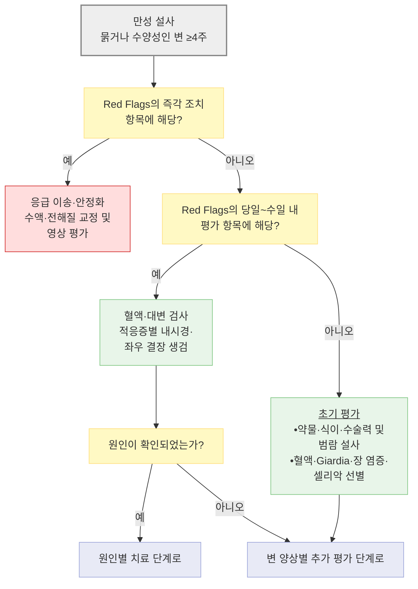
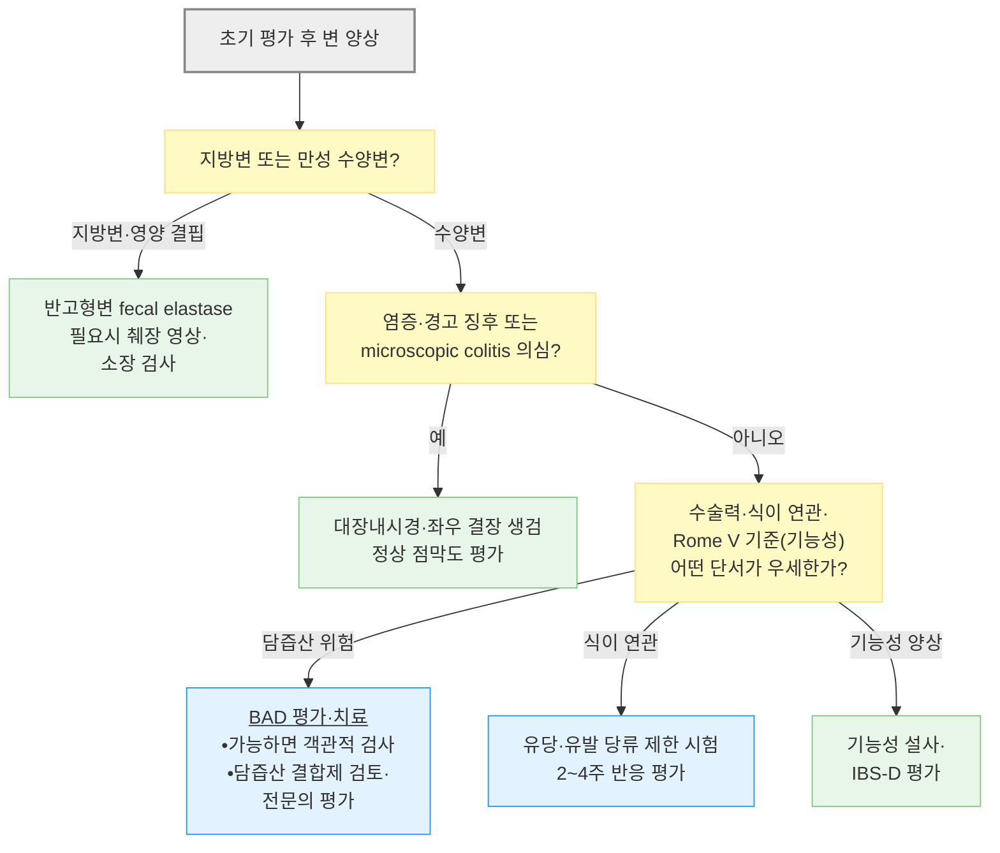

# 만성 설사 Chronic Diarrhea

## <mark style="color:green;">일반 사항</mark>

* 정의 : 묽거나 수양성인 변([Bristol stool scale](083_-acute-diarrhea.md#undefined-2) 6\~7형)이 ≥4주 반복되는 상태로, 배변 횟수 증가·절박변 또는 변실금이 동반될 수 있음
* 기간 구분 : 만성 ≥4주, 지속성 ≥14일\~＜4주, 급성 ＜14일 <mark style="color:$info;">\[BSG 2018]</mark>
* 대부분 장 점막의 수분·전해질 흡수-분비 불균형이 핵심 기전
* 기전상 삼투압성·분비성·염증성·흡수 장애·과운동성으로 분류되며 복합 기전이 흔함
* 진정한 식품 알레르기는 성인 만성 설사의 원인으로는 드묾

## <mark style="color:green;">원인</mark>

#### <mark style="color:$primary;">과운동성 설사 (Hypermotility)</mark>

* 기능성 설사 (functional diarrhea) : 반복적인 묽은 변이 주된 표현형이며, 복통·복부 불편감이 있더라도 IBS 기준을 충족하지 않음
  * IBS-D와 구분 : [IBS-D](087_-ibs.md#rome-v)는 배변 또는 변 형태·횟수 변화와 연관된 반복적 복통 또는 복부 불편감이 있음 <mark style="color:$info;">\[Rome V]</mark>
* Post-infectious IBS : 급성 장염 이후 장 투과성 변화·미세 염증 지속으로 수개월 이상 설사·팽만·urgency 지속; 외래에서 흔히 간과됨
* 갑상선 기능 항진증, 당뇨병신경병증, 수술 후 (미주신경 절단술·위 절제술 후)
  * 당뇨병성 설사 : 오래된 당뇨병에서 기립성 저혈압·위마비 등 다른 자율신경병증과 함께 나타나는 경우가 많고, 야간 설사·변실금이 흔함; metformin·감미료(sorbitol) 등 약물·식이 원인과 SIBO·EPI·셀리악병 동반을 먼저 감별

#### <mark style="color:$primary;">삼투압 설사 (Osmotic)</mark>

* 탄수화물 흡수 장애 : 당분(lactose, fructose), 당알코올(sorbitol, xylitol 등)
  * sucralose·사카린 등 인공감미료도 일부 환자에서 증상을 유발할 수 있으나 전형적인 삼투압성 원인으로 단정하지 않음
* 삼투성 하제 (예: MgO, phosphate, sulfate)
* 금식 시 호전이 특징

#### <mark style="color:$primary;">흡수 장애 (Malabsorption)</mark>

* Whipple disease, giardiasis, 셀리악병(celiac disease), short bowel syndrome
  * 셀리악병은 한국에서 유병률이 낮으나 원인 불명 흡수 장애·철 결핍 빈혈·만성 설사에서는 anti-tTG IgA와 total IgA 선별 고려
* 소장 세균 과증식 (SIBO)
  * 위험 인자 : 위·소장 수술(맹관 고리 등), 협착·게실, 소장 운동 장애(당뇨병성 신경병증·경피증 등), 고령; 장기 PPI 사용과의 연관성은 논란이 있음
* 췌장 외분비 기능 부전 (EPI) : 만성 췌장염(특히 알코올성), 췌장암, 췌장·위 절제술 후, cystic fibrosis 등
  * 고령·당뇨병·흡연자에서도 fecal elastase 저하가 드물지 않으며, IBS-D로 진단된 환자 일부(약 5%)에서도 확인됨 <mark style="color:$info;">\[Dig Dis Sci 2022]</mark>

#### <mark style="color:$primary;">분비성 설사 (Secretory) - BAD 포함</mark>

* 특징 : 다량의 수양성 설사가 금식 중 및 야간에도 지속될 수 있음
* 담즙산 설사 (bile acid diarrhea, BAD) : 담즙산 흡수 감소 및/또는 합성 증가로 대장 내 담즙산이 과다해져 발생; 만성 수양성 설사의 주요 원인 중 하나로 과소 진단되는 경향
  * 담낭절제술 후 : 담즙산의 저장·방출 양상이 바뀌고 대장으로 전달되는 담즙산이 증가하여 발생 가능; 일부는 자연 호전하지만 지속 기간은 다양함
  * Terminal ileum 절제·질환 후
  * 특발성 BAD : terminal ileal disease 없이도 발생; IBS-D로 오진되는 경우 많음
  * 야간 수양성 설사 + 담낭절제술 병력에서 의심하되, 이 양상만으로 확진하지 않음; 식후 악화가 흔하고 금식 시 호전될 수 있어 전형적 분비성 양상과 다를 수 있음
* 하제 : 자극성 하제(senna, bisacodyl), 변연화제(docusate) 등
  * 하제 남용을 환자가 밝히지 않는 경우가 있으므로 주의
* 종양 : VIPoma, gastrinoma, carcinoid syndrome, 갑상선 수질암 - 극히 드묾
  * 단서 : 금식에도 지속되는 다량 수양성 설사와 저칼륨혈증(VIPoma), 홍조·천명(carcinoid syndrome), 난치성·다발성 소화성 궤양(gastrinoma)
* Systemic mastocytosis : 비만세포 매개물질(histamine 등) 분비로 설사; 홍조·두드러기·복통 동반 가능 - 드묾

#### <mark style="color:$primary;">약물 유발 설사</mark>

* 마그네슘 함유 보충제·제산제, cholinesterase inhibitors, SSRI, ARB (특히 olmesartan), PPI, NSAID, metformin, GLP-1RA, colchicine, mycophenolate, 면역관문억제제, allopurinol, orlistat
  * olmesartan-associated enteropathy : olmesartan 복용 수개월\~수년 후 셀리악병과 유사한 중증 장병증 발생 가능; 심한 만성 설사·체중 감소·흡수 장애 → olmesartan 중단 후 호전
  * GLP-1 수용체 작용제 / GIP·GLP-1 이중 작용제 (semaglutide, liraglutide, tirzepatide 등) : 장 운동 변화 및 장 내 분비 변화로 오심·복부 팽만·설사 또는 변비 유발 가능
    * 설사와 변비의 빈도는 제제·용량에 따라 다르며, 주로 치료 시작 또는 용량 증량기에 발생
* 항생제 관련 장염 : _C. difficile_ 포함; 장내 dysbiosis로 인한 비특이적 설사 포함
* 알코올 : 과다 섭취 시 장 운동 항진, 점막 손상, 흡수 장애로 만성 설사 유발
* 허브 : St. John's wort, echinacea, 마늘, 인삼, saw palmetto, cranberry, 알로에 및 senna·cascara 등을 함유한 완하성 허브차

#### <mark style="color:$primary;">염증성·비감염성 설사 (Inflammatory)</mark>

* IBD (Crohn's disease, 궤양성 대장염)
* Microscopic colitis (collagenous colitis, lymphocytic colitis) : 내시경은 정상이거나 경미한 비특이 소견일 수 있으며 조직검사로 확진; NSAID·PPI·SSRI 등과 연관되며 발병과의 약물 투여의 시간적 관계 확인
* 혈관염, 방사선 장염, 호산구성 장염

#### <mark style="color:$primary;">감염성 설사 (Infection)</mark>

* 세균 : _Clostridioides difficile_, _Mycobacterium avium_ complex (MAC)
  * MAC은 면역 저하자에서 주로 발생 - HIV, 장기이식, 고용량 스테로이드 복용자
* 바이러스 : cytomegalovirus (면역 저하자에서 주로 발생)
* 기생충 : _Giardia duodenalis_ (_G. lamblia_), _Cryptosporidium_, _Cystoisospora belli_ (구 _Isospora belli_), _Strongyloides_

#### <mark style="color:$primary;">만성 전신 질환</mark>

* 갑상선 질환, 당뇨병, 콜라겐 혈관 질환 → 장 운동 또는 흡수 변화

## <mark style="color:green;">임상 양상</mark>

#### <mark style="color:$primary;">기전별 임상 특징</mark>

<table><thead><tr><th width="140">기전 유형</th><th width="265">특징적 양상</th><th>감별 단서</th></tr></thead><tbody><tr><td><strong>과운동성</strong></td><td>하복부 통증, 소량 설사, 야간에 드묾</td><td>스트레스·식사와 연관; 장음↑</td></tr><tr><td><strong>삼투압성</strong></td><td>식사 후 설사, 복부 팽창/가스</td><td>금식 시 호전; 당류 제한 시 호전</td></tr><tr><td><strong>흡수장애</strong></td><td>지방변, 체중 감소, 영양 결핍</td><td>설사 양 많고 악취; 지용성 비타민 결핍</td></tr><tr><td><strong>분비성/BAD</strong></td><td>다량 수양성 설사, 야간에도 지속</td><td>금식 중에도 지속 가능; BAD는 식후 악화도 가능; 회장 질환·절제, 담낭절제술 병력</td></tr><tr><td><strong>염증성</strong></td><td>혈변, 농변, 복통, 발열, 체중 감소</td><td>대변 calprotectin↑; microscopic colitis는 비혈성 수양변·정상 내시경 가능</td></tr></tbody></table>

#### <mark style="color:$primary;">췌장 외분비 기능 부전을 의심할 단서</mark>

* 지방변(기름지고 악취가 나며 변기에 뜨거나 씻겨 내려가지 않는 변), 식후 복부 팽만·가스, 의도하지 않은 체중 감소
* 지용성 비타민(A·D·E·K) 결핍, 골감소증·골다공증
* 음주력·만성 췌장염 병력, 췌장·위 수술력, 새로 발생하거나 조절이 악화된 당뇨병
* 췌장 기능이 크게 줄어든 뒤에야 지방변이 뚜렷해지므로, 지방변이 없어도 위험 인자와 영양 결핍이 있으면 EPI를 배제하지 않음

### <mark style="color:$danger;">🚩 Red Flags!</mark>

<mark style="color:$danger;">**즉각 조치**</mark>

* 저혈압·실신·의식 변화 또는 부정맥을 동반한 중증 탈수·전해질 이상 `중증 탈수` `전해질 이상`
* 순환 부전 징후를 동반한 대량 혈변·흑색변 `위장관 출혈`
* 현저한 복부 팽창, 심한 압통 또는 복막 자극 징후와 발열·전신 독성 `독성 거대결장` `장 천공`
* 저혈압·쇼크·장폐색 또는 거대결장을 동반한 _C. difficile_ 감염 의심 `전격성 C. difficile 감염`

<mark style="color:$warning;">**당일\~수일 내 평가**</mark>

* **(당일)** 새로 발생한 혈변·흑색변 또는 지속되는 발열과 복통 `장 출혈` `침습성 감염` `IBD`
* **(당일)** 면역저하자에서 악화되는 설사 `CMV 장염` `기회 감염`
* **(당일)** 면역관문억제제 치료 중 새로 발생하거나 악화된 설사 `면역매개 장염`
* 원인 불명 체중 감소(6개월 내 ≥5%), 철 결핍 빈혈 또는 저알부민혈증 `대장암` `IBD` `흡수 장애`
* 50세 이상에서 새로 발생한 만성 설사 `대장암` `Microscopic colitis`
* 대장암·IBD 가족력이 있는 환자의 새 증상 또는 수면 중 깨는 야간 설사 `기질적 장 질환`

<mark style="color:$info;">**조기 평가 및 추적**</mark>

* 경고 징후 없이 기본 평가 후 4\~6주 치료에도 지속되는 설사 `BAD` `Microscopic colitis` `SIBO`
* 지방변(기름지고 악취 나는 변)·지용성 비타민 결핍 등 흡수 장애를 시사하는 소견 `췌장 외분비 부전` `셀리악병` `SIBO`

## <mark style="color:green;">진단</mark>

### <mark style="color:orange;">기초 평가</mark>

* 병력 : 기저 질환(당뇨병·만성 췌장염 포함), 약물(최근 항생제 포함), 식이(음식 일기), 음주, 정신사회적 스트레스, 여행력, 가족력, 수술력(담낭절제술, 위·췌장·회장 수술)
* 환자가 "설사"로 표현하는 증상이 변실금인 경우가 흔하므로 변실금 여부를 따로 확인
* 고령자·거동 저하자·오피오이드 복용자에서 변비 병력과 함께 소량의 묽은 변이나 변실금이 반복되면 분변 매복에 의한 범람성 설사(overflow diarrhea)를 고려하고 직장수지검사를 시행

**기능성 설사 평가** <mark style="color:$info;">\[Rome V]</mark>

* 배변 중 25%를 초과하여 묽은 변·수양변이 발생하고, 변비를 유발하는 약물 없이 단단한 변은 드묾
* 증상 시작은 최소 6개월 전이며 최근 3개월간 기준을 충족
* 적절한 평가로 기질적 원인 유무를 평가하고, IBS-D 기준을 충족하는 경우는 제외함

**IBS 평가**

* 증상 시작 최소 6개월, 최근 3개월간 평균 월 3일 이상 반복되지만 지속적이지는 않은 복통 또는 복부 불편감이 있고, ① 배변과의 관련, ② 배변 횟수 변화, ③ 변 형태 변화 중 2가지 이상과 연관되는지 평가
* 설사 아형은 Bristol 변 형태로 구분 (☞ [IBS](087_-ibs.md))

### <mark style="color:orange;">검사</mark>

* **경고 징후 없는 경우** : 약물·식이 검토 및 음식 일기(2\~4주)와 기본 검사를 병행 → 식이 유발 원인(lactose, fructose, sorbitol) 평가 → 단계적 검사
* **경고 징후 있는 경우** : 긴급도에 따라 혈액·대변·내시경 검사를 앞당김. 쇼크·복막 자극 징후·독성 거대결장 의심 시 안정화와 응급 영상 평가를 우선하며 전대장내시경을 바로 시행하지 않음

#### <mark style="color:$primary;">혈액 검사</mark>

* CBC, CRP ← 빈혈·염증 평가
  * 경고 징후 없는 수양성 설사에서 ESR/CRP만으로 IBD를 선별하지 말고 fecal calprotectin 또는 lactoferrin을 우선
* Na·K·Cl·중탄산염(또는 total CO₂), BUN/Cr ← 수분·전해질 소실 및 신기능 평가
* LFT·알부민; Mg·P·Ca·INR은 심한 설사·흡수장애·영양결핍 또는 출혈 위험 등 임상상에 따라 선택
* TSH ← 갑상선 기능 이상
* Anti-tissue transglutaminase IgA (anti-tTG IgA) + total IgA ← 셀리악병(유병률은 낮지만 원인 불명 만성 설사, IBS-D/기능성 설사를 진단하려는 경우, 흡수 장애·철 결핍 빈혈 동반 시 선별 고려)
  * IgA 결핍이면 IgG deamidated gliadin peptide(DGP) 또는 IgG-tTG를 사용
  * 글루텐 함유 식사를 유지한 상태에서 검사하며, 검사 전에 gluten-free 식이를 시작하지 않음. 이미 제한 중이면 임의로 단기간 섭취시키지 말고 gluten challenge의 양·기간을 전문의와 결정
  * 성인에서는 원칙적으로 혈청검사와 상부위장관 내시경·십이지장 조직검사로 확진
  * 일부 고역가 항체 양성 환자(ESsCD 2025: 45세 미만, 경고 증상 없음, anti-TG2 IgA ≥10×정상상한, 별도 채혈 확인 등)의 무생검 진단은 전문기관에서 판단 <mark style="color:$info;">\[ESsCD 2025]</mark>
* 빈혈·흡수장애가 의심되면 ferritin·Fe/TIBC·B12·folate를 검사하고, 지방 흡수장애·영양결핍 위험에서는 Vit D 등 추가

#### <mark style="color:$primary;">대변 검사</mark>

* _Giardia_ 항원 또는 PCR : 원인 불명 만성 수양성 설사에서 검사 권고; 여행력이 없어도 배제하지 않음
* 대변 배양 : 발열·혈변, 집단 발생, 면역저하 또는 역학적 위험이 있을 때 선택
* 기생충란충 검사 : 여행·이주·오염수 노출·면역저하 등 위험이 있을 때 선택; 특별한 위험이 없으면 광범위한 routine 검사를 권하지 않음
* 장 염증 평가 : fecal calprotectin/lactoferrin을 우선
  * 대변 WBC는 정확도가 낮아 routine 검사로 권하지 않음
* 대장암 평가가 필요하면 일반 잠혈검사보다 정량적 FIT와 내시경 적응증을 구분하여 적용
* 대변 전해질(Na, K) : 원인 불명 다량 수양성 설사에서 선택적으로 시행
  * osmotic gap 계산 : 290 − 2×(Na + K) mOsm/kg stool water
    * 대변 Na·K는 mmol/L로 입력하며 측정 대변 삼투압을 290 대신 넣지 않음. 검체 보관 지연·오염은 해석에 영향을 주므로 검사실 지침 준수
* 하제 남용 의심 : 대변 Mg 등 하제 선별 검사를 선택적으로 고려

<table><thead><tr><th width="146">Osmotic gap (mOsm/kg)</th><th>임상 해석</th></tr></thead><tbody><tr><td><strong>＜50</strong></td><td>분비성 설사 (secretory) - 금식 중에도 지속 가능</td></tr><tr><td><strong>50~100</strong></td><td>혼합형/indeterminate - 두 기전 공존 가능; 추가 평가 필요</td></tr><tr><td><strong>＞100</strong>*</td><td>삼투압성 설사 (osmotic) - 금식 시 호전 기대</td></tr></tbody></table>

> _\*삼투압성 설사의 gap 기준을 ＞125로 쓰는 문헌도 있음._\
> _gap 해석 전 검체 확인 : 측정 대변 삼투압(gap이 아님)이 ＜250 mOsm/kg이면 물·희석뇨 오염 검체로 보고 gap을 해석하지 않음_

<mark style="color:cyan;">**분변 칼프로텍틴(fecal calprotectin)**</mark>

* 장 점막 염증 부위로 모인 호중구에서 유래해 대변으로 배설되는 단백질
* 대변 내 칼프로텍틴 농도는 장 점막의 염증 정도와 밀접한 상관관계를 보임; IBD와 기능성 설사의 감별에 사용
  * 통상 ＜50 ㎍/g이면 유의한 장 염증 가능성이 낮음. 절단값은 검사법·검사실에 따라 다르므로 단일 수치만으로 IBD를 확진·배제하지 않음
* 감염·NSAID·PPI 복용·대장 종양 등에서도 상승할 수 있음
* 정상이어도 microscopic colitis·셀리악병·BAD는 배제되지 않음
* 단독 수치보다 임상 양상·교란 요인과 함께 해석함
  * 경계 수치는 교란 요인을 확인한 뒤 재검을 고려하고, 뚜렷한 상승은 대장내시경 평가 대상
  * 혈변·체중 감소 등 경고 징후가 있으면 수치가 낮아도 내시경을 보류하지 않음
* 급성 설사의 원인 감별에는 권고하지 않음
* [급여기준](https://www.hira.or.kr/rc/insu/insuadtcrtr/InsuAdtCrtrPopup.do?mtgHmeDd=20210127\&sno=1\&mtgMtrRegSno=0001) : 4주 이상의 만성 설사 또는 복통·혈변 등 하부 위장관 증상이 있는 염증성 장질환 의심 환자 (1회)

<mark style="color:cyan;">**기타 대변 검사**</mark>

* Fecal elastase-1 : 췌장 외분비 기능 부전(EPI)의 초기 평가. 지방변·체중 감소·영양 결핍이 있거나 EPI 위험 인자를 가진 만성 설사에서 검사; ＜100 ㎍/g은 EPI를 강하게 지지, 100\~200 ㎍/g은 판정 유보. 수양변에서는 희석으로 거짓 저하가 생기므로 반고형변 이상에서 검사
* _C. difficile_ 검사 : 최근 항생제·의료기관 노출, 면역저하 또는 설명되지 않는 설사에서 설사변으로 검사(GDH + toxin EIA 다단계 알고리듬 등); NAAT 단독 양성은 임상상과 함께 해석

#### <mark style="color:$primary;">호기 검사 (Hydrogen breath test)</mark>

* 유당·과당 불내성 평가에 사용할 수 있으며, SIBO에서는 해부학적 이상·수술력·운동장애 등 사전확률이 높은 증상 환자에서 선택적으로 고려
* 한계 : 위양성·위음성 모두 가능; 임상 양상과 함께 해석 필수
  * methane 양성은 intestinal methanogen overgrowth (IMO)로 구분하며 constipation-predominant phenotype과 연관
  * 장 통과 가속(rapid transit) → 수소 조기 상승 → false positive 가능
* glucose 또는 lactulose 수소·메탄 호기검사를 사용할 수 있으나 정확도가 제한적이므로 단독으로 진단하지 않음
  * IBS-D·복부팽만만으로 SIBO 호기검사를 일률적으로 시행하지 않으며, 특히 lactulose 검사 양성만으로 SIBO를 확정하지 않음. ESNM/ANMS 2024는 IBS 환자에서 호기검사에 의한 과진단과 불필요한 항생제 사용을 경고 <mark style="color:$info;">\[ESNM/ANMS 2024]</mark>

#### <mark style="color:$primary;">영상·내시경</mark>

* 복부 단순 X선은 장폐색·거대결장·분변 매복 등이 의심될 때 선택하며 원인 불명 만성 설사의 일률적 검사는 아님
* CT/MR enterography : 크론병·소장 종양 등 소장 병변이 의심될 때(지속적 심한 복통·체중 감소·철 결핍 빈혈·fecal calprotectin 상승이 있으나 내시경으로 원인이 밝혀지지 않을 때) 선택
* 원인 불명 EPI 또는 췌장 질환이 의심되는 지방변·체중 감소에서는 췌장 CT/MRI, 필요시 EUS로 만성 췌장염·췌장 종양 등을 평가. 영상검사만으로 EPI를 확진하지 않음
* 대장 내시경 + 조직검사 : 경고 징후·혈변·≥50세 신규 발생, 초기 검사 후에도 지속되는 원인 불명 설사 또는 microscopic colitis 의심 시; ＜50세이어도 적응증이 있으면 시행
  * 만성 설사 평가 목적으로 대장내시경을 시행할 때는 정상 점막이어도 좌·우측 결장 생검으로 microscopic colitis를 평가; 직장 생검만으로 배제하지 않음
* 상부위장관 내시경 + 십이지장 조직검사 : 지방변·대량 설사·체중 감소·영양 결핍 등 소장성 흡수 장애가 의심되거나 대장내시경으로 원인이 밝혀지지 않을 때 고려

#### <mark style="color:$primary;">특수 검사 (의뢰)</mark>

* SeHCAT scan, 혈청 C4 (7α-hydroxy-4-cholesten-3-one) : 담즙산 설사(BAD) 진단에 사용
  * 혈청 FGF-19는 표준화·접근성이 제한적인 보조 검사
  * 가능하면 객관적 검사(SeHCAT·혈청 C4)로 진단. 검사가 어려우면 위험 인자·감별진단을 검토한 뒤 소화기내과에서 cholestyramine 치료 시험을 고려할 수 있음; 치료 반응만으로 확진하거나 무반응만으로 배제하지 않음
* 소장 흡인액 배양 : 선택적으로 SIBO 평가에 사용하나 채취·오염·배양 기준의 한계가 있으며 단독으로 완전한 확진 검사로 간주하지 않음
* 조직검사 : 셀리악병(십이지장), Whipple disease(소장) 의심 시
* 신경내분비종양 의심 : 24시간 소변 5-HIAA(carcinoid), 혈청 VIP·gastrin 등은 사전확률이 높을 때 전문 평가로 시행하며 원인 불명 설사의 일률적 선별 검사로 쓰지 않음

### <mark style="color:orange;">변 양상 기반 접근 (Stool Phenotype Approach)</mark>

<table data-search="false"><thead><tr><th width="220">변 양상</th><th>의심 진단</th></tr></thead><tbody><tr><td><strong>수양성 + 야간 지속</strong></td><td>Secretory, BAD, Microscopic colitis</td></tr><tr><td><strong>식후 즉시 악화</strong></td><td>IBS-D, BAD (담낭절제술 후), 삼투압성</td></tr><tr><td><strong>지방변</strong> (기름지고 악취)</td><td>Malabsorption, 췌장 외분비 부전, SIBO, 셀리악병</td></tr><tr><td><strong>혈변·농변</strong></td><td>IBD, 침습성 감염, 종양; C. difficile은 대개 비혈성 수양변</td></tr><tr><td><strong>소량 빈번 + urgency 주증상</strong></td><td>IBS-D, BAD, 직장 염증</td></tr><tr><td><strong>복부 팽만·가스 동반</strong></td><td>Carbohydrate intolerance, SIBO, IBS-D</td></tr><tr><td><strong>금식 시 호전</strong></td><td>Osmotic (유당·과당 불내성, 삼투성 하제)</td></tr><tr><td><strong>금식해도 지속</strong></td><td>Secretory (BAD, 종양, 하제 남용)</td></tr></tbody></table>

### <mark style="color:orange;">Functional diarrhea vs IBS-D 감별</mark>

* Rome V는 IBS에서 복통뿐 아니라 복부 불편감도 평가함. 복통이 없다는 이유만으로 IBS-D를 배제하거나 기능성 설사로 단정하지 않음

<table><thead><tr><th width="198">특징</th><th>Functional diarrhea</th><th>IBS-D</th></tr></thead><tbody><tr><td><strong>주된 표현형</strong></td><td>반복되는 묽은 변·수양변</td><td>설사형 배변 이상과 연관된 반복적 복통 또는 복부 불편감</td></tr><tr><td><strong>감별 핵심</strong></td><td>묽은 변의 비율, 단단한 변의 드문 발생 여부 및 IBS 기준 충족 여부를 종합</td><td>증상 빈도·기간 및 배변·배변 횟수·변 형태와의 관계</td></tr><tr><td><strong>야간 설사·체중 감소·출혈</strong></td><td colspan="2">기능성 진단에 앞서 기질적 원인 평가</td></tr><tr><td><strong>치료 방향</strong></td><td>변 형태·절박변 조절과 원인별 접근</td><td>변 형태 조절에 복통·불편감 및 장-뇌 축 치료 병행</td></tr></tbody></table>

* 매일 깨어 있는 동안 계속되는 지속적(continuous) 복통이 있으면 Rome V의 IBS 기준에서 제외되지만, 이 군은 오히려 증상·심리 동반질환·기능 장애가 더 심할 수 있으므로 기능성 설사로 단순 분류하지 않음 <mark style="color:$info;">\[Rome V]</mark>


**Microscopic colitis :** 고령(특히 60대 이상) 여성의 만성 비혈성 수양성·야간 설사에서는 대장내시경이 정상이어도 microscopic colitis를 적극 고려해야 함; 조직검사로 확진하며, 진단 누락을 줄이기 위해 정상 점막에서도 좌·우측 결장 생검을 권고. NSAID·PPI·SSRI 복용력 반드시 확인



**외래 임상 핵심 포인트 (One-line Pearls)**

* "먹으면 바로 설사" → IBS-D / BAD 먼저 생각
* "밤에도 깨서 설사" → 기능성보다 기질성 가능성↑ → microscopic colitis / BAD 평가
* "정상 내시경인데 계속 물설사" → microscopic colitis 놓치기 쉬움; random biopsy 필수
* "담낭절제 후 지속 설사" → BAD를 주요 원인으로 고려; 담즙산 결합제 치료 검토·소화기내과 평가
* "복통 없는 만성 묽은 변" → 기능성 설사 가능하나 반복적 복부 불편감과 배변의 관계도 확인하여 Rome V에 따라 IBS-D와 감별
* "배변 이상과 연관된 반복 복통·불편감" → IBS-D 기준 평가 → gut-brain modulation 접근
* "고령 여성 + 비혈성 수양성·야간 설사 + 정상 내시경" → microscopic colitis 적극 고려; 좌·우측 결장 조직검사
* "olmesartan 복용 중 + 심한 흡수 장애" → olmesartan enteropathy 의심; 대체 약제를 고려하며 중단


***



<p align="center"><strong>만성 설사 초기 분류</strong></p>

***



> _각 경로의 검사 결과와 치료 반응으로 재평가하고, 원인 불명이거나 치료에 반응하지 않으면 대변 Na/K 등으로 혼합 기전과 드문 원인을 전문 평가_

<p align="center"><strong>변 양상별 평가</strong></p>

<p align="center"><em><mark style="color:$info;">저자 재구성 (참고 문헌 : BSG 2018; AGA 2019; Rome V 2026)</mark></em></p>

***

## <mark style="background-color:$warning;">Management</mark>

### <mark style="color:orange;">치료 방침</mark>

* 원인 질환 치료 : 감염, IBD, 췌장 기능 부전, 갑상선 기능 항진 등 기저 원인 교정
  * 기전을 규명하지 않은 채 대증 치료에만 의존하지 말 것
* 경고 징후가 없고, 기본 평가 후 기능성 설사/IBS로 판단되면 증상에 맞춘 치료 시행
* 탈수 관리·영양 공급 : 경증은 물과 식사를 병행하고, 의미 있는 수분·전해질 소실에는 적절한 조성의 ORS 사용
  * 고당분 스포츠음료는 ORS를 대체하지 못함
* 유발 식품 회피 ([음식 일기](084_-chronic-diarrhea.md#diary) 작성 권고)
  * 유당 불내성 → lactose-free 식이; lactase 보충제 고려
  * 식이 제한 : low-FODMAP 식이(IBS-D), gluten 제거(확진된 셀리악병), sorbitol·fructose 제한
  * 셀리악병 검사를 계획한 환자에서는 혈청검사·조직검사 전에 gluten-free 식이를 시작하지 않음
* 약물 재검토 : PPI, NSAID, SSRI, GLP-1 RA, olmesartan 등 설사 유발 약물 확인 후 중단 또는 교체
* 항문 주위 피부 보호 : zinc oxide 연고 <mark style="color:blue;">\[</mark>[<mark style="color:blue;">보소미연고</mark>](https://www.druginfo.co.kr/detail/product_cp_cancer.aspx?pid=34971)<mark style="color:blue;">]</mark>, 피부 방수제 <mark style="color:blue;">\[</mark>[<mark style="color:blue;">카빌론</mark>](https://www.solventum.com/ko-kr/home/medical/advanced-wound-care/advanced-skin-care/cavilon/)<mark style="color:blue;">]</mark> 고려
* 위생 관리 : 특히 감염성 원인 배제 전까지 손 위생 철저
* 기본 평가 후 식이·기능성 질환 치료에 4\~6주간 반응이 없으면 추가 검사 또는 의뢰
  * loperamide 무반응은 10일 이내 중단·재평가 기준을 따름

## <mark style="color:green;">비-약물 치료 및 예방</mark> <a href="#non-drug-treatment" id="non-drug-treatment"></a>

* [Low-FODMAP 식이](087_-ibs.md#low-fodmap) : 주로 IBS-D에서 단기간(2\~6주) 시도한 뒤 FODMAP 식품을 단계적으로 다시 늘려 개인별 허용 범위를 찾음
  * 기능성 설사에서의 근거는 상대적으로 제한적
* 유당 제한 : 유당 불내성 확인 후 lactose-free 제품으로 전환 또는 lactase 효소 보충
* 수분 보충 : 탈수 예방; 카페인·알코올·고당분 음료 제한
* 규칙적 운동 : 규칙적인 유산소 운동이 장 운동 조절에 도움 - IBS-D 증상 완화에 근거 있음
* 스트레스 관리 : 심리적 스트레스가 IBS-D에서 gut-brain axis로 유발 인자가 됨
  * 인지행동치료(CBT), 장 지향 최면요법(gut-directed hypnotherapy)
* 규칙적 식사 습관 : 불규칙한 식사와 폭식을 피하고, 필요하면 소량씩 자주 식사

## <mark style="color:green;">약물 치료</mark> <a href="#drug-treatment" id="drug-treatment"></a>

(☞ [소화기계 약제](073_-gidrugs.md))

### <mark style="color:orange;">Opiates (μ-opiate receptor 선택적)</mark>

* 작용 : 장 운동 지연, 장 분비 감소
* 대상 : 비특이적 만성 설사 대증 치료, 기능성 설사·IBS-D의 urgency 증상
* 회피 : 발열·혈변을 동반한 급성 침습성 감염, _C. difficile_ 감염 의심 또는 확진, 급성 중증 대장염 또는 toxic megacolon 위험
* loperamide : 2 ㎎ qd\~qid로 시작하여 반응에 따라 조절. 최대 16 ㎎/d <mark style="color:blue;">\[</mark>[<mark style="color:blue;">로프민</mark>](https://www.health.kr/drug/A11A1660A0057)<mark style="color:blue;">]</mark>
  * 만성 설사의 통상 유지용량은 2\~6 ㎎/d을 1\~2회 분복; 최저 유효용량으로 개별 조절
  * 과량 복용 시 QT 연장·torsades de pointes·실신 위험
  * CYP3A4·P-gp 억제제(clarithromycin, itraconazole 등) 병용 주의
  * 만성 기능성 설사에서는 식전 규칙 복용(scheduled dosing, 예: 식전 30분)이 urgency 예방에 도움이 될 수 있음. 변비 발생 시 감량
  * 만성 설사에서 복용 후 10일 이내 호전이 없으면 중단하고 원인을 재평가 - 효과 없이 증량 또는 계속 복용하지 않음
* diphenoxylate/atropine : 유통 확인 안 됨

### <mark style="color:orange;">IBS-D 표적 치료제</mark>


IBS-D는 단순 설사 억제보다 장-뇌 축 조절 및 복통 완화에 초점을 맞춘 복합 접근이 필요. (☞ [IBS](087_-ibs.md#management))\
Loperamide 단독은 urgency·묽은 변에 효과적이지만, 복통 dominant phenotype에서는 효과 제한적


#### <mark style="color:$primary;">5-HT3 receptor antagonists</mark>

* ondansetron : 4 ㎎ qd에서 시작하여 변 형태·빈도에 따라 감량 또는 증량(예: bid) <mark style="color:blue;">\[</mark>[<mark style="color:blue;">조프란</mark>](https://www.health.kr/drug/A11ABBBBB1538)<mark style="color:blue;">]</mark>&#x20;
  * 장 통과시간 지연 → urgency·묽은 변 개선; IBS-D에서 RCT·메타분석 근거가 있으나 복통 개선 근거는 없음 <mark style="color:$info;">\[Gut 2014]</mark> <mark style="color:$info;">\[Aliment Pharmacol Ther 2023]</mark>. (IBS-D에는 허가 외 사용)
  * 기능성 설사의 일률적 1차 약제로 사용하지 않음
  * 변비가 생기면 감량·휴약
  * 장폐색 징후가 있으면 장운동 저하로 진행성 장폐색이 가려질 수 있어 신중 투여·관찰
  * 선천성 QT 연장 증후군에서는 회피하고, 저칼륨·저마그네슘혈증은 교정
* ramosetron : IBS-D 치료 허가 약제 <mark style="color:blue;">\[이리퀵]</mark>
  * 성인 남성 [5 ㎍](https://www.health.kr/drug/2025050200021) qd(2.5\~10 ㎍/일), 성인 여성 [2.5 ㎍](https://www.health.kr/drug/2025050200017) qd(불충분 시 최대 5 ㎍/일); 항구토용 0.1 ㎎(100 ㎍) 제형과 구분
  * 변비·굳은 변 발생 시 감량·휴약·중단을 고려하고, 새로 발생한 복통·혈변은 중단 후 허혈성 대장염 평가
  * CYP1A2 억제제(fluvoxamine 등) 병용 시 혈중 농도 상승, SSRI·SNRI 등 세로토닌성 약물 병용 시 신중 투여

#### <mark style="color:$primary;">위장관 신경조절제</mark>

* 저용량 TCA : 복통 + urgency 동반 IBS-D에 유용; 진통·장 운동 억제·수면 개선 복합 효과 (IBS-D에는 허가 외 사용)
  * amitriptyline : 10\~25 ㎎ hs <mark style="color:blue;">\[</mark>[<mark style="color:blue;">에트라빌</mark>](https://www.health.kr/drug/A11A0570B0082)<mark style="color:blue;">]</mark>
  * 고령에서는 항콜린 부작용·기립성 저혈압·심독성 때문에 가능한 회피
  * 금기 : 녹내장·전립선비대 등 배뇨장애, 부정맥, 심근경색 회복 초기, MAO 억제제 병용; 그 밖의 심혈관 질환과 다른 항콜린 약물 병용은 신중 평가


**QT 연장·약물 상호작용 주의** : Ondansetron·amitriptyline은 QT 간격을 연장할 수 있으며, loperamide도 특히 과량 복용 또는 상호작용에 따른 혈중 농도 상승 시 심각한 부정맥 위험이 있음. Domperidone, macrolide계 항생제(clarithromycin 등), azole계 항진균제, 항부정맥제(amiodarone·sotalol 등), 일부 항정신병제·항우울제 등은 QT 연장 또는 약물 농도 상승을 일으킬 수 있으므로 병용 전 약물별 금기·상호작용을 확인. 병용금기 조합은 피하며, 고령·다제 병용·기존 QT 연장·서맥·심질환이 있으면 위험을 평가하고 심전도 모니터링을 고려. 저칼륨·저마그네슘혈증은 교정


#### <mark style="color:$primary;">Antispasmodics</mark>

* 식후 복통·cramping 동반 시 고려
* trimebutine 100\~200 ㎎ tid 식전 <mark style="color:blue;">\[</mark>[<mark style="color:blue;">포리부틴</mark>](https://www.health.kr/drug/A11A0500A0119)<mark style="color:blue;">]</mark>
* pinaverium 50 ㎎ tid 식사 중, 씹지 말고 충분한 물과 함께 통째로 삼킴; 누운 자세 또는 취침 직전 복용 회피 <mark style="color:blue;">\[</mark>[<mark style="color:blue;">디세텔</mark>](https://www.health.kr/drug/A11A0950A0197)<mark style="color:blue;">]</mark>
* mebeverine : 단일제 유통 확인 안 됨

#### <mark style="color:$primary;">비흡수성 항생제</mark>

* rifaximin : bloating prominent IBS-D에서 고려(허가 외 사용); 제품·용법은 (☞ 아래 항생제)
  * 허가 외 사용 및 급여 제한을 설명하고, post-infectious IBS를 별도 확립 적응증으로 간주하지 않음

### <mark style="color:orange;">α-2 Adrenergic agonist</mark>

* 작용 : 장내 전해질 분비 억제, intestinal transit time 지연
* 대상 : 일반적인 만성 설사의 routine 치료가 아니라 난치성 당뇨병성·분비성 설사 또는 opiate 금단 설사에서 전문의가 제한적으로 고려하는 허가 외 치료제
* 주의 : 저혈압·서맥·진정; 갑작스러운 중단 시 반동성 고혈압
* clonidine : α₂ 작용제로 장 상피의 수분·전해질 흡수를 늘리고 장 운동을 억제함
  * 당뇨병성 자율신경병증 설사에서 소규모 연구·증례로 효과가 보고되었으나 근거는 제한적
  * 기립성 저혈압·반동성 고혈압에 주의 (속방형 유통 확인 안 됨)

### <mark style="color:orange;">Somatostatin analogue</mark>

* 작용 : 장 내 fluid·전해질 흡수 자극, GI peptides 분비 억제
* 대상 : carcinoid syndrome, VIPoma 등 신경내분비종양 관련 설사
  * 화학요법 관련 난치성 설사·위 절제술 후 덤핑증후군에서는 전문의가 제한적으로 고려
* octreotide 속효성 주사 : 카르시노이드·VIPoma 등 신경내분비종양 설사와 난치성 분비성 설사에서 전문의가 SC 분할 투여로 개별 조절 <mark style="color:blue;">\[</mark>[<mark style="color:blue;">산도스타틴주사</mark>](https://www.health.kr/drug/A11ACCCCC0365)<mark style="color:blue;">]</mark>
  * 장기 지속형 <mark style="color:blue;">\[산도스타틴라르주사]</mark>([10](https://www.health.kr/drug/A11ACCCCC0366)·[20](https://www.health.kr/drug/A11ACCCCC0367)·[30 ㎎](https://www.health.kr/drug/A11ACCCCC0368))는 4주 간격 심부 IM 제제로 속효성 SC 용법과 혼용하지 않음

### <mark style="color:orange;">Bile acid-binding resin</mark>

* 대상 : 담즙산 설사(BAD) - 담낭절제술 후, 제한된 terminal ileum 질환·절제 후, 특발성 BAD
  * 광범위 회장 절제·질환으로 담즙산 풀이 고갈되고 지방변이 있는 경우 담즙산 결합제가 지방변·열량 소실을 악화시킬 수 있음
* cholestyramine : BAD의 초기 치료로 고려. 한국희귀필수의약품센터 공급 제품 <mark style="color:blue;">\[</mark>[<mark style="color:blue;">에픽콜레스티라민현탁용산</mark>](https://www.kodc.or.kr/drugInfo/6640016829?totalPages=1\&page=1\&searchYn=true\&limit=5\&medcinCtgryCode=ALL\&searchType=medcinName\&searchKeyword=%EC%97%90%ED%94%BD%EC%BD%9C%EB%A0%88%EC%8A%A4%ED%8B%B0%EB%9D%BC%EB%AF%BC%ED%98%84%ED%83%81%EC%9A%A9%EC%82%B0)<mark style="color:blue;">(라이트)]</mark>
  * cholestyramine resin 성분량 기준 2\~4 g/d의 저용량으로 시작하여 반응·내약성에 따라 점진적으로 증량; 최저 유효용량 유지. 분말은 제품 지침에 따라 액체에 충분히 분산하여 복용하며 마른 분말을 그대로 삼키지 않음
  * 변비·복부팽만에 주의. 다른 경구약은 결합제 복용 최소 1시간 전 또는 4\~6시간 후로 분리
  * 담즙산 설사에는 식약처 인정 범위 외 사용. 2026년 5월 신설된 급여기준은 혈청 콜레스테롤 수치 감소에 관한 것으로, BAD 치료에 대한 급여 인정과 구분함
  * "라이트"는 설탕 대신 aspartame을 사용한 저당 제형(1포 5.7 g 중 cholestyramine resin 4 g)으로, 페닐케톤뇨증 환자에서는 phenylalanine 함유에 주의
  * 첨가제로 sorbitol·fructose·mannitol을 함유하므로, 복용 후 설사·가스가 악화되면 첨가제 영향도 고려
* colesevelam : cholestyramine 불내약 시 대안으로 고려되지만 유통 확인 안 됨
* 결합제 사용이 어렵거나 내약성이 나쁘면 loperamide 등으로 증상 조절 <mark style="color:$info;">\[CAG 2020]</mark>

### <mark style="color:orange;">항생제</mark>

* 대상 : 소장 세균 과증식(SIBO); IBS-D에서의 적응증 판단은 (☞ IBS-D 표적 치료제)
* rifaximin : 흡수가 적어 흔히 우선 고려하지만 근거의 질이 높지 않고 연구마다 용량·기간이 다양함. 위험 인자와 진단 근거 없이 경험적으로 반복하지 않음
  * SIBO 치료 예시 : 200 ㎎ 2T tid (1,200 ㎎/d) × 7\~14일 <mark style="color:blue;">\[</mark>[<mark style="color:blue;">노르믹스</mark>](https://www.health.kr/drug/A11AOOOOO0736)<mark style="color:blue;">]</mark>; SIBO의 최적 용량·기간은 확립되지 않음. SIBO·IBS-D 모두 허가 외 사용
  * IBS-D의 대표 임상시험 용법은 550 ㎎ tid × 14일. 550 ㎎ 정제 <mark style="color:blue;">\[</mark>[<mark style="color:blue;">틱스타</mark>](https://www.health.kr/drug/2023080800002)<mark style="color:blue;">]</mark>는 현성 간성뇌증 재발 감소에 허가된 제품이며, 200 ㎎ 정제를 이용한 용법과 근거·허가·급여가 동일하지 않음
  * [보험주의](https://www.hira.or.kr/rc/insu/insuadtcrtr/InsuAdtCrtrPopup.do?mtgHmeDd=20130901\&sno=1\&mtgMtrRegSno=418\&brdScnBltNo=4\&brdBltNo=\&isPopupYn=Y) : 급여는 급성 장염 또는 장내 세균총 이상으로 인한 설사(여름철 설사·여행자 설사·소장결장염)에서 동일 효능의 다른 약제로 호전되지 않는 경우와 고암모니아혈증 보조요법·위장관 수술 전후 투여에 인정되며, 그 밖의 사용은 약값 전액 본인부담. SIBO·IBS-D의 14일 치료가 이 기준에 그대로 해당하는 것은 아님
  * 재발 시 진단과 원인을 재평가한 뒤 반복 치료를 고려하며, 장 운동 장애·해부학적 이상 교정이 재발 방지의 핵심
* ciprofloxacin·metronidazole 등 전신 항생제는 내성, _C. difficile_ 감염, fluoroquinolone 중대 이상반응 및 metronidazole 누적 신경독성을 고려하여 routine 대체제로 사용하지 않음

### <mark style="color:orange;">Microscopic colitis 치료제</mark>

* 대상 : 조직검사로 확진된 collagenous/lymphocytic colitis
* 발병과 시간적 연관성이 의심되는 약물(NSAID, PPI, SSRI 등)을 확인하고 적응증·대체 가능성을 검토하여 중단 또는 교체; 모든 환자에서 일률적 동시 중단이 필수인 것은 아님
* budesonide : 1차 선택; 9 ㎎ qd × 6\~8주 <mark style="color:$info;">\[AGA 2016]</mark> <mark style="color:$info;">\[UEG 2021]</mark> (현미경적 결장염 치료용 경구 제형은 유통 확인 안 됨)
  * 재발·만성 활동성 질환에서는 전문의가 최저 유효용량 유지요법을 고려 <mark style="color:$info;">\[UEG 2021]</mark>
* budesonide 사용이 어려울 때의 대안은 전문의와 결정. AGA 2016은 bismuth subsalicylate 또는 prednisolone을 치료하지 않는 것보다 나은 선택으로 조건부 제안했으나, UEG/EMCG는 전신 스테로이드를 권고하지 않고 bismuth도 근거가 불충분하다고 평가함 <mark style="color:$info;">\[AGA 2016]</mark> <mark style="color:$info;">\[UEG 2021]</mark>; bismuth의 일반 안전성 주의 사항은 [소화기계 약제](073_-gidrugs.md#bismuth-subsalicylate) 참조 - 급성 설사 용법·최대 2일 사용 기준을 현미경적 결장염 치료에 그대로 적용하지 않음
* 흡연은 발병 위험 증가와 연관되어 금연 권고
  * 단, 금연이 현미경적 결장염의 질병 경과에 미치는 효과는 근거가 충분하지 않음
* 조직검사 확진 후 소화기내과에서 치료하는 것을 원칙으로 함

### <mark style="color:orange;">췌장 외분비 기능 부전(EPI)의 치료</mark>

* EPI가 진단되면 췌장효소 대체요법(PERT)과 영양 평가를 시행. 효소는 식사·간식과 함께 복용
  * 성인 주 식사당 lipase 40,000 Ph.Eur. 단위(간식은 절반)로 시작하여 증상·체중에 따라 조절 <mark style="color:$info;">\[AGA 2023]</mark> <mark style="color:blue;">\[크레온]</mark>; 허가 용법은 식사당 [20,000](https://health.kr/drug/2012060500005)\~[40,000](https://health.kr/drug/2012060500008) 단위이며 1일 체중 ㎏당 15,000\~20,000 단위를 넘지 않도록 함
  * 판크레아틴 제제는 비급여 일반의약품
  * 식사 중 또는 직후 충분한 물과 함께 캡슐을 통째로 복용. 삼키기 어려우면 개봉하여 pH＜5.5의 액체나 부드러운 음식에 섞은 즉시 복용하되, 내용물은 씹거나 부수지 않음
* 효소 치료에 대한 반응만으로 EPI를 진단하지 않음. 지속되는 지방변·체중 감소에서는 복약 순응도·식사 중 복용 여부를 먼저 확인하고 다른 동반 원인(BAD, SIBO, 셀리악병 등)도 재평가
* 체중·영양 상태·지용성 비타민을 추적하며, 과도한 지방 제한으로 영양 결핍을 악화시키지 않음

### <mark style="color:orange;">Fiber supplement</mark>

* 대상 : 소량의 물 설사, 대변실금 동반 기능성 설사
* 작용 : 수용성 식이섬유 → 장 내용물 점도↑ → 대변 수분 흡수↑
* [psyllium](073_-gidrugs.md#bulk-forming) : 차전자피 성분량 기준 소량(예: 3\~5 g/d)부터 시작해 반응·내약성에 따라 증량. 제품 총 분말량과 차전자피 함량을 구분하고 제품 용법을 따름(충분한 수분과 함께) (차전자피 단일 의약품 유통 확인 안 됨)
* calcium polycarbophil : 1.25\~2.5 g/d에서 시작하여 반응에 따라 증량, 최대 5 g/d <mark style="color:blue;">\[</mark>[<mark style="color:blue;">웰콘정</mark>](https://www.health.kr/drug/A11AOOOOO6150)<mark style="color:blue;">]</mark>; 처음부터 최대용량을 일률적으로 투여하지 않음. 중증 비투석 신부전·고칼슘혈증·신장결석·장폐색/협착·중증 탈수 등은 금기, 투석 또는 경증 신부전은 신중 투여. 다른 경구약과 최소 2시간 분리하고 PPI·H2RA·제산제에 의한 효과 감소 가능성 확인

### <mark style="color:orange;">Probiotics</mark>

* 효과는 균주 특이적(strain-specific)이며 전체 효과 크기는 크지 않음 (guideline 간 권고 불일치)
* IBS-D 또는 기능성 만성 설사의 routine 치료로 권고하기에는 근거가 불충분하며, 항생제 관련 설사 예방 근거를 만성 설사 치료 근거로 확대하지 않음
  * _Saccharomyces boulardii_, _Lactobacillus rhamnosus_ GG 등은 일부 항생제 관련 설사 예방 연구가 있으나 효과는 대상군·균주·제품에 따라 다름

***

## <mark style="color:green;">시술 및 기타 처치</mark>

* 만성 설사 자체에 대한 일률적 시술은 없음. 분변 매복이 확인되면 지사제 대신 매복 해소와 변비 원인 교정을 시행
* 내시경·조직검사는 원인 진단 목적으로 적응증에 따라 시행하며, 장폐색·독성 거대결장·천공 의심 시 응급 평가를 우선함

***

## <mark style="color:red;">질병코드</mark>

* K59.1 기능성 설사 Functional diarrhoea
* K58.1 설사 위주의 과민대장증후군 \[IBS-D] Irritable bowel syndrome with predominant diarrhoea \[IBS-D]
* K52.8 기타 명시된 비감염성 위장염 및 결장염 Other specified noninfective gastroenteritis and colitis - 현미경적 결장염(콜라젠성·림프구성 결장염) 포함
* K52.9 상세불명의 비감염성 위장염 및 결장염 Noninfective gastroenteritis and colitis, unspecified
* K90.0 복강질환 Coeliac disease
* K90.3 췌장성 지방변 Pancreatic steatorrhoea
* A09.9 상세불명 기원의 위장염 및 결장염 Gastroenteritis and colitis of unspecified origin

***

## <mark style="color:purple;">처방례</mark>

성인 예시. 원인 평가 후 선택하며 모든 약을 일률적으로 병용하지 않음.

> **처방례 1. 기능성 설사 / IBS-D (urgency 동반)**
>
> ```
> 로프민캡슐 2 ㎎/C  1C  qd (증상을 유발하는 식사 30분 전)
> ※ 변 형태·횟수에 따라 최저 유효용량으로 조절
> ※ IBS-D에서 불충분하면 ramosetron 등 표적 치료 검토
> ※ ondansetron은 선택적 대안: 4 ㎎ qd부터 적정하며 IBS-D에 허가 외 사용
> ※ 지사제·5-HT₃ 차단제를 처음부터 일률적으로 병용하지 않음
> ※ loperamide 식전 규칙 복용은 urgency 예방에 도움이 될 수 있으며 변비 발생 시 감량
> ※ 고령·다제 병용 시 QT 연장 위험 모니터링
> ```
>
> 약제 정보: [로프민캡슐 2㎎](https://www.health.kr/drug/A11A1660A0057)
>
> _✽반복적 복통·복부 불편감과 배변 이상이 연관되면 Rome V에 따라 IBS-D를 평가; gut-brain modulation 병행 설명. 복통이 주된 문제이면 저용량 amitriptyline 또는 진경제를 증상에 따라 선택._

> **처방례 2. IBS-D (반복 복통·cramping 동반)**
>
> ```
> 포리부틴정 100 ㎎/T  1T  tid (식전)  필요시 단기간
> 에트라빌정 10 ㎎/T    1T  hs
> ※ amitriptyline은 IBS-D에 허가 외 사용
> ※ 진경제는 경련성 통증이 불편할 때 선택적으로 사용; 지속 필요성 재평가
> ※ TCA는 진통·장 운동 억제·수면 개선 복합 효과
> ※ 항콜린 부작용(구강건조·변비·요폐), 기립성 저혈압·심독성에 주의; 10 ㎎에서 시작
> ※ 고령에서는 amitriptyline을 가능한 회피하고 대안 검토
> ※ 녹내장·전립선비대 등 배뇨장애·부정맥·심근경색 회복 초기·MAO 억제제 병용은 금기
> ※ SSRI 병용 시 QT 연장 및 세로토닌 증후군 위험 모니터링
> ※ QT 연장 관련 약물은 본문의 공통 주의사항과 약물별 병용금기·상호작용을 확인
> ```
>
> 약제 정보: [포리부틴정 100㎎](https://www.health.kr/drug/A11A0500A0119) · [에트라빌정 10㎎](https://www.health.kr/drug/A11A0570B0082)
>
> _✽low-FODMAP 식이와 병행; 스트레스-증상 연관성 설명. 4\~6주 후 반응 평가._

> **처방례 3. IBS-D (5-HT₃ 차단제)**
>
> ```
> 이리퀵정 5 ㎍/T  1T  qd (성인 남성)
> ※ 성인 여성은 2.5 ㎍ qd로 시작, 불충분하면 최대 5 ㎍/일
> ※ 변비·굳은 변이 생기면 감량·휴약
> ※ 복통 악화·혈변 시 중단 후 허혈성 대장염 평가
> ```
>
> 약제 정보: [이리퀵정 5㎍](https://www.health.kr/drug/2025050200021) · [이리퀵정 2.5㎍](https://www.health.kr/drug/2025050200017)
>
> _✽ramosetron은 허가된 IBS-D 치료 약제로, loperamide에 반응이 불충분하거나 urgency·묽은 변이 주 증상일 때 선택._

> **처방례 4. 담낭절제술 후 담즙산 설사(BAD)**
>
> ```
> 에픽콜레스티라민현탁용산(라이트) 4 g/포  1포  qd
> ※ 1포는 cholestyramine resin 성분량 4 g이며 총 분말량과 구분
> ※ 제품 지침에 따라 액체에 충분히 분산하여 복용; 마른 분말 그대로 복용 금지
> ※ 반응·변비·복부팽만에 따라 점진적으로 용량 조절
> ※ 다른 경구약은 결합제 복용 최소 1시간 전 또는 4~6시간 후 복용
> ※ BAD에는 식약처 인정 범위 외 사용; 고지혈증 급여기준과 구분
> ※ 광범위 회장 절제·질환에 따른 지방변에서는 악화 가능성에 주의
> ```
>
> 약제 정보: [에픽콜레스티라민현탁용산(라이트) 4g/포](https://www.kodc.or.kr/KDCB101)
>
> _✽담낭절제술 병력만으로 BAD를 확진하지 않으며, 가능하면 객관적 검사를 시행. 검사가 어려울 때는 감별진단을 검토한 뒤 치료 시험을 고려. 결합제 사용이 어려울 때의 대증 치료 예: 로프민캡슐 2 ㎎/C 1C 필요시(이 예시에서는 1일 최대 4C). Loperamide 복용 후 10일 이내 호전이 없으면 중단·재평가._

> **처방례 5. 소장 세균 과증식 (SIBO)**
>
> ```
> 노르믹스정 200 ㎎/T  2T  tid  × 14일 (총 1,200 ㎎/d)
> ※ 식사와 무관하게 복용 가능
> ※ SIBO에는 허가 외 사용이며, 급여가 자동 인정되는 것은 아님
> ※ 재발 시 진단과 원인을 재평가한 뒤 반복 치료 고려
> ※ 이 처방례는 노르믹스정 200 ㎎을 이용한 SIBO 허가 외 요법의 예시임
> ```
>
> 약제 정보: [노르믹스정 200㎎](https://www.health.kr/drug/A11AOOOOO0736)
>
> _✽rifaximin은 비흡수성 항생제로 전신 부작용 적음. 원인(장 운동 장애, 해부학적 이상) 교정 없이는 재발률 높음._

> **처방례 6. 췌장 외분비 기능 부전 (EPI)**
>
> ```
> 크레온캡슐40000  1C  tid (주 식사 중)
> 크레온캡슐10000  2C  간식 시
> ※ 증상·체중에 따라 조절; 1일 체중 ㎏당 15,000~20,000 단위 이내
> ```
>
> 약제 정보: [크레온캡슐40000](https://health.kr/drug/2012060500008) · [크레온캡슐10000](https://health.kr/drug/2012060500005)
>
> _✽fecal elastase와 원인 평가로 EPI를 확인한 뒤 시작; 고령에서 새로 발생한 EPI는 췌장암을 먼저 배제. 판크레아틴 제제는 비급여 일반의약품. 반응이 불충분하면 복용 시점·용량을 확인한 뒤 위산 억제제 병용을 고려._

***

### <mark style="color:$success;">핵심 복약 지도</mark>

> **지사제(loperamide)에 대해**
>
> * 처방된 횟수와 1일 최대용량을 지키십시오. 제품과 치료 목적에 따라 최대용량이 다르므로 임의로 증량하지 마십시오.
> * **만성 설사·화장실 급박감(urgency)이 주 증상인 경우**: 식사 30분 전 규칙적으로 복용하면 갑작스러운 긴박감 예방에 도움이 될 수 있습니다.
> * **열이 나거나 혈변이 동반되면 복용을 즉시 중단하고 내원하십시오.** 감염성·염증성 설사에서는 오히려 위험할 수 있습니다.
> * **복용 후 10일 이내에 호전이 없으면 중단하고 진료받으십시오.** 효과 없이 계속 증량하거나 4\~6주까지 기다리지 마십시오.

> **담즙산 결합제(cholestyramine)에 대해**
>
> * 분말을 제품 지침에 따라 물이나 다른 액체에 충분히 섞어 복용하십시오. 마른 분말을 그대로 삼키지 마십시오.
> * 다른 먹는 약은 이 약을 복용하기 최소 1시간 전 또는 4\~6시간 후에 복용하십시오.
> * 변비나 복부팽만이 심하면 알려 주십시오. 복용량은 의료진과 상의하여 조절하십시오.

> **섬유소 보충제(psyllium, polycarbophil)에 대해**
>
> * **반드시 충분한 물(250 ㎖ 이상)과 함께** 복용하십시오. 물 없이 복용하면 식도나 장에 막힐 수 있습니다.
> * 삼킴곤란·장폐색·협착이 있으면 복용하지 마십시오. Polycarbophil은 취침 직전 복용을 피하고 복용 후 최소 1시간 뒤에 누우십시오. 다른 경구약과 최소 2시간 간격을 두십시오. 신장질환·고칼슘혈증·신장결석은 복용 전에 알리십시오.
> * 복용 후 흉통·삼킴곤란·구토·숨참이 생기면 중단하고 즉시 평가받으십시오.
> * 효과가 나타나는 시간은 제품에 따라 다르며 수일 내 나타날 수 있습니다. 웰콘은 보통 12\~72시간 내 효과가 나타납니다.
> * 설사뿐 아니라 변비에도 사용될 수 있는 약입니다 (대변 형태 안정화).

> **ramosetron(이리퀵)에 대해**
>
> * 변비나 굳은 변이 생기면 복용을 멈추고 알려 주십시오.
> * 복통이 심해지거나 혈변이 보이면 즉시 복용을 중단하고 진료받으십시오.

> **Amitriptyline(에트라빌)·rifaximin(노르믹스)에 대해**
>
> * 에트라빌은 졸림·어지럼을 유발하므로 복용 중 운전·위험한 작업을 피하고 음주하지 마십시오. 소변이 안 나오거나 심한 두근거림·실신이 생기면 즉시 평가받으십시오. 장기 복용 후에는 임의로 갑자기 끊지 말고 감량 계획을 상의하십시오. 새 우울감·행동 변화·자살 생각은 즉시 의료진에게 알리십시오.
> * 노르믹스는 정해진 기간만 복용하며 남은 약으로 반복 자가 치료하지 마십시오. 새 발열·혈변·심한 복통, 치료 후 악화되는 설사는 바로 알리십시오.

> **크레온(췌장 효소제)에 대해**
>
> * 식사 중이나 식사 직후에 충분한 물과 함께 드십시오. 식사 전에 미리 먹거나 식사가 끝나고 한참 뒤에 먹으면 효과가 떨어집니다.
> * 캡슐은 통째로 드십시오. 삼키기 어려우면 의료진·약사에게 개봉 복용법을 안내받으십시오. 이때는 내용물을 pH＜5.5의 액체나 부드러운 음식에 섞어 즉시 삼키며, 내용물을 씹거나 부수지 마십시오. 간식 때는 정해 드린 양을 드십시오.
> * 기름진 변이 계속되거나 체중이 줄면 알려 주십시오.

> **언제 다시 병원을 방문해야 하나요?**
>
> * 식이·기능성 질환 치료를 4\~6주 시행해도 호전되지 않는 경우. 단, loperamide 복용에도 10일 이내 호전이 없으면 먼저 중단하고 재진
> * 혈변, 흑색변(검고 끈적한 변)이 나타나는 경우 - **즉시 내원**
> * 발열과 함께 설사가 심해지는 경우 - **즉시 내원**
> * 체중이 눈에 띄게 줄거나 심한 피로감이 동반되는 경우

***

## <mark style="color:green;">주요 참고문헌 및 확인 자료</mark>

### <mark style="color:orange;">임상 근거</mark>

* <mark style="color:$info;">Arasaradnam RP, et al. Guidelines for the investigation of chronic diarrhoea in adults: British Society of Gastroenterology, 3rd edition. Gut. 2018. - 단계적 만성 설사 검사</mark>

[https://pmc.ncbi.nlm.nih.gov/articles/PMC6204957/](https://pmc.ncbi.nlm.nih.gov/articles/PMC6204957/)

* <mark style="color:$info;">Smalley W, et al. AGA clinical practice guidelines on the laboratory evaluation of functional diarrhea and diarrhea-predominant irritable bowel syndrome in adults (IBS-D). Gastroenterology. 2019. - Giardia·셀리악병·염증 지표·BAD 평가</mark>

[https://gastro.org/clinical-guidance/laboratory-evaluation-of-functional-diarrhea-and-diarrhea-predominant-irritable-bowel-syndrome-in-adults-ibs-d/](https://gastro.org/clinical-guidance/laboratory-evaluation-of-functional-diarrhea-and-diarrhea-predominant-irritable-bowel-syndrome-in-adults-ibs-d/)

* <mark style="color:$info;">Corsetti M, et al. Bowel Disorders. Gastroenterology. 2026;170(6):1261-1282. - 기능성 설사·IBS의 진단 개정</mark>

[https://doi.org/10.1053/j.gastro.2026.02.003](https://doi.org/10.1053/j.gastro.2026.02.003)

* <mark style="color:$info;">Lembo A, et al. AGA clinical practice guideline on the pharmacological management of irritable bowel syndrome with diarrhea. Gastroenterology. 2022. - IBS-D 약물 치료</mark>

[https://gastro.org/clinical-guidance/pharmacological-management-of-irritable-bowel-syndrome-with-diarrhea/](https://gastro.org/clinical-guidance/pharmacological-management-of-irritable-bowel-syndrome-with-diarrhea/)

* <mark style="color:$info;">Whitcomb DC, et al. AGA clinical practice update on the epidemiology, evaluation, and management of exocrine pancreatic insufficiency. Gastroenterology. 2023. - fecal elastase 판정 구간·PERT 시작 용량</mark>

[https://gastro.org/clinical-guidance/epidemiology-evaluation-management-exocrine-pancreatic-insufficiency/](https://gastro.org/clinical-guidance/epidemiology-evaluation-management-exocrine-pancreatic-insufficiency/)

* <mark style="color:$info;">Dominguez-Muñoz JE, et al. European guidelines for the diagnosis and treatment of pancreatic exocrine insufficiency. United European Gastroenterol J. 2025. - 효소 대체 요법·영양 관리·치료 무반응 재평가</mark>

[https://doi.org/10.1002/ueg2.12674](https://doi.org/10.1002/ueg2.12674)

* <mark style="color:$info;">Olmos JI, et al. Exocrine pancreatic insufficiency is undiagnosed in some patients with diarrhea-predominant irritable bowel syndrome using the Rome IV criteria. Dig Dis Sci. 2022. - IBS-D 환자의 fecal elastase 저하 빈도</mark>

[https://doi.org/10.1007/s10620-022-07568-8](https://doi.org/10.1007/s10620-022-07568-8)

* <mark style="color:$info;">Nguyen GC, et al. American Gastroenterological Association Institute guideline on the medical management of microscopic colitis. Gastroenterology. 2016. - budesonide 유도·유지, 대안 약제</mark>

[https://gastro.org/clinical-guidance/medical-management-of-microscopic-colitis](https://gastro.org/clinical-guidance/medical-management-of-microscopic-colitis)

* <mark style="color:$info;">Miehlke S, et al. European guidelines on microscopic colitis. United European Gastroenterol J. 2021. - 좌·우측 생검, budesonide 유도·유지 요법</mark>

[https://pmc.ncbi.nlm.nih.gov/articles/PMC8259259/](https://pmc.ncbi.nlm.nih.gov/articles/PMC8259259/)

* <mark style="color:$info;">Sadowski DC, et al. Canadian Association of Gastroenterology clinical practice guideline on the management of bile acid diarrhea. J Can Assoc Gastroenterol. 2020. - 담즙산 결합제와 광범위 회장 절제의 예외</mark>

[https://pmc.ncbi.nlm.nih.gov/articles/PMC6985689/](https://pmc.ncbi.nlm.nih.gov/articles/PMC6985689/)

* <mark style="color:$info;">Pimentel M, et al. ACG clinical guideline: small intestinal bacterial overgrowth. Am J Gastroenterol. 2020. - 호기검사·IMO·rifaximin</mark>

[https://journals.lww.com/ajg/fulltext/2020/02000/acg\_clinical\_guideline\_\_small\_intestinal\_bacterial.9.aspx](https://journals.lww.com/ajg/fulltext/2020/02000/acg_clinical_guideline__small_intestinal_bacterial.9.aspx)

* <mark style="color:$info;">Kashyap P, et al. Critical appraisal of the SIBO hypothesis and breath testing: A clinical practice update endorsed by ESNM and ANMS. Neurogastroenterol Motil. 2024;36:e14817. - IBS에서 호기검사에 의한 SIBO 과진단·항생제 과용 주의</mark>

[https://doi.org/10.1111/nmo.14817](https://doi.org/10.1111/nmo.14817)

* <mark style="color:$info;">Al-Toma A, et al. European Society for the Study of Coeliac Disease 2025 updated guidelines on the diagnosis and management of coeliac disease in adults. Part 1: Diagnostic approach. United European Gastroenterol J. 2025. - 성인 셀리악병 진단·선별된 환자의 무생검 진단</mark>

[https://doi.org/10.1002/ueg2.70119](https://doi.org/10.1002/ueg2.70119)

* <mark style="color:$info;">Garsed K, et al. A randomised trial of ondansetron for the treatment of irritable bowel syndrome with diarrhoea. Gut. 2014;63:1617-1625. - 변 형태·절박변 개선 및 개별 용량 적정</mark>

[https://gut.bmj.com/content/63/10/1617](https://gut.bmj.com/content/63/10/1617)

* <mark style="color:$info;">Gunn D, et al. Randomised, placebo-controlled trial and meta-analysis show benefit of ondansetron for irritable bowel syndrome with diarrhoea: the TRITON trial. Aliment Pharmacol Ther. 2023;57:1258-1271. - 대변 반응 개선, 복통 반응 차이 없음</mark>

[https://doi.org/10.1111/apt.17426](https://doi.org/10.1111/apt.17426)

### <mark style="color:orange;">허가·급여 확인 자료</mark>

* [식품의약품안전처. 의약품안전나라 - 의약품 품목허가정보.](https://nedrug.mfds.go.kr/index) - 제품별 적응증·용법·금기 및 허가 상태 확인
* <mark style="color:$info;">건강보험심사평가원. 약제·검사 급여기준 및 의약품 정보</mark>

[https://www.hira.or.kr](https://www.hira.or.kr)

* <mark style="color:$info;">보건복지부 고시 제2026-92호(2026.5.1. 시행). Cholestyramine resin 경구제 급여기준 신설 - 혈청 콜레스테롤 수치 감소에 대한 기준</mark>

[https://www.hira.or.kr/bbsDummy.do?pgmid=HIRAA020002000100\&brdScnBltNo=4\&brdBltNo=12034](https://www.hira.or.kr/bbsDummy.do?pgmid=HIRAA020002000100\&brdScnBltNo=4\&brdBltNo=12034)

* <mark style="color:$info;">건강보험심사평가원. Rifaximin 경구제(노르믹스정) 보험인정기준. 고시 제2013-127호(2013.9.1. 시행)</mark>

[https://www.hira.or.kr/rc/insu/insuadtcrtr/InsuAdtCrtrPopup.do?mtgHmeDd=20130901\&sno=1\&mtgMtrRegSno=418\&brdScnBltNo=4\&brdBltNo=\&isPopupYn=Y](https://www.hira.or.kr/rc/insu/insuadtcrtr/InsuAdtCrtrPopup.do?mtgHmeDd=20130901\&sno=1\&mtgMtrRegSno=418\&brdScnBltNo=4\&brdBltNo=\&isPopupYn=Y)

* <mark style="color:$info;">전남대학교병원 약제부. 에픽 콜레스티라민 현탁용 산 4g 처방가능 알림(2026.5.15.부터). 2026.5.6. - 한국희귀필수의약품센터 공급 제품의 병원 처방 확인</mark>

[https://www.cnuh.com/pharm/board/B0150.cs?act=read\&articleId=48081\&m=\&pageIndex=1\&pageUnit=15\&searchCondition=\&searchEndDt=\&searchKeyword=\&searchStartDt=](https://www.cnuh.com/pharm/board/B0150.cs?act=read\&articleId=48081\&m=\&pageIndex=1\&pageUnit=15\&searchCondition=\&searchEndDt=\&searchKeyword=\&searchStartDt=)

***

## <mark style="color:blue;">환자 안내서</mark>


**만성 설사, 원인을 찾아 치료해야 합니다**

4주 이상 지속되는 설사는 단순한 '예민한 장'이 아닐 수 있습니다. 음식, 약물, 장 염증, 흡수 장애 등 다양한 원인이 있으며, 원인에 따라 치료 방법이 달라집니다.


#### <mark style="color:$primary;">왜 만성 설사가 생기나요?</mark>

만성 설사의 원인은 매우 다양합니다.

* **음식 관련** : 우유(유당 불내성), 과당이 많은 과일·과일주스, 당 알코올(소르비톨·자일리톨)을 많이 드시면 장에서 소화되지 않아 설사가 생깁니다.
* **약물** : 메트포르민(당뇨약), 위산 억제제(PPI), 소염진통제(NSAID), 일부 혈압약(특히 올메사르탄 성분), GLP-1 계열 등의 주사제(오젬픽·위고비·마운자로 등)가 설사를 유발할 수 있습니다.
* **장 질환** : 과민대장증후군(IBS), 염증성 장 질환(크론병·궤양성 대장염), 현미경적 대장염(내시경이 정상이어도 조직검사로 발견)
* **담즙산 문제** : 담낭 절제 후 담즙산의 저장·방출 양상이 달라져 대장으로 전달되는 담즙산이 증가하면 설사가 생길 수 있습니다. 담낭 절제술 후 지속되는 설사에서 고려해야 할 원인입니다.
* **흡수 장애** : 장이 영양분을 제대로 흡수하지 못하는 경우 (지방 흡수 장애 시 악취 나는 기름진 변이 특징)

#### <mark style="color:$primary;">음식 일기를 써 보세요</mark> <a href="#diary" id="diary"></a>

무엇을 먹었을 때 설사가 생기는지 **2\~4주 음식 일기**를 작성하면 원인을 찾는 데 큰 도움이 됩니다.

* 📋 기록할 내용 : 식사 시간, 먹은 음식, 설사 발생 시간, 횟수, 변의 형태
* 유당(우유·아이스크림 등; 숙성 경질 치즈는 대체로 유당이 적음), 과당(꿀·과일주스), 소르비톨(무설탕 식품), 카페인, 알코올이 흔한 유발 원인입니다

#### <mark style="color:$primary;">일상에서 이렇게 관리하세요</mark>

* **규칙적인 식사** : 과식이나 불규칙 식사는 장 운동을 자극합니다. 소량씩 자주 드세요.
* **수분 보충** : 설사로 빠져나간 수분을 충분히 보충하십시오. 설사가 많거나 탈수 증상이 있으면 고당분 스포츠음료보다 약국의 경구수분보충액(ORS)이 적절합니다.
* **증상을 악화시키는 음식은 줄이세요** : 과량의 기름진 음식, 고당분 음료, 카페인, 알코올. 다만 음식을 지나치게 제한하지는 마세요.
* **식이·약 변경 전** : 셀리악병 검사를 앞두었다면 글루텐을 임의로 끊지 마세요. 복용약이 원인으로 의심되어도 처방한 의료진과 중단·교체 계획을 정하세요.
* **설사약** : 열·혈변·심한 복통이나 배가 심하게 붓는 증상이 생기면 지사제를 중단하고 진료받으세요. 로페라미드를 복용해도 10일 이내 호전이 없으면 중단하고 다시 진료받으세요.
* **담즙산 설사 치료약** : 담즙산을 붙잡는 분말약은 물 등에 충분히 섞어 복용하며, 다른 먹는 약과 복용 간격을 지켜야 합니다. 변비·복부팽만이 심하면 알려 주세요.
* **규칙적인 운동** : 걷기나 수영 같은 가벼운 유산소 운동이 장 기능 안정화에 도움이 됩니다.
* **스트레스 관리** : 장과 뇌는 신경으로 연결되어 있습니다. 스트레스가 심하면 장 운동이 빨라질 수 있습니다. 충분한 수면과 명상, 규칙적인 운동이 도움됩니다.

#### <mark style="color:$primary;">이런 증상은 진료가 필요합니다 🚨</mark>

* 변에 **피가 섞이거나** 변이 검고 끈적한(흑색변) 경우: 당일 진료. 출혈이 많거나 실신·식은땀이 나면 응급실
* **발열**과 함께 설사가 심해지는 경우: 당일 진료
* **이유 없이 체중이 줄어드는 경우**(예: 6개월 안에 5% 이상): 수일 내 진료 예약; 이 수치에 이를 때까지 기다리지 마세요
* 밤에 자다가 깰 정도로 설사가 지속되는 경우: 수일 내 진료 예약
* 심한 어지러움·실신·의식 변화 또는 소변이 현저히 감소하는 경우: 즉시 응급 진료
