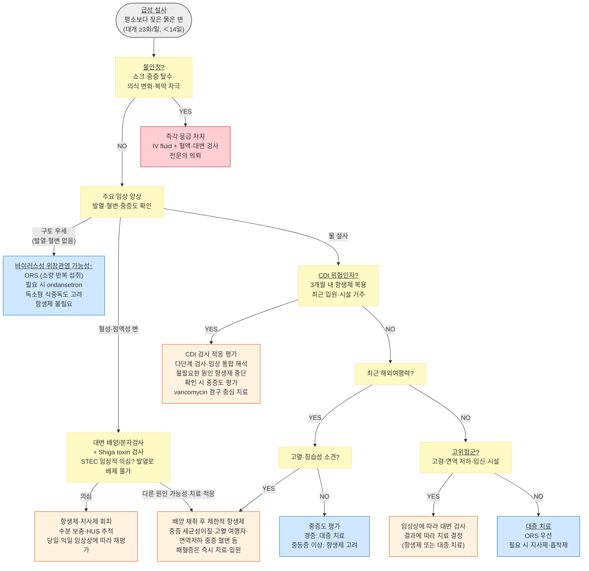

# 급성 감염성 설사 Acute Infectious Diarrhea

## <mark style="color:green;">일반 사항</mark>

* 감염원에 의해 발생한, 기간이 14일 미만인 설사; 보통 구역·구토·복통 동반
* 이질 (dysentery) : 육안적 혈변이 있는 설사; 점액변·뒤무직·복통·발열이 동반될 수 있으나 점액변이나 발열만으로 이질로 정의하지 않음
* 여행자 설사 : 여행 중 또는 귀국 후 발생할 수 있으며 시작 시점·잠복기는 병원체와 노출 시점에 따라 다름 (☞ [여행자 설사](086_-travelers-diarrhea.md))


**급성 설사의 정의** : 평소보다 잦은 묽은 변·수양변(대개 ≥3회/일)이 ＜14일 지속. 이 책에서는 지속성 ≥14일~＜4주, 만성 ≥4주로 구분하며 단단한 변의 단순 횟수 증가와 구별


## <mark style="color:green;">원인 및 위험 인자</mark>

* 원인균 : 바이러스(외래 급성 물 설사의 대부분), 세균, 기생충
  * 외래 급성 물 설사는 바이러스성 또는 원인 미확인인 경우가 많고 대부분 자연 호전됨. 성인에서는 norovirus가 흔하고 소아에서도 norovirus·rotavirus 등이 중요하나 백신 접종률·지역·연도·감시 대상에 따라 분포가 다름; 혈성 설사·고열·심한 복통·여행력·집단 발병이 있으면 세균성 원인의 가능성이 높아지며, 입원 환자·면역 저하자는 세균성 감염·CDI·기회감염 및 비감염성 원인을 함께 고려
* 발열·심한 복통·혈변은 침습성 감염 가능성을 높이나 증상만으로 병원체를 확정할 수 없음; 탈수는 바이러스성 감염에서도 심할 수 있음
* 최근 항생제 사용 또는 입원력이 있으면 _C. difficile_ 의심

### <mark style="color:orange;">위험 인자</mark>

<table><thead><tr><th width="180">위험 인자</th><th>세부 내용</th></tr></thead><tbody><tr><td>여행</td><td>저개발 국가 방문; 식품·물 위생 주의 미흡</td></tr><tr><td>면역 저하</td><td>쇠약, 영양 불량, 면역억제제 사용, HIV</td></tr><tr><td>시설 생활</td><td>보호·요양 시설 거주, 최근 입원</td></tr><tr><td>약물</td><td>항생제(최근 3개월 내), PPI (위산 감소 → 방어 약화)</td></tr><tr><td>임신</td><td>면역 변화, <em>Listeria</em> 등 위험 증가</td></tr><tr><td>만성 간질환</td><td>생굴 등 날 해산물 섭취 후 <em>Vibrio vulnificus</em> 패혈증 위험 ↑↑</td></tr></tbody></table>


**만성 간질환 환자의 날 해산물 섭취 주의** : 간경변·만성 간염 등 만성 간질환 환자는 생굴 섭취 후 _Vibrio vulnificus_ 패혈증 위험이 건강인보다 수십 배 높으며 사망률이 매우 높음. 여름철 특히 주의하고 날 조개·생굴 섭취를 반드시 피해야 함


### <mark style="color:orange;">원인균별 임상 특징</mark>

#### <mark style="color:$primary;">바이러스 vs. 세균 비교</mark>

<table><thead><tr><th width="130">특징</th><th width="230">바이러스</th><th>세균</th></tr></thead><tbody><tr><td>계절</td><td>온대: 겨울 / 열대: 연중</td><td>여름, 우기</td></tr><tr><td>전염 경로</td><td>분변–경구, 음식</td><td>음식·물, 분변–경구</td></tr><tr><td>잠복기</td><td>대개 1~3일</td><td>수 시간~수일 (병원체별 차이)</td></tr><tr><td>이환 부위</td><td>주로 소장</td><td>소장 또는 대장</td></tr><tr><td>설사 양상</td><td>대개 물 설사, 비염증성</td><td>물 설사 또는 염증성 설사</td></tr><tr><td>발열</td><td>보통 없음 또는 경미</td><td>침습성 설사에서 흔함</td></tr><tr><td>구토</td><td>흔함 (특히 norovirus)</td><td>미리 형성된 독소형에서 흔함</td></tr><tr><td>치료 원칙</td><td>대증 치료; 항생제 불필요</td><td>대증 치료; 일부에서 항생제 고려</td></tr></tbody></table>

위 비교는 전형적인 경향이며 예외가 많음. ETEC·콜레라·독소형 식중독 등 세균 감염도 비염증성 물 설사를 자주 일으킴.

<p align="center"><em><mark style="color:$info;">Ref. Harrison's Principles of Internal Medicine 21st ed. 2022</mark></em></p>

#### <mark style="color:$primary;">균주별 임상 양상</mark>

<table><thead><tr><th width="170">병원체</th><th width="60">발열</th><th width="60">복통</th><th width="80">구역·구토</th><th width="60">혈변</th><th width="102">점액변</th></tr></thead><tbody><tr><td><em>Salmonella</em></td><td>++</td><td>++</td><td>+</td><td>+</td><td>±</td></tr><tr><td><em>Shigella</em></td><td>++</td><td>++</td><td>++</td><td>++</td><td>+</td></tr><tr><td><em>Campylobacter</em></td><td>++</td><td>++</td><td>++</td><td>+</td><td>±</td></tr><tr><td>STEC (O157:H7)</td><td>0/±</td><td>++</td><td>+</td><td>++</td><td>0/±</td></tr><tr><td><em>C. difficile</em></td><td>+</td><td>+</td><td>NC</td><td>0/±</td><td>+</td></tr><tr><td><em>Yersinia</em></td><td>++</td><td>++</td><td>+</td><td>+</td><td>±</td></tr><tr><td><em>Vibrio</em></td><td>±</td><td>++</td><td>++</td><td>+</td><td>±</td></tr><tr><td><em>E. histolytica</em></td><td>±</td><td>+</td><td>+</td><td>+</td><td>+</td></tr><tr><td><em>Cryptosporidium</em></td><td>±</td><td>±</td><td>±</td><td>NC</td><td>NC</td></tr><tr><td><em>Giardia</em></td><td>NC</td><td>+</td><td>+</td><td>NC</td><td>NC</td></tr><tr><td><strong>Norovirus</strong></td><td>NC/경미</td><td>+</td><td><strong>++</strong></td><td>NC</td><td>NC</td></tr></tbody></table>

++=흔함, +=발생함, ±=변이, NC=전형적이지 않음, 0=드물거나 없음. STEC=Shiga toxin–producing _E. coli_.\
Norovirus: 구토 우세, 짧은 잠복기(12\~48시간), 폭발적 집단 발생이 특징. 발열은 경미하거나 없음.\
\*STEC: 강력한 시가 독소(Shiga toxin)에 의해 심한 출혈성 결장염(hemorrhagic colitis)을 유발하므로 혈성 설사와 심한 복통이 특징이나 초기에는 비혈성 설사일 수 있음. 대변 백혈구 검사는 원인 병원체를 판별하는 데 권고되지 않음.

<p align="center"><em><mark style="color:$info;">Ref. NEJM 2004;350, Table 1</mark></em></p>

#### <mark style="color:$primary;">잠복 기간별 감염 특징</mark>

**1\~6시간**

<table data-header-hidden><thead><tr><th width="140"></th><th width="137"></th><th></th></tr></thead><tbody><tr><td><strong>원인균</strong></td><td><strong>증상 / 설사 특징</strong></td><td><strong>원인 음식 / 관련 인자</strong></td></tr><tr><td><em>S. aureus</em></td><td>구역, 구토, 설사</td><td>햄, 가금류, 감자/계란 샐러드, 마요네즈, 크림 패스트리</td></tr><tr><td><em>Bacillus cereus</em></td><td>구역, 구토, 설사</td><td>볶음밥</td></tr></tbody></table>

**8\~16시간**

<table data-header-hidden><thead><tr><th width="134"></th><th width="195"></th><th></th></tr></thead><tbody><tr><td><strong>원인균</strong></td><td><strong>증상 / 설사 특징</strong></td><td><strong>원인 음식 / 관련 인자</strong></td></tr><tr><td><em>C. perfringens</em></td><td>복통, 설사 (구토는 드묾)</td><td>소/가금류 고기, 콩류, gravy</td></tr><tr><td><em>B. cereus</em></td><td>복통, 설사 (구토는 드묾)</td><td>육류, 채소, 말린 콩, 시리얼</td></tr></tbody></table>

**수 시간~수일: 독소형 외 감염 (잠복기가 서로 겹침)**

<table data-header-hidden><thead><tr><th width="147"></th><th width="131"></th><th></th></tr></thead><tbody><tr><td><strong>원인균</strong></td><td><strong>증상 / 설사 특징</strong></td><td><strong>원인 음식 / 관련 인자</strong></td></tr><tr><td><em>Vibrio cholerae</em></td><td>물 설사</td><td>어패류, 물</td></tr><tr><td>ETEC</td><td>물 설사</td><td>샐러드, 치즈, 육류, 물; 여행</td></tr><tr><td>STEC</td><td>혈성 설사</td><td>소고기, 살라미, 비살균 우유/채소, 사과 주스; 단체 생활, 고령</td></tr><tr><td><em>Salmonella</em></td><td>염증성 설사</td><td>소고기, 가금류, 계란, 유제품</td></tr><tr><td><em>Campylobacter</em></td><td>염증성 설사</td><td>가금류, 비살균 우유; 여행, 동물 접촉</td></tr><tr><td><em>Shigella</em></td><td>dysentery</td><td>감자/계란 샐러드, 상추, 비살균 채소; 밀집 생활, 여행</td></tr><tr><td><em>V. parahaemolyticus</em></td><td>주로 물 설사; 때때로 혈변</td><td>연체동물, 갑각류</td></tr><tr><td>Norovirus</td><td>발열, 복통, 구토, 물 설사</td><td>감염 분변/구토물에 오염; 레스토랑, 단체 시설</td></tr><tr><td>Rotavirus</td><td>발열, 복통, 구토, 물 설사</td><td>감염 분변에 오염; 단체 시설, 어린이 시설</td></tr></tbody></table>

ETEC=Enterotoxigenic _E. coli_, EHEC=Enterohemorrhagic _E. coli_. 위 시간대는 대략적인 경향임. Norovirus는 12~48시간, 비티푸스 Salmonella는 6시간~6일, 장염비브리오는 4~96시간에도 발병하므로 ‘16시간 초과’로 일률 분류하지 않음.

<p align="center"><em><mark style="color:$info;">Ref. Harrison's Principles of Internal Medicine 21st ed. 2022</mark></em></p>

#### <mark style="color:$primary;">원충 (Protozoa)</mark>

* 오염 지역의 물·음식 노출 후 발생하여 ＞7일 지속되는 물 설사 시 의심
* _Giardia_ : 복부 팽만·지방변·장기 지속 설사; 무증상 보균도 흔함
* _Cryptosporidium_ : 자가 제한적이나 면역 저하자에서 만성화·중증화 위험
* _E. histolytica_ : 아메바성 이질; 혈성 점액 설사, 우하복부 통증; 간 농양 합병 주의

## <mark style="color:green;">임상 양상</mark>

* 급성 발병의 묽은 변 (≥3회/일), 구역·구토, 복통·경련성 복통
* 발열·혈성·점액성 변 → 침습성 세균 감염 시사
* 대부분 2\~5일 내 자연 호전; 탈수 여부·속도가 임상적 중증도를 결정

### <mark style="color:orange;">주요 후기 합병증</mark>

* STEC 또는 드물게 _Shigella dysenteriae_ type 1 → HUS
* _Campylobacter_ → Guillain–Barré syndrome
* _Salmonella_, _Shigella_, _Campylobacter_, _Yersinia_ → 반응성 관절염
* 세균성 장염·Giardia 등 → 감염 후 IBS

## <mark style="color:$danger;">🚩 Red Flags!</mark>

<mark style="color:$danger;">**즉각 조치**</mark>

* 저혈압·말초 순환 부전·의식 변화·무뇨 또는 현저한 핍뇨, 경구 수분 섭취 불가 → 즉각 수액 소생 및 응급 의뢰  `중증 탈수·쇼크`
* 발열 또는 저체온에 저혈압·의식 변화·장기 기능 이상 동반 → 배양 채취로 치료를 지연하지 말고 즉각 응급 치료  `패혈증`
* 심한 복통과 복막 자극 징후·복벽 강직 → 즉각 응급 평가  `장 천공·장 허혈`
* 혈성 설사 중 또는 호전 후 소변 감소·창백·멍·혈소판 감소·신기능 악화 → 즉각 응급 평가  `HUS`
* 면역 저하자의 심한 설사·발열에 활력징후 불안정 또는 장기 기능 이상 동반 → 즉각 응급 의뢰  `중증 감염`
* 만성 간질환 환자의 날 해산물 섭취 후 발열·저혈압·통증성 수포성 피부 병변 → 즉각 응급 의뢰  `V. vulnificus 패혈증`

<mark style="color:$warning;">**당일 평가**</mark>

* 혈변·농변, ≥38.5℃의 발열에 심한 복통·전신 증상 동반 → 당일 원인 검사 및 중증도 평가  `침습성 장염·STEC`
* ≥6회/24시간의 설사가 지속되며 탈수 진행, 기립 시 어지럼·빈맥 → 당일 수분 상태 평가  `탈수`
* 고령·허약, 임신, 영아 또는 면역 저하자의 중등도 이상 설사 → 당일 평가  `중증화 고위험군`
* 요양 시설·단체 집단 발생 → 당일 평가 및 보건당국과 신고·역학 조사 협의  `집단 감염`
* 최근 3개월 내 항생제 사용 후 새 설사에 발열·복통 동반 → 당일 평가  `C. difficile 감염`

<mark style="color:$info;">**조기 평가 및 추적**</mark>

* 대증 치료 후 48~72시간 내 호전이 없으면 재평가; 7일 이상 지속하면 대변 검사와 약물성 등 원인 재검토  `지속 설사`
* 14일 이상 지속하면 기생충·IBD·약물성 설사 등 평가; 감염 후 IBS는 지속 증상과 진단 기준을 확인한 뒤 판단  `지속성 설사`
* 설사 소실 후에도 체중 감소·복통이 지속되면 비감염성 원인 평가  `흡수 불량·IBD·악성 종양`

## <mark style="color:green;">진단</mark>

### <mark style="color:orange;">GI 주요 증상에 따른 감별</mark>

**구토**

<table data-header-hidden><thead><tr><th width="130"></th><th width="123"></th><th></th></tr></thead><tbody><tr><td><strong>균주</strong></td><td><strong>잠복기</strong></td><td><strong>원인 음식</strong></td></tr><tr><td><em>S. aureus</em></td><td>1~6시간</td><td>샐러드, 유제품, 육류</td></tr><tr><td><em>B. cereus</em></td><td>1~6시간</td><td>쌀밥, 육류</td></tr><tr><td>Norovirus</td><td>12~48시간</td><td>조개, 조리된 음식, 샐러드, 샌드위치, 주스</td></tr></tbody></table>

**물 설사**

<table data-header-hidden><thead><tr><th width="153"></th><th width="111"></th><th></th></tr></thead><tbody><tr><td><strong>균주</strong></td><td><strong>잠복기</strong></td><td><strong>원인 음식</strong></td></tr><tr><td><em>C. perfringens</em></td><td>8~16시간</td><td>육류, 가금류, 고기 국물</td></tr><tr><td>ETEC</td><td>1~3일</td><td>분변 오염(물/음식)</td></tr><tr><td>Enteric viruses</td><td>10~72시간</td><td>분변 오염(물/음식)</td></tr><tr><td><em>C. parvum</em></td><td>2~10일 (평균 7일)</td><td>채소, 과일, 비살균 우유, 물</td></tr><tr><td><em>C. cayetanensis</em></td><td>대개 1주 (2~14일 이상)</td><td>수입 베리류, 바질</td></tr></tbody></table>

**염증성 설사 (발열, 혈성/점액성 설사)**

<table data-header-hidden><thead><tr><th width="146"></th><th width="92"></th><th></th></tr></thead><tbody><tr><td><strong>균주</strong></td><td><strong>잠복기</strong></td><td><strong>원인 음식</strong></td></tr><tr><td><em>Campylobacter</em></td><td>2~5일</td><td>가금류, 비살균 우유, 물</td></tr><tr><td>Nontyphoidal <em>Salmonella</em></td><td>6시간~6일</td><td>계란, 가금류, 육류, 비살균 우유/주스, 날 음식</td></tr><tr><td>STEC</td><td>1~8일</td><td>갈아 놓은 쇠고기, 비살균 우유/주스, 날 채소, 물</td></tr><tr><td><em>Shigella</em> spp</td><td>1~3일</td><td>분변 오염(물/음식)</td></tr><tr><td><em>V. parahaemolyticus</em></td><td>4~96시간</td><td>익히지 않은 조개</td></tr></tbody></table>

<p align="center"><em><mark style="color:$info;">Ref. Approach to the adult with acute diarrhea in resource-rich settings. UpToDate 2024</mark></em></p>

### <mark style="color:orange;">혈성 설사의 주요 세균 감별</mark>

혈성 설사에서 실무적으로 특히 중요한 세 병원체를 우선 감별함. 다만 Salmonella, Yersinia, 비콜레라 Vibrio, _E. histolytica_ 등과 허혈성 대장염·IBD 등 비감염성 원인도 고려함.

<table data-header-hidden><thead><tr><th width="98"></th><th></th><th></th><th></th></tr></thead><tbody><tr><td>특징</td><td>STEC</td><td><em>Shigella</em></td><td><em>Campylobacter</em></td></tr><tr><td>발열</td><td>드물거나 없음</td><td>흔함 (++)</td><td>흔함 (++)</td></tr><tr><td>혈변</td><td>흔함, 대량</td><td>흔함, 점액 동반</td><td>가능 (중등도)</td></tr><tr><td>복통</td><td>매우 심함</td><td>중등도, tenesmus</td><td>심한 경련성</td></tr><tr><td>항생제</td><td>일반적으로 피함</td><td>사용</td><td>중증 시 사용</td></tr><tr><td>특기 사항</td><td>HUS 위험</td><td>tenesmus, 이질</td><td>가금류 노출력</td></tr></tbody></table>


**STEC 감별 핵심** : 혈변·심한 복통, 특히 무발열 또는 미열이면 STEC를 의심하나 발열만으로 배제하지 않음. 혈변·염증성 설사는 대변 배양/분자검사와 Shiga toxin 또는 독소 유전자 검사를 고려. STEC 의심 시 항생제·장운동억제제를 피하고 HUS를 추적; 패혈증·장티푸스 의심은 배양 채취 후 즉시 치료·의뢰하며 일률적으로 검사 결과를 기다리지 않음.


### <mark style="color:orange;">섭취 음식에 따른 감별</mark>

<table><thead><tr><th width="194">음식·노출</th><th>의심 병원체</th></tr></thead><tbody><tr><td>해산물 (생굴·조개류)</td><td><em>Vibrio</em>, Norovirus, <em>Salmonella</em></td></tr><tr><td>가금류</td><td><em>Campylobacter</em>, <em>Salmonella</em></td></tr><tr><td>계란</td><td><em>Salmonella</em></td></tr><tr><td>갈아놓은 쇠고기</td><td>STEC</td></tr><tr><td>마요네즈·크림류</td><td><em>Staphylococcus</em>, <em>Salmonella</em> (특히 날계란 사용 시)</td></tr><tr><td>대량 조리 후 부적절하게 보관한 고기·가금류·gravy</td><td><em>C. perfringens</em></td></tr><tr><td>물 (오염 지역)</td><td><em>Vibrio cholerae</em>, <em>Giardia</em>, <em>Cryptosporidium</em></td></tr><tr><td>항생제 복용 후</td><td><em>C. difficile</em></td></tr><tr><td>사람 간 접촉·단체 생활</td><td><em>Shigella</em>, Rotavirus, Norovirus</td></tr><tr><td>구강–항문 성접촉</td><td><em>Shigella</em>, <em>Campylobacter</em>, <em>Giardia</em>, <em>E. histolytica</em></td></tr></tbody></table>

### <mark style="color:orange;">검사 적응증</mark>

#### <mark style="color:$primary;">혈액 검사</mark>

중증 (활력 징후 이상, 심한 복통, 탈수, 패혈증 의심) 시 고려:

* CBC, CRP, 전해질, creatinine
* Lactate (조직 관류 저하, 패혈증·장 경색 감별)
* LFT·lipase는 간담도 질환·췌장염을 시사하는 증상·진찰 소견이 있을 때 선택적으로 시행
* 혈액 배양 : 생후 3개월 미만 영아의 세균성 감염 의심, 패혈증 징후, 창자열(장티푸스) 의심, 면역 저하자, 고위험(용혈성 빈혈 등), 유행 지역 여행력 + 원인불명 발열

#### <mark style="color:$primary;">대변 검사</mark>

* 다음의 경우 고려
  * 중등증 이상 : 심한 설사(탈수), ≥6회/24시간, 심한 복통
  * 염증성 설사 : 혈성·점액성 변, 발열 ≥38.5℃
  * 고위험군 : 고령·허약, 요양 시설 거주, 기저 질환(심장 질환·IBD), 면역 저하, 임신
  * 7일 지속, 집단 내 전염 우려, 항생제 투여 예정
* _C. difficile_ 검사 : GDH+toxin±NAAT 또는 NAAT+toxin 다단계 알고리듬; 엄격한 검체 제출 기준이 있는 기관은 NAAT 단독도 가능
  * 생후 12개월 이하 routine 검사 금지; 1~2세는 다른 원인을 배제한 뒤 제한적 검사 (☞ [급성 설사](083_-acute-diarrhea.md))
  * 설명되지 않는 새로 발생한 하루 3회 이상의 무른 변에서 시행하며 최근 항생제 사용·입원·요양 시설 노출은 위험인자로 고려
  * 형태를 유지하지 못하는 대변만 검사하고 최근 완하제 투여 여부를 확인; 무증상 환자·형성변 검사 및 치료 후 test of cure는 시행하지 않음
* STEC 확진 또는 강력히 의심되는 경우: CBC(hemoglobin·platelet), 전해질, BUN/creatinine을 반복 추적함. 설사 호전 후에도 HUS가 나타날 수 있으며 고위험 환자는 임상 경과에 따라 매일 검사; HUS 의심 시 말초혈액도말, LDH, bilirubin 추가


**Multiplex PCR (GI Panel) 해석 시 주의**

패널 기반 분자 진단은 신속성이 큰 장점이나 다음을 반드시 고려

* PCR 양성 ≠ 반드시 병원성 원인: 무증상 보균·잔존 핵산도 검출 가능
* _C. difficile_ NAAT 양성은 보균일 수 있어 설명되지 않는 새 비성형변 ≥3회/24시간 등 임상상과 독소검사·대체 원인을 함께 평가하여 치료; 횟수와 NAAT 양성만으로 자동 치료하지 않음
* EPEC 등 일부 병원체는 성인에서 임상 의미가 불분명할 수 있음
* 결과는 반드시 임상 양상·역학력과 함께 해석함; 양성 결과가 반드시 치료 필요성을 의미하지 않음
* 집단 발생·역학 조사 목적 또는 원인 불명 지속 설사에서 보조적으로 사용
* 세균성 병원체가 검출되어 감수성 검사 또는 공중 보건 조사가 필요하면 대변 배양(reflex culture)을 추가


#### <mark style="color:$primary;">대변 원인균 검사 [대한감염학회 등 2019·IDSA 2017]</mark>

* 혈변·점액변·심한 복통·압통·패혈증 징후 : _Salmonella_, _Shigella_, _Campylobacter_, _Yersinia_, _C. difficile_, STEC 대변 검사
* 콜레라 유행 지역 여행 후 3일 이내 다량의 쌀뜨물 설사 : 콜레라 대변 검사
* 집단 설사 질환 발생 의심 : 대변 검사 (역학 조사 포함)
* 역학적 연관 + Shiga toxin 생성균 가능성 (발열 없이 혈성 설사 또는 심한 복통): Shiga toxin 검사
* 여행자 14일 이상 설사 지속 : 기생충 검사
* 설사 발생 전 8~12주 내 항생제 복용력 : 임상적 검사 적응증을 충족하면 _C. difficile_ 검사; 항생제·입원력이 없어도 지역사회 CDI 가능
* 대변 백혈구·lactoferrin·잠혈만으로 세균성 원인을 확정하거나 항생제 여부를 결정하지 않음
* 기생충 일반 충란 검사만으로 Cryptosporidium·Cyclospora가 빠질 수 있어 의심 병원체의 항원·PCR 또는 특수 염색을 별도 의뢰

#### <mark style="color:$primary;">기타 검사</mark>

* 영상 검사 : 복막염·장 천공·장 허혈·독성거대결장 등 외과적 원인이 의심될 때 임상 상황에 따라 복부·골반 CT, 단순 촬영 또는 초음파 선택
* 대장 내시경 : 대변 검사 음성의 지속성 설사에서 감별 진단 목적으로 고려
* 기생충 검사 : 14일 이상 지속되는 설사, 오염된 물·음식 노출, 구강–항문 성접촉, 면역 저하자에서 고려
* 성매개 직장염·장염이 의심되면 노출 부위에 따라 임질·클라미디아 검사와 매독·HIV 검사를 함께 고려

***



<p align="center"><strong>급성 감염성 설사 진단·치료 알고리듬</strong></p>

***

## <mark style="color:$warning;">Management</mark>

* 대부분 자연 호전 - 수분·전해질 보충과 대증 치료가 핵심
* 항생제는 치료 이득이 기대되는 특정 세균·기생충 감염, 중증·전신 증상 또는 면역 저하자에서 선별적으로 고려
* 장 운동 억제제는 침습성 세균 감염(발열·혈성변) 시 사용하지 않음

**항생제가 필요한 상황 vs. 일반적으로 불필요한 상황**

<table><thead><tr><th width="280">항생제 적극 고려</th><th>일반적으로 불필요</th></tr></thead><tbody><tr><td>패혈증 또는 장티푸스성 발열 의심</td><td>단순 물 설사 (바이러스 의심)</td></tr><tr><td>전형적인 중증 세균성이질</td><td>짧은 경과, 자연 호전 추세</td></tr><tr><td>해외여행 후 고열(≥38.5℃) 또는 패혈증</td><td>Norovirus 의심 집단 발생</td></tr><tr><td>면역 저하자의 중증 혈성 설사</td><td>발열이 없거나 경미한 혈성 설사 (STEC 의심)</td></tr><tr><td>치료 적응증이 있는 병원체 확인</td><td>비티푸스 Salmonella (면역 정상, 합병증 위험 낮음)</td></tr><tr><td><em>C. difficile</em> 감염 (증상·검사 일치)</td><td>단순 바이러스 위장관염</td></tr></tbody></table>

**항생제 사용의 흔한 오류**

* 발열 없는 혈성 설사에 경험적 quinolone 투여 (STEC 놓침)
* 단순 바이러스 설사에 광범위 항생제 처방
* loperamide를 혈성 설사·고열 환자에 사용
* _C. difficile_ 의심 환자에 원인 항생제 지속 또는 불필요한 추가 항생제 사용
* 탈수 교정보다 약 처방을 먼저 시작

## <mark style="color:green;">비-약물 치료</mark>

### <mark style="color:orange;">수분 및 전해질 보충</mark>

<table><thead><tr><th width="156">상황</th><th>권장 수액</th></tr></thead><tbody><tr><td>경증 탈수</td><td>ORS (경구 수분 보충액) 우선</td></tr><tr><td>중등도 탈수</td><td>ORS 우선; 경구 불가 시 IV 병용</td></tr><tr><td>쇼크·패혈증</td><td>Lactated Ringer's 또는 NS IV bolus 우선</td></tr><tr><td>콜레라</td><td>탈수 정도에 따라 ORS 우선; 중증 탈수·쇼크는 신속한 LR 또는 NS IV와 지속 소실량 보충. 마실 수 있으면 ORS 병행</td></tr></tbody></table>

* 경구 수분 보충(ORS): 경증~중등증 탈수의 일차 치료
  * 성인은 매 묽은 변 후 ORS 약 200~250 ㎖부터 추가하고 실제 소실량·갈증·소변량에 따라 증량. 많은 양의 수양변은 한 컵만으로 보충이 부족할 수 있음; 심부전·신부전은 투여량과 전해질을 개별 조절
  * 중증 탈수·의식 변화·장마비 또는 ORS 실패는 등장성 정맥 수액 적용; 의식이 회복되고 마실 수 있으면 ORS 병행
  * WHO 저삼투압 ORS(Na 75 mEq/L)를 표시된 물의 양에 정확히 조제. 포장 ORS를 구할 수 없는 응급 상황에는 깨끗한 물 1 L + 평평하게 깎은 설탕 6티스푼 + 소금 1/2티스푼을 정확히 혼합; 계량이 어렵거나 지나치게 짜면 사용하지 않으며 24시간 후 폐기
  * 구토가 있을 때 : 한 번에 많이 마시지 말고 1\~2분마다 한두 모금씩 반복 섭취 → 구토 감소, ORS 성공률 향상

### <mark style="color:orange;">식이</mark>

* 금식은 권장하지 않음 - 가능한 한 조기 정상 식이 재개
* 초기에는 소화 쉬운 식품 선택: 죽, 삶은 감자, 토스트, 바나나
* 유제품은 섭취 후 복부팽만·설사 악화 또는 이차성 유당 불내성이 의심될 때만 일시 제한. 고지방식·카페인·알코올도 증상을 악화하면 줄임
* BRAT 식이(바나나·쌀밥·사과소스·토스트)는 영양 불균형 우려로 현재 권고하지 않음

## <mark style="color:green;">약물 치료</mark>

　☞ [소화기계 약제](073_-gidrugs.md#antidiarrheal-agent)

### <mark style="color:orange;">항생제</mark>

* 아래 용법은 성인 지침 용법이며 허가 용법·급여와 구분함. Azithromycin의 감염성 설사·여행자 설사 치료는 국내 [지스로맥스정250㎎] 허가 외 적응증임 (유효균종에 Campylobacter가 기재되어 있어도 장염 적응증 허가를 의미하지 않음)
* 항생제 적응증 : 패혈증·장티푸스성 발열, 전형적인 중증 세균성이질, 해외여행 후 고열 또는 패혈증, 면역 저하자의 중증 혈성 설사, 치료 이득이 확인된 특정 병원체 감염

#### <mark style="color:$primary;">병원체별 항생제 선택</mark>

<table><thead><tr><th width="135">병원체 / 상황</th><th width="276">선호 항생제 (용법)</th><th>비고</th></tr></thead><tbody><tr><td><strong>경험적 치료</strong><br>(적응증에 해당하는 중증 침습성 설사)</td><td>Azithromycin 500 ㎎ qd × 3일<br>Ciprofloxacin 500 ㎎ bid × 3일</td><td>면역 정상 성인의 혈성 설사에 일률적으로 투여하지 않음. 여행력·지역 내성·중증도에 따라 선택; 동남아·인도 등 fluoroquinolone 내성 Campylobacter 위험 지역에서는 azithromycin 우선</td></tr><tr><td><strong>여행자 설사</strong><br>(중등증 이상, 비침습성)</td><td>Azithromycin 1,000 ㎎ 단회<br>또는 500 ㎎ qd × 3일<br>Rifaximin 200 ㎎ tid × 3일 (대안)</td><td>경증에는 항생제 권고하지 않음. Rifaximin은 발열·혈변 없는 비침습성 설사에만 사용</td></tr><tr><td><em><strong>Shigella</strong></em></td><td>Azithromycin 500 ㎎ qd × 3일<br>Ciprofloxacin 500 ㎎ bid × 3일<br>Ceftriaxone 1~2 g IV qd × 3~5일 (중증)</td><td>경증은 수액 치료만으로 호전 가능. 다제·광범위 내성 증가 → 치료 필요 시 배양 및 감수성검사에 따라 선택</td></tr><tr><td><em><strong>Campylobacter</strong></em></td><td>Azithromycin 500 ㎎ qd × 3일</td><td>Fluoroquinolone 내성 매우 흔함; 자연 호전도 많으므로 중증·고위험군 또는 증상 초기에 선별 사용</td></tr><tr><td><em><strong>V. cholerae</strong></em></td><td>Doxycycline 300 ㎎ 단회 (감수성일 때)<br>Ciprofloxacin 1 g 단회<br>Azithromycin 1 g 단회</td><td>중증 탈수·고배출 또는 입원 환자 등에서 항생제 고려. 적극적 수액 보충이 치료의 핵심; 감수성·임신 여부를 고려하여 항생제 선택</td></tr><tr><td><strong>비티푸스 </strong><em><strong>Salmonella</strong></em></td><td><strong>일반적으로 항생제 불필요</strong></td><td>중증 감염, 면역 저하, 영아, ≥50세이면서 죽상경화증 의심, 판막성·혈관내 질환·중요 관절질환 등 침습성 감염 고위험군에서 치료; 감수성에 따라 ceftriaxone, azithromycin 또는 ciprofloxacin 선택</td></tr><tr><td><strong>STEC (O157:H7 등)</strong></td><td><strong>항생제 피함</strong></td><td>발열이 없거나 경미한 혈성 설사와 심한 복통 시 특히 의심; HUS 위험 때문에 장 운동 억제제도 피함</td></tr><tr><td><em><strong>C. difficile</strong></em><br>(초발, non-fulminant)</td><td>Vancomycin 경구 125 ㎎ qid × 10일</td><td>국내 이용 가능한 치료 중심. Fidaxomicin 200 ㎎ bid × 10일은 국제 지침상 조건부 우선 권고이나 국내 이용 가능성을 별도로 구분. Severe(본문 중증도 기준 참조)도 같은 용량; metronidazole 단독은 표준 초기치료로 제시하지 않음; AGA 2026은 비전격성 CDI에서 사용하지 않도록 권고</td></tr><tr><td><em><strong>C. difficile</strong></em><br>(fulminant)</td><td>Vancomycin 500 ㎎ PO/NG qid<br>+ metronidazole 500 ㎎ IV q8h</td><td>저혈압·쇼크, 장마비 또는 독성거대결장. 즉시 입원·외과 협진; 장마비 시 직장 vancomycin 추가 고려</td></tr><tr><td><em><strong>Giardia</strong></em></td><td>Metronidazole 250 ㎎ tid 또는 500 ㎎ bid × 5~7일 <mark style="color:blue;">[후라시닐]</mark></td><td>Metronidazole의 Giardia 치료는 국내 허가 외 사용; tinidazole 2 g 단회는 국제 지침 대안이나 국내 통상 유통 처방으로 제시하지 않음</td></tr><tr><td><em><strong>E. histolytica</strong></em></td><td>Metronidazole 500~750 ㎎ tid × 7~10일 <mark style="color:blue;">[후라시닐]</mark></td><td>이후 paromomycin 등 luminal agent로 장내 낭종 제거 필요; 국내 이용 가능 여부 확인</td></tr></tbody></table>


**fluoroquinolone 내성 현황**: 국내외적으로 _Campylobacter_와 _Shigella_에서 fluoroquinolone 내성이 크게 증가하고 있다. _Salmonella_에서도 fluoroquinolone 내성이 증가 추세이며, 특히 아시아 유래 균주에서 주의가 필요하다. 동남아·인도 여행 후 발생한 설사에서는 azithromycin을 경험적 1차 치료로 우선 고려하며, 단회 요법(doxycycline, ciprofloxacin 등)은 지역 내 내성률에 따라 효과가 다를 수 있으므로 참고한다.



**항생제 치료 실패·내성** : Azithromycin도 모든 균주에 유효한 것은 아님. XDR Shigella는 azithromycin·ciprofloxacin·ceftriaxone 등 여러 약제에 함께 내성일 수 있음. 항생제 투여 후 24~48시간 내 미호전 또는 악화 시 배양·감수성검사와 전문의 평가; 다른 비상약을 임의로 연속 복용하지 않음

<mark style="color:$info;">근거: CDC. Emergence of Extensively Drug-Resistant Shigellosis—United States, 2011–2023. MMWR 2026. 미국 감시 결과의 내성 비율을 국내에 그대로 적용하지 않음.</mark>



**CDI 중증도·최신 권고** : IDSA/SHEA 기준은 WBC ＞15,000/μL 또는 creatinine ≥1.5 ㎎/㎗를 중증 판단에 사용함. AGA 2026 전문가 권고는 WBC ＞15,000/μL 또는 creatinine ＞기저치의 1.5배를 제시하여 신기능의 변화도 강조함. 기준이 서로 같지 않으므로 적용 지침을 명시하고 만성 신질환·탈수·백혈구감소증 등은 임상상과 함께 해석함. 비전격성 중증 CDI도 경구 vancomycin 125 ㎎ qid × 10일이며 IV vancomycin으로 대체하지 않음.

AGA 2026은 비전격성 CDI에서 fidaxomicin을 우선하고 경구 vancomycin도 허용함. 국내 접근성을 고려하면 경구 vancomycin이 실무적 선택임. IDSA 2021의 metronidazole 제한적 대안과 달리 AGA 2026은 비전격성 CDI의 metronidazole 사용을 권하지 않음. 재발 시 이전 처방을 단순 반복하지 않고 vancomycin 감량·간헐 요법 및 전문기관 미생물군 복원 치료를 검토함; 해외 승인 미생물군 제제를 국내 통상 처방으로 제시하지 않음.

<mark style="color:$info;">근거: IDSA/SHEA 2017·2021; Fischer M, et al. AGA Clinical Practice Update. Clin Gastroenterol Hepatol. 2026;24:2359–2369.</mark>


* 항생제 안전성 : azithromycin은 저칼륨혈증·QT 연장 및 ondansetron 병용에 주의. Ciprofloxacin은 힘줄 손상·말초신경병증·중추신경계 이상·혈당 이상 등 위해와 신기능을 고려하며 대동맥류 고위험군·임부에서는 대안을 우선. Doxycycline은 국내 허가상 12세 미만·임부·수유부 금기이므로 콜레라에서도 환자별 약제를 선택함

### <mark style="color:orange;">장 운동 조절제</mark>

* 이 장의 loperamide 용법은 면역 정상 성인에 한함. 국내 일부 소아 허가가 있으나 IDSA는 급성 설사의 18세 미만에 사용하지 않도록 권고함
* 일부 설사 횟수 감소 효과; 침습성 세균 감염(발열·혈성·점액성 변) 시 사용하지 않음
* loperamide : 초회 4 ㎎, 이후 필요시 2 ㎎; 최대 16 ㎎/24시간 <mark style="color:blue;">\[로프민]</mark>
  * 국내 허가상 최대용량은 16 ㎎/일이나 이 책의 일반 외래·자가 치료 한도는 8 ㎎/일, 최대 2일; 혈변·발열·전신 독성·STEC 또는 CDI 의심·급성 중증 대장염·장폐색 위험 시 사용하지 않음
  * 항생제 병용이 금기를 해제하지 않으며, 48시간 내 미호전 또는 복부 팽만·변비·심한 통증이면 중단·재평가 (☞ [여행자 설사](086_-travelers-diarrhea.md))

### <mark style="color:orange;">진경제</mark>

* 경련성 복통 완화를 위해 단기간 사용할 수 있으나 수분 보충과 원인 치료를 대신하지 않으며, 복막 자극 징후·장마비·독성거대결장이 의심되면 사용하지 않음
* cimetropium : 50 ㎎ tid <mark style="color:blue;">\[알기론]</mark>&#x20;
  * 항콜린성 진경제는 고령에서 가능한 회피하며, 전립선비대·요폐·협우각 녹내장 및 다른 항콜린 약물 병용에 주의
* tiropramide : 100 ㎎ bid\~tid <mark style="color:blue;">\[티로파]</mark>&#x20;

### <mark style="color:orange;">구토 조절제 (Antiemetics)</mark>

* 심한 구토로 ORS 섭취가 어려울 때 제한적으로 고려; 성인 급성 위장관염에서 일상적 반복 처방 근거는 제한적
* ondansetron : 4\~8 ㎎ PO (또는 ODT) <mark style="color:blue;">\[조프란]</mark> (급성 위장관염 구토에는 국내 허가 외 사용)
  * 구토 조절을 통해 ORS 섭취를 도울 수 있으나 수액 치료를 대신하지 않음
  * QT 연장 위험이 있으므로 선천성 long-QT, 서맥, 저칼륨혈증·저마그네슘혈증 또는 다른 QT 연장 약물 병용 시 주의; 설사가 증가할 수 있음

### <mark style="color:orange;">분비 억제제 (Antisecretory)</mark>

* bismuth subsalicylate (BSS) : 경증 급성 설사·여행자 설사의 선택적 증상 완화
  * 성인 급성 설사·여행자 설사 : 현탁액 30 ㎖(525 ㎎)를 30분마다 또는 60 ㎖(1,050 ㎎)를 1시간마다 필요시 복용; 24시간 최대 240 ㎖(30 ㎖ 기준 8회 용량), 최대 2일 <mark style="color:blue;">\[펩토무스현탁액]</mark>
  * Salicylate 과민, 소화성 궤양·출혈 이상·혈변/흑변, 다른 salicylate 제제 병용에서는 사용하지 않음. 바이러스 감염이 의심되는 소아·청소년은 Reye 증후군 위험 때문에 피함
  * 신기능 저하 환자는 자가사용을 피하고 의료진과 상의. 항응고제·methotrexate·probenecid 복용자, 통풍 환자 및 임부·수유부는 대체 치료를 우선 고려
  * 혀·변의 일시적 흑색 변색이 생길 수 있음; 이명·청력 저하, 증상 악화 또는 2일 이상 지속 시 중단·평가

* racecadotril : 성인 100 ㎎ tid, 식전 복용 권장 <mark style="color:blue;">\[하이드라섹캡슐100㎎]</mark>; 정상 배변 2회까지, 최대 7일
  * Enkephalinase 억제 작용 → 장 분비 억제; 장 운동에 영향을 주지 않아 반동 변비·복부 팽만이 상대적으로 적음
  * 비혈성 급성 수양성 설사에서 ORS의 선택적 보조요법. 혈변 또는 농성 변과 발열, 항생제 관련 설사, 만성 설사, 지속적·조절되지 않는 구토, 임부·수유부는 금기
  * ACE 억제제 병용 시 혈관부종 위험 증가; ACE 억제제로 인한 혈관부종 병력은 금기. 얼굴·혀 부종·호흡곤란 또는 전신 발진·발열이면 중단·평가
  * 소아 산제의 연령·체중별 용법은 [급성 설사](083_-acute-diarrhea.md) 참조; 성인 캡슐과 구분

### <mark style="color:orange;">흡착제</mark>

* diosmectite : 3 g (1포) tid, 식간 복용 <mark style="color:blue;">\[스타빅 현탁액]</mark>
  * 장 점막 보호, 독소·세균 흡착 효과
  * 성인용; 만 19세 미만 소아·청소년은 사용하지 않으며 현행 국내 허가상 임부·임신 가능성이 있는 여성·수유부는 금기. 기존의 소아 급성 설사 적응증은 삭제됨
  * 다른 약제(항생제·프로바이오틱스 포함)의 흡수를 방해하므로 반드시 2시간 이상 간격 복용

<mark style="color:$info;">허가: 식품의약품안전처 의약품안전평가과-4526호(2026. 7. 6), 대한병원협회 보험 2026-222 안내 — 소아 급성 설사 적응증 삭제, 만 19세 미만 소아·청소년 사용 제한.</mark>

### <mark style="color:orange;">Probiotics</mark>

* 급성 감염성 설사 치료 또는 여행자 설사 예방에 대한 효과는 균주 특이적이고 이득이 제한적이므로 일상적으로 권고하지 않음
* 항생제 연관 설사(AAD) 예방: _Lactobacillus rhamnosus_ GG, _S. boulardii_ 일부 효과; 고위험군에서 고려 (보험 기준 확인 필요)
* **주의**: 중증 면역 저하자, 중심정맥관 보유 환자에서는 균혈증·진균혈증 위험 때문에 피함

## <mark style="color:green;">예방</mark>

　☞ [여행자 설사 및 예방](086_-travelers-diarrhea.md)

* 손 위생: 식전·배변 후 비누와 물로 20초 이상 손 씻기
  * 알코올 손소독제는 _C. difficile_ 포자에 효과 없음 - 반드시 비누 세척 필요
  * Norovirus가 의심될 때도 비누와 물을 이용한 손 씻기를 우선
* 식품 안전: 고기·해산물 충분히 가열, 생채소·과일 세척, 비살균 유제품 회피
* 여행 시: 병수(bottled water) 또는 끓인 물 사용; 길거리 음식·생선회 주의
* 전파 예방: 증상이 있는 동안 음식 조리·수영·성접촉을 피함. Norovirus 의심 시 증상 소실 후에도 최소 48시간 타인의 음식 조리·돌봄을 피하고, 식품 취급·의료·돌봄 종사자는 보건당국의 업무 복귀 기준을 따름
* 백신
  * [로타바이러스 백신](../231_/210_-vaccination.md#rotavirus) : 영아 필수 예방접종 (2회 또는 3회); 로타바이러스 중증 위장관염·입원을 예방하며 효과는 백신·국가 환경에 따라 다름
  * 경구 [콜레라 백신](../231_/210_-vaccination.md#cholera): 유행 지역 여행 전 고려

***

### <mark style="color:red;">질병코드</mark>

* A08 바이러스성 및 기타 명시된 장감염
  * A08.0 로타바이러스 장염
  * A08.1 Norwalk 인자에 의한 급성 위장병증
* A09 감염성 및 상세불명 기원의 기타 위장염 및 결장염
* A00 콜레라
* A02 기타 Salmonella 감염
* A03 Shigella증
* A04 기타 세균성 장감염
  * A04.1 장독소성 대장균 감염(ETEC)
  * A04.3 장출혈성 대장균 감염
  * A04.5 Campylobacter 장염
  * A04.7 _Clostridium difficile_ 장염
* A05 달리 분류되지 않은 기타 세균성 식중독

***

## <mark style="color:purple;">처방례</mark>

* 아래 약물 처방례는 성인 기준이며 ORS·조기 정상 식이를 우선. 패혈증·장티푸스 의심·활력징후 불안정은 아래 외래 경구 처방으로 치료하지 않고 배양 후 즉시 입원·전원하여 적절한 전신 항생제 치료. 지사제·진경제·흡착제는 필요 증상에 따라 선택하며 모두 일괄 병용하는 표준 처방이 아님

> **처방례 1. 바이러스성·비혈성 설사, 발열(–), 경증**
>
> ```
> 로프민 2 ㎎/C　　　　　처음 2C, 이후 묽은 변마다 1C
> 　　　　　　　　　　　(이 책의 일반 외래·자가 치료 한도 4C/일, 최대 2일)
> 알기론 50 ㎎/T　　　　　3T　#3
> 스타빅 현탁액 20 ㎖/P　　3P　#3　식간 복용
> ```
>
> _✽ 성인 비염증성 물 설사의 증상 완화 처방. 고령에서는 항콜린성 진경제(cimetropium)를 가능한 회피. ORS를 우선하며 loperamide는 혈변·발열 발생 시 즉시 중단. 구토가 심하면 QT 연장 위험 등을 확인한 후 조프란 4 ㎎ ODT 추가 고려. 프로바이오틱스는 일상적으로 권고하지 않으며 선택적으로 추가함._

> **처방례 2. 여행자 설사, 중등증 (발열 없음, 비혈성)**
>
> ```
> 지스로맥스 250 ㎎/T　　2T　qd × 3일
> 로프민 2 ㎎/C　　　　　처음 2C, 이후 묽은 변마다 1C
> 　　　　　　　　　　　(이 책의 일반 외래·자가 치료 한도 4C/일, 최대 2일)
> 스타빅 현탁액 20 ㎖/P　3P　#3　식간 복용
> ```
>
> _✽ 성인 중등증 여행자 설사에서 이득·위해를 평가하여 선택한 항생제 처방례 (azithromycin은 국내 허가 외 사용). 경증에는 항생제 불필요. Loperamide는 초회 4 ㎎, 이후 묽은 변마다 2 ㎎, 이 책의 일반 외래·자가 치료 한도 8 ㎎/일·최대 2일. 발열·혈변 발생 시 중단·재평가. 비침습성으로 판단되면 rifaximin 200 ㎎ tid × 3일도 대안이며 ciprofloxacin은 지역 감수성·이상반응 위험을 반영한 대체 옵션. ORS가 어려운 구토는 QT 위험을 확인하여 ondansetron 선택적 고려._

> **처방례 3. 경험적 항생제 적응증에 해당하는 중증 침습성 설사**
>
> ```
> 지스로맥스 250 ㎎/T　　2T　qd × 3일
> 티로파 100 ㎎/T　　　　3T　#3
> 스타빅 현탁액 20 ㎖/P　3P　#3　식간 복용
> 타이레놀 500 ㎎/T　　　1T　tid　발열·통증 시
> ```
>
> _✽ 활력징후가 안정되고 경구 섭취가 가능한 성인에서 발열·복통·뒤무직을 동반한 전형적인 세균성이질 등 경험적 치료 적응증을 확인하여 선택함. 패혈증·장티푸스 의심·중증 면역 저하자의 전신감염은 이 외래 처방을 적용하지 않고 입원 치료함. Azithromycin의 장염 치료는 국내 허가 외 사용임. **loperamide는 사용하지 않음**. STEC 의심(발열이 없거나 경미한 혈성 설사 + 심한 복통) 시 항생제 투여를 보류하고 Shiga toxin 검사를 시행함. 고열 지속·패혈증 징후 시 혈액 배양 및 전문의 의뢰._

> **처방례 4.&#x20;**_**C. difficile**_**&#x20;감염 (초발, non-fulminant)**
>
> ```
> 반코마이신 캡슐 125 ㎎/C　4C　#4 × 10일
> ```
>
> _✽ 임상적으로 의미 있는 설사와 검사 결과가 일치하는 초발 CDI에서 사용함. NAAT 양성·독소 음성의 불일치 결과는 보균으로 단정하지 말고 임상적 감염 가능성을 함께 판단함. 불필요한 원인 항생제는 가능하면 중단함. Severe CDI(본문 중증도 기준 참조)도 vancomycin 125 ㎎ qid를 사용하며, 500 ㎎ qid로 증량하지 않음. **Fulminant CDI**(저혈압·쇼크, 장마비 또는 독성거대결장)는 입원하여 vancomycin 500 ㎎ PO/NG qid + metronidazole 500 ㎎ IV q8h 및 외과 협진이 필요함. Fidaxomicin 200 ㎎ bid × 10일은 국제 지침상 조건부 우선 권고이나 2026년 국내 발표 문헌은 국내 이용 불가를 명시하므로 일반 국내 유통 처방례로 제시하지 않음._

***

### <mark style="color:$success;">핵심 복약 지도</mark>

1. **수분 보충이 가장 중요합니다** - 설사·구토가 있을 때는 묽은 변을 볼 때마다 ORS 한 컵(200~250 mL)부터 추가로 마시고, 설사량이 많으면 더 보충하세요. 심장·신장 질환으로 수분 제한을 받는 분은 의료진이 정한 양을 따르세요. 구토가 있으면 **1\~2분마다 한두 모금씩** 조금씩 반복해서 드세요.
2. **지사제(loperamide·로프민)**: 혈변이나 발열이 생기면 즉시 중단하고 내원하세요 - 염증성·침습성 설사에서 계속 복용하면 증상을 악화시킬 수 있습니다.
3. **항생제는 처방된 용법과 기간대로 복용**하고 임의로 중단하거나 연장하지 마세요.
4. **흡착제(스타빅·diosmectite)**: **다른 모든 약과 2시간 이상 간격**을 두고 반드시 따로 복용하세요 - 다른 경구약의 흡수를 방해할 수 있습니다. 만 19세 미만 소아·청소년, 임산부·임신 가능성이 있는 분, 수유 중인 분은 복용하지 마세요.
5. **프로바이오틱스(비오플 등)**: 급성 설사에 반드시 필요한 약은 아닙니다. 복용하는 경우 흡착제와 2시간 이상 간격을 두세요. _S. boulardii_ 제품은 항진균제와 함께 복용하지 마세요.
6. **식사**: 금식하지 말고 죽·삶은 감자·토스트 등 소화 쉬운 음식을 소량씩 드세요. 견딜 수 있는 평소 음식으로 빨리 돌아가세요. 유제품은 먹은 뒤 증상이 심해질 때만 일시적으로 줄이고, 기름진 음식·커피·알코올도 증상을 악화하면 피하세요.
7. **손 위생**: 화장실 이용 후 반드시 **비누와 물로 20초 이상** 손을 씻어 가족에게 옮기지 않도록 주의하세요.

***

### <mark style="color:blue;">환자 안내서</mark>

**급성 감염성 설사 (식중독·바이러스성 장염) 안내**

**어떤 병인가요?**\
세균·바이러스·기생충에 의해 장이 감염되어 생기는 급성 설사입니다. 바이러스가 흔한 원인이며 대부분 며칠 안에 저절로 좋아집니다. 가장 중요한 치료는 탈수 예방을 위한 수분 보충입니다.

**이런 증상이 있으면 바로 병원에 오세요**

* 대변에 피가 섞이거나 심한 복통·복부 경직이 있을 때
* 하루 6회 이상 설사가 지속되거나, 물을 마셔도 구토가 반복될 때
* 입이 심하게 마르고 소변이 거의 나오지 않을 때 (탈수 위험)
* 어지러워서 일어서기 힘들 때
* 고열(38.5℃ 이상)이 지속될 때
* 설사가 7일 이상 계속될 때

**집에서 이렇게 관리하세요**

<table><thead><tr><th width="120">항목</th><th>방법</th></tr></thead><tbody><tr><td>수분 보충</td><td>ORS를 우선하여 설사할 때마다 한 컵씩 추가; 구토 시에는 1~2분마다 한두 모금씩. 스포츠 음료는 ORS를 대신하지 못하며 당 함량이 높아 설사를 악화시킬 수 있습니다.</td></tr><tr><td>식사</td><td>죽, 밥, 삶은 감자, 토스트 등 소화 쉬운 음식을 소량씩; 금식은 하지 마세요</td></tr><tr><td>피할 것</td><td>기름진 음식, 생과일주스, 카페인, 알코올; 유제품은 섭취 후 증상이 심해질 때 일시 제한</td></tr><tr><td>손 위생</td><td>화장실 이용 후·식사 전 반드시 비누로 20초 이상 손씻기</td></tr><tr><td>전파 예방</td><td>증상이 있는 동안 다른 사람의 음식 조리·수영·성접촉을 피하세요. 노로바이러스 의심 시 증상이 멎은 뒤에도 최소 48시간 다른 사람의 음식 조리·돌봄을 피하고, 구토물·화장실은 적절히 소독하세요</td></tr></tbody></table>

**약은 언제 먹어야 하나요?**\
처방받은 항생제는 정해진 용법과 기간대로 복용하고 임의로 중단하거나 연장하지 마세요. 지사제(loperamide)는 혈변이나 발열이 있으면 드시면 안 됩니다. 흡착제(스타빅)는 다른 약과 **2시간 이상 간격**을 두고 따로 복용하세요 (항생제, 프로바이오틱스 모두 포함). 만 19세 미만 소아·청소년, 임산부·임신 가능성이 있는 분, 수유 중인 분은 스타빅(diosmectite)을 복용하지 마세요. 시판 지사제를 임의로 복용하기 전에 의사와 상담하세요.

**예방 수칙**

* 고기·해산물은 완전히 익혀 드세요 (특히 조개류·생선)
* 생채소·과일은 흐르는 물에 충분히 씻으세요
* 날 음식 조리 후 손과 도마·칼을 깨끗이 씻으세요
* 해외 여행 시 병수 또는 끓인 물을 사용하고 길거리 음식에 주의하세요
* **간 질환이 있으신 분은 생굴이나 날 조개를 드시지 마세요**
* 영아에게 로타바이러스 백신을 접종하세요

***

## <mark style="color:green;">주요 참고문헌 및 확인 자료</mark>

### <mark style="color:orange;">임상 근거</mark>

* <mark style="color:$info;">Kim YJ, et al. Guideline for the Antibiotic Use in Acute Gastroenteritis. Infect Chemother. 2019;51:217–243. — 국내 성인 지침</mark>

[https://doi.org/10.3947/ic.2019.51.2.217](https://doi.org/10.3947/ic.2019.51.2.217)

* <mark style="color:$info;">Fischer M, et al. AGA Clinical Practice Update on Management of Clostridioides difficile Infection in Adults: Expert Review. Clin Gastroenterol Hepatol. 2026;24:2359–2369. — 진단·치료·재발 예방에 관한 전문가 권고</mark>

[https://doi.org/10.1016/j.cgh.2026.05.007](https://doi.org/10.1016/j.cgh.2026.05.007)

* <mark style="color:$info;">CDC. Food Poisoning Symptoms; Cryptosporidium·Cyclospora Symptoms; How to Prevent Norovirus. — 잠복기 및 전파 예방</mark>

[식중독 증상](https://www.cdc.gov/food-safety/signs-symptoms/index.html) · [Cryptosporidium](https://www.cdc.gov/cryptosporidium/signs-symptoms/index.html) · [Cyclospora](https://www.cdc.gov/cyclosporiasis/signs-symptoms/) · [Norovirus 예방](https://www.cdc.gov/norovirus/prevention/index.html)


* <mark style="color:$info;">IDSA. 2017 Infectious Diarrhea Clinical Practice Guideline. — 검사·STEC·항생제·수분 보충 원칙</mark>

[https://www.idsociety.org/practice-guideline/infectious-diarrhea/](https://www.idsociety.org/practice-guideline/infectious-diarrhea/)

* <mark style="color:$info;">IDSA·SHEA. 2021 Focused Update: Management of Clostridioides difficile Infection in Adults. — 항생제 선택과 재발 치료</mark>

[https://doi.org/10.1093/cid/ciab549](https://doi.org/10.1093/cid/ciab549)

* <mark style="color:$info;">Moon JM, et al. Clinical Approaches to Clostridioides difficile Infection Management. J Korean Med Sci. 2026;41:e150. — 국내 치료 접근성·진료 현황; 설문은 2024년 시행</mark>

[https://doi.org/10.3346/jkms.2026.41.e150](https://doi.org/10.3346/jkms.2026.41.e150)

* <mark style="color:$info;">CDC Yellow Book 2026. Travelers’ Diarrhea. — 기능적 중증도·항생제·자가 치료 및 예방</mark>

[https://www.cdc.gov/yellow-book/hcp/preparing-international-travelers/travelers-diarrhea.html](https://www.cdc.gov/yellow-book/hcp/preparing-international-travelers/travelers-diarrhea.html)

* <mark style="color:$info;">CDC. Emergence of Extensively Drug-Resistant Shigellosis—United States, 2011–2023. MMWR. 2026. — 치료 실패 시 배양·감수성검사 필요성</mark>

[https://www.cdc.gov/mmwr/volumes/75/wr/mm7513a1.htm](https://www.cdc.gov/mmwr/volumes/75/wr/mm7513a1.htm)

### <mark style="color:orange;">허가·급여 확인 자료</mark>

* <mark style="color:$info;">한국화이자제약. 지스로맥스정250㎎ 제품설명서 (2026.1.27 개정). — 제품 함량 및 국내 적응증; 감염성 설사는 허가 외 사용</mark>

* <mark style="color:$info;">식품의약품안전처 의약품안전평가과-4526 (2026.7.6), 대한병원협회 보험 2026-222 안내. — 스타빅 등 5품목의 소아 관련 허가 변경</mark>


* <mark style="color:$info;">식품의약품안전처. 의약품안전나라 — 의약품 품목허가정보. 국내 제품별 적응증·용법·금기 및 허가 상태 확인; 처방 시 최신 품목정보 조회</mark>

[https://nedrug.mfds.go.kr/index](https://nedrug.mfds.go.kr/index)

* <mark style="color:$info;">건강보험심사평가원. 약제·검사 급여기준 및 의약품 정보 — 임상 권고와 국내 허가·급여를 구분하여 적용</mark>

[https://www.hira.or.kr](https://www.hira.or.kr)
