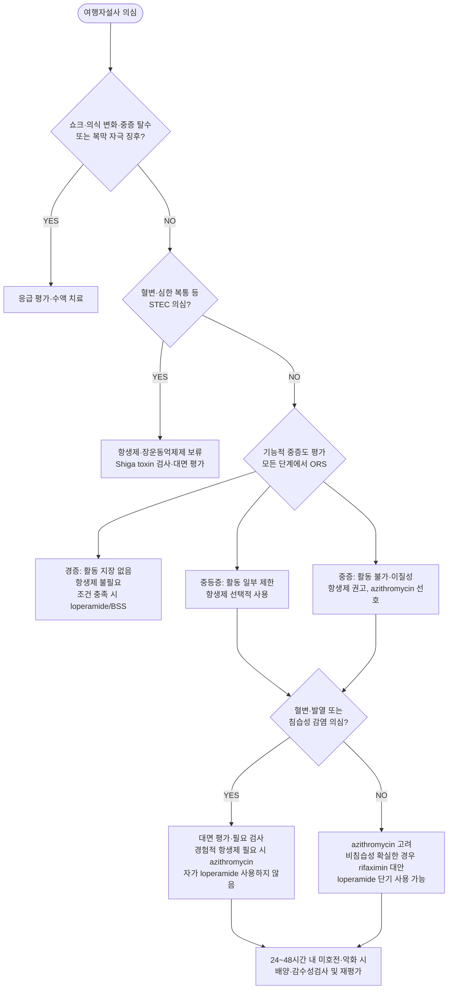

# 여행자설사 Travelers’ Diarrhea, TD

## <mark style="color:green;">일반 사항</mark>

* 여행자설사(TD)는 가장 흔한 여행 관련 질환으로, 고위험 지역을 2주간 여행하는 사람의 약 30\~70%에서 발생할 수 있으며, 여행 지역·계절·노출에 따라 발생률이 달라짐
* 전파 경로 : 대부분 오염된 음식이나 음료수
* 경과 : 세균성은 대부분 3\~7일 내 자연 호전; EAEC 감염이나 바이러스 후 장 과민 상태 등에서는 1\~2주 이상 지속되거나 post-infectious IBS(PI-IBS)로 이행할 수 있음

## <mark style="color:green;">원인 및 위험 인자</mark>

### <mark style="color:orange;">원인균</mark>

<table><thead><tr><th width="105">분류</th><th width="94">빈도</th><th>주요 원인균</th></tr></thead><tbody><tr><td>세균</td><td>75~90%</td><td><em>E. coli</em> (ETEC, EAEC), <em>Campylobacter, Shigella, Salmonella, Aeromonas</em> spp.</td></tr><tr><td>바이러스</td><td>10~25%</td><td>Norovirus, Rotavirus, Astrovirus, Sapovirus</td></tr><tr><td>원충</td><td>약 10%<br>(주로 장기 여행자)</td><td><em>Giardia duodenalis, Cryptosporidium, Cyclospora</em></td></tr></tbody></table>

* 바이러스는 10\~25%까지 기여할 수 있으며(multiplex PCR 연구), 구토 우세 증상과 관련. 혼합 감염 및 중복 검출이 가능하므로 위 비율을 단순 합산하지 않음

### <mark style="color:orange;">위험 인자</mark>

* 숙주 요인 : 면역 저하자, 제산성 약물 복용자(PPI, H₂-차단제), 위장관 수술력, 젊은 성인
* 지역 요인 : 더운 기후, 상하수도 및 위생 인프라 미비 지역(사하라이남 아프리카, 남아시아, 중남미)
* 시기 : 체류 초기에도 발생하며, 장기 체류에서는 원충 감염과 반복 노출을 함께 고려

## <mark style="color:green;">임상 양상</mark>

### <mark style="color:orange;">병원체별 특징</mark>

<table><thead><tr><th width="153">원인균</th><th width="106">잠복기</th><th>임상 특징</th></tr></thead><tbody><tr><td>ETEC</td><td>6~72시간</td><td>권태감, 식욕 부진, 복통에 이어지는 급격한 수양성 설사</td></tr><tr><td>EAEC</td><td>일정하지 않음</td><td>수양성 설사; 일부에서 지속성 설사와 관련</td></tr><tr><td><em>Campylobacter</em></td><td>대개 2~5일</td><td>발열, 경련성 복통, 수양성 또는 혈성 설사</td></tr><tr><td><em>Shigella</em></td><td>대개 1~3일</td><td>뒤무직·절박변·점혈변 등 이질성 증상, 발열</td></tr><tr><td><em>Salmonella</em></td><td>12~72시간</td><td>오한, 발열, 두통, 근육통 동반; 균혈증 가능</td></tr><tr><td><em>Aeromonas</em> spp.</td><td>1~2일</td><td>수양성 또는 점혈변 설사; 담수 노출력. 중등도 이상이면 감수성 결과에 따라 fluoroquinolone 또는 3세대 cephalosporin 고려</td></tr><tr><td>Norovirus</td><td>12~48시간</td><td>오심·구토가 우세하며 폭발적 집단 발생이 특징; 경과가 짧음(1~3일)</td></tr><tr><td><em>Giardia duodenalis</em></td><td>1~2주</td><td>악취성 지방성 설사, 복부 팽만, 잦은 트림; 수 주~수개월 지속 가능</td></tr><tr><td><em>Cyclospora cayetanensis</em></td><td>2~14일</td><td>수양성 설사가 장기간 지속되며 재발-완화 경과가 특징; TMP/SMX 반응. 위험 지역: 과테말라·아이티·네팔·페루 등</td></tr><tr><td><em>S. aureus·B. cereus (독소형)</em></td><td><em>1~6시간</em> </td><td><em>음식 섭취 직후 폭발적 구토·복통. 발열 대개 없음; 12~24시간 내 자연 호전. 항생제 불필요</em></td></tr></tbody></table>

* 독소형 식중독 감별 : 잠복기가 1\~6시간으로 매우 짧고 구토가 주증상이며 발열이 없으면 세균성 TD보다 _S. aureus_ 또는 _B. cereus_ 독소형을 먼저 의심. 항생제는 불필요하며 수분 보충과 대증 치료로 충분

### <mark style="color:orange;">중증도 분류</mark>

* 경증 : 견딜 만하고 고통스럽지 않으며, 계획된 활동에 지장 없음
* 중등증 : 고통스럽거나 계획된 활동에 지장을 주는 설사
* 중증 : 계획된 활동이 불가능한 설사; 이질성 설사는 모두 중증으로 간주
* 기간 : 급성 ＜14일, 지속성 ≥14일~＜4주, 만성 ≥4주; 14일 이상이면 원충·CDI·감염 후 상태 및 기저 위장관질환 평가


**이질성 설사(Dysentery)** : 육안적 혈변(grossly bloody stool)이 있는 설사를 말하며, 뒤무직·절박변·경련성 복통·점액변이 동반될 수 있음. 모든 이질성 설사는 중증으로 간주함. 발열성 설사(febrile diarrhea)는 침습성 감염을 시사하지만 이질과 동의어는 아니며, 경험적 항생제가 필요하면 azithromycin을 우선 고려



**Post-infectious IBS (PI-IBS)** : 급성 감염 후 새로 발생하는 IBS로, 지속되는 복통과 배변 변화가 특징임. 감염 직후의 일시적 설사·유당불내증과 구분하며, 복통·배변 변화와 증상 기간 등 정식 IBS 진단 요건을 확인함. 감염 기간이 길고 중증일수록, 여성에서, 심리적 스트레스가 동반된 경우 위험이 높음


## <mark style="color:$danger;">🚩 Red Flags!</mark>

<mark style="color:$danger;">**즉각 조치**</mark>

* 심한 탈수 소견: 의식 저하·혼돈, 빈맥(＞120회/분), 저혈압, 무뇨 또는 핍뇨
* 의식 변화·쇼크·중증 탈수·패혈증 의심 또는 심한 전신 독성은 단독으로도 응급 평가; 혈변·고열이 모두 동반될 때까지 기다리지 않음
* 혈성 설사 후 소변량 감소·창백·멍·의식 변화  `HUS`
* 영아·고령자·면역 저하자에서의 급격한 임상 악화
* 복막 자극 징후 : 판상 복부, 반동 압통  `급성 복증`

<mark style="color:$warning;">**당일 평가**</mark>

* 육안적 혈변 또는 중증 발열성 설사
* 38.5℃ 이상 발열·혈변·심한 복통은 당일 평가; 48시간 지속될 때까지 기다리지 않음
* 중등증 이상 + 면역 저하자, 염증성 장질환자, 인슐린 의존성 당뇨병 환자
* 대증 치료 48시간 후에도 호전 없는 중등증 이상

<mark style="color:$info;">**조기 평가 및 추적**</mark>

* 귀국 후 설사가 ≥14일 지속 → 원충·CDI·감염 후 상태 및 기저 위장관질환 평가
* 설사 소실 후 복통·배변 변화 지속 → 감염 후 상태·PI-IBS 감별
* Norovirus 집단 발생이 의심되는 경우 (유람선, 단체 투어)

## <mark style="color:green;">진단</mark>

* 면역정상 성인의 합병증 없는 단기간 경증 설사는 일반적으로 임상 진단으로 충분하며 일률적인 대변 검사는 불필요
* 미생물 검사 적응증 : 중증, 혈변 또는 발열성 설사, 면역 저하, 지속성(≥2주), 경험적 치료 실패, 집단 발생 의심
  * 대변 배양, 기생충란·낭포 검사
  * 지속성 증상은 Giardia 항원/PCR 및 원충 중심 multiplex PCR을 우선 고려; 광범위 세균·바이러스 패널을 무조건 반복하지 않음
  * 현미경 기생충란·낭포 검사는 필요 시 3일 이상에 걸친 연속 검체를 사용하며 Cryptosporidium·Cyclospora·Cystoisospora는 변형 항산성 염색 또는 해당 PCR을 별도 확인
* 혈변·심한 복통에서는 STEC 배양 및 Shiga toxin 또는 독소 유전자 검사를 포함함. HUS 의심 시 CBC·혈소판·신기능 및 용혈 검사와 소변검사를 시행함
* PCR에서 세균이 검출되고 항생제 치료가 필요하면 가능한 한 배양·감수성검사로 연결함. 다중 PCR 양성은 집락화·잔여 핵산 검출일 수 있어 임상상과 함께 해석함
* 지속성 설사에서 CDI는 항생제 복용력과 무관하게 평가하되, 적절한 설사 검체(통상 24시간 내 무형변 ≥3회, 하제 등 다른 원인 배제)에 검사함. NAAT 단독 양성은 보균 가능성이 있어 독소검사와 임상상을 함께 판단함
* 혈액 검사 : CBC, 전해질, 신기능 (심한 탈수, 면역 저하자, 중증). 장티푸스·균혈증·패혈증 의심 시 가능하면 항생제 투여 전 혈액배양 시행함
* 말라리아 위험 지역 방문 후 발열은 설사가 동반되어도 말라리아를 배제해야 하며, 지속 고열·전신 증상에서는 장티푸스·파라티푸스도 감별함

### <mark style="color:orange;">귀국 후 지속 설사 접근법</mark>

<table><thead><tr><th width="188">상황</th><th>우선 고려</th><th>검사</th></tr></thead><tbody><tr><td>설사 &#x3C;14일</td><td>대부분 급성 세균성·바이러스성 TD</td><td>경증은 임상 판단; 중증·혈변·발열·면역 저하·치료 실패 시 대변 검사</td></tr><tr><td>설사 ≥14일 + <br>악취성·지방변·복부팽만</td><td><em>Giardia duodenalis</em></td><td>대변 항원검사 / 기생충란·낭포 / PCR</td></tr><tr><td>재발성 수양성 설사</td><td><em>Cyclospora, Cryptosporidium</em></td><td>대변 PCR 또는 변형 항산성 염색</td></tr><tr><td>혈변·체중 감소 지속</td><td><em>Entamoeba histolytica</em>, IBD, 대장 질환</td><td>대변 PCR·항원검사; 적응 시 대장내시경</td></tr><tr><td>지속성 설사 초기 평가</td><td><em>C. difficile</em> 감염</td><td>항생제 사용 여부와 관계없이 대변 독소검사 / NAAT 포함</td></tr><tr><td>감염 검사 음성 + <br>만성 복통·설사</td><td>일시적 흡수장애, PI-IBS, SIBO, 유당불내증, celiac disease·IBD 등</td><td>증상 기간과 경고 증상에 따라 단계적으로 평가; SIBO 의심 시 수소호기검사 고려</td></tr><tr><td>수인성 노출 후 <br>혈성·점액성 설사 지속</td><td><em>Aeromonas, Vibrio, Yersinia</em></td><td>대변 배양; <em>Aeromonas</em>는 일반 배양에서 검출 가능하며 <em>Vibrio·Yersinia</em>는 검사실에 특수 배양 요청</td></tr></tbody></table>

<p align="center"></p>

***

***



<p align="center"><strong>여행자설사 중증도별 치료 알고리듬</strong></p>

* 경증 : 견딜 만하고 고통스럽지 않으며 계획된 활동에 지장을 주지 않는
  &#x20;설사
* 중등증 : 고통이 있거나 계획된 활동에 지장을 주는 설사
* 중증 : 계획된 활동을 할 수 없는 수준의 설사

<p align="center"><em><mark style="color:$info;">Ref. ISTM Guidelines 2017; CDC Yellow Book 2026</mark></em></p>

***

## <mark style="color:$warning;">Management</mark>

### <mark style="color:orange;">치료 원칙</mark>

* 수분 보충이 모든 단계의 1순위 : 경증 설사도 탈수로 악화될 수 있음. ORS(경구 수액), 물, 이온 음료, 국물, 짭짤한 크래커 등으로 즉시 시작. 고령자·소아·트레킹 중·고온 환경에서 특히 중요

<table><thead><tr><th width="88">중증도</th><th width="220">지사제</th><th>항생제</th></tr></thead><tbody><tr><td>경증</td><td>loperamide 또는 bismuth subsalicylate 고려</td><td>권고하지 않음</td></tr><tr><td>중등증</td><td>단독 또는 항생제 병용 고려</td><td>선택적으로 고려; 비침습성 수양성 설사에서는 rifaximin도 대안</td></tr><tr><td>중증</td><td>무혈변·무발열 성인에서 병용 고려; 혈변·발열 시 이 책의 자가 치료에서는 중단·진료</td><td>항생제 투여 권고(azithromycin 선호)</td></tr></tbody></table>

### <mark style="color:orange;">여행 전후 의료 상담 - 단계별 안내</mark>

1. **Pre-Travel (출국 전) - 여행지 건강 유의사항 설명 및 사전 준비**
   * 여행자설사 발생 가능성과 대처법 충분히 설명
   * 모든 설사에서 안전한 물로 정확히 조제한 경구수액(ORS)의 중요성 설명
   * 여행지 위험도·일정에 따른 비상약 처방 (비상약 키트 참조)
   * 발열 또는 혈변 시 azithromycin 우선 원칙을 안내하되, 심한 복통과 혈변·무발열 등 STEC 의심 소견이면 항생제·지사제를 복용하지 말고 즉시 진료
2. **During-Travel (여행 중) - 단계별 자가 관리**
   * 단계별 자가 관리 표 및 알고리듬 참조; 48시간 내 호전되지 않으면 의료기관 방문
3. **Post-Travel (귀국 후) - 지속 증상 처리**
   * 급성 설사 지속 시 지침에 따른 경험적 치료
   * 중증·지속성(≥2주)·치료 실패 : 대변 배양·기생충 검사·PCR
   * 만성·지속성 증상 : 귀국 후 지속 설사 접근법 표 참조

## <mark style="color:green;">비-약물 치료 및 예방</mark>

### <mark style="color:orange;">수분 및 영양 보충</mark>

* 모든 중증도에서 수분 보충이 1순위. 심한 수분 손실에는 포장 ORS를 표시된 양(대개 1 L)의 끓이거나 정수한 물에 정확히 녹여 사용
* 경증에서는 물·이온음료·국물 등 선호 음료로 보충할 수 있으나, 당분이 지나치게 많은 음료는 삼투성 설사를 악화시킬 수 있음
* 심한 탈수, 의식 저하, 쇼크 또는 지속 구토가 있으면 즉시 의료기관에서 평가하고 정맥 수액 고려
* 식사를 불필요하게 제한하지 않으며 견딜 수 있는 규칙적인 식사를 계속

### <mark style="color:orange;">예방</mark>

### <mark style="color:orange;">음식 / 음료</mark>

* 수질이 불확실한 지역에서는 끓이거나 적절히 처리한 물, 밀봉된 생수를 마시고 양치질에도 안전한 물 사용
* 밀봉 확인 후 음료수 섭취; 마개가 깨진 병은 마시지 않는다
* 위생 가공처리 안 된 우유·유제품 섭취 금지
* 껍질 벗기지 않은 과일·채소 금지; 가능한 한 직접 껍질을 벗긴다
* 익히지 않은 채소·샐러드 주의; 생고기·덜 익은 고기·어패류 금지
* 방금 조리된 뜨거운 음식 선택; 뷔페 음식 특히 주의
* 얼음은 정수된 물로 만든 것이 확인된 경우에만 사용
* 거리 음식은 충분히 익혀 주문 즉시 뜨겁게 제공되는 경우에 한해 선택하고, 상온에 오래 둔 음식은 피함


음식·음료 선택과 손 위생은 위험을 줄이지만 식당의 조리 위생과 지역 기반시설 문제까지 통제할 수 없어 TD를 완전히 예방하지는 못함


### <mark style="color:orange;">위생</mark>

* 식사 전·배변 후 비누와 물로 20초 이상 손 씻기. 물과 비누가 없으면 알코올 60% 이상 손 소독제를 보조적으로 사용하되 norovirus에는 효과가 낮아 손 씻기를 대체하지 못함
* 수질이 불확실한 호수·강·수영장에서 물을 삼키지 않으며, 설사 중에는 공용 물놀이 시설 이용을 피함

### <mark style="color:orange;">예방적 항생제</mark>


**최신 가이드라인 방향** : 예방적 항생제보다 증상 발생 시 조기 자가치료 전략이 선호됨. 위생 수칙과 적절한 비상약 휴대를 우선하고, 예방적 항생제는 면역 저하자 또는 중대한 기저질환이 있는 고위험 지역 단기 여행자에서 이득과 위해를 개별 평가하여 드물게 고려


* 일반 여행자에게 예방적 항생제 권고하지 않음
* 고려 대상 : 면역 저하자 또는 중대한 내과 기저질환이 있는 고위험 지역 단기 여행자에서 이득과 위해를 개별 평가하여 드물게 고려
* 예외적으로 예방 투여가 필요하면 여행의학·감염 전문의와 비흡수성 약제 사용을 검토함. Rifaximin 예방은 국내 허가 외 사용이며 침습성 병원체를 예방하지 못함. Rifamycin SV의 TD 치료 용법을 예방 용법으로 대입하지 않음
  * Fluoroquinolone 예방적 사용은 권고하지 않음 : <em>Campylobacter·Shigella</em>의 내성률 상승, 중대한 이상반응과 <em>C. difficile</em> 감염 위험 때문(CDC Yellow Book 2026)
* Prebiotics/Probiotics : 예방 효과에 대한 자료가 불충분하여 권고하지 않음


**경구 콜레라 백신과 TD** : CTB 함유 경구 콜레라 백신(Dukoral)은 LT-ETEC에 대한 단기간 교차 보호 가능성이 보고되었으나 전체 TD 예방효과는 제한적이며, TD 예방만을 목적으로 일률적으로 권고하지 않음. 콜레라 백신은 실제 콜레라 노출 위험과 국내 허가·공급 상태에 따라 판단


**여행 중 비상약 전략**&#x20;

* 항생제 비상약은 여행 지역·기간, 기저질환 및 의료 접근성을 고려하여 선별 처방. 두 종류를 휴대하는 경우 각각의 사용 기준을 명확히 교육
  * azithromycin : 중증, 발열성 또는 이질성 설사, 또는 동남아 여행 시
  * rifaximin : 열·혈변 없는 수양성 설사용 (비이질성)
* 한 가지 항생제만 휴대한다면 azithromycin이 대부분의 세균성 상황에 대응 가능하나, STEC 의심 소견에는 복용하지 않고 진료

#### <mark style="color:$primary;">단계별 자가 관리 (여행 중)</mark>

<table><thead><tr><th width="61">단계</th><th width="230">상황</th><th>조치</th></tr></thead><tbody><tr><td><strong>1</strong></td><td>경증 수양성 설사, 활동 가능</td><td>수분 보충 우선; loperamide 또는 bismuth subsalicylate 고려; 항생제 불필요</td></tr><tr><td><strong>2</strong></td><td>중등증, 활동 제한, 열·혈변 없음</td><td>항생제 선택적으로 고려; azithromycin 또는 비침습성으로 판단되면 rifaximin; loperamide 병용 가능</td></tr><tr><td><strong>3</strong></td><td>발열성 설사 또는 이질성 설사(육안적 혈변)</td><td>의료기관 평가 우선. 사전 지시에 따라 azithromycin을 사용할 수 있으나 혈변·심한 복통 등 STEC 의심 시 항생제·loperamide를 임의 복용하지 않고 즉시 진료; 발열만으로 STEC 배제 불가</td></tr><tr><td><strong>4</strong></td><td>24~48시간 항생제 후 미호전, 심한 탈수·지속 구토</td><td>즉시 의료기관 방문; 정맥 수액·대변 검사 고려</td></tr><tr><td><strong>5</strong></td><td>귀국 후 2주 이상 지속</td><td>Giardia 항원/PCR·원충 중심 검사, CDI 및 감염 후·기저 위장관질환 평가</td></tr></tbody></table>

### <mark style="color:orange;">여행 전 비상약 키트 준비 (출국 전 처방 준비)</mark>

<table><thead><tr><th width="186">품목</th><th>용도</th></tr></thead><tbody><tr><td>휴대용 ORS 파우치</td><td>탈수 방지·치료(1순위); 정확한 조제용 물의 양 확인</td></tr><tr><td>loperamide</td><td>무발열·무혈변 성인 설사 조절; 발열·혈변 시 중단·진료</td></tr><tr><td>azithromycin</td><td>중증, 이질성 또는 발열성 설사; 동남아 여행 시 우선</td></tr><tr><td>rifaximin</td><td>선별된 여행자에서 비침습성 수양성 설사의 대안; 발열·혈변 시 사용 금지</td></tr><tr><td>항구토제 ODT</td><td>선별된 환자에서 제한적으로 고려(허가 외 사용과 QT 위험 설명)</td></tr><tr><td>체온계</td><td>발열 여부와 중증도 판단</td></tr><tr><td>알코올 손 소독제</td><td>비누·물이 없을 때 보조적으로 사용</td></tr><tr><td>diosmectite</td><td>성인 선택적 대증 치료; 만 19세 미만 소아·청소년 사용 제한, 임부·임신 가능성이 있는 여성·수유부 금기, 다른 경구약과 2시간 이상 간격</td></tr></tbody></table>


## <mark style="color:green;">약물 치료</mark>

### <mark style="color:orange;">특수 환자군</mark>

* 소아 : ORS를 조기에 시작하고 모유·분유 및 연령에 맞는 식사를 계속함. 성인 비상약 처방을 그대로 적용하지 않음. 심한 수양성 설사·전신 감염에서 항생제가 필요하면 azithromycin을 우선 검토하되 체중별 용량을 적용함. 혈변은 STEC·HUS 위험을 먼저 평가함
* 임신부 : 신속한 경구 수분·전해질 보충이 우선임. 항생제가 필요하면 azithromycin 또는 3세대 cephalosporin을 임상 상황에 따라 검토함. BSS는 피하며, diosmectite는 국내 금기임. 성인 비상약 세트를 일괄 적용하지 않음
* 면역 저하자 : 탈수·균혈증과 기회감염 위험을 함께 평가함. 반복적인 경험적 항생제보다 검사·감수성 기반 치료를 우선함

### <mark style="color:orange;">항생제</mark>

* 항생제 사용 여부는 배변 횟수보다 계획된 활동에 미치는 기능적 영향을 기준으로 결정
  * 경증 : 항생제 권고하지 않음
  * 중등증 : 이득과 위해를 고려하여 선택적으로 사용
  * 중증 또는 이질성 설사 : 항생제 권고; azithromycin 선호
  * 발열성 설사 또는 동남아시아 여행 : azithromycin 우선 고려
  * 면역 저하자 또는 중대한 내과 기저질환자 : 더 낮은 문턱으로 평가·치료 고려
* 항생제는 감수성 있는 세균성 TD의 증상 기간을 약 1\~2일 단축하지만, ESBL 생성 장내세균 보균, 장내 미생물 변화 및 <em>C. difficile</em> 감염 위험을 증가시킬 수 있으므로 경증에는 사용하지 않음


**STEC 주의** : 심한 복통과 육안적 혈변, 특히 발열이 없거나 미미한 경우 Shiga toxin-producing <em>E. coli</em> (STEC/O157:H7)를 고려하며 발열만으로 배제할 수 없음. 소아뿐 아니라 성인에서도 항생제와 장운동억제제가 HUS 위험을 높일 수 있으므로 투여하지 말고 즉시 의료기관에서 평가


#### <mark style="color:$primary;">Macrolide</mark>&#x20;

* 1차 선택 (이질성·발열성·중증·동남아)
* azithromycin : 500 ㎎ qd × 3일, 또는 1 g 단회 <mark style="color:blue;">\[지스로맥스정250㎎]</mark>
  * 국내 정제는 250 ㎎/정 기준으로 500 ㎎은 2정, 1 g은 4정임. 여행자설사는 국내 지스로맥스정 허가 적응증에 포함되지 않아 허가 외 사용임
  * QT 연장·저칼륨혈증·저마그네슘혈증, 부정맥 병력 및 QT 연장 약물 병용을 확인함. 탈수·전해질 이상이 있으면 위험이 커질 수 있음
  * 태국 등 Campylobacter 고위험 지역에서 1차 선택제
  * 이질성 또는 발열성 설사 및 중증에서 전반적 선호 항생제
  * 단회 1 g 복용 시 오심이 흔함; 1 g을 같은 날 2회로 나누거나 500 ㎎ qd × 3일 요법을 사용하면 내약성을 높일 수 있음

#### <mark style="color:$primary;">Rifamycin계</mark>&#x20;

* 비침습적(비이질성·비발열성) 수양성 설사에서 제한적으로 고려
* 전신 흡수가 적으나 rifamycin계 과민반응, CDI 및 중증 간장애·병용약물에 대한 주의는 필요함
* 발열·혈변·이질성 설사에서 사용하지 않음. 전신 흡수가 거의 없어 <em>Campylobacter, Shigella, Salmonella</em> 등 침습성 병원체에 대한 효과가 제한적
* 여행자가 침습성 여부를 정확히 구분하기 어려워 경험적 단일 비상약으로서 유용성이 제한됨. 복용 중 발열·혈변이 생기면 중단하고 재평가. 혈변·심한 복통 등 STEC 의심 소견이 있으면 항생제를 임의로 추가·교체하지 말고 즉시 진료
* rifaximin : 200 ㎎ tid × 3일 <mark style="color:blue;">\[노르믹스]</mark> — CDC TD 지침 용법
  * 국내 허가의 설사 기본 용법은 12세 이상에서 200 ㎎을 6시간마다 투여하며, 의사 지시에 따라 용량·횟수 증감이 가능함. 위 tid × 3일은 국제 TD 지침 요법으로 구분하여 처방함
* rifamycin SV : 388 ㎎ bid × 3일 (국내 미출시, 해외 가이드라인 옵션; 성인 ≥18세)

#### <mark style="color:$primary;">Fluoroquinolone</mark>&#x20;


현재 azithromycin이 우선 선택되며, rifaximin은 비침습성 설사에서 제한적으로 고려함. <em>Campylobacter·Shigella</em>의 fluoroquinolone 내성이 전 세계적으로 증가 중이며, 중대한 안전성 경고(건염·건 파열, 말초신경병증·중추신경계 이상 등에 대한 FDA boxed warning 및 저혈당·QT 연장·대동맥류/박리 등 추가 경고)과 <em>C. difficile</em> 위험 때문에 예방 목적으로 권고하지 않음. 이질성 설사에서도 우선 선택하지 않음


* 대체 옵션 (현재 사용 감소)
* ciprofloxacin : 750 ㎎ 단회, 또는 500 ㎎ bid × 3일 <mark style="color:blue;">\[씨프로바이]</mark>
* levofloxacin : 500 ㎎ qd × 1\~3일 <mark style="color:blue;">\[크라비트]</mark>


TMP/SMX, doxycycline은 일반적인 세균성 TD의 경험적 치료에 권고하지 않음. 단, 확진된 Cyclospora에는 TMP/SMX 등 원인균별 표적 치료를 적용함.


#### <mark style="color:$primary;">지역별 추천 항생제</mark>

<table><thead><tr><th width="163">여행 지역·상황</th><th width="187">특징 병원체</th><th>치료 원칙</th></tr></thead><tbody><tr><td>동남아시아 <br>(태국 포함)</td><td><em>Campylobacter</em> (FQ 내성 높음)</td><td>azithromycin <strong>우선</strong></td></tr><tr><td>남아시아 <br>(인도, 파키스탄 등)</td><td>FQ 내성 <em>Campylobacter, Shigella</em> 등</td><td>azithromycin 우선 고려</td></tr><tr><td>중남미·아프리카</td><td>ETEC 등</td><td>중증도와 침습성 여부에 따라 azithromycin; 비침습성 수양성 설사에 rifaximin 대안</td></tr><tr><td>유람선·단체 투어</td><td>Norovirus (집단 발생)</td><td>항생제 불필요; 수분 보충·감염관리</td></tr><tr><td>장기 여행·<br>지속성 설사</td><td><em>Giardia, Cyclospora, Cryptosporidium</em> 등</td><td>검사 후 표적 치료; <em>Giardia</em>는 metronidazole/tinidazole, <em>Cyclospora</em>는 TMP/SMX</td></tr></tbody></table>


**항생제 치료 실패·내성** : Azithromycin도 모든 균주에 유효한 것은 아님. XDR Shigella는 azithromycin·ciprofloxacin·ceftriaxone 등 여러 약제에 함께 내성일 수 있음. 항생제 투여 후 24~48시간 내 미호전 또는 악화 시 배양·감수성검사와 전문의 평가; 다른 비상약을 임의로 연속 복용하지 않음

<mark style="color:$info;">근거: CDC. Emergence of Extensively Drug-Resistant Shigellosis—United States, 2011–2023. MMWR 2026. 미국 감시 결과의 내성 비율을 국내에 그대로 적용하지 않음.</mark>


### <mark style="color:orange;">원인균 확인 후 치료</mark>

* 비장티푸스 Salmonella : 면역정상 성인의 단순 장염은 대개 항생제가 불필요함. 균혈증·중증 감염, 면역 저하 및 침습성 감염 고위험군에서 감수성에 따라 치료함
* Giardia : metronidazole 등 원충 치료제를 사용함. 검사가 어려우면서 지방변·복부팽만 등 임상상이 전형적인 지속성 설사에서는 경험적 치료를 개별 검토할 수 있음
* Cyclospora : TMP/SMX가 표적 치료제임. 일반 TD에서의 경험적 TMP/SMX 비권고와 구분함
* E. histolytica : metronidazole 또는 tinidazole 치료 후 장관 내 약제가 추가로 필요함. Metronidazole 단독으로 치료를 끝내지 않으며 국내 약제 공급 경로를 전문기관과 협의함
* Cryptosporidium : 면역정상자는 수분 보충만으로 호전되는 경우가 많음. 지속성·면역 저하 환자는 전문 평가하며 nitazoxanide 등 해외 치료 옵션의 국내 공급·허가 여부를 구분함

### <mark style="color:orange;">장 운동 조절제</mark>

* loperamide <mark style="color:blue;">\[로프민]</mark>
* 성인 용법 : 처음 4 ㎎, 이후 묽은 변마다 2 ㎎; 국내 로프민 허가상 최대 16 ㎎/일. 이 책에서는 일반 외래·여행 중 자가 치료 시 최대 8 ㎎/일, 최대 2일로 보수적으로 사용하며, 이는 허가 최대용량과 구분함
* 사용 대상 : 충분히 수분을 보충한 면역정상 성인의 무혈변·무발열 급성 수양성 설사
* 혈변·발열·전신 독성·침습성 장염·STEC 또는 CDI 의심·급성 중증 대장염·장폐색 위험이 있으면 사용하지 않음. 복부 팽만·변비·심한 통증이 생기거나 48시간 내 호전이 없으면 중단하고 재평가
* 권장량 초과 시 QT 연장·심실성 부정맥 위험이 있으므로 임의로 증량하지 않음
  * CDC는 일부 성인 TD에서 적절한 항생제와의 병용을 허용하나 국내 제품의 출혈성 대장염 등 금기를 해제하는 의미는 아님. 이 책의 자가 치료에서는 발열·혈변이 생기면 중단하고 진료하며, 항생제와 함께 임의로 다시 복용하지 않음
* racecadotril : 성인 100 ㎎ tid, 식전 복용 권장 <mark style="color:blue;">\[하이드라섹캡슐100㎎]</mark>; 정상 배변 2회까지, 최대 7일 (TD 표준 권고 약제는 아니며 ORS의 선택적 보조요법)
  * 순수 항분비 작용(엔케팔린 분해 억제); 장 운동 억제 없음
  * loperamide보다 변비가 적을 수 있으나 세균 배출에 미치는 영향과 TD에서의 근거는 제한적
  * 혈변 또는 농성 변과 발열, 항생제 관련 설사, 만성 설사, 지속적·조절되지 않는 구토, 임부·수유부에는 투여하지 않음
  * ACE 억제제 병용 시 혈관부종 위험 증가; ACE 억제제로 인한 혈관부종 병력은 금기. 얼굴·혀 부종·호흡곤란 또는 전신 발진·발열이면 즉시 중단·평가
  * 소아 산제는 생후 3개월 이상에서 별도 체중별 허가 용법 적용 (☞ [급성 설사](083_-acute-diarrhea.md))
* cimetropium : 50 ㎎ tid <mark style="color:blue;">\[알기론]</mark>
  * 항콜린성 진경제는 고령에서 가능한 회피하며, 전립선비대·요폐·협우각 녹내장 및 다른 항콜린 약물 병용에 주의
* tiropramide : 100 ㎎ bid\~tid <mark style="color:blue;">\[티로파]</mark>
* phloroglucinol : 160 ㎎ tid <mark style="color:blue;">\[후로스판]</mark>

### <mark style="color:orange;">항구토제</mark>

* 구토로 수분 섭취가 어려운 경우 구강붕해정(ODT) 형태의 항구토제를 제한적으로 고려할 수 있으나, 급성 감염성 설사·TD에는 허가 외 사용이며 QT 연장 위험과 병용 약물을 확인
* ramosetron ODT : 0.1 ㎎(100 ㎍) 제형 <mark style="color:blue;">\[나제아오디정]</mark> (허가 외; 국내 허가 용법과 환자별 위험 확인)
  * TD의 표준 비상약으로 권고할 근거가 부족하여 일괄 처방하지 않음. 항구토용 제형으로, IBS-D의 2.5\~5 ㎍ 정제와 구분하며 용량을 서로 대입하지 않음. 지속 구토 시 임의로 반복 투여하지 말고 재평가
* ondansetron ODT : 4\~8 ㎎ prn <mark style="color:blue;">\[조프란 구강붕해정]</mark> (허가 외)


ODT는 입에서 녹지만 삼킨 뒤 흡수되므로 지속 구토 시 투여가 보장되는 제형은 아님. 반복 구토, 탈수 또는 약물을 유지하지 못하면 반복 복용하지 말고 의료기관 방문


### <mark style="color:orange;">흡착제</mark>

* bismuth subsalicylate (BSS) : 경증 급성 설사·여행자 설사의 선택적 증상 완화
  * 성인 급성 설사·여행자 설사 : 현탁액 30 ㎖(525 ㎎)를 30분마다 또는 60 ㎖(1,050 ㎎)를 1시간마다 필요시 복용; 24시간 최대 240 ㎖(30 ㎖ 기준 8회 용량), 최대 2일 <mark style="color:blue;">\[펩토무스현탁액]</mark>
  * Salicylate 과민, 소화성 궤양·출혈 이상·혈변/흑변, 다른 salicylate 제제 병용에서는 사용하지 않음. 바이러스 감염이 의심되는 소아·청소년은 Reye 증후군 위험 때문에 피함
  * 신기능 저하 환자는 자가사용을 피하고 의료진과 상의. 항응고제·methotrexate·probenecid 복용자, 통풍 환자 및 임부·수유부는 대체 치료를 우선 고려
  * 혀·변의 일시적 흑색 변색이 생길 수 있음; 이명·청력 저하, 증상 악화 또는 2일 이상 지속 시 중단·평가

* diosmectite : 3 g tid, 식간 복용 <mark style="color:blue;">\[스타빅]</mark> (성인용; 만 19세 미만 소아·청소년 사용 제한, 임부·임신 가능성이 있는 여성·수유부 금기)
  * 다른 약물의 흡수를 방해할 수 있으므로 2시간 이상 간격을 둠. TD 예방 목적으로는 권고하지 않음

<mark style="color:$info;">허가: 식품의약품안전처 의약품안전평가과-4526호(2026. 7. 6) 및 대한약사회·인천시약사회 정정 안내 — 소아 급성 설사 적응증 삭제, 만 19세 미만 소아·청소년 사용 제한.</mark>

***

### <mark style="color:red;">질병코드</mark>

* **A09.0** 기타 및 상세불명의 감염성 기원의 위장염 및 결장염 (감염성 여행자설사에서 일반적으로 고려)
* **A09.9** 상세불명 기원의 위장염 및 결장염 (감염성 기원이 불명확한 경우)
* **A04.1** 장독소성 대장균 장염 (확진된 ETEC)
* **A04.4** 기타 장대장균 장염 (확진된 EAEC)
* **A04.5** 캄필로박터 장염
* **A03** 세균성 이질 (Shigella)
* **A02.0** 살모넬라 장염
* **A07.1** 지아르디아증 (Giardiasis)

***

## <mark style="color:purple;">처방례</mark>

* 아래 처방례·비상약 키트는 성인 기준. 패혈증 의심·의식 변화·쇼크·중증 탈수는 자가 경구 처방으로 지연하지 말고 즉시 의료기관 평가. ORS를 우선하고, 지사제·진경제·흡착제·항구토제는 필요 증상에 따라 선택; 모두 일괄 병용하는 표준 처방이 아님

> **처방례 1. 경증 (비이질성, 바이러스성 또는 독소형 의심)**
>
> ```
> 로프민 2 ㎎/캡슐        처음 2캡슐, 이후 설사 시마다 1캡슐 (자가 치료 시 최대 4캡슐/일)
> 스타빅 현탁액 3 g/포    1포   tid   (식간; 다른 약과 2시간 이상 간격)
> ```
>
> _✽ 경증에서는 항생제 불필요. 독소형(잠복기 1\~6시간, 발열 없음)은 대증 치료만으로 충분. 진경제·흡착제는 증상에 따라 선택적으로 사용. 발열·혈변 발생 시 지사제를 중단하고 재평가. 혈변·심한 복통이면 STEC 가능성 때문에 비상용 항생제를 임의로 시작하지 말고 진료._

> **처방례 2. 중등증 (비이질성 세균성, 열·혈변 없음)**
>
> ```
> 노르믹스 200 ㎎/정      1정   tid   × 3일
> 티로파 100 ㎎/정        1정   tid   (복통 시 선택)
> 스타빅 현탁액 3 g/포    1포   tid   (선택; 다른 경구약과 2시간 이상 간격)
> ```
>
> _✽ 항생제는 선택적 사용임. 이 처방은 CDC 지침 용법이며 국내 허가 기본 용법(200 ㎎, 6시간마다)과 구분함. 발열·혈변 없는 비침습성 중등증에서 rifaximin을 대안으로 고려. 침습성 여부를 확실히 구분하기 어려우므로 동남아(태국 포함) 여행자 또는 단일 비상약 전략에서는 처방례 3의 azithromycin을 우선 고려. 복용 중 발열·혈변이 생기면 즉시 중단하고 재평가._

> **처방례 3. 중증·이질성 또는 발열성 설사 (또는 동남아 여행)**
>
> ```
> 지스로맥스 250 ㎎/정    2정   qd   × 3일   (오심 심한 경우 표준 3일 요법 권장)
> 티로파 100 ㎎/정        1정   tid   (복통 시 선택)
> 스타빅 현탁액 3 g/포    1포   tid   (선택; 다른 경구약과 2시간 이상 간격)
> ```
>
> _✽ 국내 지스로맥스정의 TD 치료는 허가 외 사용임. 1 g(250 ㎎ 정제 4정) 단회 요법은 편리하나 오심이 흔하므로 1 g을 같은 날 2회로 나누거나 500 ㎎ qd × 3일 요법을 선택할 수 있음. 혈변 또는 발열성 설사에서는 자가 loperamide를 중단하고 평가. 혈변·심한 복통 등 STEC 의심 시 항생제·loperamide를 임의 복용하지 말고 즉시 진료; 발열만으로 STEC를 배제하지 않음. 24\~48시간 내 호전 없으면 의료기관 방문._

> **처방례 4. 비상약 (출국 전 처방, 여행 중 자가 치료용)**
>
> ```
> ■ 중등증 이상 비침습성 수양성 설사용 (발열·혈변 없을 때)
> 노르믹스 200 ㎎/정      1정   tid   × 3일   (아래 주석 참조)
> 로프민 2 ㎎/캡슐        처음 2캡슐, 이후 1캡슐 (자가 치료 시 최대 4캡슐/일)
>
> ■ 중증·이질성 또는 발열성 설사용 (또는 동남아 여행 시 우선)
> 지스로맥스 250 ㎎/정    2정   qd   × 3일
> ```
>
> _✽ 경증에서는 항생제를 사용하지 않음. Rifaximin은 CDC 지침 용법으로 국내 허가 기본 용법과 구분하며, azithromycin의 TD 치료는 국내 허가 외 사용임. 발열성·이질성 설사는 의료기관 평가를 우선하며, 비상용 azithromycin은 사전 지시 범위에서 사용. 혈변·심한 복통 등 STEC 의심 시 항생제와 loperamide를 임의 복용하지 않고 즉시 진료하며, 발열만으로 STEC를 배제하지 않음. 자가 치료 환경에서 loperamide는 최대 4캡슐/일로 제한. rifaximin 복용 중 발열·혈변 발생 시 중단하고 재평가._

***

### <mark style="color:$success;">핵심 복약 지도</mark>

**loperamide (로프민)**

* 처음 4 ㎎(2캡슐), 이후 묽은 변마다 2 ㎎(1캡슐) 추가. 국내 허가 최대량은 하루 8캡슐(16 ㎎)이지만 이 책의 일반 외래·자가 치료 한도는 하루 4캡슐(8 ㎎), 최대 2일입니다.
* **여행 중 자가 치료 시 하루 최대 4캡슐(8 ㎎), 최대 2일로 제한**하고, 복통이 심해지거나 48시간 내 호전이 없으면 중단·진료
* **발열·혈변이 생기면 loperamide를 중단하고 진료받으십시오.** 비상용 항생제를 복용하더라도 임의로 loperamide를 다시 복용하지 마십시오. STEC·출혈성 대장염·CDI 의심 시 피해야 합니다.

**rifaximin (노르믹스)**

* 이 장의 국제 TD 지침 처방은 식사와 무관하게 하루 3번, 3일 복용함. 국내 허가의 기본 용법(200 ㎎, 6시간마다)과 구분함
* 전신 흡수가 거의 없어 전신 부작용이 드물다
* **발열·혈변이 생기면 즉시 중단하고 재평가하십시오. 혈변·심한 복통 등 STEC 의심 소견이 있으면 항생제를 임의로 추가·교체하지 말고 즉시 진료받으십시오.** 발열만으로 STEC를 배제할 수 없습니다.

**azithromycin (지스로맥스)**

* 500 ㎎씩 3일 복용(표준 요법) 또는 1 g(250 ㎎ 정제 4정) 단회 복용; 오심 예방을 위해 식후 복용 권장
* 1 g 단회 복용은 오심이 흔하므로 1 g을 같은 날 2회로 나누거나 500 ㎎ qd × 3일 요법을 선택할 수 있음
* QT 연장 위험 약물(항부정맥제, 항정신병약 등) 복용 중인 환자는 복용 전 의사 확인

**ramosetron ODT (나제아 OD정)**

* 여행자설사에는 허가 외 사용이며 표준 비상약으로 일괄 처방하지 않습니다. 개별 처방을 받은 경우에만 지시대로 복용하세요.
* 항구토용 0.1 ㎎(100 ㎍) 제형이며 IBS-D 치료용 ramosetron 정제와 용량을 혼동하지 마세요.
* 혀 위에 올려 침으로 녹여 삼킨다; 물 없이 복용 가능
* 구토가 가라앉으면 다른 경구 약물을 복용한다
* 심한 구토로 탈수가 우려되면 즉시 의료기관 방문

**diosmectite (스타빅 현탁액)**

* 제품별 복용법에 따라 복용
* 다른 경구약 흡수를 방해할 수 있으므로 복용 간격을 2시간 이상 두기
* 성인용입니다. 만 19세 미만 소아·청소년, 임산부·임신 가능성이 있는 분, 수유 중인 분은 복용하지 마세요.
* 변비가 생길 수 있으며, 이 경우 복용 횟수를 줄인다

***

### <mark style="color:blue;">환자 안내서</mark>

**여행자설사 - 여행을 떠나기 전 꼭 알아두세요**

**여행자설사란?**\
위생 기반시설이 불충분한 고위험 지역을 여행할 때 오염된 음식이나 물을 통해 세균·바이러스 등에 감염되어 설사가 생기는 것입니다. 2주 여행 시 약 30\~70%에서 발생할 수 있는 흔한 여행 관련 질병입니다. 대부분 3\~7일 안에 저절로 낫지만, 일부에서는 1\~2주 이상 지속될 수 있습니다.

***

**이런 증상이 생기면 즉시 병원으로 가세요** 🚨

* 변에 **피**가 섞여 나온다
* **38.5°C 이상의 고열**과 설사가 함께 있다
* 물을 마셔도 소변이 8시간 이상 안 나온다 (탈수 위험)
* 의식이 흐릿하거나 심하게 어지럽다
* 48시간 이상 치료해도 좋아지지 않는다

***

**음식과 물 주의사항**

✅ 끓인 물이나 밀봉된 생수만 마시세요\
✅ 과일은 직접 껍질을 벗겨 드세요\
✅ 방금 조리된 뜨거운 음식을 드세요\
❌ 얼음·샐러드·길거리 음식·날 음식은 피하세요\
❌ 뷔페 음식은 특히 조심하세요

***

**설사가 생겼을 때**

1. **수분을 충분히** 보충하세요. 포장 ORS(경구수액)는 표시된 양의 안전한 물에 정확히 녹이세요. 경증에는 물·이온음료·국 등도 이용할 수 있지만 지나치게 단 음료는 많이 마시지 마세요\
   _(고령자·만성질환자·더운 날씨일수록 탈수가 빨리 진행됩니다)_
2. **발열도 없고 혈변도 없는 경증**이면 지사제(로프민)를 드셔도 됩니다\
   _(여행 중 자가 복용 시에는 하루 4캡슐까지만)_
3. **발열이나 육안적 혈변이 있으면** 지사제를 중단하고 진료받으세요. 비상용 항생제는 출국 전 받은 지침에 따라 사용하되, **혈변·심한 복통 등 STEC가 의심되는 경우에는 항생제를 임의로 추가·교체하지 말고 즉시 병원으로 가세요. 열이 있어도 STEC를 배제할 수 없습니다.**
4. 구토가 계속되어 물이나 약을 유지할 수 없으면 구강붕해정을 반복해서 복용하지 말고 의료기관을 방문하세요
5. 귀국 후에도 2주 이상 설사가 계속되면 기생충뿐 아니라 <em>C. difficile</em> 감염과 다른 위장관질환 평가를 위해 병원을 방문하세요

***

**손 씻기 꼭 하세요!** 🧼 식사 전·화장실 후에는 비누와 물로 20초 이상 손을 씻으세요. 물과 비누가 없으면 알코올 60% 이상 손 소독제를 사용할 수 있지만, norovirus에는 효과가 낮아 손 씻기를 대신하지 못합니다.

***

## <mark style="color:green;">임상 근거/허가·급여 확인 자료</mark>

### <mark style="color:orange;">임상 근거</mark>

* <mark style="color:$info;">CDC Yellow Book 2026. Travelers’ Diarrhea. 2026.3.24 갱신. — 기능적 중증도·항생제·자가 치료 및 예방</mark>

[https://www.cdc.gov/yellow-book/hcp/preparing-international-travelers/travelers-diarrhea.html](https://www.cdc.gov/yellow-book/hcp/preparing-international-travelers/travelers-diarrhea.html)

* <mark style="color:$info;">CDC Yellow Book 2026. Post-Travel Diarrhea. — 귀국 후 지속성 설사의 원충·CDI·비감염성 감별</mark>

[https://www.cdc.gov/yellow-book/hcp/post-travel-evaluation/post-travel-diarrhea.html](https://www.cdc.gov/yellow-book/hcp/post-travel-evaluation/post-travel-diarrhea.html)

* <mark style="color:$info;">IDSA. 2017 Infectious Diarrhea Clinical Practice Guideline. — 검사·STEC·항생제·수분 보충 원칙</mark>

[https://www.idsociety.org/practice-guideline/infectious-diarrhea/](https://www.idsociety.org/practice-guideline/infectious-diarrhea/)

* <mark style="color:$info;">CDC. Emergence of Extensively Drug-Resistant Shigellosis—United States, 2011–2023. MMWR. 2026. — 치료 실패 시 배양·감수성검사 필요성</mark>

[https://www.cdc.gov/mmwr/volumes/75/wr/mm7513a1.htm](https://www.cdc.gov/mmwr/volumes/75/wr/mm7513a1.htm)

* <mark style="color:$info;">CDC Yellow Book 2026. Pregnant Travelers — 임신부 여행자설사의 수분 보충·항생제 선택 및 BSS 회피</mark>

[Pregnant Travelers](https://www.cdc.gov/yellow-book/hcp/family-travel/pregnant-travelers.html)

### <mark style="color:orange;">허가·급여 확인 자료</mark>

* <mark style="color:$info;">식품의약품안전처. 의약품안전나라 — 의약품 품목허가정보. 국내 제품별 적응증·용법·금기 및 허가 상태 확인; 처방 시 최신 품목정보 조회</mark>

[https://nedrug.mfds.go.kr/index](https://nedrug.mfds.go.kr/index)

* <mark style="color:$info;">건강보험심사평가원. 약제·검사 급여기준 및 의약품 정보 — 임상 권고와 국내 허가·급여를 구분하여 적용</mark>

[https://www.hira.or.kr](https://www.hira.or.kr)

* <mark style="color:$info;">한국화이자. 지스로맥스정250㎎ 제품설명서(2026.1.27 개정) — 정제 함량, 국내 적응증·금기 및 QT 위험</mark>

[지스로맥스정 제품설명서](https://labeling.pfizer.com/ShowLabeling.aspx?id=16137)

* <mark style="color:$info;">한올바이오파마. 노르믹스정 제품정보 — 국내 설사 기본 용법과 의사 지시하 증감 규정</mark>

[노르믹스정 제품정보](https://hanall.com/kr/m21_view.php?idx=47&pg=12)

* <mark style="color:$info;">인천시약사회. (정정)의약품 허가사항 변경명령 알림[디옥타헤드랄스멕타이트 성분 제제]. 2026.7.8 — 2026.7.6 시행 및 만 19세 미만 제한 확인</mark>

[스멕타이트 허가사항 변경 안내](https://www.kpanet.or.kr/kpa0400/board.cm?boardSeq=225522&menuCd=1000090400)
