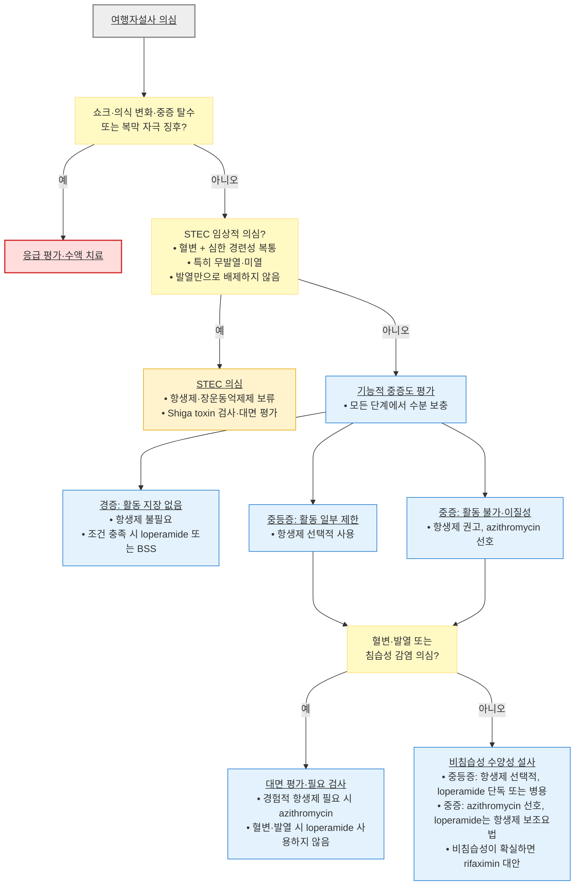

# 여행자설사 Travelers’ Diarrhea, TD

## <mark style="color:green;">일반 사항</mark>

* 여행자설사(TD)는 가장 흔한 여행 관련 질환으로, 고위험 지역을 2주간 여행하는 사람의 약 30\~70%에서 발생할 수 있으며, 여행 지역·계절·노출에 따라 발생률이 달라짐
* 전파 경로 : 대부분 오염된 음식이나 음료수
* 경과 : 치료하지 않으면 세균성은 대개 3\~7일, 바이러스성은 2\~3일 내 호전되고 원충 감염은 수 주\~수개월 지속될 수 있음. 일부는 2주 이상 지속되거나 post-infectious IBS(PI-IBS)로 이행함 <mark style="color:$info;">\[CDC]</mark>

## <mark style="color:green;">원인 및 위험 인자</mark>

### <mark style="color:orange;">원인균</mark>

<table><thead><tr><th width="105">분류</th><th width="94">빈도</th><th>주요 원인균</th></tr></thead><tbody><tr><td>세균</td><td>75~90%</td><td><em>E. coli</em> (ETEC, EAEC), <em>Campylobacter, Shigella, Salmonella, Aeromonas</em> spp.</td></tr><tr><td>바이러스</td><td>10~25%</td><td>Norovirus, Rotavirus, Astrovirus, Sapovirus</td></tr><tr><td>원충</td><td>약 10%<br>(주로 장기 여행자)</td><td><em>Giardia duodenalis, Cryptosporidium, Cyclospora</em></td></tr></tbody></table>

* 바이러스는 10\~25%까지 기여할 수 있으며(multiplex PCR 연구), 구토 우세 증상과 관련. 혼합 감염 및 중복 검출이 가능하므로 위 비율을 단순 합산하지 않음

### <mark style="color:orange;">위험 인자</mark>

* 숙주 요인 : 면역 저하자, 제산성 약물 복용자(PPI, H₂-차단제), 위장관 수술력, 젊은 성인
* 지역·여행 요인 : 더운 기후·고온다습한 계절, 상하수도 및 위생 인프라 미비 지역(사하라이남 아프리카, 남아시아, 중남미), 배낭여행·오지 여행 등 모험형 여행
* 발현 시기 : 독소형은 섭취 후 수 시간 내, 세균·바이러스는 6\~96시간에 급격히 시작하며, 원충은 대개 1\~2주(Cyclospora 2\~14일) 후 나타남. 장기 체류에서는 원충 감염과 반복 노출을 함께 고려 <mark style="color:$info;">\[CDC]</mark>

## <mark style="color:green;">임상 양상</mark>

### <mark style="color:orange;">병원체별 특징</mark>

<table><thead><tr><th width="153">원인균</th><th width="106">잠복기</th><th>임상 특징</th></tr></thead><tbody><tr><td>ETEC</td><td>6~72시간</td><td>권태감, 식욕 부진, 복통에 이어지는 급격한 수양성 설사</td></tr><tr><td>EAEC</td><td>일정하지 않음</td><td>수양성 설사; 일부에서 지속성 설사와 관련</td></tr><tr><td><em>Campylobacter</em></td><td>대개 2~5일</td><td>발열, 경련성 복통, 수양성 또는 혈성 설사</td></tr><tr><td><em>Shigella</em></td><td>대개 1~3일</td><td>뒤무직·절박변·점혈변 등 이질성 증상, 발열</td></tr><tr><td>비장티푸스 <em>Salmonella</em></td><td>12~72시간</td><td>오한, 발열, 두통, 근육통 동반; 균혈증 가능</td></tr><tr><td><em>Aeromonas</em> spp.</td><td>1~2일</td><td>수양성 또는 점혈변 설사; 담수 노출력</td></tr><tr><td>Norovirus</td><td>12~48시간</td><td>오심·구토가 우세하며 폭발적 집단 발생이 특징; 경과가 짧음(1~3일)</td></tr><tr><td><em>Giardia duodenalis</em></td><td>1~2주</td><td>악취성 지방성 설사, 복부 팽만, 잦은 트림; 수 주~수개월 지속 가능</td></tr><tr><td><em>Cyclospora cayetanensis</em></td><td>2~14일</td><td>수양성 설사가 장기간 지속되며 재발-완화 경과가 특징; TMP/SMX 반응. 위험 지역: 과테말라·아이티·네팔·페루 등</td></tr><tr><td><em>S. aureus·B. cereus</em> (구토형 독소)</td><td>1~6시간</td><td>음식 섭취 직후 폭발적 구토·복통. 발열 대개 없음; 12~24시간 내 자연 호전. 항생제 불필요</td></tr></tbody></table>

* 독소형 식중독 감별 : 잠복기가 1\~6시간으로 매우 짧고 구토가 주증상이며 발열이 없으면 세균성 TD보다 _S. aureus_ 또는 _B. cereus_ 독소형을 먼저 의심. 항생제는 불필요하며 수분 보충과 대증 치료로 충분. _B. cereus_ 설사형은 잠복기가 6\~24시간이며 수양성 설사가 주증상

### <mark style="color:orange;">중증도 분류</mark>

* 경증 : 견딜 만하고 고통스럽지 않으며, 계획된 활동에 지장 없음
* 중등증 : 고통스럽거나 계획된 활동에 지장을 주는 설사
* 중증 : 계획된 활동이 불가능한 설사; 이질성 설사는 모두 중증으로 간주
* 기간에 따른 구분 : 급성 ＜14일, 지속성 ≥14일\~＜4주, 만성 ≥4주; 14일 이상이면 원충·CDI·감염 후 상태 및 기저 위장관질환 평가


**이질성 설사(Dysentery)** : 육안적 혈변(grossly bloody stool)이 있는 설사를 말하며, 뒤무직·절박변·경련성 복통·점액변이 동반될 수 있음. 모든 이질성 설사는 중증으로 간주함. 발열성 설사(febrile diarrhea)는 침습성 감염을 시사하지만 이질과 동의어는 아니며, 경험적 항생제가 필요하면 azithromycin을 우선 고려



**Post-infectious IBS (PI-IBS)** : 급성 감염 후 새로 발생하는 IBS로, 지속되는 복통과 배변 변화가 특징임. 감염 직후의 일시적 설사·유당불내증과 구분하며, 복통·배변 변화와 증상 기간 등 정식 IBS 진단 요건을 확인함. 감염 기간이 길고 중증일수록, 여성에서, 심리적 스트레스가 동반된 경우 위험이 높음 (☞ [과민대장증후군](087_-ibs.md))


### <mark style="color:$danger;">🚩 Red Flags!</mark>

<mark style="color:$danger;">**즉각 조치**</mark>

* 의식 저하·혼돈, 빈맥(＞120회/분), 저혈압, 무뇨 또는 핍뇨  `중증 탈수` `쇼크`
* 고열·오한과 함께 저혈압·의식 변화 등 심한 전신 독성  `패혈증` `균혈증`
* 혈성 설사 후 소변량 감소·창백·멍·의식 변화  `HUS`
* 판상복부·반동 압통 등 복막 자극 징후  `급성 복증`
* 영아·고령자·면역 저하자의 급격한 임상 악화  `중증 탈수` `패혈증`

<mark style="color:$warning;">**당일 평가**</mark>

* 말라리아 위험 지역 체류 중 또는 귀국 후 발열  `말라리아` `장티푸스`
* 육안적 혈변, 38.5℃ 이상 발열 또는 심한 복통  `이질` `침습성 장염` `STEC`
* 지속 구토로 수분·약을 유지하지 못함  `탈수`
* 면역 저하·염증성 장질환·인슐린 치료 중인 당뇨병·임신부의 중등증 이상 설사  `합병증 고위험`
* 항생제 자가 치료 24\~48시간 후에도 호전 없는 중등증 이상  `치료 실패` `내성균`

<mark style="color:$info;">**조기 평가 및 추적**</mark>

* 귀국 후 14일 이상 지속되는 설사  `원충 감염` `CDI` `기저 위장관질환`
* 설사 소실 후에도 지속되는 복통·배변 변화  `PI-IBS`

## <mark style="color:green;">진단</mark>

* 정상 면역 성인의 합병증 없는 단기간 경증 설사는 일반적으로 임상 진단으로 충분하며 일률적인 대변 검사는 불필요
* 미생물 검사 적응증 : 중증, 혈변 또는 발열성 설사, 면역 저하, 지속성(≥2주), 경험적 치료 실패, 집단 발생 의심
  * 대변 배양, 기생충란·낭포 검사
  * 지속성 증상은 Giardia 항원/PCR 및 원충 중심 multiplex PCR을 우선 고려; 광범위 세균·바이러스 패널을 무조건 반복하지 않음
  * 현미경 기생충란·낭포 검사는 필요시 서로 다른 날 채취한 3회 검체를 사용하며 Cryptosporidium·Cyclospora·Cystoisospora는 변형 항산성 염색 또는 해당 PCR을 별도 확인
* 혈변·심한 복통에서는 STEC 배양 및 Shiga toxin 또는 독소 유전자 검사를 포함함. HUS 의심 시 CBC·혈소판·신기능 및 용혈 검사와 소변검사를 시행함
* PCR에서 세균이 검출되고 항생제 치료가 필요하면 가능한 한 배양·감수성검사로 연결함. 다중 PCR 양성은 집락화·잔여 핵산 검출일 수 있어 임상상과 함께 해석함
* 지속성 설사에서 CDI는 항생제 복용력과 무관하게 평가하되, 적절한 설사 검체(통상 24시간 내 무형변 ≥3회, 하제 등 다른 원인 배제)에 검사함. NAAT 단독 양성은 보균 가능성이 있어 독소검사와 임상상을 함께 판단함 (☞ [급성 감염성 설사](085_-acute-infectious-diarrhea.md#cdi))
* 혈액 검사 : CBC, 전해질, 신기능 (심한 탈수, 면역 저하자, 중증). 장티푸스·균혈증·패혈증 의심 시 가능하면 항생제 투여 전 혈액배양 시행함
* 말라리아 위험 지역 방문 후 발열은 설사가 동반되어도 당일 말라리아 검사(혈액 도말·신속항원검사)를 시행함. 신속항원검사 음성만으로 배제하지 않으며, 초기 검사가 음성이어도 임상적으로 의심되면 혈액 도말을 12\~24시간 간격으로 반복하여 총 3회 평가함. 지속 고열·전신 증상에서는 장티푸스·파라티푸스도 감별함

### <mark style="color:orange;">귀국 후 지속 설사 접근법</mark>

<table><thead><tr><th width="188">상황</th><th>우선 고려</th><th>검사</th></tr></thead><tbody><tr><td>설사 ＜14일</td><td>대부분 급성 세균성·바이러스성 TD</td><td>경증은 임상 판단; 중증·혈변·발열·면역 저하·치료 실패 시 대변 검사</td></tr><tr><td>설사 ≥14일 + <br>악취성·지방변·복부팽만</td><td><em>Giardia duodenalis</em></td><td>대변 항원검사 / 기생충란·낭포 / PCR</td></tr><tr><td>재발성 수양성 설사</td><td><em>Cyclospora, Cryptosporidium</em></td><td>대변 PCR 또는 변형 항산성 염색</td></tr><tr><td>혈변·체중 감소 지속</td><td><em>Entamoeba histolytica</em>, IBD, 대장 질환</td><td>대변 PCR·항원검사; 적응 시 대장내시경</td></tr><tr><td>지속성 설사 초기 평가</td><td><em>C. difficile</em> 감염</td><td>항생제 사용 여부와 관계없이 NAAT·독소검사</td></tr><tr><td>감염 검사 음성 + <br>만성 복통·설사</td><td>일시적 흡수장애, PI-IBS, SIBO, 유당불내증, 장기 체류자의 열대 흡수장애(tropical sprue), celiac disease·IBD 등</td><td>증상 기간과 경고 증상에 따라 단계적으로 평가; SIBO 의심 시 수소호기검사 고려</td></tr><tr><td>수인성 노출 후 <br>혈성·점액성 설사 지속</td><td><em>Aeromonas, Vibrio, Yersinia</em></td><td>대변 배양; <em>Aeromonas</em>는 일반 배양에서 검출 가능하며 <em>Vibrio·Yersinia</em>는 검사실에 특수 배양 요청</td></tr></tbody></table>

***



> _항생제 투여 후 24\~48시간 내 호전이 없거나 악화되면 배양·감수성검사를 포함하여 재평가함_

<p align="center"><strong>여행자설사 중증도별 치료 알고리듬</strong></p>

<p align="center"><em><mark style="color:$info;">저자 재구성 (참고 문헌 : ISTM 2017; CDC Yellow Book 2026)</mark></em></p>

***

## <mark style="background-color:$warning;">Management</mark>


### <mark style="color:orange;">치료 원칙</mark>

* 수분 보충이 모든 단계의 1순위 : 경증 설사도 탈수로 악화될 수 있음. 경증은 물·이온 음료·국물·짭짤한 크래커 등 선호 음료로 즉시 시작하고, 수분 손실이 많으면 포장 ORS(경구 수액)를 사용. 고령자·소아·트레킹 중·고온 환경에서 특히 중요

<table><thead><tr><th width="88">중증도</th><th width="220">지사제</th><th>항생제</th></tr></thead><tbody><tr><td>경증</td><td>loperamide 또는 bismuth subsalicylate 고려</td><td>권고하지 않음</td></tr><tr><td>중등증</td><td>loperamide 단독 또는 항생제 병용 고려</td><td>선택적으로 고려; 비침습성 수양성 설사에서는 rifaximin도 대안</td></tr><tr><td>중증</td><td>무혈변·무발열 성인에서 항생제와 병용 고려; 혈변·발열 시에는 사용하지 않음</td><td>항생제 투여 권고(azithromycin 선호)</td></tr></tbody></table>

### <mark style="color:orange;">여행 전후 의료 상담 - 단계별 안내</mark>

1. **Pre-Travel (출국 전) - 여행지 건강 유의사항 설명 및 사전 준비**
   * 여행자설사 발생 가능성과 대처법 충분히 설명
   * 수분 보충의 중요성과, 수분 손실이 많을 때 안전한 물로 정확히 조제한 경구수액(ORS)을 사용하는 방법 설명
   * 여행지 위험도·일정에 따른 비상약 처방 (비상약 키트 참조)
   * 발열 또는 혈변(이질)이 있으면 진료를 우선하고, 바로 진료받기 어려우면 사전에 정한 사용 기준에 따라 비상용 azithromycin을 복용. 단, 열이 없거나 미열이면서 혈변과 심한 복통이 함께 있으면 STEC 가능성이 있어 항생제·loperamide를 복용하지 않고 즉시 진료. 귀국 후 발열은 항생제 자가 복용으로 말라리아·장티푸스 평가를 지연하지 않음
2. **During-Travel (여행 중) - 단계별 자가 관리**
   * 단계별 자가 관리 표 및 알고리듬 참조; 48시간 내 호전되지 않으면 의료기관 방문
3. **Post-Travel (귀국 후) - 지속 증상 처리**
   * 급성 설사 지속 시 지침에 따른 경험적 치료
   * 중증·지속성(≥2주)·치료 실패 : 대변 배양·기생충 검사·PCR
   * 만성·지속성 증상 : 귀국 후 지속 설사 접근법 표 참조

### <mark style="color:orange;">여행 중 비상약 전략</mark>

* 항생제 비상약은 여행 지역·기간, 기저질환 및 의료 접근성을 고려하여 선별 처방. 두 종류를 휴대하는 경우 각각의 사용 기준을 명확히 교육
  * azithromycin : 중증, 발열성 또는 이질성 설사, 또는 동남아 여행 시
  * rifaximin : 열·혈변 없는 수양성 설사용 (비이질성)
* 한 가지 항생제만 휴대한다면 azithromycin이 대부분의 세균성 상황에 대응 가능

#### <mark style="color:$primary;">단계별 자가 관리 (여행 중)</mark>

<table><thead><tr><th width="61">단계</th><th width="230">상황</th><th>조치</th></tr></thead><tbody><tr><td><strong>1</strong></td><td>경증 수양성 설사, 활동 가능</td><td>수분 보충 우선; loperamide 또는 bismuth subsalicylate 고려; 항생제 불필요</td></tr><tr><td><strong>2</strong></td><td>중등증, 활동 제한, 열·혈변 없음</td><td>항생제 선택적으로 고려; azithromycin 또는 비침습성으로 판단되면 rifaximin; loperamide 병용 가능</td></tr><tr><td><strong>3</strong></td><td>발열성 설사 또는 이질성 설사(육안적 혈변)</td><td>의료기관 평가 우선. 바로 진료받기 어려우면 사전 지시에 따라 azithromycin을 사용하고 loperamide는 복용하지 않음. 열이 없거나 미열이면서 혈변과 심한 복통이 함께 있으면 STEC 가능성 때문에 항생제도 복용하지 않고 즉시 진료</td></tr><tr><td><strong>4</strong></td><td>24~48시간 항생제 후 미호전, 심한 탈수·지속 구토</td><td>즉시 의료기관 방문; 정맥 수액·대변 검사 고려</td></tr><tr><td><strong>5</strong></td><td>귀국 후 2주 이상 지속</td><td>Giardia 항원/PCR·원충 중심 검사, CDI 및 감염 후·기저 위장관질환 평가</td></tr></tbody></table>

### <mark style="color:orange;">여행 전 비상약 키트 준비 (출국 전 처방 준비)</mark>

<table><thead><tr><th width="186">품목</th><th>용도</th></tr></thead><tbody><tr><td>휴대용 ORS 파우치</td><td>탈수 방지·치료; 정확한 조제용 물의 양 확인</td></tr><tr><td>loperamide</td><td>무발열·무혈변 성인 설사 조절; 발열·혈변 시 중단·진료</td></tr><tr><td>azithromycin</td><td>중증, 이질성 또는 발열성 설사; 동남아 여행 시 우선</td></tr><tr><td>rifaximin</td><td>선별된 여행자에서 비침습성 수양성 설사의 대안; 발열·혈변 시 사용 금지</td></tr><tr><td>항구토제 ODT</td><td>선별된 환자에서 제한적으로 고려(허가 외 사용과 QT 위험 설명)</td></tr><tr><td>체온계</td><td>발열 여부와 중증도 판단</td></tr><tr><td>알코올 손 소독제</td><td>비누·물이 없을 때 보조적으로 사용</td></tr></tbody></table>

## <mark style="color:green;">비-약물 치료 및 예방</mark> <a href="#non-drug-treatment" id="non-drug-treatment"></a>

### <mark style="color:orange;">수분 및 영양 보충</mark>

* 모든 중증도에서 수분 보충이 1순위. 심한 수분 손실에는 포장 ORS를 표시된 양(대개 1 ℓ)의 끓이거나 정수한 물에 정확히 녹여 사용
* 경증에서는 물·이온음료·국물 등 선호 음료로 보충할 수 있으나, 당분이 지나치게 많은 음료는 삼투성 설사를 악화시킬 수 있음 <mark style="color:$info;">\[CDC]</mark>
* 심한 탈수, 의식 저하, 쇼크 또는 지속 구토가 있으면 즉시 의료기관에서 평가하고 정맥 수액 고려
* 식사를 불필요하게 제한하지 않으며 견딜 수 있는 규칙적인 식사를 계속

### <mark style="color:orange;">예방</mark>

#### <mark style="color:$primary;">음식 / 음료</mark>

* 수질이 불확실한 지역에서는 끓이거나 적절히 처리한 물, 밀봉된 생수를 마시고 양치질에도 안전한 물 사용
* 밀봉 확인 후 음료수 섭취; 마개가 깨진 병은 마시지 않는다
* 살균하지 않은 우유·유제품 섭취 금지
* 껍질 벗기지 않은 과일·채소 금지; 가능한 한 직접 껍질을 벗긴다
* 익히지 않은 채소·샐러드 주의; 생고기·덜 익은 고기·어패류 금지
* 방금 조리된 뜨거운 음식 선택; 뷔페 음식 특히 주의
* 얼음은 정수된 물로 만든 것이 확인된 경우에만 사용
* 거리 음식은 충분히 익혀 주문 즉시 뜨겁게 제공되는 경우에 한해 선택하고, 상온에 오래 둔 음식은 피함


음식·음료 선택과 손 위생은 위험을 줄이지만 식당의 조리 위생과 지역 기반시설 문제까지 통제할 수 없어 TD를 완전히 예방하지는 못함


#### <mark style="color:$primary;">위생</mark>

* 식사 전·배변 후 비누와 물로 20초 이상 손 씻기. 물과 비누가 없으면 알코올 60% 이상 손 소독제를 보조적으로 사용하되 norovirus에는 효과가 낮아 손 씻기를 대체하지 못함
* 수질이 불확실한 호수·강·수영장에서 물을 삼키지 않으며, 설사 중에는 공용 물놀이 시설 이용을 피함

#### <mark style="color:$primary;">예방적 약제</mark>


**최신 가이드라인 방향** : 예방적 항생제보다 증상 발생 시 조기 자가치료 전략이 선호됨. 위생 수칙과 적절한 비상약 휴대를 우선하고, 예방적 항생제는 면역 저하자 또는 중대한 기저질환이 있는 고위험 지역 단기 여행자에서 이득과 위해를 개별 평가하여 드물게 고려


* 일반 여행자에게 예방적 항생제 권고하지 않음 : 내약성, _C. difficile_ 감염, 항생제 내성균 보균 위험이 이득보다 큼 <mark style="color:$info;">\[CDC]</mark>
* 고려 대상 : 면역 저하자 또는 중대한 내과 기저질환이 있는 고위험 지역 단기 여행자에서 이득과 위해를 개별 평가하여 드물게 고려
* 예외적으로 예방 투여가 필요하면 여행의학·감염 전문의와 비흡수성 약제 사용을 검토함. Rifaximin 예방은 허가 외 사용이며 침습성 병원체를 예방하지 못함. Rifamycin SV의 TD 치료 용법을 예방 용법으로 대입하지 않음
  * Fluoroquinolone 예방적 사용은 권고하지 않음 : _Campylobacter·Shigella_의 내성률 상승, 중대한 이상반응과 _C. difficile_ 감염 위험 때문 <mark style="color:$info;">\[CDC]</mark>
* Bismuth subsalicylate : 예방 효과가 보고되었으나 복용량이 많고 3주를 넘는 사용의 안전성이 확립되지 않아 일반적으로 사용하지 않음; 12세 미만 소아·임신부에는 권하지 않음 <mark style="color:$info;">\[CDC]</mark>
* Prebiotics/Probiotics : 예방 효과에 대한 자료가 불충분하여 권고하지 않음


**경구 콜레라 백신과 TD** : CTB 함유 경구 콜레라 백신 <mark style="color:blue;">\[</mark>[<mark style="color:blue;">듀코랄액</mark>](https://www.health.kr/drug/2010053100006)<mark style="color:blue;">]</mark>은 LT-ETEC에 대한 단기간 교차 보호 가능성이 보고되었으나 전체 TD 예방효과는 제한적이며, TD 예방만을 목적으로 일률적으로 권고하지 않음. 콜레라 백신은 실제 콜레라 노출 위험과 허가·공급 상태에 따라 판단


## <mark style="color:green;">약물 치료</mark> <a href="#drug-treatment" id="drug-treatment"></a>

### <mark style="color:orange;">항생제</mark>

* 항생제 사용 여부는 배변 횟수보다 계획된 활동에 미치는 기능적 영향을 기준으로 결정 <mark style="color:$info;">\[ISTM 2017]</mark>
  * 경증 : 항생제 권고하지 않음
  * 중등증 : 이득과 위해를 고려하여 선택적으로 사용
  * 중증 또는 이질성 설사 : 항생제 권고; azithromycin 선호
  * 발열성 설사 또는 동남아시아 여행 : azithromycin 우선 고려
  * 면역 저하자 또는 중대한 내과 기저질환자 : 더 낮은 문턱으로 평가·치료 고려
* 항생제는 감수성 있는 세균성 TD의 증상 기간을 약 1\~2일 단축하지만, ESBL 생성 장내세균 보균, 장내 미생물 변화 및 _C. difficile_ 감염 위험을 증가시킬 수 있으므로 경증에는 사용하지 않음


**STEC 주의** : 심한 복통과 육안적 혈변, 특히 발열이 없거나 미미한 경우 Shiga toxin-producing _E. coli_ (STEC/O157:H7)를 고려하며 발열만으로 배제할 수 없음. 소아뿐 아니라 성인에서도 항생제와 장운동억제제가 HUS 위험을 높일 수 있으므로 STEC가 의심되면 투여하지 말고 즉시 의료기관에서 평가 <mark style="color:$info;">\[IDSA 2017]</mark>


#### <mark style="color:$primary;">Macrolide</mark>

* 1차 선택 : 중증·이질성·발열성 설사, 동남아(태국 포함)·남아시아 여행
* azithromycin : 500 ㎎ qd × 3일, 또는 1 g 단회 <mark style="color:blue;">\[</mark>[<mark style="color:blue;">지스로맥스</mark>](https://www.health.kr/drug/A11AGGGGA5794)<mark style="color:blue;">]</mark>
  * 정제는 250 ㎎ 정만 유통되어 500 ㎎은 2정, 1 g은 4정임. 여행자설사는 지스로맥스정 허가 적응증에 포함되지 않아 허가 외 사용임
  * QT 연장·저칼륨혈증·저마그네슘혈증, 부정맥 병력 및 QT 연장 약물 병용을 확인함. 탈수·전해질 이상이 있으면 위험이 커질 수 있음
  * 단회 1 g 복용 시 오심이 흔함; 1 g을 같은 날 2회로 나누거나 500 ㎎ qd × 3일 요법을 사용하면 내약성을 높일 수 있음 <mark style="color:$info;">\[CDC]</mark>

#### <mark style="color:$primary;">Rifamycin계</mark>

* 비침습적(비이질성·비발열성) 수양성 설사에서 제한적으로 고려
* 전신 흡수가 적으나 rifamycin계 과민반응, CDI 및 중증 간장애·병용약물에 대한 주의는 필요함
* 금기 : 열·혈변 동반 설사, 장폐색·중증 궤양성 장질환. 전신 흡수가 거의 없어 _Campylobacter, Shigella, Salmonella_ 등 침습성 병원체에 대한 효과가 제한적
* 여행자가 침습성 여부를 정확히 구분하기 어려워 경험적 단일 비상약으로서 유용성이 제한됨. 복용 중 발열·혈변이 생기면 중단하고 재평가
* rifaximin : 200 ㎎ tid × 3일 <mark style="color:blue;">\[</mark>[<mark style="color:blue;">노르믹스</mark>](https://www.health.kr/drug/A11AOOOOO0736)<mark style="color:blue;">]</mark> - CDC TD 지침 용법; 12세 이상
  * 허가된 설사 기본 용법은 12세 이상에서 200 ㎎을 6시간마다 투여하며, 의사 지시에 따라 용량·횟수 증감이 가능함. 위 tid × 3일은 국제 TD 지침 요법으로 구분하여 처방함
* rifamycin SV : 388 ㎎ bid × 3일 (해외 약제; 성인 ≥18세)

#### <mark style="color:$primary;">Fluoroquinolone</mark>


현재 azithromycin이 우선 선택되며, rifaximin은 비침습성 설사에서 제한적으로 고려함. _Campylobacter·Shigella_의 fluoroquinolone 내성이 전 세계적으로 증가 중이며, 특히 남아시아·동남아시아에서 사용이 제한됨. 중대한 안전성 경고(건염·건 파열, 말초신경병증·중추신경계 이상 등에 대한 FDA boxed warning 및 저혈당·QT 연장·대동맥류/박리 등 추가 경고)와 _C. difficile_ 위험이 있음. 치료에서는 내성이 낮은 지역의 대체 약제로만 고려하고, 예방 목적으로는 권고하지 않음. 이질성 설사에서도 우선 선택하지 않음


* 대체 옵션 (현재 사용 감소)
* ciprofloxacin : 500 ㎎ bid × 3일, 또는 750 ㎎ 단회 <mark style="color:blue;">\[</mark>[<mark style="color:blue;">베아신</mark>](https://health.kr/drug/2016040100009)<mark style="color:blue;">]</mark>
  * 750 ㎎ 단일 정제는 유통 확인 안 됨
* levofloxacin : 500 ㎎ 단회, 또는 qd × 3일 <mark style="color:blue;">\[</mark>[<mark style="color:blue;">크라비트</mark>](https://www.health.kr/drug/A11AOOOOO7621)<mark style="color:blue;">]</mark>


TMP/SMX, doxycycline은 일반적인 세균성 TD의 경험적 치료에 권고하지 않음. 단, 확진된 Cyclospora에는 TMP/SMX 등 원인균별 표적 치료를 적용함.


#### <mark style="color:$primary;">지역별 추천 항생제</mark>

<table><thead><tr><th width="163">여행 지역·상황</th><th width="187">특징 병원체</th><th>치료 원칙</th></tr></thead><tbody><tr><td>동남아시아 <br>(태국 포함)</td><td><em>Campylobacter</em> (FQ 내성 높음)</td><td>azithromycin <strong>우선</strong></td></tr><tr><td>남아시아 <br>(인도, 파키스탄 등)</td><td>FQ 내성 <em>Campylobacter, Shigella</em> 등</td><td>azithromycin 우선 고려</td></tr><tr><td>중남미·아프리카</td><td>ETEC 등</td><td>중증도와 침습성 여부에 따라 azithromycin; 비침습성 수양성 설사에 rifaximin 대안</td></tr><tr><td>유람선·단체 투어</td><td>Norovirus (집단 발생)</td><td>항생제 불필요; 수분 보충·감염관리</td></tr><tr><td>장기 여행·<br>지속성 설사</td><td><em>Giardia, Cyclospora, Cryptosporidium</em> 등</td><td>검사 후 표적 치료; <em>Giardia</em>는 tinidazole/metronidazole, <em>Cyclospora</em>는 TMP/SMX</td></tr></tbody></table>


**항생제 치료 실패·내성** : Azithromycin도 모든 균주에 유효한 것은 아님. 미국 감시에서 XDR Shigella(ampicillin·azithromycin·ceftriaxone·ciprofloxacin·TMP/SMX 모두 내성)가 증가하고 있어 경험적 경구 약제가 듣지 않을 수 있음 <mark style="color:$info;">\[MMWR 2026]</mark>. 항생제 투여 후 24\~48시간 내 미호전 또는 악화 시 배양·감수성검사와 전문의 평가; 다른 비상약을 임의로 연속 복용하지 않음


### <mark style="color:orange;">원인균 확인 후 치료</mark>

* _Campylobacter_ : 치료가 필요하면 azithromycin을 우선함
* _Shigella_ : 감수성 결과에 따라 약제를 선택함. XDR 균주는 감염 전문의와 상의
* _Aeromonas_ : 중등증 이상이면 감수성 결과에 따라 fluoroquinolone 또는 3세대 cephalosporin 고려
* 비장티푸스 Salmonella : 정상 면역 성인의 단순 장염은 대개 항생제가 불필요함. 균혈증·중증 감염, 면역 저하 및 침습성 감염 고위험군에서 감수성에 따라 치료함
* Giardia : tinidazole 2 g 단회, 식사와 함께 <mark style="color:blue;">\[</mark>[<mark style="color:blue;">티니다진</mark>](https://health.kr/drug/A11A2070A0134)<mark style="color:blue;">]</mark>(500 ㎎ 4정), 또는 metronidazole 250 ㎎ tid × 5\~7일 <mark style="color:blue;">\[</mark>[<mark style="color:blue;">후라시닐</mark>](https://health.kr/drug/A11A0100A0080)<mark style="color:blue;">]</mark>(람블편모충증은 허가 외 사용). 검사가 어려우면서 지방변·복부팽만 등 임상상이 전형적인 지속성 설사에서는 경험적 치료를 개별 검토할 수 있음
* Cyclospora : TMP/SMX 160/800 ㎎ bid × 7\~10일이 표적 치료임 <mark style="color:blue;">\[</mark>[<mark style="color:blue;">셉트린</mark>](https://www.health.kr/drug/A11A0500A0065)<mark style="color:blue;">]</mark>(80/400 ㎎ 정 2정). 일반 TD에서의 경험적 TMP/SMX 비권고와 구분함
* E. histolytica : metronidazole 500\~750 ㎎ tid × 5\~10일 또는 tinidazole 2 g qd × 2\~3일 치료 후 장관 내 약제가 추가로 필요함. Metronidazole 단독으로 치료를 끝내지 않으며 장관 내 약제의 공급 경로를 전문기관과 협의함
* Cryptosporidium : 정상 면역자는 수분 보충만으로 호전되는 경우가 많음. 지속성·면역 저하 환자는 전문 평가하며 nitazoxanide는 해외 약제임

### <mark style="color:orange;">지사제</mark>

* **loperamide** : 처음 4 ㎎, 이후 묽은 변마다 2 ㎎; 허가 최대 16 ㎎/일 <mark style="color:blue;">\[</mark>[<mark style="color:blue;">로프민</mark>](https://www.health.kr/drug/A11A1660A0057)<mark style="color:blue;">]</mark>
  * 이 책에서는 일반 외래·여행 중 급성 설사 자가 치료를 보수적으로 최대 8 ㎎/일, 최대 2일로 제한함(허가용량 상한과 구분)
  * 사용 대상 : 충분히 수분을 보충한 정상 면역 성인의 무혈변·무발열 급성 수양성 설사
  * 혈변·발열·전신 독성·침습성 장염·STEC 또는 CDI 의심·급성 중증 대장염·장폐색 위험이 있으면 사용하지 않음. 복부 팽만·변비·심한 통증이 생기거나 48시간 내 호전이 없으면 중단하고 재평가
  * 소아 감염성 급성 설사에는 사용하지 않음(IDSA는 18세 미만에서 비권고)
  * 권장량 초과 시 QT 연장·심실성 부정맥 위험이 있으므로 임의로 증량하지 않음
  * CDC는 침습성 병원체를 포함하여 적절한 항생제와의 병용을 안전하다고 보나 이질·발열 설사에서의 단독 사용은 권하지 않으며, 항생제와 병용하면 ESBL 생성 장내세균 획득이 더 흔할 수 있음 <mark style="color:$info;">\[CDC]</mark>. 이 책의 자가 치료에서는 발열·혈변이 생기면 중단하고 진료하며, 항생제와 함께 임의로 다시 복용하지 않음

### <mark style="color:orange;">분비 억제제</mark>

* **racecadotril** : 성인 100 ㎎ tid, 식전 <mark style="color:blue;">\[</mark>[<mark style="color:blue;">하이드라섹</mark>](https://www.health.kr/drug/2019012500080)<mark style="color:blue;">]</mark> (비급여); 정상 배변 2회까지, 최대 7일
  * TD 표준 권고 약제는 아니며 경구 수분 보충의 선택적 보조요법; 장 운동 억제 작용은 없음
  * 혈변 또는 화농성 변과 발열, 항생제 관련 설사, 만성 설사, 조절되지 않는 구토에는 투여하지 않음
  * ACE 억제제 병용 시 혈관부종 위험 증가; ACE 억제제로 인한 혈관부종 병력은 금기
  * 소아 용법·지침상 대상 (☞ [소화기계 약제](073_-gidrugs.md#racecadotril))
* **bismuth subsalicylate (BSS)** : 경증 급성 설사·여행자설사의 선택적 증상 완화. 현탁액 30 ㎖(525 ㎎)를 30분마다 또는 60 ㎖(1,050 ㎎)를 1시간마다 필요시 복용; 24시간 최대 240 ㎖, 최대 2일 <mark style="color:blue;">\[</mark>[<mark style="color:blue;">펩토무스현탁액</mark>](https://www.health.kr/drug/2023041200001)<mark style="color:blue;">]</mark>
  * 금기·주의 사항 (☞ [소화기계 약제](073_-gidrugs.md#bismuth-subsalicylate))

### <mark style="color:orange;">흡착제</mark>

* **diosmectite** : 성인 3 g(20 ㎖, 1포) tid, 식간 복용 <mark style="color:blue;">\[</mark>[<mark style="color:blue;">포타겔현탁액</mark>](https://www.health.kr/drug/2019102400021)<mark style="color:blue;">]</mark>
  * 여행자설사의 표준 권고 약제는 아니며 경구 수분 보충의 선택적 보조요법
  * 복용 전 잘 흔들며, 다른 경구약과는 통상 2시간 이상 간격을 둠
  * 변비·복부 팽만이 생기면 중단·평가; 변비·장폐색 병력에서 주의
  * 만 19세 미만 소아·청소년에는 사용하지 않음. 상세 주의사항 (☞ [소화기계 약제](073_-gidrugs.md#adsorbent))

### <mark style="color:orange;">진경제</mark>

* 복통이 심할 때 단기간 선택적으로 사용하며, TD 지침의 표준 약제는 아님
* cimetropium : 50 ㎎ bid\~tid <mark style="color:blue;">\[</mark>[<mark style="color:blue;">알피움</mark>](https://www.health.kr/drug/A11AOOOOO7809)<mark style="color:blue;">]</mark>
  * 항콜린성 진경제는 고령에서 가능한 회피하며, 전립선비대·요폐·협우각 녹내장 및 다른 항콜린 약물 병용에 주의
* tiropramide : 100 ㎎ bid\~tid <mark style="color:blue;">\[</mark>[<mark style="color:blue;">티로파</mark>](https://www.health.kr/drug/A11A0430A0302)<mark style="color:blue;">]</mark>
* phloroglucinol : 1회 2정, 증상 발현 시 물 한 컵에 녹이거나 설하에서 녹여 복용 <mark style="color:blue;">\[</mark>[<mark style="color:blue;">후로스판</mark>](https://www.health.kr/drug/A11A1560A0119)<mark style="color:blue;">]</mark>

### <mark style="color:orange;">항구토제</mark>

* 구토로 수분 섭취가 어려운 경우 구강붕해정(ODT) 형태의 항구토제를 제한적으로 고려할 수 있으나, 급성 감염성 설사·TD에는 허가 외 사용이며 QT 연장 위험과 병용 약물을 확인
* ramosetron ODT : 0.1 ㎎(100 ㎍) 제형 <mark style="color:blue;">\[</mark>[<mark style="color:blue;">나제아오디</mark>](https://www.health.kr/drug/A11AGGGGG5333)<mark style="color:blue;">]</mark> (허가 외; 허가 용법과 환자별 위험 확인)
  * TD의 표준 비상약으로 권고할 근거가 부족하여 일괄 처방하지 않음. 항구토용 제형으로, IBS-D의 2.5\~5 ㎍ 정제와 구분하며 용량을 서로 대입하지 않음. 지속 구토 시 임의로 반복 투여하지 말고 재평가
* ondansetron ODT : 4\~8 ㎎, 개별 처방 지시 범위에서 필요시 <mark style="color:blue;">\[</mark>[<mark style="color:blue;">조프란자이디스</mark>](https://www.health.kr/drug/A11ABBBBB1538)<mark style="color:blue;">]</mark> (허가 외)
  * apomorphine(심한 저혈압·의식 소실)·domperidone·ribociclib(QT 연장·부정맥)과 병용 금기
  * 비상용 azithromycin과 함께 복용하면 QT 연장 위험이 더해지므로 QT 연장 병력·병용 약물·탈수에 따른 전해질 이상을 확인


ODT는 입에서 녹지만 삼킨 뒤 흡수되므로 지속 구토 시 투여가 보장되는 제형은 아님. 반복 구토, 탈수 또는 약물을 유지하지 못하면 반복 복용하지 말고 의료기관 방문


### <mark style="color:orange;">특수 환자군</mark>

* 소아 : ORS를 조기에 시작하고 모유·분유 및 연령에 맞는 식사를 계속함. 성인 비상약 처방을 그대로 적용하지 않음. 심한 수양성 설사·전신 감염에서 항생제가 필요하면 azithromycin 10 ㎎/㎏ qd × 3일을 우선 검토함. Rifaximin은 12세 이상에서 사용하며, loperamide는 소아 감염성 설사에 사용하지 않음. 혈변은 STEC·HUS 위험을 먼저 평가함
* 임신부 : 신속한 경구 수분·전해질 보충이 우선임. 항생제가 필요하면 azithromycin 또는 3세대 cephalosporin을 임상 상황에 따라 검토함. BSS는 피하며, 성인 비상약 세트를 일괄 적용하지 않음
* 면역 저하자 : 탈수·균혈증과 기회감염 위험을 함께 평가함. 반복적인 경험적 항생제보다 검사·감수성 기반 치료를 우선함

***

## <mark style="color:red;">질병코드</mark>

* A09.0 감염성 기원의 기타 및 상세불명의 위장염 및 결장염 Other and unspecified gastroenteritis and colitis of infectious origin
* A09.9 상세불명 기원의 위장염 및 결장염 Gastroenteritis and colitis of unspecified origin
* A04.1 장독소생산 대장균감염 Enterotoxigenic Escherichia coli infection
* A04.4 기타 장대장균감염 Other intestinal Escherichia coli infection
* A04.5 캄필로박터장염 Campylobacter enteritis
* A03.9 상세불명의 시겔라증 Shigellosis, unspecified
* A02.0 살모넬라장염 Salmonella enteritis
* A07.1 편모충증[람블편모충증] Giardiasis [lambliasis]
* A07.8 기타 명시된 원충성 장질환 Other specified protozoal intestinal diseases - 원포자충 감염증(Cyclosporiasis)
* A08.1 노로바이러스에 의한 급성 위장병증 Acute gastroenteropathy due to Norovirus

***

## <mark style="color:purple;">처방례</mark>

* 아래 처방례·비상약 키트는 성인 기준. 패혈증 의심·의식 변화·쇼크·중증 탈수는 자가 경구 처방으로 지연하지 말고 즉시 의료기관 평가. 수분 보충을 우선하고, 지사제·진경제·항구토제는 필요 증상에 따라 선택; 모두 일괄 병용하는 표준 처방이 아님

> **처방례 1. 경증 (무발열·무혈변 수양성 설사)**
>
> ```
> 로프민캡슐 2 ㎎/C    처음 2C, 이후 묽은 변마다 1C (자가 치료 시 최대 4C/일, 최대 2일)
>
> 또는
> 펩토무스현탁액       30 ㎖  30분마다 필요시 (최대 240 ㎖/일, 최대 2일)
> ```
>
> 약제 정보: [로프민캡슐 2㎎](https://www.health.kr/drug/A11A1660A0057) · [펩토무스현탁액](https://www.health.kr/drug/2023041200001)
>
> _✽ 경증에서는 항생제 불필요. 독소형(잠복기 1\~6시간, 구토 위주, 발열 없음)은 수분 보충과 대증 치료만으로 충분. 발열·혈변 발생 시 지사제를 중단하고 재평가._

> **처방례 2. 중등증 (비이질성 세균성, 열·혈변 없음)**
>
> ```
> 노르믹스정 200 ㎎/T  1T   tid   × 3일
> 로프민캡슐 2 ㎎/C    처음 2C, 이후 묽은 변마다 1C (선택; 최대 4C/일, 최대 2일)
> 티로파정 100 ㎎/T    1T   tid   (복통 시 선택)
> ```
>
> 약제 정보: [노르믹스정 200㎎](https://www.health.kr/drug/A11AOOOOO0736) · [로프민캡슐 2㎎](https://www.health.kr/drug/A11A1660A0057) · [티로파정 100㎎](https://www.health.kr/drug/A11A0430A0302)
>
> _✽ 항생제는 선택적 사용임. Rifaximin 처방은 CDC 지침 용법이며 허가 기본 용법(200 ㎎, 6시간마다)과 구분함. 침습성 여부를 확실히 구분하기 어려우므로 동남아(태국 포함) 여행자 또는 단일 비상약 전략에서는 처방례 3의 azithromycin을 우선 고려. 복용 중 발열·혈변이 생기면 rifaximin과 loperamide를 중단하고 재평가._

> **처방례 3. 중증·이질성 또는 발열성 설사 (또는 동남아 여행)**
>
> ```
> 지스로맥스정 250 ㎎/T 2T   qd   × 3일
> ```
>
> 약제 정보: [지스로맥스정 250㎎](https://www.health.kr/drug/A11AGGGGA5794)
>
> _✽ 지스로맥스정의 TD 치료는 허가 외 사용임. 1 g(4정) 단회 요법은 편리하나 오심이 흔하므로, 오심이 걱정되면 위의 3일 요법 또는 1 g을 같은 날 2회로 나누는 방법을 선택. 혈변 또는 발열성 설사에서는 loperamide를 복용하지 않음. 24\~48시간 내 호전 없으면 의료기관 방문._

> **처방례 4. 비상약 (출국 전 처방, 여행 중 자가 치료용)**
>
> ```
> ■ 중등증 이상 비침습성 수양성 설사용 (발열·혈변 없을 때)
> 노르믹스정 200 ㎎/T   1T   tid   × 3일
> 로프민캡슐 2 ㎎/C     처음 2C, 이후 묽은 변마다 1C (자가 치료 시 최대 4C/일, 최대 2일)
>
> ■ 중증·이질성 또는 발열성 설사용 (또는 동남아 여행 시 우선)
> 지스로맥스정 250 ㎎/T 2T   qd   × 3일
> ```
>
> 약제 정보: [노르믹스정 200㎎](https://www.health.kr/drug/A11AOOOOO0736) · [로프민캡슐 2㎎](https://www.health.kr/drug/A11A1660A0057) · [지스로맥스정 250㎎](https://www.health.kr/drug/A11AGGGGA5794)
>
> _✽ 포장 ORS를 함께 준비하도록 안내. 경증에서는 항생제를 사용하지 않음. Rifaximin은 CDC 지침 용법으로 허가 기본 용법과 구분하며, azithromycin의 TD 치료는 허가 외 사용임. 발열성·이질성 설사는 의료기관 평가를 우선하며, 바로 진료받기 어려우면 비상용 azithromycin을 사전 지시 범위에서 사용하고 loperamide는 복용하지 않음. 귀국 후 발열은 항생제 자가 복용으로 말라리아·장티푸스 평가를 지연하지 않음. 열이 없거나 미열이면서 혈변과 심한 복통이 함께 있으면 항생제도 복용하지 않고 즉시 진료._

***

### <mark style="color:$success;">핵심 복약 지도</mark>

**loperamide (로프민)**

* 처음 4 ㎎(2캡슐), 이후 묽은 변마다 2 ㎎(1캡슐) 추가. 허가 최대량은 하루 8캡슐(16 ㎎)이나 **여행 중 자가 치료 시 하루 최대 4캡슐(8 ㎎), 최대 2일로 제한**함
* 복통이 심해지거나 배가 불러 오르거나 48시간 내 호전이 없으면 중단·진료
* **발열·혈변이 생기면 중단하고 진료.** 비상용 항생제를 복용하더라도 임의로 다시 복용하지 않음

**bismuth subsalicylate (펩토무스현탁액)**

* 복용 전 잘 흔들어 복용하며, 하루 240 ㎖, 2일을 넘기지 않음
* 혀·변이 일시적으로 검게 변할 수 있음. 이명·청력 저하가 생기면 중단
* aspirin 등 salicylate 제제·항응고제 복용자, 임신 중에는 복용하지 않음

**rifaximin (노르믹스)**

* 식사와 무관하게 하루 3번, 3일 복용함. 허가 기본 용법(200 ㎎, 6시간마다)과 구분함
* 전신 흡수가 적지만 과민반응이나 항생제 관련 설사 등은 생길 수 있음
* **발열·혈변이 생기면 즉시 중단하고 재평가**

**azithromycin (지스로맥스)**

* 500 ㎎(2정)씩 3일 복용(표준 요법) 또는 1 g(4정) 단회 복용; 오심 예방을 위해 식후 복용 권장
* 1 g 단회 복용은 오심이 흔하므로 1 g을 같은 날 2회로 나누거나 3일 요법을 선택할 수 있음
* QT 연장 위험 약물(항부정맥제, 항정신병약 등) 복용 중인 환자는 복용 전 의사 확인
* **열이 없거나 미열이면서 혈변과 심한 복통이 함께 있으면 복용하지 않고 즉시 진료**

**metronidazole·tinidazole (후라시닐·티니다진)**

* 복용 중 및 복용 종료 후 최소 3일간 금주 - 구역·구토·홍조·두근거림 등 disulfiram 유사 반응 위험
* tinidazole 2 g 단회 요법은 식사와 함께 복용

**ramosetron ODT (나제아오디)**

* 여행자설사에는 허가 외 사용이며 표준 비상약으로 일괄 처방하지 않음. 개별 처방을 받은 경우에만 지시대로 복용
* 항구토용 0.1 ㎎(100 ㎍) 제형이며 IBS-D 치료용 ramosetron 정제와 용량을 혼동하지 않음
* 혀 위에 올려 침으로 녹여 삼킴; 물 없이 복용 가능
* 구토가 가라앉으면 다른 경구 약물을 복용
* 심한 구토로 탈수가 우려되면 즉시 의료기관 방문

***

## <mark style="color:green;">주요 참고문헌 및 확인 자료</mark>

### <mark style="color:orange;">임상 근거</mark>

* <mark style="color:$info;">CDC Yellow Book 2026. Travelers’ Diarrhea. 2026.3.24 갱신. - 기능적 중증도·항생제·자가 치료 및 예방</mark>

[https://www.cdc.gov/yellow-book/hcp/preparing-international-travelers/travelers-diarrhea.html](https://www.cdc.gov/yellow-book/hcp/preparing-international-travelers/travelers-diarrhea.html)

* <mark style="color:$info;">CDC Yellow Book 2026. Post-Travel Diarrhea. - 귀국 후 지속성 설사의 원충·CDI·비감염성 감별</mark>

[https://www.cdc.gov/yellow-book/hcp/post-travel-evaluation/post-travel-diarrhea.html](https://www.cdc.gov/yellow-book/hcp/post-travel-evaluation/post-travel-diarrhea.html)

* <mark style="color:$info;">CDC Yellow Book 2026. Pregnant Travelers. - 임신부 여행자설사의 수분 보충·항생제 선택 및 BSS 회피</mark>

[https://www.cdc.gov/yellow-book/hcp/family-travel/pregnant-travelers.html](https://www.cdc.gov/yellow-book/hcp/family-travel/pregnant-travelers.html)

* <mark style="color:$info;">Riddle MS, et al. Guidelines for the prevention and treatment of travelers' diarrhea: a graded expert panel report. J Travel Med. 2017;24(suppl_1):S57-S74. - ISTM 중증도 분류와 중증도별 치료 권고</mark>

[https://doi.org/10.1093/jtm/tax026](https://doi.org/10.1093/jtm/tax026)

* <mark style="color:$info;">Shane AL, et al. 2017 IDSA Clinical Practice Guidelines for the Diagnosis and Management of Infectious Diarrhea. Clin Infect Dis. 2017;65(12):e45-e80. - 검사·STEC·항생제·수분 보충 원칙</mark>

[https://www.idsociety.org/practice-guideline/infectious-diarrhea/](https://www.idsociety.org/practice-guideline/infectious-diarrhea/)

* <mark style="color:$info;">Logan N, et al. Emergence of Extensively Drug-Resistant Shigellosis - United States, 2011-2023. MMWR Morb Mortal Wkly Rep. 2026;75:173-178. - XDR Shigella 정의와 증가 추세</mark>

[https://www.cdc.gov/mmwr/volumes/75/wr/mm7513a1.htm](https://www.cdc.gov/mmwr/volumes/75/wr/mm7513a1.htm)

### <mark style="color:orange;">허가·급여 확인 자료</mark>

* [식품의약품안전처. 의약품안전나라 - 의약품 품목허가정보.](https://nedrug.mfds.go.kr/index) - 제품별 적응증·용법·금기 및 허가 상태 확인

***

## <mark style="color:blue;">환자 안내서</mark>

#### <mark style="color:$primary;">여행자설사란?</mark>

위생 기반시설이 불충분한 고위험 지역을 여행할 때 오염된 음식이나 물을 통해 세균·바이러스 등에 감염되어 설사가 생기는 것입니다. 2주 여행 시 약 30\~70%에서 발생할 수 있는 흔한 여행 관련 질병입니다. 대부분 3\~7일 안에 저절로 낫지만, 일부에서는 1\~2주 이상 지속될 수 있습니다.

#### <mark style="color:$primary;">즉시 응급 평가가 필요한 경우 🚨</mark>

* 물을 마셔도 소변이 8시간 이상 안 나옵니다 (탈수 위험)
* 의식이 흐릿하거나 심하게 어지럽습니다

#### <mark style="color:$primary;">당일 진료받을 경우</mark>

* 말라리아 위험 지역을 다녀온 뒤 열이 납니다. 설사가 함께 있어도 말라리아 검사가 필요합니다.
* 변에 피가 섞이거나 38.5℃ 이상 발열, 심한 복통이 있습니다.
* 구토 때문에 물을 유지할 수 없습니다.
* 중등증 이상 설사가 치료 48시간 후에도 좋아지지 않습니다. 증상이 악화하면 그 전에 진료받으세요.

#### <mark style="color:$primary;">음식과 물 주의사항</mark>

✅ 끓인 물이나 밀봉된 생수만 마시고, 양치질도 안전한 물로 하세요\
✅ 과일은 직접 껍질을 벗겨 드세요\
✅ 방금 조리된 뜨거운 음식을 드세요\
❌ 얼음·샐러드·길거리 음식·날 음식은 피하세요\
❌ 뷔페 음식은 특히 조심하세요

#### <mark style="color:$primary;">설사가 생겼을 때</mark>

1. **수분을 충분히** 보충하세요. 포장 ORS(경구수액)는 표시된 양의 안전한 물에 정확히 녹이세요. 경증에는 물·이온음료·국 등도 이용할 수 있지만 지나치게 단 음료는 많이 마시지 마세요\
   _(고령자·만성질환자·더운 날씨일수록 탈수가 빨리 진행됩니다)_
2. 성인은 **발열·혈변이 없는 경증 설사**에서 지사제(로프민)를 사용할 수 있습니다. 여행 중 자가 복용은 하루 최대 4캡슐, 최대 2일로 제한하세요.
3. **발열이나 피 섞인 설사가 있으면** 지사제를 중단하고 먼저 진료를 받으세요. 바로 진료받기 어려우면 출국 전 받은 지침에 따라 비상용 항생제를 복용하세요. 귀국 후 열이 나면 항생제를 먼저 먹지 말고 진료받으세요(말라리아 등 확인 필요). 단, **열이 없거나 미열인데 피 섞인 설사와 심한 복통이 함께 있으면 항생제도 먹지 말고 바로 진료받으세요.** 일부 대장균 감염에서는 항생제가 합병증 위험을 높일 수 있습니다.
4. 구토가 계속되어 물이나 약을 유지할 수 없으면 구강붕해정을 반복해서 복용하지 말고 의료기관을 방문하세요
5. 귀국 후에도 2주 이상 설사가 계속되면 기생충뿐 아니라 _C. difficile_ 감염과 다른 위장관질환 평가를 위해 병원을 방문하세요

#### <mark style="color:$primary;">임신 중이거나 어린이라면</mark>

* 임신 중이거나 어린이는 성인용 비상약을 그대로 복용하지 말고, 출국 전에 따로 처방받으세요.
* 임신 중에는 펩토무스현탁액 같은 비스무트 제제를 복용하지 마세요.

#### <mark style="color:$primary;">손 씻기 꼭 하세요! 🧼</mark>

식사 전·화장실 후에는 비누와 물로 20초 이상 손을 씻으세요. 물과 비누가 없으면 알코올 60% 이상 손 소독제를 사용할 수 있지만, norovirus에는 효과가 낮아 손 씻기를 대신하지 못합니다.
