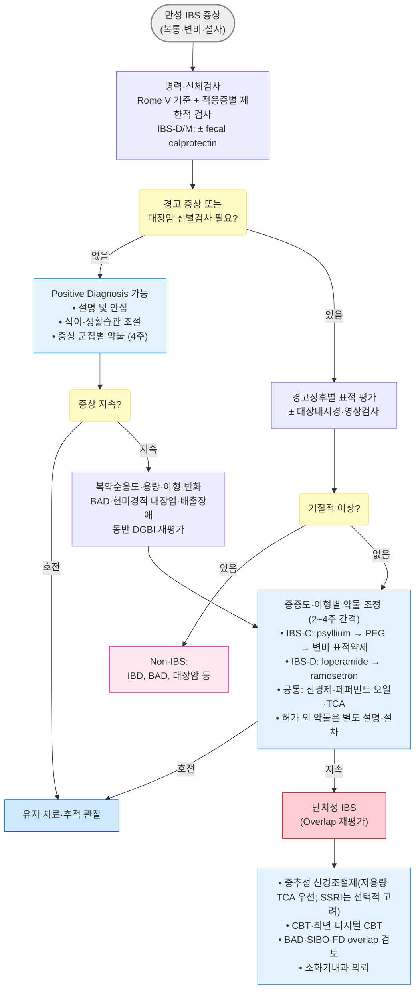
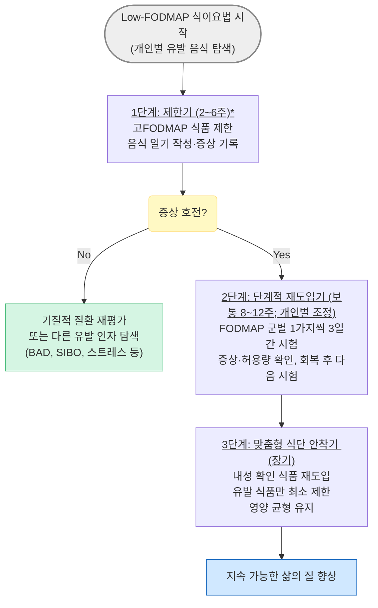

# 과민대장증후군 Irritable Bowel Syndrome, IBS

## <mark style="color:green;">일반 사항</mark>

* 반복되는 복통 또는 복부 불편감과 배변 빈도·대변 형태의 변화가 연관되어 나타나는 대표적인 장-뇌 상호작용장애(disorder of gut-brain interaction, DGBI)
* 흔히 다른 기능적/정신적 질환 동반
  * 동반 증상: 소화불량, 가슴쓰림, 흉통, 피로, 근육통, 섬유근육통, 두통/편두통, 수면장애, 우울, 불안, 신체형장애, 요통, 비뇨기계 증상(빈뇨, 절박뇨, 성교통)
* 유병률은 적용한 진단기준과 조사 방법에 따라 크게 달라짐; Rome IV 기준의 전 세계 유병률은 약 4%였으며, 2026년 Rome V 글로벌 역학조사에서는 IBS 유병률이 8.5%로 보고됨. 진단기준·조사 시점이 다른 결과이므로 질환의 실제 발생이 두 배 증가한 것으로 해석하지 않음.  <mark style="color:$info;">[Rome V 글로벌 역학조사 2026]</mark> 대개 50세 이전에 시작하며 여성에서 더 흔함
* 병태생리 : 단일 인자가 아닌 복합 기전 - 내장 과민성, 대장 운동 이상, 장-뇌 축(gut-brain axis) 교란, 장내 미생물 불균형(gut dysbiosis), 점막 저등급 염증(mast cell 활성화), 중추 감작

### <mark style="color:orange;">분류 (Rome V 기준)</mark>

* Bristol 변 형태 척도(BSFS) 기반으로 분류; 비정상 배변이 적어도 한 번 있는 날의 배변 형태를 기준으로 평가. 배변 양상을 바꾸는 치료약을 사용하지 않는 상태에서 평가하는 것이 원칙이며 아형은 시간에 따라 바뀔 수 있음
* 임상시험에서는 최소 2주 배변일기를 이용한 아형 분류를 권고; 모든 임상 진단에서 2주 관찰이 필수인 것은 아님 <mark style="color:$info;">[Rome V]</mark>

<table><thead><tr><th width="118">아형</th><th width="231">정의 (위 평가일의 배변 중 비율)</th><th>임상 특징</th></tr></thead><tbody><tr><td><strong>IBS-D</strong><br>(설사 우세형)</td><td>무른 변(BSFS 6~7) ＞¼ AND 굳은 변(BSFS 1~2) ＜¼</td><td>적은 양의 무른 변, 잔변감, 잦은 배변 시도; 야간 배변은 드묾; 남성에서 상대적으로 많음</td></tr><tr><td><strong>IBS-C</strong><br>(변비 우세형)</td><td>굳은 변(BSFS 1~2) ＞¼ AND 무른 변(BSFS 6~7) ＜¼</td><td>과도한 힘주기, 배변 후 잔변감; 여성에서 상대적으로 많음</td></tr><tr><td><strong>IBS-M</strong><br>(혼합형)</td><td>굳은 변 ＞¼ AND<br>무른 변 ＞¼ 모두 해당</td><td>설사와 변비가 교대; 예측 불가 양상</td></tr><tr><td><strong>IBS-U</strong><br>(미분류)</td><td>IBS 진단 기준을 충족하나<br>특정 아형으로 분류 불가</td><td>비정상 변 형태의 비율이 IBS-C·IBS-D·IBS-M 기준에 미달</td></tr></tbody></table>

### <mark style="color:orange;">동반 질환 및 Overlap Syndrome</mark>

* IBS는 다른 기능성 위장관 질환 및 전신 질환과 중복(overlap) 되는 경우가 매우 흔함; 동반 이환이 있을수록 증상 부담과 의료 이용률이 높음
  * Overlap 환자에서는 상부위장관 증상과 하부위장관 증상을 함께 평가하고 정신사회적 요인에 대한 통합 접근이 필요함
* 상부 GI 질환 : 기능성 소화불량(가장 흔함. IBS 환자의 약 30\~40%에서 동반), GERD
* 전신 기능성 질환 : 섬유근육통, 만성 피로 증후군, 두통/편두통, 간질성 방광염
* 자율신경 질환 : 기립성 빈맥 증후군, 과호흡 증후군
* 정신건강 질환 : 불안장애·우울장애, 신체증상장애; 동반 빈도는 진료 환경과 평가 도구에 따라 차이가 큼

## <mark style="color:green;">원인 및 위험 인자</mark>

* 원인 불명; gut-brain interaction 이상이 핵심 기전으로 추정
* 단일 인자가 아닌 복합 기전이 관여

### <mark style="color:orange;">추정 기전</mark>

* 유전적 소인
* 중추 신경계의 통증 처리 과정 교란 (central sensitization)
* 내장 과민성 (visceral hypersensitivity) : 정상 장 자극에 대한 과도한 통증 반응
* 대장 운동성 이상
* 장내 미생물 불균형 (gut dysbiosis) 및 장 투과성 증가
* 일부 환자에서 관찰되는 점막 면역 활성화·장 투과성 변화·세로토닌 신호 이상
* 소장 세균 과증식 (SIBO) - 일부 IBS-D에서 관련성 보고 (논란)
* 담즙산 설사 (bile acid diarrhea, BAD) : IBS-D 환자의 상당수가 BAD phenotype에 해당할 수 있음; 식후 급박변·담낭절제술 병력·아침 설사가 두드러지면 의심
* 감염 후 IBS (post-infectious IBS, PI-IBS) : 급성 위장관 감염 후 발생 가능하며, 발생률은 병원체·감염 중증도·추적 기간에 따라 차이가 큼; 설사 우세형(IBS-D)과 연관이 많으며 수년 이상 지속 가능
  * 원인균 : _Campylobacter_, _Salmonella_, _Shigella_, 노로바이러스 등
  * COVID-19 후 새로 발생한 IBS가 보고되지만 발생률은 연구 설계와 진단기준에 따라 차이가 큼; 장기 위장관 증상 전체의 빈도를 PI-IBS 발생률로 해석하지 않음

### <mark style="color:orange;">위험 인자 및 증상 악화 요인</mark>

* 발병 위험 인자 : 급성 위장관 감염 이력, 여성, 젊은 연령, 유전·가족력, 심리사회적 스트레스·불안·우울
* 증상 유발·악화 요인 : 개인별 FODMAP 식품, 지방식, 알코올, 카페인, 월경, 수면 부족 및 스트레스
* 항생제 사용과 IBS의 연관성이 보고되지만 인과관계는 확정되지 않음

## <mark style="color:green;">임상 양상</mark>

* 복통 : 하복부, 다양한 강도(때로 경련성); 간헐적·주기적; 깨어 있는 동안, 주로 아침이나 식후 발생; 배변 후 호전(일부에서는 배변 후 악화)
* 설사, 변비, 또는 설사-변비 교대; 설사 시 보통 양이 많지 않음
* 소화불량, 상복부 불편, 구역, 속쓰림, 복부 팽창, 방귀
* 배변 시 긴장(힘주기), 절박변, 불완전한 배변감
* 두통, 피로, 설명할 수 없는 근육통/관절통, 성교통

## <mark style="color:$danger;">🚩 Red Flags!</mark>

  <mark style="color:$danger;">**즉각 조치**</mark>

* 대량·지속되는 혈변/직장 출혈 또는 실신·빈맥·저혈압 등 혈역학적 불안정 → 응급 평가  `[위장관 출혈]`
* 갑작스럽거나 진행하는 심한 복통, 복막 자극징후 → 응급 평가  `[장폐쇄·천공·장간막 허혈]`
* 급성 심한 설사와 중증 탈수·의식 변화·패혈증 징후 또는 현저한 복부 팽만 → 응급 평가  `[중증 감염성 대장염·독성 거대결장]`

  <mark style="color:$warning;">**당일~수일 내 평가**</mark>

* 수면을 깨우는 반복적 야간 설사 또는 지속적인 야간 복통  `[기질적 장질환]`
* 설명할 수 없는 발열 또는 새로 발생한 발열·혈변 동반 설사(전신 상태가 안정적이면 당일 평가)  `[감염성·염증성 장질환]`
* 복부 종괴 또는 림프절 종대  `[복강 내 종양·염증성 질환]`
* 원인 불명의 육안적 혈변·직장 출혈(혈역학적으로 안정; 당일 평가)  `[대장암·IBD·기타 출혈성 병변]`
* 설명할 수 없는 체중 감소 또는 철결핍빈혈  `[대장암·흡수장애·IBD]`
* ≥50세에서 처음 발생한 IBS 유사 증상  `[대장암·기타 기질적 장질환]`

  <mark style="color:$info;">**조기 평가 및 추적**</mark>

* 대장암·IBD·폴립증·셀리악병의 개인력 또는 가족력; 특히 젊은 연령에 발병한 1촌 가족력  `[유전성·기질적 장질환]`
* 흡수장애 또는 지방변  `[셀리악병·췌장외분비부전 등]`
* 표준 치료를 충분히 시행했는데도 지속되거나 양상이 현저히 변한 증상 → 진단·아형·동반 질환 재평가  `[기질적 질환·중복 질환]`

## <mark style="color:green;">진단</mark>


**"IBS는 적극적(positive) 진단이 가능한 질환이다."** IBS는 반드시 광범위한 검사로 모든 기질적 질환을 배제한 후에만 진단하는 '배제 진단'이 아니며, '증상 기반 진단기준 충족 + alarm signs 없음 + 임상 상황에 맞춘 제한적 검사'로 적극적으로 진단 가능 (2025 서울 컨센서스 포함 국제 지침에서 강조됨)


* IBS를 확진하는 특이 검사는 없으며, 검사 결과는 대개 정상이지만 동반 질환에 따라 이상이 있을 수 있음
* 환자의 불안감 해소를 위한 검사는 고려하되 과잉 검사 지양 - 불필요한 반복 영상·내시경 검사는 환자 불안을 강화하고 의료 이용을 증가시킬 수 있음
* 경고 징후 없이 기본 검사가 정상이면서 진단 기준에 부합하면 진단 가능
* 신체검사에서 복부 종괴·장폐쇄 징후를 확인하고, 국소 압통이 있으면 Carnett sign을 통해 복벽 통증 가능성을 평가

### <mark style="color:orange;">진단 기준 \[Rome V, 2026]</mark>

* 증상이 발생한 지 최소 6개월 되었고 최근 3개월간 다음 기준을 충족; 다음 중 ≥2개와 관련되는, 평균 월 ≥3일의 재발하지만 지속적이지 않은 복통 또는 복부 불편감
  1. 배변과 관련
  2. 배변 빈도의 변화와 관련
  3. 대변 형태(모양)의 변화와 관련

* 보조 기준 : 복통·불편감이 월경에만 관련되는 경우는 구분하여 평가 <mark style="color:$info;">[Rome V]</mark>


**Rome IV와의 관계** : 2026년 Rome V에서는 복부 불편감이 다시 포함되고 증상 빈도 기준이 평균 주 1일 이상에서 월 3일 이상으로 완화됨. 2025 서울 컨센서스와 기존 치료 연구는 대부분 Rome IV를 기반으로 하므로, 근거를 해석할 때 적용한 진단기준을 함께 확인함.


### <mark style="color:orange;">검사</mark>

* 모든 환자에게 동일한 검사 패널을 시행하지 않고 증상 아형·연령·경고징후·노출력에 따라 선택
  * 기본 검사 : CBC ± CRP/ESR
  * IBS-D·IBS-M : fecal calprotectin 또는 lactoferrin을 고려하고, 셀리악병 배제가 필요하면 tissue transglutaminase IgA와 total IgA를 함께 측정; 검사 전 글루텐 섭취를 유지하고 IgA 결핍이면 IgG 기반 검사 선택
  * TFT : 갑상선질환을 시사하는 증상·징후가 있을 때
  * 대변 배양·기생충 검사 : 급성 발병, 여행·오염 노출, 면역저하 등 적응증이 있을 때; routine 시행하지 않음
  * 분변잠혈검사 : IBS 진단 목적이 아니라 연령별 대장암 선별 또는 출혈 평가 목적으로 시행
* Fecal calprotectin : 주로 설사 증상이 있는 환자에서 IBD vs IBS 감별을 위한 비침습적 triage 검사
  * calprotectin : neutrophil에서 분비되는 단백질. 염증이 있을 때 장 점막으로 유출되어 대변에 존재하게 됨. 대변에서의 농도는 염증 정도를 반영

<table><thead><tr><th width="152">Calprotectin 수치</th><th>해석 및 처치</th></tr></thead><tbody><tr><td>＜50 ㎍/g</td><td>IBD 가능성 낮음; 임상 상황에 따라 추가검사 없이 관찰 가능</td></tr><tr><td>50~150 ㎍/g</td><td>경계 범위; 감염, NSAID·PPI 사용 등 교란 요인을 확인하고 2~4주 후 재검 또는 임상 상황에 따라 대장내시경 고려</td></tr><tr><td>＞150 ㎍/g</td><td>장 염증 가능성 증가; 수치의 정도·지속 여부와 증상을 함께 평가하여 소화기내과 의뢰 및 대장내시경 고려</td></tr></tbody></table>

* 위 수치는 한 가지 진료 경로의 예시이며, 검사실·검사법과 진료 경로에 따라 절단값이 다르므로 해당 기관의 참고범위를 우선 적용. 낮은 수치만으로 현미경적 대장염·대장암을 배제하거나 경고징후에 대한 평가를 생략하지 않음
* 대장내시경 : 연령별 국가 대장암 선별 권고에 따라 시행 고려 (한국 국가암검진: 만 50세부터 분변잠혈검사, 이상 시 대장내시경), 경고 징후 있거나 IBD 의심 시 시행.
  * 전형적 IBS에서 경고 징후가 없으면 일률적인 대장내시경은 시행하지 않음; IBS 진단과 별개로 연령·위험도에 맞는 대장암 선별 필요성을 평가
* GI 기능 평가 (선택적 시행)
  * 변비 : colon transit time, anorectal manometry, balloon expulsion test
  * 설사 : 적응증이 있을 때 대변 배양; 현미경적 대장염 의심 시 정상으로 보이는 우측·좌측 대장에서 다부위 조직검사; 48-h fecal bile acid excretion 또는 serum 7α-C4(BAD 평가); fecal calprotectin/lactoferrin
  * 호흡검사 : lactose breath test는 유당흡수장애, glucose breath test는 해부학적 변화·장 운동 장애 등 위험 인자를 동반하여 SIBO가 의심될 때 선택적으로 시행; IBS의 팽만만으로 일률적으로 검사하지 않으며 빠른 장 통과에 따른 위양성 등 한계를 고려

### <mark style="color:orange;">감별</mark>

#### <mark style="color:$primary;">IBS vs IBD vs 대장암 감별</mark>

<table><thead><tr><th width="165">감별 특징</th><th width="146" align="center">IBS</th><th width="146" align="center">IBD</th><th width="89" align="center">대장암</th></tr></thead><tbody><tr><td>야간 증상</td><td align="center">드묾</td><td align="center">흔함</td><td align="center">가능</td></tr><tr><td>체중 감소</td><td align="center">드묾</td><td align="center">흔함</td><td align="center">흔함</td></tr><tr><td>혈변</td><td align="center">없음</td><td align="center">흔함</td><td align="center">가능</td></tr><tr><td>CRP / ESR</td><td align="center">대개 정상</td><td align="center">상승 가능; 정상일 수도 있음</td><td align="center">다양</td></tr><tr><td>Fecal calprotectin</td><td align="center">대개 낮음</td><td align="center">대개 상승하나 정상으로 배제 불가; 검사법·임상상 고려</td><td align="center">다양</td></tr><tr><td>배변 후 통증</td><td align="center">호전 또는 악화</td><td align="center">다양</td><td align="center">다양</td></tr></tbody></table>

#### <mark style="color:$primary;">기타 감별 질환</mark>

<table><thead><tr><th width="190">질환</th><th>감별 단서</th></tr></thead><tbody><tr><td>셀리악병 (gluten enteropathy)</td><td>만성 설사, 피로, 빈혈, 골 통증, 구내염; tTG-IgA와 total IgA로 선별</td></tr><tr><td>Lactose intolerance</td><td>유제품 섭취와 관련한 복부 팽만, 설사</td></tr><tr><td>Bile acid diarrhea (BAD)</td><td>식후 급박변, 담낭절제술 병력, 아침 설사; serum 7α-C4 상승 또는 대변 담즙산 증가; cholestyramine 반응은 진단을 뒷받침하지만 확진 검사는 아님</td></tr><tr><td>Microscopic colitis</td><td>고령에서 만성 수양성 설사; 자가면역 질환 동반 가능; 대장내시경 육안 정상이어도 우측·좌측 대장 다부위 조직검사로 확진</td></tr><tr><td>SIBO (소장 세균 과증식)</td><td>복부 팽만, 설사, 흡수 장애 및 위험 인자; glucose breath test를 선택적으로 시행</td></tr><tr><td>Diverticulitis</td><td>좌측 복통, 발열, 좌하복부 압통/종괴</td></tr><tr><td>자궁내막증</td><td>주기적 하복부 통증 (월경 주기 연관)</td></tr><tr><td>난소암</td><td>특히 중년 이후 여성에서 지속되는 복부 팽만·조기 포만·골반/복통·빈뇨/절박뇨; 임상적으로 의심되면 부인과 평가 ± CA-125/영상검사</td></tr><tr><td>정신사회적 문제</td><td>우울·불안·신체증상장애는 IBS와 공존하거나 증상 부담을 증폭할 수 있음</td></tr></tbody></table>

***



<p align="center"><strong>과민대장증후군 진단 및 치료 알고리듬</strong></p>

***


## <mark style="background-color:$warning;">Management</mark>

### <mark style="color:orange;">치료 원칙</mark>

* 모든 환자에게 효과적인 단일 요법은 없음 - 증상 아형 + 증상 군집 + 중증도에 따른 맞춤 치료 선택
* 안심 및 교육 : 치명적 질환이 아니며 증상 조절이 가능함을 설명; 의사-환자 신뢰 형성이 치료의 출발점
* 생활습관 중재 (1차) : 식이 조절, 규칙적 운동, 스트레스 관리
* 약물 치료 : 비-약물 치료로 해결되지 않는 경우 아형별 보조 치료
* 장-뇌 축 치료 : 인지행동 치료(CBT), 장-지향 최면치료(gut-directed hypnotherapy) 등은 특히 중등도 이상·난치성 IBS에서 고려 (ACG 2021 조건부 권고; 2025 서울 컨센서스 약한 권고)
* 1차 치료에 반응하지 않으면 기질적 문제·overlap syndrome·정신사회적 요인 재평가


**외래 설명 요점 (진료 시 참고)**\
• _"검사상 큰 병은 아니지만, 장이 예민해진 상태입니다."_\
• _"스트레스 때문에 생긴 병이라는 뜻은 아닙니다. 증상은 실제이며 장-뇌 축의 과민 반응이 주된 기전입니다."_\
• _"완치보다는 증상을 조절하면서 삶의 질을 높이는 것이 목표입니다."_\
• _"반복 검사보다 생활 조절과 맞춤 치료가 더 중요합니다."_


### <mark style="color:orange;">중증도별 치료 접근</mark>

<table><thead><tr><th width="113">중증도</th><th>특징</th><th>치료 접근</th></tr></thead><tbody><tr><td>경증<br>(Mild)</td><td>간헐적 증상; 일상생활 유지</td><td>식이·안심·음식 일기 / 필요 시 prn 진경제·loperamide</td></tr><tr><td>중등증<br>(Moderate)</td><td>삶의 질 영향; 규칙적 증상; 직장·사회활동 지장</td><td>아형별 약물 치료 (지속 투여); 수용성 섬유·low-FODMAP</td></tr><tr><td>중증/난치성<br>(Severe)</td><td>일상 기능 저하; 기존 치료 무반응; 정신사회적 동반</td><td>중추성 신경조절제(저용량 TCA 우선; SSRI는 선택적 고려); CBT·최면·디지털 CBT; Overlap 재평가; 전문의 의뢰</td></tr></tbody></table>

### <mark style="color:orange;">증상 군집별 처방 (Symptom-cluster Prescribing)</mark>

* IBS 아형을 먼저 확인하고 지배적인 증상 군집·동반 질환·내약성을 함께 고려하여 처방

<table><thead><tr><th width="168">증상 군집</th><th>우선 고려 약물 / 치료</th></tr></thead><tbody><tr><td>복통·경련 우세</td><td>진경제(antispasmodic), 페퍼민트 오일, TCA 저용량</td></tr><tr><td>복부 팽만·가스 우세</td><td>low-FODMAP 식이; probiotics를 단순 팽만에 일률적으로 사용하지 않음. IBS에서 선택적 시험 시 지침 차이·불확실성을 설명; IBS-D에서는 rifaximin 허가 외 사용을 선택적으로 검토</td></tr><tr><td>절박변·빈도 우세</td><td>loperamide prn, ramosetron; ondansetron은 허가 외 선택지</td></tr><tr><td>변비 우세</td><td>psyllium(수용성 섬유), PEG 하제; 불응 시 prucalopride 등 동반 변비 치료 검토</td></tr><tr><td>불안·과민 우세</td><td>TCA 저용량, CBT, gut-directed hypnotherapy, SSRI(공존 불안·우울 시)</td></tr></tbody></table>

## <mark style="color:green;">비-약물 치료 및 예방</mark>

### <mark style="color:orange;">식이 조절 - Low-FODMAP</mark>

* 일치된 단일 효과적 식단은 없음; 개인별 유발 음식 파악이 핵심 (음식 일기 작성 권고)
* 수용성 식이 섬유(psyllium 등)를 저용량부터 시작해 가스·복부 불편을 보며 서서히 증량; 총 식이 섬유 섭취량과 환자 내약성을 함께 고려
  * 불용성 식이 섬유(밀기울·bran)는 증상을 악화시킬 수 있으므로 주의
* 증상 유발 음식 회피 (개인별 경험 기반) : 지방식, 알코올, 카페인, 매운 음식, 우유, 청량음료, 인공 감미료
* Gluten-free diet : 셀리악병이 배제된 경우 일률적으로 권고하지 않음 (효과 불확실, 실행 부담 큼)
* 저FODMAP은 무유제품식·무글루텐식과 다름. 식품의 FODMAP 종류와 섭취량에 따라 조절하고, 제한기에 호전이 없으면 엄격한 제한을 중단하여 다른 치료를 검토


**과도한 음식 제한 주의** : 장기간·광범위한 음식 제한은 영양 불균형, 체중 감소, 삶의 질 저하(orthorexia-like 양상)를 초래할 수 있음. 가능한 최소 제한 원칙으로 접근하며, 증상과 무관한 식품은 단계적 재도입으로 제한을 풀도록 안내


***



<p align="center"><strong>Low-FODMAP 3단계 식이 접근</strong> (ACG 2021 조건부 권고)</p>

\*제한기는 2\~6주로 제한; 이후 단계적 재도입으로 개인별 불내성 식품 특정. 가능하면 숙련된 영양사의 지도를 받고, 장기간의 엄격한 제한식은 피함. (☞ [저FODMAP 식품 목록](075_-indigestion-dyspepsia.md#undefined-19) )

### <mark style="color:orange;">운동 및 생활습관</mark>

* 규칙적 유산소 운동 : 주 3\~5회, 20\~60분 (걷기·수영 등); 위장 운동 개선 및 삶의 질 향상 효과

### <mark style="color:orange;">장-뇌 축 심리 치료 및 디지털 중재</mark>

* 인지행동 치료(CBT), 장-지향 최면치료(gut-directed hypnotherapy), 심리역동치료, 마음챙김 기반 인지치료(MBCT)
* 중등도 이상 또는 기존 치료에 반응하지 않는 IBS, 정신사회적 동반 이환이 있는 환자에서 고려 - ACG 2021 조건부 권고, 2025 서울 컨센서스 약한 권고
* 디지털 중재 : 일부 앱·웹 기반 CBT와 장-지향 최면 프로그램의 유효성이 보고되었으나, 국내 이용 가능성·허가 상태·비용은 제품별로 확인하며 대면 치료를 일률적으로 대체하지 않음

## <mark style="color:green;">약물 치료</mark>

　☞ [소화기계약제](073_-gidrugs.md) (보험 주의)

* 아래 용량·처방례는 성인 기준이며 소아·청소년에게 그대로 적용하지 않음
* 약물은 보조 치료 수단; 증상 아형 및 지배적 증상 군집에 따라 선택
* 약물 조정은 2\~4주 간격으로 점진적으로 시행

**2025 서울 컨센서스 중심 주요 권고** (약제군별 근거 수준을 해당 약물 모두의 직접 근거로 해석하지 않음)

<table><thead><tr><th width="96">대상</th><th>치료</th><th width="184">근거 수준 / 권고 강도</th></tr></thead><tbody><tr><td><strong>IBS-C</strong></td><td>수용성 섬유, PEG, 난치성 변비에서 prucalopride 고려, lubiprostone, GC-C 작용제</td><td>GC-C 작용제: 높음/강함<br>수용성 섬유·lubiprostone: 중등도/약함<br>PEG·5-HT₄ 작용제군: 낮음/약함; prucalopride는 IBS-C 직접 RCT 부재</td></tr><tr><td><strong>IBS-D</strong></td><td>loperamide, 5-HT₃ 길항제(ramosetron), rifaximin</td><td>5-HT₃ 길항제: 높음/약함<br>rifaximin: 중등도/약함<br>loperamide: 매우 낮음/약함</td></tr><tr><td><strong>공통</strong></td><td>진경제, TCA, 선택적 SSRI, probiotics, low-FODMAP 식이, 장-지향 심리치료</td><td>진경제·TCA·저FODMAP·장-지향 심리치료: 낮음/약함<br>SSRI·probiotics: 매우 낮음/약함</td></tr></tbody></table>


국내 가용성·허가 상태가 국제 지침과 다름. Ramosetron은 국내 IBS-D 허가 치료제이며 실제 유통 제품을 사용함. Rifaximin의 IBS-D 사용은 국내 허가 외임. Prucalopride는 IBS-C 자체의 허가 치료제가 아니며, 동반 변비가 국내 허가 적응증인 일반 하제 불응 성인 만성 변비에 해당하는지 구분함. Lubiprostone은 아래의 과거 국내 허가·취하 상태를 구분함. 2025 서울 컨센서스 당시 linaclotide·plecanatide 등 GC-C 작용제는 국내에서 이용할 수 없었음. Eluxadoline·alosetron·tegaserod 역시 국내 치료 선택지가 아님.


#### <mark style="color:$primary;">진경제 (Antispasmodics)</mark>

* 작용 : 장 평활근 수축과 과도한 운동을 조절하여 식후 복통·경련을 완화; 약제별 기전은 서로 다름
* 대상 : 복통·경련이 주증상인 IBS - 2025 서울 컨센서스 약한 권고(낮은 근거)
* 항무스카린성 약물의 부작용 : 입마름, 시각 장애, 어지럼, 소변 저류, 변비, 빈맥; 고령에서는 항콜린 부담·인지 저하·섬망·낙상 위험 때문에 가능한 회피하고, 변비·녹내장·전립선비대에서는 약제별 금기·주의를 구분
* 복용 시점은 성분별로 다름. 항콜린성 진경제는 단기·필요시 사용을 우선하며 지속 사용 시 효과·항콜린 부담을 재평가
* pinaverium : 50 ㎎ tid, 식사 중 충분한 물과 함께 통째로 삼킴; 씹거나 빨지 않고 누운 자세·취침 직전 복용을 피함
* 항무스카린성 : dicyclomine <mark style="color:blue;">\[스파토민]</mark>, cimetropium <mark style="color:blue;">\[알기론]</mark>, scopolamine butylbromide <mark style="color:blue;">\[부스코판]</mark>
* dicyclomine 국내 용법 : 10~20 ㎎ 1일 3~4회. 녹내장, 전립선비대에 의한 배뇨장애·폐쇄성 요로질환, 위장관폐색·마비성 장폐색, 중증 근무력증, 중증 궤양성 대장염·거대결장, 역류성 식도염, 수유부 등은 금기. 2주 이내 호전이 없으면 중단하여 재평가  <mark style="color:$info;">[국내 허가사항]</mark>
* 기타 진경제 : trimebutine <mark style="color:blue;">\[포리부틴]</mark>, pinaverium <mark style="color:blue;">\[디세텔]</mark>, tiropramide <mark style="color:blue;">\[티로파]</mark>

#### <mark style="color:$primary;">페퍼민트 오일 (Peppermint Oil)</mark>

* 작용 : Ca²⁺ 채널 차단을 통한 장 평활근 이완 → 복통 및 경련 완화
* 대상 : 복통·경련이 주증상인 IBS - ACG 2021 조건부 권고(낮은 근거)
* 부작용 : 위식도역류, 항문 작열감 - 장용 코팅 제제 사용으로 경감 가능
* 장용 코팅 캡슐 0.2\~0.4 ㎖ tid, 식간 복용

#### <mark style="color:$primary;">Opiate성 지사제</mark>

* 작용 : 변의 유동성 및 배변 긴급성·빈도 감소
* 대상 : IBS-D; 절박변·빈도 우세 시 설사가 예상되는 상황에서 예방적 투여 (AGA 2022 very low certainty 조건부 권고)
* 부작용 : 복통, 팽만감, 구역, 변비
* 혈변·고열을 동반한 설사, 감염성 대장염·독성 거대결장·장폐쇄가 의심되면 loperamide를 사용하지 않음. 권장 최대용량 초과는 심실성 부정맥·QT 연장 위험이 있음
* loperamide : IBS-D에서는 2 ㎎부터 필요에 따라 최소 유효용량으로 조절 <mark style="color:blue;">\[로프민]</mark>; 국내 성인 단일제 허가상 최대 16 ㎎/d. 급성 설사의 초회 4 ㎎ 요법과 IBS의 저용량 필요시 사용을 구분하며 변비·팽만 발생 시 감량·중단

#### <mark style="color:$primary;">부피 형성 하제 (Bulk-forming Laxatives)</mark>

* 작용 및 대상 : 수용성 섬유는 대변 수분·굳기를 조절하며 IBS 전반 증상 개선에 도움. 주로 IBS-C에서 사용하고 일부 IBS-D에서 변 굳기 조절 목적으로 고려할 수 있으나, 모든 부피 형성 하제가 두 아형에 동일하게 효과적인 것은 아님
* 부작용 : 복부 팽만, 가스 (서서히 증량하여 경감)
* 연하곤란·장 협착/폐쇄가 있으면 사용하지 않으며, 충분한 물과 함께 복용하고 마른 가루를 그대로 삼키지 않음
* psyllium qd\~tid <mark style="color:blue;">\[무타실]</mark>, agiocur granules qd\~bid <mark style="color:blue;">\[아기오]</mark>

#### <mark style="color:$primary;">삼투성 하제 (Osmotic Laxatives)</mark>

* 작용 및 대상 : 배변 빈도 개선·굳기 완화; IBS-C (AGA 2022 조건부 권고, 저근거)
* PEG 3350 <mark style="color:blue;">\[마이락스]</mark> 17 g/P 1P qd; 약 240 ㎖의 물 또는 음료에 녹여 가능하면 아침에 복용, 식사와 무관; 보통 1\~4일 내 효과
* 배변 빈도·대변 굳기는 개선하지만 복통 및 IBS 전반 증상의 개선 효과는 분명하지 않음 <mark style="color:$info;">[2025 서울 컨센서스]</mark>
* lactulose·sorbitol : 복부 가스·팽만 증가 가능성으로 IBS에서 회피 권장

#### <mark style="color:$primary;">Probiotics</mark>

* 작용 : 장내 미생물 불균형 개선 → 가스 형성·염증 억제 (논란)
* 연구 설계·균주·용량의 이질성이 커 특정 균주나 제품을 일률적으로 권고할 수 없으며, 연구 결과를 다른 제품에 그대로 적용할 수 없음
* AGA 2020은 IBS에서 임상시험 내 사용으로 제한; AGA 2023은 복부 팽만·팽창 치료에 사용하지 않도록 권고
* 2025 서울 컨센서스는 IBS 증상에 선택적 사용을 약하게 권고(매우 낮은 근거). BSG 2021에 따라 사용을 원하는 환자에서 불확실성을 설명한 뒤 최대 12주 시험할 수 있으나 호전이 없으면 중단; 단순 가스·팽만의 일률적 치료로 제시하지 않음 <mark style="color:$info;">[AGA 2020·2023; BSG 2021; 서울 컨센서스 2025]</mark>
* 고령·입원 환자 및 면역저하 환자에서는 드문 균혈증·진균혈증 위험을 고려

#### <mark style="color:$primary;">중추성 신경조절제 (Central Neuromodulators)</mark>


**'중추성 신경조절제' 명칭** : IBS에서 약제의 사용 목적을 설명하기 위해 '장-뇌 신경조절제' 또는 '중추성 신경조절제'라는 용어를 사용할 수 있음. 저용량 TCA는 우울증 유무와 별개로 내장 과민성·통증을 조절하기 위해 사용하며, 공존 불안·우울의 치료 목적이 함께 있는 경우에는 이를 구분하여 설명


* 작용 : 중추성 통증 지각·visceral sensitivity 조절; motility에 작용; 우울증 치료보다 저용량 투여
* 대상 : 지속되는 복통·불편감에 대한 2차 선택; TCA는 우울·불안이 없는 환자에서도 고려 가능. 정신사회적 동반 이환 유무만으로 약물 종류를 결정하지 않음
* TCA·SSRI를 IBS 증상 조절만을 목적으로 사용하는 경우 국내 허가 외 사용임을 설명; 공존 우울·불안장애 치료 목적의 처방과 구분
* 4주경 내약성·초기 반응을 평가하고, 견딜 수 있으면 저용량 적정 후 8\~12주까지 효과를 평가

#### <mark style="color:$primary;">TCA (삼환계 항우울제)</mark>

* 항콜린 작용으로 장 통과 시간 연장 → IBS-D 및 복통에 효과; ACG 2021 강력 권고 (내장 통각 과민·복통·설사 조절)
* 부작용 : 입마름, 시야 흐림, 변비, 요 정체, 빈맥, 혼돈; 녹내장·전립선 비대·심혈관 질환에서 주의. 고령에서는 특히 amitriptyline의 항콜린 부담·기립성 저혈압·심장 위험 때문에 가능한 회피하고 개별적으로 판단
* amitriptyline <mark style="color:blue;">\[에트라빌]</mark>, nortriptyline <mark style="color:blue;">\[센시발]</mark>, imipramine <mark style="color:blue;">\[이미프라민]</mark>
* amitriptyline 용량 : 5\~10 ㎎ hs 시작 → 1\~2주 간격으로 5\~10 ㎎씩 점진적 증량; 보통 10\~30 ㎎/d 범위에서 최소 유효용량 유지

#### <mark style="color:$primary;">SSRI</mark>

* 일부 IBS 증상 개선 보고가 있으나 약제별 효과와 장 운동에 대한 영향이 다르며 변비 치료 목적으로 일률적으로 사용하지 않음
* <mark style="color:$info;">[AGA 2022]</mark> IBS-C / -D 모두에서 조건부 반대 (저근거); 전반적 삶의 질 개선은 일부 보고되나 복통 감소 근거는 약함
* sertraline 25\~100 ㎎ <mark style="color:blue;">\[졸로푸트]</mark>, citalopram 10\~20 ㎎, paroxetine 20\~50 ㎎ <mark style="color:blue;">\[세로자트]</mark>, fluoxetine 10\~20 ㎎ 아침 → 점차 증량 최대 40 ㎎/d <mark style="color:blue;">\[푸로작]</mark>
* 위 SSRI 용량은 성인 공존 정신질환 치료 시 참고 범위이며 IBS 표준 용량이 아님; 진단·연령·간기능·상호작용에 맞추어 선택. Paroxetine은 항콜린 작용과 중단 증상에 특히 주의
* 처방 시 의사-환자 공동 결정(shared decision-making) 필요


AGA 2022는 IBS 치료 목적의 SSRI에 조건부 반대(저근거). 2025 서울 컨센서스는 매우 낮은 근거로 선택적 사용을 약하게 권고하며, 공존 불안·우울 또는 다른 치료 실패 시 제한적으로 고려. 단순히 변비를 완화하거나 장 통과 시간을 단축할 목적으로 처방하지 않음 <mark style="color:$info;">[AGA 2022; 서울 컨센서스 2025]</mark>


#### <mark style="color:$primary;">비흡수성 항생제</mark>

* 작용 : 장내 세균 활동 억제 → 탄수화물 발효·복부 팽만 감소; 장기 사용 효과는 입증되지 않음
* 대상 : 복부 팽만이 동반된 난치성 IBS-D - AGA 2022 조건부 권고 (중등도 근거)
* rifaximin : 미국 허가 용법 550 ㎎ tid × 14일; 최초 반응 후 재발하면 동일 요법을 최대 2회 추가 가능
  * 국내 <mark style="color:blue;">\[노르믹스 200 ㎎정]</mark>은 IBS-D 적응증이 없고 미국 허가 용량과 일치하는 제형도 아니므로, 국내 허가·급여 범위와 허가 외 사용 절차를 확인
  * 주요 3상시험은 북미 환자 대상이어서 아시아 환자에 대한 일반화에는 제한이 있음

#### <mark style="color:$primary;">Serotonin 5-HT4 Receptor Agonist</mark>

* 작용 : GI motility 조절 (대장 통과 시간 단축)
* 대상 : 단순 하제에 반응하지 않는 IBS-C에서 동반 변비 조절 목적으로 선택적으로 고려
* 부작용 : 두통, 복통
* 주의/금기 : 신장 기능 저하, 장폐쇄·천공 의심, 심한 IBD
* prucalopride : 성인 2 ㎎ qd; ≥65세는 1 ㎎ qd로 시작 후 필요 시 2 ㎎. 중증 신장애는 1 ㎎ qd, 중증 간장애는 1 ㎎ qd; 투석 환자 금기. <mark style="color:blue;">\[레졸로]</mark>. 국내 적응증은 일반 하제에 반응하지 않는 성인 만성 변비이며 IBS-C 적응증 및 IBS-C 대상 RCT는 없음; 세부 용량·급여는 [변비](082_-constipation.md) 참고
* tegaserod : 6 ㎎ bid - 2007년 심혈관 안전성 문제로 철수 후 미국에서 제한적으로 재도입되었으나 2022년 다시 시장 철수; 아시아에서 이용 불가

#### <mark style="color:$primary;">Serotonin 5-HT3 Receptor Antagonist</mark>

* 작용 : serotonin 작용 억제 → 대장 운동·분비 감소, 설사 개선
* 대상 : 절박변·빈도 우세 및 난치성 IBS-D - 2025 서울 컨센서스 약한 권고(높은 근거)
* 부작용 : 변비; ramosetron은 허혈성 대장염·중증 변비 관련 합병증에 주의. Ondansetron은 변비·QT 연장 위험을 별도로 평가하며 약제군 전체의 이상반응을 동일하게 간주하지 않음
* ramosetron : 남성 5 ㎍ qd(조절 범위 2.5~10 ㎍/d), 여성 2.5 ㎍ qd(필요 시 최대 5 ㎍/d) <mark style="color:blue;">\[이리스탑]</mark>
* ondansetron : 4 ㎎ qd\~tid <mark style="color:blue;">\[조프란]</mark> (국내 IBS-D 허가 외)
  * 절박변·묽은 변과 배변 빈도 감소에는 도움이 될 수 있으나 복통 개선 근거는 불분명; 저용량(4 ㎎ qd)부터 시작하여 변비 여부 모니터링

#### <mark style="color:$primary;">Bile Acid Sequestrant</mark>

* 작용 : 장내 담즙산 결합 → 담즙산 설사(BAD) 조절


**IBS-D와 Bile Acid Diarrhea (BAD) Phenotype** : IBS-D 환자 중 상당수가 실제로 BAD phenotype에 해당할 수 있음. 특히 식후 급박변, 담낭절제술 병력, 아침 설사가 두드러지는 환자에서 BAD를 의심\
•확인 방법 : 이용 가능하면 공복 serum 7α-C4 또는 48-h fecal bile acid excretion 등을 고려; 국내 일차의료에서는 접근성이 제한적. FGF19는 검사 표준화·임상 근거가 제한적이어서 일상적 검사로 권고할 근거가 불충분\
•현실적 진단 팁 : 검사가 여의치 않으면 임상적으로 BAD 가능성이 높은 환자에서 cholestyramine을 시험적으로 투여할 수 있으나, 치료 반응만으로 확진하거나 비반응만으로 BAD를 배제하지 않음


* 대상 : BAD가 확인되거나 강하게 의심되는 만성 설사; IBS-D 전반 증상의 일률적 치료제로 권고하지 않음. 국내 제품의 허가상 담즙산 설사 적응증 범위와 환자의 원인을 구분
* 부작용 : 변비, 복부 팽만, 복통, 담석증, 다른 약제 흡수 방해 (digitalis, warfarin, propranolol, thiazide, amiodarone, thyroxine, acetaminophen, NSAID, steroid, 엽산, Vit A/D/K, PcG)
* 금기 : 완전 담도폐쇄, 성분 과민증
* 고중성지방혈증 : TG 상승 위험에 따라 사용 회피·대안을 고려하고 기저 TG 및 치료 중 변화를 확인
* 다른 경구약은 cholestyramine 복용 최소 1시간 전 또는 4\~6시간 후 투여; 장기 사용 시 지용성 비타민 결핍에 주의 <mark style="color:$info;">[제품 허가사항]</mark>
* cholestyramine : 활성 resin 기준 저용량(예: 4 g qd)부터 반응·내약성에 따라 조절, 필요 시 분복; 최대 24 g/d. 제품 전체 분말 무게와 활성 resin 함량을 구분하며 물 또는 음료에 섞어 복용 <mark style="color:blue;">\[퀘스트란]</mark>

#### <mark style="color:$primary;">GC-C Agonist (Guanylate Cyclase-C 작용제)</mark>

* 작용 : cGMP 증가 → 장액 분비 촉진·대장 통과 시간 단축·내장 통각 억제
* 대상 : 난치성 IBS-C - 2025 서울 컨센서스 강한 권고(높은 근거)
* 부작용 : 설사; 중증 설사·탈수 시 중단하고 평가. 복용 시점은 약제별로 구분
* linaclotide : 성인 IBS-C 290 ㎍ qd (식사 최소 30분 전); 성인 CIC는 145 ㎍ qd 또는 내약성에 따라 72 ㎍ qd (미국 용법)
* plecanatide : 3 ㎎ qd, 식사와 무관
* 2025 서울 컨센서스 발표 당시 두 약제 모두 국내에서 이용할 수 없었으므로 최신 식약처 허가·유통 상태 확인

#### <mark style="color:$primary;">Chloride Channel Activator</mark>

* 작용 : ClC-2 채널 활성화 → 장액 분비 촉진
* 대상 : 난치성 IBS-C - AGA 2022 조건부 권고 (중등도 근거)
* 부작용 : 오심 (식사와 함께 복용 시 경감)
* lubiprostone : 8 ㎍ bid (식사와 함께)
  * 위 8 ㎍ bid는 미국의 18세 이상 여성 IBS-C 허가 용법; 성인 CIC의 24 ㎍ bid와 구분
  * 국내 허가 이력이 있으나 아미티자 24 ㎍ 품목은 2024년 2월 2일 허가 취하됨; 위 용량은 해외 치료 용법. 과거 국내 적응증은 성인 CIC 및 일부 성인 OIC였으며 IBS-C는 포함되지 않았음 <mark style="color:$info;">[식약처·미국 허가사항]</mark>

#### <mark style="color:$primary;">NHE3 Inhibitor (Tenapanor)</mark>

* 작용 : 장 상피세포 Na⁺-H⁺ 교환체 억제 → 장액 분비 증가, 복통 감소
* 대상 : IBS-C - AGA 2022 조건부 권고 (중등도 근거)
* 부작용 : 설사
* tenapanor : 미국 성인 IBS-C 용법 50 ㎎ bid, 아침(또는 첫 식사) 및 저녁 식사 직전. 기계적 장폐쇄 또는 그 의심 시 금기; 중증 설사 시 중단·수분 보충. 국내 미출시 약물로 해외 용법임

#### <mark style="color:$primary;">기타</mark>

* 표면 활성제 : simethicone 40\~80 ㎎ tid <mark style="color:blue;">\[가소콜]</mark> - 효과 입증 불충분
* α/β-galactosidase : 일부에서 가스·팽만 감소 효과
* 항불안제 : 습관화 가능성 때문에 IBS에서 만성적으로 사용해서는 안 됨

### <mark style="color:orange;">IBS-D 표적 치료제</mark>


IBS-D는 단순 설사 억제보다 **장-뇌 축 조절 및 복통 완화**에 초점을 맞춘 복합 접근이 필요함.\
Loperamide 단독은 urgency·묽은 변에 효과적이나 복통 dominant phenotype에서는 효과 제한적.


* **ondansetron** (5-HT₃ 차단제) 4 ㎎ qd부터 시작하여 반응에 따라 증량(보통 qd~tid; 국내 IBS-D 허가 외) <mark style="color:blue;">\[조프란]</mark>
  * 장 통과시간 지연 → urgency·묽은 변 개선; 복통 개선 효과는 분명하지 않음
  * 국내 IBS-D 허가 외; 환자에게 설명하고 허가 외 사용 및 급여 관련 절차를 확인
* **저용량 TCA** : 복통 + urgency 동반 IBS-D에 유용; 진통·장 운동 억제·수면 개선 복합 효과
  * amitriptyline : 10\~25 ㎎ hs <mark style="color:blue;">\[에트라빌]</mark>


**QT 연장 주의 - ondansetron + TCA 병용 시** : Ondansetron과 amitriptyline 모두 QT 간격 연장 가능성이 있으며, citalopram·escitalopram 등 QT 연장 가능 SSRI 병용 시 위험이 증가; 고령 환자, 전해질 이상(저칼륨·저마그네슘), 기존 QT 연장 병력이 있는 경우 심전도 모니터링을 고려


* **Antispasmodics** : 식후 복통·cramping 동반 시
  * mebeverine : 135 ㎎ tid (식전 20분) <mark style="color:blue;">\[두스파탈린]</mark>
  * trimebutine : 100\~200 ㎎ tid <mark style="color:blue;">\[포리부틴]</mark>
* **rifaximin** : 복부 팽만이 두드러진 IBS-D에서 고려할 수 있으나 국내 IBS-D 허가·급여 대상이 아님. 미국 허가 용법은 550 ㎎ tid × 14일이며 국내 200 ㎎정으로 임의 환산한 용법을 표준요법처럼 제시하지 않음

## <mark style="color:green;">시술 및 기타 처치</mark>

* 배출장애가 의심되거나 변비 치료에 불응하면 직장수지검사와 항문직장내압검사·풍선배출검사를 고려; 배변협응장애가 확인되면 골반저 바이오피드백 치료를 시행
* IBS 자체에 대한 수술 적응증은 없으며, 분변미생물군이식(FMT)은 임상시험 외 일상 치료로 권고하지 않음  <mark style="color:$info;">[ACG 2021; 서울 컨센서스 2025]</mark>

***

### <mark style="color:red;">질병코드</mark>

K58 과민대장증후군 Irritable bowel syndrome

### <mark style="color:orange;">보험</mark>

* Ramosetron HCl 2.5 ㎍·5 ㎍ 경구제 : 허가사항 범위 내 설사형 과민대장증후군에 급여 인정; 이외 인정기준 밖에서는 약값 전액 환자 부담. 고시 제2025-88호, 2025.6.1. 시행  <mark style="color:$info;">[HIRA]</mark>
* IBS 아형 자체와 약제의 국내 허가 적응증·급여 인정기준은 구분하며, 해외 지침상 권고만으로 국내 급여가 인정되는 것은 아님

***

## <mark style="color:purple;">처방례</mark>

> **처방례 1. IBS-C 경증 (변비·복부 팽만)**
>
> ```
> 무타실 산 (psyllium) 　　　2 P　　 #2
> 마이락스 산 17 g 　　　　  1 포　  qd
> ```
>
> _✽ 증상 정도에 따라 수용성 섬유(psyllium)와 삼투성 하제(PEG)를 병용할 수 있으나, 경증에서는 한 약제부터 시작해 반응에 따라 추가할 수 있음. 심부전·신부전 등 수분 제한이 필요한 환자를 제외하고 충분한 수분을 섭취하도록 안내. Lactulose는 복부 가스·팽만을 악화시킬 수 있음. 2\~4주 후 반응을 평가하고, 호전이 없으면 배출장애·복약순응도를 재평가한 뒤 prucalopride 등 동반 변비 표적약제를 고려._

> **처방례 2. IBS-D 경증\~중등증 (복통·잦은 설사)**
>
> ```
> 스파토민 캡슐 10 ㎎ 　　　3C　  #3　  식전
> ```
>
> _✽ 비고령 성인의 단기 사용 예시; 정규 복용이 필요한 경우의 1일 처방량이며, 필요시 사용 시에는 복용 횟수를 줄임. 진경제(dicyclomine)는 식전 또는 복통 예상 상황 전 복용; 고령에서는 가능한 회피하고 입마름·변비·요폐·어지럼을 확인. 녹내장·배뇨장애·장폐쇄·역류성 식도염·수유 등 금기를 배제하고 2주 이내 호전이 없으면 중단·재평가. 묽은 변·절박변 조절이 필요하면 loperamide를 필요 시 추가하되 복통 자체의 개선 효과는 제한적임._

> **처방례 3. IBS-D 중등증 (복통 지속, 중추성 신경조절제 추가)**
>
> ```
> 티로파 정 　　　　　　　 3T　  #3　  식전
> 에트라빌 정 10 ㎎ 　　　1T　  취침 전
> ```
>
> _✽ Amitriptyline은 이 예시에서 내장 과민성·통증·설사 조절 목적의 저용량 처방이며 국내 IBS 허가 외 사용임을 설명. 고령에서는 가능한 회피하며, 약 4주에 내약성과 초기 반응을 확인하고 견딜 수 있으면 5\~10 ㎎씩 점진적으로 증량하여 8\~12주까지 효과를 평가. 변비·입마름·주간 졸림을 모니터링._

> **처방례 4. 난치성 IBS-D (ramosetron)**
>
> ```
> 이리스탑 정 5 ㎍ 　　　　　1T　  qd　　　　　　(남성)
>  ── 또는 ──
> 이리스탑 정 2.5 ㎍ 　　　　1T　  qd　　　　　　(여성)
> ```
>
> _✽ Ramosetron(이리스탑)은 변비로 전환되는지 확인하고 용량을 조절. 갑자기 심해지는 복통·혈변이 있으면 즉시 중단하고 허혈성 대장염을 평가. Rifaximin은 국내 IBS-D 허가·급여 대상이 아니고 국내 제형이 미국 허가 용법과 일치하지 않아 routine 병용 처방례에서 제외._

***

### <mark style="color:$success;">핵심 복약 지도</mark>

* **진경제** : 복용 시점은 성분별로 다름. Pinaverium은 식사 중 충분한 물과 함께 통째로 삼키고 취침 직전·누운 자세 복용을 피함. 항콜린성 약제(dicyclomine 등)는 고령에서 가능한 회피하고 입마름·변비·요폐·어지럼을 확인
* **Loperamide** : 설사가 예상될 때 예방적으로 복용 가능; 변비로 전환 시 감량·중단; 복통·팽만 부작용 모니터링
* **PEG 하제 (마이락스)** : 1포(PEG 3350 17g)를 약 240㎖의 물 또는 음료에 녹여 1일 1회 복용; 보통 1\~4일 내 효과. 설사·복부 불편이 있으면 상담하여 용량·치료를 조정; 배변이 좋아져도 복통은 남을 수 있음
* **중추성 신경조절제 (amitriptyline 등)** : 이 약은 항우울제로도 사용되며, IBS에서는 **장의 민감성과 통증을 줄이기 위한 저용량 사용**임을 설명; 취침 전 저용량부터 시작; 갑자기 중단 금지; 기상 후 졸림이 있으면 복용 시간 앞당기거나 용량 감량 고려
* **Rifaximin (노르믹스)** : 국내 IBS-D 허가 외 사용임을 설명; 미국 허가 요법은 14일이며 최초 반응 후 재발 시 최대 2회 추가 치료 가능. 거의 체내로 흡수되지 않지만 약물이상반응과 항생제의 불필요한 반복 사용에 주의
* **Ramosetron** : 대변이 딱딱해지거나 변비가 생기면 보고; 갑작스러운 심한 복통이나 혈변이 생기면 복용을 중단하고 허혈성 대장염을 평가
* **Ondansetron** : 변비를 모니터링하고, QT 연장 위험인자나 QT 연장 약물 병용 여부를 확인
* **Probiotics** : 균주별 효과 차이가 있음; 4주 전후까지 반응을 관찰할 수 있으며 최대 12주 시도 후 호전이 없으면 중단; 제품 지침에 따라 보관

***

### <mark style="color:blue;">환자 안내서</mark>

**🔍 과민대장증후군(IBS)이란?**

과민대장증후군은 복통·복부 불편감·복부 팽만·설사·변비 등이 반복되는 장-뇌 상호작용장애입니다. **IBS 자체가 암으로 진행하는 질환은 아니며, 염증성 장질환과는 다른 질환입니다.** 증상은 실제로 느껴지는 것이며 장과 뇌 사이의 신호 전달이 예민해진 상태가 핵심 기전입니다. 스트레스 때문에 '꾀병'이 생긴 것이 아닙니다.

**🥦 식습관 관리 - Low-FODMAP 3단계**

* **1단계 (2\~6주)** : 마늘·양파, fructan이 많은 밀 식품, 유당이 많은 유제품 등에서 증상을 유발하는 종류와 양을 조절하며 음식 일기를 작성하세요. 모든 유제품이나 글루텐을 일괄 금지하는 식이는 아닙니다. 호전이 없으면 엄격한 제한을 계속하지 말고 상담하세요.
* **2단계 (보통 8\~12주; 개인별 조정)** : 증상이 나아졌다면 한 번에 한 FODMAP 군의 식품을 재도입해 3일 동안 조금씩 양을 늘려 보세요. 증상이 생기면 양을 줄이거나 중단하고 회복 후 다음 시험을 진행하세요. 한 번의 반응만으로 영구 금지하지 말고 반복 여부와 먹을 수 있는 양을 확인하세요.
* **3단계 (장기 유지)** : 내가 먹어도 괜찮은 음식은 다시 자유롭게 드세요. 문제가 되는 식품만 최소한으로 줄이세요.
* **주의** : 지나치게 많은 음식을 오래 제한하면 영양 부족과 삶의 질 저하가 생길 수 있습니다. 가능한 한 덜 제한하고 최대한 다양하게 먹는 것이 최종 목표입니다.
* 수용성 식이 섬유(psyllium, 귀리)를 서서히 늘려 보세요. 밀기울(bran)은 오히려 증상을 악화시킬 수 있습니다.
* 천천히 식사하고 과식을 피하세요.

**🚶 생활습관**

* **규칙적인 운동** (주 3\~5회, 20\~60분 걷기·수영 등)은 장 운동을 돕고 스트레스를 줄입니다.
* 충분한 수면과 규칙적인 생활 리듬을 유지하세요.
* **스트레스 관리** : IBS는 장과 뇌가 긴밀하게 연결된 질환입니다. 명상·호흡 훈련·이완 요법을 시도해 보세요.

**💊 약 복용 안내**

* 진경제의 복용 시점은 약마다 다릅니다. 디세텔(pinaverium)은 식사 중 충분한 물과 함께 통째로 삼키고 바로 눕거나 취침 직전에 복용하지 마세요. 다른 약은 처방된 복용 시점을 따르세요.
* 변비형이라면 처방된 섬유 보충제나 하제를 복용하면서 충분한 물을 드세요. 단, 심장·신장 질환으로 수분을 제한 중이라면 담당 의사의 지시를 따르세요.
* **장 민감성 조절제(신경조절제)를 처방받으신 경우** : 항우울제로도 쓰이는 약을 장의 민감성과 통증 조절을 위해 **저용량으로 처방**한 것입니다. 우울·불안 치료 목적이 함께 있다면 그 목적도 따로 설명받으세요. 취침 전 소량으로 시작하며 주간 졸림이 있으면 담당 의사에게 말씀해 주세요.
* 완치보다는 증상을 조절하면서 삶의 질을 높이는 것이 목표입니다.

**🚨 이런 증상이 생기면 진료받으세요**

* **즉시 응급 진료** : 많은 양의 혈변이나 계속되는 출혈, 실신·식은땀·저혈압이 의심되는 증상, 갑자기 심해진 복통, 고열과 심한 탈수
* **빠른 시일 내 진료** : 소량이라도 반복되는 혈변·직장 출혈, 설명할 수 없는 체중 감소, 야간에 잠을 깨우는 증상, 빈혈을 의심할 만한 심한 피로·어지럼

***

## <mark style="color:green;">임상 근거/허가·급여 확인 자료</mark>

### <mark style="color:orange;">임상 근거</mark>

* Rome Foundation. Rome V Criteria. 2026. — IBS 진단 및 아형 분류; 기존 Rome IV 기반 연구와 구분

  [https://theromefoundation.org/rome-v-criteria/](https://theromefoundation.org/rome-v-criteria/)

* Sperber AD, et al. Rome V global epidemiology and validation survey: prevalence of disorders of gut–brain interaction and comparison with the Rome IV global epidemiology study. Gut. 2026.

  [https://doi.org/10.1136/gutjnl-2026-339666](https://doi.org/10.1136/gutjnl-2026-339666)

* Monash University. IBS diets — 제한기 2~6주, 재도입기 보통 8~12주, 이후 개인별 맞춤 유지

  [https://monashfodmap.com/ibs-central/diets/](https://monashfodmap.com/ibs-central/diets/)

* Choi Y, et al. 2025 Seoul Consensus on Clinical Practice Guidelines for Irritable Bowel Syndrome. J Neurogastroenterol Motil. 2025;31(2):133–169. — 적극적 진단, 아형별 치료, probiotics·SSRI의 불확실한 근거

  [https://doi.org/10.5056/jnm25007](https://doi.org/10.5056/jnm25007)

* ACG. Clinical Guideline: Management of Irritable Bowel Syndrome. 2021. — 제한적 검사, 수용성 섬유·저FODMAP, TCA·장-뇌 치료

  [https://pubmed.ncbi.nlm.nih.gov/33315591/](https://pubmed.ncbi.nlm.nih.gov/33315591/)

* AGA. Pharmacological Management of IBS-C and IBS-D. 2022. — 아형별 약제 권고와 SSRI 조건부 반대

  [https://gastro.org/clinical-guidance/pharmacological-management-of-irritable-bowel-syndrome-with-constipation-ibs-c/](https://gastro.org/clinical-guidance/pharmacological-management-of-irritable-bowel-syndrome-with-constipation-ibs-c/)

  [https://gastro.org/clinical-guidance/pharmacological-management-of-irritable-bowel-syndrome-with-diarrhea-ibs-d/](https://gastro.org/clinical-guidance/pharmacological-management-of-irritable-bowel-syndrome-with-diarrhea-ibs-d/)

* BSG. Guidelines on the Management of Irritable Bowel Syndrome. 2021. — Probiotics의 제한적 시험과 무반응 시 중단 등

  [https://gut.bmj.com/content/70/7/1214](https://gut.bmj.com/content/70/7/1214)

* AGA. Role of Probiotics in Gastrointestinal Disorders. 2020; Evaluation and Management of Belching, Abdominal Bloating and Distention. 2023. — IBS 및 복부 팽만에서 probiotics 권고의 제한

  [https://gastro.org/clinical-guidance/role-of-probiotics-in-the-management-of-gastrointestinal-disorders/](https://gastro.org/clinical-guidance/role-of-probiotics-in-the-management-of-gastrointestinal-disorders/)

  [https://pubmed.ncbi.nlm.nih.gov/37452811/](https://pubmed.ncbi.nlm.nih.gov/37452811/)

* Canadian Association of Gastroenterology. Clinical Practice Guideline on the Management of Bile Acid Diarrhea. 2020. — BAD 검사와 담즙산 결합수지 치료; FGF19 근거의 한계

  [https://pubmed.ncbi.nlm.nih.gov/31526844/](https://pubmed.ncbi.nlm.nih.gov/31526844/)

* Ford AC, et al. ATLANTIS trial. Lancet. 2023. — 일차의료 IBS의 2차 치료로 저용량 amitriptyline 10~30 ㎎ 평가

  [https://pubmed.ncbi.nlm.nih.gov/37858323/](https://pubmed.ncbi.nlm.nih.gov/37858323/)

### <mark style="color:orange;">허가·급여 확인 자료</mark>

* 식품의약품안전처. 의약품안전나라 — 의약품 품목허가정보. — 국내 제품별 적응증·용법·금기 및 허가 상태 확인; 처방 시 최신 품목정보 조회

  [https://nedrug.mfds.go.kr/index](https://nedrug.mfds.go.kr/index)

* 건강보험심사평가원. 약제급여기준 및 의약품안전사용서비스(DUR). — 허가 외 사용과 급여 범위, 용량·병용 주의 정보

  [Ramosetron 경구제 급여기준(2025.6.1.)](https://www.hira.or.kr/rc/insu/insuadtcrtr/InsuAdtCrtrPopup.do?mtgHmeDd=20250601&sno=1&mtgMtrRegSno=0006)

* 미국 FDA·DailyMed. 의약품 허가사항. — Rifaximin, lubiprostone, GC-C 작용제 및 cholestyramine의 해외 용법·안전성; 국내 허가와 구분

  [https://dailymed.nlm.nih.gov](https://dailymed.nlm.nih.gov)

* 조아제약. 스파토민캡슐 제품정보 및 디시클로민 단일제 용법·용량 변경자료 — 1캡슐 10 ㎎, 성인 용법 및 2주 무반응 시 중단

  [스파토민캡슐 제품정보](https://m.choa.co.kr/product/product_020100.asp?bmain=view&idx=51&page=)

  [디시클로민 용법·용량](https://m.choa.co.kr/userFiles2/board3/디시클로민염산염%20단일제%28정제%2C%20캡슐제%29%20용법용량.pdf)

* Health Canada. DICETEL 제품설명서. — 식도 자극 예방을 위한 식사 중 복용·충분한 물·취침 직전 복용 회피

  [https://pdf.hres.ca/dpd_pm/00028699.PDF](https://pdf.hres.ca/dpd_pm/00028699.PDF)
