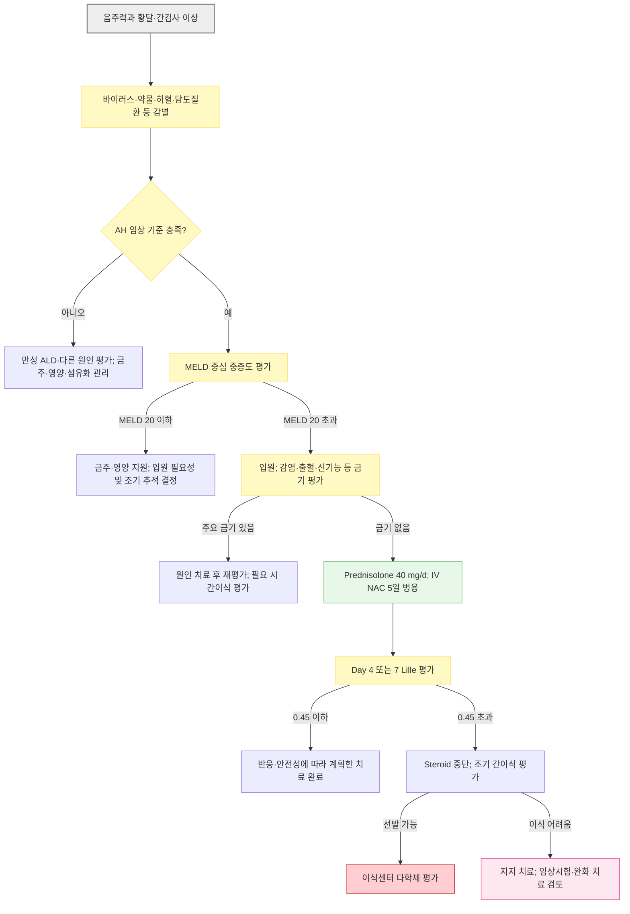

# 알코올 간질환 Alcohol-associated Liver Disease, ALD

## <mark style="color:green;">일반 사항</mark>

* 과다한 알코올 섭취와 관련된 간 손상의 스펙트럼 : 지방증, 알코올 연관 간염(AH), 간섬유화, 간경변증 등이 다양한 조합으로 나타나며 반드시 일정한 순서로 진행하는 것은 아님
* 명칭 : 과거 'Alcoholic Liver Disease'에서 Alcohol-Associated Liver Disease (ALD)로 개칭; 알코올 사용 장애(AUD)와의 통합 관리를 반영\
  ✽ 알코올 간염의 영문 표기도 'alcoholic hepatitis'에서 alcohol-associated hepatitis (AH) 로 통일 권고; KCD 코드(K70.1)는 유지
* 전 세계적으로 진행성 간질환의 가장 흔한 원인이자 간이식의 주요 적응증
* 유병률(미국) : 성인의 약 1%; 주로 40\~50대(대부분 60세 이전 발병); 전통적으로 남성이 다수이나 최근 여성·젊은 층 비율 증가 추세
* 음주 노출과 위험 : 장기간 하루 평균 남성 ＞30 g, 여성 ＞20 g에서도 알코올 관련 간손상이 발생할 수 있음. 이는 ALD를 단독 확진하는 기준이나 2023 SLD 명명법의 ALD 분류 경계가 아니며, 음주력·간손상·다른 원인을 종합하여 진단. 표준잔은 미국 기준 1잔 = 순수 알코올 14 g(약 5% 맥주 355 ㎖, 12% 와인 150 ㎖, 40% 증류주 45 ㎖); 국가별 표준잔과 실제 도수에 주의 <mark style="color:$info;">[Krag 2026]</mark>
* 하루 ＞60 g의 알코올을 섭취하는 사람의 90%에서 수 주 내 지방간 발생; 간경변증은 통상 수십 년의 만성 섭취 후에 발생 (10\~15%, 8\~12년 추적 시 7\~16%)
* 미국 ALD 관련 사망률 : 1999년 인구 10만 명당 6.7명 → 2022년 12.5명으로 증가(2018\~2022년 급가속); ALD가 유럽·미국에서 간이식의 가장 흔한 단일 적응증(2012년 17% → 2023년 41%)\
  ✽ JAMA Review(Krag et al., 2026)
* COVID-19 팬데믹 이후 음주량 증가로 ALD 관련 의료 부담이 급격히 증가; 알코올 섭취 과소보고(과거력 축소 보고)로 실제 유병률은 통계보다 높을 가능성

## <mark style="color:green;">원인 및 위험 인자</mark>

* 음주량·기간 : 음주량과 기간이 증가할수록 위험 상승; 폭음(미국 기준 약 2시간 내 남성 5잔·여성 4잔 이상), 비만·당뇨병 등이 동반되면 위험이 더 커질 수 있음. 특정 수치를 모든 환자에게 안전·위험의 절대 경계로 적용하지 않음
* MetALD(대사이상 동반 알코올 관련 간질환) : **간 지방증 + 심대사 위험인자 ≥1개**와 음주량 여성 주 약 140∼350 g(하루 평균 20∼50 g), 남성 주 약 210∼420 g(하루 평균 30∼60 g)이 함께 있는 SLD. 여성 주 350 g 초과 또는 남성 주 420 g 초과는 ALD 범주로 분류. 대사 요인·알코올·다른 간질환이 함께 간손상에 기여할 수 있음 <mark style="color:$info;">[AGA MetALD 2026]</mark>
* 위 분류 수치는 안전 음주량이 아님. 최근 3개월 이상의 평균, 과거 음주량·폭음 양상을 함께 확인 (☞ [MASLD](093_-nafld.md))
* 여성 : 동일 음주량에서 남성보다 간질환 진행이 빠름 (알코올 대사 속도 차이, 장투과성 증가)
* 유전 : PNPLA3 I148M, TM6SF2 등 유전 변이 - 지방간·간염·간경변증 위험 증가
* 비만 / 인슐린 저항성 : MASLD(대사 지방간질환)와 동반 시 상승 효과
* 만성 바이러스 간염 : HBV, HCV 동반 시 간경변증 및 HCC 위험 대폭 증가
* 영양 불량 : 단백질·비타민(thiamine, 엽산, 아연) 결핍
* 장내 미생물 불균형(Gut dysbiosis) : 장벽 손상 → LPS 유입 → 간 염증 촉진 (병태생리의 핵심)
* 흡연 : 섬유화 진행 가속

## <mark style="color:green;">임상 양상</mark>

* 지방간 : 대부분 무증상; 경미한 우상복부 불편감; 금주 시 가역적 회복
* 알코올 연관 간염(AH) : 최근 발생·악화한 황달을 중심으로 피로, 식욕 부진, 구역, 미열, 우상복부 통증/팽만, 체중 감소, 빈맥, 저혈압, 부종 등이 나타나는 임상 증후군. 무증상일 수 있는 조직학적 알코올성 지방간염과 구분
* 간경변증 : 여성형 유방, 근육 소실, 거미혈관종, 손발바닥 홍반, 복수, 식도 정맥류, 간성 뇌병증, 비장 비대
* ✽ 중증 알코올 간염은 acute-on-chronic liver failure (ACLF) 형태로 발현 가능 - 다장기 부전을 동반하며 단기 사망률이 매우 높아(1개월 20\~50%) 조기 인식과 신속한 중증도 평가가 중요

## <mark style="color:$danger;">🚩 Red Flags!</mark>

<mark style="color:$danger;">**즉각 조치**</mark>

* 의식 혼탁, 지남력 장애, 행동 변화 → 간성 뇌병증  `[간성 뇌병증]`
* GCS ≤8 또는 급격한 의식 저하  `[기도 보호 필요]`
* 대량 상부 위장관 출혈 → 식도·위 정맥류 파열  `[정맥류 출혈]`
* 급성 신손상(AKI) 또는 핍뇨 → 저혈량·패혈증·ATN·HRS-AKI 등 원인 평가  `[급성 신손상]`
* 복수 환자의 발열·복통 또는 전신 상태 악화 → 패혈증·자발성 세균성 복막염 평가; 전형적 증상이 모두 나타나지 않을 수 있음  `[복막염·패혈증]`
* 금단성 경련, 섬망, 심한 초조·환각 또는 불안정한 활력징후 → 응급 평가  `[중증 알코올 금단]`

<mark style="color:$warning;">**당일 평가**</mark>

* 새로 발생·악화한 황달 → 원인 평가; AH 기준을 모두 충족할 때까지 평가를 미루지 않음  `[알코올 연관 간염·담도질환 등]`
* MELD score ＞20 또는 mDF ≥32 → 중증 알코올 간염  `[중증 알코올 간염]`
* 심한 구역·구토 - 경구 수분 및 영양 섭취 불가  `[탈수·영양불량]`
* 새로 발생하거나 악화한 복수·황달 → 비대상화 평가 및 전문의 의뢰  `[간경변 비대상화]`
* 악화하는 금단 증상·심한 진전 → 당일 평가; 경련·섬망·활력징후 불안정 시 응급 의뢰  `[알코올 금단]`

<mark style="color:$info;">**조기 평가 및 추적**</mark>

* 지속적 음주 + AST/ALT 반복 상승  `[지속 간손상]`
* 금주 후 4\~8주 내에 간기능 검사 미호전  `[간검사 추적]`
* 근육 감소·영양불량 → 영양·근감소증 평가와 추적 계획; 새로운 비대상성 사건은 상위 의뢰 단계에 따름  `[영양불량·근감소증]`
* 무증상·안정 상태에서 섬유화 저위험 판정 후에도 지속 음주 시 2\~3년 간격 재선별 고려; 지속적 간검사 이상·음주량 증가·새 증상이 있으면 더 일찍 재평가  `[섬유화 재평가]`


## <mark style="color:green;">진단</mark>

### <mark style="color:orange;">병력 청취</mark>

* 음주 시작 연령, 하루 음주량(표준 잔 환산), 정기적/매일 음주 지속 연수, 음주 종류, 가정 내 음주, 금주 시도력
* [알코올 사용 장애 선별](../230_/189_-alcohol-use-disorder.md#undefined-3) : AUDIT(Alcohol Use Disorders Identification Test) 또는 AUDIT-C 사용 권장 - 구조화되고 비판단적인 방식으로 접근
  * AUDIT-C 고위험 컷오프 : 여성 ≥3점, 남성 ≥4점
  * 전체 AUDIT : ＜8점은 AUD 가능성이 낮지만 **ALD 환자에서는 음주 감소·금주 상담이 필요** / 8\~15점 1차 진료 수준의 단순 개입(brief intervention) / 16\~19점 집중 상담·전문의뢰 고려 / ≥20점 중독전문의 의뢰(AUD 확진을 위한 DSM-5 기준 평가)
* SLD 환자는 최초 평가 후 최소 연 1회 음주력을 재평가하고, AUD 치료 중에는 경과에 따라 더 자주 확인 <mark style="color:$info;">[AGA MetALD 2026]</mark>
* 알코올 섭취는 낙인·문화적 이유로 과소 보고가 매우 흔함 - 자가보고만으로는 부정확할 수 있어 바이오마커 병행 권장
* 최근 음주력 확인 바이오마커 : phosphatidylethanol(PEth, 혈액) - 최근 수주간 음주 노출을 반영하는 유용한 보조 바이오마커(단, 섭취량의 정밀 정량에는 한계); ethyl glucuronide(EtG, 소변)는 최근 5일 이내 음주 검출에 유용; 이 외 EtS, CDT도 활용 가능 - ACG 2024 권고\
  ✽ 검사 전 환자에게 "말하기 어려운 음주를 확인하는 데 도움이 되는 검사"임을 설명하고 치료 결정에 활용됨을 안내


**무증상 고위험군 선별(원발 스크리닝) 흐름 요약** (JAMA Review, Krag et al. 2026 Fig. 2 기반)

과도한 음주력·지속적 간효소 이상(6개월 이상)·영상 지방간 소견·당뇨/비만 중 하나 이상이 있으면 AUD 선별(AUDIT-C→AUDIT)과 섬유화 선별(FIB-4)을 **병렬로** 시행. FIB-4 ＜1.3(65세 이상은 ＜2.0) 저위험 시 지속 음주 환자는 **2\~3년 간격 재선별 고려(간검사 악화·새 증상 시 앞당김)**; FIB-4 ≥1.3(또는 ≥2.0)이면 VCTE 또는 ELF 2차 검사로 진행. 해당 JAMA 경로는 VCTE ＜10 kPa·ELF ＜9.8을 저위험으로 제시하지만, EASL의 ALD 진행성 섬유화 배제 기준은 VCTE ＜8 kPa임. 검사 목적·환자군이 다른 컷오프를 혼용하지 않고, 중간·고위험 또는 임상·검사 불일치 시 전문의 평가 <mark style="color:$info;">[Krag 2026; EASL NIT 2021]</mark>


### <mark style="color:orange;">알코올 연관 간염(AH)의 임상 진단기준</mark>


**NIAAA 기준에 따른 probable AH**

* 최근 **8주 이내 황달 발생**
* 황달 발생 전 최소 6개월 동안 지속적인 과음: 여성 ＞40 g/d, 남성 ＞60 g/d이며 황달 발생 직전 금주 기간이 60일 미만
* 총 빌리루빈 **＞3.0 ㎎/㎗**
* AST **＞50 및 ＜400 IU/L**, AST/ALT **＞1.5**, ALT **＜400 IU/L**
* 허혈성 간염, 약물유발 간손상, 급성 바이러스간염, 담도질환 등 다른 급성 간손상을 시사하는 교란 요인이 없음

위 기준은 조직학적 확진이 아닌 **임상적 probable AH 진단 기준**이다. 기준을 충족하면서 교란 요인이 없으면 간생검 없이 진단할 수 있음. 진단이 불확실하거나 다른 원인이 중복될 가능성이 높고 스테로이드 치료 여부가 진단에 크게 좌우되는 경우에는 경정맥 간생검을 고려함.


### <mark style="color:orange;">실험실 검사</mark>

<table><thead><tr><th width="144.21051025390625">검사 항목</th><th width="256.84210205078125">알코올 간염 특징</th><th>비고</th></tr></thead><tbody><tr><td>AST</td><td>↑, 보통 ＜400 IU/L</td><td>알코올에 의한 미토콘드리아 손상</td></tr><tr><td>AST/ALT 비</td><td>＞1.5가 AH 임상 기준; ≥2이면 더 시사적</td><td>알코올 간염에 시사적 (단독 진단 기준은 아님)</td></tr><tr><td>GGT</td><td>상승할 수 있으나 정상이라고 음주·ALD를 배제하지 못함</td><td>비만·약물·담즙정체에서도 상승; 금주 시 2~3주 내 감소</td></tr><tr><td>ALP</td><td>↑ (통상 정상치 3배 미만)</td><td>담즙정체성 표현형에서는 더 뚜렷하게 상승 가능</td></tr><tr><td>총 빌리루빈</td><td>AH 임상 기준 ＞3 ㎎/㎗; 중증에서는 더 높을 수 있음</td><td></td></tr><tr><td>Albumin</td><td>감소할 수 있음</td><td>간 합성 기능·염증·영양 상태를 함께 반영</td></tr><tr><td>INR</td><td>연장할 수 있음; 중증도 평가에 활용</td><td></td></tr><tr><td>WBC</td><td>↑ (＞12,000; 중증 시 left shift)</td><td>감염과 감별 필요</td></tr><tr><td>빈혈, 혈소판 감소</td><td>흔함</td><td>엽산↓, 비장 비대</td></tr></tbody></table>

* 타 간질환 감별 : HBsAg, 필요 시 anti-HBc IgM, anti-HAV IgM, HCV Ab/RNA, 필요 시 anti-HEV IgM, ANA·ASMA·IgG, 철 대사검사 등을 임상 상황에 따라 시행. AFP는 AH의 감별진단 검사가 아니며 HCC가 의심될 때 별도로 평가
* AST ≥400 IU/L 또는 ALT ≥400 IU/L는 위 probable AH의 전형적 범위를 벗어남. 특히 현저히 상승하면 허혈성·독성·바이러스 간염 등 다른 원인을 적극 감별

### <mark style="color:orange;">영상 검사</mark>

* 복부 초음파 (1차 선택), CT, MRI - 지방간, 간경변증, 복수, 비장 비대 평가
* 간 탄성도 검사(Transient elastography, FibroScan) : 비침습적 섬유화 정량 평가; 급성 간염 시기에는 과대 측정 가능

### <mark style="color:orange;">비침습적 섬유화 평가</mark>

**FIB-4 score**

* (혈청 기반 섬유화 지수)
* $$\text{FIB-4} = \frac{\text{연령(세)} \times \text{AST(U/L)}}{\text{혈소판(10}^9\text{/L)} \times \sqrt{\text{ALT(U/L)}}}$$<br>
* 안정 상태에서 ＜1.3(65세 이상 ＜2.0)은 진행성 섬유화 가능성이 낮음; ＞2.67은 고위험으로 전문의 평가. 35세 미만에서는 정확도가 낮아 임상 위험에 따라 2차 검사 고려
* MetALD는 대사 요인과 알코올이 함께 작용하므로 적극적으로 섬유화 위험을 평가; 단순한 MASLD의 경미한 음주 동반과 구분
* FIB-4 중간값(1.3∼2.67; 65세 이상 2.0∼2.67)에서는 VCTE 또는 ELF로 2차 평가. 간생검은 NIT 불일치·진단 불확실 등 필요한 경우에 선택적으로 고려
* FIB-4의 한계 : 정확도·예측도는 대상군·유병률·활동성 음주 및 혈소판 변화에 따라 달라짐. 낮은 값만으로 섬유화를 완전히 배제할 수 없으며, 임상적 의심이 강하면 2차 검사(VCTE/ELF) 고려
* 활동성 음주·간염은 VCTE 간경직도도 일시적으로 상승시킬 수 있어, 금주·염증 호전 후 임상 경과에 따라 재평가 <mark style="color:$info;">[EASL NIT 2021; AGA MetALD 2026]</mark>
* VCTE 해석 : 안정 상태에서 ＜8 kPa이면 진행성 섬유화 배제에 유용하며, ≥12∼15 kPa이면 위양성 요인을 검토한 뒤 진행성 섬유화를 의심. 간경직도가 높고 AST 또는 GGT가 정상 상한의 2배를 초과하면 최소 1주간 금주·음주 감소 후 재측정을 고려; 중증 AH에서는 급성기 수치로 섬유화 단계를 확정하지 않음 <mark style="color:$info;">[EASL NIT 2021]</mark>
* 급성 알코올 간염 시기에는 FIB-4 사용 주의 : AST·ALT 급상승으로 FIB-4가 위양성으로 매우 높게 나올 수 있어 섬유화 평가 지표로 직접 사용하지 않음. 염증·혈소판 변화가 안정된 뒤 재평가하며, 4\~8주 등 시점은 임상 경과에 따라 개별화

### <mark style="color:orange;">중증도 평가 점수</mark>

* [modified Maddrey's Discriminant Function](https://www.mdcalc.com/calc/56/maddreys-discriminant-function-alcoholic-hepatitis) (mDF)
  * mDF = {4.6 × (PT 환자 − PT 대조; 초)} + 혈청 빌리루빈 (㎎/㎗)
  * ≥32점 시 중증 / 불량 예후. 역사적으로 1개월 사망률이 약 20\~50% 범위로 보고되었으며, 현재는 MELD가 단기 예후와 치료 결정에 우선 사용됨
* AH의 치료 경계값은 주로 **원래 MELD(빌리루빈·INR·크레아티닌)** 연구에 근거함. MELD-Na·MELD 3.0을 같은 점수 경계에 그대로 대입하지 않으며, KONOS 배분 점수의 상한·규칙과 AH 예후 연구의 점수 범위를 구분함
* [MELD score](https://www.konos.go.kr/popup/meldPeldPop.do) (ACG 2024 우선 권고)
  * **＞20 = 중증**; 25\~39 범위에서 corticosteroid 최대 이득; 40\~50에서는 이득이 제한적이고 **＞50에서는 일반적으로 이득이 기대되지 않음**
* [Lille score](https://www.mdcalc.com/calc/2024/lille-model-alcoholic-hepatitis) (steroid 반응 예측)
  * 7일 투여 후 빌리루빈 변화를 바탕으로 계산; ＞0.45 = 비반응 → steroid 중단
  * 4일째 Lille score도 7일째와 유사한 예측력을 보여 조기 중단 판단에 사용할 수 있음 (ACG 2024)
* 간 생검 : 진단 불확실 또는 임상시험 선별 시 고려


**중증도 점수 실전 활용 요약**

**MELD ＞20**을 우선적인 중증 AH 기준으로 사용하며 mDF ≥32는 보조적으로 참고함. 점수가 불일치하면 수치 하나만으로 steroid를 자동 시작하지 않고 진단·감염·신기능·전체 경과를 종합함. ACG 2024는 MELD를 단기 사망률 예측과 corticosteroid 치료 결정에서 mDF보다 우선적인 지표로 권고함.


***



<p align="center"><strong>알코올 연관 간질환 진단 및 치료 알고리듬</strong></p>

***

## <mark style="background-color:$warning;">Management</mark>

### <mark style="color:orange;">치료 원칙</mark>

1. 금주 - 모든 병기에서 가장 중요한 단일 치료; 지방간은 금주만으로 빠르게 회복
2. 영양 지원 - 영양 불량이 합병증·사망률 결정 인자
3. AUD 통합 관리 - 금주 유지를 위한 행동 치료 및 약물 치료 병행 (ACG 2024 강조)

### <mark style="color:orange;">임상 표현형 분류 (Bedside Phenotype)</mark>


알코올 간질환은 다양한 임상 양상과 합병증으로 나타남. 아래 구분은 **공인된 상호배타적 분류체계가 아니라 입원 시 우세한 임상 문제를 정리하기 위한 실무적 구분**임.


<table><thead><tr><th width="161.73681640625">표현형</th><th width="192.3157958984375">주요 임상 단서</th><th width="172.894775390625">특징적 Lab/소견</th><th>우선 처치 방향</th></tr></thead><tbody><tr><td>염증성 (Inflammatory)</td><td>발열, WBC ↑, 황달, CRP ↑</td><td>bilirubin↑↑, AST/ALT ＞1.5</td><td>중증 AH에서 감염·기타 금기 평가 후 steroid 고려</td></tr><tr><td>담즙정체성 (Cholestatic)</td><td>황달 두드러짐, 회복 지연</td><td>direct bilirubin↑↑, ALP/GGT↑</td><td>장기 추적, 담도 질환 감별</td></tr><tr><td>비대상성 간경변증</td><td>복수, 간성 뇌병증, 정맥류 출혈</td><td>albumin↓, INR↑, Na↓</td><td>합병증 치료 + 간이식 평가</td></tr><tr><td>금단 증상 우세</td><td>진전, 불안, 발한, 빈맥</td><td>CIWA-Ar 상승</td><td>benzodiazepine + thiamine 우선</td></tr><tr><td>영양불량/Sarcopenia</td><td>근육 감소, 체중 감소, 쇠약</td><td>albumin↓, zinc↓</td><td>고단백·고칼로리 영양 집중</td></tr><tr><td>감염 동반</td><td>발열, 저혈압, 복통</td><td>procalcitonin↑, lactate↑</td><td>감염 치료 우선, steroid 보류</td></tr><tr><td>간신증후군 (HRS)</td><td>핍뇨, creatinine 상승</td><td>Cr↑, Na↓</td><td>AKI 원인 교정; HRS-AKI이면 albumin + terlipressin(또는 norepinephrine) 고려</td></tr><tr><td>Steroid 비반응 중증</td><td>Lille ＞0.45, 다장기 부전</td><td>MELD↑↑</td><td>조기 간이식 또는 완화 치료</td></tr></tbody></table>

### <mark style="color:orange;">기본 치료</mark>

* 금주 및 금단 증상 치료 (필요시 입원 치료) (☞ [음주](../230_/189_-alcohol-use-disorder.md))
* 입원 기준 : **MELD ＞20 또는 중증 AH**, 간성 뇌병증, AKI/순환부전, 중증 감염 의심, 위장관 출혈, 경구 수분·영양 섭취 불가 등
* 알코올 사용 장애(AUD) 치료 통합 : 행동 치료(동기 강화 면담·인지행동치료 등)와 약물 치료 병행. 금주 유지가 장기 예후의 핵심이며, 관찰연구에서 AUD 약물치료는 간경변 비대상화 위험 감소와 연관됨; 약제별 관찰연구의 OR를 직접 비교하여 우열을 결정하지 않음 <mark style="color:$info;">[ACG 2024]</mark>
  * naltrexone : FDA 승인 AUD 치료제 중 하나; 대상성 간경변증에서는 간기능을 평가하며 신중하게 고려. 급성 AH·비대상성 간경변증에서는 일반적으로 회피하고 전문의 판단. 현재 opioid 사용·의존 또는 급성 opioid 금단 시 사용하지 않음
  * naltrexone 사용 전 opioid 복용·의존 및 향후 opioid 진통 필요성을 확인; opioid 병용·급성 금단 유발 위험에 주의
  * acamprosate : 간 대사 부담이 적은 금주 유지 약제 <mark style="color:blue;">\[명인아캄프로세이트정333mg]</mark>. 국내 허가 적응증은 심리적 상담과 병행하는 **해독 후 금주 유지**이며 해독기간 중에는 사용하지 않음. 해당 품목은 **CrCl ≤30 mL/min, Child-Pugh C 중증 간부전, 임부·임신 가능 여성·수유부, 소아·고령자, 성분 과민반응**에 금기임. 미국의 CrCl 30 초과∼50 mL/min 감량 기준을 국내 허가 용량으로 표기하지 않음 <mark style="color:$info;">[식약처 품목허가정보, 2026-10-26 확인]</mark>
  * disulfiram : FDA 승인이나 간독성 위험으로 **ALD 환자에게는 권장하지 않음**
  * baclofen : 간경변증 환자에서 금주 유지 RCT 근거가 있는 허가 외 AUD 치료 선택지. 신장 배설이므로 신기능 저하 시 축적·진정·신경독성 위험을 평가하고 간성 뇌병증이 있거나 위험이 높으면 특히 신중히 사용. 저용량부터 개별 적정하며 갑자기 중단하지 않음. 2026년 관찰연구에서 acamprosate 대비 간성 뇌병증 위험 증가와 연관되었으나, 무작위 비교 근거는 아니므로 약제 선택은 개별화 <mark style="color:$info;">[ACG 2024; Yeo 2026]</mark>
  * gabapentin : 허가 외 대안으로 선택적으로 고려; 신기능에 따른 감량과 진정·간성 뇌병증 위험을 평가
  * semaglutide(GLP-1 수용체 작용제) : 비만을 동반한 중등도\~중증 AUD 환자 108명을 대상으로 한 2026년 RCT(Lancet)에서 26주 후 heavy drinking days가 위약 대비 13.7%p 더 감소. **AUD 적응증은 미승인**이며 ALD/AH 치료 효과를 입증한 연구가 아니므로 현재는 연구 단계 <mark style="color:$info;">[Klausen 2026]</mark>
* 약물 주의
  * 전신 NSAIDs : 특히 간경변증·복수·신기능 저하 환자에서 회피 - 신손상·위장관 출혈·HRS 위험 증가
  * acetaminophen : 안정적인 간경변증에서는 일반적으로 최대 **2 g/d** 범위에서 우선 고려할 수 있는 전신 진통제. 복합 감기약 등의 중복 성분을 확인. 지속 음주·영양불량·급성 중증 AH에서는 자가 복용을 피하고 의료진이 필요성·용량을 결정 <mark style="color:$info;">[AASLD 증상 관리 2022]</mark>
  * 아미노글리코사이드계 항생제(겐타마이신, 아미카신 등) 가급적 회피 : 간신증후군(HRS) 위험이 높은 ALD 환자에서 신독성이 치명적일 수 있음; 불가피한 경우 혈중 농도 모니터링 및 최단 기간 사용
  * 간독성 약물·건강보조식품·한약 주의

### <mark style="color:orange;">영양 지원</mark>

<table><thead><tr><th width="127.9473876953125">항목</th><th width="198.421142578125">권장 목표</th><th>임상 포인트</th></tr></thead><tbody><tr><td>총 열량</td><td>AH에서 약 35 ㎉/㎏/d</td><td>건체중·영양 상태·비만 여부에 따라 개별화; 재급식 위험 시 점진 증량</td></tr><tr><td>단백질</td><td>1.2~1.5 g/㎏/d</td><td>간성 뇌병증 있어도 제한 불요 - 오히려 근육 소실 악화</td></tr><tr><td>식사 패턴</td><td>소량씩 자주(4~6회/d)</td><td>야간 공복 최소화; late evening snack 적극 권장 (예: 두유 1컵, 삶은 달걀 1\~2개, 단백질 쉐이크, 통밀 크래커 + 치즈)</td></tr><tr><td>Thiamine</td><td>결핍 위험이 높으면 보충</td><td>Wernicke 의심 시 고용량 IV thiamine; 저혈당 치료가 필요한 경우 포도당 투여를 지연하지 않음</td></tr><tr><td>아연</td><td>결핍 시 보충</td><td>결핍 여부·임상 상황에 따라 투여; 장기 고용량은 구리 결핍 주의</td></tr><tr><td>엽산/B 복합제</td><td>보충 권장</td><td>결핍 매우 흔함</td></tr><tr><td>경관 영양</td><td>경구 불가 시 조기 시행</td><td>TPN보다 장관 영양 선호</td></tr></tbody></table>

* 재급식증후군 위험이 있으면 인·칼륨·마그네슘·혈당을 확인하고 thiamine을 조기에 보충하며 영양을 점진적으로 증량
* ALD에서는 비만 + sarcopenia 동반이 흔함 - BMI만으로 영양 상태 판단 불가; 근육량 평가 병행 권장

### <mark style="color:orange;">동반 질환 관리</mark>

* 비만·당뇨병·인슐린 저항성, 영양불량, 흡연, 철 과부하, 바이러스 간염을 함께 평가·치료. ALD에도 심대사 위험인자가 흔히 동반되므로 혈당이 정상이라고 가정하지 않음
* 간경변 단계별 심대사 약물 사용 시 안전성 고려사항 :

<table><thead><tr><th width="110">약물군</th><th width="230">간질환에서의 참고 사항</th><th>실전 포인트</th></tr></thead><tbody><tr><td>Statin</td><td>대상성 간경변증에서 심혈관 적응증에 따라 사용 가능</td><td>비대상성 간경변증에서는 전문의와 위험·이득을 평가하고 약제별 용량·근육/간독성 감시</td></tr><tr><td>GLP-1 RA</td><td>비간경화 MASH의 semaglutide 근거를 ALD/AH 치료 효과와 구분</td><td>T2DM·비만 적응증에 따라 선택; 대상성 간경변증에서도 자료가 제한적이며 탈수·영양·근육량 점검</td></tr><tr><td>SGLT-2 억제제</td><td>대사·심혈관·신장 적응증으로 선택; 일부 MASH 조직학적 연구와 ALD 근거를 구분</td><td>저혈량·AKI·생식기 진균감염·정상혈당 케톤산증 위험 평가; 금식·급성 중증질환 시 보류</td></tr><tr><td>Pioglitazone</td><td>일부 비간경화 MASH에서 조직학적 근거; ALD 치료제가 아님</td><td>T2DM 적응증으로 선택 시 부종·심부전·골절 위험 고려; 간경변증은 전문의 판단</td></tr><tr><td>Metformin</td><td>MASH 조직학적 치료제로 권고하지 않음</td><td>eGFR ＜30에서 사용하지 않으며 급성 중증질환·저산소증·신기능 악화·비대상성 간경변증에서 회피; 조영제 관련 중단은 신기능·검사 조건에 따름</td></tr><tr><td>ACE 억제제/ARB</td><td>고혈압·심혈관/신장 적응증으로 사용</td><td>복수 동반 시 회피 고려; 저혈압·신기능·칼륨 감시</td></tr></tbody></table>

* Resmetirom·semaglutide의 비간경화 MASH 승인 근거는 MetALD에서 정식으로 확립된 치료 근거가 아니므로 그대로 적용하지 않음 <mark style="color:$info;">[AGA MetALD 2026]</mark>

* Nonselective β-blocker(propranolol, carvedilol 등) : CSPH를 동반한 대상성 간경변증에서 **첫 비대상화 및 정맥류 출혈 예방**을 위해 고려; 대상성 간경변증에서는 carvedilol을 우선 고려할 수 있음. 저혈압·AKI 등에서는 용량 조정·보류 여부를 평가 (자세한 적응증·용량은 간경변증 챕터 참조) <mark style="color:$info;">[Baveno VII]</mark>

## <mark style="color:green;">비-약물 치료 및 예방</mark>

* 완전 금주 : 모든 병기에서 가장 중요한 기본 치료이며 장기 예후 개선의 핵심; 지방간은 수주 내 호전 가능
* 금주 지원 : 동기 강화 면담·인지행동치료 등 환자 상황에 맞는 행동 치료를 AUD 약물치료와 병행하고 정신건강의학과·중독의학과와 협력. 효과 크기는 대상군·치료 강도·추적 기간에 따라 다르므로 특정 프로그램의 금주율을 모든 환자에게 적용하지 않음
  * 섬유화 검사 결과는 현재 간 상태를 설명하고 행동 변화를 돕는 상담 자료로 활용할 수 있으나 검사 자체가 금주 치료를 대체하지 않음

* 영양 재활 : 고칼로리·고단백 식사; 결핍 영양소(thiamine, 엽산, 아연) 보충
* 운동 : sarcopenia는 BMI와 무관한 독립적 사망 예측 인자 - 저강도 유산소 + 근력 운동 권장; 심한 간경변증에서는 주치의 지도 아래 시행\
  ✽ **frailty(허약)** 평가도 고려 - handgrip strength 측정, chair stand test 등 간단한 도구로 기능 상태 파악 가능; sarcopenia와 함께 이식 전 평가 및 예후 예측에 활용
* 전신 NSAIDs는 특히 간경변증에서 회피; acetaminophen은 안정 상태에서 의료진과 상의하여 최대 2 g/d 범위로 사용하고 지속 음주·영양불량·급성 간손상에서는 자가 복용을 피함 (상기 참조)
* HAV 및 HBV 예방 접종 : 면역이 없는 만성 간질환 환자에서 시행. 그 외 인플루엔자·폐렴구균·COVID-19·Tdap/파상풍·대상포진 등은 연령 및 위험도에 따른 일반 예방접종 일정에 따름
* 정기 추적 검사 : 간경변증(F4) 시 6개월마다 간초음파 + AFP(HCC 감시); Child-Pugh C이면서 이식·간암 치료 대상이 아닌 경우에는 감시 이득을 개별 판단; F3에서는 모든 환자에게 일률적 감시를 권고하지 않고 개별 HCC 위험에 따라 전문의가 결정. 비대상성 간경변증에서는 정맥류 및 문맥압항진 합병증을 평가
* MetALD 환자(정의는 상기 원인·위험인자 참조)는 대사질환(비만·당뇨)이 동반된 음주자로, FIB-4 등 선별 검사를 더욱 적극적으로 시행 권장; 비만·당뇨 환자를 진료할 때도 반대로 음주력을 체계적으로 확인해야 함 - 그렇지 않으면 MASLD로 오분류되어 알코올 기여분이 간과될 수 있음


## <mark style="color:green;">약물 치료</mark>

### <mark style="color:orange;">Corticosteroid (중증 알코올 간염)</mark>

* 적응증 : **MELD ＞20**인 중증 AH; mDF ≥32는 보조적 기준으로 사용할 수 있음. ACG 2024 기준 MELD 25\~39 범위에서 최대 이득
* 주요 금기/보류 사유 : 조절되지 않은 감염·패혈증, 활동성 위장관 출혈, 중증 신부전/AKI, 조절되지 않는 당뇨병, 치료되지 않은 HBV 감염 등\
  ✽ 감염·출혈·신기능 이상은 원인 치료 후 steroid 재평가 가능하나, 재투여 여부는 위험-이득을 개별적으로 판단


**Steroid 시작 전 감염 평가 필수** : 중증 AH에서는 감염이 무증상·비전형적일 수 있으므로 병력·신체진찰·배양검사·흉부영상 등을 포함한 체계적인 감염 선별을 시행하고, 복수가 있으면 진단적 복수천자로 SBP를 평가함. 검사 범위는 임상 상태에 따라 결정하되 발열이 없다는 이유만으로 감염 선별을 생략하지 않음. 투여 중 감염 징후를 면밀히 모니터링


<table><thead><tr><th width="402.42108154296875">임상 상황</th><th align="center">Prednisolone</th></tr></thead><tbody><tr><td>Severe AH (MELD ＞20) + steroid 금기 없음</td><td align="center">✅ 고려/권장</td></tr><tr><td>감염 치료 완료 후 안정화</td><td align="center">⚠️ 신중 가능</td></tr><tr><td>조절되지 않는 패혈증</td><td align="center">❌ 보류</td></tr><tr><td>활동성 GI 출혈</td><td align="center">❌ 지혈 후 재평가</td></tr><tr><td>중증 AKI / HRS-AKI</td><td align="center">⚠️ 보류 후 원인 치료·재평가</td></tr><tr><td>MELD 25\~39</td><td align="center">✅ 최대 이득</td></tr><tr><td>MELD ＞50</td><td align="center">❌ 일반적으로 이득 기대 어려움</td></tr><tr><td>Lille ≤0.45 (7일 반응)</td><td align="center">✅ 4주 유지</td></tr><tr><td>Lille ＞0.45 (비반응)</td><td align="center">❌ 중단, 간이식 평가</td></tr></tbody></table>

* prednisolone : 40 ㎎/d po × 4주 <mark style="color:blue;">\[소론도]</mark>\
  ✽ 위 용법은 전통적인 고정용량 치료이며, Day 4 또는 7 비반응 시 조기 중단. **4주 치료를 마친 뒤** 중단·감량 방식의 우열을 확정할 근거는 제한적이므로 노출 기간·부신억제 위험·기관 프로토콜에 따라 결정
* methylprednisolone : 32 ㎎/d IV (경구 불가 시; 반응에 따라 최대 4주) <mark style="color:blue;">\[솔루메드롤주]</mark> 등 주사제 사용
* 반응 평가 : **Day 4 또는 Day 7 Lille score** 계산 → Lille ＞0.45 시 지속 이득 가능성이 낮아 **steroid 중단 권고**
  * 비반응 환자는 감염 및 AKI 발생 위험이 특히 높음 - 조기 완화 치료 및 간이식 평가 병행


**치료 중 감량요법의 새로운 근거 — STASH 2025** : 중증 AH 254명에서 prednisolone 40 ㎎/d 4주 유지와, 첫 주 40 ㎎/d 후 매주 10 ㎎/d씩 감량하는 40→30→20→10 ㎎/d 요법을 비교. 90일 감염 발생은 감량군 19.7% vs 고정용량군 33.1%로 감소했으며, 사망률의 유의한 차이는 확인되지 않음. 공개형 시험·환자군 등의 한계가 있어 표준 처방을 일괄 대체하지 않고 전문기관에서 선택적으로 고려. 이는 4주 치료 종료 후 감량 문제와 다름 <mark style="color:$info;">[STASH 2025]</mark>


### <mark style="color:orange;">N-Acetylcysteine (중증, Steroid 병용)</mark>

* ACG 2024는 중증 AH에서 corticosteroid의 보조요법으로 **IV NAC 병용을 강하게 권고**(중등도 근거). 단기 생존 개선 근거가 있으나 장기 생존 이득은 확립되지 않았고, 학회별 권고 차이가 있음 <mark style="color:$info;">[ACG 2024]</mark>
* 5일 IV 투여 : 원 연구는 Day 1에 150 ㎎/㎏을 30분, 50 ㎎/㎏을 4시간, 100 ㎎/㎏을 16시간에 걸쳐 투여하고 Day 2\~5에는 100 ㎎/㎏/d를 투여함. 일부 기관의 첫 주입 1시간 방식은 원 연구와 다른 변형법이므로 기관 프로토콜을 명시 <mark style="color:$info;">[Nguyen-Khac 2011]</mark>
* 주입 과민반응·기관지경련·저혈압 및 수액 과부하에 주의; 복수·저나트륨혈증·신기능 저하 시 희석액·총 수액량을 개별 조정
* **AH에 대한 NAC 병용은 국내 허가 외 사용으로 구분**. 정맥주사 가능한 제형·농도·허가 경로를 확인하여 병원 프로토콜에 따라 사용; 흡입용·경구용 제형으로 대체하지 않음

### <mark style="color:orange;">Steroid 금기 시의 치료 원칙</mark>

* **Pentoxifylline은 현재 중증 AH의 표준 대체치료로 권고하지 않음.** STOPAH에서 28일 사망률 개선이 입증되지 않았고, steroid 비반응 환자의 구제치료로도 효과가 없었음.
* 감염·활동성 위장관 출혈·중증 AKI 등으로 steroid를 시작할 수 없는 경우에는 해당 원인을 우선 치료하고, 영양·금주·AUD 치료를 포함한 지지요법을 시행함.
* 중증 AH이면서 steroid를 사용할 수 없거나 비반응인 경우에는 **조기 간이식 평가**를 적극적으로 고려함.
* FMT, G-CSF 등은 현재 표준치료가 아니며 임상시험 또는 전문센터의 연구적 치료 범위에서 고려함.

### <mark style="color:orange;">신규·연구 단계 치료</mark>

* FMT (대변 미생물 이식) : 초기 소규모 연구와 후속 단일지역 RCT에서 중증 AH 환자의 단기 생존 개선 가능성이 보고되었으나, 표본 규모와 일반화 가능성의 한계가 있음. 현재 국내 임상 표준 치료가 아니며 연구 단계
* IL-1 억제제 : 현재 표준 치료가 아님. 2024년 anakinra+zinc와 prednisone을 비교한 RCT에서는 prednisone군의 90일 생존이 더 양호하고 AKI가 적었음. <mark style="color:$info;">[AlcHepNet 2024]</mark>
* 항산화제 : 독립적 효과 입증 부족


## <mark style="color:green;">시술 및 기타 처치</mark>

### <mark style="color:orange;">간이식 (Liver Transplantation)</mark>

* ALD는 유럽·미국에서 간이식의 가장 흔한 단일 적응증(미국 2023년 전체 간이식 중 41%, 2012년 17%에서 증가); 2023년 미국에서 알코올 관련 간경변 3,505건, 알코올 간염 658건 이식 시행
* MELD 계열 점수는 예후·이식 평가에 활용함. MELD 3.0은 미국 등의 배분체계에 사용되며 국내 KONOS 배분 점수와 동일한 제도로 서술하지 않음. **비대상성 사건(복수, 정맥류 출혈, 간성 뇌병증 등)이 발생하면 MELD와 관계없이 간이식 평가를 의뢰**하고, 비대상성 사건이 없는 경우에도 일반적으로 MELD 약 15 전후부터 평가를 고려함.
* 기존 기준 : 6개월 금주 후 간이식 (전통적 기준)
* 중증 알코올 간염으로 steroid 비반응 시, 6개월 금주 기준 충족 없이도 **엄선된 환자에서 조기 간이식**을 고려할 수 있음. 미국 다기관 조사에서도 많은 이식센터가 6개월 금주기간을 절대적 조건으로 사용하지 않고 조기 이식을 평가하고 있음
  * 조기 이식 코호트 생존율 : 1년 94%, 3년 84%; 엄선된 이식 수혜자 코호트 결과이며 비이식 환자와 단순 직접 비교하지 않음
  * 이식 후 **지속 음주** 누적 발생 : 1년 10%, 3년 17%; **한 차례라도 음주한 경우**는 각각 25%, 34%로 구분함. 지속 음주는 이식 후 사망 증가와 연관됨
* 조기 간이식 선발의 핵심 - 엄격한 다학제 평가 (정신건강의학과 + 중독의학과 + 사회사업팀 필수 협력)
  * 가족/사회적 지지 체계 확인 - 조기 이식 성패를 좌우하는 핵심 요소
  * 재발 위험성 평가 (AUD 중증도, 이전 금주 시도, 사회적 안정성)
  * 이식 후 지속적 금주 지원 계획 수립
* steroid 비반응 환자에서 **4개 이상의 장기 부전이 있고 조기 간이식 대상이 아닌 경우**에는 예후가 매우 불량하므로 완화의료가 적절할 수 있음. 4개 장기 부전 자체를 모든 환자에게 적용하는 절대적 '이식 제외 기준'으로 해석해서는 안 됨.


***

### <mark style="color:red;">질병코드</mark>

K70 알코올성 간질환

K70.0 알코올성 지방간

K70.1 알코올성 간염

K70.2 알코올성 간섬유증 및 경화증

K70.3 알코올성 간경변증

K70.4 알코올성 간부전

K70.9 상세불명의 알코올성 간질환

***

## <mark style="color:purple;">처방례</mark>

> **처방례 1. 알코올 연관 간염 (비중증, MELD ≤20)**
>
> ```
> 티아민(Vitamin B1) 100 ㎎/T  1T qd (식후)
> 비타민B 복합제는 결핍 위험·제품별 함량에 따라 선택 (티아민 중복 확인)
> 엽산 1 ㎎/T                  1T qd (결핍·위험 시; B12 결핍 동반 평가)
> ※ 금주 상담과 AUD·금단 위험 평가 병행; 초기에는 수일 내 조기 재평가 계획
> ※ 안정화 후 경과에 따라 4~8주 등 간검사 추적 간격 조정; 악화 시 즉시 평가
> ※ 영양 불량 동반 시 고칼로리·고단백 경구 영양 보충제 추가
> ```
>
> _✽비중증 AH의 기본 치료: 금주 + 영양 지원 + 결핍 영양소 보충. MELD ≤20에서는 일반적으로 corticosteroid를 사용하지 않음._

> **처방례 2. 알코올 금단 증상 예방·치료 (외래 가능한 경증)**
>
> ```
> [외래 치료는 경증이며 신뢰할 수 있는 보호자·추적관찰이 가능한 경우에 한함]
> Lorazepam은 기관의 단기 금단 프로토콜에 따라 투여
> 예: 1~2 ㎎을 증상 평가 후 투여하고, 반복 여부·최대량·감량 계획을 개별 지정
> ※ 무감시 상태에서 q4~6h 필요 시 처방만으로 관리하지 않음
>
> 티아민 100 ㎎ po qd (경구 섭취 가능한 저위험 외래 환자의 예)
> ※ 영양불량·흡수장애·중증 금단이면 IV/IM 100 ㎎/d × 3~5일 등 비경구 보충 고려
> ※ 24시간 이내 재평가하고 금주·감량 후 초기 최대 5일간 매일 상태 확인 계획
> ※ 증상 기반 투여는 환자·보호자가 척도와 투여 지침을 신뢰성 있게 따를 때 적용
> ※ 중등도 금단(CIWA-Ar 10~18)은 집중 관찰 가능한 전문 외래 또는 입원 평가
> ※ 중증 금단, 경련·섬망, 중대한 내과질환, 불충분한 지지·감시 → 입원 평가
> ※ 간성 뇌병증·의사소통 불가 시 CIWA-Ar만으로 판단하지 않음
> ※ 중증 간질환에서는 diazepam/chlordiazepoxide 등 장시간 작용 benzodiazepine의
>    축적 위험을 고려하여 lorazepam 또는 oxazepam을 우선 고려
> ※ Wernicke 뇌증 의심 → thiamine 200~500 ㎎ IV 2~3회/d 등 고용량 치료
> ```
>
> _✽금단 치료는 간기능·금단 중증도·과거 경련/섬망·감시 역량에 따라 결정함. 증상 기반 투여가 어려우면 의료진이 정한 고정용량·감량 계획과 가까운 추적을 적용하거나 입원함. 음주 병행, 운전 및 다른 진정제 자가 병용을 피함._

> **처방례 3. 중증 알코올 간염 (MELD ＞20, 입원 치료, steroid 금기 없음)**
>
> ```
> [입원 치료]
> Prednisolone 총 40 ㎎/d po  × 28일
> 또는 Methylprednisolone 32 ㎎ IV qd (경구 불가 시)
>
> N-acetylcysteine (NAC) IV  5일:
>   Day 1 - 부하 150 ㎎/㎏ over 30분 (원 연구)
>           → 50 ㎎/㎏ over 4시간
>           → 100 ㎎/㎏ over 16시간
>   Day 2~5 - 100 ㎎/㎏/d
>   ※ ACG 2024는 중증 AH에서 steroid 보조요법으로 IV NAC 병용을 권고
>      장기 생존 이득은 확립되지 않았으며 국내 허가 범위·병원 프로토콜에 따라 시행
>
> 티아민 100 ㎎ IV/IM qd × 3~5일 등 영양결핍 교정
> ※ Wernicke 뇌증 의심 시 별도의 고용량 IV 치료
> ※ 아연은 결핍 또는 임상적 필요가 있는 경우 보충
>
> [Day 4 또는 7] Lille score 계산
>   → Lille ＞0.45 시 steroid 중단 및 조기 간이식 평가
> ※ Day 4에는 단순히 빌리루빈이 감소하지 않았다는 이유만으로 중단하지 않고
>    Lille score를 계산하여 판단
> ※ 감염·AKI·위장관 출혈 등 steroid 관련 위험을 투여 중 면밀히 감시
> ※ 반응 환자의 치료 중 감량요법은 STASH 근거와 기관 프로토콜에 따라 별도 결정
> ```
>
> _✽중증 AH에서는 감염을 평가하고, 활동성 감염·중증 AKI·활동성 위장관 출혈 등 주요 금기가 없을 때 prednisolone을 고려함. 비반응 환자는 조기 간이식 평가와 완화 치료 가능성을 함께 검토함._

### <mark style="color:$success;">핵심 복약 지도</mark>

> **스테로이드(prednisolone)를 처방받으셨나요?**
>
> * **아침 식사 후 한 번** 복용합니다. 공복 복용 시 위장 장애가 생길 수 있습니다.
> * 임의로 중단하거나 용량을 줄이지 마세요. 검사 결과와 치료 반응에 따라 의사가 유지·중단·감량 계획을 정합니다.
> * 복용 중 발열, 오한, 기침, 복통, 배에 물이 차는 느낌이 있으면 **즉시 병원에 연락**하세요 - 감염 합병증 신호일 수 있습니다.
> * 혈당이 오를 수 있으므로 당뇨 환자는 혈당 모니터링을 강화하세요.

> **티아민(Vitamin B1)을 처방받으셨나요?**
>
> * 알코올은 체내 티아민(비타민 B1)을 심하게 고갈시킵니다.
> * 티아민 부족 시 '베르니케 뇌증'(혼란, 눈떨림, 보행 장애)이 발생할 수 있어 복용이 매우 중요합니다.
> * 티아민을 가능한 한 조기에 투여합니다. **저혈당을 교정해야 하는 경우 포도당 투여를 지연해서는 안 됩니다.**

> **아연 보충제를 처방받으셨나요?**
>
> * 공복 복용 시 위장 자극이 있으면 식사와 함께 복용할 수 있습니다. 장기 고용량 복용 시 구리 결핍에 주의합니다.

> **언제 즉시 병원을 방문해야 하나요?**
>
> * 갑작스런 의식 혼탁, 말이 어둔해지는 경우 (간성 뇌병증 가능성) - **즉시 응급실**
> * 검은 변, 선홍색 혈변 또는 피를 토하는 경우 (식도 정맥류 출혈) - **즉시 응급실**
> * 복부가 급격히 팽창하거나 고열이 동반된 경우 (자발성 세균성 복막염)
> * 스테로이드 복용 중 감염 증상이 나타나는 경우

***

### <mark style="color:blue;">환자 안내서</mark>


**알코올 연관 간질환 - 간은 회복될 수 있습니다. 금주가 치료의 시작입니다.**

알코올은 간에 직접 독성을 가집니다. 지방간 단계에서는 금주만으로 간이 빠르게 회복되지만, 알코올 간염이나 간경변증으로 진행되면 회복이 매우 어려워집니다. 지금 멈추는 것이 가장 효과적인 치료입니다.


#### <mark style="color:$primary;">왜 알코올이 간에 해로운가요?</mark>

* 알코올은 간에서 분해될 때 독성 물질(아세트알데히드)을 만들어 간세포를 손상시킵니다.
* 손상이 반복되면 간에 염증(알코올 간염)이 생기고, 결국 딱딱한 흉터 조직(간경변증)으로 변합니다.
* 간경변증이 되면 간암, 복수, 식도 출혈 등 심각한 합병증이 발생할 수 있습니다.

#### <mark style="color:$primary;">금주가 왜 그렇게 중요한가요?</mark>

* **지방간 단계**에서 금주하면 간 지방과 간수치가 수주 내 빠르게 호전될 수 있습니다.
* **알코올 간염** 단계에서도 금주는 회복의 핵심이며, 약 치료의 효과를 높여줍니다.
* **간경변증**에서도 금주하면 더 이상의 진행을 막고 일부 기능 회복이 가능합니다.
* 혼자 금주하기 어려우신 분은 전문의에게 솔직히 말씀해 주세요. 금주를 돕는 약과 상담이 있습니다.

#### <mark style="color:$primary;">일상생활에서 어떻게 관리하나요?</mark>

* 🚫 **완전 금주가 목표입니다.** 혼자 끊기 어렵거나 다시 마셨더라도 숨기지 말고 의료진과 치료를 이어가세요. 과거 금단·경련이 있었거나 매일 많이 마신다면 금주를 시작할 때 의료진의 도움을 받으세요.
* 🥗 **균형 잡힌 식사**를 규칙적으로 드세요. 단백질(살코기, 달걀, 두부)을 충분히 섭취하세요.
* 💊 **처방된 비타민(티아민, 엽산)**을 빠짐없이 복용하세요 - 알코올이 체내 비타민을 고갈시킵니다.
* 💊 **아세트아미노펜(타이레놀류)** : 계속 술을 마시거나 영양 상태가 나쁘거나 급성 간손상이 있으면 스스로 복용하지 말고 의료진과 상의하세요. 간 상태가 안정적이면 의료진이 1일 총 2 g 이하로 사용할 수 있습니다. 감기약·복합 진통제의 중복 성분을 확인하고, 다른 진통제로 임의 교체하지 마세요.
* 🚫 건강 보조 식품, 한약, 각종 간 건강 제품도 의사와 먼저 상의 후 드세요.
* ☀️ **가벼운 걷기 운동**을 매일 30분씩 실천하세요 - 근육을 유지하는 것이 회복에 도움이 됩니다.

#### <mark style="color:$primary;">이런 증상이 나타나면 즉시 병원으로 가세요</mark>

* 🧠 말이 어눌해지거나, 갑자기 멍해지거나, 방향감각을 잃는 경우 → **응급실**
* 🩸 검은 변 또는 피를 토하는 경우 → **응급실**
* 🤒 배가 급격히 부풀어 오르거나 열이 나는 경우 → **당일 진료**
* 💛 눈이나 피부가 노랗게 되는 경우 → **당일 진료**

#### <mark style="color:$primary;">변비를 조심하세요 - 간성 뇌병증의 숨은 유발 요인</mark>

* 간경변증이 있는 분은 변비가 생기면 장내 암모니아가 과다 흡수되어 **간성 뇌병증(의식 혼탁)**이 악화될 수 있습니다.
* 간성 뇌병증이 반드시 음주 때문에만 생기는 것이 아닙니다 - 변비, 감염, 탈수도 흔한 유발 요인입니다.
* 매일 규칙적인 배변을 하도록 노력하시고, 변비가 2\~3일 이상 지속되면 즉시 주치의와 상의하세요.

#### <mark style="color:$primary;">정기 추적 검사가 왜 필요한가요?</mark>

* 간경변증이 있으면 **간암(간세포암)**이 발생할 수 있습니다 - 초기에는 증상이 없어 정기 검사 없이는 발견이 어렵습니다.
* **6개월마다 복부 초음파 + 혈액검사(AFP)**를 받으시면 간암을 조기에 발견할 수 있습니다.
* 식도·위 정맥류 여부를 확인하기 위한 **내시경 검사**도 의사 지시에 따라 정기적으로 받으세요.

***

## <mark style="color:$primary;">주요 참고문헌 및 확인 자료</mark>

### 임상 근거

* Jophlin LL, et al. ACG Clinical Guideline: Alcohol-Associated Liver Disease. Am J Gastroenterol. 2024;119:30–54. — AH 진단·중증도·steroid/NAC·AUD 치료·조기 간이식
  * https://doi.org/10.14309/ajg.0000000000002572
* Krag A, et al. Alcohol-Related Liver Disease: A Review. JAMA. 2026;336(5):413–425. — ALD 위험·단계적 선별·통합 관리
  * https://doi.org/10.1001/jama.2026.12038
* Arab JP, et al. AGA Clinical Practice Update on the Evaluation and Management of Metabolic Dysfunction- and Alcohol-Associated Liver Disease: Expert Review. 2026. — MetALD 분류·음주 재평가·약물 근거의 적용 한계
  * https://doi.org/10.1016/j.cgh.2026.07.027
* EASL. Clinical Practice Guidelines on non-invasive tests for evaluation of liver disease severity and prognosis – 2021 update. — ALD의 간경직도 컷오프와 위양성 해석
  * https://doi.org/10.1016/j.jhep.2021.05.025
* Crabb DW, et al. Standard Definitions and Common Data Elements for Clinical Trials in Patients With Alcoholic Hepatitis: Recommendation From the NIAAA Alcoholic Hepatitis Consortia. Gastroenterology. 2016;150:785–790.
  * https://doi.org/10.1053/j.gastro.2016.02.042
* Nguyen-Khac E, et al. Glucocorticoids plus N-Acetylcysteine in Severe Alcoholic Hepatitis. N Engl J Med. 2011;365:1781–1789. — NAC 주입 원법과 단기·장기 결과
  * https://doi.org/10.1056/NEJMoa1101214
* ASAM. The ASAM Clinical Practice Guideline on Alcohol Withdrawal Management. 2020. — 외래 선택·일일 관찰·증상 기반 및 고정용량 치료 조건
  * https://www.asam.org/quality-care/clinical-guidelines/alcohol-withdrawal-management-guideline
* Kulkarni A, et al. Infections in Standard or Tapered Dose of Prednisolone for Alcohol-Associated Hepatitis: A Randomized Trial (STASH Trial). Am J Gastroenterol. 2025;120:2821–2831. — 치료 중 감량과 감염 위험
  * https://pubmed.ncbi.nlm.nih.gov/40079479/
* Randomized trial of anakinra plus zinc vs. prednisone for severe alcohol-associated hepatitis. J Hepatol. 2024;80:684–693. — IL-1 억제제 병용과 steroid의 비교
  * https://pubmed.ncbi.nlm.nih.gov/38342441/
* Yeo YH, et al. Assessing Major Adverse Liver Outcomes With Baclofen Compared to Acamprosate in Compensated Alcohol-Associated Cirrhosis. Aliment Pharmacol Ther. 2026;63:1673–1684. — 관찰연구의 안전성 신호와 해석 한계
  * https://pubmed.ncbi.nlm.nih.gov/41842890/
* Klausen, et al. Once-weekly semaglutide versus placebo in patients with alcohol use disorder and comorbid obesity: a randomised, double-blind, placebo-controlled trial. Lancet. 2026. — AUD·비만 환자의 음주 감소; ALD/AH 치료 근거와 구분
  * https://pubmed.ncbi.nlm.nih.gov/42070571/
* AASLD. Practice Guidance: Palliative care and symptom-based management in decompensated cirrhosis. Hepatology. 2022. — Acetaminophen 최대 2 g/d와 전신 NSAIDs 회피
  * https://doi.org/10.1002/hep.32378
* de Franchis R, et al. Baveno VII – Renewing consensus in portal hypertension. J Hepatol. 2022. — CSPH에서 첫 비대상화 예방과 NSBB
  * https://doi.org/10.1016/j.jhep.2021.12.022

### 허가·급여 확인 자료

* 식품의약품안전처. 의약품안전나라 - 의약품 품목허가정보. — 국내 제품별 적응증·용법·금기 및 허가 상태 확인; 명인아캄프로세이트정333mg(품목기준코드 201900645) 금기 확인(2026-10-26)
  * https://nedrug.mfds.go.kr/index
* 건강보험심사평가원. 약제 급여기준 및 약제급여목록. — AUD 약제·영양제·주사제 등 국내 급여 범위 확인
  * https://www.hira.or.kr
* FDA/DailyMed. Acamprosate calcium delayed-release tablets prescribing information. — 미국 신장애 금기·감량 기준; 국내 허가사항과 구분
  * https://dailymed.nlm.nih.gov/dailymed/drugInfo.cfm?setid=fe6f754f-62b4-4c86-805d-221332409516
